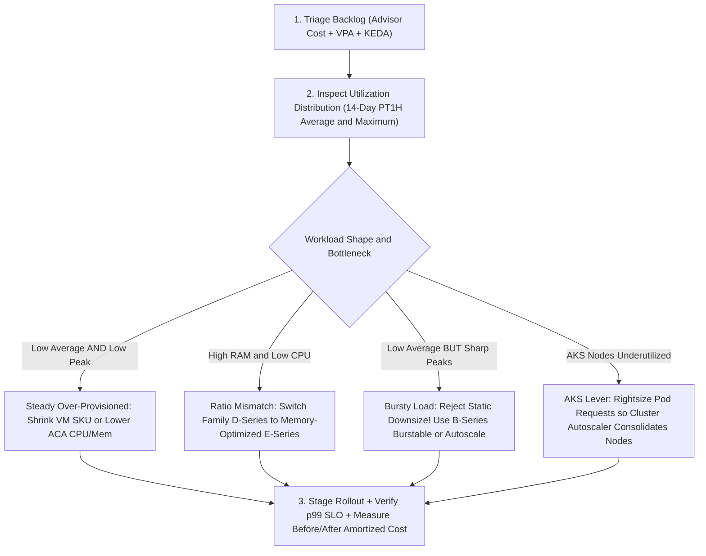
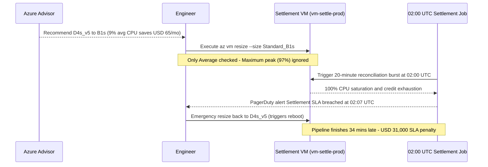

# Rightsizing Compute

> **Prerequisites:** Azure Cost Management & 8–24h data lag (Module 01), Budgets & alerts (Module 02), AKS node pools & Cluster Autoscaler (`07-aks/05`), Container Apps KEDA scaling (`06-azure-container-apps/03`), Observability & SLOs (`12-observability`, `20-sre`).  
> **Estimated Reading Time:** 35 minutes  
> **Target Audience:** Backend Engineers, Platform Engineers, SREs, Kubernetes Administrators.

> [!TIP]
> **The Golden Rule of Rightsizing:** Never rightsize on **average utilization** alone — inspect the **full utilization distribution (`Average`, `p95`, `Maximum`)** across known peak events, change **SKU family** or **autoscaling/burstable capacity** rather than blindly shrinking fixed nodes, and prove every change with **measured before/after daily cost** (Module 01).

---

## Why This Matters

You've entered the **Optimize** phase (module 00), and for most organizations the biggest single lever is embarrassingly simple: they're paying for compute they don't use. Over-provisioned VM SKUs, AKS node pools sized for a load that never came, Container Apps with 4x the CPU they touch — this is the most common and most recoverable waste in any cloud bill. **Rightsizing** is the discipline of matching provisioned capacity to actual demand. But it has a sharp edge that separates real FinOps from naive cost-cutting: a rightsizing recommendation that's *correct on average* can be *catastrophically wrong* for a bursty or spiky workload — and blindly applying Advisor's suggestions is how a \$50/month saving becomes a \$50,000 outage. This module teaches both the mechanics and the judgment.

---

## 1. Architectural Mental Model: Distribution-Driven Compute Rightsizing

Azure Advisor flags low-average compute automatically, but safe rightsizing requires triaging each workload's **distribution shape** (`Average` vs. `Maximum` / `p95`) and choosing the right compute lever across VMs, AKS, and Container Apps:



### Azure Advisor is your automated Optimize backlog

**Azure Advisor** is a free, built-in service that continuously analyzes your resources and emits recommendations across five categories; the **Cost** category is a ready-made **Optimize backlog**. Its cost recommendations typically include: **rightsize or shut down underutilized VMs** (based on observed CPU/network over a lookback window, usually ~7-14 days), **buy reserved instances/savings plans** for steady workloads (module 05), delete **unattached public IPs and idle resources** (module 04 territory), and more. Each recommendation carries an **estimated monthly/annual savings** and an **impact** rating. Advisor is where the Optimize phase gets *concrete* — instead of "we should be more efficient," it's a scored list of specific actions with dollar figures. But — and this is the whole judgment lesson — **Advisor's savings estimate assumes its recommendation is safe to apply, and it doesn't know your workload's *shape* or its *SLOs* (track 20).** It sees average utilization; it can't see the 9am spike or the month-end batch. Treat Advisor as a **backlog to triage**, not a set of commands to run.

### Rightsizing a VM: SKU families, and why "smaller" isn't one axis

Rightsizing a VM means changing its **SKU** to better fit observed usage. Azure VM SKUs come in **families** tuned for different ratios: **general-purpose** (D-series, balanced CPU:memory), **compute-optimized** (F-series, high CPU:memory), **memory-optimized** (E-series, high memory:CPU), **burstable** (B-series, cheap baseline with burst credits — key below), and more. Rightsizing isn't only "go smaller within a family" (e.g. `D4s_v5` → `D2s_v5`, halving vCPU/RAM/cost); it's often "**move to the right family**" — a VM using 80% memory but 10% CPU is wasting money on a balanced D-series and belongs on a memory-optimized E-series, possibly *cheaper* while *better* fit. The mechanics are easy (`az vm resize`); the skill is reading utilization to pick the right family *and* size. Two cautions: resizing usually requires a **reboot/deallocate** (brief downtime — plan it), and not every SKU is available in every region/zone, so a resize can fail on capacity.

### Rightsizing AKS node pools (track 07 callback)

On AKS (track 07), rightsizing operates at two levels, and conflating them is a classic error. **Node-level:** the **VM SKU of the node pool** — the same SKU judgment as above, applied to worker nodes. You can't resize nodes in place; you **add a new node pool** with the right SKU, cordon/drain the old one, and delete it (the safe migration pattern from track 07). **Cluster-level:** the **Cluster Autoscaler** (track 07 module 05) sizes the *number* of nodes to pending pods — so rightsizing here means setting sensible `--min-count`/`--max-count` and, above all, setting **pod resource `requests` correctly**, because the autoscaler and the scheduler bin-pack on *requests*, not actual usage. The subtle, expensive AKS waste: pods with **inflated CPU/memory `requests`** reserve capacity they never use, forcing the autoscaler to add nodes you're paying for to satisfy phantom demand. So AKS rightsizing is often *not* "smaller nodes" but "**honest pod requests**," after which the autoscaler naturally runs fewer nodes. Tools like the **Vertical Pod Autoscaler (VPA)** in *recommendation* mode surface right-sized requests from observed usage — the Kubernetes-native analog of Advisor.

### Rightsizing Container Apps allocations (track 06 callback)

On Azure Container Apps (track 06), you don't manage VMs at all — you set a **CPU/memory allocation per replica** (e.g. 0.5 vCPU / 1 GiB), in fixed valid combinations, and you pay per the vCPU-seconds and GiB-seconds your replicas consume while running. Rightsizing here is **lowering the per-replica allocation to fit actual usage** and, just as importantly, tuning the **KEDA scale rules** (track 06 module 03) — especially **scale-to-zero** (`minReplicas: 0`), the single biggest Container Apps cost lever, so an idle app costs *nothing* instead of holding warm replicas. The interplay matters: an over-generous per-replica allocation multiplied across `maxReplicas` under load is where Container Apps bills add up. Because Container Apps abstracts the node (track 06 vs track 07's hand-managed nodes), rightsizing is *simpler* here — allocation + scale rules — but the same principle holds: match provisioned capacity to real demand, and let it scale to zero when there's no demand at all.

### The bursty-workload trap: when the recommendation is wrong

Here is the judgment that separates FinOps from cost-cutting. Advisor (and any average-utilization tool) computes recommendations from **average or percentile CPU over a lookback window**. A workload with a **low average but sharp bursts** — a payment service quiet all day that spikes at checkout, a batch job that pegs the CPU for 20 minutes at 2am, a Black-Friday retailer — has a *low average* and so gets a "rightsize down" recommendation. **Applying it removes exactly the headroom the burst needs**, causing throttling, latency-SLO breaches (track 20), or an outage precisely when the workload matters most. The saving (\$X/month) is real; the risk (a checkout outage) dwarfs it. The correct FinOps move is not "obey Advisor" and not "ignore Advisor" — it's **look at the utilization *distribution*, not just the average**: the p95/p99 and the peak, the shape over a representative window (including your known peak events). For a genuinely bursty workload, the right answer might be a **burstable B-series** (cheap baseline, bursts on credits) rather than a smaller fixed SKU, or keeping the size but adding **autoscaling** so capacity follows demand — not a static downsize. This is exactly module 00's "value, not just savings," made concrete, and it's this module's diagnose-and-fix.

---

## 2. Taxonomic Comparison & Command Reference

### Azure Compute SKU Families & Platform Rightsizing Matrix

| Compute Target / Family | CPU : Memory Ratio | Best Workload Fit | Primary Rightsizing Lever | Operational Catch |
| :--- | :--- | :--- | :--- | :--- |
| **D-Series (`D2s_v5`, `D4s_v5`)** | Balanced (1:4) | General microservices, web APIs | Step down size or shift to E/F if skewed | Resize across families triggers VM reboot/deallocate |
| **F-Series (`F2s_v2`, `F4s_v2`)** | High CPU (1:2) | Video encoding, math, CPU-bound workers | Move CPU-saturated D-series workloads here | Low RAM ceiling if workload caches in memory |
| **E-Series (`E2s_v5`, `E4s_v5`)** | High Memory (1:8) | Redis, JVM caches, in-memory analytics | Move 80% RAM / 10% CPU D-series VMs here | Often cheaper than paying for unused D-series vCPUs |
| **B-Series (`B2s`, `B2ms`)** | Burstable Credit Model | Spiky internal tools, cron jobs, bursty web | Cheap baseline + CPU credit burst headroom | Exhausting CPU credits throttles to baseline (monitor `CPU Credits Remaining`) |
| **AKS Node Pool + Pods** | Any VM SKU | Multi-tenant containers | Honest pod `requests` + new pool + drain old | Cannot resize node VM SKU in-place; Cluster Autoscaler packs on `requests` |
| **Container Apps (ACA)** | Fixed valid pairs | Event-driven HTTP & queue workers | Lower `--cpu`/`--memory` + `--min-replicas 0` | Cold start latency on scale-from-zero vs warm idle bill |

### Advisor Average vs. Distribution-Based Triage Matrix

| Observed 14-Day CPU Pattern | Naive Advisor Suggestion | Distribution-Aware Decision | Why |
| :--- | :--- | :--- | :--- |
| **Avg: 6%, Max: 14%** | Downsize or Shutdown | **Approve** static downsize (or schedule shutdown) | Headroom remains unused even at peak |
| **Avg: 9%, Max: 96% (20m/day)** | Downsize `D2s_v5` → `B1s` | **Override**: Use `B2s`+, autoscale, or retain capacity | Static shrink starves daily burst and breaches SLO |
| **Avg CPU: 10%, RAM: 85%** | Downsize CPU SKU | **Switch Family** to Memory-Optimized (`E-series`) | Smaller balanced SKU causes OOM kills |

### Command Reference

Advisor and utilization metrics are **free** to read. `az vm resize` and node-pool changes affect real (billable) resources — the exercises keep them tiny and clean them up.

| Command | What it does | Example |
|---|---|---|
| `az advisor recommendation list --category Cost` | Lists cost recommendations with estimated savings (the Optimize backlog) | `az advisor recommendation list --category Cost -o table` |
| `az vm list-sizes` / `az vm list-skus` | Shows available SKUs (and their vCPU/RAM) in a region — for picking a target size/family | `az vm list-skus -l eastus --resource-type virtualMachines -o table` |
| `az vm resize` | Changes a VM's SKU (rightsize); usually requires reboot/deallocate | see breakdown below |
| `az monitor metrics list` | Pulls a VM's CPU/utilization metrics — read the *distribution*, not just the average | see breakdown below |
| `az aks nodepool add` / `delete` | Adds a right-SKU node pool / removes the old one (AKS rightsizing, track 07) | `az aks nodepool add -g <rg> --cluster-name <c> -n right --node-vm-size Standard_D2s_v5 --node-count 2` |
| `az containerapp update --cpu --memory` | Changes a Container App's per-replica allocation (track 06) | `az containerapp update -n app -g rg --cpu 0.5 --memory 1.0Gi` |
| `az containerapp update --min-replicas 0` | Enables scale-to-zero (the biggest Container Apps lever, track 06) | `az containerapp update -n app -g rg --min-replicas 0 --max-replicas 5` |

Flag breakdown — `az vm resize --resource-group rg-app --name vm-web --size Standard_B2s`:

- `--name vm-web` — the VM to rightsize.
- `--size Standard_B2s` — the **target SKU**. Here a **burstable B-series** — chosen deliberately for a low-average/bursty workload so it keeps a cheap baseline but can burst on credits, instead of a fixed smaller SKU that would starve the burst. Verify availability with `az vm list-skus -l <region>` first.
- (implicit) resizing across some SKU families forces a **deallocate/reboot** — plan the brief downtime; the command may stop/start the VM.

Flag breakdown — read the utilization *distribution* before trusting a recommendation:

```bash
az monitor metrics list \
  --resource $(az vm show -g rg-app -n vm-web --query id -o tsv) \
  --metric "Percentage CPU" \
  --start-time 2026-07-10T00:00:00Z --end-time 2026-07-24T00:00:00Z \
  --interval PT1H \
  --aggregation Average Maximum \
  -o table
```

- `--metric "Percentage CPU"` — the utilization signal Advisor also uses.
- `--start-time`/`--end-time` — a **representative window** (here ~2 weeks); include a known peak event if you have one, or Advisor's blind spot becomes yours.
- `--interval PT1H` — hourly buckets; fine-grained enough to reveal spikes an average would hide.
- `--aggregation Average Maximum` — **the whole point**: pull `Maximum` alongside `Average` so you can see the peaks. A 12% average with a 95% max is a bursty workload Advisor will wrongly tell you to shrink.

---

## 3. Production War Story Post-Mortem: The \$65/Month Advisor Downsize That Outaged Nightly Settlement

| Field | Incident Details |
| :--- | :--- |
| **Severity** | **SEV-1** (Nightly Settlement Pipeline Timeout & Partner SLA Breach) |
| **Detection / Resolution Time** | Detected 7 minutes into 02:00 UTC batch run / Resolved in 34 minutes |
| **Impact** | Blindly applying Advisor's `Standard_D4s_v5` → `Standard_B1s` recommendation saved \$65/month on paper but starved a 20-minute nightly settlement burst (9% daily avg, 97% peak), causing \$31,000 in delayed settlement penalties |

### What Happened

Azure Advisor flagged the settlement worker VM (`vm-settle-prod`) as underutilized because its 14-day average CPU sat at 9%. An engineer auto-applied the suggestion (`az vm resize --size Standard_B1s`) without pulling `Maximum` hourly buckets or checking known batch schedules. At 02:00 UTC, the nightly settlement reconciliation spiked CPU demand; `B1s` had only 1 vCPU and insufficient baseline/credit headroom, throttling execution past the 02:30 UTC partner cutoff.



### Root Cause Analysis

1. **Averaging hides burst shape**: Advisor's 14-day average smoothed out a critical 20-minute nightly peak (`Average: 9%`, `Maximum: 97%`).
2. **Missing SLO & reboot verification**: No check existed linking the VM to the 02:00 UTC settlement SLO or accounting for CPU credit ceilings on `B1s`.

### The Fix & Architectural Hardening

- Standardized a mandatory **Distribution PR Gate**: every rightsizing change must attach 14-day `PT1H` `Average` and `Maximum` CPU metrics (plus memory utilization) covering at least one known peak cycle.
- Migrated the batch runner to a **scale-to-zero Container App Job / VMSS** that provisions 4 vCPUs for the 20-minute 02:00 UTC window and bills \$0 the other 23.6 hours — achieving *greater* savings safely.

---

## 4. Multi-Language Production Implementation: Distribution-Aware Rightsizing Evaluator

These four implementations fetch or analyze hourly `Percentage CPU` timeseries (`Average` and `Maximum`) from Azure Monitor (`2023-10-01`) alongside memory/burstable thresholds, automatically separating genuinely idle resources from **bursty-peak traps** where static downsizing would breach SLOs.

````carousel
```go
package rightsizing

import (
	"context"
	"encoding/json"
	"fmt"
	"net/http"
	"net/url"
	"time"

	"github.com/Azure/azure-sdk-for-go/sdk/azcore/policy"
	"github.com/Azure/azure-sdk-for-go/sdk/azidentity"
)

type MetricPoint struct {
	Average float64
	Maximum float64
}

type TriageDecision string

const (
	DecisionSafeDownsize     TriageDecision = "SAFE_STATIC_DOWNSIZE"
	DecisionRejectBurstyPeak TriageDecision = "REJECT_STATIC_DOWNSIZE_USE_BURSTABLE_OR_AUTOSCALE"
	DecisionKeepCurrent      TriageDecision = "KEEP_CURRENT_OR_SWITCH_FAMILY"
)

// EvaluateDistribution guards against Advisor's average-utilization trap.
func EvaluateDistribution(points []MetricPoint) (TriageDecision, float64, float64) {
	if len(points) == 0 {
		return DecisionKeepCurrent, 0, 0
	}
	var sumAvg, globalMax float64
	for _, p := range points {
		sumAvg += p.Average
		if p.Maximum > globalMax {
			globalMax = p.Maximum
		}
	}
	meanAvg := sumAvg / float64(len(points))

	if meanAvg < 20.0 && globalMax >= 75.0 {
		return DecisionRejectBurstyPeak, meanAvg, globalMax
	}
	if meanAvg < 20.0 && globalMax < 40.0 {
		return DecisionSafeDownsize, meanAvg, globalMax
	}
	return DecisionKeepCurrent, meanAvg, globalMax
}

// FetchHourlyCPU pulls 14-day PT1H Average and Maximum Percentage CPU from Azure Monitor.
func FetchHourlyCPU(ctx context.Context, resourceID, timespanISO string) ([]MetricPoint, error) {
	cred, err := azidentity.NewDefaultAzureCredential(nil)
	if err != nil {
		return nil, err
	}
	tok, err := cred.GetToken(ctx, policy.TokenRequestOptions{Scopes: []string{"https://management.azure.com/.default"}})
	if err != nil {
		return nil, err
	}

	q := url.Values{}
	q.Set("api-version", "2023-10-01")
	q.Set("metricnames", "Percentage CPU")
	q.Set("timespan", timespanISO)
	q.Set("interval", "PT1H")
	q.Set("aggregation", "Average,Maximum")

	endpoint := fmt.Sprintf("https://management.azure.com%s/providers/Microsoft.Insights/metrics?%s", resourceID, q.Encode())
	req, err := http.NewRequestWithContext(ctx, http.MethodGet, endpoint, nil)
	if err != nil {
		return nil, err
	}
	req.Header.Set("Authorization", "Bearer "+tok.Token)

	resp, err := (&http.Client{Timeout: 15 * time.Second}).Do(req)
	if err != nil {
		return nil, err
	}
	defer resp.Body.Close()

	if resp.StatusCode != http.StatusOK {
		return nil, fmt.Errorf("monitor metrics HTTP %d", resp.StatusCode)
	}

	var raw struct {
		Value []struct {
			Timeseries []struct {
				Data []struct {
					Average *float64 `json:"average"`
					Maximum *float64 `json:"maximum"`
				} `json:"data"`
			} `json:"timeseries"`
		} `json:"value"`
	}
	if err := json.NewDecoder(resp.Body).Decode(&raw); err != nil {
		return nil, err
	}

	var points []MetricPoint
	if len(raw.Value) > 0 && len(raw.Value[0].Timeseries) > 0 {
		for _, d := range raw.Value[0].Timeseries[0].Data {
			if d.Average != nil && d.Maximum != nil {
				points = append(points, MetricPoint{Average: *d.Average, Maximum: *d.Maximum})
			}
		}
	}
	return points, nil
}
```
<!-- slide -->
```typescript
import { DefaultAzureCredential } from "@azure/identity";

export type TriageOutcome =
  | "SAFE_STATIC_DOWNSIZE"
  | "REJECT_BURSTY_USE_B_SERIES_OR_AUTOSCALE"
  | "KEEP_OR_CHANGE_FAMILY";

export interface DistributionAnalysis {
  meanAverageCpu: number;
  peakMaximumCpu: number;
  decision: TriageOutcome;
}

export async function analyzeVmCpuDistribution(
  vmResourceId: string,
  timespanIso: string
): Promise<DistributionAnalysis> {
  const { token } = await new DefaultAzureCredential().getToken(
    "https://management.azure.com/.default"
  );

  const params = new URLSearchParams({
    "api-version": "2023-10-01",
    metricnames: "Percentage CPU",
    timespan: timespanIso,
    interval: "PT1H",
    aggregation: "Average,Maximum",
  });

  const url = `https://management.azure.com${vmResourceId}/providers/Microsoft.Insights/metrics?${params}`;
  const resp = await fetch(url, { headers: { Authorization: `Bearer ${token}` } });
  if (!resp.ok) {
    throw new Error(`Azure Monitor query failed: ${resp.status}`);
  }

  const body = (await resp.json()) as {
    value?: Array<{ timeseries?: Array<{ data?: Array<{ average?: number; maximum?: number }> }> }>;
  };

  const buckets = (body.value?.[0]?.timeseries?.[0]?.data ?? []).filter(
    (d) => typeof d.average === "number" && typeof d.maximum === "number"
  );

  if (buckets.length === 0) {
    return { meanAverageCpu: 0, peakMaximumCpu: 0, decision: "KEEP_OR_CHANGE_FAMILY" };
  }

  const meanAverageCpu =
    buckets.reduce((sum, b) => sum + (b.average ?? 0), 0) / buckets.length;
  const peakMaximumCpu = Math.max(...buckets.map((b) => b.maximum ?? 0));

  let decision: TriageOutcome = "KEEP_OR_CHANGE_FAMILY";
  if (meanAverageCpu < 20 && peakMaximumCpu >= 75) {
    decision = "REJECT_BURSTY_USE_B_SERIES_OR_AUTOSCALE";
  } else if (meanAverageCpu < 20 && peakMaximumCpu < 40) {
    decision = "SAFE_STATIC_DOWNSIZE";
  }

  return {
    meanAverageCpu: Number(meanAverageCpu.toFixed(2)),
    peakMaximumCpu: Number(peakMaximumCpu.toFixed(2)),
    decision,
  };
}
```
<!-- slide -->
```python
import requests
from azure.identity import DefaultAzureCredential


def triage_vm_rightsizing(vm_resource_id: str, timespan_iso: str) -> dict:
    """Pull hourly Average + Maximum CPU and guard against bursty downsize traps."""
    token = DefaultAzureCredential().get_token("https://management.azure.com/.default").token
    url = f"https://management.azure.com{vm_resource_id}/providers/Microsoft.Insights/metrics"
    params = {
        "api-version": "2023-10-01",
        "metricnames": "Percentage CPU",
        "timespan": timespan_iso,
        "interval": "PT1H",
        "aggregation": "Average,Maximum",
    }

    resp = requests.get(
        url,
        params=params,
        headers={"Authorization": f"Bearer {token}"},
        timeout=20,
    )
    resp.raise_for_status()

    value = resp.json().get("value", [])
    data = value[0]["timeseries"][0]["data"] if value and value[0].get("timeseries") else []
    valid = [d for d in data if "average" in d and "maximum" in d]

    if not valid:
        return {"decision": "INSUFFICIENT_TELEMETRY", "mean_avg": 0.0, "peak_max": 0.0}

    mean_avg = sum(d["average"] for d in valid) / len(valid)
    peak_max = max(d["maximum"] for d in valid)

    if mean_avg < 20.0 and peak_max >= 75.0:
        decision = "REJECT_BURSTY_USE_B_SERIES_OR_AUTOSCALE"
    elif mean_avg < 20.0 and peak_max < 40.0:
        decision = "SAFE_STATIC_DOWNSIZE"
    else:
        decision = "KEEP_OR_CHECK_MEMORY_FAMILY"

    return {
        "decision": decision,
        "mean_avg": round(mean_avg, 2),
        "peak_max": round(peak_max, 2),
    }
```
<!-- slide -->
```csharp
using System;
using System.Collections.Generic;
using System.Linq;
using System.Net.Http;
using System.Net.Http.Headers;
using System.Text.Json;
using Azure.Core;
using Azure.Identity;

public enum RightsizingDecision
{
    SafeStaticDownsize,
    RejectBurstyUseBurstableOrAutoscale,
    KeepOrCheckMemoryFamily
}

public sealed record DistributionReport(double MeanAverageCpu, double PeakMaximumCpu, RightsizingDecision Decision);

public static class RightsizingDistributionAuditor
{
    private static readonly HttpClient Http = new() { Timeout = TimeSpan.FromSeconds(20) };

    public static async Task<DistributionReport> AnalyzeAsync(
        string vmResourceId,
        string timespanIso,
        CancellationToken ct = default)
    {
        var token = await new DefaultAzureCredential().GetTokenAsync(
            new TokenRequestContext(["https://management.azure.com/.default"]), ct);

        var url = $"https://management.azure.com{vmResourceId}/providers/Microsoft.Insights/metrics" +
                  $"?api-version=2023-10-01&metricnames=Percentage%20CPU" +
                  $"&timespan={Uri.EscapeDataString(timespanIso)}&interval=PT1H&aggregation=Average,Maximum";

        using var req = new HttpRequestMessage(HttpMethod.Get, url);
        req.Headers.Authorization = new AuthenticationHeaderValue("Bearer", token.Token);

        using var resp = await Http.SendAsync(req, ct);
        resp.EnsureSuccessStatusCode();

        using var doc = JsonDocument.Parse(await resp.Content.ReadAsStringAsync(ct));
        var avgs = new List<double>();
        var maxes = new List<double>();

        var buckets = doc.RootElement.GetProperty("value")[0]
            .GetProperty("timeseries")[0]
            .GetProperty("data");

        foreach (var point in buckets.EnumerateArray())
        {
            if (point.TryGetProperty("average", out var avg) && point.TryGetProperty("maximum", out var max))
            {
                avgs.Add(avg.GetDouble());
                maxes.Add(max.GetDouble());
            }
        }

        if (avgs.Count == 0)
            return new DistributionReport(0, 0, RightsizingDecision.KeepOrCheckMemoryFamily);

        double meanAvg = avgs.Average();
        double peakMax = maxes.Max();

        var decision = (meanAvg < 20.0 && peakMax >= 75.0)
            ? RightsizingDecision.RejectBurstyUseBurstableOrAutoscale
            : (meanAvg < 20.0 && peakMax < 40.0)
                ? RightsizingDecision.SafeStaticDownsize
                : RightsizingDecision.KeepOrCheckMemoryFamily;

        return new DistributionReport(Math.Round(meanAvg, 2), Math.Round(peakMax, 2), decision);
    }
}
```
````

---

## 5. Practical Hands-On Verification CLI Workflows

Advisor and metrics are free. The VM/Container App exercises create small, short-lived billable resources — clean them up. Advisor's lookback means brand-new resources won't have recommendations yet; use *existing* resources where you can.

1. **Pull your cost recommendation backlog.** Run:
   ```bash
   az advisor recommendation list --category Cost -o table
   ```

   **Expected Output:**
   ```text
   Category    Impact    Problem                                   Resource Name
   ----------  --------  ----------------------------------------  ---------------
   Cost        High      Right-size or shutdown underutilized VMs  vm-api-staging
   Cost        Medium    Buy a reserved virtual machine instance   vm-prod-core
   ```
   > Verify: Add the `advisor` extension if prompted. Read the estimated savings and impact. This is your Optimize to-do list — but a *backlog to triage*, not a script to run.

2. **Inspect one recommendation in detail.** Pick the highest-savings rightsizing recommendation and run:
   ```bash
   az advisor recommendation list --category Cost --query "[?contains(shortDescription.solution,'right')]" -o json
   ```
   Note the target resource and the *assumed* saving. Write down: what does Advisor *not* know about this workload?

3. **Read a VM's utilization distribution.** For a real VM (or a small one you create), run the `az monitor metrics list` query from the command reference with `--aggregation Average Maximum`:
   ```bash
   az monitor metrics list \
     --resource $(az vm show -g rg-app -n vm-web --query id -o tsv) \
     --metric "Percentage CPU" \
     --start-time 2026-07-10T00:00:00Z --end-time 2026-07-24T00:00:00Z \
     --interval PT1H \
     --aggregation Average Maximum \
     -o table
   ```

   **Expected Output:**
   ```text
   Timestamp                 Average    Maximum    Unit
   ------------------------  ---------  ---------  -------
   2026-07-24T01:00:00+00:00 7.42       12.10      Percent
   2026-07-24T02:00:00+00:00 11.15      96.40      Percent
   ```
   > Verify: Compare the average CPU to the maximum. Write both down — the gap between them (e.g., 11.15% average vs. 96.40% maximum) is the whole rightsizing judgment.

4. **Rightsize a VM down within a family.** Create a small VM, then resize it:
   ```bash
   az group create -n rg-rightsize -l eastus
   az vm create -g rg-rightsize -n vm-demo --image Ubuntu2204 --size Standard_D2s_v5 \
     --admin-username azureuser --generate-ssh-keys --no-wait
   # ...wait for provisioning, then rightsize down:
   az vm resize -g rg-rightsize -n vm-demo --size Standard_B1s
   az vm show -g rg-rightsize -n vm-demo --query "hardwareProfile.vmSize" -o tsv
   ```

   **Expected Output:**
   ```text
   Standard_B1s
   ```
   > Verify: Note the resize triggered a deallocate/reboot, and compare the two SKUs' hourly prices (portal or `az vm list-skus`). This is the mechanic; the judgment is next.

5. **Choose a family, not just a size.** Using `az vm list-skus`, compare a general-purpose `D2s_v5`, a burstable `B2s`, and a memory-optimized `E2s_v5` on vCPU/RAM:
   ```bash
   az vm list-skus -l eastus --resource-type virtualMachines \
     --query "[?name=='Standard_D2s_v5'||name=='Standard_B2s'||name=='Standard_E2s_v5'].{name:name, vCPU:capabilities[?name=='vCPUs'].value|[0], ramGB:capabilities[?name=='MemoryGB'].value|[0]}" \
     -o table
   ```

   **Expected Output:**
   ```text
   Name             vCPU    RamGB
   ---------------  ------  -------
   Standard_B2s     2       4
   Standard_D2s_v5  2       8
   Standard_E2s_v5  2       16
   ```
   > Verify: Write down which you'd pick for: a steady 80%-CPU service (`D2s_v5` or `F2s_v2`), a low-average bursty web app (`B2s`), and a memory-hungry cache (`E2s_v5`). The answer is rarely "the smallest."

6. **Rightsize a Container App allocation and enable scale-to-zero (track 06).** If you have a Container App from track 06 (or make a trivial one), lower its allocation and let it scale to zero:
   ```bash
   az containerapp update -n <app> -g <rg> --cpu 0.25 --memory 0.5Gi
   az containerapp update -n <app> -g <rg> --min-replicas 0 --max-replicas 5
   ```
   Note that `--min-replicas 0` means an idle app bills **nothing** — the single biggest lever on Container Apps (track 06 module 03's KEDA scaling, now framed as cost).

7. **(AKS, design or real) Rightsize via honest pod requests.** Reason through (or, if you have a cluster up, demonstrate) the AKS lever: a Deployment with `requests: cpu: 1000m` that actually uses `50m` forces the autoscaler to reserve 20x the CPU it needs, adding nodes you pay for. Lower the request to a realistic value and observe (or explain) the autoscaler consolidating onto fewer nodes. Write the one-sentence rule: *the autoscaler bin-packs on requests, not usage.*

8. **Measure impact before/after (the capstone skill).** For the VM you resized in exercise 4, capture its **daily cost before** (module 01 Cost Analysis on that resource/RG over the prior week) and its **daily cost after** (over the following days — remember the 8-24h lag, so this spans two sessions). Write down the measured delta. "We rightsized" is a claim; "we cut this VM from \$X to \$Y/day, measured" is FinOps. The capstone requires exactly this before/after.

9. **Diagnose and fix: the wrong recommendation for a bursty workload.** The judgment exercise. Take a VM (real or hypothetical) that Advisor says to downsize from `D2s_v5` to `B1s` for a \$Z/month saving. Pull its CPU with `--aggregation Average Maximum` over a window **including a peak**: suppose the **average is 9%** but the **maximum is 96%** (a spike at checkout / a nightly batch). **Diagnose:** the recommendation is computed from the *average* and is **wrong** — `B1s` would throttle during the spike, breaching a latency SLO (track 20) and risking an outage worth far more than \$Z. **Fix, three correct options:** (a) keep the size and add **autoscaling** so capacity follows the burst; (b) move to a **burstable B-series sized for the burst** (`B2s`+), whose credit model *is* built for low-average/spiky loads, rather than a fixed tiny SKU; (c) accept the recommendation only after confirming the peak is genuinely gone. The wrong fix is applying Advisor's number blindly. Lesson: **rightsize on the utilization *distribution* (p95/max/peak events), never the average — a saving that risks an outage is a FinOps failure (module 00).**

10. **Clean up.**
    ```bash
    az group delete -n rg-rightsize --yes --no-wait
    az group show -n rg-rightsize -o table
    ```
    Delete any Container App/AKS resources you spun up unless a later module needs them. Confirm with `az group show -n rg-rightsize -o table` (gone).

### Independent challenge

No commands given. Drawing on this module, Azure Advisor, the metric-reading from **track 12** (observability), your AKS knowledge from **track 07** (node pools, autoscaler) and Container Apps from **track 06** (allocations, KEDA), and the before/after measurement discipline from **module 01**, produce a **rightsizing proposal** for three real (or realistic) workloads on your subscription: one VM, one AKS node pool *or* pod-request fix, and one Container App. For each, state the **observed utilization distribution** (average *and* peak/p95, not just average), the **recommended change** (target SKU/family, node count, allocation, or request value — with justification), the **estimated saving**, and — mandatory — the **risk and how you'd de-risk it** (SLO check, autoscaling, burstable SKU, staged rollout). Include at least one workload where the *naive* recommendation is **wrong** and you override it, explaining why in business terms. The deliverable is the written proposal with the exact metric queries backing each utilization claim.

<details>
<summary>Stuck? One hint</summary>

Start every workload from `az monitor metrics list --aggregation Average Maximum` (or the Container Apps / AKS equivalent), over a window that *includes* a known peak — the peak is the thing Advisor can't see and the thing that determines whether the recommendation is safe. For the "wrong recommendation" workload, pick something with an obvious spike shape (a checkout service, a nightly batch, a cron-triggered job): its low average will earn a downsize recommendation that its high peak makes dangerous. The de-risk move is almost always one of three: **autoscale** so capacity tracks demand (HPA/Cluster Autoscaler from track 07, KEDA from track 06), choose a **burstable B-series** whose credit model fits a spiky load, or **stage** the change and watch the SLO (track 20) before committing. The saving is the easy half; the risk column is where the FinOps judgment lives.

</details>

---

## 6. Common Mistakes & Troubleshooting

- **Applying Advisor recommendations blindly.** Advisor sees *average* utilization, not your workload's shape or SLOs. Its estimate assumes the change is safe. Triage the backlog against the utilization *distribution* — never auto-apply.
- **Reading the average and ignoring the peak.** A 10% average with a 95% max is a bursty workload a downsize would break. Always pull `Maximum`/p95 alongside `Average` over a window that includes known peaks.
- **Thinking rightsizing means "one size smaller."** Often the win is a *different family* (memory-optimized for a memory-heavy VM, burstable for a spiky one) — sometimes cheaper *and* better-fitting than a smaller same-family SKU.
- **Trying to resize AKS nodes in place.** You can't — add a new right-SKU node pool, cordon/drain, and delete the old one (track 07's safe migration).
- **Chasing node count instead of fixing pod requests.** The autoscaler bin-packs on **requests**, not usage. Inflated requests reserve phantom capacity and add nodes you pay for; honest requests are the real AKS lever.
- **Forgetting scale-to-zero on Container Apps.** `minReplicas: 0` makes an idle app free (track 06). Leaving a warm replica running 24/7 for a rarely-used app is pure waste.
- **Claiming savings without measuring them.** "We rightsized" is not a result. Capture before/after daily cost (module 01) across the data lag — the measured delta is the deliverable (and a capstone requirement).
- **Ignoring the reboot/capacity cost of a resize.** `az vm resize` can force a deallocate/reboot and can fail if the target SKU is unavailable in the region/zone. Plan the downtime and check availability first.

---

## 7. Operational Validation Checkpoints & Checkpoint Quiz

### Operational Validation Checkpoints

<details><summary><strong>Checkpoint 1: Triage of a 10% average CPU Advisor recommendation</strong></summary>

Before resizing down, query `az monitor metrics list --interval PT1H --aggregation Average Maximum` over at least 14 days covering known business peaks (or batch windows). If `Maximum` reaches >75–90% during bursts, reject a fixed smaller SKU and instead adopt burstable `B-series` capacity or horizontal autoscaling.

</details>

<details><summary><strong>Checkpoint 2: Why shrinking AKS node VM sizes didn't reduce node count</strong></summary>

Kubernetes Cluster Autoscaler and the scheduler allocate nodes based on Pod **`requests`**, not real-time container utilization. Shrinking node VM size while pods still carry inflated `requests` (e.g., `1000m` requested for `50m` used) forces the autoscaler to spin up *more* smaller nodes; fix pod `requests` first via VPA recommendations, then let autoscaler consolidate nodes.

</details>

<details><summary><strong>Checkpoint 3: Proving a rightsizing win after deployment</strong></summary>

Resizing a VM or tuning Container Apps `--min-replicas 0` does not instantly change Cost Analysis because usage metrics lag 8–24 hours. Record a 7-day `AmortizedCost` daily average baseline before the change, wait 48–72 hours post-change, and verify the measured daily dollar drop alongside clean p99 latency SLOs.

</details>

### Checkpoint quiz

Write down your answer to each question before expanding it — checking without attempting first is the single easiest way to fool yourself into thinking you've learned this.

<details>
<summary>Show questions</summary>

1. What is Azure Advisor's Cost category, and why should you treat it as a *backlog to triage* rather than a list of commands to run?
2. Rightsizing a VM isn't just "go smaller." What's the other axis, and give an example where moving *family* is the right (possibly cheaper) call?
3. On AKS, what are the two levels rightsizing operates at, and what's the subtle, expensive mistake involving pod `requests` and the autoscaler?
4. On Container Apps, what two knobs do you tune to rightsize, and which single setting is the biggest cost lever for a rarely-used app?
5. Explain the bursty-workload trap: why does an average-based recommendation go wrong, and what should you look at instead?
6. Give three legitimate ways to handle a low-average/high-peak workload instead of blindly downsizing it.
7. Why is measuring before/after cost (not just making the change) a required part of rightsizing, and which module's tooling do you use?
8. A rightsizing saves \$50/month but risks a checkout outage during peak. In FinOps terms (module 00), is applying it a success or a failure, and why?

</details>

<details>
<summary>Show answers</summary>

1. It's a free, continuously-updated list of specific cost actions (rightsize/shut down VMs, buy reservations, delete idle resources) with estimated savings. Triage it because Advisor's estimate **assumes the change is safe** and is computed from **average utilization** — it doesn't know your workload's shape or SLOs.
2. The other axis is **SKU family**. A VM at 80% memory / 10% CPU is wasting money on a balanced D-series and belongs on a **memory-optimized E-series** — often a better fit *and* cheaper than a smaller D-series, because you stop paying for CPU you don't use.
3. **Node-level** (the node pool's VM SKU — migrate via a new pool, can't resize in place) and **cluster-level** (autoscaler node *count* + pod requests). The subtle mistake: **inflated pod `requests`** — the autoscaler and scheduler bin-pack on requests, not actual usage, so over-requesting reserves phantom capacity and adds nodes you pay for. Honest requests are the real lever.
4. The **per-replica CPU/memory allocation** and the **KEDA scale rules** (min/max replicas). The biggest lever is **scale-to-zero** (`minReplicas: 0`) — an idle app then bills nothing.
5. Recommendations are computed from **average/percentile CPU over a lookback**. A workload with a **low average but sharp bursts** gets a downsize recommendation that removes exactly the headroom the burst needs — causing throttling/SLO breaches/outages at peak. Look at the **distribution** (p95/max and known peak events), not the average.
6. (a) Keep the size and add **autoscaling** so capacity follows demand; (b) move to a **burstable B-series** sized for the burst (its credit model fits spiky loads); (c) downsize only after confirming the peak is genuinely gone. Not: apply Advisor's number blindly.
7. Because "we rightsized" is a claim, not a result — only the **measured** delta proves value and catches a change that didn't help (or hurt). Use **module 01** Cost Analysis on the resource/RG, before and after, across the 8-24h data lag.
8. A **failure**. FinOps maximizes business value per dollar; a \$50/month saving that risks an outage worth orders of magnitude more destroys value. The correct move is to de-risk (autoscale/burstable/stage), not to take the naive saving.

</details>

---

## 8. Next

Continue to [04-storage-and-data-cost-optimization](../04-storage-and-data-cost-optimization/README.md) — compute is usually the biggest lever, but storage and data are the *quietest* waste: orphaned disks billing for weeks (the exact track-14 trap), un-tiered blobs, and Log Analytics retention (track 12) silently accumulating. Next you'll sweep and tier the storage side of the bill.
