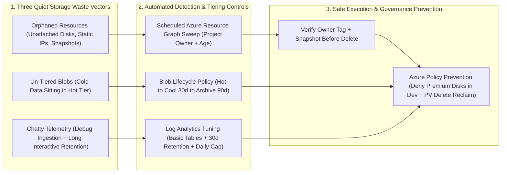
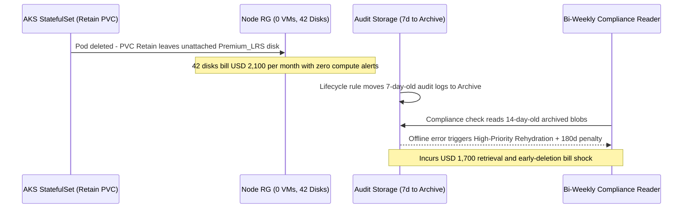

# Storage and Data Cost Optimization

> **Prerequisites:** Azure Cost Management & amortized cost (Module 01), AKS StatefulSets & PersistentVolume reclaim policies (`14-databases-and-state`), Log Analytics & observability ingestion (`12-observability`, `07-aks/06`), Azure Resource Graph & `Owner` tagging (`17-governance/06`).  
> **Estimated Reading Time:** 35 minutes  
> **Target Audience:** Platform Engineers, Backend Engineers, Kubernetes Operators, FinOps Practitioners.

> [!TIP]
> **The Golden Rule of Storage & Data Optimization:** Storage waste hides because it is **decoupled from compute** and bills on **provisioned size/tier rather than stored bytes** — hunt orphans continuously via **Azure Resource Graph sweeps** verified by **`Owner` tags**, automate Blob aging with **lifecycle policies** matched to real read patterns, and cap **Log Analytics ingestion + interactive retention** before telemetry becomes your quietest bill killer.

---

## Why This Matters

Compute waste is loud — a big VM shows up at the top of every cost chart. Storage and data waste is **quiet**: an orphaned disk from a deleted cluster billing \$40 a month for a year, a terabyte of logs sitting in premium storage that nobody has queried since Q1, a Log Analytics workspace ingesting and retaining data at full-price for two years because nobody changed the default. None of it screams; all of it adds up. This module is the **cleanup and tiering** half of the Optimize phase — including the *exact* orphaned-disk trap you were warned about in track 14 and the Log Analytics retention cost flagged in track 12, now met head-on with the sweep-and-tier discipline that catches them systematically instead of by accident.

---

## 1. Architectural Mental Model: Quiet Storage Bleed & Automated Sweep-and-Tier Loops

Unlike compute, unattached disks and over-retained logs emit zero CPU alerts. Preventing silent storage accumulation requires continuous estate-wide sweeping (Resource Graph), automated tier aging (Lifecycle Policies), and telemetry ingestion governance:



### Orphaned resources: paying for things nothing uses (track 14)

An **orphaned resource** is one that still exists and still bills but is attached to nothing and serves no purpose. The canonical example — flagged directly in **track 14 modules 01-02** — is an **unattached managed disk**: a StatefulSet's PVC used a disk with `reclaimPolicy: Retain`, the PVC/pod was deleted, and the disk was **left behind, still provisioned, still billing**, disconnected from any VM or node. Because it's not attached to anything, it never appears in a compute-utilization view; it just quietly accrues. The family of orphans is larger than disks: **unattached public IPs** (a static IP reserved after its load balancer was deleted), **unused NAT gateways / load balancers**, **empty App Service plans**, **old snapshots**, **disks/NICs from deleted VMs**, and **idle databases**. The defining trait is the same: **provisioned but unattached/unused**, so it evades utilization-based tools (module 03) entirely. Advisor catches *some* orphans, but the reliable way to find them is a **deliberate sweep** — an Azure Resource Graph query (track 17 module 06's estate-wide query tool) for resources in an unattached state. Finding and cleaning at least one real orphan is a hard capstone requirement precisely because everyone has one and nobody notices.

### Blob storage tiers: hot, cool, cold, archive

Azure **Blob Storage** offers **access tiers** that trade retrieval cost/latency for storage cost, and using the wrong tier for the access pattern is pervasive waste:

- **Hot** — highest storage cost, lowest access cost. For data read/written frequently.
- **Cool** — lower storage cost, higher access cost, 30-day minimum. For data accessed occasionally (backups from the last month, recent logs).
- **Cold** — lower still, 90-day minimum, higher access cost. Infrequent access.
- **Archive** — cheapest storage by far, but **offline**: retrieval takes *hours* (rehydration) and costs the most. For compliance/retention data you're legally required to keep but expect never to read.

The lever is **matching tier to access pattern**, and doing it **automatically** via **lifecycle management policies** — rules like "move blobs to Cool after 30 days of no access, Archive after 90, delete after 365." Manually re-tiering doesn't scale; the lifecycle policy is the real tool. The trap runs both ways: leaving never-read data in Hot wastes storage cost, but archiving data you *do* read occasionally can cost *more* (early-deletion penalties + steep retrieval), so the tier has to match the *actual* pattern — the same "don't optimize on the average, look at the real behavior" discipline as rightsizing (module 03).

### Managed disk tiers, and the "provisioned, not used" model

**Managed disks** (the VM/AKS block storage from tracks 07/14) also have performance tiers — **Premium SSD (v1/v2)**, **Standard SSD**, **Standard HDD**, and **Ultra** — and here's the cost model that surprises people: for most disk types you **pay for the provisioned size and tier, not for what you actually store or how much IOPS you use.** A 1 TiB Premium SSD attached to a VM using 40 GiB bills for 1 TiB of Premium — full stop. So disk optimization has three moves: **right-tier** (a dev disk doesn't need Premium; Standard SSD/HDD is often fine), **right-size** (don't provision 1 TiB for a 40 GiB workload — though shrinking a disk is hard/risky, so size correctly up front), and — the biggest, cheapest win — **delete orphans** (the unattached disks above). Snapshots follow a similar "you pay for it sitting there" model and pile up from backup jobs (track 14 module 04) that never prune. The mental model that ties storage together: **provisioned capacity bills whether or not you use it** — the same trap as an over-provisioned VM, just quieter because storage rarely tops the chart.

### Log Analytics and data-ingestion cost (track 12)

Observability has a cost tail that track 12 (module 04 logging, and the Container Insights/Log Analytics work in track 07 module 06) flagged and this module confronts. A **Log Analytics workspace** bills on two axes: **ingestion** (per GB of data you send in — the dominant cost, driven by how *chatty* your logs are) and **retention** (how long you keep it — an **interactive** retention window, often a default like 30-90 days included, then per-GB-per-month beyond it, plus cheaper long-term **archive** retention for compliance). The classic silent waste: a workspace left at a long default retention, ingesting **verbose debug logs at full price**, from a Container Insights integration nobody tuned. The levers: **reduce ingestion** (drop noisy log categories, sample, use Basic/Auxiliary table plans for high-volume low-value logs rather than the full Analytics plan), **tune retention** to what you actually query interactively vs. what you archive cheaply for compliance, and **set a daily cap** as a guardrail against a runaway log-flood blowing the bill. This is where observability (track 12) and cost meet: more telemetry is not free, and "log everything forever" is a budget decision disguised as an engineering default.

### Sweep systematically: cleanup as a recurring practice, not a one-off

Every category here — orphans, wrong tiers, stale snapshots, over-retained logs — shares a failure mode: it accumulates **silently and continuously**, so a one-time cleanup fixes today and the waste is back in three months. The Operate-phase answer (module 00) is to make the **sweep recurring**: a scheduled Resource Graph query for orphans, lifecycle policies that tier/delete automatically, retention set once as policy, and — ideally — **governance policy** (track 17) that *prevents* some of it (e.g. deny disks above a size in dev, require lifecycle rules on new storage accounts). Cleanup you do by hand once is a chore; cleanup encoded as a recurring query + automatic policies is the discipline. Tie it back to tagging (track 17 module 06): an **`Owner` tag** on a resource is what lets a sweep say "this orphan belongs to team-payments, ask them before deleting" instead of the scary "is anyone using this?" — which is exactly why the taxonomy matters for cleanup, not just allocation.

---

## 2. Taxonomic Comparison & Command Reference

### Azure Blob Access Tiers Comparison

| Tier | Storage Cost | Access / Read Cost | Early Deletion Minimum | Retrieval Latency | Best Workload Fit |
| :--- | :--- | :--- | :--- | :--- | :--- |
| **Hot** | Highest | Lowest | None | Milliseconds | Active app assets, frequent reads/writes |
| **Cool** | Lower than Hot | Higher than Hot | 30 days | Milliseconds | Recent backups, 30–90d infrequent access logs |
| **Cold** | Lower than Cool | Higher than Cool | 90 days | Milliseconds | Historical datasets queried a few times a year |
| **Archive** | Lowest (by far) | Highest + rehydration fee | 180 days | **Hours (offline)** | Legal/compliance cold storage rarely or never read |

### Orphan Resource Sweeps & Safe Remediation Matrix

| Orphan Class | Azure Resource Graph Predicate | Pre-Delete Safety Check | Upstream Prevention |
| :--- | :--- | :--- | :--- |
| **Unattached Managed Disk** | `type =~ 'microsoft.compute/disks'` and `isnull(properties.managedBy)` | Verify `Owner` tag & `timeCreated`; snapshot if unsure | Use `reclaimPolicy: Delete` on non-critical PVCs; policy-deny `Premium_LRS` in dev |
| **Unattached Public IP** | `type =~ 'microsoft.network/publicipaddresses'` and `isnull(properties.ipConfiguration)` | Confirm not DNS-pinned or reserved for DR failover | Remove static IP reservations alongside LB/VM teardown |
| **Unattached NIC** | `type =~ 'microsoft.network/networkinterfaces'` and `isnull(properties.virtualMachine)` | Confirm no pending VM re-attach or private endpoint | Delete NICs cleanly inside Terraform/IaC destroy workflows |
| **Stale Snapshots** | `type =~ 'microsoft.compute/snapshots'` with age filter | Check backup policy compliance window before pruning | Automate snapshot retention TTLs (track 14 module 04) |

### Command Reference

Resource Graph queries, tier reads, and Advisor are **free**. The disk/storage exercises create tiny resources — clean them up. Deleting an orphan *stops* a bill, so these commands *save* money.

| Command | What it does | Example |
|---|---|---|
| `az disk list --query "[?managedBy==null]"` | **Finds orphaned (unattached) disks** — `managedBy==null` means attached to no VM (track 14) | `az disk list --query "[?managedBy==null].{name:name, gb:diskSizeGb, rg:resourceGroup}" -o table` |
| `az disk delete` | Deletes an orphaned disk (stops its billing) | `az disk delete --ids <disk-id> --yes` |
| `az graph query` | Estate-wide orphan sweep across subscriptions (track 17 module 06) | see breakdown below |
| `az network public-ip list --query "[?ipConfiguration==null]"` | Finds unattached public IPs (another common orphan) | `az network public-ip list --query "[?ipConfiguration==null].name" -o table` |
| `az storage account management-policy create` | Sets a Blob **lifecycle** policy (auto-tier/delete by age) | see breakdown below |
| `az storage blob set-tier` | Manually moves a blob between Hot/Cool/Cold/Archive | `az storage blob set-tier --tier Cool --name <blob> -c <container> --account-name <sa>` |
| `az monitor log-analytics workspace update --retention-time` | Sets Log Analytics **retention** days (track 12) | `az monitor log-analytics workspace update -g rg -n ws --retention-time 30` |
| `az monitor log-analytics workspace show --query workspaceCapping` | Reads/sets the **daily ingestion cap** guardrail | `az monitor log-analytics workspace show -g rg -n ws --query workspaceCapping` |

Flag breakdown — estate-wide orphaned-disk sweep with Resource Graph (track 17 module 06's tool):

```bash
az graph query -q "Resources
| where type =~ 'microsoft.compute/disks'
| where isnull(properties.managedBy) or properties.diskState == 'Unattached'
| project name, resourceGroup, subscriptionId, sizeGb=properties.diskSizeGB, tags" -o table
```

- `type =~ 'microsoft.compute/disks'` — case-insensitive match on the disk resource type across **every** subscription you can see.
- `isnull(properties.managedBy) or properties.diskState == 'Unattached'` — the orphan test: a disk owned by no VM / in the `Unattached` state — the track-14 trap.
- `project ... sizeGb, tags` — pull the size (to estimate the ongoing bill) and the **`tags`** so you can see the `Owner` (track 17) before deleting — "whose is this?"

Flag breakdown — a Blob lifecycle policy that tiers then deletes automatically:

```bash
az storage account management-policy create --account-name <sa> -g <rg> --policy '{
  "rules": [{
    "name": "tier-then-expire",
    "enabled": true,
    "type": "Lifecycle",
    "definition": {
      "filters": {"blobTypes": ["blockBlob"]},
      "actions": {"baseBlob": {
        "tierToCool":    {"daysAfterModificationGreaterThan": 30},
        "tierToArchive": {"daysAfterModificationGreaterThan": 90},
        "delete":        {"daysAfterModificationGreaterThan": 365}
      }}
    }
  }]
}'
```

- `tierToCool: 30` / `tierToArchive: 90` — auto-demote blobs as they age, matching tier to a *time-based* access assumption (validate it against real access).
- `delete: 365` — auto-expire after a year (respect any legal retention first).
- The policy runs **automatically** — the point is you set the pattern once and stop hand-tiering, the scalable version of `az storage blob set-tier`.

---

## 3. Production War Story Post-Mortem: The \$3,800/Month "Ghost" RG & Archive Rehydration Shock

| Field | Incident Details |
| :--- | :--- |
| **Severity** | **SEV-2** (Accumulated Orphan Billing & Aggressive Lifecycle Rehydration Spike) |
| **Detection / Resolution Time** | Detected during quarterly storage audit / Resolved in 50 minutes (lifecycle policy tuned immediately) |
| **Impact** | 42 orphaned `Premium_LRS` disks from rotated AKS StatefulSets (`reclaimPolicy: Retain`) silently billed \$2,100/month across 4 months with 0 running VMs, while an aggressive 7-day `Archive` rule triggered \$1,700 in rehydration & early-deletion fees |

### What Happened

Two storage misconfigurations hit the same subscription. First, AKS StatefulSet rollouts used a StorageClass with `reclaimPolicy: Retain`; deleted pods left behind 42 unattached 512 GiB `Premium_LRS` disks in the managed node resource group (`MC_*`), invisible to compute utilization dashboards. Second, an engineer added a lifecycle rule moving audit blobs to `Archive` after just 7 days; a bi-weekly compliance script read 14-day-old blobs, forcing emergency high-priority rehydration plus 180-day early-deletion penalties.



### Root Cause Analysis

1. **Decoupled compute vs. storage billing**: Orphans had `managedBy == null`, escaping compute/VM rightsizing monitors completely.
2. **Lifecycle rule mismatched to access cadence**: Archiving data inside its 14-day active audit window triggered rehydration + minimum-retention penalties.

### The Fix & Architectural Hardening

- Scheduled a weekly **Azure Resource Graph orphan sweep** projecting `Owner`, `timeCreated`, and `diskSizeGB`; verified with owners, snapshotted critical volumes, and deleted all 42 orphans.
- Tuned the lifecycle policy to match real access patterns (`Hot` 0–30d → `Cool` 30–90d → `Cold` 90–180d → `Archive` 180d+), and added a Log Analytics 30-day interactive retention + daily cap alongside Azure Policy denying `Premium_LRS` in dev.

---

## 4. Multi-Language Production Implementation: Estate Orphan Sweeper via Resource Graph

These four implementations query the Azure Resource Graph REST API (`2022-10-01`) across all accessible subscriptions to surface unattached managed disks (`isnull(properties.managedBy)`) and unattached public IPs, extract `Owner` tags for safe human verification before deletion, and calculate estimated monthly waste.

````carousel
```go
package storageaudit

import (
	"bytes"
	"context"
	"encoding/json"
	"fmt"
	"net/http"
	"time"

	"github.com/Azure/azure-sdk-for-go/sdk/azcore/policy"
	"github.com/Azure/azure-sdk-for-go/sdk/azidentity"
)

type OrphanDisk struct {
	Name          string            `json:"name"`
	ResourceGroup string            `json:"resourceGroup"`
	SizeGB        float64           `json:"sizeGb"`
	SkuName       string            `json:"sku"`
	Tags          map[string]string `json:"tags"`
}

// SweepOrphanedDisks queries Azure Resource Graph across subscriptions for unattached disks.
func SweepOrphanedDisks(ctx context.Context) ([]OrphanDisk, error) {
	cred, err := azidentity.NewDefaultAzureCredential(nil)
	if err != nil {
		return nil, err
	}
	tok, err := cred.GetToken(ctx, policy.TokenRequestOptions{Scopes: []string{"https://management.azure.com/.default"}})
	if err != nil {
		return nil, err
	}

	kql := `Resources
| where type =~ 'microsoft.compute/disks'
| where isnull(properties.managedBy) or properties.diskState == 'Unattached'
| project name, resourceGroup, sizeGb=todouble(properties.diskSizeGB), sku=tostring(sku.name), tags`

	body, _ := json.Marshal(map[string]any{"query": kql})
	req, err := http.NewRequestWithContext(
		ctx,
		http.MethodPost,
		"https://management.azure.com/providers/Microsoft.ResourceGraph/resources?api-version=2022-10-01",
		bytes.NewReader(body),
	)
	if err != nil {
		return nil, err
	}
	req.Header.Set("Authorization", "Bearer "+tok.Token)
	req.Header.Set("Content-Type", "application/json")

	resp, err := (&http.Client{Timeout: 15 * time.Second}).Do(req)
	if err != nil {
		return nil, err
	}
	defer resp.Body.Close()

	if resp.StatusCode != http.StatusOK {
		return nil, fmt.Errorf("resource graph HTTP %d", resp.StatusCode)
	}

	var result struct {
		Data []OrphanDisk `json:"data"`
	}
	if err := json.NewDecoder(resp.Body).Decode(&result); err != nil {
		return nil, err
	}
	return result.Data, nil
}
```
<!-- slide -->
```typescript
import { DefaultAzureCredential } from "@azure/identity";

export interface OrphanDiskFinding {
  name: string;
  resourceGroup: string;
  sizeGb: number;
  sku: string;
  ownerTag: string;
  safeToDeleteWithoutLookup: boolean;
}

export async function sweepOrphanedDisks(): Promise<OrphanDiskFinding[]> {
  const { token } = await new DefaultAzureCredential().getToken(
    "https://management.azure.com/.default"
  );

  const kql = `Resources
| where type =~ 'microsoft.compute/disks'
| where isnull(properties.managedBy) or properties.diskState == 'Unattached'
| project name, resourceGroup, sizeGb=todouble(properties.diskSizeGB), sku=tostring(sku.name), tags`;

  const resp = await fetch(
    "https://management.azure.com/providers/Microsoft.ResourceGraph/resources?api-version=2022-10-01",
    {
      method: "POST",
      headers: {
        Authorization: `Bearer ${token}`,
        "Content-Type": "application/json",
      },
      body: JSON.stringify({ query: kql }),
    }
  );

  if (!resp.ok) {
    throw new Error(`Resource Graph query failed: ${resp.status}`);
  }

  const json = (await resp.json()) as {
    data?: Array<{
      name: string;
      resourceGroup: string;
      sizeGb: number;
      sku: string;
      tags?: Record<string, string>;
    }>;
  };

  return (json.data ?? []).map((disk) => {
    const ownerTag = disk.tags?.["Owner"] ?? "(missing-owner-tag)";
    return {
      name: disk.name,
      resourceGroup: disk.resourceGroup,
      sizeGb: disk.sizeGb,
      sku: disk.sku,
      ownerTag,
      safeToDeleteWithoutLookup: false, // Always confirm Owner & snapshot before deletion
    };
  });
}
```
<!-- slide -->
```python
import requests
from azure.identity import DefaultAzureCredential


def sweep_orphaned_disks() -> list[dict]:
    """Run an estate-wide Azure Resource Graph query for unattached managed disks."""
    token = DefaultAzureCredential().get_token("https://management.azure.com/.default").token
    url = "https://management.azure.com/providers/Microsoft.ResourceGraph/resources?api-version=2022-10-01"
    kql = """
    Resources
    | where type =~ 'microsoft.compute/disks'
    | where isnull(properties.managedBy) or properties.diskState == 'Unattached'
    | project name, resourceGroup, subscriptionId, sizeGb=properties.diskSizeGB, sku=sku.name, tags
    """

    resp = requests.post(
        url,
        json={"query": kql},
        headers={"Authorization": f"Bearer {token}", "Content-Type": "application/json"},
        timeout=20,
    )
    resp.raise_for_status()

    findings = []
    for row in resp.json().get("data", []):
        tags = row.get("tags") or {}
        findings.append(
            {
                "name": row["name"],
                "resource_group": row["resourceGroup"],
                "size_gb": row.get("sizeGb", 0),
                "sku": row.get("sku", "unknown"),
                "owner": tags.get("Owner", "(untagged-verify-before-delete)"),
            }
        )
    return findings
```
<!-- slide -->
```csharp
using System;
using System.Collections.Generic;
using System.Net.Http;
using System.Net.Http.Headers;
using System.Text;
using System.Text.Json;
using Azure.Core;
using Azure.Identity;

public sealed record OrphanDiskFinding(string Name, string ResourceGroup, double SizeGb, string Sku, string OwnerTag);

public static class StorageOrphanSweeper
{
    private static readonly HttpClient Http = new() { Timeout = TimeSpan.FromSeconds(20) };

    public static async Task<IReadOnlyList<OrphanDiskFinding>> SweepDisksAsync(CancellationToken ct = default)
    {
        var token = await new DefaultAzureCredential().GetTokenAsync(
            new TokenRequestContext(["https://management.azure.com/.default"]), ct);

        const string kql = @"Resources
| where type =~ 'microsoft.compute/disks'
| where isnull(properties.managedBy) or properties.diskState == 'Unattached'
| project name, resourceGroup, sizeGb=todouble(properties.diskSizeGB), sku=tostring(sku.name), tags";

        var body = JsonSerializer.Serialize(new { query = kql });
        using var req = new HttpRequestMessage(
            HttpMethod.Post,
            "https://management.azure.com/providers/Microsoft.ResourceGraph/resources?api-version=2022-10-01")
        {
            Content = new StringContent(body, Encoding.UTF8, "application/json")
        };
        req.Headers.Authorization = new AuthenticationHeaderValue("Bearer", token.Token);

        using var resp = await Http.SendAsync(req, ct);
        resp.EnsureSuccessStatusCode();

        using var doc = JsonDocument.Parse(await resp.Content.ReadAsStringAsync(ct));
        var results = new List<OrphanDiskFinding>();

        foreach (var item in doc.RootElement.GetProperty("data").EnumerateArray())
        {
            string owner = "(missing-owner-tag)";
            if (item.TryGetProperty("tags", out var tags) &&
                tags.ValueKind == JsonValueKind.Object &&
                tags.TryGetProperty("Owner", out var ownerProp))
            {
                owner = ownerProp.GetString() ?? owner;
            }

            results.Add(new OrphanDiskFinding(
                Name: item.GetProperty("name").GetString() ?? "",
                ResourceGroup: item.GetProperty("resourceGroup").GetString() ?? "",
                SizeGb: item.GetProperty("sizeGb").GetDouble(),
                Sku: item.GetProperty("sku").GetString() ?? "",
                OwnerTag: owner));
        }

        return results;
    }
}
```
````

---

## 5. Practical Hands-On Verification CLI Workflows

Sweeps, tier reads, and retention changes are free. The disk/storage exercises create tiny billable resources and then delete them — deleting an orphan is the lesson. Remember the 8-24h cost lag when confirming a bill *stopped*.

1. **Sweep your estate for orphaned disks (the track-14 trap, for real).** Run the Resource Graph orphan query from the command reference (add the extension with `az extension add --name resource-graph` if needed):
   ```bash
   az graph query -q "Resources
   | where type =~ 'microsoft.compute/disks'
   | where isnull(properties.managedBy) or properties.diskState == 'Unattached'
   | project name, resourceGroup, subscriptionId, sizeGb=properties.diskSizeGB, tags" -o table
   ```

   **Expected Output:**
   ```text
   Name                      ResourceGroup         SizeGb    Tags
   ------------------------  --------------------  --------  -------------------------
   pvc-4a12e8b0-old-db       MC_rg-aks_aks_eastus  128       {'Owner': 'team-data'}
   ```
   > Verify: Every established Azure user has at least one. Write down each orphan's size and estimate its monthly cost — this is money you're spending on nothing.

2. **Deliberately create an orphan, then find and kill it.** Reproduce the track-14 trap end to end:
   ```bash
   az group create -n rg-storage-lab -l eastus
   az disk create -g rg-storage-lab -n orphan-demo --size-gb 32 --sku Standard_LRS
   # it's attached to no VM — it's born orphaned and already billing:
   az disk list -g rg-storage-lab --query "[?managedBy==null].{name:name, gb:diskSizeGb, state:diskState}" -o table
   az disk delete -g rg-storage-lab -n orphan-demo --yes   # stops the bill
   ```

   **Expected Output:**
   ```text
   Name         Gb    State
   -----------  ----  ----------
   orphan-demo  32    Unattached
   ```
   > Verify: You just felt the whole lifecycle: a disk billing while attached to nothing, and the one command that stops it. This is what track 14's warning was about.

3. **Sweep for unattached public IPs and other orphans.** Run:
   ```bash
   az network public-ip list --query "[?ipConfiguration==null].{name:name, rg:resourceGroup}" -o table
   ```
   Extend the idea: write a Resource Graph query for another orphan class (old snapshots, or NICs with no VM). Note that each class needs its own "unattached" predicate — there's no single "show me waste" button, which is why the sweep is a *practice*.

4. **Read and change Blob tiers.** Create a storage account and a blob, inspect its tier, and demote it:
   ```bash
   SA=coststore$RANDOM
   az storage account create -n "$SA" -g rg-storage-lab --sku Standard_LRS
   az storage container create --account-name "$SA" -n data
   echo "cold data" > sample.txt
   az storage blob upload --account-name "$SA" -c data -f sample.txt -n sample.txt
   az storage blob show --account-name "$SA" -c data -n sample.txt --query "properties.blobTier"
   az storage blob set-tier --account-name "$SA" -c data -n sample.txt --tier Cool
   az storage blob show --account-name "$SA" -c data -n sample.txt --query "properties.blobTier"
   ```

   **Expected Output:**
   ```text
   "Hot"
   "Cool"
   ```
   > Verify: Compare Hot vs Cool vs Archive per-GB pricing (portal). Note Archive's retrieval is *hours* — write down when that's acceptable and when it's a trap.

5. **Apply a lifecycle policy (automatic tiering).** Attach the lifecycle policy from the command reference to `$SA` and confirm:
   ```bash
   az storage account management-policy show --account-name "$SA" -g rg-storage-lab
   ```
   This is the scalable version of exercise 4 — you set the aging rules once and stop hand-tiering.

6. **Right-tier a disk.** Note that a **dev** disk rarely needs Premium. Compare the monthly price of `Premium_LRS` vs `StandardSSD_LRS` vs `Standard_LRS` for a given size (portal or `az disk list-skus` if available). Write down the dev-disk default you'd standardize on — and how a governance policy (track 17) could *deny* Premium disks in dev automatically.

7. **Tune Log Analytics retention and read ingestion (track 12).** For a workspace you have (from track 07 module 06 / track 12), inspect and reduce retention:
   ```bash
   az monitor log-analytics workspace show -g <rg> -n <ws> --query "{retentionDays:retentionInDays, cap:workspaceCapping}" -o json
   az monitor log-analytics workspace update -g <rg> -n <ws> --retention-time 30
   ```

   **Expected Output:**
   ```json
   {
     "cap": {
       "dailyQuotaGb": -1.0,
       "quotaNextResetTime": null
     },
     "retentionDays": 90
   }
   ```
   > Verify: Note the retention you started at (often a long default) and what dropping it to 30 days saves. Then reason about **ingestion**: which log source is chattiest, and whether a daily cap (`--query workspaceCapping`) is a sensible guardrail. This is track 12's "telemetry isn't free" made into a bill.

8. **Estimate the ongoing cost of what you found.** Combine exercises 1, 3, and 7: tally the monthly cost of every orphan, un-tiered blob set, and over-retained workspace you found. Write one number — "silent waste found: \$X/month." That number is the elevator pitch for why the sweep is a recurring practice.

9. **Diagnose and fix: the disk that's been quietly billing for weeks.** The flagship storage incident. Scenario: Cost Analysis (module 01) shows a steady ~\$X/month "Storage" line in an RG that has **no running VMs**. Investigate:
   ```bash
   # the RG bills for storage but has no VMs — where's the money going?
   az vm list -g <rg> -o table                       # empty or few
   az disk list -g <rg> --query "[?managedBy==null].{name:name, gb:diskSizeGb, created:timeCreated}" -o table
   ```

   **Expected Output:**
   ```text
   Name               Gb    Created
   -----------------  ----  --------------------------------
   vm-data-vol-01     256   2026-05-14T11:20:03.112000+00:00
   ```
   > **Diagnose:** an unattached disk (or several) left behind when a StatefulSet/VM was deleted with a `Retain` reclaim policy (track 14) — it's been billing every day since, invisible to every compute view because it's attached to nothing.  
   > **Fix:** confirm it's truly orphaned (check its `timeCreated`/`Owner` tag, ask the owning team via the track-17 `Owner` tag — *don't* delete a disk that's a detached data volume someone's about to reattach), snapshot it if unsure, then `az disk delete --ids <id> --yes`. **Prevent recurrence:** set the reclaim policy to `Delete` where appropriate (track 14) and add the orphan sweep to a schedule. Lesson: **storage waste hides because it's decoupled from compute — only a deliberate sweep (or a governance policy) finds it.**

10. **Clean up.**
    ```bash
    az group delete -n rg-storage-lab --yes --no-wait
    az group show -n rg-storage-lab -o table
    ```
    Keep the retention change on your real workspace if it's a genuine improvement. Confirm the lab RG is gone with `az group show -n rg-storage-lab -o table`.

### Independent challenge

No commands given. Drawing on this module, the orphaned-disk lesson from **track 14**, the Log Analytics/observability cost from **track 12**, the Resource Graph query tool and `Owner` tag from **track 17 module 06**, and Cost Analysis from **module 01**, run a **real storage-and-data waste audit** on your subscription and produce a remediation plan. It must: **sweep** for at least three orphan classes (disks, public IPs, and one more) and total their monthly cost; identify at least one **mis-tiered** blob set or over-provisioned disk and propose the right tier with justification; inspect your **Log Analytics** retention and ingestion and propose a change with an estimated saving; and — the Operate-phase part — describe how you'd make this audit **recurring** (a scheduled Resource Graph query, lifecycle policies, retention-as-policy, and one governance policy from track 17 that would *prevent* a class of this waste). Actually **clean up at least one real orphan** you find (safely — check the `Owner` tag first). The deliverable is the audit findings, the dollar total, the remediation actions taken, and the recurring-prevention design.

<details>
<summary>Stuck? One hint</summary>

The sweep is the backbone — write one Resource Graph query per orphan class, each with its own "unattached" predicate (`isnull(properties.managedBy)` for disks, `isnull(properties.ipConfiguration)` for public IPs, and find the analog for snapshots/NICs), and always `project` the `tags` so you can read the **`Owner`** before touching anything. That `Owner` tag (track 17 module 06) is what turns a scary "is anyone using this?" deletion into a safe "team-payments, are you done with this detached volume?" — the taxonomy pays off in cleanup, not just allocation. For *prevention*, remember the whole point of the Operate phase: a one-time sweep is a chore, so pair each finding with the automatic control that stops it recurring — a lifecycle policy for blobs, retention set as a workspace default, a `Delete` reclaim policy for PVs (track 14), and a track-17 Azure Policy that denies (say) Premium disks in dev or requires a lifecycle rule on new storage.

</details>

---

## 6. Common Mistakes & Troubleshooting

- **Assuming a compute view will surface storage waste.** Orphans are attached to nothing, so utilization tools (module 03) and compute charts never show them. Only a deliberate **sweep** (Resource Graph) or Advisor finds them.
- **Deleting a disk that isn't actually orphaned.** A detached disk might be a data volume someone's about to reattach. Check `timeCreated` and the `Owner` tag (track 17), ask the owner, and snapshot if unsure — before `az disk delete`.
- **Archiving data you actually read.** Archive is cheapest to store but slow and expensive to retrieve, with early-deletion penalties. Tier to match the *real* access pattern; the wrong tier can cost *more* than Hot.
- **Hand-tiering blobs instead of using lifecycle policies.** Manual re-tiering doesn't scale and drifts. Encode the aging rules once as a lifecycle management policy and let it run.
- **Forgetting disks bill on provisioned size/tier, not usage.** A 1 TiB Premium disk storing 40 GiB bills for 1 TiB of Premium. Right-tier and right-size up front (shrinking is hard), and kill orphans.
- **Leaving Log Analytics at default retention and full-price ingestion.** Long default retention on verbose logs is silent money. Tune retention to what you interactively query, cut noisy ingestion, and set a daily cap (track 12).
- **Treating cleanup as a one-time project.** Every waste class re-accumulates. Make the sweep recurring and add governance policy (track 17) that prevents the common cases — cleanup encoded, not cleanup performed.

---

## 7. Operational Validation Checkpoints & Checkpoint Quiz

### Operational Validation Checkpoints

<details><summary><strong>Checkpoint 1: Safely cleaning up unattached disks found in an AKS node resource group</strong></summary>

Even when `managedBy == null`, never run `az disk delete` blindly on every unattached volume. Inspect `timeCreated` and the `Owner` tag via Resource Graph, confirm with the owning team that it isn't a temporarily detached database volume awaiting StatefulSet maintenance, take a snapshot if uncertain, and switch non-critical StorageClasses to `reclaimPolicy: Delete`.

</details>

<details><summary><strong>Checkpoint 2: Preventing Archive tier bill shock on log containers</strong></summary>

Before configuring `tierToArchive` in a Blob lifecycle rule, verify the longest active query window (audits, incident replays, ML backfills). Keep blobs in `Cool` (30d minimum) or `Cold` (90d minimum) during any active read window and reserve `Archive` (180d minimum, hours to rehydrate) solely for compliance retention unlikely to be touched.

</details>

<details><summary><strong>Checkpoint 3: Controlling runaway Container Insights Log Analytics charges</strong></summary>

When Log Analytics costs surge despite 30-day retention, inspect **daily ingestion volume by table** (`ContainerLogV2`, `Syslog`, `Perf`). Ingestion dominates retention cost: filter debug/health-probe noise, switch high-volume audit tables to Basic/Auxiliary plans, and configure a workspace `dailyQuotaGb` cap as an emergency circuit breaker.

</details>

### Checkpoint quiz

Write down your answer to each question before expanding it — checking without attempting first is the single easiest way to fool yourself into thinking you've learned this.

<details>
<summary>Show questions</summary>

1. What is an orphaned resource, what's the canonical example from track 14, and why do compute/utilization views (module 03) never catch it?
2. Name the four Blob access tiers from most to least expensive to store, and the key catch about the cheapest one.
3. What's the scalable way to tier blobs (vs. doing it by hand), and what's the risk of tiering purely by age?
4. For managed disks, what do you actually pay for, and what are the three optimization moves — which is usually the biggest, cheapest win?
5. On what two axes does a Log Analytics workspace bill (track 12), which is usually dominant, and name three levers to cut the cost.
6. How does the `Owner` tag from track 17 module 06 make an orphan *sweep* safer, and why is that a cleanup concern, not just an allocation one?
7. What's the Operate-phase reason a one-time cleanup is insufficient, and give two ways to make waste-prevention recurring/automatic.
8. Cost Analysis shows a steady storage charge in an RG with no VMs. What's your first hypothesis and the command that confirms it?

</details>

<details>
<summary>Show answers</summary>

1. A resource that still exists and bills but is **attached to nothing / unused**. The canonical example (track 14) is an **unattached managed disk** left behind by a `Retain` PVC after its pod/VM was deleted. Compute views miss it because it's attached to no VM — it has no utilization to show.
2. **Hot → Cool → Cold → Archive** (most to least storage cost). Catch: **Archive** is offline — retrieval takes **hours** (rehydration) and costs the most, plus early-deletion penalties, so it's only for data you're keeping but expect never to read.
3. A **lifecycle management policy** that auto-tiers/deletes by age — set once, runs automatically. Risk of age-only tiering: it assumes access follows age; data you *do* read occasionally can end up in Archive where reading it costs more. Match the tier to the real access pattern.
4. You pay for the **provisioned size and tier**, not stored bytes or IOPS used. Three moves: **right-tier** (dev doesn't need Premium), **right-size** up front, and — usually biggest and cheapest — **delete orphans** (unattached disks/snapshots).
5. **Ingestion** (per GB sent in — usually dominant) and **retention** (per GB kept beyond the included window). Levers: reduce ingestion (drop/sample noisy logs, Basic/Auxiliary table plans), tune retention (interactive vs. cheap archive), and set a **daily cap** guardrail.
6. The `Owner` tag identifies *which team* an orphan belongs to, turning a risky "is anyone using this?" deletion into a safe "team-X, are you done with this?" confirmation. It's a cleanup concern because deleting the wrong "orphan" (a detached volume about to be reattached) causes data loss — the tag de-risks the sweep.
7. Every waste class **re-accumulates silently and continuously**, so a one-time sweep fixes today and the waste returns. Make prevention recurring: scheduled Resource Graph sweeps, **lifecycle policies**, retention set as a workspace default, and **governance policy** (track 17) that denies/requires the common cases (e.g. deny Premium disks in dev).
8. First hypothesis: an **unattached (orphaned) disk** (or snapshot) left behind by a deleted VM/StatefulSet with `Retain` (track 14). Confirm with `az disk list -g <rg> --query "[?managedBy==null]"` (and `az vm list -g <rg>` to show there are no VMs to justify the storage).

</details>

---

## 8. Next

Continue to [05-reservations-savings-plans-and-spot](../05-reservations-savings-plans-and-spot/README.md) — you've cut waste by rightsizing (module 03) and sweeping storage (this module). The last big Optimize lever is *pricing* the compute you've decided you genuinely need: committing to it for a discount (Reservations, Savings Plans) or running interruptible workloads dirt-cheap (Spot) — and knowing which of the three fits a given workload.
