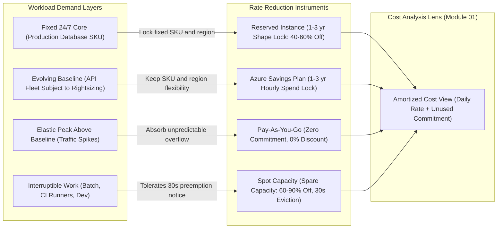
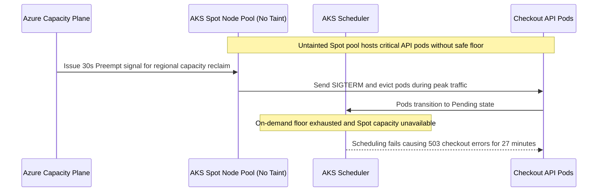

# Reservations, Savings Plans, and Spot

> **Prerequisites:** Cost allocation and amortized vs. actual views (Module 01), rightsizing distributions (Module 03), cleanup (Module 04), and AKS node pools/autoscaler (Track 07).  
> **Estimated Reading Time:** 35 minutes  
> **Target Audience:** Backend Engineers, Platform Engineers, Cloud Architects, FinOps Practitioners.

> [!TIP]
> **The Golden Rule of Commitments and Spot:** Always **rightsize first, then commit** (`Module 03` before `Module 05`), choose **Reserved Instances** only when a specific shape is locked for years, choose **Savings Plans** for steady spend whose SKU or region may evolve, run **Spot** exclusively for interruptible workloads behind a safe on-demand/reserved baseline floor, and analyze every commitment solely on the **amortized** cost view.

---

## Why This Matters

Rightsizing (module 03) and cleanup (module 04) reduce the compute you *provision*. This module reduces the **rate** you pay for the compute you've decided you genuinely need — the last big Optimize lever, and the one where a single decision can cut a steady workload's compute bill by 40–70%. But it's a **commitment** lever: the discounts come from promising Azure your spend up front, and the wrong commitment locks you into paying for capacity you later don't want. The three instruments — **Reserved Instances**, **Savings Plans**, and **Spot** — trade **commitment against flexibility** in different ways, and matching the instrument to the workload's *stability* is the entire skill. Get it right and it's the highest-ROI hour in this track; get it wrong and you've prepaid for a mistake.

---

## 1. Architectural Mental Model: Commitment Layering & Billing Views

Rather than treating an entire subscription as one monolithic billing problem, mature FinOps architectures slice compute demand into horizontal layers — placing **Spot** on interruptible tasks, **Reserved Instances** on the immovable core, **Savings Plans** on the evolving steady baseline, and **PAYG** only on genuine bursts. Once any commitment is active, Cost Analysis must switch from *Actual* (which spikes on purchase day and hides daily utilization) to *Amortized* (which distributes the commitment cost smoothly across hourly usage):



### The commitment-for-discount bargain (and amortized cost, module 01)

Pay-as-you-go (PAYG) is the flexible, expensive default: you pay the on-demand rate by the second and can stop anytime. Azure's commitment discounts flip that: **you promise a level of usage or spend for 1 or 3 years, and in exchange pay a substantially lower rate.** The provider gets predictable revenue and capacity planning; you get a discount for giving up flexibility. This is *only* a good deal for **stable, predictable, always-on** workloads — a database that runs 24/7, a baseline of production nodes that's always up. Committing to spend you won't actually use is worse than PAYG (you pay for nothing). Crucially, this is where **amortized cost** from module 01 becomes real: a commitment purchase shows as a spike in *actual* cost and a flat daily amount in *amortized* cost — so once you start buying reservations, you **must** analyze with amortized cost or your daily charts become nonsense. Commitments and the amortized view are two sides of one coin.

### Reserved Instances: commit to a specific resource shape

A **Reserved Instance (RI)** is a commitment to a **specific resource type** for 1 or 3 years — classically a **VM SKU in a region** (e.g. "a `D4s_v5` in East US for 3 years"), but RIs also exist for other resources (Azure SQL, Cosmos DB, Blob storage capacity, Software plans). You commit to the *shape*, and Azure applies the reduced rate to any matching running resource. The trade-off:

- **Biggest discount** of the three instruments (often ~40–60%+ for 3-year).
- **Least flexible** — it's tied to a resource shape. If you rightsize that `D4s_v5` down to a `D2s_v5` next quarter (module 03!), the reservation may no longer fully match. RIs have **instance-size flexibility** *within* a family (a D-family reservation can apply across D sizes in the group), which softens this, but change the *family* or region and the fit degrades.
- Payment: all-upfront (biggest discount) or monthly.

RIs suit a workload you're **confident about at a specific size** for years — a steady production database tier, a fixed baseline of identical nodes. The risk is exactly the tension with module 03: **reserve, then rightsize, and you've committed to a shape you no longer run.** Sequence matters — **rightsize first, then reserve the right-sized shape.**

### Savings Plans: commit to spend, keep shape flexibility

An **Azure Savings Plan** is the newer, more flexible commitment: instead of committing to a *resource shape*, you commit to a **fixed hourly spend** (e.g. "\$10/hour on compute") for 1 or 3 years, and Azure automatically applies the discounted rate to **whatever eligible compute you run** up to that amount, across **SKUs, regions, and even services** (VMs, Container Instances, some others). The trade-off vs. RIs:

- **Slightly smaller discount** than an equivalent RI (you pay a little for the flexibility).
- **Much more flexible** — you can rightsize, change SKU families, move regions, or shift between eligible services and *keep* the discount, as long as your hourly compute spend stays at or above the commitment. This directly **resolves the RI-vs-rightsizing tension** — a Savings Plan doesn't care that you swapped `D4s_v5` for a `D2s_v5`.
- Any eligible usage **above** the commitment is billed at PAYG; usage **below** it is wasted commitment.

The rule of thumb: **RI for a shape you're certain won't change (max discount); Savings Plan for steady spend whose *shape* might evolve (flexibility).** Many orgs layer them — RIs for the rock-stable core, a Savings Plan over the variable-but-always-present remainder.

### Spot: dirt-cheap, interruptible capacity

**Spot VMs** (and **AKS spot node pools**, track 07) are the opposite bargain: Azure sells you its **spare capacity** at a steep discount (often 60–90% off) with **no availability guarantee** — Azure can **evict** your spot instance with ~30 seconds' notice when it needs the capacity back (or when your price cap is exceeded). No commitment, huge discount, but the workload **must tolerate sudden termination**. Spot fits **fault-tolerant, interruptible, stateless, or re-runnable** work: batch jobs, CI runners, dev/test, stateless workers behind a queue, ML training with checkpointing, and — on AKS — a **spot node pool** for workloads that can reschedule (with `spec.tolerations` for the spot taint, so only opted-in pods land there). It is **wrong** for anything that must stay up: a production database, a stateful singleton, a latency-critical always-on service. A common robust pattern is **mixed node pools**: a small on-demand (or reserved) pool for the baseline/critical pods and a spot pool the Cluster Autoscaler (track 07 module 05) scales for the interruptible bulk — cheap capacity with a safe floor. The mental model: Spot trades **reliability** for price; RI/Savings Plans trade **flexibility** for price.

### Choosing: a decision framework across the three

Put the three on one axis of **how much you're willing to give up for the discount**.

The decision procedure: (1) **rightsize first** (module 03) so you commit to the *correct* size; (2) identify your **always-on baseline** vs. your **variable** vs. your **interruptible** load; (3) cover the interruptible part with **Spot**, the stable-and-fixed part with **RIs**, and the stable-but-evolving remainder with a **Savings Plan**; (4) leave genuinely spiky/short-lived load on **PAYG**. Model the **break-even** before committing — a 1-year commitment only pays off if you'll actually run that workload for most of the term; if there's real doubt, a shorter term or a Savings Plan's flexibility is the safer bet. This is module 00's "value, not just savings" again: the biggest discount on capacity you won't use is negative value.

---

## 2. Taxonomic Comparison & Command Reference

### Commitment & Capacity Instrument Matrix

| Instrument | You Give Up | You Get | Typical Discount | Billing View Required | Right For |
| :--- | :--- | :--- | :--- | :--- | :--- |
| **Reserved Instance (RI)** | Flexibility (locked to SKU/family + region, 1–3 yr) | Biggest rate discount | ~40–60%+ | Amortized (`AmortizedCost`) | Stable workload, **known size**, for years (steady DB tier, fixed node baseline) |
| **Savings Plan** | Flexibility (locked to hourly *spend*, 1–3 yr) — shape-free | Large discount across SKUs, regions, and services | ~30–50%+ | Amortized (`AmortizedCost`) | Steady **spend** whose shape may evolve (fleet you'll rightsize) |
| **Spot** | Reliability (evictable with ~30s notice, no SLA) | Steepest discount, zero term lock | ~60–90% | Actual or Amortized | Interruptible, stateless, or re-runnable work (batch, CI, dev, queue workers) |
| **PAYG** | Nothing | Full elasticity, stop anytime | 0% (baseline) | Actual or Amortized | Spiky, unpredictable, or short-lived workloads below break-even |

### Flexibility & Eviction Behavior Matrix

| Mechanism | Scope / Trigger | What Happens in Practice | Operational Guardrail |
| :--- | :--- | :--- | :--- |
| **RI Instance-Size Flexibility** | Same VM series group in same region | A `D8s_v5` RI automatically covers four `D2s_v5` VMs (same normalized ratio) | Does *not* cross VM families (`D` to `E`) or regions; verify ratio before resizing |
| **RI Exchange / Modification** | Within Azure reservation exchange rules | Allows trading remaining value toward a new SKU/term of equal or greater commitment | Do not rely on ad-hoc exchanges as a substitute for rightsizing first |
| **Savings Plan Auto-Application** | Across eligible compute hourly spend | Discounts highest-saving eligible SKUs first; overflow above cap bills at PAYG | Commit near the p5–p10 hourly floor so idle valleys don't waste spend |
| **Spot Eviction Policy** | Capacity pressure or `--max-price` exceeded | `Deallocate` preserves OS/data disk for resume; `Delete` destroys VM & disks | Poll IMDS Scheduled Events (`169.254.169.254`) for 30s `Preempt` drain |
| **AKS Spot Node Pool Taint** | `kubernetes.azure.com/scalesetpriority=spot:NoSchedule` | Only pods carrying explicit matching `tolerations` schedule onto Spot nodes | Keep system & critical API pods isolated on an on-demand/reserved floor pool |

### Command Reference

Reservations and savings plans are **real financial commitments** — the exercises mostly *inspect, price, and model* them (free) rather than buy (which spends real money for 1–3 years; **don't buy one for a lab**). Spot VMs/node pools are cheap and cleaned up.

| Command | What it does | Example |
|---|---|---|
| `az reservations reservation-order list` | Lists reservation orders you hold (inspect existing commitments) | `az reservations reservation-order list -o table` |
| `az reservations catalog show` | Shows purchasable reservation SKUs/terms and prices for a region | `az reservations catalog show --reserved-resource-type VirtualMachines --location eastus` |
| Cost Management → Reservations → "Buy" (portal) | Shows **recommendations** (which RIs/Savings Plans would save, based on your usage) | portal; or `az consumption reservation recommendation list` |
| `az consumption reservation recommendation list` | Azure's data-driven RI recommendations from your actual usage | `az consumption reservation recommendation list --query "[].{sku:skuName, savings:netSavings, term:term}" -o table` |
| `az reservations reservation-order calculate` | Prices a specific reservation before buying (break-even modeling) | `az reservations reservation-order calculate --billing-scope <id> --reserved-resource-type VirtualMachines ...` |
| `az vm create --priority Spot` | Creates a Spot VM (evictable, cheap) | see breakdown below |
| `az aks nodepool add --priority Spot` | Adds an AKS **spot node pool** (track 07) | see breakdown below |

Flag breakdown — `az vm create --resource-group rg --name vm-batch --image Ubuntu2204 --priority Spot --max-price -1 --eviction-policy Deallocate --size Standard_D2s_v5`:

- `--priority Spot` — provision as **Spot** (spare capacity, steep discount, evictable).
- `--max-price -1` — the price cap; **-1** means "pay up to the on-demand price" (only evicted for *capacity*, not price). A set cap (e.g. `0.05`) also evicts you if the spot price rises above it — cheaper but more evictions.
- `--eviction-policy Deallocate` — on eviction, **stop/deallocate** the VM (you keep the disk, can restart later) vs. `Delete` (fully removed). `Deallocate` suits work you'll resume; `Delete` suits fully ephemeral runs.

Flag breakdown — `az aks nodepool add --resource-group rg --cluster-name aks --name spotpool --priority Spot --eviction-policy Delete --spot-max-price -1 --enable-cluster-autoscaler --min-count 0 --max-count 10 --node-taints "kubernetes.azure.com/scalesetpriority=spot:NoSchedule"`:

- `--priority Spot --spot-max-price -1` — a spot node pool at up to on-demand price (evicted only on capacity).
- `--enable-cluster-autoscaler --min-count 0 --max-count 10` — let the autoscaler (track 07 module 05) scale spot nodes **from zero**, so the cheap pool only exists when there's interruptible work.
- `--node-taints "...scalesetpriority=spot:NoSchedule"` — taint spot nodes so **only pods that explicitly tolerate spot** land there — the safe-floor pattern that keeps critical pods on the on-demand pool.

---

## 3. Production War Story Post-Mortem: Untainted Spot Pool Eviction Storm & Stranded 3-Year RI

| Field | Incident Details |
| :--- | :--- |
| **Severity** | **SEV-2** (Regional Spot Eviction Drops Production Checkout Pods + Stranded RI Audit Finding) |
| **Detection / Resolution Time** | Detected in 4 minutes via PagerDuty 5xx SLO burn / Mitigated in 31 minutes |
| **Impact** | 38% of checkout API pods evicted simultaneously for 27 minutes; subsequent FinOps audit uncovered \$4,200/month in stranded 3-year `E16s_v5` RIs bought before rightsizing |

### What Happened

To offset high on-demand costs after an earlier team bought oversized 3-year `E16s_v5` Reserved Instances and then migrated services to smaller `D4s_v5` nodes (stranding the E-series reservation), another engineer added a cheaper AKS Spot node pool. However, the Spot pool was provisioned **without node taints** (`NoSchedule`), and the on-demand pool was scaled down to zero headroom. When Azure reclaimed Spot capacity in `eastus` during morning peak, Kubernetes evicted critical checkout API pods along with batch workers, leaving them `Pending` until an on-demand node pool was manually scaled up.



### Root Cause Analysis

1. **Missing Spot isolation taint & baseline floor**: Provisioning a Spot node pool without `--node-taints "kubernetes.azure.com/scalesetpriority=spot:NoSchedule"` allowed latency-sensitive, non-tolerating API pods to land on interruptible capacity.
2. **Pre-rightsizing RI lock-in**: Earlier, the team purchased a 3-year E-series RI before completing Module 03 rightsizing; migrating to `D4s_v5` crossed VM families, breaking instance-size flexibility and leaving the commitment wasted while total spend still rose.

### The Fix & Architectural Hardening

- Added `--node-taints "kubernetes.azure.com/scalesetpriority=spot:NoSchedule"` to the Spot node pool and restricted Spot `tolerations` strictly to idempotent queue workers and batch jobs.
- Established a dedicated on-demand/Savings-Plan-backed baseline pool sized for peak critical SLO traffic, while switching future evolving commitments to a 1-year **Azure Savings Plan** after completing Module 03 rightsizing.

---

## 4. Multi-Language Production Implementation: Commitment Break-Even & Layering Analyzer

These four implementations model the exact math of Section 1 and Hands-On Exercises 3 & 8: given an array of hourly on-demand compute spend samples (`hourlyPaygUSD`), a candidate Savings Plan discount rate, an RI discount rate, and a Spot-eligible interruptible flag, they validate eligibility, compute **break-even months**, and search candidate hourly commitment floors to find the **net-optimal Savings Plan commitment** (accounting for both PAYG overflow above the commit and wasted commit during low-traffic valleys).

````carousel
```go
package finops

import (
	"errors"
	"math"
)

type CommitmentDecision struct {
	Instrument            string
	RecommendedHourlyUSD  float64
	BreakEvenMonths       float64
	ExpectedMonthlyNetUSD float64
	ExpectedMonthlySave   float64
}

// OptimizeCommitment computes break-even months and searches hourly commitment levels
// to find the net-optimal Savings Plan floor without over-committing into idle valleys.
func OptimizeCommitment(
	hourlyPaygUSD []float64,
	spDiscountRate float64,
	riDiscountRate float64,
	shapeLocked3Yr bool,
	interruptible bool,
) (CommitmentDecision, error) {
	if len(hourlyPaygUSD) == 0 {
		return CommitmentDecision{}, errors.New("hourly usage samples required")
	}
	if interruptible {
		return CommitmentDecision{
			Instrument:      "Spot (with On-Demand floor)",
			BreakEvenMonths: 0,
		}, nil
	}

	effectiveDiscount := spDiscountRate
	instrument := "Azure Savings Plan"
	if shapeLocked3Yr {
		effectiveDiscount = riDiscountRate
		instrument = "Reserved Instance"
	}

	breakEvenMonths := 12.0 * (1.0 - effectiveDiscount)
	maxHourly := 0.0
	totalPayg := 0.0
	for _, v := range hourlyPaygUSD {
		totalPayg += v
		if v > maxHourly {
			maxHourly = v
		}
	}

	bestCommit := 0.0
	bestCost := totalPayg
	step := math.Max(0.25, maxHourly/100.0)

	for commit := 0.0; commit <= maxHourly; commit += step {
		var periodCost float64
		for _, demand := range hourlyPaygUSD {
			covered := math.Min(demand, commit)
			overflow := math.Max(0, demand-commit)
			// Under-utilization still pays the discounted commitment rate up to commit
			periodCost += commit*(1.0-effectiveDiscount) + overflow
			_ = covered
		}
		if periodCost < bestCost {
			bestCost = periodCost
			bestCommit = commit
		}
	}

	scaleToMonth := 730.0 / float64(len(hourlyPaygUSD))
	return CommitmentDecision{
		Instrument:            instrument,
		RecommendedHourlyUSD:  math.Round(bestCommit*100) / 100,
		BreakEvenMonths:       math.Round(breakEvenMonths*10) / 10,
		ExpectedMonthlyNetUSD: math.Round(bestCost*scaleToMonth*100) / 100,
		ExpectedMonthlySave:   math.Round((totalPayg-bestCost)*scaleToMonth*100) / 100,
	}, nil
}
```
<!-- slide -->
```typescript
export interface CommitmentDecision {
  instrument: "Spot" | "Reserved Instance" | "Azure Savings Plan" | "PAYG";
  recommendedHourlyCommitUsd: number;
  breakEvenMonths: number;
  projectedMonthlyCostUsd: number;
  projectedMonthlySavingsUsd: number;
}

/**
 * Evaluates hourly PAYG compute spend to choose between Spot, RI, Savings Plan, or PAYG
 * and sweeps candidate hourly spend commits to prevent over-committing into idle valleys.
 */
export function optimizeCommitmentLayer(
  hourlyPaygUsd: number[],
  options: {
    spDiscountRate: number;
    riDiscountRate: number;
    shapeLockedForYears: boolean;
    interruptible: boolean;
    expectedActiveMonthsPerYear: number;
  }
): CommitmentDecision {
  if (hourlyPaygUsd.length === 0) {
    throw new Error("hourlyPaygUsd must contain at least one hourly sample");
  }
  if (options.interruptible) {
    return {
      instrument: "Spot",
      recommendedHourlyCommitUsd: 0,
      breakEvenMonths: 0,
      projectedMonthlyCostUsd: 0,
      projectedMonthlySavingsUsd: 0,
    };
  }

  const useRi = options.shapeLockedForYears;
  const discount = useRi ? options.riDiscountRate : options.spDiscountRate;
  const breakEvenMonths = Number((12 * (1 - discount)).toFixed(1));

  const totalPayg = hourlyPaygUsd.reduce((sum, x) => sum + x, 0);
  const scaleToMonth = 730 / hourlyPaygUsd.length;

  if (options.expectedActiveMonthsPerYear < breakEvenMonths) {
    return {
      instrument: "PAYG",
      recommendedHourlyCommitUsd: 0,
      breakEvenMonths,
      projectedMonthlyCostUsd: Number((totalPayg * scaleToMonth).toFixed(2)),
      projectedMonthlySavingsUsd: 0,
    };
  }

  const maxHourly = Math.max(...hourlyPaygUsd);
  const step = Math.max(0.25, maxHourly / 100);
  let bestCommit = 0;
  let bestPeriodCost = totalPayg;

  for (let commit = 0; commit <= maxHourly; commit += step) {
    let cost = 0;
    for (const demand of hourlyPaygUsd) {
      const overflow = Math.max(0, demand - commit);
      cost += commit * (1 - discount) + overflow;
    }
    if (cost < bestPeriodCost) {
      bestPeriodCost = cost;
      bestCommit = commit;
    }
  }

  return {
    instrument: useRi ? "Reserved Instance" : "Azure Savings Plan",
    recommendedHourlyCommitUsd: Number(bestCommit.toFixed(2)),
    breakEvenMonths,
    projectedMonthlyCostUsd: Number((bestPeriodCost * scaleToMonth).toFixed(2)),
    projectedMonthlySavingsUsd: Number(((totalPayg - bestPeriodCost) * scaleToMonth).toFixed(2)),
  };
}
```
<!-- slide -->
```python
from dataclasses import dataclass


@dataclass(frozen=True)
class CommitmentDecision:
    instrument: str
    recommended_hourly_commit_usd: float
    break_even_months: float
    projected_monthly_cost_usd: float
    projected_monthly_savings_usd: float


def optimize_commitment_layer(
    hourly_payg_usd: list[float],
    sp_discount_rate: float = 0.35,
    ri_discount_rate: float = 0.48,
    shape_locked_years: bool = False,
    interruptible: bool = False,
    expected_active_months: float = 12.0,
) -> CommitmentDecision:
    """Compute break-even months and optimal hourly commitment across historical PAYG samples."""
    if not hourly_payg_usd:
        raise ValueError("hourly_payg_usd cannot be empty")
    if interruptible:
        return CommitmentDecision("Spot", 0.0, 0.0, 0.0, 0.0)

    discount = ri_discount_rate if shape_locked_years else sp_discount_rate
    instrument = "Reserved Instance" if shape_locked_years else "Azure Savings Plan"
    break_even = round(12.0 * (1.0 - discount), 1)
    total_payg = sum(hourly_payg_usd)
    scale = 730.0 / len(hourly_payg_usd)

    if expected_active_months < break_even:
        return CommitmentDecision("PAYG", 0.0, break_even, round(total_payg * scale, 2), 0.0)

    max_hourly = max(hourly_payg_usd)
    step = max(0.25, max_hourly / 100.0)
    best_commit, best_cost = 0.0, total_payg

    commit = 0.0
    while commit <= max_hourly + 1e-9:
        period_cost = sum(commit * (1.0 - discount) + max(0.0, d - commit) for d in hourly_payg_usd)
        if period_cost < best_cost:
            best_cost = period_cost
            best_commit = commit
        commit += step

    return CommitmentDecision(
        instrument=instrument,
        recommended_hourly_commit_usd=round(best_commit, 2),
        break_even_months=break_even,
        projected_monthly_cost_usd=round(best_cost * scale, 2),
        projected_monthly_savings_usd=round((total_payg - best_cost) * scale, 2),
    )
```
<!-- slide -->
```csharp
using System;
using System.Collections.Generic;
using System.Linq;

public sealed record CommitmentDecision(
    string Instrument,
    double RecommendedHourlyCommitUsd,
    double BreakEvenMonths,
    double ProjectedMonthlyCostUsd,
    double ProjectedMonthlySavingsUsd);

public static class CommitmentOptimizer
{
    public static CommitmentDecision Evaluate(
        IReadOnlyList<double> hourlyPaygUsd,
        double spDiscountRate = 0.35,
        double riDiscountRate = 0.48,
        bool shapeLockedForYears = false,
        bool interruptible = false,
        double expectedActiveMonthsPerYear = 12.0)
    {
        if (hourlyPaygUsd is null || hourlyPaygUsd.Count == 0)
            throw new ArgumentException("At least one hourly usage sample is required.", nameof(hourlyPaygUsd));

        if (interruptible)
            return new CommitmentDecision("Spot", 0, 0, 0, 0);

        double discount = shapeLockedForYears ? riDiscountRate : spDiscountRate;
        string instrument = shapeLockedForYears ? "Reserved Instance" : "Azure Savings Plan";
        double breakEvenMonths = Math.Round(12.0 * (1.0 - discount), 1);

        double totalPayg = hourlyPaygUsd.Sum();
        double scaleToMonth = 730.0 / hourlyPaygUsd.Count;
        if (expectedActiveMonthsPerYear < breakEvenMonths)
            return new CommitmentDecision("PAYG", 0, breakEvenMonths, Math.Round(totalPayg * scaleToMonth, 2), 0);

        double maxHourly = hourlyPaygUsd.Max();
        double step = Math.Max(0.25, maxHourly / 100.0);
        double bestCommit = 0;
        double bestCost = totalPayg;

        for (double commit = 0; commit <= maxHourly; commit += step)
        {
            double periodCost = hourlyPaygUsd.Sum(d => commit * (1.0 - discount) + Math.Max(0, d - commit));
            if (periodCost < bestCost)
            {
                bestCost = periodCost;
                bestCommit = commit;
            }
        }

        return new CommitmentDecision(
            instrument,
            Math.Round(bestCommit, 2),
            breakEvenMonths,
            Math.Round(bestCost * scaleToMonth, 2),
            Math.Round((totalPayg - bestCost) * scaleToMonth, 2));
    }
}
```
````

---

## 5. Practical Hands-On Verification CLI Workflows

Inspection, recommendations, and pricing are **free** — do those for real. **Do not actually buy** a reservation or savings plan for a lab (it's a 1–3 year real commitment). Spot VMs/pools are cheap; clean them up.

### 1. Read Azure's own commitment recommendations
```bash
az consumption reservation recommendation list \
  --query "[].{sku:skuName, term:term, savings:netSavings}" -o table \
  2>/dev/null || echo "view under Cost Management → Reservations → Add in the portal"
```

**Expected Output:**
```text
Sku              Term    Savings
---------------  ------  ---------
Standard_D4s_v5  P1Y     412.80
Standard_D2s_v5  P3Y     895.40
```
> Verify: these are computed from *your* usage — Azure telling you which RIs would pay off. Note the SKUs and the estimated savings; this is where you'd start a real commitment decision.

### 2. Browse the reservation catalog and compare terms
```bash
az reservations catalog show --reserved-resource-type VirtualMachines --location eastus -o table 2>/dev/null | head
```

**Expected Output:**
```text
Name             Term    BillingPlan    Locations
---------------  ------  -------------  -----------
Standard_D2s_v5  P1Y     Upfront        eastus
Standard_D2s_v5  P3Y     Upfront        eastus
```
> Compare 1-year vs 3-year pricing for a SKU you actually run. Write down the discount vs. PAYG for each term — the longer term is cheaper but a bigger bet.

### 3. Model a break-even
Take a VM SKU you run steadily. Find its PAYG monthly cost (module 01 / portal) and a 1-year RI price. Compute: how many months must you run it for the RI to beat PAYG? Then ask honestly: *are you confident it'll run that long at that size?* Write the break-even months and your confidence. This is the actual reservation decision, done on paper.

### 4. The rightsize-then-reserve ordering (thought exercise)
Suppose you reserve a `D4s_v5` for 3 years, then next quarter module 03 says rightsize it to `D2s_v5`. Write down what happens to the reservation's fit, how instance-size flexibility *within the family* helps, and why the correct sequence is **rightsize first, then reserve**. This ordering trap is exercise 9's fix.

### 5. Compare RI vs Savings Plan for one workload
For a steady workload you expect to *evolve* (you'll probably change its SKU within a year), argue in writing whether an RI or a Savings Plan fits better and why. Then do the same for a workload you're certain is fixed for 3 years. The two answers should differ — if they don't, re-read the flexibility trade-off.

### 6. Create a Spot VM and understand eviction
```bash
az group create -n rg-spot-lab -l eastus
az vm create -g rg-spot-lab -n vm-spot --image Ubuntu2204 --size Standard_D2s_v5 \
  --priority Spot --max-price -1 --eviction-policy Deallocate \
  --admin-username azureuser --generate-ssh-keys --no-wait
```

**Expected Output:**
```json
{
  "provisioningState": "Creating",
  "priority": "Spot",
  "evictionPolicy": "Deallocate"
}
```
> Compare its price to the same SKU on-demand (portal). Write down what `--eviction-policy Deallocate` vs `Delete` means for a job you'd want to resume vs. one that's fully ephemeral, and why a production database must **never** be Spot. (In production Spot workloads, also poll `http://169.254.169.254/metadata/scheduledevents?api-version=2020-07-01` with `Metadata: true` to catch the 30s `Preempt` signal.)

### 7. (AKS, design or real) Add a spot node pool with a safe floor
Reason through (or, with a cluster up, run) the `az aks nodepool add --priority Spot ... --node-taints` pattern from the command reference:
```bash
az aks nodepool add --resource-group rg-aks --cluster-name aks-learn \
  --name spotpool --priority Spot --eviction-policy Delete --spot-max-price -1 \
  --enable-cluster-autoscaler --min-count 0 --max-count 10 \
  --node-taints "kubernetes.azure.com/scalesetpriority=spot:NoSchedule"
```
> Explain the mixed-pool design: critical pods on the on-demand pool, interruptible pods *tolerating* the spot taint on the autoscaled-from-zero spot pool. Write the one-sentence rule: *Spot for interruptible, on-demand/reserved for the floor.*

### 8. Pick instruments for a whole fleet
Take a realistic fleet: a 24/7 production database, a fixed baseline of 3 always-on API nodes, a variable API tier that scales with traffic, a nightly batch job, and CI runners. Assign each to RI / Savings Plan / Spot / PAYG **and justify each choice** using stability and interruptibility. This is the module's core competency in one table.

### 9. Diagnose and fix: the commitment that no longer fits
The commitment footgun. Scenario: six months ago the team bought a **3-year RI for a `D8s_v5`** to save money; then, following module 03, they **rightsized the workload to a `D2s_v5`**. Now Cost Analysis (amortized, module 01) shows the reservation is **under-utilized** — they're paying for `D8s_v5` capacity they no longer run.

> **Diagnose:** RI committed to a *shape*, and rightsizing changed the shape; instance-size flexibility covers *within-family* sizing so *some* benefit still applies across D-sizes, but the commitment was oversized for the new footprint — a classic **reserve-before-rightsize** mistake.
> **Fix:** (a) check whether **instance-size flexibility** already reapplies the reservation to the smaller D-SKUs (often it partially does); (b) **exchange** the reservation for one matching the new footprint (Azure allows reservation exchanges within rules); (c) for the future, prefer a **Savings Plan** for evolving workloads so shape changes don't strand the commitment; and (d) **always rightsize first, then commit**. Lesson: **commit to the size you'll actually run — sequence rightsizing *before* reserving, and use Savings Plans when the shape is uncertain.**

### 10. Clean up
```bash
az group delete -n rg-spot-lab --yes --no-wait
```

**Expected Output:**
```text
(Accepted: asynchronous deletion of rg-spot-lab started; verify with az group exists -n rg-spot-lab)
```
> You didn't buy any real commitment (correct). Confirm the spot lab RG is gone.

### Independent challenge

No commands given. Drawing on this module, the rightsizing discipline from **module 03**, the amortized-vs-actual view from **module 01**, AKS node pools and the Cluster Autoscaler from **track 07**, and Container Apps scaling from **track 06**, produce a **commitment-and-capacity strategy** for a realistic three-tier application on your subscription: a stateful production database, an always-on API baseline, an autoscaling API tier, and a batch/CI workload. For each tier, choose **RI / Savings Plan / Spot / PAYG**, justify it in terms of **stability vs. flexibility vs. interruptibility**, state the **term** (1 vs 3 year) and a **break-even** rationale for any commitment, and identify the **one ordering rule** (vs. module 03) you must follow so a future rightsize doesn't strand a commitment. Finish with two or three sentences on why, once you've bought anything here, all your cost analysis (modules 01, 06) must switch to the **amortized** view. Model, justify, and write it — **do not actually purchase** a reservation or savings plan.

<details><summary>Stuck? One hint</summary>

Sort the fleet by two questions before picking any instrument: *"is it always on?"* and *"can it survive being killed with 30 seconds' notice?"* The batch/CI tier answers "no" to always-on and "yes" to survivable → **Spot**. The database answers "yes/critical" and "no, must stay up" → never Spot; if its size is truly fixed for years, **RI** (max discount), otherwise **Savings Plan**. The always-on API baseline is a Savings Plan (steady spend, but you'll likely rightsize it, so keep shape-flexibility). The autoscaling variable tier and anything spiky stays **PAYG** below the commitment line. The ordering rule is the module's whole cautionary tale: **rightsize (module 03) *then* commit**, or you reserve a shape you're about to change — and prefer a Savings Plan whenever the shape is even slightly uncertain.

</details>

---

## 6. Common Mistakes & Troubleshooting

- **Reserving before rightsizing.** Commit to a shape, then module 03 changes the shape, and you've stranded the commitment. Always **rightsize first, then reserve** the correct size.
- **Committing to spend you won't use.** A commitment below your real usage saves money; a commitment *above* it wastes money — you pay for capacity you don't run. The biggest discount on unused capacity is negative value.
- **Using an RI where a Savings Plan fits.** If the workload's *shape* might evolve, an RI's shape-lock will hurt; a Savings Plan keeps SKU/region/service flexibility for a slightly smaller discount. Match the instrument to how fixed the shape is.
- **Putting the wrong thing on Spot.** Spot is evictable with ~30s notice. A production database, stateful singleton, or latency-critical always-on service must never be Spot. Spot is for interruptible/stateless/re-runnable work.
- **No safe floor on a spot node pool.** Taint spot nodes and keep a small on-demand/reserved pool for critical pods, so an eviction storm can't take out the baseline. Autoscale the spot pool from zero.
- **Analyzing cost with the actual view after committing.** Once you buy a reservation/savings plan, *actual* cost shows a purchase spike and misleading zeros; switch all engineering/allocation analysis to **amortized** (module 01).
- **Ignoring break-even and confidence.** A 1–3 year commitment only pays off if the workload runs most of the term at that size. If you're not confident, choose a shorter term, a Savings Plan, or stay on PAYG.

---

## 7. Operational Validation Checkpoints & Cumulative Review

### Operational Validation Checkpoints

<details><summary><strong>Checkpoint 1: Rescuing a Pre-Rightsizing Reserved Instance Purchase</strong></summary>

If a team bought a 3-year `Standard_D8s_v5` Reserved Instance and later downsized the workload to two `Standard_D2s_v5` VMs, **instance-size flexibility** within the `Dv5` family automatically applies 50% of the reservation (4 vCPUs out of 8 vCPUs) to the new instances, leaving 50% stranded. Rather than leaving the remaining 4 vCPUs unused, check the Reservation Utilization report in the **Amortized** view and **exchange** the excess RI capacity for an eligible SKU you actually run continuously (or prefer a Savings Plan next renewal cycle).

</details>

<details><summary><strong>Checkpoint 2: Isolating Critical Workloads from Spot Evictions in AKS</strong></summary>

Adding `--priority Spot` to an AKS node pool does not protect critical workloads on its own unless `--node-taints "kubernetes.azure.com/scalesetpriority=spot:NoSchedule"` is applied and a separate non-Spot node pool remains available. Without the taint, the Kubernetes scheduler may place stateless API replicas or system add-ons onto Spot nodes, triggering an outage when Azure reclaims capacity with 30 seconds' notice.

</details>

<details><summary><strong>Checkpoint 3: Auditing Daily Spend After a Savings Plan Purchase</strong></summary>

When Cost Analysis shows a sudden \$20,000 spike on the 1st of the month followed by near-zero VM compute charges for Team A, you are inspecting the **ActualCost** view. Switching the query to **AmortizedCost** distributes the commitment cost proportionally across every consumed hour (and reveals any unused commitment line items), which is mandatory before making commitment-coverage or showback decisions.

</details>

### Checkpoint quiz

Write down your answer to each question before expanding it — checking without attempting first is the single easiest way to fool yourself into thinking you've learned this.

1. What's the fundamental bargain behind all commitment discounts, and what kind of workload is it *only* a good deal for?
2. What does a Reserved Instance commit you to, what's its main advantage and its main drawback, and how does instance-size flexibility soften the drawback?
3. What does a Savings Plan commit you to instead, and which specific tension with module 03 does that flexibility resolve?
4. What is Spot capacity, what do you give up for its discount, and name two workloads it fits and one it must never be used for.
5. State the one-line rule for choosing RI vs. Savings Plan vs. Spot.
6. What is the correct *ordering* between rightsizing (module 03) and reserving, and what goes wrong if you reverse it?
7. Once you buy any commitment, which module 01 cost view must you analyze with, and why does the other view become misleading?
8. Describe the mixed-node-pool pattern on AKS (track 07) and what the taint on the spot pool accomplishes.

<details><summary>Show answers</summary>

1. You **promise 1–3 years of usage or spend** in exchange for a much lower rate — trading flexibility for discount. It's only a good deal for **stable, predictable, always-on** workloads; committing to usage you won't consume is worse than PAYG.
2. An RI commits to a **specific resource shape** (e.g. a VM SKU in a region) for 1–3 years. Advantage: **biggest discount**. Drawback: **least flexible** — tied to the shape, so changing size/family/region degrades the fit. **Instance-size flexibility** lets a family reservation apply across sizes *within* that family group, softening (not eliminating) the lock.
3. A Savings Plan commits to a **fixed hourly spend**, shape-free — Azure applies the discount to whatever eligible compute you run up to that amount across SKUs/regions/services. It resolves the **reserve-vs-rightsize tension**: you can rightsize/change SKU and keep the discount.
4. Spot is Azure's **spare capacity** at a steep discount with **no availability guarantee** — evictable with ~30s notice. You give up **reliability**. Fits batch/CI/dev/stateless-workers/checkpointed-ML; must **never** run a production database or stateful/latency-critical always-on service.
5. **RI** for a shape you're certain won't change (max discount); **Savings Plan** for steady spend whose shape may evolve (flexibility); **Spot** for interruptible/stateless/re-runnable work (steepest discount, no commitment).
6. **Rightsize first, then reserve** the correct size. Reversed, you commit to a shape and then change it, stranding the reservation on capacity you no longer run (the module's diagnose-and-fix).
7. **Amortized** cost. After a commitment, *actual* cost shows a big purchase spike and then misleading zeros, so daily/allocation analysis only makes sense on the amortized view that spreads the purchase across usage.
8. A small **on-demand/reserved** pool for baseline/critical pods plus an **autoscaled-from-zero spot pool** for interruptible pods. The **taint** on the spot pool ensures only pods that *tolerate* spot schedule there, keeping critical pods on the safe on-demand floor even during a spot eviction.

</details>

### Cumulative review

Closed-book. Don't reopen modules 00–05 or earlier tracks while attempting these — find out what actually stuck. These mix the whole Optimize phase (modules 03–05) with the Inform foundations (00–02) and the tagging/AKS/observability tracks.

1. A steady production service is over-provisioned *and* on PAYG. Walk the full Optimize sequence you'd apply, in the right order, naming the module for each step — and explain why doing them out of order (committing before rightsizing) is a documented mistake.
2. Give one workload each that is best served by rightsizing-down, by cleanup, by an RI, by a Savings Plan, and by Spot — and the single property of each workload that makes that the right lever.
3. You bought a 3-year RI, then your daily *actual*-cost chart went weird (a spike, then near-zero for that VM). Explain what happened in terms of module 01, and what you must do to all your cost analysis from now on.
4. A bursty checkout service (module 03) and a nightly batch job (module 05) both have low average CPU. Why do they get *opposite* correct treatments, and what would blindly downsizing each cause?
5. Tie tagging (track 17 module 06) to two different Optimize activities: how does the `Owner` tag help an orphan sweep (module 04), and how does `CostCenter` help you decide whether a commitment is worth it (modules 01/05)?
6. Storage waste and an over-committed reservation are both "paying for capacity you don't use," yet they hide differently. Contrast *why* each is invisible in a naive cost view and which module's tool surfaces each.
7. You have an AKS cluster (track 07) running a mix of critical API pods and interruptible workers. Design the node-pool + commitment strategy across modules 03/05 and track 07: SKUs, pools, taints, autoscaling, and which pools you'd reserve vs. leave spot vs. PAYG.
8. From a blank page, list the Optimize-phase levers in rough order of "biggest, cheapest win first" for a typical over-provisioned estate, and name the one judgment check (module 03) that stops any of them from becoming a FinOps failure.
9. A teammate proposes archiving all logs older than 30 days to Blob Archive and buying a 3-year RI for the log-analytics ingestion VM. Critique both ideas using modules 04 and 05 — what's right, what's risky, and what's a category error.
10. Explain how *every* module so far feeds the single sentence "we cut this workload's cost from \$X to \$Y/day without breaking its SLO" — naming which module provides the measurement, which the change, which the judgment, and which the guardrail.

<details><summary>Show answers</summary>

1. (1) **Rightsize** the over-provisioning (module 03) so you commit to the correct size; (2) **clean up** any orphans/tiers around it (module 04); (3) then apply a **commitment** — RI if the right-sized shape is fixed for years, Savings Plan if it'll evolve (module 05). Out of order (commit first) strands the commitment when you later rightsize the shape — the module 05 footgun.
2. Rightsize-down: an over-provisioned steady VM (average *and* peak both low → genuinely oversized). Cleanup: an unattached disk (provisioned-but-unused). RI: a fixed-size 24/7 database (stable + known shape). Savings Plan: an always-on fleet you'll rightsize (steady spend, evolving shape). Spot: a nightly batch job (interruptible/re-runnable).
3. A commitment purchase shows as a **spike in actual cost on the purchase day**, then near-zero for that resource's compute (module 01 amortized-vs-actual). From now on analyze with **amortized** cost, which spreads the purchase across usage days, or your daily/allocation charts are meaningless.
4. The checkout service must **stay up during its spike**, so downsizing removes the headroom it needs → SLO breach/outage; correct treatment is keep size + autoscale or a burstable SKU (module 03). The batch job **tolerates interruption**, so correct treatment is cheap **Spot** (module 05). Blindly downsizing the checkout causes a peak outage; blindly leaving batch on-demand just overpays.
5. `Owner` (track 17) tells an orphan sweep *whose* resource it is, so you can safely confirm before deleting (module 04) instead of guessing. `CostCenter` lets you isolate a team's steady spend in Cost Analysis (modules 01/05) to see whether it's large and stable enough to justify a commitment — you commit against *allocated* steady spend, not a blur.
6. An **orphan** is invisible because it's decoupled from compute — no utilization to show — so only a **Resource Graph sweep/Advisor** (module 04) finds it. An **over-committed reservation** is invisible in the *actual* view (it looks paid-for) and only shows as under-utilization in the **amortized** view / reservation utilization report (modules 01/05).
7. On-demand or **reserved** pool for the critical API baseline (Savings Plan/RI on its steady size), a **spot** node pool (tainted, autoscaled from zero, track 07 module 05) for interruptible workers that tolerate the spot taint, and PAYG headroom for spiky bursts. Rightsize the pods' requests first (module 03) so the autoscaler runs the right node count.
8. Roughly: **delete orphans** (module 04, free money), **rightsize** over-provisioned compute (module 03), **tier/retention** storage and logs (module 04), then **commit** (RI/Savings Plan) and **Spot** the interruptible load (module 05). The judgment check: **read the utilization distribution/SLO, not the average** (module 03) — it's what stops a saving from causing an outage (module 00).
9. Archiving logs older than 30 days: fine *only* if you genuinely never query them interactively — Archive retrieval is slow/expensive, and log-analytics data isn't Blob anyway (retention/archive is tuned on the workspace, module 04), so "move to Blob Archive" is partly a **category error**. Buying a 3-year RI for the ingestion VM is risky: only worth it if that VM is truly fixed for 3 years and you've rightsized it first (module 05) — otherwise a Savings Plan or PAYG is safer.
10. **Measurement:** module 01 (before/after amortized cost). **Change:** modules 03/04/05 (rightsize/cleanup/tier/commit/Spot). **Judgment:** module 03/00 (read the distribution and SLO so the change is safe, value not just savings). **Guardrail:** module 02 (a budget/alert that would catch it regressing). The sentence is only true when all four are present.

</details>

---

## 8. Next

Continue to [06-showback-and-chargeback](../06-showback-and-chargeback/README.md) — you can now see, allocate, guard, and optimize spend. The **Operate** phase makes it stick culturally: attributing cost back to the teams who incur it (showback) and, sometimes, actually billing them for it (chargeback) — the organizational conversation that turns cost from a platform-team headache into something every team owns, built entirely on the track-17 tags you've keyed off all track.
