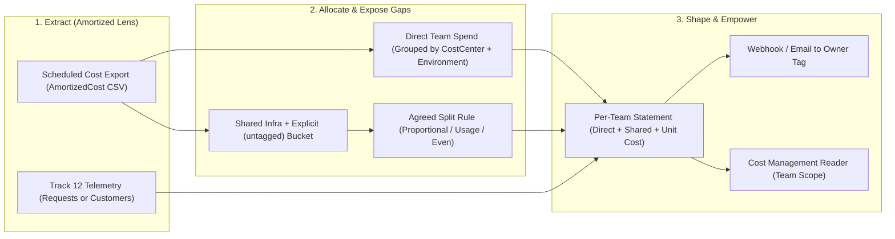
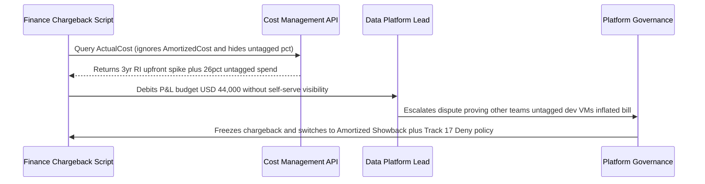

# Showback and Chargeback

> **Prerequisites:** Cost allocation & amortized views (Module 01), alert action groups (Module 02), optimization levers (Modules 03–05), scoped RBAC (Track 16), and tagging taxonomy/policy (Track 17 Module 06).  
> **Estimated Reading Time:** 30 minutes  
> **Target Audience:** Backend Engineers, Platform Engineers, Engineering Managers, FinOps Practitioners.

> [!TIP]
> **The Golden Rule of Showback and Chargeback:** Never graduate to **chargeback** while your `(untagged)` bucket is material or your shared-cost split is undocumented — prove allocation trust through repeatable **amortized showback** first, keep the `(untagged)` percentage explicitly visible rather than hiding it, and always pair cost statements with **unit economics** and scoped **Cost Management Reader** access so teams own efficiency rather than resenting raw totals.

---

## Why This Matters

Everything so far — allocation (module 01), budgets (module 02), optimization (modules 03–05) — quietly assumes the *platform team* is doing the work. But cost only becomes an engineering concern (module 00's culture shift) when the teams *incurring* the spend can see it, own it, and feel it. **Showback** and **chargeback** are the Operate-phase mechanisms that push cost accountability out to the teams: showback *shows* each team what they spent; chargeback actually *bills* them for it. Both are built entirely on the tagging taxonomy from **track 17 module 06** you've keyed off all track. This module turns "the platform team nags people about the bill" into "each team sees their own numbers and changes their own behavior" — the single most important cultural move in FinOps.

---

## 1. Architectural Mental Model: Automated Showback & Allocation Pipeline

A trustworthy showback practice behaves like a deterministic data pipeline rather than an ad-hoc month-end spreadsheet. Every month after billing closes, a scheduled export extracts **AmortizedCost** usage tagged with `CostCenter`, `Environment`, and `Owner`; separates direct team spend from `(untagged)` and genuinely shared infrastructure; applies a documented allocation rule; divides by business denominators from observability (Track 12); and delivers an identical, reproducible statement directly to the team alongside scoped self-serve access:



### Showback vs. chargeback: visibility vs. accountability

The two words name a spectrum of how *hard* cost accountability lands on a team:

- **Showback** — you **report** to each team what their spend was, for transparency and behavior change, but the money doesn't actually move between budgets. It's "here's your \$12,000 of cloud last month" as information. Low friction, no accounting machinery, and it's where almost every org should **start** — visibility alone changes behavior surprisingly well.
- **Chargeback** — you actually **bill** the team's own budget for their cloud spend; the cost is a real line item against their P&L, not just a report. High accountability (teams feel it directly), but high friction: it needs accurate, defensible, dispute-resistant allocation, finance buy-in, and an internal billing process, because now the numbers **move real money** and every error is an argument.

The maturity path is **showback → chargeback**: prove the allocation is accurate and trusted with showback first, *then* graduate to chargeback once teams believe the numbers. Jumping straight to chargeback on shaky allocation (a big "(untagged)" bucket, module 01) is how FinOps gets a reputation for "finance fighting engineering over wrong bills." Many mature orgs deliberately **stay at showback** — the visibility delivers most of the behavioral value without the overhead.

### It's all built on the tags (track 17 module 06)

Neither showback nor chargeback is possible without **allocatable cost**, and that allocation is exactly the tagging taxonomy from **track 17 module 06**: **`CostCenter`** maps spend to a team's financial code, **`Owner`** names who to send the report to, **`Environment`** splits a team's dev vs prod, and **`Project`/`Application`** slice within a team. A showback report is, mechanically, a **Cost Analysis query grouped by `CostCenter`** (module 01) shaped into a per-team statement. This is why every earlier module hammered the tags: **the report is only as complete and trustworthy as the tagging was at usage time.** Two consequences that this module has to confront directly: (1) the **"(untagged)" bucket** (module 01) — spend that *can't* be attributed to any team — must be handled explicitly (usually a **shared/platform cost pool** split by an agreed rule), because you can't just drop it; and (2) **shared costs** that genuinely belong to no single team (a shared AKS cluster's control plane, a shared gateway, networking) need a documented **allocation method**. Showback exposes exactly how good — or bad — your track-17 tagging discipline really was.

### Handling shared and untagged cost — the hard, political part

The clean 90% of a bill maps to a team via `CostCenter` and is easy. The messy 10% — **shared infrastructure** and **untagged spend** — is where showback gets political, because *how you split it decides who pays*. Common allocation methods, each defensible and each arguable:

- **Even split** — divide shared cost equally across teams. Simple; unfair if teams differ wildly in size.
- **Proportional (by direct spend)** — allocate shared cost in proportion to each team's *directly-attributed* spend. The most common default: big consumers of direct resources probably drive proportionally more shared cost too.
- **Usage-based** — split by an actual usage metric (a shared cluster split by each team's pod CPU-hours, a shared gateway by request count from track 12/19). The fairest and the hardest — it needs real usage data per team.

The untagged bucket is handled the same way (a shared pool, split by an agreed method) **while you fix the tagging going forward** — but the honest move is to make the untagged number **visible in the report** so it creates pressure to shrink it, not silently absorb it. There's no objectively correct method; the FinOps skill is **agreeing a method openly, documenting it, and applying it consistently** so the conversation is about behavior, not about whether the allocation is rigged. This is the "organizational conversation" showback enables — and it's a feature: it forces the org to decide, out loud, who owns shared cost.

### Building a showback report: query, shape, distribute

A showback report is a repeatable pipeline, not a one-off spreadsheet:

1. **Query** amortized cost (module 01 — amortized so commitments from module 05 are fairly spread) grouped by `CostCenter` (and `Environment`) over a **complete period** (last month), scoped at the subscription or management group (track 17).
2. **Allocate** the shared/untagged pool by your documented method.
3. **Shape** into a per-team statement: direct cost, allocated shared cost, total, trend vs. last period, and the team's **unit cost** (module 00 — cost per request/customer, pairing this with the denominator from track 12).
4. **Distribute** it — to the `Owner` of each `CostCenter`, ideally where they'll see it (a dashboard, an email, a Teams/Slack post via the same webhook/action-group plumbing from module 02 / track 07).

The right tool depends on scale: the portal's Cost Analysis with a `CostCenter` grouping *is* a showback view for eyeballing; a **scheduled Cost Management export** (CSV to storage) feeds a scripted report or a Power BI dashboard for something teams check themselves; the `az costmanagement` CLI (module 01) scripts it. The key property is **repeatability** — a report you regenerate identically every month, so trends are real and the numbers are trusted, not a bespoke spreadsheet that changes shape and invites disputes.

### The point is behavior change, not accounting

The reason to do any of this is **module 00's culture shift**, made operational. A team that receives a monthly statement showing their dev environment costs more than their prod, or that their cost-per-customer is climbing, will **change its own behavior** — far more effectively than the platform team filing tickets. Showback works because it puts the number in front of the people who can act on it (the same principle as module 07's PR-time cost gate, just monthly instead of per-change). Two guardrails keep it healthy: **pair the report with the ability to act** (the team needs Cost Management Reader at their scope from module 01, and the optimization levers from modules 03–05, or the report is just blame), and **lead with unit economics, not raw totals** (module 00) — a team whose total grew because it doubled customers should be *celebrated*, and only a unit-cost view tells that story correctly. Showback done as "here's your bill, be cheaper" breeds resentment; showback done as "here's your efficiency, here's how to improve it, here's the lever" builds ownership.

---

## 2. Taxonomic Comparison & Command Reference

### Showback vs. Chargeback Maturity Matrix

| Dimension | Showback (Informational Reporting) | Chargeback (Internal Financial Billing) |
| :--- | :--- | :--- |
| **Financial Movement** | None — informational statements only | Real budget transfers / GL journal entries against team P&L |
| **Organizational Friction** | Low — zero accounting reconciliation required | High — requires Finance sign-off and dispute resolution SLA |
| **Required Tag Quality** | Tolerates ~5–15% `(untagged)` while tagging improves | Demands near-zero `(untagged)` (`<2–5%`) and locked `Deny` policy |
| **Primary Outcome** | Visibility, unit-cost awareness, voluntary optimization | Hard financial accountability when showback alone stalls |
| **Failure Mode If Premature** | Teams ignore inaccurate spreadsheets | Finance-vs-engineering warfare over wrong/untrusted internal bills |

### Shared & Untagged Cost Allocation Methods

| Method | Formula / Rule | Telemetry Needed | Fairness Profile | Best Suited For |
| :--- | :--- | :--- | :--- | :--- |
| **Even Split** | `SharedPool / TeamCount` | Team list only | Penalizes small teams; favors massive consumers | Early-stage orgs with similarly sized teams |
| **Proportional (Direct Spend)** | `SharedPool * (TeamDirect / TotalDirect)` | Tagged `CostCenter` spend | Defensible default; assumes direct spend correlates with shared load | General platform overhead, untagged legacy pools |
| **Usage-Based** | `SharedPool * (TeamMetric / TotalMetric)` | Pod CPU-hrs, API requests, ingress GB | Highest fairness; rewards efficient consumers | Shared multi-tenant AKS clusters, API Gateways, NAT/egress |

### Tag Taxonomy Roles in Showback (Track 17 Module 06)

| Tag Key | Showback Pipeline Function | Example Value | If Missing (`(untagged)`) |
| :--- | :--- | :--- | :--- |
| **`CostCenter`** | Primary group-by key attributing direct spend to a team | `cc-payments-402` | Falls into explicit `(untagged)` pool |
| **`Owner`** | Distribution target for monthly report & orphan verification | `payments-eng@corp.com` | Report has no accountable recipient |
| **`Environment`** | Splits team spend into `prod` vs. `dev`/`staging` efficiency | `prod` / `dev` | Hides oversized non-prod waste inside team total |
| **`Project` / `Application`** | Sub-slices cost by microservice or product initiative | `checkout-api` | Blocks feature-level unit-cost attribution |

### Command Reference

Cost queries and exports are **free**. A scheduled export writes CSVs to a storage account (trivially cheap; clean it up).

| Command | What it does | Example |
|---|---|---|
| `az costmanagement query --dataset-grouping type=Tag name=CostCenter` | The core showback query — cost grouped by team (module 01) | see module 01; use `--type AmortizedCost` |
| `az costmanagement export create` | Schedules a recurring CSV export of cost data to Blob storage (feeds a repeatable report) | see breakdown below |
| `az costmanagement export list` / `run` | Lists/triggers exports | `az costmanagement export run --name showback-monthly --scope <scope>` |
| `az storage blob download` | Pulls the exported CSV to process into a per-team statement | `az storage blob download --account-name <sa> -c exports -n <blob> -f report.csv` |
| `az role assignment create --role "Cost Management Reader"` | Gives a team read access to *their* scope's cost (module 01 / track 16) | `az role assignment create --assignee <team-group> --role "Cost Management Reader" --scope <team-scope>` |
| `az monitor action-group ...` (webhook) | Distributes the report to a team channel (reuse from module 02 / track 07) | `--action webhook team-slack <url>` |

Flag breakdown — `az costmanagement export create --name showback-monthly --scope "/subscriptions/<id>" --storage-account-id <sa-id> --storage-container exports --timeframe MonthToDate --recurrence Monthly --recurrence-period from=2026-08-01 to=2027-12-31 --schedule-status Active`:

- `--scope "/subscriptions/<id>"` — the scope to export (subscription or a management group to cover the whole org, track 17). The export carries the tag columns, so grouping by `CostCenter` happens downstream.
- `--storage-account-id` / `--storage-container exports` — where the CSV lands; a cheap storage account (module 04) that your report script or Power BI reads.
- `--timeframe MonthToDate` — what each run captures (use `TheLastMonth` on a monthly recurrence to export completed periods).
- `--recurrence Monthly --recurrence-period from=... to=...` — run it **every month automatically** — the repeatability that makes showback trustworthy.
- `--schedule-status Active` — enable it now (vs. `Inactive` to stage it).

---

## 3. Production War Story Post-Mortem: Premature Chargeback on Actual Cost & Hidden Untagged Pool

| Field | Incident Details |
| :--- | :--- |
| **Severity** | **SEV-2** (FinOps Governance Breakdown & Disputed Internal Billing) |
| **Detection / Resolution Time** | Escalated within 48 hours of month-end close / Resolved in 10 business days via chargeback freeze |
| **Impact** | Data Platform team wrongly charged \$44,000 for an unrelated 3-year RI purchase spike plus an opaque 26% untagged pool split evenly, triggering 14 finance dispute tickets and halting optimization work for a quarter |

### What Happened

Platform leadership skipped showback and jumped directly to monthly GL chargeback. The export script queried `ActualCost` rather than `AmortizedCost`, capturing a centralized 3-year compute RI upfront charge inside the subscription where Data Platform happened to hold the primary billing tag, and silently merged a 26% `(untagged)` bucket into an "Infrastructure Overhead" line split evenly across all 4 product teams. When Engineering Leads received P&L debits without `Cost Management Reader` access or unit-cost context, they proved the bill included test clusters from two other teams and rejected the entire FinOps program.



### Root Cause Analysis

1. **Wrong billing view (`ActualCost`)**: Upfront commitment purchases (Module 05) distorted a single month and team instead of amortizing proportionally across consuming resources.
2. **Opaque allocation gap**: Hiding 26% `(untagged)` spend inside an undocumented even split transferred one team's missing tags onto disciplined teams.
3. **Zero self-serve verification**: Teams lacked `Cost Management Reader` on their resource groups to verify line items before billing finalized.

### The Fix & Architectural Hardening

- Rolled back to **monthly showback** until `(untagged)` fell below `3%` via Track 17 Module 06 `Deny` tag-enforcement policies on new deployments.
- Switched the scheduled export to **`AmortizedCost`**, surfaced the explicit `(untagged)` percentage banner at the top of every report, documented a **proportional-to-direct-spend** shared split, and granted every team `Cost Management Reader` on its scope.

---

## 4. Multi-Language Production Implementation: Amortized Showback & Proportional Allocation Engine

These four production modules build a deterministic monthly showback report from amortized line items: they group direct team spend by `CostCenter` and `Environment` (`prod` vs `dev`), explicitly isolate and measure `(untagged)` spend percentage (gating chargeback readiness when `untaggedPct > 5%`), allocate the shared + untagged pool proportionally across tagged teams with **last-team penny reconciliation**, and compute **unit cost per 1,000 requests** from observability telemetry.

````carousel
```go
package showback

import (
	"errors"
	"math"
	"sort"
)

type AmortizedLineItem struct {
	CostCenter  string
	Environment string
	SharedPool  bool
	AmountUSD   float64
}

type TeamStatement struct {
	CostCenter       string
	DirectUSD        float64
	DevUSD           float64
	AllocatedPoolUSD float64
	TotalUSD         float64
	UnitCostPer1kReq float64
}

type ShowbackReport struct {
	TotalUSD        float64
	UntaggedUSD     float64
	UntaggedPercent float64
	ChargebackReady bool
	Statements      []TeamStatement
}

func BuildShowbackReport(items []AmortizedLineItem, reqsByTeam map[string]int64) (ShowbackReport, error) {
	if len(items) == 0 {
		return ShowbackReport{}, errors.New("cannot generate showback from empty amortized dataset")
	}

	directByTeam := make(map[string]float64)
	devByTeam := make(map[string]float64)
	var totalUSD, directSum, sharedUSD, untaggedUSD float64

	for _, it := range items {
		totalUSD += it.AmountUSD
		switch {
		case it.SharedPool:
			sharedUSD += it.AmountUSD
		case it.CostCenter == "":
			untaggedUSD += it.AmountUSD
		default:
			directSum += it.AmountUSD
			directByTeam[it.CostCenter] += it.AmountUSD
			if it.Environment == "dev" {
				devByTeam[it.CostCenter] += it.AmountUSD
			}
		}
	}

	untaggedPct := 0.0
	if totalUSD > 0 {
		untaggedPct = math.Round((untaggedUSD/totalUSD)*10000) / 100
	}

	teams := make([]string, 0, len(directByTeam))
	for cc := range directByTeam {
		teams = append(teams, cc)
	}
	sort.Strings(teams)

	poolTotal := sharedUSD + untaggedUSD
	poolRemainingCents := int64(math.Round(poolTotal * 100))
	statements := make([]TeamStatement, 0, len(teams))

	for i, cc := range teams {
		direct := directByTeam[cc]
		var alloc float64
		if directSum > 0 {
			if i == len(teams)-1 {
				alloc = float64(poolRemainingCents) / 100.0
			} else {
				cents := int64(math.Round((direct / directSum) * poolTotal * 100))
				poolRemainingCents -= cents
				alloc = float64(cents) / 100.0
			}
		}
		totalTeam := math.Round((direct+alloc)*100) / 100
		unitCost := 0.0
		if reqs := reqsByTeam[cc]; reqs > 0 {
			unitCost = math.Round((totalTeam/(float64(reqs)/1000.0))*10000) / 10000
		}
		statements = append(statements, TeamStatement{
			CostCenter:       cc,
			DirectUSD:        math.Round(direct*100) / 100,
			DevUSD:           math.Round(devByTeam[cc]*100) / 100,
			AllocatedPoolUSD: alloc,
			TotalUSD:         totalTeam,
			UnitCostPer1kReq: unitCost,
		})
	}

	return ShowbackReport{
		TotalUSD:        math.Round(totalUSD*100) / 100,
		UntaggedUSD:     math.Round(untaggedUSD*100) / 100,
		UntaggedPercent: untaggedPct,
		ChargebackReady: untaggedPct <= 5.0 && directSum > 0,
		Statements:      statements,
	}, nil
}
```
<!-- slide -->
```typescript
export interface AmortizedLineItem {
  costCenter?: string;
  environment?: string;
  sharedPool?: boolean;
  amountUsd: number;
}

export interface TeamStatement {
  costCenter: string;
  directUsd: number;
  devUsd: number;
  allocatedSharedUsd: number;
  totalUsd: number;
  unitCostPer1kRequests: number;
}

export interface ShowbackReport {
  totalUsd: number;
  untaggedUsd: number;
  untaggedPercent: number;
  chargebackReady: boolean;
  statements: TeamStatement[];
}

export function buildMonthlyShowback(
  items: AmortizedLineItem[],
  requestsByTeam: Record<string, number>
): ShowbackReport {
  if (items.length === 0) {
    throw new Error("Amortized cost export contains zero line items");
  }

  const direct = new Map<string, number>();
  const dev = new Map<string, number>();
  let total = 0;
  let directSum = 0;
  let shared = 0;
  let untagged = 0;

  for (const row of items) {
    total += row.amountUsd;
    if (row.sharedPool) {
      shared += row.amountUsd;
    } else if (!row.costCenter) {
      untagged += row.amountUsd;
    } else {
      directSum += row.amountUsd;
      direct.set(row.costCenter, (direct.get(row.costCenter) ?? 0) + row.amountUsd);
      if (row.environment?.toLowerCase() === "dev") {
        dev.set(row.costCenter, (dev.get(row.costCenter) ?? 0) + row.amountUsd);
      }
    }
  }

  const untaggedPercent = total > 0 ? Number(((untagged / total) * 100).toFixed(2)) : 0;
  const poolTotal = shared + untagged;
  let remainingCents = Math.round(poolTotal * 100);
  const teams = [...direct.keys()].sort();

  const statements: TeamStatement[] = teams.map((cc, idx) => {
    const teamDirect = direct.get(cc) ?? 0;
    let alloc = 0;
    if (directSum > 0) {
      if (idx === teams.length - 1) {
        alloc = remainingCents / 100;
      } else {
        const cents = Math.round((teamDirect / directSum) * poolTotal * 100);
        remainingCents -= cents;
        alloc = cents / 100;
      }
    }
    const teamTotal = Number((teamDirect + alloc).toFixed(2));
    const reqs = requestsByTeam[cc] ?? 0;
    return {
      costCenter: cc,
      directUsd: Number(teamDirect.toFixed(2)),
      devUsd: Number((dev.get(cc) ?? 0).toFixed(2)),
      allocatedSharedUsd: Number(alloc.toFixed(2)),
      totalUsd: teamTotal,
      unitCostPer1kRequests: reqs > 0 ? Number((teamTotal / (reqs / 1000)).toFixed(4)) : 0,
    };
  });

  return {
    totalUsd: Number(total.toFixed(2)),
    untaggedUsd: Number(untagged.toFixed(2)),
    untaggedPercent,
    chargebackReady: untaggedPercent <= 5.0 && directSum > 0,
    statements,
  };
}
```
<!-- slide -->
```python
from collections import defaultdict
from dataclasses import dataclass


@dataclass(frozen=True)
class AmortizedLineItem:
    cost_center: str | None
    environment: str | None
    amount_usd: float
    shared_pool: bool = False


@dataclass(frozen=True)
class TeamStatement:
    cost_center: str
    direct_usd: float
    dev_usd: float
    allocated_shared_usd: float
    total_usd: float
    unit_cost_per_1k_requests: float


def generate_showback_report(
    items: list[AmortizedLineItem],
    requests_by_team: dict[str, int],
) -> dict:
    """Aggregate amortized spend by CostCenter, expose untagged %, and split shared pool proportionally."""
    if not items:
        raise ValueError("Amortized export is empty")

    direct: dict[str, float] = defaultdict(float)
    dev_spend: dict[str, float] = defaultdict(float)
    total_usd = direct_sum = shared_usd = untagged_usd = 0.0

    for item in items:
        total_usd += item.amount_usd
        if item.shared_pool:
            shared_usd += item.amount_usd
        elif not item.cost_center:
            untagged_usd += item.amount_usd
        else:
            direct_sum += item.amount_usd
            direct[item.cost_center] += item.amount_usd
            if (item.environment or "").lower() == "dev":
                dev_spend[item.cost_center] += item.amount_usd

    untagged_pct = round((untagged_usd / total_usd) * 100, 2) if total_usd > 0 else 0.0
    pool_total = shared_usd + untagged_usd
    remaining_cents = round(pool_total * 100)
    teams = sorted(direct.keys())
    statements: list[TeamStatement] = []

    for idx, cc in enumerate(teams):
        team_direct = direct[cc]
        if direct_sum <= 0:
            alloc = 0.0
        elif idx == len(teams) - 1:
            alloc = remaining_cents / 100.0
        else:
            cents = round((team_direct / direct_sum) * pool_total * 100)
            remaining_cents -= cents
            alloc = cents / 100.0

        team_total = round(team_direct + alloc, 2)
        reqs = requests_by_team.get(cc, 0)
        unit_cost = round(team_total / (reqs / 1000.0), 4) if reqs > 0 else 0.0
        statements.append(
            TeamStatement(
                cost_center=cc,
                direct_usd=round(team_direct, 2),
                dev_usd=round(dev_spend[cc], 2),
                allocated_shared_usd=round(alloc, 2),
                total_usd=team_total,
                unit_cost_per_1k_requests=unit_cost,
            )
        )

    return {
        "total_usd": round(total_usd, 2),
        "untagged_usd": round(untagged_usd, 2),
        "untagged_percent": untagged_pct,
        "chargeback_ready": untagged_pct <= 5.0 and direct_sum > 0,
        "statements": statements,
    }
```
<!-- slide -->
```csharp
using System;
using System.Collections.Generic;
using System.Linq;

public sealed record AmortizedLineItem(
    string? CostCenter,
    string? Environment,
    decimal AmountUsd,
    bool SharedPool = false);

public sealed record TeamStatement(
    string CostCenter,
    decimal DirectUsd,
    decimal DevUsd,
    decimal AllocatedSharedUsd,
    decimal TotalUsd,
    decimal UnitCostPer1kRequests);

public sealed record ShowbackReport(
    decimal TotalUsd,
    decimal UntaggedUsd,
    decimal UntaggedPercent,
    bool ChargebackReady,
    IReadOnlyList<TeamStatement> Statements);

public static class ShowbackAllocator
{
    public static ShowbackReport Build(
        IReadOnlyCollection<AmortizedLineItem> items,
        IReadOnlyDictionary<string, long> requestsByTeam)
    {
        if (items.Count == 0)
            throw new ArgumentException("Amortized export must not be empty.", nameof(items));

        var direct = new Dictionary<string, decimal>(StringComparer.OrdinalIgnoreCase);
        var dev = new Dictionary<string, decimal>(StringComparer.OrdinalIgnoreCase);
        decimal total = 0m, directSum = 0m, shared = 0m, untagged = 0m;

        foreach (var row in items)
        {
            total += row.AmountUsd;
            if (row.SharedPool)
                shared += row.AmountUsd;
            else if (string.IsNullOrWhiteSpace(row.CostCenter))
                untagged += row.AmountUsd;
            else
            {
                directSum += row.AmountUsd;
                direct[row.CostCenter] = direct.GetValueOrDefault(row.CostCenter) + row.AmountUsd;
                if (string.Equals(row.Environment, "dev", StringComparison.OrdinalIgnoreCase))
                    dev[row.CostCenter] = dev.GetValueOrDefault(row.CostCenter) + row.AmountUsd;
            }
        }

        decimal untaggedPct = total > 0 ? Math.Round((untagged / total) * 100m, 2) : 0m;
        decimal poolTotal = shared + untagged;
        long remainingCents = (long)Math.Round(poolTotal * 100m, MidpointRounding.AwayFromZero);

        var teams = direct.Keys.OrderBy(k => k, StringComparer.Ordinal).ToList();
        var statements = new List<TeamStatement>(teams.Count);

        for (int i = 0; i < teams.Count; i++)
        {
            string cc = teams[i];
            decimal teamDirect = direct[cc];
            decimal alloc = 0m;
            if (directSum > 0)
            {
                if (i == teams.Count - 1)
                {
                    alloc = remainingCents / 100m;
                }
                else
                {
                    long cents = (long)Math.Round((teamDirect / directSum) * poolTotal * 100m, MidpointRounding.AwayFromZero);
                    remainingCents -= cents;
                    alloc = cents / 100m;
                }
            }

            decimal teamTotal = Math.Round(teamDirect + alloc, 2);
            long reqs = requestsByTeam.GetValueOrDefault(cc, 0);
            decimal unitCost = reqs > 0 ? Math.Round(teamTotal / (reqs / 1000m), 4) : 0m;

            statements.Add(new TeamStatement(
                cc,
                Math.Round(teamDirect, 2),
                Math.Round(dev.GetValueOrDefault(cc), 2),
                alloc,
                teamTotal,
                unitCost));
        }

        return new ShowbackReport(
            Math.Round(total, 2),
            Math.Round(untagged, 2),
            untaggedPct,
            untaggedPct <= 5.0m && directSum > 0m,
            statements);
    }
}
```
````

---

## 5. Practical Hands-On Verification CLI Workflows

Queries and exports are free; the export's storage account is trivially cheap and cleaned up. Work against your real cost data — the messier your tagging, the more honest the showback.

### 1. Produce a raw per-team showback view
Run the module 01 `CostCenter` grouping over **last month** with `--type AmortizedCost`:
```bash
SUB_ID=$(az account show --query id -o tsv)
az costmanagement query \
  --scope "/subscriptions/$SUB_ID" \
  --type AmortizedCost \
  --timeframe TheLastMonth \
  --dataset-aggregation '{"totalCost":{"name":"Cost","function":"Sum"}}' \
  --dataset-grouping type=Tag name=CostCenter -o table
```

**Expected Output:**
```text
Cost       TagKey      TagValue     Currency
---------  ----------  -----------  ----------
142.80     CostCenter  payments     USD
 89.40     CostCenter  web          USD
 24.15     CostCenter               USD
```
> Verify: this *is* a showback report in its rawest form — each row is a team's direct spend. Write down the per-team totals and, prominently, the **(untagged)** row (`TagValue` blank).

### 2. Measure and confront the untagged bucket
From exercise 1, compute the untagged spend as a **percentage of total**. This is the fraction you *cannot* attribute to any team — the ceiling on how accurate your showback can be. Write it down; if it's large, note that chargeback is not yet safe (you'd be billing teams for a guess).

### 3. Split a shared/untagged pool three ways
Take the untagged (or a genuinely shared) cost total and allocate it across your teams by each of the three methods: **even**, **proportional to direct spend**, and (design-level) **usage-based**. Write down how each method changes who pays what. Notice that the *method choice* alone moves real money between teams — this is the political core of showback.

### 4. Add environment breakdown per team
Re-run grouped by **both** `CostCenter` and `Environment` (two groupings, or filter per team):
```bash
az costmanagement query \
  --scope "/subscriptions/$SUB_ID" \
  --type AmortizedCost \
  --timeframe TheLastMonth \
  --dataset-aggregation '{"totalCost":{"name":"Cost","function":"Sum"}}' \
  --dataset-grouping type=Tag name=CostCenter \
  --dataset-grouping type=Tag name=Environment -o table
```

**Expected Output:**
```text
Cost       CostCenter  Environment
---------  ----------  -----------
 98.50     payments    prod
 44.30     payments    dev
 31.20     web         prod
 58.20     web         dev
```
> Now each team's statement shows dev vs prod. Write down any team whose **dev** costs a surprising fraction of its total (like `web` above where dev exceeds prod) — that's an instant behavior-change conversation (module 03's scale-to-zero, module 04's cleanup).

### 5. Compute a per-team unit cost (module 00 + track 12)
For one team, take its total from exercise 1 and divide by a real denominator you can get from observability (track 12) — requests served, customers, transactions. Present the team's cost as **cost per unit**, not raw dollars. Write down why this framing changes how the team receives the report.

### 6. Schedule a repeatable export
Create a cheap storage account and schedule a monthly export:
```bash
az group create -n rg-showback -l eastus
SA=showback$RANDOM
az storage account create -n "$SA" -g rg-showback --sku Standard_LRS
SAID=$(az storage account show -n "$SA" -g rg-showback --query id -o tsv)
az costmanagement export create --name showback-monthly \
  --scope "/subscriptions/$(az account show --query id -o tsv)" \
  --storage-account-id "$SAID" --storage-container exports \
  --timeframe MonthToDate --recurrence Monthly \
  --recurrence-period from=$(date +%Y-%m-01) to=2027-12-31 --schedule-status Active \
  2>/dev/null || echo "some subscription types create exports via the portal (Cost Management → Exports)"
az costmanagement export run --name showback-monthly --scope "/subscriptions/$(az account show --query id -o tsv)"
```

**Expected Output:**
```text
Export run queued for showback-monthly; CSV file appears under container 'exports' in storage account showback<id>.
```
> Trigger it once with `az costmanagement export run --name showback-monthly --scope "/subscriptions/$(az account show --query id -o tsv)"` and note the CSV landing in the container. This repeatable pipeline is what makes monthly showback trustworthy vs. a one-off spreadsheet.

### 7. Grant a team scoped visibility (so the report isn't just blame)
Recall from module 01 that a team needs to *see* their own cost to own it. Inspect the role you'd grant:
```bash
az role definition list --name "Cost Management Reader" --query "[].{name:roleName, actions:permissions[0].actions}" -o jsonc
```

**Expected Output:**
```json
[
  {
    "actions": [
      "Microsoft.CostManagement/*/read",
      "Microsoft.Consumption/*/read",
      "Microsoft.Authorization/*/read"
    ],
    "name": "Cost Management Reader"
  }
]
```
> Write down the exact scope (from the track-17 tree) you'd assign it at for one team, so they can self-serve their numbers between reports.

### 8. Draft the distribution
Sketch how the monthly statement reaches each team: the `Owner` tag → the team's channel via a webhook action group (reuse module 02 / track 07). Write the two-sentence framing you'd put at the top of the report so it reads as "your efficiency and levers" (module 00), not "your bill, be cheaper."

### 9. Diagnose and fix: the showback report teams don't trust (so ignore)
The cultural failure mode. Scenario: you send monthly showback, but a team disputes it and stops engaging — "these numbers are wrong, half our stuff isn't even in here."

> **Diagnose:** the cause is almost always **allocation quality** — a large **(untagged)** bucket (module 01) means the team's real spend is understated or dumped into a shared pool they think is unfair, *or* the shared-cost method was never agreed/documented so it looks arbitrary. It's rarely that the team is being difficult; it's that the allocation isn't **trustworthy** yet.
> **Fix:** (a) shrink untagged by enforcing tags at create time going forward (track 17 module 06's `Deny`) — you can't fix the past, only the future; (b) **document and agree** the shared-cost allocation method openly so it's defensible, not arbitrary; (c) stay at **showback, not chargeback**, until the allocation is trusted — don't move real money on numbers teams dispute; and (d) lead with **unit cost**, so a team that grew isn't wrongly shamed. Lesson: **showback fails on trust, not on math — fix allocation quality and agree the method before expecting behavior change, and never graduate to chargeback on allocation teams don't believe.**

### 10. Clean up
```bash
az group delete -n rg-showback --yes --no-wait
```

**Expected Output:**
```text
(Accepted: asynchronous deletion of rg-showback started; verify with az group exists -n rg-showback)
```
> Keep the export if you want ongoing showback. Confirm the RG is gone.

### Independent challenge

No commands given. Drawing on this module, the tagging taxonomy from **track 17 module 06**, Cost Analysis and the amortized view from **module 01**, unit economics from **module 00**, the denominator from **track 12**, and the distribution plumbing from **module 02/track 07**, build a **complete monthly showback report** for the three-team org (Payments/Web/Data) on your real subscription. It must: attribute **direct cost per team** via `CostCenter`; make the **(untagged) bucket explicit** with its percentage; allocate **shared/untagged cost** by a **documented, justified method** (state which of even/proportional/usage-based and why); include each team's **dev-vs-prod split** and a **per-team unit cost**; and be produced by a **repeatable** pipeline (a scheduled export or a saved query), not a one-off. Finish with a written argument for whether this org is ready for **chargeback** or should stay at **showback**, justified by your untagged percentage and allocation trust. The deliverable is the report, the documented allocation method, and the showback-vs-chargeback recommendation.

<details><summary>Stuck? One hint</summary>

Start from the module 01 `az costmanagement query --type AmortizedCost --dataset-grouping type=Tag name=CostCenter` over `TheLastMonth` — that single query is 90% of the report. The other 10% is the hard part: the **(untagged)** row and any genuinely shared resources. Don't hide them — surface the untagged percentage at the top of the report (it creates the pressure to fix tagging), and allocate the shared pool by **proportional-to-direct-spend** as a defensible default unless you have real per-team usage data (track 12) to do usage-based. Amortized (not actual) is mandatory so any module-05 commitments are spread fairly across teams rather than dumped on whoever's report happens to fall on the purchase day. For the chargeback readiness call: if untagged is more than a few percent or the shared method isn't agreed, the answer is "stay at showback" — you never move real money on allocation teams can dispute.

</details>

---

## 6. Common Mistakes & Troubleshooting

- **Jumping to chargeback on shaky allocation.** Billing teams' budgets on numbers they dispute (big untagged bucket, undocumented shared split) turns FinOps into finance-vs-engineering warfare. Prove trust with showback first.
- **Hiding the untagged bucket.** Silently absorbing unattributable cost into a shared pool makes the report look clean but hides the real problem. Surface the untagged percentage so it creates pressure to fix tagging (track 17 module 06).
- **Using an undocumented/arbitrary shared-cost method.** How you split shared cost decides who pays — if it isn't agreed and documented, teams (correctly) call it rigged. Pick a method openly, write it down, apply it consistently.
- **Reporting raw totals instead of unit cost.** A team that grew looks like it overspent unless you show **cost per customer/request** (module 00). Lead with efficiency, or you punish growth.
- **Analyzing with actual instead of amortized cost.** After any commitment (module 05), actual cost dumps a purchase spike on one report. Use **amortized** so commitments are spread fairly across teams and months.
- **Sending a report a team can't act on.** Without Cost Management Reader at their scope (module 01) and the levers from modules 03–05, showback is just blame. Pair the number with visibility and the ability to change it.
- **A bespoke spreadsheet each month.** If the report's shape changes monthly, trends and trust evaporate. Make it a **repeatable** pipeline (scheduled export / saved query) that regenerates identically.

---

## 7. Operational Validation Checkpoints & Checkpoint Quiz

### Operational Validation Checkpoints

<details><summary><strong>Checkpoint 1: Chargeback Readiness Gate When Untagged Spend Exceeds 15%</strong></summary>

Even if Finance requests immediate GL chargeback, an `(untagged)` share above 5% (and especially above 15%) guarantees disputes because any split rule transfers unattributed legacy spend onto compliant teams. Keep the program at **showback**, display the exact `(untagged)` percentage prominently, enforce Track 17 `Deny` tag policies for new resources, and defer chargeback until `(untagged)` stabilizes near zero and teams validate the numbers.

</details>

<details><summary><strong>Checkpoint 2: Defending Unit Economics When Total Monthly Spend Grows 40%</strong></summary>

If the Checkout team's total monthly bill climbs from \$10,000 to \$14,000 (+40%) while API requests served double from 100M to 200M (+100%), raw-dollar showback wrongly triggers alarm. Leading with **unit cost** reveals cost dropped from \$0.10 to \$0.07 per 1,000 requests (-30%), celebrating efficiency improvement rather than penalizing healthy business growth.

</details>

<details><summary><strong>Checkpoint 3: Splitting a Shared Multi-Tenant AKS Cluster Fairly</strong></summary>

When three product teams share one large AKS cluster, an even split penalizes a small background worker team while giving heavy traffic teams a free ride. Using **usage-based allocation** (proportional to each namespace's pod CPU/memory requests over the billing period, sourced from Prometheus/Container Insights in Track 12) aligns cost directly with each team's rightsizing discipline from Module 03.

</details>

### Checkpoint quiz

Write down your answer to each question before expanding it — checking without attempting first is the single easiest way to fool yourself into thinking you've learned this.

1. What's the difference between showback and chargeback, and why should an org almost always start with showback?
2. Which tags from track 17 module 06 does a showback report depend on, and what does each contribute to the report?
3. Name the three common methods for allocating shared/untagged cost, and state the real reason the *choice* of method is politically charged.
4. What's the honest way to handle the "(untagged)" bucket in a report, and why not just silently absorb it into a shared pool?
5. Why must a showback report use *amortized* cost (module 01/05), and why lead with *unit* cost rather than raw totals (module 00)?
6. What makes a showback report *trustworthy* over time, and why does that property matter more than the exact allocation math?
7. Two things must accompany a showback report for it to change behavior rather than breed resentment. What are they, and which earlier modules provide each?
8. A team disputes its showback numbers and disengages. What's the most likely root cause, and is the fix "argue harder" or something else?

<details><summary>Show answers</summary>

1. **Showback** *reports* each team's spend for transparency (money doesn't move); **chargeback** actually *bills* the team's budget (real money moves). Start with showback because it's low-friction, changes behavior via visibility alone, and lets you prove the allocation is accurate *before* the numbers move money and every error becomes a dispute.
2. **`CostCenter`** (maps spend to a team's financial code — the core grouping), **`Owner`** (who to send the statement to), **`Environment`** (dev-vs-prod split per team), and **`Project`/`Application`** (slice within a team). The report is a Cost Analysis query grouped by these tags.
3. **Even split**, **proportional to direct spend**, and **usage-based**. The choice is charged because **how you split shared cost decides who pays** — there's no objectively correct method, so it must be agreed openly and documented, or it looks rigged.
4. Make it **explicitly visible** (its percentage) in the report and allocate it via an agreed shared-pool method **while fixing tagging going forward** (track 17's create-time `Deny`). Silently absorbing it hides the allocation problem and understates or misattributes teams' real spend.
5. **Amortized** so a commitment purchase (module 05) is spread fairly across usage/teams instead of spiking one report. **Unit cost** (per customer/request, module 00) so a team that grew isn't wrongly shamed — raw totals punish growth; unit cost shows efficiency.
6. **Repeatability** — a report regenerated identically every period (scheduled export / saved query) so trends are real and numbers are trusted. Trust matters more than precision because showback fails on *trust*, not on math — teams ignore numbers they don't believe, however accurate.
7. **Scoped visibility** (Cost Management Reader at the team's scope — module 01 / track 16) so they can self-serve, and **the ability to act** (the optimization levers from modules 03–05). Without both, the report is blame, not ownership.
8. Most likely **allocation quality** — a large untagged bucket or an undocumented/arbitrary shared-cost method, not a difficult team. The fix isn't to argue: shrink untagged going forward (track 17 `Deny`), **document and agree** the allocation method, stay at showback until trusted, and lead with unit cost.

</details>

---

## 8. Next

Continue to [07-cost-as-a-cicd-gate](../07-cost-as-a-cicd-gate/README.md) — showback moves the cost number in front of teams *monthly*. The final Operate-phase move shifts it **left**: showing the cost of a change *in the pull request*, before it's ever deployed, and enforcing cost guardrails as policy — tying this track back to the Terraform (track 09), CI/CD (track 10), and policy-as-code (tracks 11/17) you already know.
