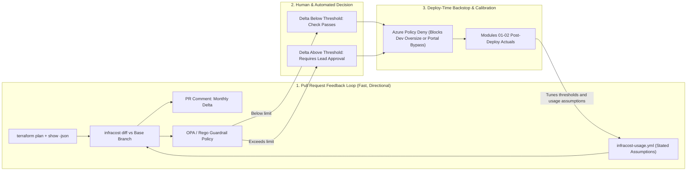
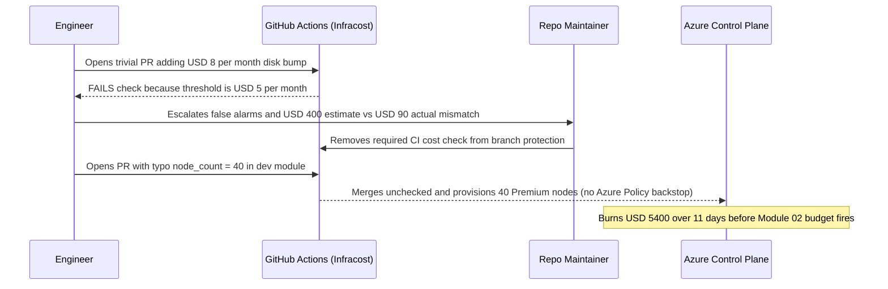

# Cost as a CI/CD Gate

> **Prerequisites:** Post-deploy cost tracking & budgets (Modules 01–02), Terraform plans (`terraform show -json`, Track 09), CI pipelines & secrets (Track 10/16), OPA/Rego policy (Track 11), and Azure Policy/tagging (Track 17).  
> **Estimated Reading Time:** 30 minutes  
> **Target Audience:** Backend Engineers, Platform Engineers, DevOps/SRE Engineers, Cloud Architects.

> [!TIP]
> **The Golden Rule of CI/CD Cost Gates:** Pair **fast PR-time feedback** (Infracost `diff` + OPA/Rego threshold approval guardrails calibrated high enough to earn respect) with an **unbypassable deploy-time backstop** (Azure Policy `Deny` on dev SKUs and Premium disk tiers), always frame the plan-time estimate as a **directional signal** rather than an invoice contract, and **close the loop** against post-deploy actuals (`Modules 01–02`).

---

## Why This Matters

Every module so far reacts to cost *after* it's incurred: Cost Analysis shows last month, budgets alert once spend crosses a line, showback reports what already happened. Even the fastest of these is a monthly or daily feedback loop — and by then the money is spent and the Terraform is already applied. This module closes the loop at the earliest possible point: **the pull request**. By estimating the cost of an infrastructure change *from its Terraform plan* and posting it as a **PR comment** — and enforcing hard **cost guardrails as policy** — you show engineers the price of a decision *while they're still making it*, exactly the "shift left" instinct behind tracks 10, 11, and 17. This is the culmination of module 00's culture shift: cost becomes a checked, visible property of every change, like tests and security scans already are.

---

## 1. Architectural Mental Model: Defense-in-Depth Shift-Left Cost Control Loop

A resilient cost gate operates across two distinct enforcement planes before any dollar hits the cloud bill, followed by a post-deploy calibration loop. In CI, `terraform show -json` feeds `infracost diff` (augmented by an `infracost-usage.yml` file for consumption metrics) to produce a PR comment and evaluate an OPA/Rego guardrail. At deploy time, Azure Policy acts as the unbypassable backstop for portal clicks or manual `terraform apply` runs, while Modules 01–02 post-deploy actuals continuously recalibrate your usage assumptions:



### Shift cost left: from month-end to the pull request

The core idea is **shifting cost feedback left** — moving it from the end of the lifecycle (the bill) to the beginning (the code review), the same move you already made for **tests** (track 10), **security scanning** (track 11), and **policy** (track 17). A cost estimate at PR time is worth more than a perfect report at month-end for one reason: **it reaches the engineer at the moment the decision is cheap to change.** Adding `node_count = 10` or bumping a disk to Premium in a Terraform PR is a one-line edit to reconsider *before* merge; the same change discovered on next month's bill is a deployed, running, argued-over cost. The whole Inform-phase premise (module 00 — "put the number where the decision is made") hits its sharpest point here: the PR diff is where infrastructure cost is *born*, so it's where the number belongs.

### Infracost: cost from a Terraform plan

**Infracost** is the standard open-source tool for this. It reads a **Terraform plan** (the `terraform plan` output from track 09 — the same plan you learned to *read* the `N to add` from) and produces a **cost estimate** by pricing each resource the plan would create/modify against cloud pricing data. It works because a Terraform plan is a **precise, declarative statement of exactly what will exist** — SKUs, sizes, counts, regions — which is exactly what you need to price it. Infracost runs in two main modes: **`infracost breakdown`** (the full estimated monthly cost of a configuration) and **`infracost diff`** (the *delta* a change introduces — "this PR adds \$340/month"), which is the one that belongs in a PR. Key honesty about what it can and can't do:

- It estimates **usage-independent** costs well (a VM's hourly rate, a disk's provisioned size, a fixed node count) — the things the plan pins down.
- It **can't** know **usage-based** costs (data egress, requests, storage *consumed*, function invocations) without a **usage file** you provide with assumptions — so its estimate is a **projection under stated assumptions**, not a guaranteed bill. This is the same caveat as module 01's forecasts, just at plan-time.

The value isn't a to-the-cent bill; it's a **directionally-correct, per-PR delta** that catches the accidental 10x before it merges.

### Wiring it into CI (tracks 09/10)

The gate lives in the **CI pipeline** you built in **track 10** (GitHub Actions / the CI system), operating on the **Terraform** from **track 09**. The pattern, on every PR that touches infrastructure:

1. `terraform init` and `terraform plan -out=plan.tfplan`, then `terraform show -json plan.tfplan > plan.json` — the machine-readable plan (track 09).
2. `infracost breakdown --path plan.json` on the PR branch and on the base branch — or `infracost diff` — to compute the **cost delta**.
3. **Post the delta as a PR comment** (Infracost's GitHub/GitLab integration, or a step that comments), so reviewers see "+\$340/month" right next to the code diff.
4. Optionally **fail the check** if the delta exceeds a threshold (see guardrails).

This is deliberately the same shape as the test/scan/policy steps already in your pipeline (track 10) and the signing/SBOM gates (track 18) — cost is just another **automated check** on the change. Infracost needs an API key (free tier available) for pricing data, stored as a CI secret (track 10's secrets handling / track 16). Because it runs on a *plan*, it never touches real infrastructure — the estimate is free and safe.

### Cost guardrails as policy (tracks 11/17)

A PR comment *informs*; a **guardrail** *enforces*. Two complementary layers, both reusing machinery you already have:

- **Threshold gates in CI** — fail the PR check if the cost **diff exceeds a limit** (e.g. ">\$500/month increase requires approval"), using Infracost's **policy support** (it can evaluate policies written in **OPA/Rego** — the *same* policy-as-code engine you met for admission control in track 11 and could apply to infra). This makes an expensive change a **blocking, override-with-approval** event, not a silent merge.
- **Preventive Azure Policy** — deny the expensive thing *at deploy time* regardless of pipeline, using **Azure Policy** from **track 17** (and track 11): deny VM SKUs above a size in dev, deny Premium disks in non-prod, restrict regions, require a lifecycle policy on storage (module 04). This is the **defense-in-depth** you already understand — the CI gate catches it in review, and Azure Policy catches it even if someone bypasses CI (a portal click, a rogue `terraform apply`). The CI gate is *fast feedback*; Azure Policy is the *hard backstop*.

The design principle is the track-11/17 one: **guardrails, not gates that block everything** — the goal is to make the *expensive path require a conscious, approved decision*, not to forbid spending. A gate that fails on every \$5 increase gets disabled; a gate that flags a \$2,000/month jump for a human to approve gets respected.

### The estimate is directional — treat it as a signal, not a contract

The failure mode that discredits the whole practice is **over-trusting the number**. Infracost's estimate is a **projection under assumptions** — it prices what the plan declares, applies default or usage-file assumptions for consumption, and can't see runtime reality (autoscaling that never triggers, a spot discount from module 05, an existing reservation, real egress). So the estimate can be **materially off** on usage-heavy resources, and someone will eventually "catch it being wrong" and argue the gate is worthless. The correct framing (and the honest one): the gate's job is to **catch the direction and the order of magnitude** — the accidental `count = 100`, the Premium-disk-in-dev, the forgotten always-on cluster — *before* merge, and to make cost **visible and discussed** in review. It is a **signal that prompts a conversation**, not a contract that predicts the invoice. Tune the threshold so it fires on changes worth a human look, feed it a realistic usage file for your big consumption resources, and pair it with the *actual* post-deploy cost tracking (modules 01–02) that measures what really happened. Plan-time estimate + post-deploy measurement is the full loop; the estimate alone is only half.

---

## 2. Taxonomic Comparison & Command Reference

### Defense-in-Depth Cost Guardrail Layers

| Dimension | CI Cost Gate (Infracost + OPA/Rego) | Azure Policy Backstop (ARM Deploy Time) |
| :--- | :--- | :--- |
| **Trigger Point** | Pull Request (`terraform plan` JSON) | ARM Control Plane (`terraform apply`, CLI, Portal) |
| **Feedback Speed** | Seconds — before merge or apply | Immediate `403 PolicyViolation` at deployment attempt |
| **Bypassability** | Bypassable by manual CLI/Portal edits or check overrides | Unbypassable within scoped subscription/MG |
| **Context Awareness** | Full PR diff, total monthly delta, Rego threshold approval | Resource properties, SKU names, `Environment` tags |
| **Best Guardrail Role** | Flag large monthly cost deltas (`>\$200–\$500/mo`) for sign-off | Hard-deny forbidden SKUs (`E64` or Premium SSD in `dev`) |

### Plan-Time Estimation Accuracy Boundary

| Cost Category | Examples | Infracost Behavior | How to Handle in Practice |
| :--- | :--- | :--- | :--- |
| **Usage-Independent** | VM hourly SKU, fixed AKS nodes, provisioned Premium disk GB | High accuracy directly from `plan.json` | Enforce thresholds confidently on fixed deltas |
| **Usage-Dependent** | Bandwidth egress, API requests, Log Analytics GB ingested | Displays `Monthly cost depends on usage` unless modeled | Supply realistic assumptions in `infracost-usage.yml` |
| **Runtime-Discounted & Elastic** | Spot evictions, Savings Plans, KEDA/HPA autoscaling bursts | Cannot observe existing commitments or future traffic | Treat delta as directional upper bound; calibrate via Modules 01–02 actuals |

### Command Reference

Infracost runs on a Terraform **plan** — it never touches real infrastructure, so these are **free and safe**. The Azure Policy commands reuse track 17.

| Command | What it does | Example |
|---|---|---|
| `infracost auth login` | Authenticates Infracost (free tier) for pricing data | `infracost auth login` |
| `infracost breakdown --path <dir\|plan.json>` | Full estimated monthly cost of a config/plan | `infracost breakdown --path plan.json` |
| `infracost diff --path <plan.json>` | The **cost delta** a change introduces (the PR number) | see breakdown below |
| `infracost comment github` | Posts the estimate as a PR comment (CI integration) | `infracost comment github --path infracost.json --repo <r> --pull-request <n> --github-token $GH` |
| `terraform show -json plan.tfplan` | Converts a saved plan to JSON for Infracost (track 09) | `terraform plan -out=tf.plan && terraform show -json tf.plan > plan.json` |
| `infracost breakdown --usage-file <f>` | Prices usage-based resources using your stated assumptions | `infracost breakdown --path plan.json --usage-file usage.yml` |
| `az policy assignment create` (deny SKU/tier) | Preventive Azure Policy backstop (tracks 11/17) | `az policy assignment create --name deny-premium-dev --policy <def> --scope <dev-scope>` |

Flag breakdown — the PR-time cost diff, the heart of the gate:

```bash
infracost diff \
  --path plan.json \
  --compare-to infracost-base.json \
  --format json \
  --out-file infracost.json
```

- `--path plan.json` — the **PR branch's** Terraform plan (JSON via `terraform show -json`, track 09) — what the change *would* create.
- `--compare-to infracost-base.json` — the **base branch's** prior Infracost breakdown; the diff between them is the **delta this PR introduces** ("+\$340/mo").
- `--format json --out-file infracost.json` — machine-readable output the next step (`infracost comment` / a policy check) consumes to post the comment and/or enforce the threshold.

Flag breakdown — an Infracost policy that fails the check on a big increase (OPA/Rego, track 11 engine):

```bash
infracost breakdown --path plan.json --format json --out-file infracost.json
infracost comment github --path infracost.json --policy-path cost-policy.rego \
  --repo org/repo --pull-request 42 --github-token "$GITHUB_TOKEN"
```

- `--policy-path cost-policy.rego` — a **Rego** policy (the same policy-as-code language as track 11's admission control) evaluated against the estimate — e.g. "fail if `diffTotalMonthlyCost > 500`". This is what turns the comment into a **blocking guardrail**, overridable with an approval.
- `--repo` / `--pull-request` / `--github-token` — where to post and how to authenticate (a CI secret, track 10/16), so the result lands on the PR.

---

## 3. Production War Story Post-Mortem: Disabled \$5 Tollbooth Gate Allows `node_count = 40` Spike

| Field | Incident Details |
| :--- | :--- |
| **Severity** | **SEV-2** (Unreviewed Infrastructure Cost Spike Bypassing Disabled CI Gate) |
| **Detection / Resolution Time** | Detected 11 days post-merge via Module 02 Forecasted Budget alert / Destroyed & patched in 45 minutes |
| **Impact** | Unreviewed `node_count = 40` dev AKS change burned \$5,400 in 11 days (\$14,800/mo run-rate) after engineers disabled an overly noisy \$5/mo CI cost gate |

### What Happened

An infrastructure repository initially enabled a strict Infracost Rego gate that failed any PR increasing monthly estimates by more than **\$5/month**. Within two weeks, minor OS disk adjustments triggered constant CI failures, and one autoscaled resource estimated at \$400/mo actually billed \$90/mo in production — causing developers to dismiss the tool as "noisy and wrong." A team lead turned the required GitHub branch protection check off entirely. The following week, a developer accidentally committed `node_count = 40` (intended as `4`) in a `dev` Terraform module; with no CI gate *and* no Azure Policy `Deny` SKU/count limit on the `dev` resource group, `terraform apply` quietly provisioned 40 nodes.



### Root Cause Analysis

1. **Tollbooth threshold (`\$5/mo`)**: Blocking trivial deltas conditioned engineers to treat cost checks as bureaucratic friction rather than meaningful safety nets.
2. **Overselling plan-time precision**: Presenting Infracost's default estimate as an exact invoice eroded credibility when runtime autoscaling didn't trigger.
3. **Single-layer defense**: Removing the CI gate left zero deploy-time protection because no preventive Azure Policy guarded `Environment=dev`.

### The Fix & Architectural Hardening

- Re-enabled the CI cost gate with a sensible **\$500/month approval threshold** (plus an explicit `cost-approved` PR label workflow for intentional scaling) and added an `infracost-usage.yml` calibrated from Modules 01–02 actuals.
- Deployed a **preventive Azure Policy (`Deny`)** scoped to `Environment=dev` prohibiting Premium SSDs and oversized VM families regardless of CI state.

---

## 4. Multi-Language Production Implementation: CI Cost-Gate Policy Evaluator

These four implementations mirror an enterprise CI gate evaluator downstream of `infracost diff --format json --out-file infracost.json`: they parse `diffTotalMonthlyCost`, inspect per-resource diff lines for missing usage assumptions (`monthlyCost == null` / `depends on usage`), and apply tiered guardrail policy (`pass`, `warn`, `require_approval` unless `cost-approved` label is attached, or `hard_block` for extreme spikes).

````carousel
```go
package costgate

import (
	"encoding/json"
	"fmt"
	"strconv"
)

type InfracostReport struct {
	DiffTotalMonthlyCost string `json:"diffTotalMonthlyCost"`
	Projects             []struct {
		Name string `json:"name"`
		Diff struct {
			Resources []struct {
				Name        string  `json:"name"`
				MonthlyCost *string `json:"monthlyCost"`
			} `json:"resources"`
		} `json:"diff"`
	} `json:"projects"`
}

type GateResult struct {
	Allowed         bool
	Action          string
	DeltaMonthlyUSD float64
	MissingUsage    []string
	Message         string
}

func EvaluateInfracostGate(rawJSON []byte, hasApprovalLabel bool, warnUSD, approveUSD, blockUSD float64) (GateResult, error) {
	var rep InfracostReport
	if err := json.Unmarshal(rawJSON, &rep); err != nil {
		return GateResult{}, fmt.Errorf("invalid infracost json: %w", err)
	}
	delta, err := strconv.ParseFloat(rep.DiffTotalMonthlyCost, 64)
	if err != nil {
		return GateResult{}, fmt.Errorf("parse diffTotalMonthlyCost: %w", err)
	}

	var missing []string
	for _, p := range rep.Projects {
		for _, r := range p.Diff.Resources {
			if r.MonthlyCost == nil {
				missing = append(missing, r.Name)
			}
		}
	}

	switch {
	case delta >= blockUSD:
		return GateResult{false, "HARD_BLOCK", delta, missing, "Delta exceeds automated safety cap; split change or escalate"}, nil
	case delta >= approveUSD && !hasApprovalLabel:
		return GateResult{false, "REQUIRE_APPROVAL", delta, missing, "Requires FinOps/Tech Lead review and cost-approved PR label"}, nil
	case delta >= warnUSD:
		return GateResult{true, "WARN", delta, missing, "Directional delta notable; verify usage assumptions in PR review"}, nil
	default:
		return GateResult{true, "PASS", delta, missing, "Within automated cost guardrail"}, nil
	}
}
```
<!-- slide -->
```typescript
export interface InfracostJson {
  diffTotalMonthlyCost: string;
  projects?: Array<{
    name: string;
    diff?: {
      resources?: Array<{
        name: string;
        monthlyCost: string | null;
      }>;
    };
  }>;
}

export interface CostGateEvaluation {
  allowed: boolean;
  action: "PASS" | "WARN" | "REQUIRE_APPROVAL" | "HARD_BLOCK";
  deltaMonthlyUsd: number;
  usageDependentResources: string[];
  summary: string;
}

export function evaluateCostGate(
  report: InfracostJson,
  options: {
    hasCostApprovedLabel: boolean;
    warnThresholdUsd?: number;
    approvalThresholdUsd?: number;
    hardBlockThresholdUsd?: number;
  }
): CostGateEvaluation {
  const warnUsd = options.warnThresholdUsd ?? 100;
  const approveUsd = options.approvalThresholdUsd ?? 500;
  const blockUsd = options.hardBlockThresholdUsd ?? 5000;

  const delta = Number.parseFloat(report.diffTotalMonthlyCost);
  if (Number.isNaN(delta)) {
    throw new Error(`Invalid diffTotalMonthlyCost: ${report.diffTotalMonthlyCost}`);
  }

  const usageDependentResources: string[] = [];
  for (const proj of report.projects ?? []) {
    for (const res of proj.diff?.resources ?? []) {
      if (res.monthlyCost === null) {
        usageDependentResources.push(res.name);
      }
    }
  }

  if (delta >= blockUsd) {
    return {
      allowed: false,
      action: "HARD_BLOCK",
      deltaMonthlyUsd: delta,
      usageDependentResources,
      summary: `Estimated +USD ${delta.toFixed(2)}/mo exceeds hard cap (${blockUsd}).`,
    };
  }
  if (delta >= approveUsd && !options.hasCostApprovedLabel) {
    return {
      allowed: false,
      action: "REQUIRE_APPROVAL",
      deltaMonthlyUsd: delta,
      usageDependentResources,
      summary: `Estimated +USD ${delta.toFixed(2)}/mo requires approval label 'cost-approved'.`,
    };
  }
  if (delta >= warnUsd) {
    return {
      allowed: true,
      action: "WARN",
      deltaMonthlyUsd: delta,
      usageDependentResources,
      summary: `Directional signal +USD ${delta.toFixed(2)}/mo; validate sizing before merge.`,
    };
  }
  return {
    allowed: true,
    action: "PASS",
    deltaMonthlyUsd: delta,
    usageDependentResources,
    summary: `Estimated +USD ${delta.toFixed(2)}/mo within threshold.`,
  };
}
```
<!-- slide -->
```python
import json
from dataclasses import dataclass


@dataclass(frozen=True)
class GateEvaluation:
    allowed: bool
    action: str
    delta_monthly_usd: float
    usage_dependent_resources: list[str]
    message: str


def evaluate_infracost_json(
    raw_json: str,
    has_approval_label: bool = False,
    warn_usd: float = 100.0,
    approve_usd: float = 500.0,
    hard_block_usd: float = 5000.0,
) -> GateEvaluation:
    """Evaluate Infracost diff JSON against tiered guardrail thresholds."""
    data = json.loads(raw_json)
    delta = float(data["diffTotalMonthlyCost"])

    missing_usage: list[str] = []
    for project in data.get("projects", []):
        for resource in project.get("diff", {}).get("resources", []):
            if resource.get("monthlyCost") is None:
                missing_usage.append(resource["name"])

    if delta >= hard_block_usd:
        return GateEvaluation(
            False, "HARD_BLOCK", delta, missing_usage,
            f"Delta +{delta:.2f}/mo exceeds hard safety cap ({hard_block_usd:.0f}/mo).",
        )
    if delta >= approve_usd and not has_approval_label:
        return GateEvaluation(
            False, "REQUIRE_APPROVAL", delta, missing_usage,
            f"Delta +{delta:.2f}/mo requires 'cost-approved' label after lead review.",
        )
    if delta >= warn_usd:
        return GateEvaluation(
            True, "WARN", delta, missing_usage,
            f"Directional delta +{delta:.2f}/mo; confirm usage assumptions in PR.",
        )
    return GateEvaluation(True, "PASS", delta, missing_usage, "Within automated cost guardrail.")
```
<!-- slide -->
```csharp
using System;
using System.Collections.Generic;
using System.Globalization;
using System.Text.Json;

public sealed record CostGateResult(
    bool Allowed,
    string Action,
    decimal DeltaMonthlyUsd,
    IReadOnlyList<string> UsageDependentResources,
    string Message);

public static class CostGateEvaluator
{
    public static CostGateResult Evaluate(
        string infracostJson,
        bool hasCostApprovedLabel,
        decimal warnUsd = 100m,
        decimal approveUsd = 500m,
        decimal hardBlockUsd = 5000m)
    {
        using var doc = JsonDocument.Parse(infracostJson);
        var root = doc.RootElement;

        string deltaStr = root.GetProperty("diffTotalMonthlyCost").GetString() ?? "0";
        if (!decimal.TryParse(deltaStr, NumberStyles.Float, CultureInfo.InvariantCulture, out decimal delta))
            throw new FormatException($"Invalid diffTotalMonthlyCost value: {deltaStr}");

        var missingUsage = new List<string>();
        if (root.TryGetProperty("projects", out var projects))
        {
            foreach (var proj in projects.EnumerateArray())
            {
                if (!proj.TryGetProperty("diff", out var diff) ||
                    !diff.TryGetProperty("resources", out var resources))
                    continue;

                foreach (var res in resources.EnumerateArray())
                {
                    if (res.TryGetProperty("monthlyCost", out var mc) && mc.ValueKind == JsonValueKind.Null)
                        missingUsage.Add(res.GetProperty("name").GetString() ?? "unknown");
                }
            }
        }

        if (delta >= hardBlockUsd)
            return new CostGateResult(false, "HARD_BLOCK", delta, missingUsage, "Exceeds automated safety cap.");
        if (delta >= approveUsd && !hasCostApprovedLabel)
            return new CostGateResult(false, "REQUIRE_APPROVAL", delta, missingUsage, "Requires cost-approved PR label.");
        if (delta >= warnUsd)
            return new CostGateResult(true, "WARN", delta, missingUsage, "Directional delta notable; verify sizing.");

        return new CostGateResult(true, "PASS", delta, missingUsage, "Within automated cost guardrail.");
    }
}
```
````

---

## 5. Practical Hands-On Verification CLI Workflows

Infracost runs on a plan, so everything here is **free and touches no real infrastructure**. Reuse a Terraform config from **track 09** (or write a tiny one). You'll need a free Infracost API key.

### 1. Install and authenticate Infracost
Install the CLI (per its docs) and run `infracost auth login` for a free API key. Confirm with:
```bash
infracost auth login
infracost --version
```

**Expected Output:**
```text
Infracost v0.10.x
```
> Verify: note it needs only pricing data — no Azure credentials, because it prices a *plan*, not live resources.

### 2. Break down a real Terraform config
Point Infracost at a track-09 config:
```bash
cd <your-track-09-terraform-dir>
terraform init
terraform plan -out=tf.plan
terraform show -json tf.plan > plan.json
infracost breakdown --path plan.json --format json --out-file infracost-base.json
infracost breakdown --path plan.json
```

**Expected Output:**
```text
Name                                          Monthly Qty  Unit         Monthly Cost
azurerm_linux_virtual_machine.web
└─ Instance usage (Standard_D2s_v5)                   730  hours              $70.08
azurerm_public_ip.pip
└─ IP address (static)                                730  hours               $3.65
azurerm_storage_account.logs
└─ Data egress (outbound)                    Monthly cost depends on usage
OVERALL TOTAL                                                                 $73.73
```
> Read the per-resource monthly estimate. Note which resources it prices confidently (VMs, disks — usage-independent) and which show `Monthly cost depends on usage` (egress, requests). That split is the whole "directional, not exact" lesson made visible.

### 3. Compute a cost diff for a change
Edit the config to make something more expensive (bump a VM SKU, add `count`, switch a disk to Premium). Re-plan, then:
```bash
terraform plan -out=tf.plan
terraform show -json tf.plan > plan.json
infracost diff --path plan.json --compare-to infracost-base.json
```

**Expected Output:**
```text
~ azurerm_linux_virtual_machine.web
  +$210.24 ($70.08 -> $280.32)
    ~ Instance usage (Standard_D2s_v5 -> Standard_D8s_v5)  +$210.24

Monthly cost estimate will increase by +$210.24 (+285%)
```
> Read the "+\$X/month" delta. *This* number — the delta a change introduces — is what belongs in a PR, far more actionable than an absolute total.

### 4. Provide a usage file for a consumption resource
For a resource whose cost `depends on usage`, create an `infracost-usage.yml` with an assumption (e.g. monthly egress GB, request count) and re-run:
```yaml
# infracost-usage.yml
version: 0.1
resource_usage:
  azurerm_storage_account.logs:
    monthly_egress_gb: 500
```
```bash
infracost breakdown --path plan.json --usage-file infracost-usage.yml
```

**Expected Output:**
```text
azurerm_storage_account.logs
└─ Data egress (outbound, 500 GB)                    500  GB                  $43.50
```
> Watch the previously-unknown cost become an estimate. Write down: this number is only as good as your assumption — a projection, not a promise (the module 01 forecast caveat, at plan time).

### 5. Catch an accidental 10x
Deliberately introduce the classic mistake — change a node/replica `count` from `2` to `20`, or a size an order of magnitude too big. Run `infracost diff --path plan.json --compare-to infracost-base.json` and see the delta explode. This is exactly what the PR gate exists to surface *before* merge — the accidental blowout caught in review, not on the bill.

### 6. Wire it into CI (design or real, track 10)
In a GitHub Actions workflow (or your track-10 CI), add a job on infrastructure PRs that runs `terraform plan` → `terraform show -json` → `infracost diff` → `infracost comment github`, storing the Infracost API key as a **CI secret** (`INFRACOST_API_KEY`, track 10/16). If you have a repo handy, wire it for real and open a PR to see the comment; otherwise write the workflow YAML and explain each step's place in the pipeline (same shape as your test/scan steps).

### 7. Add a threshold guardrail as policy (track 11 engine)
Write a small Rego policy (`cost-policy.rego`) that fails the check when the monthly diff exceeds a threshold (e.g. \$200), and attach it via `--policy-path`:
```rego
# cost-policy.rego
package infracost

deny[msg] {
  to_number(input.diffTotalMonthlyCost) > 200.0
  msg := sprintf("Monthly cost increase $%v exceeds $200/mo threshold; requires approval", [input.diffTotalMonthlyCost])
}
```
```bash
infracost diff --path plan.json --compare-to infracost-base.json --format json --out-file infracost.json
infracost comment github --path infracost.json --policy-path cost-policy.rego --dry-run
```

**Expected Output:**
```text
Policy checks: 1 failed
  - Monthly cost increase $1,261.44 exceeds $200/mo threshold; requires approval
```
> Test it against your exercise-5 blowout (fails) and a trivial change (passes). Note this is the *same* policy-as-code language you used for admission control in track 11 — now guarding cost instead of security.

### 8. Add the preventive Azure Policy backstop (track 17)
Design (or assign) an Azure Policy that **denies** an expensive choice at deploy time — e.g. deny Premium disks or oversized VM SKUs in a `dev`-tagged scope (reusing the tag from track 17 module 06 and the `Deny` effect from track 11 module 05 / track 17 module 03). Write down why you want *both* this and the CI gate: the CI gate is fast feedback in review; Azure Policy is the hard backstop that catches a portal-click or a CI bypass.

### 9. Diagnose and fix: the cost gate everyone ignores (or games)
The discredited-gate failure mode. Scenario: the team wired an Infracost gate that **fails the build on any increase over \$5/month**. Within a week, engineers are routinely overriding it, or worse, someone "proved it wrong" (it estimated \$400 for a resource whose real bill was \$90 because autoscaling never triggered), and now nobody trusts it.

> **Diagnose:** two coupled problems — the **threshold is too low** (it fires on trivial changes, training people to override reflexively), and the estimate was **over-trusted as exact** on a usage-heavy resource where Infracost can't see runtime reality (autoscaling/spot/reservations).
> **Fix:** (a) **raise the threshold** to a level worth a human's attention (flag changes big enough to matter, e.g. >\$200–\$500/mo, requiring approval — a guardrail, not a tollbooth — the track-11/17 principle); (b) reframe the number as a **directional signal** that prompts a conversation, not a contract; (c) feed a realistic **usage file** for the big consumption resources so estimates are less wrong; and (d) **pair it with post-deploy actuals** (modules 01–02) so real cost is measured, not just estimated. Lesson: **a cost gate that blocks everything or claims to predict the invoice gets disabled; a guardrail that flags the changes worth discussing, framed as a signal and backed by real measurement, gets respected.**

### 10. (No cleanup needed.)
Infracost created no real resources. If you assigned a real Azure Policy in exercise 8, remove it (`az policy assignment delete`) unless you want to keep the guardrail.

### Independent challenge

No commands given. Drawing on this module, the Terraform from **track 09**, the CI pipeline from **track 10**, the policy-as-code (OPA/Rego admission control) from **track 11**, the Azure Policy `Deny` and tagging from **track 17** (modules 03/06), and the post-deploy cost tracking from **modules 01–02**, build a **complete cost-gate for an infrastructure repo**. It must: run **Infracost on every infrastructure PR** and post the **monthly cost diff** as a PR comment; enforce a **threshold guardrail** (a Rego policy that requires approval above a sensible limit — justify the number, not \$5); include a **preventive Azure Policy** backstop that denies at least one expensive choice at deploy time (tied to the `Environment` tag); provide a **usage file** so at least one consumption-based resource is estimated rather than "depends on usage"; and be **defended in writing** as *defense-in-depth* — what the CI gate catches, what Azure Policy catches, and why you need both. Finish with two or three sentences on how you'd **close the loop** by comparing the plan-time estimate to the *actual* post-deploy cost (modules 01–02), and why the estimate alone is only half the practice. The deliverable is the pipeline config, the policies, and the written defense.

<details><summary>Stuck? One hint</summary>

Build it as *just another CI check*, structurally identical to the test and security steps already in your track-10 pipeline: on an infra PR, `terraform plan` → `terraform show -json` → `infracost diff --compare-to <base>` → `infracost comment github`. The threshold is the design decision people get wrong — set it where a human *should* look (a few hundred dollars a month, requiring approval), not where every change trips it, or you recreate exercise 9's ignored gate. For defense-in-depth, remember the CI gate is **fast feedback in review** but bypassable (portal clicks, a manual apply), while **Azure Policy** (track 17 module 03 / track 11 module 05) is the **unbypassable deploy-time backstop** — deny Premium disks or oversized SKUs on the `Environment=dev` scope using the tag from track 17 module 06. And keep the estimate honest: it's directional, so pair the plan-time number with the actual post-deploy cost from modules 01–02 — that comparison is what makes the whole gate trustworthy over time.

</details>

---

## 6. Common Mistakes & Troubleshooting

- **Setting the threshold too low.** A gate that fails on every trivial increase trains engineers to override reflexively and then it's decoration. Flag changes worth a human's attention (hundreds/month, requiring approval) — a guardrail, not a tollbooth (tracks 11/17).
- **Treating the estimate as an exact bill.** Infracost prices what the plan declares under stated assumptions; it can't see autoscaling, spot (module 05), reservations, or real egress. Frame it as a **directional signal**, and it stays credible.
- **Not providing a usage file.** Usage-based resources show "depends on usage" and get ignored, or default assumptions mislead. Supply realistic usage for your big consumption resources so their estimates mean something.
- **CI gate *or* Azure Policy, not both.** The CI comment is fast feedback but bypassable; Azure Policy is the deploy-time backstop but has no PR context. You need both — defense-in-depth (tracks 11/17).
- **Running Infracost against live infra instead of a plan.** It works off the Terraform **plan JSON** (track 09). Feed it `terraform show -json`, not live resources — that's why it needs no Azure credentials and touches nothing.
- **Estimate without post-deploy measurement.** A plan-time estimate is half the loop; without comparing to *actual* cost (modules 01–02) you never learn how wrong it was, and the gate can't be tuned. Close the loop.
- **Leaking the Infracost API key.** It's a CI secret (track 10/16) — never commit it. It's only pricing-data auth, but still handle it like any secret.

---

## 7. Operational Validation Checkpoints & Checkpoint Quiz

### Operational Validation Checkpoints

<details><summary><strong>Checkpoint 1: Why PR Comments Must Use `infracost diff --compare-to`</strong></summary>

Running `infracost breakdown` alone on a large production Terraform stack prints a multi-thousand-dollar baseline figure that obscures the cost of the specific PR. Running `infracost diff --path plan.json --compare-to infracost-base.json` isolates the **net monthly delta** (`+\$210/mo` or `-\$90/mo`) introduced by that commit, putting the exact cost decision in front of reviewers.

</details>

<details><summary><strong>Checkpoint 2: Reconciling a \$400 Estimate vs. a \$90 Actual Bill</strong></summary>

When a developer points out that Infracost estimated \$400/mo for an autoscaled or usage-based resource whose real Module 01 invoice was \$90/mo, explain that plan-time tools price declared capacity or `infracost-usage.yml` assumptions without runtime telemetry or existing Savings Plans. Update the usage file with historical actuals from Modules 01–02 to sharpen future estimates rather than discarding the gate.

</details>

<details><summary><strong>Checkpoint 3: Stopping a Manual Portal Click After CI Passes</strong></summary>

Even with a strict Rego threshold check in GitHub Actions, an engineer with Contributor access can manually scale up a Premium disk or oversized `E32s_v5` VM in the Azure Portal. Only an **Azure Policy `Deny` assignment** (Track 17) scoped to `Environment=dev` blocks out-of-band deployments at the ARM control plane.

</details>

### Checkpoint quiz

Write down your answer to each question before expanding it — checking without attempting first is the single easiest way to fool yourself into thinking you've learned this.

1. What does "shifting cost left" mean, and why is a cost estimate at PR time worth more than a perfect report at month-end?
2. What input does Infracost read, why does that input make cost estimation possible, and which track taught you to read that same artifact?
3. Which costs does Infracost estimate well, which does it struggle with, and what do you provide to help with the latter?
4. Describe the CI pipeline steps that turn a Terraform PR into a cost comment (tracks 09/10). Does Infracost touch real infrastructure?
5. What are the two guardrail layers (CI threshold vs. Azure Policy), which track provides each, and why do you want both?
6. Why is the Infracost estimate "directional, not a contract," and what's the failure mode of over-trusting it?
7. How should you set the cost-diff threshold so the gate gets respected rather than disabled, stated as the track-11/17 principle?
8. What's the "other half" of the loop that a plan-time estimate alone is missing, and which modules provide it?

<details><summary>Show answers</summary>

1. Moving cost feedback from the end of the lifecycle (the bill) to the start (the PR/code review) — the same shift as tests (track 10), scanning (track 11), policy (track 17). It's worth more because it reaches the engineer **when the decision is still cheap to change** (a one-line edit before merge vs. a deployed, argued cost).
2. A **Terraform plan** (JSON via `terraform show -json`, track 09). The plan is a precise declarative statement of exactly what will exist — SKUs, sizes, counts, regions — which is exactly what's needed to price it. Track 09 taught you to read the plan's `N to add`.
3. It estimates **usage-independent** costs well (VM rates, disk provisioned size, fixed counts). It struggles with **usage-based** costs (egress, requests, consumed storage, invocations); you provide a **usage file** with assumptions to estimate those (making it a projection under assumptions).
4. `terraform init` → `terraform plan -out` → `terraform show -json` → `infracost diff` (vs. the base branch) → `infracost comment` posts the delta on the PR (track 10 CI, track 09 Terraform). It runs on the **plan**, so it touches **no real infrastructure** and needs no Azure credentials.
5. A **CI threshold gate** that fails the PR check above a limit (Infracost + OPA/Rego — track 11's policy engine), and **preventive Azure Policy** that denies expensive choices at deploy time (track 17 / track 11 `Deny`). Both because the CI gate is fast review feedback but bypassable, and Azure Policy is the unbypassable deploy-time backstop — defense-in-depth.
6. Because it prices what the plan declares under stated assumptions and can't see runtime reality (autoscaling, spot, reservations, real egress), so it can be materially off on usage-heavy resources. Over-trusting it means someone "proves it wrong" and the whole gate loses credibility — it's a signal, not the invoice.
7. Set it where a human **should** look — flag changes big enough to matter (hundreds/month), requiring approval — not where every trivial change trips it. The track-11/17 principle: **guardrails that make the expensive path a conscious, approved decision**, not gates that block everything (which get disabled).
8. **Post-deploy actual cost measurement** — comparing the plan-time estimate to what really got billed — from **modules 01–02** (Cost Analysis and budgets). The estimate is only half the loop; measuring actuals is how you learn how wrong it was and tune the gate.

</details>

---

## 8. Next

Continue to [08-capstone-project](../08-capstone-project/README.md) — you've now built the full FinOps practice: the framework (module 00), visibility and allocation (01), budgets (02), the Optimize levers (03–05), showback (06), and the shift-left cost gate (this module). The capstone asks you to run all of it, for real, against your own subscription — one cost analysis, one firing budget, one measured rightsizing, one orphaned-resource sweep, and one cost gate in a PR — and prove each with evidence.
