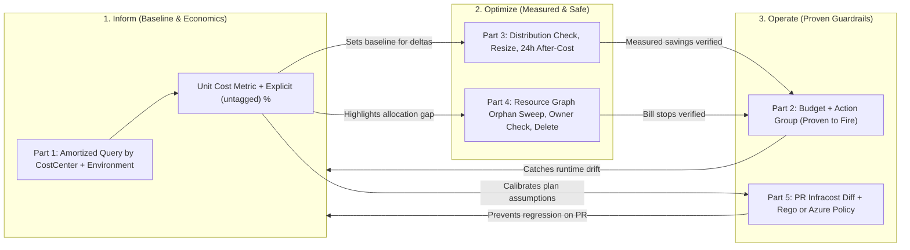
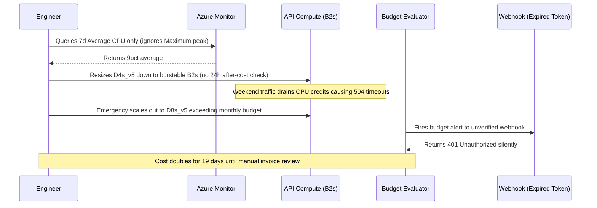

# Capstone Project

> **Prerequisites:** FinOps Modules 00–07, AKS & Action Groups (Track 07), Terraform (Track 09), CI/CD pipelines (Track 10), Observability metrics (Track 12), Storage/Disks (Track 14), and Tagging/Azure Policy (Track 17 Module 06).  
> **Estimated Reading Time:** 45 minutes (plus 8–24h billing lag window for Part 3)  
> **Target Audience:** Backend Engineers, Platform Engineers, SREs, Cloud Architects, FinOps Practitioners.

> [!TIP]
> **The Golden Rule of the FinOps Capstone:** Never claim an optimization without **measured before-and-after amortized evidence** across the 8–24h billing lag, never rightsize from averages without checking peak/p95 safety, never delete a suspected orphan without verifying its `Owner` tag, and verify every guardrail by **watching it fire** on real spend or a real pull request.

---

## Why This Matters

This is where the whole track stops being eight separate skills and becomes one practice. Across modules 00–07 you learned each piece of FinOps in isolation — the framework, cost analysis, budgets, rightsizing, storage cleanup, commitments, showback, and the CI/CD gate. But a real FinOps practitioner never gets to do these one at a time; they arrive together as a single ongoing discipline over a real, running, costing subscription. There's no new concept and no quiz here. The goal is to prove you can **operate the full loop** — Inform, Optimize, Operate (module 00) — against **your own real Azure cost data**, and to produce **evidence** for each piece, because in FinOps a claim without a measured before/after is just an opinion. Everything you touch here is real money on your real subscription, which is exactly the point — and exactly why every part ends in cleanup.

Treat this as a project, not a checklist of isolated tasks. The pieces build on each other in the order you'd actually run them: first make cost *visible and allocated* (Inform), then *change* it and *prove* the change (Optimize), then *keep it that way* with guardrails (Operate).

---

## 1. Architectural Mental Model: The End-to-End Closed-Loop FinOps Lifecycle

Every artifact in the Capstone feeds the next stage of one continuous feedback loop rather than five disconnected scripts. **Part 1 (Inform)** establishes the amortized, tag-grouped baseline and unit cost; **Part 2** protects that baseline with a verified-to-fire budget; **Parts 3 and 4 (Optimize)** eliminate over-provisioning and orphans only after passing safety checks (`Average`/`Maximum` utilization and `Owner` tag verification) and re-measure via Part 1's own tooling; and **Part 5 (Operate)** pushes cost feedback left into pull requests while using Part 1's actuals to keep estimates honest:



---

## 2. Taxonomic Comparison & Capstone Command Reference

### Capstone Evidence & Phase Verification Matrix

| Capstone Part | FinOps Phase | Primary Tooling | Mandatory Evidence Artifact | Evaluation Lag | Non-Negotiable Safety Gate |
| :--- | :--- | :--- | :--- | :--- | :--- |
| **Part 1: Cost Breakdown** | Inform (00–01) | `az costmanagement query` (`AmortizedCost`) | Table by `CostCenter` + `Environment`, `(untagged)%`, top 3 services/RGs, unit cost | 8–24h usage lag | Never use `ActualCost` if commitments exist |
| **Part 2: Firing Budget** | Inform / Operate (02) | `az consumption budget create` + Action Group | Captured alert email / Teams / webhook notification | Periodic (up to 24h) | Scope threshold below current spend to prove delivery |
| **Part 3: Rightsizing** | Optimize (03) | `az monitor metrics list` + resize + Cost Analysis | Before `\$X/day`, after `\$Y/day`, delta, peak/p95 distribution proof | 8–24h post-change | Inspect `Average` AND `Maximum`/p95 before downsizing |
| **Part 4: Orphan Sweep** | Optimize (04) | `az graph query` (`managedBy`, `ipConfiguration`) | Sweep output, monthly cost estimate, deletion confirmation | Immediate (bill stops next cycle) | Verify `Owner` tag; snapshot disk if uncertain |
| **Part 5: CI Cost Gate** | Operate (07) | `infracost diff` + OPA/Rego or Azure Policy | Live PR comment screenshot/text + guardrail block/allow test | Seconds on PR | Pair directional PR threshold with ARM `Deny` backstop |

### Command Reference

| Part | Command | Purpose in Capstone |
|---|---|---|
| **Part 1** | `az costmanagement query --type AmortizedCost --timeframe TheLastMonth --dataset-grouping type=Tag name=CostCenter` | Establishes reproducible per-team baseline and exposes `(untagged)` share |
| **Part 2** | `az consumption budget create --budget-name <name> --amount <below-current> --notifications <json>` | Creates forecasted + actual alerts wired to Track 07 Action Group |
| **Part 3** | `az monitor metrics list --resource <id> --metric "Percentage CPU" --aggregation Average Maximum` | Verifies peak headroom before applying VM/AKS/ACA rightsizing |
| **Part 4** | `az graph query -q "Resources \| where type == 'microsoft.compute/disks' and isempty(properties.managedBy)"` | Finds unattached disks across the entire subscription (Track 17 tool) |
| **Part 5** | `infracost diff --path plan.json --compare-to infracost-base.json` | Computes monthly delta for PR comment and Rego policy evaluation |

---

## 3. Production War Story Post-Mortem: Unverified Rightsizing & Silent Budget Webhook Failure

| Field | Incident Details |
| :--- | :--- |
| **Severity** | **SEV-2** (Production CPU Credit Exhaustion + Silent Cost Regression) |
| **Detection / Resolution Time** | Detected 19 days post-change via customer checkout timeouts / Mitigated in 35 minutes |
| **Impact** | Resizing an API node from `Standard_D4s_v5` to `Standard_B2s` using only 7-day average CPU (9%) exhausted burstable CPU credits during weekend traffic; emergency scale-out doubled monthly spend while an untested budget webhook dropped alerts silently |

### What Happened

An engineer attempted to execute a FinOps sprint without the Capstone's evidence gates. Checking only a 7-day average CPU chart (9%), they downsized a bursty weekend-heavy API VM to a small burstable `B2s` instance and declared a "68% cost reduction" immediately without waiting 24 hours to measure post-change amortized spend. They also created a subscription budget wired to a Slack incoming webhook without scoping a test threshold to verify alert delivery. Three weekends later, sustained peak load drained `B2s` CPU credits to zero, forcing an emergency manual scale-out to `D8s_v5` nodes that blew past the monthly budget — while the webhook returned `401 Unauthorized` silently because of a stale secret.



### Root Cause Analysis

1. **Average-only rightsizing**: Ignoring `--aggregation Maximum` / p95 concealed periodic peak bursts that made burstable CPU credits unsafe (Module 03).
2. **Unproven guardrail**: Treating budget creation (`az consumption budget create`) as completion without watching an alert fire missed a broken Action Group webhook (Module 02).
3. **Zero after-measurement**: Declaring victory before waiting across the 8–24h billing lag meant nobody noticed the emergency scale-out tripled baseline spend.

### The Fix & Architectural Hardening

- Enforced mandatory `Average` + `Maximum` metric inspection over at least one peak cycle prior to resizing, restoring a non-burstable `D4s_v5` baseline with HPA/autoscale headroom.
- Tested every Action Group by deliberately tripping a low-threshold test budget and confirming real message delivery in the target channel before closing the change.

---

## 4. Multi-Language Production Implementation: End-to-End FinOps Loop Evidence Verifier

These four implementations tie the entire Capstone together in code: given a structured evidence bundle from Parts 1–5 (amortized baseline with unit denominator, budget fire confirmation, rightsizing before/after spend + peak CPU%, orphan sweep with `Owner` confirmation, and PR cost-gate + policy check), they verify **every safety and evidence invariant** before allowing a FinOps engagement to be signed off as complete.

````carousel
```go
package capstone

import (
	"errors"
	"fmt"
	"math"
)

type CapstoneEvidence struct {
	TotalAmortizedUSD     float64
	UntaggedUSD           float64
	UnitDenominator       int64
	BudgetAlertCaptured   bool
	ResizeBeforeDailyUSD  float64
	ResizeAfterDailyUSD   float64
	ResizePeakUtilPct     float64
	SloMaxSafePeakPct     float64
	OrphanOwnerVerified   bool
	OrphanConfirmedGone   bool
	PrCostCommentPosted   bool
	GuardrailTested       bool
}

type VerificationSummary struct {
	Approved          bool
	UntaggedPercent   float64
	UnitCostUSD       float64
	MeasuredDailySave float64
	Blockers          []string
}

func VerifyFinOpsLoop(ev CapstoneEvidence) (VerificationSummary, error) {
	if ev.TotalAmortizedUSD <= 0 || ev.UnitDenominator <= 0 {
		return VerificationSummary{}, errors.New("part 1 baseline total and unit denominator must be positive")
	}

	var blockers []string
	untaggedPct := math.Round((ev.UntaggedUSD/ev.TotalAmortizedUSD)*10000) / 100
	unitCost := math.Round((ev.TotalAmortizedUSD/float64(ev.UnitDenominator))*100000) / 100000
	dailySave := math.Round((ev.ResizeBeforeDailyUSD-ev.ResizeAfterDailyUSD)*100) / 100

	if !ev.BudgetAlertCaptured {
		blockers = append(blockers, "part 2: budget notification delivery has not been proven")
	}
	if ev.ResizePeakUtilPct > ev.SloMaxSafePeakPct {
		blockers = append(blockers, fmt.Sprintf("part 3: peak utilization %.1f%% exceeds SLO ceiling %.1f%%", ev.ResizePeakUtilPct, ev.SloMaxSafePeakPct))
	}
	if dailySave <= 0 {
		blockers = append(blockers, "part 3: measured after-cost did not improve over before-cost")
	}
	if !ev.OrphanOwnerVerified || !ev.OrphanConfirmedGone {
		blockers = append(blockers, "part 4: orphan deletion requires Owner verification and gone confirmation")
	}
	if !ev.PrCostCommentPosted || !ev.GuardrailTested {
		blockers = append(blockers, "part 5: PR Infracost diff comment and policy guardrail must both be demonstrated")
	}

	return VerificationSummary{
		Approved:          len(blockers) == 0,
		UntaggedPercent:   untaggedPct,
		UnitCostUSD:       unitCost,
		MeasuredDailySave: dailySave,
		Blockers:          blockers,
	}, nil
}
```
<!-- slide -->
```typescript
export interface CapstoneEvidence {
  totalAmortizedUsd: number;
  untaggedUsd: number;
  unitDenominator: number;
  budgetAlertCaptured: boolean;
  resizeBeforeDailyUsd: number;
  resizeAfterDailyUsd: number;
  resizePeakUtilPct: number;
  sloMaxSafePeakPct: number;
  orphanOwnerVerified: boolean;
  orphanConfirmedGone: boolean;
  prCostCommentPosted: boolean;
  guardrailTested: boolean;
}

export interface LoopVerificationResult {
  approved: boolean;
  untaggedPercent: number;
  unitCostUsd: number;
  measuredDailySavingsUsd: number;
  blockers: string[];
}

export function verifyFinOpsLoop(ev: CapstoneEvidence): LoopVerificationResult {
  if (ev.totalAmortizedUsd <= 0 || ev.unitDenominator <= 0) {
    throw new Error("Part 1 baseline amortized spend and unit denominator must be > 0");
  }

  const blockers: string[] = [];
  const untaggedPercent = Number(((ev.untaggedUsd / ev.totalAmortizedUsd) * 100).toFixed(2));
  const unitCostUsd = Number((ev.totalAmortizedUsd / ev.unitDenominator).toFixed(5));
  const measuredDailySavingsUsd = Number((ev.resizeBeforeDailyUsd - ev.resizeAfterDailyUsd).toFixed(2));

  if (!ev.budgetAlertCaptured) {
    blockers.push("Part 2: Must capture an actual fired budget alert notification.");
  }
  if (ev.resizePeakUtilPct > ev.sloMaxSafePeakPct) {
    blockers.push(`Part 3: Peak utilization (${ev.resizePeakUtilPct}%) breaches SLO limit (${ev.sloMaxSafePeakPct}%).`);
  }
  if (measuredDailySavingsUsd <= 0) {
    blockers.push("Part 3: Post-lag amortized daily cost shows no reduction.");
  }
  if (!ev.orphanOwnerVerified || !ev.orphanConfirmedGone) {
    blockers.push("Part 4: Orphan cleanup requires Owner tag sign-off and verified deletion.");
  }
  if (!ev.prCostCommentPosted || !ev.guardrailTested) {
    blockers.push("Part 5: Real PR Infracost comment and Rego/Azure Policy guardrail proof required.");
  }

  return {
    approved: blockers.length === 0,
    untaggedPercent,
    unitCostUsd,
    measuredDailySavingsUsd,
    blockers,
  };
}
```
<!-- slide -->
```python
from dataclasses import dataclass


@dataclass(frozen=True)
class CapstoneEvidence:
    total_amortized_usd: float
    untagged_usd: float
    unit_denominator: int
    budget_alert_captured: bool
    resize_before_daily_usd: float
    resize_after_daily_usd: float
    resize_peak_util_pct: float
    slo_max_safe_peak_pct: float
    orphan_owner_verified: bool
    orphan_confirmed_gone: bool
    pr_cost_comment_posted: bool
    guardrail_tested: bool


def verify_finops_loop(ev: CapstoneEvidence) -> dict:
    """Validate all five FinOps capstone deliverables and safety invariants."""
    if ev.total_amortized_usd <= 0 or ev.unit_denominator <= 0:
        raise ValueError("Part 1 amortized baseline and unit denominator must be positive")

    blockers: list[str] = []
    untagged_pct = round((ev.untagged_usd / ev.total_amortized_usd) * 100, 2)
    unit_cost = round(ev.total_amortized_usd / ev.unit_denominator, 5)
    daily_save = round(ev.resize_before_daily_usd - ev.resize_after_daily_usd, 2)

    if not ev.budget_alert_captured:
        blockers.append("Part 2: Budget alert must be proven to fire with captured notification.")
    if ev.resize_peak_util_pct > ev.slo_max_safe_peak_pct:
        blockers.append(
            f"Part 3: Peak util {ev.resize_peak_util_pct}% exceeds safe SLO ceiling {ev.slo_max_safe_peak_pct}%."
        )
    if daily_save <= 0:
        blockers.append("Part 3: Measured post-lag daily cost did not decrease.")
    if not (ev.orphan_owner_verified and ev.orphan_confirmed_gone):
        blockers.append("Part 4: Must verify Owner tag and confirm orphan deletion.")
    if not (ev.pr_cost_comment_posted and ev.guardrail_tested):
        blockers.append("Part 5: PR Infracost comment and guardrail test are required.")

    return {
        "approved": len(blockers) == 0,
        "untagged_percent": untagged_pct,
        "unit_cost_usd": unit_cost,
        "measured_daily_savings_usd": daily_save,
        "blockers": blockers,
    }
```
<!-- slide -->
```csharp
using System;
using System.Collections.Generic;

public sealed record CapstoneEvidence(
    decimal TotalAmortizedUsd,
    decimal UntaggedUsd,
    long UnitDenominator,
    bool BudgetAlertCaptured,
    decimal ResizeBeforeDailyUsd,
    decimal ResizeAfterDailyUsd,
    double ResizePeakUtilPct,
    double SloMaxSafePeakPct,
    bool OrphanOwnerVerified,
    bool OrphanConfirmedGone,
    bool PrCostCommentPosted,
    bool GuardrailTested);

public sealed record LoopVerificationSummary(
    bool Approved,
    decimal UntaggedPercent,
    decimal UnitCostUsd,
    decimal MeasuredDailySavingsUsd,
    IReadOnlyList<string> Blockers);

public static class CapstoneVerifier
{
    public static LoopVerificationSummary Verify(CapstoneEvidence ev)
    {
        if (ev.TotalAmortizedUsd <= 0m || ev.UnitDenominator <= 0)
            throw new ArgumentException("Part 1 baseline total and unit denominator must be > 0.");

        var blockers = new List<string>();
        decimal untaggedPct = Math.Round((ev.UntaggedUsd / ev.TotalAmortizedUsd) * 100m, 2);
        decimal unitCost = Math.Round(ev.TotalAmortizedUsd / ev.UnitDenominator, 5);
        decimal dailySavings = Math.Round(ev.ResizeBeforeDailyUsd - ev.ResizeAfterDailyUsd, 2);

        if (!ev.BudgetAlertCaptured)
            blockers.Add("Part 2: Budget alert delivery must be proven by capturing notification.");
        if (ev.ResizePeakUtilPct > ev.SloMaxSafePeakPct)
            blockers.Add($"Part 3: Peak CPU {ev.ResizePeakUtilPct:F1}% exceeds SLO limit {ev.SloMaxSafePeakPct:F1}%.");
        if (dailySavings <= 0m)
            blockers.Add("Part 3: Post-lag amortized daily cost did not decrease.");
        if (!ev.OrphanOwnerVerified || !ev.OrphanConfirmedGone)
            blockers.Add("Part 4: Orphan cleanup requires Owner tag sign-off and deletion confirmation.");
        if (!ev.PrCostCommentPosted || !ev.GuardrailTested)
            blockers.Add("Part 5: Real PR Infracost diff comment and guardrail behavior must be verified.");

        return new LoopVerificationSummary(
            blockers.Count == 0,
            untaggedPct,
            unitCost,
            dailySavings,
            blockers);
    }
}
```
````

---

## 5. Practical Hands-On Verification CLI Workflows: The Five-Part Capstone Project

### The project

Run a **complete FinOps engagement** on your own real Azure subscription — the same subscription you've used across the curriculum, ideally with real usage on it from the earlier tracks so there's genuine spend to analyze. Your deliverable has five parts, each producing **evidence**, all keyed off the **tagging taxonomy from track 17 module 06** (`CostCenter`/`Environment`/`Owner`/`DataClassification`):

1. **A real cost analysis grouped by the track-17 tags** (modules 00–01). Produce a written cost breakdown of your subscription for a **complete period** (last month), using **amortized** cost, grouped by **`CostCenter`** *and* **`Environment`**. It must explicitly state the **(untagged) percentage** (your allocation gap), your **top three services** and **resource groups** by cost, and **one unit-cost metric** (module 00) computed against a real denominator (requests/customers/environments — pull the denominator from your track-12 observability if you can). This is the Inform-phase baseline everything else is measured against.

```bash
SUB_ID=$(az account show --query id -o tsv)
az costmanagement query \
  --scope "/subscriptions/$SUB_ID" \
  --type AmortizedCost \
  --timeframe TheLastMonth \
  --dataset-aggregation '{"totalCost":{"name":"Cost","function":"Sum"}}' \
  --dataset-grouping type=Tag name=CostCenter \
  --dataset-grouping type=Tag name=Environment -o table
```

**Expected Output:**
```text
Cost       CostCenter  Environment    Currency
---------  ----------  -------------  ----------
112.40     payments    prod           USD
 46.10     payments    dev            USD
 18.90                                USD
```

2. **At least one budget with an action-group alert, proven to fire** (module 02). Create a budget (subscription-scoped or tag-filtered by `CostCenter`/`Environment`) wired to a **reusable action group** (track 07), with both a **forecasted** and an **actual** alert threshold. Then **prove it fires** by scoping the amount below current spend and **capturing the notification** — a budget you haven't watched fire is not evidence. The proof (the alert email/notification) is a required artifact.

```bash
az consumption budget list --query "[].{name:name, amount:amount, spent:currentSpend.amount}" -o table
```

**Expected Output:**
```text
Name              Amount    Spent
----------------  --------  -------
capstone-verify   10.00     177.40
```

3. **A rightsizing recommendation actually applied, with measured before/after cost** (module 03). Take a real Azure Advisor cost recommendation (or one you derive from a utilization *distribution* — not just the average), **apply it** to a real resource (a VM resize, a Container App allocation, or an AKS pod-request/node-pool change — tracks 06/07), and **measure the cost impact before and after** using module 01 Cost Analysis on that resource/RG (across the 8–24h data lag, so this spans two sessions). You must also show you **checked it was safe** (the utilization distribution / SLO), i.e. that you didn't naively downsize a bursty workload (module 03's trap). The evidence is the before cost, the after cost, the measured delta, and the safety check.

```bash
az monitor metrics list \
  --resource "<vm-resource-id>" \
  --metric "Percentage CPU" \
  --interval PT1H \
  --aggregation Average Maximum \
  --query "value[0].timeseries[0].data[-5:].{time:timeStamp, avg:average, max:maximum}" -o table
```

**Expected Output:**
```text
Time                  Avg    Max
--------------------  -----  -----
2026-11-10T10:00:00Z  6.4    14.2
2026-11-10T11:00:00Z  7.1    16.8
```

4. **An orphaned-resource sweep that finds and cleans up at least one real orphan** (module 04). Run a **Resource Graph sweep** (track 17 module 06's tool) for orphaned resources — unattached disks (the track-14 trap), unattached public IPs, stale snapshots — across your subscription, **estimate the monthly cost** of what you find, verify ownership via the **`Owner` tag** before deleting, and **actually clean up at least one real orphan** (safely — snapshot if unsure). The evidence is the sweep output, the cost estimate, and confirmation the orphan is gone (and its bill stopped).

```bash
az graph query -q "Resources
| where type == 'microsoft.compute/disks' and isempty(properties.managedBy)
| project name, resourceGroup, sku=sku.name, sizeGb=properties.diskSizeGB, owner=tags.Owner" -o table
```

**Expected Output:**
```text
name              resourceGroup    sku           sizeGb    owner
----------------  ---------------  ------------  --------  -------------------
disk-orphan-demo  rg-old-app       Premium_LRS   128       platform@corp.com
```

5. **An Infracost-style cost estimate wired into a CI pipeline PR check** (module 07, tracks 09/10). Take a Terraform config (from track 09 or a small new one), wire **Infracost into a CI pipeline** (track 10) so that opening a PR that changes infrastructure **posts the estimated monthly cost diff as a PR comment**, and demonstrate it on a **real PR** (change a SKU/count and show the comment reflecting the delta). Add at least one **guardrail** — a threshold policy (track 11's Rego engine) *or* a preventive Azure Policy (track 17) that denies an expensive choice. The evidence is the PR showing the cost comment and the guardrail's behavior.

```bash
infracost diff --path plan.json --compare-to infracost-base.json
```

**Expected Output:**
```text
~ azurerm_linux_virtual_machine.api
  +$140.16 ($70.08 -> $210.24)
    ~ Instance usage (Standard_D2s_v5 -> Standard_D4s_v5)  +$140.16
```

Then **integrate and reflect** — see the acceptance checklist.

### Acceptance checklist

Work top to bottom; each item leans on the previous ones actually working and producing evidence, not just existing.

- [ ] **Cost analysis document** exists: last month, **amortized**, grouped by **`CostCenter`** and **`Environment`**, with the **(untagged) percentage** stated, top-three services and RGs, and **one real unit-cost metric** with its denominator. The exact `az costmanagement query` commands are included so it's reproducible next month.
- [ ] The analysis **honestly names the allocation gap**: you can say what fraction of spend you *cannot* attribute to a team and what that implies for the showback/chargeback conversation (module 06).
- [ ] A **budget** exists, wired to a **reusable action group** (track 07) with **both** a forecasted and an actual threshold, and you have **captured evidence it fired** (the notification), not just that it exists. You can explain why an unproven budget provides no real protection (module 02).
- [ ] A **real rightsizing was applied** to a real resource, and you have **before-and-after cost** (module 01) showing the measured delta — not "we resized" but "\$X/day → \$Y/day, measured across the data lag."
- [ ] The rightsizing is **demonstrably safe**: you show the utilization *distribution* (peak/p95, not just average) or the SLO check that proves you didn't starve a bursty workload (module 03). If the naive recommendation was wrong, you overrode it and can explain why in business terms (module 00).
- [ ] An **orphan sweep** ran (Resource Graph, track 17), covering **at least two** orphan classes, with an **estimated monthly cost** of what it found, and **at least one real orphan was safely cleaned up** (ownership checked via the `Owner` tag; gone confirmed). You can explain why orphans evade compute views (module 04).
- [ ] An **Infracost cost check runs on infrastructure PRs** in a CI pipeline (track 10) and **posts the cost diff as a PR comment**, demonstrated on a **real PR** whose comment reflects a change you made. At least **one guardrail** (CI threshold policy or preventive Azure Policy) is present and its behavior shown.
- [ ] The five parts **fit together as the FinOps loop**, not five unrelated tasks: the analysis (Inform) is grouped by the tags the budget filters on and the showback would use; the rightsizing and sweep (Optimize) are measured with the analysis's own tooling; the CI gate and budget (Operate) guard against regression. You can narrate the loop end to end.
- [ ] You can **defend every decision and every number**: why amortized not actual, why this budget scope, why this rightsizing was safe, why this orphan was truly orphaned, why this cost-gate threshold. A number you can't source or a choice you can't justify is a signal to revisit the module, not to leave it in.

### Hints

- **Do Inform before Optimize.** Part 1's cost analysis is the baseline every other part is measured against — a rightsizing "saving" or an orphan's "cost" is meaningless without the before-number from part 1's tooling. Get visibility solid first (modules 00–01).
- **Prove the budget fires by making it fire.** Scope the amount **below** current spend and wait a budget-evaluation cycle (they're periodic, not instant — allow up to a day). Capture the notification. An unfired budget looks identical to a healthy one — the only evidence is watching it trip (module 02).
- **Measure rightsizing across the data lag.** Cost data lags 8–24h, so the "after" cost isn't visible immediately — plan for part 3 to span two sessions. Capture the "before" *before* you change anything, or you lose the baseline (module 01/03).
- **Check the distribution before you rightsize.** Pull `--aggregation Average Maximum` (module 03) over a window that includes a peak. A low average with a high peak means *don't* naively downsize — autoscale, use a burstable SKU, or leave it. A saving that risks an outage is a FinOps failure (module 00).
- **Read the `Owner` tag before deleting an orphan.** The whole reason track 17's taxonomy exists for cleanup: confirm whose the resource is before `az disk delete`. A "detached volume" might be someone's data about to be reattached — snapshot if unsure (module 04, track 14).
- **Wire the cost gate as just another CI check.** Structurally it's the same as your test/scan steps (track 10): `terraform plan` → `terraform show -json` → `infracost diff` → `infracost comment`. Set the guardrail threshold where a human *should* look, not at \$5 (module 07's ignored-gate trap).
- **Keep everything cheap and destroy promptly.** The only real spend is the handful of resources you rightsize/orphan, and Infracost/analysis/budgets are free. Two tiny resources prove each point — there's no need for a cluster. This is the cost track; running up a bill here is the one unforgivable irony.
- **Reuse what you already built.** The tagging from track 17 module 06, the action groups from track 07, the Terraform from track 09, and the CI pipeline from track 10 are all still standing — the capstone is about *operating them together as the FinOps loop*, not rebuilding each piece.

### Final cleanup

The only real spend is the resources you rightsized/created and any orphan you *made* to demonstrate the sweep; the analysis, budgets, sweeps, and Infracost gate are free, but leave your subscription as you found it.

1. Confirm what you built: `az consumption budget list -o table`, `az disk list --query "[?managedBy==null]" -o table` (should no longer show the orphan you cleaned), and your CI pipeline's PR comment history.
2. Delete any resources you created or rightsized for the demo: `az group delete --name <lab-rg> --yes --no-wait` for anything in a dedicated lab RG. Keep a genuinely-improved rightsizing or retention change if you want it as a real gain.
3. Remove demo budgets and action groups you don't want to keep (`az consumption budget delete`, `az group delete` for the plumbing RG) — keep any real guardrail budget you'd genuinely run.
4. Remove any Azure Policy assignment you created for the part-5 guardrail (`az policy assignment delete`) unless you're keeping it as a real cost control.
5. Final sweep: `az group list -o table` shows nothing from this project's labs, and your orphan sweep returns one fewer orphan than when you started (the one you cleaned).

---

## 6. Common Mistakes & Troubleshooting

- **Skipping Part 1 baseline capture before modifying resources.** Once you resize a VM or delete an orphan, retroactive "before" proof becomes guesswork; export and save the amortized baseline first.
- **Treating an unfired budget as verified protection.** A typo in an email address, expired webhook secret, or wrong Action Group resource ID stays invisible until the budget actually trips; always test delivery by thresholding below current spend.
- **Evaluating rightsizing savings immediately after resize.** Azure Cost Management data lags 8–24 hours; querying the same afternoon compares two pre-change periods. Wait a full cycle before recording `\$Y/day`.
- **Resizing from average CPU without inspecting peak/p95.** Downsizing a bursty service with 10% average and 92% peak CPU saves pennies at the cost of a production SLO breach.
- **Deleting unattached disks before checking `Owner`.** An unattached disk without `managedBy` can still hold critical stateful backups or pending migration data; confirm ownership and snapshot first when unsure.
- **Forgetting Final Cleanup on lab resource groups.** Leaving demo VMs or unattached disks running after completing the Capstone contradicts the entire Optimize discipline.

---

## 7. Operational Validation Checkpoints & Blank-Page Loop Review

### Operational Validation Checkpoints

<details><summary><strong>Checkpoint 1: Overriding an Azure Advisor Rightsizing Recommendation</strong></summary>

When Azure Advisor flags a VM for downsizing because 14-day average CPU is 11%, run `az monitor metrics list --aggregation Average Maximum` over a window containing your weekly peak batch or traffic spike. If `Maximum` reaches 88–95% during peak hours, **override** the naive downsize in writing (citing Module 00's rule that a saving causing an SLO breach is negative value) and consider horizontal autoscaling instead.

</details>

<details><summary><strong>Checkpoint 2: Why a Newly Created Budget Might Not Fire Within 10 Minutes</strong></summary>

Azure budget evaluations run asynchronously on a periodic billing ingestion cadence (often up to 8–24 hours), not synchronously on every CLI call. Setting a test threshold below `currentSpend` confirms Action Group routing once the evaluation cycle completes and delivers the alert email/webhook artifact.

</details>

<details><summary><strong>Checkpoint 3: Narrating the Five Parts as One Closed FinOps Loop</strong></summary>

Part 1 establishes the tag-grouped `AmortizedCost` baseline and unit cost; Part 2 places a proven-to-fire budget alert over that same scope; Parts 3 and 4 execute safe rightsizing and orphan removal measured back through Part 1's query across the billing lag; and Part 5 shifts future changes left into pull requests via Infracost + Rego/Azure Policy while calibrating usage files against Part 1's actuals.

</details>

### Before you move on

Once it's cleaned up, don't consider this finished yet. Wait a few days, then — with no notes, none of the earlier modules open, and no commands in front of you — **run the FinOps loop from a blank page** on a fresh question: "our subscription's bill went up 30% last month — what do I do?" Walk yourself through it out loud or in writing: which cost view and grouping you'd open first and why (amortized, by `CostCenter`/`Environment` — module 01); how you'd tell healthy growth from waste (unit economics — module 00); the order you'd apply the Optimize levers and the one safety check that stops any of them becoming an outage (modules 03–05); where you'd add a guardrail so it can't silently recur (a budget proven to fire, a CI cost gate — modules 02/07); and how you'd have the *organizational* conversation with the team whose spend grew (showback, unit cost, not blame — module 06). Then note **where you stalled** — was it the amortized-vs-actual toggle? Why a bursty workload resists rightsizing? How to prove a budget fires? Whatever you couldn't reconstruct cold is exactly the module to redo. Rebuilding the whole loop from memory, and noticing precisely where it breaks down, is the truest retention check there is — far more than re-reading the prose.

---

## 8. Next

You've now taken every scattered cost warning from tracks 02, 06, 07, 09, 12, 14, and 17 and turned them into a single, ongoing, evidence-driven discipline: you can make cloud spend **visible, allocated, guarded, optimized, and owned**, and you can prove each with a measured before/after. Cost is now an engineering property of your systems, checked like tests and security. The next track, **[22-disaster-recovery-and-chaos-engineering](../../22-disaster-recovery-and-chaos-engineering/README.md)**, turns from *what your systems cost* to *whether they survive* — designing real backup and failover strategies and then deliberately breaking your own systems to prove they recover. The two disciplines are closer than they look: both are about **deciding, in advance and with evidence, what you're willing to pay** — here it was dollars, there it's the cost and complexity of resilience versus the cost of an outage. You'll find the same "measure it, don't assume it; make the tradeoff conscious" instinct running straight through it.

[Back to track index](../README.md) · [Back to main curriculum](../../README.md)
