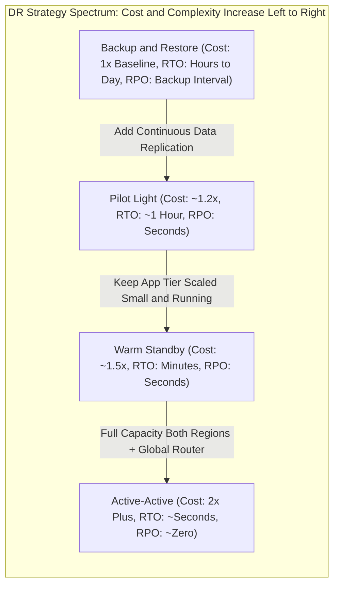
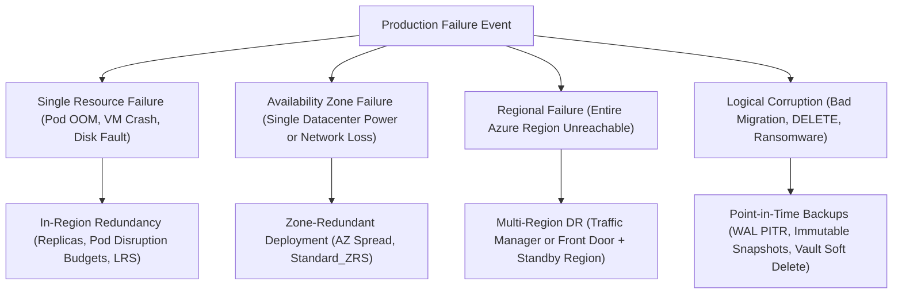
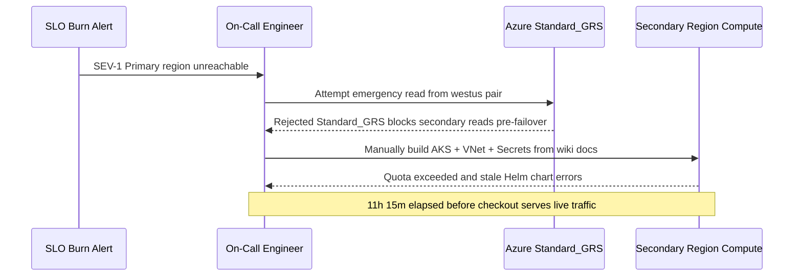

# 00 - DR Concepts: RTO, RPO, and the Strategy Spectrum

> **Prerequisites:** Database backup and point-in-time recovery fundamentals (Track 14 / Module 04), Availability SLOs and error budgets (Track 20), and Cloud FinOps right-sizing (Track 21).  
> **Estimated Reading Time:** 30 minutes  
> **Target Audience:** Backend Engineers, Platform Engineers, Site Reliability Engineers (SREs), Cloud Architects.

> [!TIP]
> **The Golden Rule of DR Design:** Never collapse **RTO** (time to recover) and **RPO** (data loss window) into one number, never equate replication or backups alone with "complete DR," and always pick the **leftmost (cheapest) strategy** on the spectrum that meets the business-signed target within your SLO error budget.

---

## Why This Matters

Disaster recovery is the one area where teams routinely spend either far too little (a nightly backup nobody has ever restored) or far too much (a full active-active clone of production for a system that could tolerate an hour of downtime). Both mistakes come from skipping the only step that matters first: writing down, as numbers, how much downtime and how much data loss the business can actually absorb. This module gives you those two numbers — **RTO** and **RPO** — and the spectrum of architectures that trade cost against them, so every design decision in the rest of the track is anchored to a target instead of a vibe.

---

## 1. Architectural Mental Model: The 2-D (RTO, RPO) Plane & Failure Domains

Every DR architecture occupies a point on an independent two-dimensional plane: **RPO** (governed by data replication frequency) and **RTO** (governed by standby compute posture and automation). Moving right along the strategy spectrum buys lower RTO and lower RPO at sharply higher infrastructure cost and operational complexity. At the same time, you must design against distinct **failure domains**—because regional failover and point-in-time backups solve fundamentally different outages:





### RTO and RPO, defined precisely

Track 14 / module 04 introduced these for a single database; here they scale up to a whole system, and the precision matters more:

- **RTO — Recovery Time Objective:** the maximum acceptable *wall-clock time* between a disaster starting and service being restored. It's a duration you commit to, measured from "the region is down" to "customers can use the system again." An RTO of 4 hours means a 4-hour outage is within tolerance; a 6-hour one is a breach.
- **RPO — Recovery Point Objective:** the maximum acceptable *amount of data*, measured in time, that you can afford to lose. An RPO of 5 minutes means that after recovery, at most the last 5 minutes of writes may be gone. RPO is set by how continuously you replicate data, not by how fast you recover.

The trap is treating them as one number. They're independent: you can have a tiny RPO (data replicated to the second) but a large RTO (it takes hours to stand the application back up), or vice versa. Every DR strategy is really a point on a 2-D `(RTO, RPO)` plane, and the whole design job is hitting a *target* point at the *lowest* cost.

### How to actually choose RTO and RPO

You don't pick these; the business does, and your job is to force the conversation with concrete numbers. A workable method:

1. **Per system, not globally.** The checkout service and the internal analytics dashboard have wildly different tolerances. Set RTO/RPO per *service tier* (e.g., Tier 0 = revenue-critical, Tier 2 = internal tooling).
2. **Translate downtime and data loss into money and trust.** "What does one hour down cost us in lost revenue, SLA credits, and reputation? What does losing the last 30 minutes of orders cost?" A number the business winces at is a real target; "as fast as possible" is not.
3. **Reconcile with the SLO.** This is the direct tie to track 20: your availability SLO already implies a downtime budget. A DR RTO that would blow the entire quarter's error budget in a single event is a mismatch — either the RTO is too loose or the SLO is unfundable.
4. **Cost the strategy that meets it, then sanity-check.** Once you know the cheapest strategy that hits the target, put its monthly cost in front of the business. Often the target tightens or loosens once the price of meeting it is visible — which is exactly the FinOps conversation from track 21.

The output is a small table: `system`, `tier`, `RTO`, `RPO`, `chosen strategy`, `monthly cost`. That table *is* the DR strategy.

### The DR strategy spectrum

There are four canonical strategies, ordered from cheapest/slowest to most-expensive/fastest. Each is a different point on the `(RTO, RPO)` plane:

- **Backup and restore.** Data is backed up to durable, ideally geo-redundant storage; on disaster you provision fresh infrastructure and restore. Cheapest — you pay only for backup storage — but slowest: RTO of hours to a day (you rebuild everything), RPO tied to backup frequency. This is track 14 / module 04's world, extended to the whole system.
- **Pilot light.** A minimal always-on core in the second region — the database replicating continuously, critical config present — but the application tier is *off* or scaled to zero. On disaster you "turn up the lights": scale out the app tier and cut traffic over. Low steady cost (you pay for replication + a tiny footprint), moderate RTO (minutes to an hour to scale up), small RPO (continuous replication).
- **Warm standby.** A scaled-down but *running* copy of the full system in the second region, continuously handling health checks (and optionally a little real traffic). On disaster you scale it up and shift traffic. Higher steady cost (a second running environment), fast RTO (minutes), small RPO.
- **Active-active (hot standby / multi-site).** Full production capacity running in *both* regions simultaneously, both serving live traffic behind a global router. On disaster you simply stop routing to the dead region — near-zero RTO, near-zero RPO. Most expensive (you run 2× everything, plus the hard problem of multi-region data consistency) and most complex.

```text
 cost / complexity  ──────────────────────────────────►
 backup&restore   pilot light   warm standby   active-active
 RTO: hours→day    RTO: ~1hr     RTO: minutes   RTO: ~seconds
 RPO: hrs (backup) RPO: seconds  RPO: seconds   RPO: ~zero
 $                 $$            $$$            $$$$
```

### Cost and complexity are the real axis

The reason there's a spectrum and not just "always do active-active" is that each step right roughly multiplies both **cost** and **operational complexity**. Active-active doesn't only cost 2× the infrastructure — it forces you to solve *bidirectional data consistency* (two regions both writing to the same logical dataset), conflict resolution, and split-brain avoidance, which is genuinely hard engineering. Warm standby avoids the consistency nightmare (one region is authoritative) but still runs a second environment. Pilot light shrinks that second environment to almost nothing. The discipline is to pick the *leftmost* (cheapest) strategy that still meets the RTO/RPO the business signed off on — anything further right is money and complexity spent buying reliability nobody asked for. This is the same right-sizing instinct as track 21's FinOps, applied to resilience.

### Failure domains: what you're actually recovering from

"Disaster" is vague; design against specific failure domains, because they demand different strategies:

- **Single resource failure** (a VM, a pod, a disk) — handled by in-region redundancy (replicas, availability zones), not DR. Chaos engineering (module 04+) targets this layer.
- **Availability Zone failure** — one datacenter within a region. Mitigated by zone-redundant deployments *inside* one region (cheaper than a second region).
- **Regional failure** — the entire Azure region is unreachable. This is what multi-region DR (modules 01–02) exists for.
- **Data corruption / human error / ransomware** — logical damage that *replicates* to every region instantly. Multi-region does **not** protect you here; only point-in-time backups do (track 14 / module 04). A complete DR plan needs both a regional strategy *and* a backup strategy, because they cover different failure domains.

---

## 2. Taxonomic Comparison & Command Reference

### DR Strategy Spectrum Comparison

| Strategy | Standby Compute Posture | Data Replication Mode | Typical RTO | Typical RPO | Cost Tier | Primary Engineering Risk |
| :--- | :--- | :--- | :--- | :--- | :--- | :--- |
| **Backup and Restore** | None running; rebuild via IaC on failure | Periodic snapshots / GRS backups | Hours to 1 day | Hours (backup schedule) | `1x` (`\$`) | Provisioning delays, quota limits, untested restores |
| **Pilot Light** | Core data live; app tier scaled to 0 or off | Continuous async replication | ~15 min to 1 hr | Seconds to minutes | `~1.2x` (`\$\$`) | Cold scale-out lag, image pull failures, config drift |
| **Warm Standby** | Scaled-down live copy serving health probes | Continuous async replication | Minutes | Seconds to minutes | `~1.5x` (`\$\$\$`) | Traffic surge before scale-out completes, DNS TTL lag |
| **Active-Active** | Full capacity live in both regions | Multi-master / geo-distributed sync or async | Near-zero (~seconds) | Near-zero | `2x+` (`\$\$\$\$`) | Split-brain writes, conflict resolution, cross-region egress |

### Failure Domain vs. Mitigation Matrix

| Failure Domain | Scope of Blast Radius | Replicates to Standby? | Primary Mitigation Layer | Does Multi-Region Failover Alone Solve It? |
| :--- | :--- | :--- | :--- | :--- |
| **Single Resource** | 1 pod, VM, or disk | No | ReplicaSets, health probes, local restart | Overkill — in-region HA resolves in seconds |
| **Availability Zone** | 1 datacenter inside 1 region | No | Zone-redundant compute & `Standard_ZRS` | Optional — single-region multi-AZ is far cheaper |
| **Whole Region** | All zones in 1 Azure region | N/A | Multi-region DR (Modules 01–02) | **Yes** — this is what regional DR targets |
| **Logical Damage** | Accidental `DROP`, bad deploy, ransomware | **Yes (instantly)** | Point-in-time backups (Track 14 / Module 03) | **No** — standby faithfully replays the corruption |

### Command Reference

This module is concept-heavy; the commands are for *inspecting* the building blocks (regions, zones, replication options) you'll design against. Flag-by-flag breakdowns are given for the multi-flag examples.

| Command | What it does | Example |
|---|---|---|
| `az account list-locations -o table` | Lists all Azure regions available to you (candidate DR pairs) | `az account list-locations -o table` |
| `az account list-locations --query "[?metadata.pairedRegion]..."` | Shows Azure's *paired* regions (used for platform-managed geo-replication) | see breakdown below |
| `az vm list-skus -l <region> --zone` | Shows which SKUs support Availability Zones in a region (AZ vs. regional design) | `az vm list-skus -l eastus --zone -o table` |
| `az storage account show -n <acct> --query sku` | Reveals a storage account's replication (LRS/ZRS/GRS/RA-GRS) — its built-in RPO story | `az storage account show -n mydata --query sku.name` |
| `az group list -o table` | Inventory of what exists (the first step of any DR plan is knowing your footprint) | `az group list -o table` |

Flag breakdown — listing paired regions (Azure pairs each region with another in the same geography for platform-level geo-replication):

```bash
az account list-locations \
  --query "[?metadata.pairedRegion!=null].{Region:name, PairedWith:metadata.pairedRegion[0].name}" \
  -o table
```
- `--query "[?metadata.pairedRegion!=null]"` — JMESPath filter: only regions that *have* a pair.
- `.{Region:name, PairedWith:...}` — reshape each result into two named columns.
- `metadata.pairedRegion[0].name` — the paired region's name (e.g. `eastus` pairs with `westus`). GRS storage replicates to *this* region automatically; choosing your DR region to match the pair means storage geo-replication is free and built in.
- `-o table` — human-readable output.

Flag breakdown — checking Availability Zone support before choosing zone-redundant vs. multi-region:

```bash
az vm list-skus -l eastus --zone --query "[?resourceType=='virtualMachines'].name" -o tsv | sort -u | head
```
- `-l eastus` — the region to check.
- `--zone` — restrict to SKUs that support zones.
- `--query "[?resourceType=='virtualMachines'].name"` — just the VM SKU names.
- `-o tsv | sort -u` — dedupe. If your workload's SKU is here, a *zone-redundant single-region* design may meet your RTO/RPO far cheaper than a second region.

---

## 3. Production War Story Post-Mortem: "GRS Protected Our Data, So Why Were We Down for 11 Hours?"

| Field | Incident Details |
| :--- | :--- |
| **Severity** | **SEV-1** (Complete Customer Checkout Outage) |
| **Detection / Resolution Time** | Detected in 4 minutes / Resolved in 11 hours 15 minutes |
| **Impact** | Checkout API missed its `99.9%` monthly SLO (43-minute error budget) by `15x` during a primary-region control-plane outage |

### What Happened

The payments team signed off on a `99.9%` availability SLO and declared during an architecture review: *"We are covered for DR because all blob receipts and order exports live in `Standard_GRS` storage."* When an extended regional outage struck the primary region, data in the paired region survived intact, **but the team had no running compute, no secondary VNet/DNS pipeline, and no read access to `Standard_GRS` until Microsoft initiated an account failover**. Engineers spent over 11 hours manually provisioning replacement infrastructure in the secondary region, hitting SKU quota rejections and missing secret configurations.



### Root Cause Analysis

1. **Conflating data RPO with service RTO:** `Standard_GRS` guaranteed asynchronous cross-region data durability (an RPO of minutes), not an application recovery time (RTO).
2. **Unreconciled SLO vs. strategy:** A `99.9%` SLO allows ~43.2 minutes/month of downtime; relying on manual backup-and-restore guaranteed blowing the monthly error budget on the first regional event.
3. **Missing read access & pre-built substrate:** Plain `Standard_GRS` cannot be read independently before failover (unlike `Standard_RA-GRS`), and without parameterized IaC modules or standby compute, recovery degraded into manual troubleshooting under pressure.

### The Fix & Architectural Hardening

- Established an explicit tier table mapping Tier-0 Checkout (`RTO <= 15m`, `RPO <= 1m`) to **Warm Standby** behind Azure Front Door and Tier-2 Reporting (`RTO <= 8h`, `RPO <= 1h`) to **Backup and Restore**.
- Upgraded critical storage accounts requiring pre-failover verification reads to `Standard_RA-GRS` and added continuous database PITR backups to isolate logical corruption from regional outages.

---

## 4. Multi-Language Production Implementation: Tiered DR Policy Validator & SLO Error-Budget Reconciler

These four implementations validate a service's DR specification—computing the monthly error budget from its availability SLO, checking whether its target RTO blows the error budget, enforcing point-in-time backup coverage for logical corruption, and recommending the leftmost strategy on the spectrum that meets both targets.

````carousel
```go
package drpolicy

import (
	"fmt"
	"math"
)

type Strategy string

const (
	BackupRestore Strategy = "backup-and-restore"
	PilotLight    Strategy = "pilot-light"
	WarmStandby   Strategy = "warm-standby"
	ActiveActive  Strategy = "active-active"
)

type ServiceTierSpec struct {
	ServiceName      string
	MonthlySLO       float64 // e.g. 0.999 for 99.9%
	TargetRTOMinutes float64
	TargetRPOMinutes float64
	ChosenStrategy   Strategy
	HasPITRBackup    bool
}

type ValidationResult struct {
	MonthlyErrorBudgetMin float64
	LeftmostRecommended   Strategy
	Warnings              []string
}

func RecommendLeftmostStrategy(rtoMin, rpoMin float64) Strategy {
	switch {
	case rtoMin <= 1 && rpoMin <= 0.1:
		return ActiveActive
	case rtoMin <= 15 && rpoMin <= 5:
		return WarmStandby
	case rtoMin <= 60 && rpoMin <= 15:
		return PilotLight
	default:
		return BackupRestore
	}
}

func ValidateDRSpec(spec ServiceTierSpec) ValidationResult {
	const minutesPer30DayMonth = 43200.0
	budget := math.Round((1.0-spec.MonthlySLO)*minutesPer30DayMonth*100) / 100
	recommended := RecommendLeftmostStrategy(spec.TargetRTOMinutes, spec.TargetRPOMinutes)

	var warnings []string
	if spec.TargetRTOMinutes > budget {
		warnings = append(warnings, fmt.Sprintf(
			"%s: target RTO (%.1fm) exceeds entire monthly SLO error budget (%.1fm)",
			spec.ServiceName, spec.TargetRTOMinutes, budget,
		))
	}
	if !spec.HasPITRBackup {
		warnings = append(warnings, fmt.Sprintf(
			"%s: missing point-in-time backup; multi-region DR replicates logical corruption",
			spec.ServiceName,
		))
	}
	if spec.ChosenStrategy != recommended {
		warnings = append(warnings, fmt.Sprintf(
			"%s: chosen strategy %q diverges from leftmost fit %q (FinOps/RTO check)",
			spec.ServiceName, spec.ChosenStrategy, recommended,
		))
	}
	return ValidationResult{
		MonthlyErrorBudgetMin: budget,
		LeftmostRecommended:   recommended,
		Warnings:              warnings,
	}
}
```
<!-- slide -->
```typescript
export type DrStrategy =
  | "backup-and-restore"
  | "pilot-light"
  | "warm-standby"
  | "active-active";

export interface ServiceDrSpec {
  serviceName: string;
  monthlySlo: number; // e.g. 0.999
  targetRtoMinutes: number;
  targetRpoMinutes: number;
  chosenStrategy: DrStrategy;
  hasPitrBackup: boolean;
}

export interface DrAuditReport {
  monthlyErrorBudgetMinutes: number;
  recommendedLeftmost: DrStrategy;
  costMultiplierHint: string;
  findings: string[];
}

export function selectLeftmostStrategy(rtoMin: number, rpoMin: number): DrStrategy {
  if (rtoMin <= 1 && rpoMin <= 0.1) return "active-active";
  if (rtoMin <= 15 && rpoMin <= 5) return "warm-standby";
  if (rtoMin <= 60 && rpoMin <= 15) return "pilot-light";
  return "backup-and-restore";
}

export function auditServiceDrSpec(spec: ServiceDrSpec): DrAuditReport {
  const budgetMin = Number(((1 - spec.monthlySlo) * 43_200).toFixed(2));
  const recommended = selectLeftmostStrategy(spec.targetRtoMinutes, spec.targetRpoMinutes);
  const costMap: Record<DrStrategy, string> = {
    "backup-and-restore": "1x",
    "pilot-light": "~1.2x",
    "warm-standby": "~1.5x",
    "active-active": "2x+",
  };

  const findings: string[] = [];
  if (spec.targetRtoMinutes > budgetMin) {
    findings.push(
      `SLO breach risk: RTO ${spec.targetRtoMinutes}m consumes more than monthly error budget (${budgetMin}m).`
    );
  }
  if (!spec.hasPitrBackup) {
    findings.push("Missing PITR backup layer: regional replication will replay accidental deletes/corruption.");
  }
  if (spec.chosenStrategy !== recommended) {
    findings.push(
      `Right-sizing mismatch: chosen '${spec.chosenStrategy}' vs leftmost strategy '${recommended}' (${costMap[recommended]}).`
    );
  }

  return {
    monthlyErrorBudgetMinutes: budgetMin,
    recommendedLeftmost: recommended,
    costMultiplierHint: costMap[recommended],
    findings,
  };
}
```
<!-- slide -->
```python
from dataclasses import dataclass
from enum import Enum


class DRStrategy(str, Enum):
    BACKUP_RESTORE = "backup-and-restore"
    PILOT_LIGHT = "pilot-light"
    WARM_STANDBY = "warm-standby"
    ACTIVE_ACTIVE = "active-active"


@dataclass(frozen=True)
class ServiceDRSpec:
    service_name: str
    monthly_slo: float  # e.g., 0.999
    target_rto_minutes: float
    target_rpo_minutes: float
    chosen_strategy: DRStrategy
    has_pitr_backup: bool


def leftmost_strategy(rto_min: float, rpo_min: float) -> DRStrategy:
    if rto_min <= 1.0 and rpo_min <= 0.1:
        return DRStrategy.ACTIVE_ACTIVE
    if rto_min <= 15.0 and rpo_min <= 5.0:
        return DRStrategy.WARM_STANDBY
    if rto_min <= 60.0 and rpo_min <= 15.0:
        return DRStrategy.PILOT_LIGHT
    return DRStrategy.BACKUP_RESTORE


def evaluate_dr_spec(spec: ServiceDRSpec) -> dict:
    budget_minutes = round((1.0 - spec.monthly_slo) * 43_200.0, 2)
    recommended = leftmost_strategy(spec.target_rto_minutes, spec.target_rpo_minutes)
    warnings: list[str] = []

    if spec.target_rto_minutes > budget_minutes:
        warnings.append(
            f"{spec.service_name}: RTO {spec.target_rto_minutes}m exceeds monthly SLO budget {budget_minutes}m"
        )
    if not spec.has_pitr_backup:
        warnings.append(
            f"{spec.service_name}: no PITR backup configured for logical corruption domain"
        )
    if spec.chosen_strategy != recommended:
        warnings.append(
            f"{spec.service_name}: chosen '{spec.chosen_strategy.value}' != leftmost fit '{recommended.value}'"
        )

    return {
        "service": spec.service_name,
        "monthly_error_budget_min": budget_minutes,
        "recommended_leftmost": recommended.value,
        "warnings": warnings,
    }
```
<!-- slide -->
```csharp
public enum DrStrategy
{
    BackupAndRestore,
    PilotLight,
    WarmStandby,
    ActiveActive
}

public sealed record ServiceDrSpec(
    string ServiceName,
    double MonthlySlo,
    double TargetRtoMinutes,
    double TargetRpoMinutes,
    DrStrategy ChosenStrategy,
    bool HasPitrBackup);

public sealed record DrValidationReport(
    double MonthlyErrorBudgetMinutes,
    DrStrategy LeftmostRecommended,
    IReadOnlyList<string> Warnings);

public static class DrStrategyValidator
{
    public static DrStrategy RecommendLeftmost(double rtoMin, double rpoMin) => (rtoMin, rpoMin) switch
    {
        ( <= 1.0, <= 0.1) => DrStrategy.ActiveActive,
        ( <= 15.0, <= 5.0) => DrStrategy.WarmStandby,
        ( <= 60.0, <= 15.0) => DrStrategy.PilotLight,
        _ => DrStrategy.BackupAndRestore
    };

    public static DrValidationReport Validate(ServiceDrSpec spec)
    {
        var errorBudget = Math.Round((1.0 - spec.MonthlySlo) * 43_200.0, 2);
        var recommended = RecommendLeftmost(spec.TargetRtoMinutes, spec.TargetRpoMinutes);
        var warnings = new List<string>();

        if (spec.TargetRtoMinutes > errorBudget)
        {
            warnings.Add(
                $"{spec.ServiceName}: Target RTO ({spec.TargetRtoMinutes}m) blows monthly SLO error budget ({errorBudget}m).");
        }
        if (!spec.HasPitrBackup)
        {
            warnings.Add(
                $"{spec.ServiceName}: Missing PITR backup; multi-region DR will replicate accidental deletions.");
        }
        if (spec.ChosenStrategy != recommended)
        {
            warnings.Add(
                $"{spec.ServiceName}: Chosen {spec.ChosenStrategy} differs from leftmost fit {recommended}.");
        }

        return new DrValidationReport(errorBudget, recommended, warnings);
    }
}
```
````

---

## 5. Practical Hands-On Verification CLI Workflows

No expensive resources are created here — this module is about turning fuzzy requirements into concrete targets and inspecting the substrate. Do the writing exercises for real; the numbers you produce feed every later module and the capstone.

### 1. Inventory your regions and their pairs

```bash
az account list-locations -o table
az account list-locations \
  --query "[?metadata.pairedRegion!=null].{Region:name, PairedWith:metadata.pairedRegion[0].name}" \
  -o table
```

**Expected Output:**
```text
Region              PairedWith
------------------  ------------------
eastus              westus
eastus2             centralus
westeurope          northeurope
southeastasia       eastasia
```

Find the pair for the region you've used all curriculum (likely `eastus`). Write down: your primary region, its Azure pair, and one *non-paired* region that's also geographically distant. You'll choose a DR region in module 01; this is the shortlist.

### 2. Read the RPO already baked into your storage

```bash
# Create a throwaway storage account to inspect (or reuse an existing one):
az group create -n dr-concepts-rg -l eastus
az storage account create -n drconcepts$RANDOM -g dr-concepts-rg -l eastus --sku Standard_GRS
az storage account list -g dr-concepts-rg --query "[].{name:name, sku:sku.name}" -o table
```

**Expected Output:**
```text
Name             Sku
---------------  ------------
drconcepts14829  Standard_GRS
```

`Standard_GRS` means data is asynchronously copied to the paired region. Note that "asynchronously" *is* an RPO: GRS has a documented RPO of typically well under 15 minutes but **not zero** — a regional disaster can lose the last few minutes of writes that hadn't replicated yet. Write that down as the RPO floor for anything stored this way.

### 3. Build your first RTO/RPO table

For a hypothetical (or real) system with three services — a customer-facing API, its database, and an internal reporting dashboard — write a table:

| System | Tier | RTO | RPO | Why |
|---|---|---|---|---|

Fill in defensible numbers and a one-line justification each. There's no answer key — the skill is producing *specific* numbers you could defend to a business owner, not "as fast as possible." Keep this table; you'll refine it in the capstone.

### 4. Map each service to a strategy

Extend your table with two columns: **chosen strategy** (backup/restore, pilot light, warm standby, or active-active) and **rough monthly cost multiplier** vs. single-region (`1x`, `~1.2x`, `~1.5x`, `2x+`). Force yourself to justify why the reporting dashboard is *not* active-active — that's the right-sizing muscle.

### 5. Reconcile a strategy against an SLO (track 20 tie-in)

Suppose the customer API's SLO is `99.9%` monthly availability. That's a downtime budget of `~43` minutes per month. Answer in writing: does a backup-and-restore strategy with an RTO of 6 hours fit inside that budget? (No — a single DR event blows `~8x` the entire month's budget.) What's the loosest RTO that a *single* regional event could consume without breaching `99.9%` for the month, and what strategy does that push you toward?

### 6. Separate the failure domains

For each of these events, write which mitigation actually helps — in-region redundancy, multi-region DR, or point-in-time backups — and note that some need more than one:

1. A single pod OOM-kills.
2. An entire Azure region goes offline for 3 hours.
3. A bad migration drops a table at 10:00, noticed at 10:20.
4. An Availability Zone loses power.

The point: multi-region DR does nothing for #3 (the drop replicates instantly), and backups do nothing for #2's *downtime* (only its data). A real plan needs both layers. This is the exact split you'll design in modules 02–03.

### 7. Diagnose-and-fix: the "we have DR" claim that doesn't

A team says "we're covered — everything's in GRS storage, so we have disaster recovery." Interrogate the claim in writing and find the holes:

- GRS covers *data* durability across regions, at an RPO of minutes — but what's the **RTO**? (There is none: GRS gives you data in the other region, not a running application. Someone still has to stand up the app tier, DNS, and networking — that could be many hours.)
- Can they even *read* the geo-replicated copy on demand, or is it `Standard_GRS` (no read access until Microsoft initiates failover) rather than `Standard_RA-GRS` (read-access geo-redundant)?
- Does GRS protect against the dropped table in #3 above? (No — corruption replicates.)

Write the corrected statement: what GRS actually provides (a data RPO), and the three things still missing before this is "disaster recovery" (a defined RTO, a way to stand up compute in the second region, and a point-in-time backup layer for logical damage). This is the module's core lesson — "we have replication" is not "we have DR."

### 8. Clean up

```bash
az group delete -n dr-concepts-rg --yes --no-wait
```

**Expected Output:**
```text
(Returns immediately with exit code 0; Azure asynchronously deletes dr-concepts-rg and its storage account)
```

Expected: the throwaway storage account and its group are gone. Nothing here was expensive, but the habit — every exercise ends by deleting what it created — is the one that keeps this track from generating a real bill in later modules.

### Independent Challenge

Pick one real system you understand well (something from an earlier track's capstone is ideal — the AKS + ACR + database environment from track 07's or track 14's capstone, or the multi-module Terraform environment from track 09's capstone). Draft a one-page **DR strategy document** for it *without* any template: identify each distinct component, assign each a tier and defensible RTO/RPO, choose the leftmost strategy on the spectrum that meets each target, and — critically — write a short paragraph justifying why you did *not* choose a more expensive strategy for at least one component, reconciling your RTO against a plausible SLO for it (drawing on track 20). End with a rough monthly-cost sanity check versus single-region (the track 21 lens). No resources need be created — this is the design artifact that the capstone will make you actually build and test.

<details><summary>Stuck? One hint</summary>

Start from the failure domains, not the tools. For each component ask "if the whole region vanished, how long can this be down (RTO) and how much of its data can I lose (RPO)?" — then, separately, "if someone corrupted this data, what brings it back?" The first question chooses your position on the backup→active-active spectrum; the second forces a point-in-time backup layer regardless of where you land on that spectrum. The cost justification almost always writes itself once you notice which components could tolerate an hour of downtime but you were tempted to make active-active anyway.

</details>

---

## 6. Common Mistakes & Troubleshooting

- **Collapsing RTO and RPO into one number.** They're independent axes — fast recovery (RTO) and little data loss (RPO) are bought by different mechanisms (compute/automation vs. replication frequency). Always state both.
- **"We have backups" or "we have GRS" = "we have DR."** Replication and backups give data-side guarantees (RPO); neither gives you a running application in the other region on a deadline (RTO). DR is data *plus* compute *plus* traffic *plus* a tested procedure.
- **Designing DR globally instead of per-tier.** One system rarely has one tolerance. A blanket "everything active-active" is the most common way to spend `4x` on components that could tolerate a 6-hour restore.
- **Ignoring the logical-damage failure domain.** Multi-region replicates corruption instantly; only point-in-time backups (track 14 / module 04) recover from a bad migration or `DELETE`. A DR plan without a backup layer is incomplete no matter how many regions it spans.
- **Cost pitfall — reflexively reaching for active-active (ties to track 21).** Active-active is not "`2x` cost," it's often *more*: `2x` compute, cross-region egress charges, geo-replicated storage, a global router, plus the engineering cost of solving bidirectional data consistency. For the large majority of systems, warm standby or pilot light meets the real RTO/RPO at a fraction of the price. The FinOps question — "what is the cheapest strategy that meets the signed-off target?" — is the correct default, not "what's the most resilient thing we can build?"
- **Setting targets without the business.** RTO/RPO are business decisions informed by engineering cost. Numbers an engineer invents alone tend to be either heroically tight (expensive) or quietly loose (a nasty surprise during a real outage).

---

## 7. Operational Validation Checkpoints

### Operational Validation Checkpoints

<details><summary><strong>Checkpoint 1: Reconciling a 99.9% SLO against a Backup-and-Restore DR Plan</strong></summary>

A `99.9%` monthly SLO allows roughly `43.2` minutes of total downtime per 30-day month. A backup-and-restore DR plan (rebuilding Terraform + AKS + restoring database snapshots) carries a realistic RTO of `2–6 hours`, meaning a single regional failover event consumes `3x–8x` the entire error budget. Either upgrade Tier-0 services to **Warm Standby** (or **Pilot Light** with tight automation) to keep RTO under the budget, or renegotiate the SLO with the business after presenting the monthly cost differential.

</details>

<details><summary><strong>Checkpoint 2: Auditing an "Everything Is in Standard_GRS" DR Claim</strong></summary>

`Standard_GRS` provides asynchronous cross-region data replication (an RPO of minutes), **not** an RTO. Without read access (`Standard_RA-GRS`), pre-provisioned standby networking/compute, a global traffic router, and a tested failover runbook, application recovery can still take hours. Furthermore, GRS faithfully replicates accidental `DELETE`s and corrupt writes, so an independent point-in-time backup layer remains mandatory.

</details>

<details><summary><strong>Checkpoint 3: Right-Sizing Failure Domains Without Buying Unnecessary Multi-Region</strong></summary>

If `az vm list-skus -l eastus --zone` confirms Availability Zone support and the business's primary risk concern is a datacenter power/rack outage rather than a whole-region outage, deploying zone-redundant (`Standard_ZRS` + multi-AZ node pools) inside a single region solves the failure domain at roughly single-region cost—avoiding the cross-region egress, dual-environment overhead, and consistency headaches of active-active multi-region DR.

</details>

### Checkpoint Quiz

Write down your answer to each question before expanding it — checking without attempting first is the single easiest way to fool yourself into thinking you've learned this.

1. Define RTO and RPO, and give one mechanism that primarily improves each.
2. Why can't RTO and RPO be a single number? Give an example of small-RPO but large-RTO.
3. Name the four strategies on the DR spectrum in order of increasing cost, with a one-line RTO/RPO characterization of each.
4. A system's SLO is 99.9% monthly availability. Roughly what downtime budget is that per month, and why does a 6-hour-RTO backup-and-restore strategy conflict with it?
5. Your data is in `Standard_GRS` storage. What DR guarantee does that give you, and what does it explicitly *not* give you?
6. Which failure domain does multi-region DR *not* protect against, and what does?
7. Give the one-sentence rule for choosing a position on the strategy spectrum, and tie it to the FinOps discipline from track 21.

<details><summary>Show answers</summary>

1. RTO = max acceptable time to restore service after a disaster; improved by automation, running/warm standby compute, and fast provisioning. RPO = max acceptable data loss measured in time; improved by more continuous replication (async → sync, higher backup frequency).
2. They're driven by different mechanisms — recovery speed vs. replication frequency. Example: continuous sync replication gives an RPO of seconds, but if the app tier is off in the DR region and takes hours to stand up, the RTO is still hours.
3. Backup and restore (RTO hours-to-day, RPO tied to backup interval) → pilot light (RTO ~1hr, RPO seconds via continuous replication) → warm standby (RTO minutes, RPO seconds) → active-active (RTO ~seconds, RPO ~zero).
4. ~43 minutes/month. A single 6-hour recovery event consumes roughly 8× the entire month's downtime budget, so one DR event alone breaches the SLO — the RTO and SLO are mismatched.
5. GRS asynchronously replicates your data to the paired region, giving a data RPO of minutes (not zero). It does *not* give you an RTO — no running application, DNS, or networking in the second region — and (as plain GRS, not RA-GRS) you can't even read the copy until Microsoft initiates failover.
6. It does not protect against logical damage — data corruption, bad migrations, accidental/malicious deletion, ransomware — because those replicate to every region instantly. Point-in-time backups (track 14 / module 04) are what recover from that domain.
7. Choose the leftmost (cheapest/simplest) strategy that still meets the RTO/RPO the business signed off on — anything further right buys reliability nobody asked for. That "cheapest option that meets the target" framing is exactly track 21's right-sizing/FinOps discipline applied to resilience.

</details>

---

## 8. Next

[01-multi-region-architecture-on-azure](../01-multi-region-architecture-on-azure/README.md) — you have targets and a chosen strategy on paper. Now build the substrate that makes any of them possible: a second Azure region, geo-redundant data, and a global traffic router that can send users to whichever region is alive.
