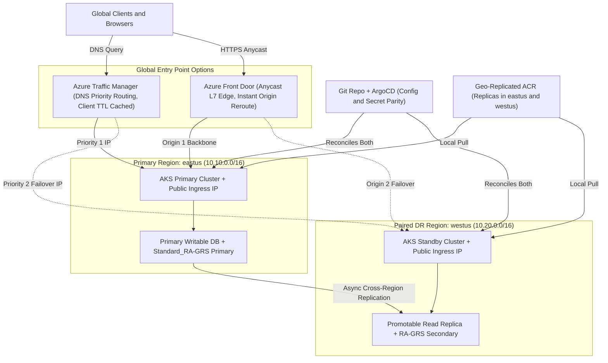
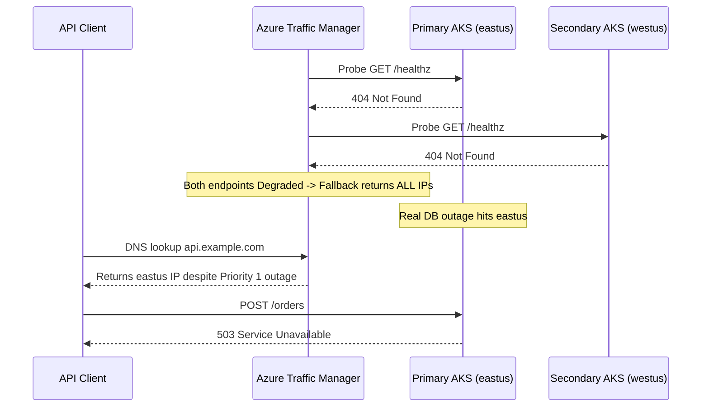

# 01 - Multi-Region Architecture on Azure

> **Prerequisites:** DR strategy spectrum and RTO/RPO targets (Module 00), Azure VNet peering and DNS fundamentals (Track 05), Reusable Terraform modules (Track 09), and GitOps with ArgoCD (Track 10).  
> **Estimated Reading Time:** 40 minutes  
> **Target Audience:** Backend Engineers, Platform Engineers, Cloud Network Architects, Site Reliability Engineers (SREs).

> [!TIP]
> **The Golden Rule of Multi-Region Substrate:** Remember that **the slowest data store dictates overall system RPO**, **non-overlapping CIDRs are mandatory** across regional VNets, Traffic Manager failover latency equals **probe detection + client DNS TTL**, and **Azure Front Door** eliminates client DNS TTL from the HTTP/S failover path entirely.

---

## Why This Matters

A DR strategy on paper (module 00) needs a substrate: somewhere to fail over *to*, a way to keep data there, and a router that sends users to whichever region is alive. This module builds all three on Azure — a global traffic router (Traffic Manager or Front Door), geo-redundant data, and a second AKS region — reusing the exact Terraform modules from track 09 and the networking concepts from track 05, now applied to a *second* region. Getting the traffic router and DNS behaviour right here is what makes the failover drills in module 02 actually redirect users instead of quietly doing nothing.

---

## 1. Architectural Mental Model: Dual-Region Substrate & Global Routing Split

Because Kubernetes clusters cannot span Azure regions, multi-region AKS runs **two independent clusters** parameterized by the same Terraform modules, kept in config parity via GitOps, pulling from one geo-replicated ACR, and fronted by either **Traffic Manager (DNS + TTL)** or **Azure Front Door (L7 Edge Reverse Proxy)**:



### Two regions, and what "paired" buys you

From module 00 you have a primary region and a candidate DR region. Choosing your DR region to be Azure's **paired** region for the primary gives you two free platform behaviours: GRS storage replicates there automatically, and Azure sequences planned platform maintenance so a pair isn't updated simultaneously. You don't *have* to use the pair (latency or data-residency may push you elsewhere), but if you have no strong reason otherwise, the pair is the sensible default. The rest of this module assumes primary = `eastus`, secondary = its pair (e.g. `westus`), but every command takes the region as a parameter — swap freely.

### Reusing track 09's Terraform modules for a second region

The critical realization: you already wrote reusable infrastructure. Track 09's capstone had a `network` module and a `platform`/`aks` module driven by variables (region, address space, names). A second region is **not new code** — it's the same modules invoked a second time with a different `region` and a non-overlapping address space:

```hcl
module "primary" {
  source        = "./modules/region"
  location      = "eastus"
  address_space = "10.10.0.0/16"
  name_prefix   = "app-eus"
}

module "secondary" {
  source        = "./modules/region"
  location      = "westus"
  address_space = "10.20.0.0/16"   # MUST NOT overlap the primary
  name_prefix   = "app-wus"
}
```

This is the concrete payoff of doing IaC properly in track 09: "add a DR region" becomes a second module block, and "redeploy the whole region from scratch" (module 03's DR mechanism) becomes `terraform apply`. The non-overlapping CIDR is not optional — if you ever peer the two VNets (for cross-region replication traffic), overlapping ranges make routing impossible, exactly as track 05 taught.

### Data replication options and their RPO

Compute is stateless and easy to duplicate; *data* is the hard part of multi-region, and each option is a different RPO:

- **Geo-redundant storage (GRS / RA-GRS).** For Blob/queue/table/file data. GRS asynchronously copies to the paired region (RPO minutes, no read access until failover); **RA-GRS** adds read access to the secondary at any time — essential if your DR region needs to *read* that data before an official failover. This is track 14 / module 04's backup destination, now seen as a DR primitive.
- **Managed database geo-replication.** Azure SQL active geo-replication, Cosmos DB multi-region, or PostgreSQL Flexible Server read replicas in another region — continuous async replication with an RPO of seconds and a promotable secondary. This is the managed-service path from track 14 / module 05, now used for cross-region DR.
- **Self-managed replication.** The CloudNativePG / streaming-replication approach from track 14 / module 03, with a replica in the second region. More control, more operational burden.
- **Zone-redundant vs. geo-redundant.** Don't confuse them: zone-redundant (ZRS) survives an AZ failure *within* one region and is far cheaper than a second region. If your target failure domain is "one datacenter," ZRS may be the whole answer (module 00's failure-domain point).

The RPO of your *whole system* is the worst RPO among its data stores — a 5-second database RPO paired with hourly blob backups gives you an hourly RPO overall.

### Traffic Manager: DNS-level global routing

**Azure Traffic Manager** routes at the **DNS layer**. Clients resolve a Traffic Manager name (`myapp.trafficmanager.net`, usually behind your own CNAME), and Traffic Manager answers with the IP of a healthy endpoint chosen by a **routing method**:

- **Priority** — always send to endpoint 1 unless it's unhealthy, then endpoint 2. This is *the* failover routing method: primary region normally, secondary only when the primary's health probe fails.
- **Performance** — send each client to the lowest-latency region (good for active-active).
- **Weighted** — split by ratio (canary-style, or gradual cutover).
- **Geographic** — route by client geography (data residency).

The catch that dominates module 02's drill: **DNS caching**. Traffic Manager health probes detect a dead region in probe-interval seconds, but clients and resolvers cache the DNS answer for the record's **TTL**. A 300-second TTL means users can keep hitting the dead region for up to 5 minutes *after* Traffic Manager has already switched. Low TTLs shrink this window but increase DNS query volume. This TTL-vs-failover-speed tension is the single most common reason a "successful" failover doesn't actually redirect traffic — you'll reproduce it deliberately in module 02.

### Front Door: an L7 global entry point

**Azure Front Door** operates at **Layer 7 (HTTP/S)** as a global reverse proxy with anycast: clients connect to Front Door's nearest edge POP, and Front Door forwards to a healthy backend (origin) over Microsoft's backbone. Because clients keep a connection to the *edge*, not to a region directly, failover doesn't wait on client DNS TTLs — Front Door re-routes at the edge in seconds. It also brings TLS termination, WAF, caching, and path-based routing (conceptually the global cousin of the Application Gateway from track 05). Trade-offs vs. Traffic Manager:

- **Traffic Manager**: DNS-level, protocol-agnostic (works for any TCP service, not just HTTP), cheaper, but bounded by DNS TTL on failover.
- **Front Door**: HTTP/S only, faster failover (no client DNS dependency), more features (WAF/caching/TLS), higher cost.

For a web/API system needing fast regional failover, Front Door is usually the better DR entry point precisely *because* it sidesteps the DNS-TTL problem. For non-HTTP services or cost sensitivity, Traffic Manager. You'll build both here so you understand the difference in your hands.

### AKS multi-region patterns

There is no "stretch one AKS cluster across two regions" — a cluster lives in one region. Multi-region AKS means **two independent clusters**, one per region, with:

- **Independent provisioning** — the same Terraform `aks` module (track 09) applied per region.
- **Independent, geo-replicated images** — one ACR with **geo-replication** enabled (a single registry that stores images in multiple regions, so each cluster pulls locally and an ACR outage in one region doesn't stop the other). Cheaper and simpler than two separate registries.
- **A global router in front** — Traffic Manager or Front Door pointing at each cluster's ingress/LoadBalancer IP as an endpoint/origin.
- **Config/secret parity** — both clusters need the same Deployments, ConfigMaps, and Secrets. GitOps (track 10 / ArgoCD) is the clean way: one Git repo, both clusters reconciling from it, so the standby is never a hand-maintained divergent copy. A standby whose config has silently drifted is a DR that fails at the worst moment.

The strategy from module 00 decides how the second cluster runs: pilot light = scaled to zero until needed; warm standby = running small; active-active = full capacity behind performance/weighted routing.

---

## 2. Taxonomic Comparison & Command Reference

### Global Traffic Router Comparison: Traffic Manager vs. Azure Front Door

| Dimension | Azure Traffic Manager | Azure Front Door (Standard / Premium) |
| :--- | :--- | :--- |
| **OSI Layer** | Layer 7 DNS resolution only | Layer 7 HTTP/S Anycast Reverse Proxy |
| **Protocol Support** | Any protocol (HTTP, gRPC, raw TCP/UDP) | HTTP / HTTPS only |
| **Failover Latency** | Probe Detection (`interval * max-failures`) + Client DNS TTL | Edge Probe Detection (~seconds); **no DNS TTL dependency** |
| **TLS / WAF / Caching** | None (pass-through IP/CNAME) | Built-in edge TLS termination, WAF, CDN caching |
| **Cross-Region Backbone** | Clients traverse public internet directly to regional IP | Edge POP proxies over Microsoft private WAN backbone |
| **Cost Profile** | Very low (per DNS query + health probe checks) | Moderate (base fee + egress + requests) |

### Multi-Region Data Replication Options

| Storage / Data Option | Scope | Secondary Readable Pre-Failover? | Typical RPO | Cost vs. LRS |
| :--- | :--- | :--- | :--- | :--- |
| **`Standard_ZRS`** | Multi-AZ inside **1 region** | N/A (single logical endpoint) | `0` (synchronous across zones) | Lower than geo-redundant |
| **`Standard_GRS`** | Async pair to **2nd region** | **No** (until Microsoft/forced failover) | Minutes (typically `< 15m`) | Geo-replication tier |
| **`Standard_RA-GRS`** | Async pair to **2nd region** | **Yes** (`-secondary` read endpoint) | Minutes (typically `< 15m`) | Slightly above GRS |
| **Managed DB Geo-Replica** | Azure SQL / Postgres Flex / Cosmos | **Yes** (read-only replica until promotion) | Seconds (async log shipping) | `~2x` DB compute + egress |

### Command Reference

| Command | What it does | Example |
|---|---|---|
| `az network traffic-manager profile create` | Creates a Traffic Manager profile (the DNS router) | see breakdown |
| `az network traffic-manager endpoint create` | Adds a region as an endpoint to the profile | see breakdown |
| `az network traffic-manager profile show` | Shows profile FQDN, routing method, endpoint health | `az network traffic-manager profile show -g <rg> -n <prof>` |
| `az afd profile create` | Creates a Front Door (Standard/Premium) profile | `az afd profile create -g <rg> --profile-name fd --sku Standard_AzureFrontDoor` |
| `az afd origin-group create` | Creates an origin group with health probes | see breakdown |
| `az afd origin create` | Adds a regional backend as an origin | see breakdown |
| `az acr replication create` | Geo-replicates an ACR to a second region | `az acr replication create -r <acr> -l westus` |
| `az storage account create --sku Standard_RA-GRS` | Creates read-access geo-redundant storage | `az storage account create -n <n> -g <rg> --sku Standard_RA-GRS` |
| `dig +short <name>` / `nslookup` | Observes what DNS *actually* returns (and TTL) — critical for module 02 | `dig +short myapp.trafficmanager.net` |

Flag breakdown — a **priority (failover)** Traffic Manager profile:

```bash
az network traffic-manager profile create \
  -g dr-rg -n app-tm \
  --routing-method Priority \
  --unique-dns-name app-tm-$RANDOM \
  --ttl 30 \
  --protocol HTTP --port 80 --path "/healthz" \
  --interval 10 --timeout 5 --max-failures 3
```
- `--routing-method Priority` — failover routing: endpoint 1 unless unhealthy, then 2.
- `--unique-dns-name` — the label in `<name>.trafficmanager.net`; must be globally unique.
- `--ttl 30` — the DNS TTL clients cache for. **Low on purpose** so failover isn't stuck behind a long cache — this single flag is the crux of module 02's DNS-TTL diagnose-and-fix.
- `--protocol HTTP --port 80 --path "/healthz"` — the health probe: GET `http://<endpoint>:80/healthz`. A non-2xx marks the endpoint unhealthy and triggers failover.
- `--interval 10 --timeout 5 --max-failures 3` — probe every 10s, fail a probe after 5s, mark unhealthy after 3 consecutive failures (~30s to detect an outage). Detection time + TTL = total failover time.

Flag breakdown — adding the two regional endpoints (priority order):

```bash
az network traffic-manager endpoint create \
  -g dr-rg --profile-name app-tm -n primary \
  --type externalEndpoints --target <primary-ingress-ip> \
  --priority 1 --endpoint-status Enabled

az network traffic-manager endpoint create \
  -g dr-rg --profile-name app-tm -n secondary \
  --type externalEndpoints --target <secondary-ingress-ip> \
  --priority 2 --endpoint-status Enabled
```
- `--type externalEndpoints` — the target is an IP/FQDN you supply (your cluster's public ingress IP), not an Azure resource ID.
- `--target` — the regional entry point's IP.
- `--priority 1` / `2` — 1 is primary; traffic goes to 2 only when 1 is unhealthy. This *is* the failover behaviour.

Flag breakdown — a Front Door origin group with health probes:

```bash
az afd origin-group create \
  -g dr-rg --profile-name fd --origin-group-name app-og \
  --probe-request-type GET --probe-protocol Http --probe-path "/healthz" \
  --probe-interval-in-seconds 30 \
  --sample-size 4 --successful-samples-required 3 \
  --additional-latency-in-milliseconds 50
```
- `--probe-path "/healthz"` — Front Door health-probes each origin here.
- `--probe-interval-in-seconds 30` — how often edges probe origins.
- `--sample-size 4 --successful-samples-required 3` — need 3 of the last 4 probes healthy to keep an origin in rotation. Failover happens at the edge when an origin drops below this — **no client DNS TTL involved**, which is Front Door's DR advantage.

---

## 3. Production War Story Post-Mortem: "The Health Probe That Painted Both Regions Degraded — And Returned the Dead One Anyway"

| Field | Incident Details |
| :--- | :--- |
| **Severity** | **SEV-2** (50% API Failure Rate During Regional Incident) |
| **Detection / Resolution Time** | Detected in 14 minutes / Resolved in 38 minutes |
| **Impact** | Traffic Manager failed to isolate a broken primary region and continued serving both primary and secondary IPs in round-robin fallback |

### What Happened

A platform engineer configured an Azure Traffic Manager profile with `--path "/healthz"` after deploying a new microservice whose router only exposed `/`. Both `primary` (`eastus`) and `secondary` (`westus`) immediately transitioned to `Degraded` monitor status because `/healthz` returned `404 Not Found`. Traffic Manager's built-in failsafe for "zero healthy endpoints" fell back to returning **all enabled endpoints**—so normal traffic seemed fine until `eastus` suffered a real database outage and half of all users still received the broken `eastus` IP.



### Root Cause Analysis

1. **False-negative health probe path:** Probing a path that returned `404` pushed every endpoint into `Degraded`, completely neutralizing Traffic Manager's priority failover signal.
2. **Silent all-degraded fallback:** Because Traffic Manager falls back to returning all enabled endpoints when none pass probes, the misconfiguration stayed invisible until an actual outage occurred.
3. **Lack of endpoint-status alerting:** Nobody monitored `endpointMonitorStatus != Online` in Azure Monitor.

### The Fix & Architectural Hardening

- Implemented a real `/healthz` endpoint verifying downstream database reachability (not a static `200 OK` stub) and exposed `X-Serving-Region` headers on all ingress responses.
- Added automated Azure Monitor alerts on Traffic Manager `EndpointMonitorStatus` dropping out of `Online` and migrated Tier-0 HTTP traffic to Azure Front Door with validated `GET /healthz` origin probes.

---

## 4. Multi-Language Production Implementation: Real `/healthz` Probe Endpoint & Priority-Aware Multi-Region Client

These four implementations provide (1) a genuine `/healthz` endpoint that verifies downstream data connectivity and stamps `X-Region` (preventing "probe lies" during failover) and (2) an edge/client failover probe loop that fails over cleanly from Primary (`eastus`) to Secondary (`westus`) when health degrades.

````carousel
```go
package multiregion

import (
	"context"
	"encoding/json"
	"errors"
	"net/http"
	"time"
)

type DependencyChecker interface {
	Ping(ctx context.Context) error
}

// NewHealthzHandler serves /healthz for Traffic Manager and Azure Front Door.
// Returns 200 only when downstream database/storage dependencies respond within timeout.
func NewHealthzHandler(region string, db DependencyChecker) http.HandlerFunc {
	return func(w http.ResponseWriter, r *http.Request) {
		ctx, cancel := context.WithTimeout(r.Context(), 2*time.Second)
		defer cancel()

		w.Header().Set("Content-Type", "application/json")
		w.Header().Set("X-Azure-Region", region)

		if err := db.Ping(ctx); err != nil {
			w.WriteHeader(http.StatusServiceUnavailable)
			_ = json.NewEncoder(w).Encode(map[string]string{
				"status": "unhealthy",
				"region": region,
				"error":  err.Error(),
			})
			return
		}
		w.WriteHeader(http.StatusOK)
		_ = json.NewEncoder(w).Encode(map[string]string{"status": "ok", "region": region})
	}
}

// FetchWithRegionalFallback simulates priority routing with strict dial timeouts.
func FetchWithRegionalFallback(ctx context.Context, endpoints []string) (*http.Response, string, error) {
	client := &http.Client{Timeout: 3 * time.Second}
	for _, baseURL := range endpoints {
		req, err := http.NewRequestWithContext(ctx, http.MethodGet, baseURL+"/healthz", nil)
		if err != nil {
			continue
		}
		resp, err := client.Do(req)
		if err == nil && resp.StatusCode >= 200 && resp.StatusCode < 300 {
			return resp, baseURL, nil
		}
		if resp != nil {
			resp.Body.Close()
		}
	}
	return nil, "", errors.New("all regional endpoints unhealthy")
}
```
<!-- slide -->
```typescript
import type { IncomingMessage, ServerResponse } from "node:http";

export interface HealthDependency {
  ping(signal: AbortSignal): Promise<void>;
}

export function createHealthzHandler(region: string, db: HealthDependency) {
  return async (_req: IncomingMessage, res: ServerResponse): Promise<void> => {
    const controller = new AbortController();
    const timer = setTimeout(() => controller.abort(), 2000);
    res.setHeader("Content-Type", "application/json");
    res.setHeader("X-Azure-Region", region);

    try {
      await db.ping(controller.signal);
      res.statusCode = 200;
      res.end(JSON.stringify({ status: "ok", region }));
    } catch (err) {
      res.statusCode = 503;
      res.end(JSON.stringify({ status: "unhealthy", region, reason: String(err) }));
    } finally {
      clearTimeout(timer);
    }
  };
}

export async function callPriorityRegions(
  priorityUrls: string[],
  path = "/healthz"
): Promise<{ regionUrl: string; status: number; regionHeader: string | null }> {
  for (const baseUrl of priorityUrls) {
    try {
      const resp = await fetch(`${baseUrl}${path}`, { signal: AbortSignal.timeout(3000) });
      if (resp.ok) {
        return {
          regionUrl: baseUrl,
          status: resp.status,
          regionHeader: resp.headers.get("x-azure-region"),
        };
      }
    } catch {
      // Fail through to next priority region endpoint
    }
  }
  throw new Error("All regional origins failed health check");
}
```
<!-- slide -->
```python
from dataclasses import dataclass
from typing import Callable
import urllib.request
import urllib.error
import json


@dataclass(frozen=True)
class HealthResponse:
    status_code: int
    region: str
    body: dict


def evaluate_healthz(region: str, ping_dependency: Callable[[], None]) -> HealthResponse:
    """Real /healthz check: only 200 when the region's data dependency succeeds."""
    try:
        ping_dependency()
        return HealthResponse(200, region, {"status": "ok", "region": region})
    except Exception as exc:
        return HealthResponse(
            503,
            region,
            {"status": "unhealthy", "region": region, "error": str(exc)},
        )


def route_priority_endpoints(endpoints: list[str], timeout_sec: float = 3.0) -> dict:
    """Queries regions in priority order (primary first, paired secondary second)."""
    for url in endpoints:
        try:
            with urllib.request.urlopen(f"{url.rstrip('/')}/healthz", timeout=timeout_sec) as resp:
                if 200 <= resp.status < 300:
                    payload = json.loads(resp.read().decode("utf-8"))
                    return {"active_url": url, "status": resp.status, "payload": payload}
        except (urllib.error.URLError, TimeoutError):
            continue
    raise RuntimeError("All regional endpoints failed priority health probing")
```
<!-- slide -->
```csharp
using System.Net;
using System.Text.Json;

public sealed record HealthStatus(string Status, string Region, string? Error = null);

public static class MultiRegionHealth
{
    public static async Task<(int StatusCode, string RegionHeader, string JsonBody)> CheckHealthzAsync(
        string region,
        Func<CancellationToken, Task> pingDependency,
        CancellationToken ct = default)
    {
        using var timeoutCts = CancellationTokenSource.CreateLinkedTokenSource(ct);
        timeoutCts.CancelAfter(TimeSpan.FromSeconds(2));

        try
        {
            await pingDependency(timeoutCts.Token);
            var ok = new HealthStatus("ok", region);
            return ((int)HttpStatusCode.OK, region, JsonSerializer.Serialize(ok));
        }
        catch (Exception ex)
        {
            var fail = new HealthStatus("unhealthy", region, ex.Message);
            return ((int)HttpStatusCode.ServiceUnavailable, region, JsonSerializer.Serialize(fail));
        }
    }

    public static async Task<string> SelectHealthyOriginAsync(
        IReadOnlyList<string> priorityOrigins,
        HttpClient httpClient,
        CancellationToken ct = default)
    {
        foreach (var origin in priorityOrigins)
        {
            using var cts = CancellationTokenSource.CreateLinkedTokenSource(ct);
            cts.CancelAfter(TimeSpan.FromSeconds(3));
            try
            {
                using var resp = await httpClient.GetAsync($"{origin.TrimEnd('/')}/healthz", cts.Token);
                if (resp.IsSuccessStatusCode)
                    return origin;
            }
            catch (OperationCanceledException) when (!ct.IsCancellationRequested) { }
            catch (HttpRequestException) { }
        }
        throw new InvalidOperationException("No healthy regional origin available.");
    }
}
```
````

---

## 5. Practical Hands-On Verification CLI Workflows

These build a real second region. It is billable — a second AKS cluster plus a global router. Keep the standby small (or scaled to zero) and run the full teardown in exercise 9 the same day. If you have your track 09 capstone Terraform, reuse it; if not, the exercises use `az` directly so you can still do them.

### 1. Confirm your region pair and reserve non-overlapping CIDRs

```bash
az account list-locations \
  --query "[?name=='eastus'].metadata.pairedRegion[0].name" -o tsv
```

**Expected Output:**
```text
westus
```

Write down primary (`eastus`, `10.10.0.0/16`) and secondary (the pair, `10.20.0.0/16`). Non-overlapping is mandatory (track 05) — verify the two `/16`s don't intersect.

### 2. Stand up the second region from your track 09 modules

If you have the track 09 capstone modules, add a `secondary` module block (as in Concepts) with the DR region and its CIDR, `terraform plan`, read the `N to add` line (it should be a second copy of the region's resources and *nothing destroyed* in the primary), and `apply`. If you don't have the Terraform, create a minimal second region by hand:

```bash
az group create -n dr-secondary-rg -l westus
az aks create -g dr-secondary-rg -n aks-wus \
  --node-count 1 --node-vm-size Standard_B2s --generate-ssh-keys \
  --tier free --load-balancer-sku standard
```

**Expected Output:**
```text
ProvisioningState: Succeeded
Name: aks-wus
Location: westus
```

Expected: a second cluster in the DR region. Note in writing that with real IaC this was *one module block*, not a from-scratch build — that reuse is the DR mechanism module 03 formalizes.

### 3. Deploy the same app to both regions

Deploy an identical workload (the simplest whole-cluster echo works) to each cluster and expose it via a LoadBalancer so each has a public IP:

```bash
# For each cluster (get-credentials first):
kubectl create deployment web --image=mcr.microsoft.com/azuredocs/aks-helloworld:v1
kubectl expose deployment web --type=LoadBalancer --port=80 --target-port=80
kubectl get svc web -w   # note the EXTERNAL-IP
```

Record both external IPs. These are the two endpoints your global router will front. (In a real system this parity is enforced by GitOps/track 10 — here you're doing it by hand to see the moving parts.)

### 4. Put a priority Traffic Manager profile in front

```bash
az group create -n dr-rg -l eastus
az network traffic-manager profile create \
  -g dr-rg -n app-tm --routing-method Priority \
  --unique-dns-name app-tm-$RANDOM --ttl 30 \
  --protocol HTTP --port 80 --path "/" \
  --interval 10 --timeout 5 --max-failures 3
az network traffic-manager endpoint create -g dr-rg --profile-name app-tm \
  -n primary --type externalEndpoints --target <primary-ip> --priority 1
az network traffic-manager endpoint create -g dr-rg --profile-name app-tm \
  -n secondary --type externalEndpoints --target <secondary-ip> --priority 2
az network traffic-manager profile show -g dr-rg -n app-tm \
  --query "{fqdn:dnsConfig.fqdn, method:trafficRoutingMethod}" -o table
```

**Expected Output:**
```text
Fqdn                            Method
------------------------------  --------
app-tm-28419.trafficmanager.net  Priority
```

Expected: a `*.trafficmanager.net` FQDN that resolves to your **primary** region's IP while it's healthy.

### 5. Observe the DNS answer and its TTL

```bash
FQDN=$(az network traffic-manager profile show -g dr-rg -n app-tm --query dnsConfig.fqdn -o tsv)
dig +short "$FQDN"          # the IP it hands out
dig "$FQDN" | grep -A1 "ANSWER SECTION"   # note the TTL value
curl -s "http://$FQDN/" | head -5
```

**Expected Output:**
```text
20.85.140.12
;; ANSWER SECTION:
app-tm-28419.trafficmanager.net. 30 IN A 20.85.140.12
```

Expected: `dig` returns the *primary* IP, and the TTL matches your `--ttl 30`. Internalize this: clients will cache that answer for the TTL — the number that will bite you in module 02.

### 6. Geo-replicate the ACR (multi-region image pulls)

```bash
# Assuming an ACR from an earlier track; enable geo-replication to the DR region:
az acr replication create -r <youracr> -l westus
az acr replication list -r <youracr> -o table
```

**Expected Output:**
```text
NAME      LOCATION    PROVISIONING STATE    STATUS    REGION ENDPOINT ENABLED
--------  ----------  --------------------  --------  -----------------------
eastus    eastus      Succeeded             Ready     True
westus    westus      Succeeded             Ready     True
```

Expected: the registry now shows a replica in the DR region. Each cluster pulls images from its local replica; an ACR regional outage no longer blocks the surviving cluster. Note this is *one* registry, not two — cheaper and no image-drift risk.

### 7. Build a Front Door in front of the same two regions

```bash
az afd profile create -g dr-rg --profile-name fd --sku Standard_AzureFrontDoor
az afd endpoint create -g dr-rg --profile-name fd --endpoint-name app-$RANDOM --enabled-state Enabled
az afd origin-group create -g dr-rg --profile-name fd --origin-group-name app-og \
  --probe-request-type GET --probe-protocol Http --probe-path "/" \
  --probe-interval-in-seconds 30 --sample-size 4 --successful-samples-required 3 \
  --additional-latency-in-milliseconds 50
az afd origin create -g dr-rg --profile-name fd --origin-group-name app-og \
  --origin-name primary --host-name <primary-ip> --origin-host-header <primary-ip> \
  --http-port 80 --priority 1 --weight 1000 --enabled-state Enabled
az afd origin create -g dr-rg --profile-name fd --origin-group-name app-og \
  --origin-name secondary --host-name <secondary-ip> --origin-host-header <secondary-ip> \
  --http-port 80 --priority 2 --weight 1000 --enabled-state Enabled
# then create a route binding the endpoint to the origin group (see az afd route create)
```

Expected: an `*.azurefd.net` endpoint that reaches your app. The key conceptual note to write down: Front Door failover happens at its edge based on the health probe — **there is no client DNS TTL in the failover path**, unlike Traffic Manager.

### 8. Diagnose-and-fix: the health probe path that lies

Point the Traffic Manager probe at a path your app doesn't serve as 200 (e.g. `/healthz` when the app only serves `/`), then observe:

```bash
az network traffic-manager profile update -g dr-rg -n app-tm --path "/healthz"
sleep 40
az network traffic-manager endpoint show -g dr-rg --profile-name app-tm \
  -n primary --query endpointMonitorStatus -o tsv    # likely Degraded
dig +short "$FQDN"
```

**Expected Output:**
```text
Degraded
20.85.140.12
```

You'll find *both* endpoints go `Degraded` (neither serves `/healthz` 200), and Traffic Manager, with no healthy endpoint, falls back to returning *all* endpoints — so it *looks* like it's still working but has no real health signal. The lesson: **a health probe that doesn't hit a real health endpoint gives you fake failover** — it either never fails over (probe too lenient) or fails over constantly / degrades everything (probe hitting the wrong path). Fix by pointing the probe at a path the app genuinely returns 200 for (add a real `/healthz`), and re-verify both endpoints go `Online`. This same mistake — a probe that doesn't reflect true health — is why some failovers in module 02 don't trigger when the region is actually sick.

### 9. Clean up (this is the expensive part — do it today)

```bash
az afd profile delete -g dr-rg --profile-name fd --yes
az network traffic-manager profile delete -g dr-rg -n app-tm
az acr replication delete -r <youracr> -l westus --yes   # drop the geo-replica if not keeping it
az group delete -n dr-secondary-rg --yes --no-wait       # the whole second region
az group delete -n dr-rg --yes --no-wait
az aks list -o table   # confirm the DR cluster is gone
```

Expected: the second cluster, both routers, and the ACR replica are gone. Leaving a second AKS cluster running is the exact way this track produces a real bill — the second region roughly doubles cost for as long as it's up.

### Independent Challenge

Using the same reusable region module from track 09 (and the ACR geo-replication and one global router from this module), stand up a **warm standby** for a small web app: primary region full-size, secondary region running but at reduced capacity (e.g. one node, one replica), both fronted by a single global router with the primary preferred. Verify with `dig`/`curl` that traffic normally lands in the primary. Then write — don't yet execute, that's module 02 — the exact sequence you'd run to promote the standby if the primary died, including how you'd scale the secondary up to full capacity. State the RPO/RTO you think this warm-standby build achieves and which region's data store is authoritative. This draws on track 09 (reusable modules), track 05 (non-overlapping VNets, DNS), and module 00's strategy choice. **Tear the second region down the moment you've verified it** — a warm standby left running is a doubled bill.

<details><summary>Stuck? One hint</summary>

The warm standby differs from active-active only in *capacity and traffic share*, not in architecture — same two regions, same router, but the secondary runs `--node-count 1` and `replicas: 1`, and the router uses Priority (primary preferred) rather than Performance/Weighted. "Promotion" is therefore two steps: scale the secondary out (`az aks nodepool scale` + `kubectl scale deployment`), then let the router's health probe (or a manual endpoint disable on the primary) shift traffic. The RTO is dominated by how long the scale-out takes plus the router's detection + TTL window — which is exactly why warm standby is faster than pilot light (already running) but slower than active-active (already full-size).

</details>

---

## 6. Common Mistakes & Troubleshooting

- **Overlapping CIDRs across regions.** If you ever peer the VNets for replication traffic, overlapping address spaces make it unroutable (track 05). Reserve non-overlapping ranges up front even if you don't peer yet.
- **Confusing zone-redundant with geo-redundant.** ZRS/AZ-spread survives a datacenter failure within one region and is far cheaper than a second region; GRS/multi-region survives a *regional* failure. Match the mechanism to the failure domain you actually need (module 00).
- **A standby whose config has silently drifted.** A second cluster hand-maintained apart from the primary will have missing secrets or stale images exactly when you fail over. Drive both from one Git source (GitOps, track 10) so the standby can't diverge.
- **Health probe pointing at the wrong path (exercise 8).** A probe that doesn't reflect real health gives fake failover — degrading everything or never triggering. Probe a genuine health endpoint that returns 200 only when the app can actually serve.
- **Assuming Traffic Manager fails over instantly.** It's DNS — clients cache the answer for the TTL, so real failover time is detection time *plus* TTL. If you need sub-TTL failover, use Front Door (edge-level) instead. This is module 02's headline pitfall.
- **Cost pitfall — running a full-size second region 24/7 (ties to track 21).** A second full-capacity region is the single largest DR cost, and for most systems a *pilot light* (secondary scaled to zero, only data replicating) meets the RTO at a fraction of the price. Geo-replicated ACR, cross-region egress, RA-GRS read charges, and the global router all add up too — none are free. Right-size the standby to the strategy module 00 chose, and scale it to zero (or destroy it) whenever you're not drilling.

---

## 7. Operational Validation Checkpoints

### Operational Validation Checkpoints

<details><summary><strong>Checkpoint 1: Selecting Traffic Manager vs. Azure Front Door</strong></summary>

When routing a non-HTTP gRPC/TCP ingestion gateway across two Azure regions, **Azure Traffic Manager** is required because Azure Front Door strictly supports HTTP/HTTPS. Conversely, for a customer-facing REST API with a tight `30-second` RTO requirement, **Azure Front Door** is the right choice because it performs health-checked rerouting at its anycast edge POPs without waiting for downstream clients or corporate DNS resolvers to expire cached TTLs.

</details>

<details><summary><strong>Checkpoint 2: Preventing Silent Config Drift and Routing Collisions</strong></summary>

Deploying `module "primary"` (`10.10.0.0/16`) and `module "secondary"` (`10.20.0.0/16`) from one parameterized Terraform root keeps VNet peering routable if cross-region database replication needs private connectivity. Pairing that with **one geo-replicated ACR** and **ArgoCD GitOps** reconciling both clusters from a single Git repository guarantees the standby never lacks an image tag, ConfigMap, or Ingress route at failover time.

</details>

<details><summary><strong>Checkpoint 3: Computing Composite System RPO</strong></summary>

If your Azure SQL active geo-replication achieves a `5-second` RPO, your PostgreSQL streaming replica lags by `10 seconds`, and your uploaded invoice PDFs sit in `Standard_RA-GRS` blob storage (`< 15 minutes` async RPO), the overall system RPO is **up to ~15 minutes** (set by the slowest asynchronous store), not 5 seconds. Never advertise the database's RPO as the system's RPO unless all dependent state shares the same bound.

</details>

### Checkpoint Quiz

Write down your answer to each question before expanding it — checking without attempting first is the single easiest way to fool yourself into thinking you've learned this.

1. What does choosing Azure's *paired* region as your DR region give you automatically?
2. Why must the second region use a non-overlapping CIDR, and which earlier track established that rule?
3. Explain the core difference between how Traffic Manager and Front Door fail over, and why that determines failover *speed*.
4. In a priority Traffic Manager profile, which two durations add up to total failover time, and which flags control each?
5. What is the difference between GRS and RA-GRS, and when does the distinction matter for DR?
6. There's no single AKS cluster stretched across two regions — so what *is* the multi-region AKS pattern, and how do you stop the two clusters' images and config from diverging?
7. In exercise 8, a health probe pointed at the wrong path produced "fake failover." Explain what went wrong and the fix.
8. Give the one-sentence FinOps rule (track 21) for how large to run the standby region.

<details><summary>Show answers</summary>

1. Automatic GRS replication to that region and Azure sequencing platform maintenance so the pair isn't updated simultaneously.
2. Because peering VNets with overlapping address ranges is unroutable, so overlapping CIDRs make cross-region replication traffic impossible; track 05 (azure-networking) established it.
3. Traffic Manager routes at the DNS layer, so failover is bounded by the client-cached TTL (failover = detection + TTL); Front Door routes at its L7 edge with no client DNS in the failover path, so it re-routes in seconds regardless of TTL.
4. Detection time (set by the probe's `--interval`, `--timeout`, and `--max-failures`) plus the DNS `--ttl` that clients cache.
5. GRS replicates data to the paired region but you can't read the secondary copy until Microsoft initiates failover; RA-GRS adds read access to the secondary at any time. It matters when your DR region needs to *read* that data before an official failover.
6. Two independent clusters, one per region, provisioned by the same Terraform module and fronted by a global router, pulling from one geo-replicated ACR; keep them in sync by reconciling both from one Git repo (GitOps, track 10) so config can't drift.
7. The probe hit a path the app didn't serve as 200, so every endpoint went Degraded and Traffic Manager, with no healthy endpoint, fell back to returning all of them — a health signal that reflects nothing. Fix: point the probe at a real health endpoint that returns 200 only when the app can actually serve, and confirm endpoints go Online.
8. Run the standby at the smallest size that still meets the chosen strategy's RTO — pilot light or warm standby for most systems, full-size only if active-active is genuinely required.

</details>

---

## 8. Next

[02-designing-and-testing-a-dr-plan](../02-designing-and-testing-a-dr-plan/README.md) — you have two regions and a router that *can* fail over. Now write the actual runbook for a regional outage — and, the part almost everyone skips, really execute a failover drill and measure whether traffic redirected.
