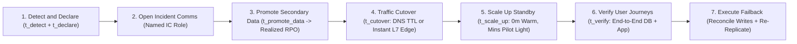
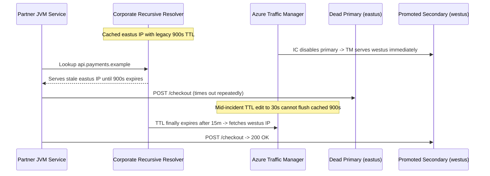

# 02 - Designing and Testing a DR Plan

> **Prerequisites:** DR strategy spectrum and RTO/RPO targets (Module 00), Multi-region Azure substrate with Traffic Manager and Front Door (Module 01), Managed DB failover (Track 14), and On-call & incident response roles (Track 20 / Modules 04–05).  
> **Estimated Reading Time:** 40 minutes  
> **Target Audience:** Backend Engineers, Site Reliability Engineers (SREs), Incident Commanders, Platform Engineers.

> [!TIP]
> **The Golden Rule of DR Plans:** An unexecuted DR runbook is an untested hypothesis. Write numbered, copy-pasteable steps for a stressed 3 AM responder using **named roles**, lower DNS TTL **before** the outage (or use Front Door), verify **end-to-end user journeys** rather than pod status, and record decomposed RTO/RPO drill metrics alongside a concrete **failback** and **cleanup** procedure.

---

## Why This Matters

A DR plan that has never been executed is a hypothesis, not a plan. Module 01 gave you a substrate that *can* fail over; this module turns that capability into a written runbook a stressed on-call engineer can follow at 3 AM — and then, the part that actually separates real DR from theatre, has you **execute a failover drill** against your two regions and measure whether traffic truly redirected. Most "DR plans" die the first time they meet a real DNS TTL, a stale replica, or a step that assumed a human who's on holiday. You'll find those failures in a drill, on purpose, instead of during an outage.

---

## 1. Architectural Mental Model: The 7-Phase Failover Pipeline & Decomposed RTO

Your realized Recovery Time Objective (`RTO_achieved`) is not a single magic switch—it is the sum of six measurable execution latencies across the 7-phase regional failover runbook, where **DNS TTL caching** sits squarely inside `t_cutover(DNS)` for Traffic Manager:



### A runbook is written for the worst version of you

The audience for a DR runbook is a tired, stressed engineer, possibly not the author, during a real outage with alarms going off (the on-call context from track 20 / module 04). That dictates the form:

- **Numbered, copy-pasteable steps**, not prose. Each step is one action with the exact command and its expected output.
- **Explicit preconditions and decision points** — "if the primary's health endpoint returns non-200 for >2 min, declare a regional incident and proceed; otherwise investigate in-region first." Ambiguity is what causes hesitation during an incident.
- **Verification after every consequential step**, not just at the end — how do you *know* the database promoted, the traffic shifted, the app is serving? A runbook without verification steps is a wish list.
- **Rollback / abort criteria** — when do you stop and *not* fail over (because failing over unnecessarily is its own outage)?
- **Named roles**, not names — "the Incident Commander decides to declare," mapping to track 20 / module 05's incident-response roles, so the plan doesn't depend on one specific person being reachable.

### The anatomy of a regional-failover runbook

A concrete structure you can reuse for any system:

1. **Detection & declaration** — what signal (SLO burn alert from track 20, health-probe failure, Azure Service Health) triggers this runbook, and who declares a DR event. Include the "don't fail over for a blip" guard.
2. **Communication** — declare an incident (track 20 / module 05), open the comms channel, set expectations. Failover is a customer-visible event.
3. **Data promotion** — promote the secondary region's data store to primary/writable (Azure SQL geo-failover, replica promotion, or storage account failover). This is usually the step with the real RPO consequence.
4. **Traffic cutover** — shift the global router to the secondary (disable the primary endpoint / raise the secondary's priority / let health probes do it). This is where DNS TTL bites.
5. **Scale-up** (pilot light / warm standby) — bring the secondary to full capacity if it wasn't already.
6. **Verification** — end-to-end checks that real user journeys work in the secondary, not just that pods are Running.
7. **Failback plan** — how you return to the primary once it recovers, which is often *harder* than the failover (you must re-replicate data that changed in the secondary without losing it).

### Failover time is detection + promotion + cutover + warm-up

Your achieved RTO is the sum of the phases, and it's worth decomposing because each has a different lever:

```text
RTO_achieved = t_detect + t_declare + t_promote_data + t_cutover(DNS) + t_scale_up + t_verify
```

- `t_detect` — health-probe interval × failures, or SLO burn-rate alert latency (track 20 / module 03).
- `t_declare` — human decision time; shrink with clear declaration criteria.
- `t_promote_data` — database/storage failover time (seconds to minutes).
- `t_cutover(DNS)` — **the DNS-TTL term for Traffic Manager** (near-zero for Front Door). This is the one people forget.
- `t_scale_up` — zero for warm standby / active-active, minutes for pilot light.
- `t_verify` — how long to confirm it actually works.

Measuring these in a drill is how you learn whether your *paper* RTO is achievable. Almost always the first drill blows the target, and the decomposed timing tells you which phase to fix.

### DNS TTL and caching: why "failover" sometimes changes nothing

The single most common failover surprise (foreshadowed in module 01): you disable the primary endpoint, Traffic Manager immediately starts answering with the secondary IP, and yet **users keep hitting the dead primary for minutes**. Why? Every resolver and client between you and the user cached the old DNS answer for the record's TTL, and some (browsers, JVMs with infinite DNS caching, corporate resolvers that ignore low TTLs) hold it even longer. So the failover "succeeded" at the Traffic Manager level and *did nothing observable* for real users during the TTL window. The fixes, in order of preference:

1. **Lower the TTL in advance** (module 01's `--ttl 30`) — you can't lower it *during* an incident and have it help, because the high TTL is already cached; it must be low *before* the outage.
2. **Use Front Door** (L7 edge failover) if you need failover faster than any safe DNS TTL allows.
3. **Know your worst-cached clients** — some ignore TTL entirely; the runbook should set expectations that a small tail keeps hitting the old region.

You'll reproduce this exact trap in the drill and measure the window.

### The drill is the deliverable — and its result is data

Echoing track 14 / module 04's "the restore is the deliverable": a DR plan is not done when it's written, it's done when a **drill** has executed it and you have *recorded results*: achieved RTO/RPO per phase, every step that was wrong/missing/ambiguous, and a list of fixes. A drill that "went fine" with no notes is nearly worthless — the value is in the discrepancies you find (a step that assumed a credential you didn't have, a replica that was 40 minutes behind, a scale-up that hit a quota). Record them, fix the runbook, and re-drill. This "execute and record, don't just write" discipline is the whole point of this module and the backbone of the game days in module 06.

---

## 2. Taxonomic Comparison & Command Reference

### Decomposed RTO Phases & Optimization Levers

| Phase Term | Runbook Stage | Typical Duration Drivers | Primary Engineering Lever to Shrink It |
| :--- | :--- | :--- | :--- |
| **`t_detect`** | Detection | Probe `--interval * --max-failures` or SLO alert window | Tune probe cadence + automated Azure Monitor alerts |
| **`t_declare`** | Declaration | On-call hesitation, unclear abort thresholds | Explicit binary preconditions + named IC role authority |
| **`t_promote_data`** | Data Promotion | DB log catchup, storage account failover sync | Continuous async replication + practiced `--allow-data-loss` rules |
| **`t_cutover(DNS)`** | Traffic Cutover | Cached DNS TTL in resolvers, browsers, and JVM pools | Pre-set `--ttl 30` beforehand or migrate HTTP/S to Front Door |
| **`t_scale_up`** | Standby Warm-Up | AKS VM provisioning, ACR image pulls, readiness probes | Warm standby pre-warmed nodes + geo-replicated ACR |
| **`t_verify`** | Verification | Manual spot-checks vs. automated synthetic journey | Automated end-to-end read/write smoke test script |

### Cutover Behaviour: High DNS TTL vs. Low DNS TTL vs. Azure Front Door

| Routing Posture | Router Cutover Time | Real Client Tail Lag | Fixable Mid-Incident? | Best Use Case |
| :--- | :--- | :--- | :--- | :--- |
| **Traffic Manager (`--ttl 300+`)** | ~1–2 seconds at authoritative DNS | Up to 5–15+ minutes for cached clients | **No** — old TTL is already cached downstream | Never recommended for tight-RTO failover |
| **Traffic Manager (`--ttl 30`)** | ~1–2 seconds at authoritative DNS | ~30 seconds (minus stubborn JVM/browser caches) | **No** — must be configured before outage | Non-HTTP/TCP services or cost-sensitive APIs |
| **Azure Front Door (L7 Edge)** | Seconds at edge POPs | Near-zero for new requests (edge-terminated) | Yes (edge routing updates independently) | Tier-0 web/API systems requiring tight RTO |

### Command Reference

| Command | What it does | Example |
|---|---|---|
| `az network traffic-manager endpoint update --endpoint-status Disabled` | Forces failover by disabling the primary endpoint (drill trigger) | see breakdown |
| `az sql failover-group set-primary` | Promotes the secondary Azure SQL region to primary (data promotion) | see breakdown |
| `az storage account failover` | Initiates account failover for GRS storage (data promotion) | `az storage account failover -n <acct> --yes` |
| `az aks nodepool scale` | Scales a pilot-light standby up to capacity | `az aks nodepool scale -g <rg> --cluster-name <c> -n <np> --node-count 3` |
| `kubectl scale deployment --replicas` | Scales the app tier up in the standby | `kubectl scale deployment web --replicas=3` |
| `dig +short <fqdn>` / `while true; do curl -s ...; done` | Measures what clients *actually* resolve/reach during cutover | see exercises |
| `az monitor metrics list` | Pulls Traffic Manager / Front Door metrics to time the drill | see track 12 |

Flag breakdown — forcing a failover by disabling the primary endpoint (the controlled drill trigger — safer than actually killing the region):

```bash
az network traffic-manager endpoint update \
  -g dr-rg --profile-name app-tm -n primary \
  --type externalEndpoints \
  --endpoint-status Disabled
```
- `--endpoint-status Disabled` — Traffic Manager stops handing out this endpoint's IP, so new DNS answers point at the secondary. This simulates "the primary is out of rotation" without destroying the primary — you can re-enable it to fail back. Crucially it does *not* flush anyone's cached DNS, so it exposes the real TTL window.

Flag breakdown — promoting an Azure SQL failover group (data promotion step):

```bash
az sql failover-group set-primary \
  --name <fg-name> \
  --resource-group <secondary-rg> \
  --server <secondary-server>
```
- `--server <secondary-server>` — the server in the DR region you're making primary. Run *against the secondary* — you're telling Azure "this side is now authoritative." A **forced** failover (add `--allow-data-loss` in a real regional outage where the primary is unreachable) accepts the async replication gap as your realized RPO — measure it.

---

## 3. Production War Story Post-Mortem: "Traffic Manager Showed 100% Cutover — Yet Checkout Stayed Dead for 15 Minutes"

| Field | Incident Details |
| :--- | :--- |
| **Severity** | **SEV-1** (Extended Customer & B2B API Outage During Failover) |
| **Detection / Resolution Time** | Detected in 3 minutes / Full traffic recovery took 24 minutes |
| **Impact** | Partner B2B webhooks and Java backend integrations failed with connection timeouts for 15+ minutes after Traffic Manager switched to `westus` |

### What Happened

During a planned regional incident response, the Incident Commander executed the failover runbook: promoted the secondary database in `westus`, confirmed Traffic Manager returned only the `westus` IP from `dig @8.8.8.8`, and announced *"Traffic cutover complete"* at `T+4m`. Yet synthetic monitors from partner networks and JVM microservices kept timing out against the dead `eastus` IP for another 15 minutes. An engineer panicked and lowered the Traffic Manager TTL from `900` to `30` mid-outage, which accomplished nothing for resolvers already holding the `900`-second record.



### Root Cause Analysis

1. **Pre-incident high DNS TTL (`900s`):** Nobody checked the Traffic Manager profile's `--ttl` prior to the outage; lowering it mid-incident cannot purge caches already held downstream.
2. **Stale client DNS & connection caching:** Partner JVM clients cached DNS lookups indefinitely (`networkaddress.cache.ttl=-1`) and held open keep-alive pools against dead sockets.
3. **False verification criterion:** The runbook only checked `dig` from one engineer's laptop and `kubectl get pods`, failing to monitor real synthetic client traffic across external resolvers.

### The Fix & Architectural Hardening

- Pre-configured `--ttl 30` on all Traffic Manager profiles in Terraform and migrated Tier-0 HTTP APIs to **Azure Front Door** so regional cutovers happen at the L7 anycast edge in seconds.
- Added JVM/HTTP client DNS TTL bounds (`30s`) and updated the runbook's verification phase to require continuous synthetic user-journey probes showing `>= 99%` `200 OK` from the secondary region before declaring recovery.

---

## 4. Multi-Language Production Implementation: Failover Drill Telemetry Probe & Phase Timer

These four implementations power an automated DR drill measurement loop (matching Exercise 3): polling the target endpoint every second, logging HTTP status + serving region/IP, tracking `T0_declare`, `T_first_secondary`, and `T_last_primary_tail` (exposing the DNS TTL tail), and computing the decomposed `t_cutover` and stabilization metrics.

````carousel
```go
package drdrill

import (
	"context"
	"fmt"
	"net"
	"net/http"
	"time"
)

type ProbeSample struct {
	Timestamp     time.Time
	StatusCode    int
	ResolvedIP    string
	ServingRegion string
	Latency       time.Duration
}

type DrillSummary struct {
	DeclaredAt          time.Time
	FirstSecondaryAt    time.Time
	LastPrimaryTailAt   time.Time
	CutoverWindow       time.Duration
	TotalSamples        int
	PrimaryTailRequests int
}

func RunFailoverProbe(
	ctx context.Context,
	fqdn string,
	primaryIP string,
	secondaryIP string,
	declaredAt time.Time,
) DrillSummary {
	client := &http.Client{Timeout: 2 * time.Second}
	summary := DrillSummary{DeclaredAt: declaredAt}
	ticker := time.NewTicker(1 * time.Second)
	defer ticker.Stop()

	for {
		select {
		case <-ctx.Done():
			if !summary.LastPrimaryTailAt.IsZero() {
				summary.CutoverWindow = summary.LastPrimaryTailAt.Sub(declaredAt)
			} else if !summary.FirstSecondaryAt.IsZero() {
				summary.CutoverWindow = summary.FirstSecondaryAt.Sub(declaredAt)
			}
			return summary
		case now := <-ticker.C:
			ips, _ := net.LookupHost(fqdn)
			resolved := ""
			if len(ips) > 0 {
				resolved = ips[0]
			}
			req, _ := http.NewRequestWithContext(ctx, http.MethodGet, "http://"+fqdn+"/", nil)
			resp, err := client.Do(req)
			status := 0
			region := "unreachable"
			if err == nil {
				status = resp.StatusCode
				if r := resp.Header.Get("X-Azure-Region"); r != "" {
					region = r
				}
				resp.Body.Close()
			}
			summary.TotalSamples++
			if resolved == secondaryIP && summary.FirstSecondaryAt.IsZero() {
				summary.FirstSecondaryAt = now
			}
			if resolved == primaryIP && now.After(declaredAt) {
				summary.PrimaryTailRequests++
				summary.LastPrimaryTailAt = now
			}
			fmt.Printf("%s status=%d ip=%s region=%s\n", now.Format("15:04:05"), status, resolved, region)
		}
	}
}
```
<!-- slide -->
```typescript
import { resolve4 } from "node:dns/promises";

export interface DrillSample {
  timestampIso: string;
  httpStatus: number;
  resolvedIp: string;
  servingRegion: string;
}

export interface DrillMetrics {
  declaredAtIso: string;
  firstSecondaryIso: string | null;
  lastPrimaryTailIso: string | null;
  tailDurationSeconds: number;
  failedRequests: number;
}

export async function runDrillProbeLoop(
  fqdn: string,
  primaryIp: string,
  secondaryIp: string,
  durationSeconds: number
): Promise<DrillMetrics> {
  const declaredAtMs = Date.now();
  let firstSecondaryMs: number | null = null;
  let lastPrimaryTailMs: number | null = null;
  let failedRequests = 0;

  for (let i = 0; i < durationSeconds; i++) {
    const now = Date.now();
    let resolvedIp = "dns-error";
    try {
      const ips = await resolve4(fqdn);
      resolvedIp = ips[0] ?? "empty";
    } catch {
      resolvedIp = "dns-error";
    }

    let status = 0;
    let region = "unreachable";
    try {
      const resp = await fetch(`http://${fqdn}/`, { signal: AbortSignal.timeout(2000) });
      status = resp.status;
      region = resp.headers.get("x-azure-region") ?? "unknown";
      if (!resp.ok) failedRequests++;
    } catch {
      failedRequests++;
    }

    if (resolvedIp === secondaryIp && firstSecondaryMs === null) firstSecondaryMs = now;
    if (resolvedIp === primaryIp) lastPrimaryTailMs = now;

    console.log(`${new Date(now).toISOString()} status=${status} ip=${resolvedIp} region=${region}`);
    await new Promise((r) => setTimeout(r, 1000));
  }

  const tailEnd = lastPrimaryTailMs ?? firstSecondaryMs ?? declaredAtMs;
  return {
    declaredAtIso: new Date(declaredAtMs).toISOString(),
    firstSecondaryIso: firstSecondaryMs ? new Date(firstSecondaryMs).toISOString() : null,
    lastPrimaryTailIso: lastPrimaryTailMs ? new Date(lastPrimaryTailMs).toISOString() : null,
    tailDurationSeconds: Number(((tailEnd - declaredAtMs) / 1000).toFixed(2)),
    failedRequests,
  };
}
```
<!-- slide -->
```python
import socket
import time
import urllib.request
import urllib.error
from datetime import datetime, timezone


def measure_failover_drill(
    fqdn: str,
    primary_ip: str,
    secondary_ip: str,
    iterations: int = 60,
) -> dict:
    """Measures DNS cutover transition and the residual client DNS-TTL tail."""
    t_declare = time.monotonic()
    first_secondary_s: float | None = None
    last_primary_tail_s: float | None = None
    failures = 0

    for _ in range(iterations):
        elapsed = round(time.monotonic() - t_declare, 2)
        try:
            resolved_ip = socket.gethostbyname(fqdn)
        except OSError:
            resolved_ip = "dns-error"

        status = 0
        region = "unreachable"
        try:
            with urllib.request.urlopen(f"http://{fqdn}/", timeout=2.0) as resp:
                status = resp.status
                region = resp.headers.get("X-Azure-Region", "unknown")
        except (urllib.error.URLError, TimeoutError):
            failures += 1

        if resolved_ip == secondary_ip and first_secondary_s is None:
            first_secondary_s = elapsed
        if resolved_ip == primary_ip:
            last_primary_tail_s = elapsed

        now_str = datetime.now(timezone.utc).strftime("%H:%M:%S")
        print(f"{now_str} t=+{elapsed}s status={status} ip={resolved_ip} region={region}")
        time.sleep(1.0)

    return {
        "t_first_secondary_s": first_secondary_s,
        "t_last_primary_tail_s": last_primary_tail_s,
        "failed_requests": failures,
    }
```
<!-- slide -->
```csharp
using System.Diagnostics;
using System.Net;

public sealed record DrillReport(
    double? FirstSecondarySeconds,
    double? LastPrimaryTailSeconds,
    int FailedProbes);

public static class FailoverDrillMonitor
{
    public static async Task<DrillReport> MeasureCutoverAsync(
        string fqdn,
        string primaryIp,
        string secondaryIp,
        int durationSeconds,
        CancellationToken ct = default)
    {
        using var http = new HttpClient { Timeout = TimeSpan.FromSeconds(2) };
        var sw = Stopwatch.StartNew();
        double? firstSecondary = null;
        double? lastPrimaryTail = null;
        int failures = 0;

        for (int i = 0; i < durationSeconds && !ct.IsCancellationRequested; i++)
        {
            double elapsed = Math.Round(sw.Elapsed.TotalSeconds, 2);
            string resolvedIp = "dns-error";
            try
            {
                var addrs = await Dns.GetHostAddressesAsync(fqdn, ct);
                resolvedIp = addrs.FirstOrDefault()?.ToString() ?? "empty";
            }
            catch (Exception) { }

            int status = 0;
            try
            {
                using var resp = await http.GetAsync($"http://{fqdn}/", ct);
                status = (int)resp.StatusCode;
                if (!resp.IsSuccessStatusCode) failures++;
            }
            catch (Exception)
            {
                failures++;
            }

            if (resolvedIp == secondaryIp && firstSecondary is null) firstSecondary = elapsed;
            if (resolvedIp == primaryIp) lastPrimaryTail = elapsed;

            Console.WriteLine($"{DateTime.UtcNow:HH:mm:ss} t=+{elapsed}s status={status} ip={resolvedIp}");
            await Task.Delay(TimeSpan.FromSeconds(1), ct);
        }

        return new DrillReport(firstSecondary, lastPrimaryTail, failures);
    }
}
```
````

---

## 5. Practical Hands-On Verification CLI Workflows

These run a real drill against the two regions from module 01. Rebuild that substrate (or a minimal echo app on two clusters behind one Traffic Manager profile) first. Keep a timer/notes file open — the *recorded results* are the deliverable, not just "it worked." Tear the second region down in exercise 9.

### 1. Write the runbook before touching anything

Using the anatomy above, write an actual numbered runbook (in a `dr-runbook.md`) for "primary region is down, fail the web app to the secondary." Every step must have the exact command and an expected-output verification. Include declaration criteria and a failback outline. Do this *first* — the drill's job is to find where this written plan is wrong.

### 2. Establish a steady-state baseline

```bash
FQDN=$(az network traffic-manager profile show -g dr-rg -n app-tm --query dnsConfig.fqdn -o tsv)
dig +short "$FQDN"                       # should be the PRIMARY ip
curl -s "http://$FQDN/" | grep -o "Welcome.*" | head -1
```

**Expected Output:**
```text
20.85.140.12
Welcome to Azure Kubernetes Service (AKS)
```

Record: which IP serves now, and that a user journey works. You need the "before" to prove the "after."

### 3. Start a continuous probe (your measurement instrument)

In a separate terminal, hit the app once a second and log which region answers (have each region's app return a header or body identifying itself, or resolve+log the IP):

```bash
while true; do
  echo "$(date +%T) $(curl -s -m 2 -o /dev/null -w '%{http_code}' http://$FQDN/) $(dig +short $FQDN | head -1)"
  sleep 1
done | tee drill-log.txt
```

**Expected Output:**
```text
14:02:10 200 20.85.140.12
14:02:11 200 20.85.140.12
```

This log is how you'll measure `t_cutover` and the DNS-TTL tail. Leave it running through the drill.

### 4. Execute the failover (trigger + data + cutover)

Note the wall-clock time, then run your runbook's steps:

```bash
date +%T   # T0 — declare
# (data promotion step for your data store — e.g. az storage account failover, if applicable)
az network traffic-manager endpoint update -g dr-rg --profile-name app-tm \
  -n primary --type externalEndpoints --endpoint-status Disabled
date +%T   # cutover initiated
```

**Expected Output:**
```text
14:03:00
{
  "endpointMonitorStatus": "Disabled",
  "endpointStatus": "Disabled",
  "name": "primary",
  "priority": 1
}
14:03:02
```

Watch `drill-log.txt`: note the timestamp when the answered IP *first* becomes the secondary, and when it *stops* ever being the primary.

### 5. Scale up the standby (if pilot light / warm standby)

```bash
az aks nodepool scale -g dr-secondary-rg --cluster-name aks-wus -n nodepool1 --node-count 3
kubectl --context aks-wus scale deployment web --replicas=3
kubectl --context aks-wus get pods -w
```

**Expected Output:**
```text
NAME                   READY   STATUS    RESTARTS   AGE
web-6f7b9b8b4d-4k2jp   1/1     Running   0          42s
web-6f7b9b8b4d-8m9qt   1/1     Running   0          42s
web-6f7b9b8b4d-r7n2x   1/1     Running   0          42s
```

Time this phase — it's `t_scale_up`, and it's often the biggest surprise (node provisioning + image pull + readiness).

### 6. Verify like a user, not like a dashboard

Confirm a real end-to-end journey in the secondary — not just "pods Running":

```bash
curl -s "http://$FQDN/" | grep -o "Welcome.*"      # served from secondary now
# hit an endpoint that touches the data store, and confirm the data is present & current
```

Record achieved RTO (T0 → first successful secondary response for a *new* client) and, if you promoted a replicated data store, the RPO (how far behind the secondary's data was).

### 7. Diagnose-and-fix: the failover that didn't redirect traffic (DNS TTL)

This is the module's core lesson. Look at `drill-log.txt`: you'll almost certainly see the answered IP flip to the secondary quickly, **but requests that reused an already-resolved connection or a cached resolver answer keep landing on the (now disabled) primary for up to the TTL** — appearing as a tail of failures or old-region responses after cutover. Reproduce it sharply:

```bash
# Set a deliberately long TTL, re-baseline, then fail over and watch the tail:
az network traffic-manager profile update -g dr-rg -n app-tm --ttl 300
sleep 5
# re-run steps 3-4 and observe: cutover at the TM level is instant, but clients
# keep hitting the old IP for up to ~300s.
```

**Findings to record:** Traffic Manager switched immediately, yet real failover (from the *client's* perspective) lagged by up to the TTL. **Fixes:** (1) lower the TTL *before* incidents (`--ttl 30` or lower) so the cached window is small; you cannot fix it mid-incident because the long TTL is already cached. (2) For sub-TTL failover, move the entry point to **Front Door** (L7 edge failover, no client DNS in the path) — re-run the drill through the Front Door endpoint and confirm the tail is seconds, not minutes. Update `dr-runbook.md` to note the realistic client-side failover window and the TTL precondition.

### 8. Record results and fix the runbook

Write a short **drill report**: achieved RTO decomposed by phase (`t_detect`, `t_promote`, `t_cutover`, `t_scale_up`, `t_verify`), achieved RPO, and a numbered list of every runbook step that was wrong, missing, ambiguous, or slower than assumed. For each, note the fix. Then edit `dr-runbook.md` accordingly. **This report is the deliverable** — a drill with no recorded discrepancies means you didn't look hard enough.

### 9. Fail back, then clean up

Failback is a real step (and often harder). Re-enable the primary and shift back, being explicit about any data written to the secondary during the drill:

```bash
az network traffic-manager endpoint update -g dr-rg --profile-name app-tm \
  -n primary --type externalEndpoints --endpoint-status Enabled
az network traffic-manager profile update -g dr-rg -n app-tm --ttl 30   # keep it low
# Then tear the expensive standby down:
az group delete -n dr-secondary-rg --yes --no-wait
az afd profile delete -g dr-rg --profile-name fd --yes 2>/dev/null
az network traffic-manager profile delete -g dr-rg -n app-tm
az group delete -n dr-rg --yes --no-wait
az aks list -o table   # confirm the DR cluster is gone
```

**Expected Output:**
```text
(Only your primary cluster remains in `az aks list -o table`; dr-secondary-rg and dr-rg are deleted)
```

Expected: back on the primary, and the billable second region destroyed. Never leave a drilled-up standby running — that's the doubled bill.

### Independent Challenge

Take a stateful system (the AKS + database environment from track 07 or track 14's capstone). Write and then **actually execute** a regional-failover drill for it that includes a *data* promotion step, not just traffic — promote a geo-replicated data store (Azure SQL failover group, storage account failover, or a promoted read replica) and measure the **RPO you really achieved** (how much data the async replication gap cost you), alongside the decomposed RTO. Record a drill report and fix at least three concrete runbook defects you find. Reference module 00 (your RTO/RPO targets), module 01 (the substrate), track 20 / module 05 (declare it as an incident with roles), and track 14 (the data layer). **Destroy the second region and any promoted-back resources immediately after** — this drill runs real duplicated infrastructure.

<details><summary>Stuck? One hint</summary>

The data-promotion step is where the *real* RPO reveals itself, and it's the step people leave out because traffic cutover is more visible. Before you fail over, write a known row to the primary's database every second (a timestamp loop); after you promote the secondary, query the highest timestamp that made it across — the gap between "last write to primary" and "last write present in secondary" is your achieved RPO in seconds. If you used a forced failover with `--allow-data-loss`, that gap is exactly the data you accepted losing. That single measurement turns "our RPO is ~5 min" from a hope into a number.

</details>

---

## 6. Common Mistakes & Troubleshooting

- **Writing the plan and never running it.** An unexecuted runbook is a hypothesis; the first drill always finds broken steps. The drill, with a recorded report, is the actual deliverable.
- **Forgetting the DNS-TTL term in the failover time.** Traffic Manager switching is instant; real client failover lags by the cached TTL. Lower TTL *before* incidents or use Front Door — you can't fix it mid-outage.
- **Verifying pods, not user journeys.** "Pods Running in the secondary" isn't recovery; a real end-to-end request touching the data layer is. Bake user-journey verification into the runbook.
- **Ignoring failback.** Returning to the primary is often harder than leaving it — you must reconcile data written to the secondary. A plan with no failback strategy strands you in the DR region.
- **Runbook depends on one person or un-scripted tribal knowledge.** Use named roles (track 20 / module 05) and exact commands, so anyone on-call can execute it.
- **Cost pitfall — leaving the drilled-up standby running (ties to track 21).** Scaling the secondary to full capacity for a drill and forgetting to scale it back (or destroy it) is a classic way to double your bill silently for weeks. Make "scale back / destroy the standby" the final, non-optional runbook step, and confirm with `az aks list` that it's gone.

---

## 7. Operational Validation Checkpoints & Cumulative Review

### Operational Validation Checkpoints

<details><summary><strong>Checkpoint 1: Diagnosing Why Clients Still Hit Primary After Cutover</strong></summary>

When `az network traffic-manager endpoint update --endpoint-status Disabled` succeeds and `dig @8.8.8.8` shows the secondary IP, yet clients keep failing against the primary IP for several minutes, downstream DNS resolvers, browsers, or JVM/HTTP connection pools are still serving cached DNS entries from the old TTL. Lowering the TTL mid-incident has zero retroactive effect—either pre-lower `--ttl 30` ahead of incidents or front HTTP workloads with Azure Front Door.

</details>

<details><summary><strong>Checkpoint 2: Measuring Realized RPO During Forced Database Failover</strong></summary>

Executing a forced `az sql failover-group set-primary --allow-data-loss` during a regional outage immediately breaks async replication and opens the secondary for writes. Comparing the highest committed timestamp/sequence watermark present in the promoted secondary against the last acknowledged write timestamp from the lost primary yields your exact realized RPO in seconds—replacing guesswork with empirical drill data.

</details>

<details><summary><strong>Checkpoint 3: Preventing Data Loss During Post-Drill Failback</strong></summary>

Simply re-enabling the primary Traffic Manager endpoint after a drill or real failover would discard every transaction written to the secondary while it acted as primary—or create split-brain divergent writes. Before shifting traffic back, re-establish reverse replication from the active secondary back to the recovered primary, verify zero lag, perform a graceful role swap without `--allow-data-loss`, and only then restore primary traffic routing.

</details>

### Checkpoint Quiz

Write down your answer to each question before expanding it — checking without attempting first is the single easiest way to fool yourself into thinking you've learned this.

1. Who is the audience a DR runbook is written for, and how does that shape its form?
2. List the seven phases of a regional-failover runbook in order.
3. Decompose achieved RTO into its component terms, and say which term the DNS TTL lives in and which router avoids that term entirely.
4. Why is "the plan is written" not the same as "the plan works," and what is the actual deliverable of this module?
5. In the drill, Traffic Manager switched to the secondary instantly, yet users kept hitting the dead primary. Explain why, and give the fix that must be applied *before* the incident.
6. Why is verifying "pods are Running in the secondary" insufficient, and what should you verify instead?
7. Why is failback often harder than the failover itself?
8. Which track/module's incident-response roles does the runbook reference, and why use named roles rather than named people?

<details><summary>Show answers</summary>

1. A tired, stressed on-call engineer — possibly not the author — during a real outage. So the runbook must be numbered, copy-pasteable steps with exact commands, explicit decision points, per-step verification, and rollback/abort criteria, leaving no room for hesitation.
2. Detection & declaration → communication → data promotion → traffic cutover → scale-up (pilot light/warm standby) → verification → failback.
3. `t_detect + t_declare + t_promote_data + t_cutover(DNS) + t_scale_up + t_verify`. The DNS TTL lives in `t_cutover`; Front Door (L7 edge failover) removes that term.
4. Because an unexecuted runbook is a hypothesis — the first drill always finds broken, missing, or ambiguous steps. The deliverable is an *executed* drill with a recorded report of achieved RTO/RPO and the defects found and fixed.
5. Resolvers and clients had cached the old DNS answer for the record's TTL, so they kept resolving the dead primary until it expired. Fix beforehand: lower the TTL in advance (or use Front Door) — you can't fix it during the incident because the long TTL is already cached.
6. Because pods Running doesn't prove the system serves users — the data layer, DNS, and dependencies must all work. Verify a real end-to-end user journey that touches the data store, not just pod status.
7. Failback must reconcile data written to the secondary during the outage back to the primary without losing it, and re-establish replication in the right direction — a data-consistency problem the initial failover didn't face.
8. Track 20 / module 05's incident-response roles (Incident Commander, comms, scribe, etc.). Named roles rather than people so the plan doesn't depend on one specific person being reachable during an outage.

</details>

### Cumulative Review

Closed-book. Cover the answers and write each out first — this mixes modules 00–02, roughly the first third of the track.

1. Define RTO and RPO, and name the DR strategy that minimizes each at the highest cost.
2. Name the four DR strategies in cost order and give the RTO/RPO shape of each.
3. Which failure domain does multi-region DR *not* cover, and what layer must you add to cover it?
4. Why does choosing Azure's *paired* region as your DR region help, and name two things it gives you for free.
5. Explain the core Traffic-Manager-vs-Front-Door difference and why it determines failover speed.
6. Decompose achieved RTO into its phases, and say which phase the DNS TTL lives in and which router avoids that term.
7. In the drill, "Traffic Manager switched instantly but users kept hitting the dead region." Explain why, and give the fix that must be applied *before* the incident.
8. Why is a DR runbook written in numbered copy-pasteable steps with per-step verification, rather than prose, and whose incident-response roles (which track/module) does it reference?
9. What makes failback often harder than failover?
10. Give the one FinOps rule that keeps DR drills from doubling your bill, tying it to track 21.

<details><summary>Show answers</summary>

1. RTO = max time to restore service; RPO = max data loss in time. Active-active minimizes both at the highest cost.
2. Backup/restore (RTO hours-day, RPO backup interval) → pilot light (RTO ~1hr, RPO seconds) → warm standby (RTO minutes, RPO seconds) → active-active (RTO seconds, RPO ~zero).
3. Logical damage (corruption, bad migration, deletion) — it replicates instantly; you must add a point-in-time backup layer (track 14 / module 04).
4. The pair gets automatic GRS replication and Azure sequences platform maintenance so both aren't updated at once — replication and coordinated maintenance, for free.
5. Traffic Manager routes at DNS (bounded by cached TTL); Front Door routes at its L7 edge with no client DNS in the failover path — so Front Door fails over in seconds regardless of TTL.
6. `t_detect + t_declare + t_promote_data + t_cutover(DNS) + t_scale_up + t_verify`. The DNS TTL lives in `t_cutover`; Front Door removes that term.
7. Resolvers and clients cached the old DNS answer for the TTL, so they kept resolving the dead primary until the cache expired. Fix: lower the TTL *before* the incident (or use Front Door) — you can't fix it mid-incident because the long TTL is already cached.
8. Because the reader is a stressed, possibly-unfamiliar on-call engineer during an outage; unambiguous numbered steps with verification prevent hesitation and let you know each step worked. It references track 20 / module 05's incident-response roles (Incident Commander, etc.).
9. Failback must reconcile data written to the secondary during the outage back to the primary without losing it, and re-establish replication in the correct direction — a data-consistency problem the initial failover didn't have.
10. Make "scale the standby back down / destroy the second region" the final mandatory runbook step and verify it's gone — running a full-size standby after a drill is the classic doubled-bill FinOps failure from track 21.

</details>

---

## 8. Next

[03-platform-level-backup-strategy](../03-platform-level-backup-strategy/README.md) — you can fail over a running system to another region. But some disasters (corruption, a botched cluster upgrade, "delete the whole resource group") need *backups*, not failover. Time to extend track 14's database backups to the whole platform: VMs, disks, the cluster itself, and Terraform as a recovery mechanism.
