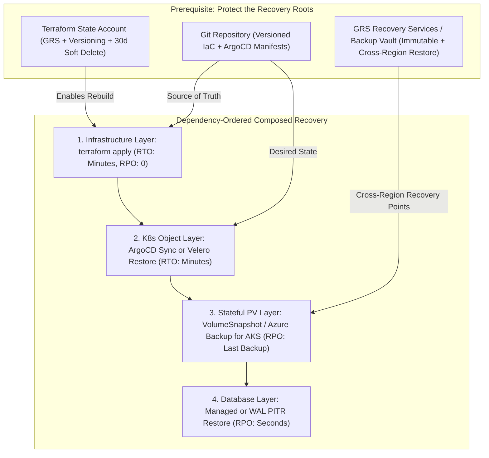
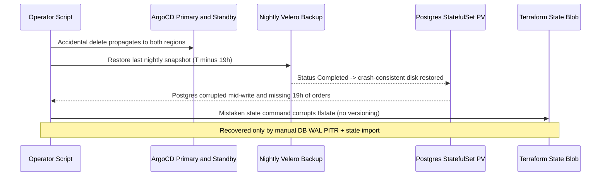

# 03 - Platform-Level Backup Strategy

> **Prerequisites:** Database backup and WAL/PITR fundamentals (Track 14 / Module 04), Reusable Terraform modules and remote state backends (Track 09 / Module 05), GitOps reconciliation with ArgoCD (Track 10), and Multi-region DR substrate (Modules 00–02).  
> **Estimated Reading Time:** 40 minutes  
> **Target Audience:** Platform Engineers, Backend Engineers, Kubernetes Administrators, Site Reliability Engineers (SREs).

> [!TIP]
> **The Golden Rule of Platform Backups:** Multi-region failover faithfully replicates logical corruption and accidental deletions—only backups recover bad contents. Split AKS recovery across **Infrastructure (Terraform)**, **Kubernetes State (GitOps / Velero)**, and **Stateful Bytes (DB WAL/PITR / Volume Snapshots)**, harden your **Terraform state backend** with versioning + soft delete + GRS, and never trust a backup until you restore it into a **different cluster**.

---

## Why This Matters

Track 14 / module 04 taught you to back up and restore a *database*. But a disaster rarely respects that boundary: a botched cluster upgrade, a deleted resource group, ransomware on a VM disk, or a corrupted persistent volume can take out things a `pg_dump` never covered. This module extends backup from the database up to the whole platform — Azure Backup for VMs and disks, backup approaches for an AKS cluster and its stateful volumes, and the idea that your **Terraform code is itself a recovery mechanism**. Multi-region failover (modules 01–02) handles a region dying; this handles the things that die *inside* a region and replicate to your standby before you notice.

---

## 1. Architectural Mental Model: The 4-Layer Platform Recovery Stack

You do not back up an AKS platform like a single monolithic VM. Complete platform resilience decomposes into four recovery layers executed in dependency order—where **Infrastructure-as-Code** sets infra RPO to zero (provided your remote state storage is protected), **GitOps or Velero** restores Kubernetes manifests, and **database WAL/PITR plus GRS snapshots** recover stateful bytes:



### Why failover and backup are different tools (again, at platform scale)

Module 00 made this point for the whole system; it's worth restating concretely now that you have a multi-region setup: your warm standby faithfully replicates the primary — *including* a corrupted disk, a bad Helm upgrade applied via GitOps to both clusters, or a `kubectl delete` that ArgoCD dutifully propagates. Failover protects against a region *disappearing*; backup protects against the *contents* being wrong. A complete platform DR posture has both layers, and this module builds the second one above the database layer you already have.

### Azure Backup for VMs and disks

**Azure Backup** is the managed service for backing up Azure resources into a **Recovery Services Vault** (or Backup Vault): VMs, managed disks, Azure Files, and (via extensions) SQL/SAP in VMs. Key ideas:

- **Backup policy** — schedule + retention (daily backups kept 30 days, weekly 12 weeks, etc.), attached to protected items.
- **Recovery point** — a restorable snapshot created by the policy; you restore a VM/disk to a point in time, or restore individual files from a VM backup.
- **Vault redundancy** — the vault itself can be LRS/ZRS/GRS; a **GRS vault** stores recovery points in the paired region, so a backup survives a regional loss (the backup-side complement to module 01's data GRS).
- **Soft delete** — deleted backups are retained for a grace period, defusing the "attacker/mistake deletes the backups too" failure mode.

For AKS specifically, most compute is cattle (recreated from Terraform + container images, not backed up), but **disks backing PersistentVolumes** and any pet VMs (a jump box, a self-managed database VM) are real Azure Backup candidates.

### Backing up an AKS cluster: what actually needs backing up

You don't back up an AKS cluster like a VM. It splits into three layers, each with a different mechanism:

- **The cluster infrastructure** (node pools, networking, identity) — *not* backed up; **re-created from Terraform** (next section). Nodes are disposable.
- **The Kubernetes object state** (Deployments, Services, ConfigMaps, Secrets, CRDs, RBAC) — this is your desired state. If it lives in Git and is reconciled by GitOps (track 10 / ArgoCD), *Git is the backup* — you redeploy from the repo. If it doesn't, you need a cluster-state backup tool.
- **The stateful data** (PersistentVolume contents) — the actual bytes, backed up via **volume snapshots** (track 14 / module 04's `VolumeSnapshot`, which become Azure Disk snapshots) and/or the database's own backup (WAL archiving, `pg_dump`).

The clean managed option is **Azure Backup for AKS**, which backs up cluster resources (namespaced objects) *and* snapshots PV disks together via a backup extension in the cluster and a Backup Vault — giving a consistent "cluster + its volumes" recovery point. The tool-agnostic option is **Velero**, the CNCF standard: it backs up Kubernetes objects to object storage (Azure Blob) and snapshots PVs, and can restore into a *different* cluster — which is exactly what you want for "recreate the cluster from Terraform, then Velero-restore the workloads and data into it."

### Infrastructure-as-Code as a recovery mechanism

The most powerful idea in this module: if your infrastructure is fully described in Terraform (track 09), then **"redeploy from Terraform" is a DR strategy**. A deleted resource group, a corrupted cluster, or a region you're migrating out of is recovered by `terraform apply` against a clean target — the network, cluster, ACR, identity, and role assignments rebuild themselves from code in minutes, deterministically, no snapshots required. This is why track 09's discipline (everything in modules, driven by variables, state in a remote backend) pays off here: your *entire compute and networking substrate* has an RTO equal to "how long `terraform apply` takes," and an RPO of zero *for the infrastructure* (code is the source of truth, and it's versioned in Git).

Two caveats that keep this honest:

- **IaC recovers infrastructure, not data.** `terraform apply` rebuilds the empty cluster and empty disks; the *data* still comes from your database backups / volume snapshots / Velero restore. IaC + data-backup together are the complete picture.
- **The Terraform state backend is itself a critical asset.** If your remote state (the Azure Storage account from track 09 / module 05) is lost, Terraform can't reconcile. Back *it* up (versioning + GRS on that storage account, soft delete on the blob) — losing state turns a 10-minute redeploy into an archaeology project.

### RTO/RPO of each recovery mechanism

Tie every mechanism back to module 00's two numbers so you choose deliberately:

| Mechanism | Recovers | Typical RTO | Typical RPO |
|---|---|---|---|
| `terraform apply` from code | Infra (net, cluster, ACR, IAM) | minutes | 0 (code in Git) |
| GitOps re-sync (ArgoCD) | K8s object state | minutes | 0 (repo is truth) |
| Velero / Azure Backup for AKS | K8s objects + PV data | minutes-hours | last backup |
| Volume snapshot restore | A PV's disk contents | minutes | last snapshot |
| DB backup / WAL PITR (track 14) | Database contents | minutes-hours | seconds (PITR) |
| Azure Backup for VM/disk | A pet VM or disk | minutes-hours | last recovery point |

The platform RTO/RPO is the *worst* row you'd have to execute for a given disaster — which tells you where to invest (usually: shrink the data-restore RPO, because IaC already made the infra RPO zero).

---

## 2. Taxonomic Comparison & Command Reference

### Platform Backup Tooling & Consistency Trade-Offs

| Tool / Mechanism | Target Scope | Cross-Cluster / Cross-Region Portable? | DB Consistency Guarantee | Critical Precondition |
| :--- | :--- | :--- | :--- | :--- |
| **Terraform (`terraform apply`)** | VNets, AKS, ACR, IAM, DB PaaS | **Yes** (redeploy anywhere) | N/A (rebuilds empty infra) | Remote `tfstate` versioned, soft-deleted, GRS |
| **GitOps (ArgoCD)** | K8s Deployments, CRDs, Config | **Yes** (point new cluster to Git) | N/A (config only) | Secrets managed securely outside plain Git |
| **Azure Backup for AKS** | Namespaced K8s objects + PVs | **Yes** (Backup Vault + extension) | Crash-consistent PV snapshots | Vault redundancy configured before protection |
| **Velero** | K8s objects (Blob) + PV snapshots | **Yes** (`velero restore` to new cluster) | Crash-consistent unless pre-hooks quiesce DB | Snapshot location + Blob container accessible |
| **DB Native WAL / PITR** | Relational / transactional databases | **Yes** (cross-region PITR restore) | **Transactionally consistent** | Continuous WAL archiving + restore tested |
| **Azure Backup (Recovery Services)** | Pet VMs, jump boxes, attached disks | **Yes** (if GRS + cross-region restore on) | Application/file-system consistent | `--backup-storage-redundancy GeoRedundant` set first |

### Command Reference

| Command | What it does | Example |
|---|---|---|
| `az backup vault create` | Creates a Recovery Services Vault | `az backup vault create -g <rg> -n <vault> -l eastus` |
| `az backup vault backup-properties set` | Sets vault redundancy (e.g. GRS) | see breakdown |
| `az backup protection enable-for-vm` | Protects a VM with a policy | see breakdown |
| `az backup protection backup-now` | Triggers an on-demand recovery point | `az backup protection backup-now ...` |
| `az backup restore restore-disks` | Restores a VM's disks from a recovery point | see `az backup restore` |
| `az dataprotection backup-vault create` | Creates a Backup Vault (used by Azure Backup for AKS) | `az dataprotection backup-vault create ...` |
| `velero install` / `velero backup create` | Installs Velero / backs up cluster objects + PVs to Blob | `velero backup create full-1 --include-namespaces app` |
| `velero restore create --from-backup` | Restores objects/PVs (into this or another cluster) | `velero restore create --from-backup full-1` |
| `terraform apply` | **Recreates infrastructure from code** — the IaC DR mechanism | `terraform apply` |
| `az storage account blob-service-properties update --enable-versioning` | Versions the state backend blob (protect Terraform state) | see breakdown |

Flag breakdown — a **GRS** Recovery Services Vault so backups survive a regional loss:

```bash
az backup vault create -g dr-rg -n dr-vault -l eastus
az backup vault backup-properties set \
  -g dr-rg -n dr-vault \
  --backup-storage-redundancy GeoRedundant \
  --cross-region-restore-flag true
```
- `--backup-storage-redundancy GeoRedundant` — recovery points are replicated to the paired region; a regional outage doesn't take your backups with it. (Set this **before** protecting anything — it can't change once items are protected.)
- `--cross-region-restore-flag true` — lets you restore from the secondary region *on demand*, the backup-side analogue of RA-GRS read access (module 01).

Flag breakdown — protecting a VM with a policy:

```bash
az backup protection enable-for-vm \
  -g dr-rg -v dr-vault \
  --vm <vm-resource-id> \
  --policy-name DefaultPolicy
```
- `-v dr-vault` — the vault that stores recovery points.
- `--vm <vm-resource-id>` — the VM to protect (jump box, self-managed DB VM).
- `--policy-name` — schedule + retention. `DefaultPolicy` is daily; define a custom policy for tighter RPO/retention.

Flag breakdown — protecting your Terraform **state** (a critical, often forgotten backup):

```bash
az storage account blob-service-properties update \
  --account-name <tfstate-acct> -g <tfstate-rg> \
  --enable-versioning true \
  --enable-delete-retention true --delete-retention-days 30
```
- `--enable-versioning true` — every state write keeps prior versions; recover a corrupted or accidentally-truncated `terraform.tfstate`.
- `--enable-delete-retention / --delete-retention-days 30` — soft-delete the state blob for 30 days, so "someone deleted the container" isn't fatal. Pair with GRS on that account (module 01) so state survives a regional loss too.

---

## 3. Production War Story Post-Mortem: "All Velero Backups Were Green — Yet Recovery Lost 19 Hours of Orders and Corrupt State Blocked Terraform"

| Field | Incident Details |
| :--- | :--- |
| **Severity** | **SEV-1** (Accidental Namespace Deletion + Stale Restore) |
| **Detection / Resolution Time** | Detected in 6 minutes / Full consistent recovery took 4 hours 40 minutes |
| **Impact** | Warm standby deleted the namespace via ArgoCD sync; nightly Velero PV restore rolled orders back 19 hours and lacked WAL consistency |

### What Happened

An engineer ran a cleanup script against the wrong Kubernetes context and deleted the production `orders` namespace. Because both the primary and warm-standby AKS clusters reconciled from the same ArgoCD/GitOps configuration, **failover was useless—the deletion hit both regions**. The team pulled up the nightly Velero backup dashboard (`Phase: Completed`, green across 30 days) and restored `orders` into a fresh cluster. The pods came up, **but the PostgreSQL StatefulSet inside the namespace was rolled back 19 hours to the midnight snapshot and refused to start cleanly without missing WAL segments**—and simultaneously, a panic-driven `terraform state rm` corrupted the unprotected remote state blob.



### Root Cause Analysis

1. **Relying on nightly crash-consistent PV snapshots for a transactional database:** Velero's nightly schedule enforced a 24-hour RPO ceiling, and disk snapshots caught PostgreSQL mid-checkpoint.
2. **"Green backup" theatre without cross-cluster restore drills:** Nobody ever tested restoring the backup into a separate cluster and running real data-freshness queries.
3. **Unprotected Terraform remote state:** The storage account holding `terraform.tfstate` lacked blob versioning and delete retention, turning a state mistake into manual `terraform import` archaeology.

### The Fix & Architectural Hardening

- Separated stateful database recovery onto continuous WAL/PITR archiving (`< 1 min` RPO, Track 14) while scoping Velero/Azure Backup for AKS to cluster manifests and non-DB file PVs.
- Enabled `Standard_GRS`, blob versioning, and 30-day soft delete on the Terraform state storage account, and scheduled weekly automated restore drills into an ephemeral verification cluster.

---

## 4. Multi-Language Production Implementation: Platform Backup Freshness Auditor & Terraform State Readiness Guard

These four implementations verify platform-level backup readiness before an outage occurs—auditing (1) whether the latest backup age violates the tier's RPO SLA (catching Exercise 7's "green restore with stale data"), (2) whether databases rely on crash-consistent PV snapshots instead of transactional WAL/PITR, and (3) whether the Terraform state storage account enables versioning, soft delete (`>= 30` days), and `GRS`/`RA-GRS`.

````carousel
```go
package platformbackup

import (
	"fmt"
	"time"
)

type BackupMechanism string

const (
	MechanismTerraformIaC BackupMechanism = "terraform-iac"
	MechanismVeleroPV     BackupMechanism = "velero-pv-snapshot"
	MechanismDatabasePITR BackupMechanism = "database-wal-pitr"
)

type StateAccountConfig struct {
	SKU               string
	VersioningEnabled bool
	SoftDeleteDays    int
}

type LayerBackupStatus struct {
	LayerName         string
	Mechanism         BackupMechanism
	LastCompletedAt   time.Time
	TargetRPOMinutes  float64
	ContainsDatabase  bool
	CrashConsistent   bool
}

func AuditPlatformRecovery(now time.Time, stateCfg StateAccountConfig, layers []LayerBackupStatus) []string {
	var findings []string

	if stateCfg.SKU != "Standard_GRS" && stateCfg.SKU != "Standard_RAGRS" {
		findings = append(findings, fmt.Sprintf("CRITICAL: tfstate SKU is %s; requires GRS or RA-GRS for regional survival", stateCfg.SKU))
	}
	if !stateCfg.VersioningEnabled {
		findings = append(findings, "CRITICAL: tfstate blob versioning disabled; state corruption is unrecoverable")
	}
	if stateCfg.SoftDeleteDays < 30 {
		findings = append(findings, fmt.Sprintf("WARN: tfstate soft-delete retention is %dd; recommend >= 30d", stateCfg.SoftDeleteDays))
	}

	for _, layer := range layers {
		ageMin := now.Sub(layer.LastCompletedAt).Minutes()
		if layer.Mechanism != MechanismTerraformIaC && ageMin > layer.TargetRPOMinutes {
			findings = append(findings, fmt.Sprintf(
				"RPO BREACH [%s]: backup age %.1fm exceeds target RPO %.1fm (restore will lose recent writes)",
				layer.LayerName, ageMin, layer.TargetRPOMinutes,
			))
		}
		if layer.ContainsDatabase && layer.CrashConsistent && layer.Mechanism == MechanismVeleroPV {
			findings = append(findings, fmt.Sprintf(
				"CONSISTENCY RISK [%s]: database relies on crash-consistent PV snapshot; layer WAL/PITR backup",
				layer.LayerName,
			))
		}
	}
	return findings
}
```
<!-- slide -->
```typescript
export interface TerraformStateBackendPolicy {
  sku: "Standard_LRS" | "Standard_ZRS" | "Standard_GRS" | "Standard_RAGRS";
  blobVersioningEnabled: boolean;
  deleteRetentionDays: number;
}

export interface BackupLayerAuditInput {
  layer: string;
  mechanism: "terraform" | "gitops" | "velero-pv" | "db-pitr";
  lastSuccessfulBackupEpochMs: number;
  targetRpoMinutes: number;
  storesTransactionalDb: boolean;
  isCrashConsistentOnly: boolean;
}

export function auditPlatformBackupPosture(
  nowEpochMs: number,
  statePolicy: TerraformStateBackendPolicy,
  layers: BackupLayerAuditInput[]
): { compliant: boolean; findings: string[] } {
  const findings: string[] = [];

  if (statePolicy.sku !== "Standard_GRS" && statePolicy.sku !== "Standard_RAGRS") {
    findings.push(`tfstate SKU '${statePolicy.sku}' does not survive regional loss; use Standard_GRS or Standard_RAGRS.`);
  }
  if (!statePolicy.blobVersioningEnabled) {
    findings.push("tfstate blob versioning is disabled; accidental state truncation cannot roll back.");
  }
  if (statePolicy.deleteRetentionDays < 30) {
    findings.push(`tfstate delete retention (${statePolicy.deleteRetentionDays}d) is below 30d minimum.`);
  }

  for (const item of layers) {
    if (item.mechanism === "terraform" || item.mechanism === "gitops") continue;

    const ageMinutes = (nowEpochMs - item.lastSuccessfulBackupEpochMs) / 60_000;
    if (ageMinutes > item.targetRpoMinutes) {
      findings.push(
        `RPO staleness in '${item.layer}': latest green backup is ${ageMinutes.toFixed(1)}m old (> ${item.targetRpoMinutes}m RPO).`
      );
    }
    if (item.storesTransactionalDb && item.isCrashConsistentOnly) {
      findings.push(
        `Consistency gap in '${item.layer}': database backed only by crash-consistent volume snapshot; require WAL/PITR.`
      );
    }
  }

  return { compliant: findings.length === 0, findings };
}
```
<!-- slide -->
```python
from dataclasses import dataclass
from datetime import datetime, timezone


@dataclass(frozen=True)
class StateBackendGuard:
    sku: str
    versioning_enabled: bool
    delete_retention_days: int


@dataclass(frozen=True)
class LayerSnapshotRecord:
    layer: str
    mechanism: str  # "terraform" | "gitops" | "velero_pv" | "db_pitr"
    last_backup_utc: datetime
    target_rpo_minutes: float
    contains_database: bool
    crash_consistent_only: bool


def audit_platform_backups(
    state_backend: StateBackendGuard,
    layers: list[LayerSnapshotRecord],
    now: datetime | None = None,
) -> list[str]:
    current_time = now or datetime.now(timezone.utc)
    issues: list[str] = []

    if state_backend.sku not in ("Standard_GRS", "Standard_RAGRS"):
        issues.append(f"tfstate SKU {state_backend.sku} lacks geo-redundancy")
    if not state_backend.versioning_enabled:
        issues.append("tfstate blob versioning is disabled")
    if state_backend.delete_retention_days < 30:
        issues.append("tfstate delete retention is under 30 days")

    for layer in layers:
        if layer.mechanism in ("terraform", "gitops"):
            continue
        age_min = (current_time - layer.last_backup_utc).total_seconds() / 60.0
        if age_min > layer.target_rpo_minutes:
            issues.append(
                f"{layer.layer}: green backup is {age_min:.1f}m stale (RPO target {layer.target_rpo_minutes}m)"
            )
        if layer.contains_database and layer.crash_consistent_only:
            issues.append(
                f"{layer.layer}: database uses crash-consistent PV snapshot instead of WAL/PITR"
            )

    return issues
```
<!-- slide -->
```csharp
public sealed record StateStoragePosture(
    string Sku,
    bool VersioningEnabled,
    int DeleteRetentionDays);

public sealed record LayerBackupRecord(
    string LayerName,
    string Mechanism,
    DateTimeOffset LastCompletedUtc,
    double TargetRpoMinutes,
    bool ContainsDatabase,
    bool CrashConsistentOnly);

public static class PlatformBackupAuditor
{
    public static IReadOnlyList<string> Evaluate(
        DateTimeOffset nowUtc,
        StateStoragePosture stateStorage,
        IEnumerable<LayerBackupRecord> layers)
    {
        var findings = new List<string>();

        if (stateStorage.Sku is not ("Standard_GRS" or "Standard_RAGRS"))
            findings.Add($"tfstate SKU '{stateStorage.Sku}' is not geo-redundant.");
        if (!stateStorage.VersioningEnabled)
            findings.Add("tfstate blob versioning must be enabled.");
        if (stateStorage.DeleteRetentionDays < 30)
            findings.Add($"tfstate soft-delete retention ({stateStorage.DeleteRetentionDays}d) should be >= 30d.");

        foreach (var layer in layers)
        {
            if (layer.Mechanism is "terraform" or "gitops") continue;

            var ageMinutes = (nowUtc - layer.LastCompletedUtc).TotalMinutes;
            if (ageMinutes > layer.TargetRpoMinutes)
            {
                findings.Add(
                    $"[{layer.LayerName}] Stale green backup: age {ageMinutes:F1}m exceeds RPO {layer.TargetRpoMinutes:F1}m.");
            }
            if (layer.ContainsDatabase && layer.CrashConsistentOnly)
            {
                findings.Add(
                    $"[{layer.LayerName}] Consistency gap: transactional DB uses crash-consistent snapshot without WAL/PITR.");
            }
        }

        return findings;
    }
}
```
````

---

## 5. Practical Hands-On Verification CLI Workflows

Some steps create billable resources (a vault + recovery points, a small VM, disk snapshots). Keep them small and run the teardown in exercise 8. The Velero and Terraform-redeploy exercises are the conceptual heart — do them even if you skip the paid VM backup.

### 1. Create a GRS Recovery Services Vault

```bash
az group create -n dr-backup-rg -l eastus
az backup vault create -g dr-backup-rg -n dr-vault -l eastus
az backup vault backup-properties set -g dr-backup-rg -n dr-vault \
  --backup-storage-redundancy GeoRedundant --cross-region-restore-flag true
az backup vault backup-properties show -g dr-backup-rg -n dr-vault -o table
```

**Expected Output:**
```text
Name      StorageType    StorageTypeState    CrossRegionRestoreFlag
--------  -------------  ------------------  ----------------------
dr-vault  GeoRedundant   Unlocked            True
```

Expected: a vault whose storage redundancy is GeoRedundant *before* any item is protected (it's immutable afterward — a common gotcha).

### 2. Protect and back up a disk/VM

```bash
# small B-series VM purely to demonstrate backup:
az vm create -g dr-backup-rg -n petvm --image Ubuntu2204 \
  --size Standard_B1s --generate-ssh-keys --no-wait
# once created:
az backup protection enable-for-vm -g dr-backup-rg -v dr-vault \
  --vm $(az vm show -g dr-backup-rg -n petvm --query id -o tsv) \
  --policy-name DefaultPolicy
az backup protection backup-now -g dr-backup-rg -v dr-vault \
  --container-name petvm --item-name petvm \
  --backup-management-type AzureIaasVM --retain-until 30-08-2026
az backup job list -g dr-backup-rg -v dr-vault -o table   # watch it complete
```

**Expected Output:**
```text
Name                                  Operation    Status      Item Name    Start Time UTC
------------------------------------  -----------  ----------  -----------  --------------------
3d4e9a1c-7b22-4c11-9a00-881122334455  Backup       Completed   petvm        2026-08-01T14:12:00Z
```

Expected: an on-demand recovery point completes. Note this recovery point is GRS-replicated — it survives a regional loss, unlike a plain local disk snapshot.

### 3. Install Velero and back up a namespace + its PVs

On one of your AKS clusters (or a kind cluster for the object-only shape), install Velero pointed at an Azure Blob container, then back up an app namespace including its volumes:

```bash
velero backup create app-full --include-namespaces app --snapshot-volumes
velero backup describe app-full --details
velero backup get
```

**Expected Output:**
```text
NAME       STATUS      ERRORS   WARNINGS   CREATED                         EXPIRES   STORAGE LOCATION   SELECTOR
app-full   Completed   0        0          2026-08-01 14:20:05 +0000 UTC   29d       default            <none>
```

Expected: a `Completed` backup whose details show both Kubernetes objects and volume snapshots. This is the "cluster state + data" recovery point that Azure Backup for AKS also produces via the managed path.

### 4. Restore into a *different* cluster (the real DR test)

This proves the backup is portable — the platform-level analogue of track 14 / module 04's "restore is the deliverable." Point Velero at a *fresh* cluster (the second region's, or a new kind cluster) and restore:

```bash
velero restore create --from-backup app-full
velero restore describe <restore-name> --details
kubectl get all,pvc -n app     # objects and volumes recreated
```

**Expected Output:**
```text
NAME                       READY   STATUS    RESTARTS   AGE
pod/app-web-7c6d4f9f-x9k2m 1/1     Running   0          45s

NAME                               STATUS   VOLUME                                     CAPACITY   ACCESS MODES
persistentvolumeclaim/app-data-pvc Bound    pvc-9b2a1d3e-1122-4455-8899-aabbccddeeff   10Gi       RWO
```

Expected: the namespace, its workloads, and its volume data reappear in a cluster that never had them. A backup you've only restored into the *same* cluster hasn't proven it can recover you from that cluster being gone.

### 5. "Redeploy from Terraform" as recovery

Simulate losing infrastructure and recover it from code. In a *non-production* Terraform environment (the track 09 modules, small settings), destroy and rebuild:

```bash
terraform destroy -target=module.secondary    # simulate losing the DR region's infra
terraform plan                                 # shows it will recreate everything
time terraform apply                           # measure the infra RTO
kubectl get nodes                              # the cluster is back, from code alone
```

Expected: the infrastructure rebuilds deterministically from code in minutes — your infra RTO. Write it down, and note the RPO is *zero* (the code in Git is the source of truth). Then observe what's still missing: the cluster is empty. That's the point of the next exercise.

### 6. Compose the full recovery: IaC + data restore

Chain the two mechanisms into one recovery: `terraform apply` rebuilds the empty cluster (exercise 5), then Velero restore (exercise 4) — or a DB PITR restore (track 14) — repopulates workloads and data. Write the ordered sequence and time the total: `terraform apply` → get-credentials → `velero restore` → verify data. This composed RTO/RPO — infra from code, data from backup — is what you'd actually execute after "someone deleted the resource group."

### 7. Diagnose-and-fix: the restore that succeeds but with stale data

The classic platform-backup failure, mirroring track 14's "green backup that won't restore." Take a Velero (or Azure Backup for AKS) backup, then write *new* data to the app, then restore the backup and observe:

```bash
# after backup app-full at T0, write new rows / files, then:
velero restore create --from-backup app-full
kubectl exec ... -- <query the data>
```

**Finding:** the restore reports `Completed` and the app comes up healthy — but the data is as of **T0**, missing everything written after the backup. The restore *technically succeeded* while silently losing recent data, because the volume snapshot's RPO is "last backup," not "now." A subtler variant: the Kubernetes objects restored but the PV snapshot was **crash-consistent** while the database was mid-write, so the DB comes up needing WAL replay it doesn't have. **Fixes:** (1) understand that backup frequency *is* your RPO — a nightly Velero backup means up to ~24h data loss on restore; tighten the schedule or layer continuous DB backup (track 14 PITR) on top for the data that needs a small RPO. (2) For databases, prefer the DB's own consistent backup (WAL/PITR) over a raw volume snapshot, or quiesce/snapshot consistently. Record the *real* RPO each mechanism gives — "the restore worked" is not the same as "the restore was current."

### 8. Clean up (billable: vault, recovery points, VM, snapshots)

```bash
# Stop protection & delete recovery points (must precede vault deletion):
az backup protection disable -g dr-backup-rg -v dr-vault \
  --container-name petvm --item-name petvm \
  --backup-management-type AzureIaasVM --delete-backup-data true --yes
az vm delete -g dr-backup-rg -n petvm --yes
velero backup delete app-full --confirm 2>/dev/null
az backup vault delete -g dr-backup-rg -n dr-vault --yes 2>/dev/null
az group delete -n dr-backup-rg --yes --no-wait
# confirm no orphaned Azure Disk snapshots from Velero PV snapshots:
az snapshot list -o table
```

**Expected Output:**
```text
(Empty table or zero snapshots left from dr-backup-rg / Velero drill)
```

Expected: vault, recovery points, VM, and any PV snapshots gone. Recovery points and snapshots bill until explicitly deleted (track 14's lesson, platform-wide) — a vault full of retained recovery points is a quiet recurring cost.

### Independent Challenge

For a real system you've built (track 07 or track 14 capstone), design a **layered platform backup strategy** and prove one non-database layer end to end. Write down, per layer (infrastructure, Kubernetes object state, PV data, database), which mechanism recovers it and the RTO/RPO that mechanism gives — then actually execute a *cluster-loss* recovery of the non-database layers: rebuild the infra with `terraform apply` and restore the workloads with Velero (or Azure Backup for AKS) into that fresh cluster, timing the composed RTO. State explicitly what still has to come from the database backup layer (track 14) and confirm your Terraform *state* itself is protected (versioning + GRS + soft delete). Draws on track 09 (IaC as recovery), track 14 (data layer), and module 00 (per-mechanism RTO/RPO). **Delete the vault, recovery points, and any second cluster afterward.**

<details><summary>Stuck? One hint</summary>

Split the system into the four layers and ask, for each, "if this were gone, what single command or artifact brings it back, and how current would it be?" Infrastructure → `terraform apply` (RTO = apply time, RPO = 0). K8s objects → GitOps re-sync or Velero (RPO = 0 if in Git, else last backup). PV data → Velero snapshot or DB backup (RPO = last snapshot / seconds for PITR). Database → track 14's WAL/PITR (RPO = seconds). The composed recovery is just those commands in dependency order (infra first, then objects, then data), and the total RTO is their sum — measuring it is the whole exercise. The easy-to-forget layer is the Terraform state backend: if it's not versioned and geo-redundant, none of the "redeploy from code" story works.

</details>

---

## 6. Common Mistakes & Troubleshooting

- **Assuming failover covers what backup covers.** Your warm standby replicates corruption, bad upgrades, and accidental deletes right along with good data. Backup is a separate, mandatory layer above the database (module 00, restated at platform scale).
- **Backing up the cluster like a VM.** AKS splits into infra (recreate from Terraform), object state (Git/GitOps or Velero), and PV data (snapshots/DB backup). Treating the whole cluster as one snapshot misses this structure and usually the data consistency.
- **Only ever restoring into the same cluster.** A backup that's never been restored into a *different* cluster hasn't proven it recovers you from cluster loss — restore into a fresh cluster to actually test it.
- **Forgetting Terraform state is a critical asset.** "Redeploy from code" assumes the remote state exists; if it's lost or corrupted, recovery stalls. Version it, soft-delete it, and geo-replicate it.
- **Setting vault redundancy too late.** GRS/cross-region-restore must be set *before* any item is protected — it's immutable afterward. Configure the vault's redundancy first.
- **"Restore succeeded" ≠ "data is current" (exercise 7).** Backup frequency is the RPO; a green restore can still be stale, or crash-consistent and needing replay. Match the mechanism's RPO to the data's needs and prefer DB-native consistent backups for databases.
- **Cost pitfall — retained recovery points and snapshots bill forever (ties to track 21).** A GRS vault storing many long-retention recovery points, plus orphaned PV disk snapshots from Velero, is a steady monthly cost that's easy to ignore. Set sane retention, delete on teardown, and treat backup storage as a line item to right-size — geo-redundant backup storage costs more than local, so only geo-replicate what genuinely needs to survive a regional loss.

---

## 7. Operational Validation Checkpoints

### Operational Validation Checkpoints

<details><summary><strong>Checkpoint 1: Recovery Services Vault Immutability Trap</strong></summary>

Once the first VM or workload item is protected inside an Azure Recovery Services Vault, its storage redundancy (`GeoRedundant` vs. `LocallyRedundant`) locks permanently. Always execute `az backup vault backup-properties set --backup-storage-redundancy GeoRedundant --cross-region-restore-flag true` immediately after `az backup vault create`—and verify `StorageType: GeoRedundant` before attaching any backup policy.

</details>

<details><summary><strong>Checkpoint 2: Why a "Completed" Velero Restore Loses Writes or Fails DB Replay</strong></summary>

Velero PV snapshots capture block storage at a point in time (`T0`) and are **crash-consistent**, not transactionally aware. Restoring a `Completed` backup returns stale data as of `T0` (making backup frequency your hard RPO) and can leave a database needing uncommitted WAL segments. Always decouple database durability onto native WAL/PITR archiving while using Velero/Azure Backup for AKS for cluster objects and file PVs.

</details>

<details><summary><strong>Checkpoint 3: Composing Total RTO After Accidental Resource Group Deletion</strong></summary>

Because Terraform recovers **empty infrastructure** (`RPO = 0` in Git, `RTO = apply time`) while data backups recover **stateful contents**, your overall recovery time equals the sequential sum: `terraform apply` (infra) + `az aks get-credentials` + ArgoCD/Velero workload restore + Database PITR restore + synthetic user-journey validation. The platform RPO equals the worst RPO among the executed data layers.

</details>

### Checkpoint Quiz

Write down your answer to each question before expanding it — checking without attempting first is the single easiest way to fool yourself into thinking you've learned this.

1. Give a concrete disaster that multi-region failover does *not* recover you from but platform backup does.
2. Name the three layers an AKS cluster splits into for backup, and the mechanism that recovers each.
3. Explain "redeploy from Terraform" as a DR mechanism, and state its RTO and RPO for the *infrastructure*.
4. Why is the Terraform state backend a critical thing to back up, and how do you protect it?
5. What does a GRS Recovery Services Vault give you that a local disk snapshot doesn't, and when must you set that redundancy?
6. Why restore a backup into a *different* cluster rather than the same one?
7. In exercise 7, the restore reported success but the data was stale. Explain why, and give two fixes.
8. For a database on AKS, why prefer the database's own WAL/PITR backup over a raw volume snapshot for its data?

<details><summary>Show answers</summary>

1. Any logical/in-region damage that replicates to the standby: a bad Helm upgrade applied to both clusters via GitOps, ransomware/corruption on a PV, a `DELETE`/dropped table, or an accidental `kubectl delete namespace` — failover carries these to the secondary; only a backup restores good state.
2. Infrastructure (node pools/networking/identity) → recreate from Terraform; Kubernetes object state → Git/GitOps re-sync or Velero; PV data → volume snapshots and/or the database's own backup.
3. Because the whole infra substrate is described in versioned code, `terraform apply` rebuilds it deterministically after loss. Infra RTO = how long apply takes (minutes); infra RPO = 0 (code in Git is the source of truth). Data still comes from a separate backup layer.
4. Because "redeploy from code" needs the state to reconcile reality to the code; losing state breaks recovery. Protect it with blob versioning, soft-delete/delete-retention, and GRS on the state storage account.
5. A GRS vault replicates recovery points to the paired region (with cross-region restore), so backups survive a regional loss — a local disk snapshot lives in the same region as what it's protecting. Set redundancy *before* protecting any item; it's immutable afterward.
6. To prove the backup can recover you from the original cluster being gone — restoring into the same cluster doesn't test portability or a true cluster-loss scenario.
7. Backup frequency is the RPO, so a restore is only as current as the last backup — everything written since is lost, even though the restore "completed." Fixes: tighten the backup schedule, and/or layer continuous DB backup (track 14 PITR) for data needing a small RPO; for DBs, use consistent DB-native backups rather than a mid-write crash-consistent snapshot.
8. A raw volume snapshot is crash-consistent and may catch the DB mid-write, requiring WAL replay it may not have; the DB's WAL/PITR backup is transactionally consistent and gives a seconds-level RPO with the ability to restore to a chosen point in time.

</details>

---

## 8. Next

[04-chaos-engineering-concepts](../04-chaos-engineering-concepts/README.md) — you can now recover a whole platform: fail over a region, restore backups, redeploy from code. But every recovery mechanism so far is *assumed* to work until a disaster tests it. The rest of the track flips that: deliberately inject failure, in a controlled way, to *prove* resilience before the disaster does the testing for you.
