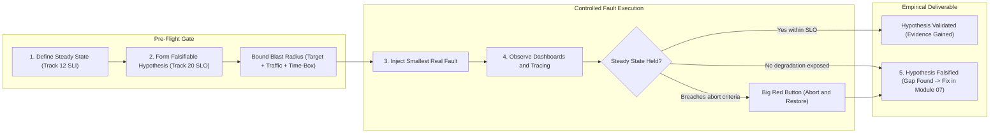
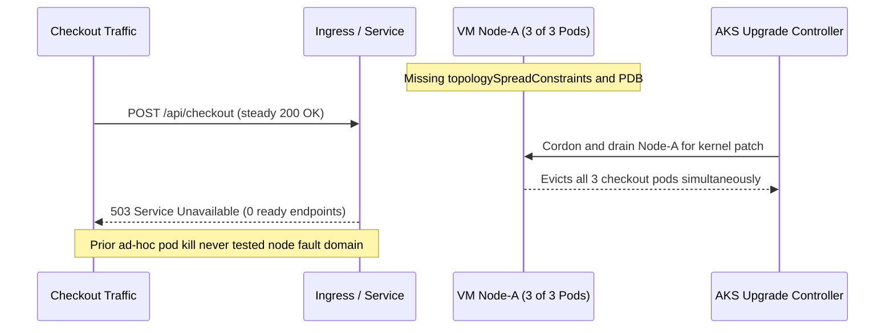

# 04 - Chaos Engineering Concepts

> **Prerequisites:** Multi-region failover & DR runbooks (Modules 00–02), Backup & restore drills (Module 03), Observability stack (`12-observability`), and SLOs & error-budget burn rates (`20-sre`).  
> **Estimated Reading Time:** 30 minutes  
> **Target Audience:** Backend Engineers, Site Reliability Engineers, Platform Engineers.

> [!TIP]
> **The Golden Rule of Chaos Engineering:** Never inject a fault without a **measurable steady-state SLI**, a **falsifiable hypothesis**, a **bounded blast radius**, and a **pre-rehearsed abort switch** ("big red button")—because fault injection without an experiment design and a stop condition is just causing an outage.

---

## Why This Matters

Everything in modules 00-03 is a recovery mechanism you *believe* works: failover you configured, backups you scheduled, runbooks you wrote. Belief is not evidence. Chaos engineering is the discipline of turning belief into evidence by injecting real failure into a system, in a controlled way, and watching whether it survives the way you think it will. It's the empirical counterpart to DR planning: instead of waiting for an outage to discover your retry logic has a bug or your "highly available" service has a hidden single point of failure, you find out on a Tuesday afternoon with a rollback ready. This module is the concepts; module 05 is the tooling.

---

## 1. Architectural Mental Model: The Scientific Chaos Loop & Blast Radius Containment

Chaos engineering is an empirical feedback loop gated by observability and strict containment boundaries. You establish a baseline SLI first, bound the target, traffic, and duration before injecting a fault, and automatically trip the abort switch if SLO burn crosses your pre-agreed threshold:



### The core principle: experiments, not breakage

Chaos engineering is often misheard as "randomly break production for fun." It is the opposite — it's the **scientific method applied to resilience**. An experiment has a specific structure:

1. **Define steady state** — a measurable output that means "the system is healthy": a track-20 SLI like request success rate or p99 latency, or an error-budget burn rate. You must be able to *see* steady state on the track 12 observability stack before you break anything.
2. **Form a hypothesis** — "if we kill one replica of the checkout service, success rate stays above 99.9% and p99 latency stays under 300ms, because the other replicas absorb the load." A hypothesis is a falsifiable claim about how the system tolerates a specific failure.
3. **Inject the failure** — the smallest real fault that tests the hypothesis (kill a pod, add latency, exhaust CPU).
4. **Observe and compare** — did steady state hold? If yes, you've gained evidence (not proof — one experiment) of resilience. If no, you've found a weakness *before* it found you.
5. **Learn and fix** — a disproved hypothesis is the win; it's a resilience gap you now fix (module 07) and re-test.

The deliverable of a chaos experiment is a *validated or invalidated hypothesis*, not "we broke something." "We killed a pod and nothing obviously caught fire" with no defined steady state and no hypothesis is not an experiment — it's just poking.

### Blast radius: the thing that makes it engineering, not recklessness

The difference between chaos *engineering* and chaos *arson* is **blast radius control** — deliberately bounding how much of the system a failure can affect so a surprising result is a contained incident, not an outage:

- **Scope the target** — inject into one pod, one node, one namespace, one availability zone — not "the whole service."
- **Scope the traffic** — run against a subset of users/requests (a canary slice, one region of an active-active setup) so most users are never exposed.
- **Time-box it** — a short experiment window with an automatic stop, not an open-ended fault.
- **Have an abort switch (a "big red button")** — a pre-decided, fast way to halt the experiment and undo the fault the instant steady state degrades past a threshold. Deciding the abort criteria *before* you start is non-negotiable.

Blast radius is what lets you run experiments against systems that matter: you cap the downside so the *worst* case of a falsified hypothesis is small and reversible.

### Start small, in non-prod, and earn your way to production

Chaos in production is the goal — production is the only environment with real traffic, real data, real dependencies — but it's the *last* step, not the first. The maturity ramp:

1. **Non-prod, one fault, tiny blast radius.** Kill a single pod in a dev namespace. Confirm your *tooling*, your *observability*, and your *abort switch* all work when nothing is at stake. Most first chaos experiments fail because the observability wasn't actually showing steady state, or the abort didn't undo cleanly — find that in dev.
2. **Non-prod, realistic scenarios.** Bigger faults (a zone, a dependency outage) in a staging environment under synthetic load.
3. **Production, minimal blast radius, business hours, humans watching.** Only once the experiment is well-understood in non-prod, run it in production with the smallest possible scope, during working hours (not 3am), with the team watching dashboards and an abort ready. Production chaos at 2am unattended is how you cause the outage you were trying to prevent.

The instruction in this track's brief — *start small in non-prod before ever touching prod* — is this ramp. Skipping to production is the single most common way chaos engineering gets banned at a company after one bad day.

### Common failure types you inject

The vocabulary of faults, each testing a different resilience assumption:

- **Pod / instance failure** — kill a replica. Tests redundancy and self-healing (does Kubernetes reschedule, do other replicas absorb load?).
- **Resource exhaustion** — pin CPU, fill memory, fill a disk. Tests limits, requests, and OOM behaviour (does one greedy pod starve its neighbours?).
- **Network faults** — latency, packet loss, DNS failure, blocking a dependency. Tests timeouts, retries, and circuit breakers (the track 13 service-mesh patterns) — does a slow dependency cascade into a total outage?
- **Zone / node failure** — drain or kill a node or a whole AZ. Tests anti-affinity, pod disruption budgets, and zone redundancy.
- **Dependency / region failure** — take out a downstream service or a whole region. This is where chaos meets DR (modules 01-02) — a region-loss experiment *is* a DR drill, which is the game-day synthesis in module 06.

### Why you observe with the stack you already built

A chaos experiment is only as good as your ability to *see* its effect. This is the direct payoff of track 12 and track 20:

- Track 12's **Prometheus/Grafana** gives you the steady-state metric and the during-experiment view — success rate, latency, saturation.
- Track 12's **distributed tracing** shows *where* an injected latency or failure propagates — which downstream call cascaded.
- Track 20's **SLOs and error-budget burn rate** give the pass/fail line: the experiment's hypothesis is usually phrased in SLO terms, and a burn-rate spike is your abort signal.

If you can't see steady state on these before the experiment, you're not ready to run it — you'd have no way to know if the hypothesis held. "Can I observe the effect?" is a precondition, and confirming it is often the first real bug chaos engineering surfaces (a metric that wasn't actually wired up).

---

## 2. Taxonomic Comparison & Experiment Reference

### Chaos Maturity Ramp & Environment Progression

| Stage | Environment & Timing | Blast Radius Bound | Primary Objective | Failure If Skipped |
| :--- | :--- | :--- | :--- | :--- |
| **1. Tooling & Signal Proof** | Dev / local `kind` cluster | Single pod, 1–2 min time-box | Prove steady-state metrics move and abort restores cleanly | Running blind experiments with broken abort switches |
| **2. Realistic Faults Under Load** | Staging with synthetic traffic | Single zone, node, or dependency path | Expose missing timeouts, noisy-neighbour leaks, or SPOFs | Surfacing cascading bugs for the first time in customer traffic |
| **3. Production Verification** | Prod, business hours, team watching | Canary slice or 1 replica, auto-abort | Validate resilience under real traffic, data, and dependencies | Unattended 2am outages and organizational ban on chaos |

### Fault Taxonomy & Resilience Assumptions Matrix

| Fault Family | Typical Injection | Resilience Assumption Tested | Primary Track-12 / Track-20 Signal | Common Hidden Gap Surfaced |
| :--- | :--- | :--- | :--- | :--- |
| **Pod / Instance Failure** | `kubectl delete pod` / `pod-kill` | Horizontal redundancy & fast endpoint removal | 5xx rate & endpoint readiness latency | Stale endpoints cause brief `502`/`503` spikes during termination |
| **Resource Exhaustion** | CPU stress / memory fill | `requests`/`limits` and OOM isolation | Pod CPU throttling & neighbour p99 | Missing limits let one greedy pod degrade unrelated pods |
| **Network Faults** | Latency, packet loss, DNS block | Client timeouts, retries, circuit breakers | Distributed trace spans & pool saturation | Slow dependency hangs caller threads, triggering full cascade |
| **Zone / Node Failure** | Node drain or AZ outage | Anti-affinity, `topologySpreadConstraints`, PDBs | Available replica count per zone | "3 replicas" all scheduled on 1 node (replica theatre) |
| **Dependency / Region Failure** | Partition downstream or disable region | Graceful degradation, fallback, DR failover | Error-budget burn rate & user journey SLIs | Single-instance cache/DB dependency takes down redundant app tier |

### Command & Artifact Reference

This module is conceptual; the "commands" are the artifacts of a disciplined experiment. You'll run real fault-injection tooling in module 05. The reference here is the **experiment design template** and the observability checks that gate it.

| Artifact / check | What it is | Example |
|---|---|---|
| Steady-state SLI query | The PromQL that defines "healthy" (track 12) | `sum(rate(http_requests_total{code=~"2.."}[5m])) / sum(rate(http_requests_total[5m]))` |
| Hypothesis statement | Falsifiable claim about tolerance to one fault | "Killing 1 of 3 replicas keeps success rate ≥ 99.9%" |
| Blast-radius scope | Target + traffic + time bound | "1 pod, dev namespace, 5 min, auto-abort on >1% error" |
| Abort criteria | Pre-decided stop condition | "Error-budget burn > 2× or p99 > 500ms → abort" |
| `kubectl delete pod` | The crudest real fault (redundancy test) | `kubectl delete pod <one-replica>` |
| Grafana dashboard | Where you watch steady state before/during/after | track 12 stack |

Experiment design template (write this out for *every* experiment, before running it):

```text
Title:            <what you're testing>
Steady state:     <measurable SLI + its normal value, e.g. success ≥ 99.9%>
Hypothesis:       <the system tolerates FAULT because MECHANISM>
Blast radius:     <target scope + traffic scope + time box>
Abort criteria:   <the threshold at which you hit the big red button>
Environment:      <non-prod first; prod only when proven>
Observation:      <which track-12 dashboards / track-20 SLOs you watch>
Result:           <held / did not hold — filled in after>
Learning / fix:   <the resilience gap found and the fix (module 07)>
```

---

## 3. Production War Story Post-Mortem: "3-Replica" Checkout Outage During Routine Node Drain

| Field | Incident Details |
| :--- | :--- |
| **Severity** | **SEV-1** (100% Checkout Endpoint Unavailability) |
| **Detection / Resolution Time** | Detected in 4 minutes / Resolved in 42 minutes |
| **Impact** | All checkout API requests returned `503 Service Unavailable` across `prod-eastus` during a planned node pool upgrade |

### What Happened

A checkout service ran with `replicas: 3` and passed an informal ad-hoc test months earlier where an engineer manually ran `kubectl delete pod` once without checking node placement or Prometheus steady-state SLIs. Because the deployment lacked `topologySpreadConstraints` and a `PodDisruptionBudget`, the Kubernetes scheduler placed all three pods on the same VM node (`aks-nodepool1-02`). During a scheduled kernel upgrade, Kubernetes cordoned and drained `aks-nodepool1-02`, evicting all three replicas simultaneously and dropping service endpoints to zero.



### Root Cause Analysis

1. **Replica theatre (single fault domain)**: Having 3 pods on 1 VM node gave zero node-level or zone-level redundancy; one host failure equaled a full service outage.
2. **Untested hypothesis ("we killed one pod once")**: Because the earlier manual test lacked a written experiment design and node-drain hypothesis, it validated pod rescheduling while masking the single-node SPOF.
3. **No graceful termination or PDB guardrails**: Absent a `PodDisruptionBudget`, cluster drain evicted all pods at once without waiting for replacements to become ready.

### The Fix & Architectural Hardening

- Added `topologySpreadConstraints` across `topology.kubernetes.io/zone` and `kubernetes.io/hostname`, plus a `PodDisruptionBudget` (`minAvailable: 2`).
- Required written chaos experiment contracts for every tier-1 service, proving survival across both pod-kill and node-drain experiments in staging against live track-12 SLIs before production sign-off.

---

## 4. Multi-Language Production Implementation: Steady-State Evaluator, Blast-Radius Gate & Abort Controller

These four implementations model the core control loop of a disciplined chaos experiment: validating blast-radius bounds up front, verifying steady-state baseline SLIs before injecting any fault, evaluating hypothesis thresholds during a strict time-box, and firing an immediate abort switch ("big red button") when SLO burn or p99 latency crosses pre-agreed limits.

````carousel
```go
package chaos

import (
	"context"
	"errors"
	"fmt"
	"time"
)

type SteadyStateSnapshot struct {
	SuccessRate float64
	P99Latency  time.Duration
	BurnRate    float64
}

type ExperimentContract struct {
	Name               string
	Environment        string
	TargetCount        int
	MaxAllowedTargets  int
	Duration           time.Duration
	MinSuccessRate     float64
	MaxP99Latency      time.Duration
	MaxBurnRate        float64
}

type TelemetryProvider interface {
	QuerySteadyState(ctx context.Context) (SteadyStateSnapshot, error)
}

type FaultController interface {
	Inject(ctx context.Context) error
	Abort(ctx context.Context) error
}

func RunBoundedExperiment(
	ctx context.Context,
	contract ExperimentContract,
	telemetry TelemetryProvider,
	fault FaultController,
) error {
	if contract.TargetCount <= 0 || contract.TargetCount > contract.MaxAllowedTargets {
		return fmt.Errorf("blast radius rejected: targets=%d max=%d", contract.TargetCount, contract.MaxAllowedTargets)
	}
	if contract.Duration <= 0 || contract.Duration > 15*time.Minute {
		return errors.New("blast radius rejected: duration must be bounded between 1s and 15m")
	}

	baseline, err := telemetry.QuerySteadyState(ctx)
	if err != nil {
		return fmt.Errorf("pre-flight observability check failed: %w", err)
	}
	if baseline.SuccessRate < contract.MinSuccessRate || baseline.P99Latency > contract.MaxP99Latency {
		return fmt.Errorf("system not in steady state before experiment: %+v", baseline)
	}

	if err := fault.Inject(ctx); err != nil {
		return fmt.Errorf("fault injection failed: %w", err)
	}
	// Always restore capacity/undo fault when leaving scope
	defer func() { _ = fault.Abort(context.Background()) }()

	deadline := time.NewTimer(contract.Duration)
	defer deadline.Stop()
	ticker := time.NewTicker(5 * time.Second)
	defer ticker.Stop()

	for {
		select {
		case <-ctx.Done():
			return ctx.Err()
		case <-deadline.C:
			return nil // Hypothesis held for full time-box
		case <-ticker.C:
			snap, err := telemetry.QuerySteadyState(ctx)
			if err != nil {
				return fmt.Errorf("observability lost during experiment; aborting: %w", err)
			}
			if snap.SuccessRate < contract.MinSuccessRate ||
				snap.P99Latency > contract.MaxP99Latency ||
				snap.BurnRate > contract.MaxBurnRate {
				return fmt.Errorf("abort criteria tripped (success=%.4f p99=%s burn=%.2fx)",
					snap.SuccessRate, snap.P99Latency, snap.BurnRate)
			}
		}
	}
}
```
<!-- slide -->
```typescript
export interface SteadyStateSnapshot {
  successRate: number;
  p99Ms: number;
  burnRate: number;
}

export interface ExperimentContract {
  title: string;
  environment: "dev" | "staging" | "prod";
  targetPods: number;
  maxTargetPods: number;
  durationMs: number;
  minSuccessRate: number;
  maxP99Ms: number;
  maxBurnRate: number;
}

export interface FaultDriver {
  querySteadyState(): Promise<SteadyStateSnapshot>;
  injectFault(): Promise<void>;
  abortFault(): Promise<void>;
}

export async function runChaosExperiment(
  contract: ExperimentContract,
  driver: FaultDriver
): Promise<{ hypothesisHeld: boolean; reason: string }> {
  if (contract.targetPods <= 0 || contract.targetPods > contract.maxTargetPods) {
    throw new Error(`Blast radius violation: ${contract.targetPods} exceeds cap ${contract.maxTargetPods}`);
  }
  if (contract.durationMs <= 0 || contract.durationMs > 15 * 60_000) {
    throw new Error("Blast radius violation: experiment must have a bounded duration <= 15m");
  }

  const baseline = await driver.querySteadyState();
  if (baseline.successRate < contract.minSuccessRate || baseline.p99Ms > contract.maxP99Ms) {
    throw new Error(`Pre-flight steady state unhealthy: ${JSON.stringify(baseline)}`);
  }

  await driver.injectFault();
  const endsAt = Date.now() + contract.durationMs;

  try {
    while (Date.now() < endsAt) {
      await new Promise((r) => setTimeout(r, 5000));
      const snap = await driver.querySteadyState();
      const breached =
        snap.successRate < contract.minSuccessRate ||
        snap.p99Ms > contract.maxP99Ms ||
        snap.burnRate > contract.maxBurnRate;

      if (breached) {
        return {
          hypothesisHeld: false,
          reason: `Abort triggered: success=${snap.successRate}, p99=${snap.p99Ms}ms, burn=${snap.burnRate}x`,
        };
      }
    }
    return { hypothesisHeld: true, reason: "Steady state held within SLO for full time-box" };
  } finally {
    // Big red button always executes on exit, abort, or exception
    await driver.abortFault();
  }
}
```
<!-- slide -->
```python
from dataclasses import dataclass
import time
from typing import Protocol


@dataclass(frozen=True)
class SteadyStateSnapshot:
    success_rate: float
    p99_ms: float
    burn_rate: float


@dataclass(frozen=True)
class ExperimentContract:
    title: str
    target_count: int
    max_targets: int
    duration_seconds: int
    min_success_rate: float = 0.999
    max_p99_ms: float = 300.0
    max_burn_rate: float = 2.0


class ChaosDriver(Protocol):
    def query_steady_state(self) -> SteadyStateSnapshot: ...
    def inject_fault(self) -> None: ...
    def abort_fault(self) -> None: ...


def execute_experiment(contract: ExperimentContract, driver: ChaosDriver) -> tuple[bool, str]:
    if not (1 <= contract.target_count <= contract.max_targets):
        raise ValueError(f"Blast radius exceeded: {contract.target_count} > {contract.max_targets}")
    if not (1 <= contract.duration_seconds <= 900):
        raise ValueError("Duration must be explicitly time-boxed (1s to 900s)")

    baseline = driver.query_steady_state()
    if baseline.success_rate < contract.min_success_rate or baseline.p99_ms > contract.max_p99_ms:
        raise RuntimeError(f"Aborted pre-flight: system not in steady state ({baseline})")

    driver.inject_fault()
    deadline = time.monotonic() + contract.duration_seconds
    try:
        while time.monotonic() < deadline:
            time.sleep(5)
            snap = driver.query_steady_state()
            if (
                snap.success_rate < contract.min_success_rate
                or snap.p99_ms > contract.max_p99_ms
                or snap.burn_rate > contract.max_burn_rate
            ):
                return False, (
                    f"Abort criteria tripped: success={snap.success_rate:.4f}, "
                    f"p99={snap.p99_ms:.1f}ms, burn={snap.burn_rate:.2f}x"
                )
        return True, "Hypothesis validated: steady state held across time-box"
    finally:
        driver.abort_fault()
```
<!-- slide -->
```csharp
using System;
using System.Threading;
using System.Threading.Tasks;

public sealed record SteadyStateSnapshot(double SuccessRate, double P99Ms, double BurnRate);

public sealed record ExperimentContract(
    string Title,
    int TargetCount,
    int MaxTargets,
    TimeSpan Duration,
    double MinSuccessRate = 0.999,
    double MaxP99Ms = 300.0,
    double MaxBurnRate = 2.0);

public interface IChaosDriver
{
    Task<SteadyStateSnapshot> QuerySteadyStateAsync(CancellationToken ct);
    Task InjectFaultAsync(CancellationToken ct);
    Task AbortFaultAsync(CancellationToken ct);
}

public static class ChaosExperimentRunner
{
    public static async Task<(bool Held, string Summary)> RunAsync(
        ExperimentContract contract,
        IChaosDriver driver,
        CancellationToken ct = default)
    {
        if (contract.TargetCount <= 0 || contract.TargetCount > contract.MaxTargets)
            throw new ArgumentOutOfRangeException(nameof(contract.TargetCount), "Blast radius cap exceeded.");

        if (contract.Duration <= TimeSpan.Zero || contract.Duration > TimeSpan.FromMinutes(15))
            throw new ArgumentOutOfRangeException(nameof(contract.Duration), "Duration must be time-boxed <= 15m.");

        var baseline = await driver.QuerySteadyStateAsync(ct);
        if (baseline.SuccessRate < contract.MinSuccessRate || baseline.P99Ms > contract.MaxP99Ms)
            throw new InvalidOperationException($"Pre-flight failed: steady state degraded ({baseline}).");

        await driver.InjectFaultAsync(ct);
        var deadline = DateTimeOffset.UtcNow + contract.Duration;

        try
        {
            while (DateTimeOffset.UtcNow < deadline)
            {
                await Task.Delay(TimeSpan.FromSeconds(5), ct);
                var snap = await driver.QuerySteadyStateAsync(ct);

                if (snap.SuccessRate < contract.MinSuccessRate ||
                    snap.P99Ms > contract.MaxP99Ms ||
                    snap.BurnRate > contract.MaxBurnRate)
                {
                    return (false, $"Abort triggered: success={snap.SuccessRate:P2}, p99={snap.P99Ms:F1}ms, burn={snap.BurnRate:F2}x");
                }
            }
            return (true, "Hypothesis validated within SLO for full experiment window.");
        }
        finally
        {
            await driver.AbortFaultAsync(CancellationToken.None);
        }
    }
}
```
````

---

## 5. Practical Hands-On Verification CLI Workflows

No paid multi-region infra is required here — a local kind cluster (track 03) or a single small AKS cluster with the track 12 observability stack is enough. The goal is to internalize the *discipline* before module 05's tooling. Deploy a simple multi-replica app with a `/healthz` and metrics you can scrape.

### 1. Establish and see steady state

Deploy an app with 3 replicas behind a Service, generate steady traffic, and open a Grafana panel (track 12) showing request success rate and p99 latency.

```bash
kubectl create deployment web --image=<your-metrics-app> --replicas=3
kubectl expose deployment web --port=80
kubectl get pods -l app=web
# generate load and watch success rate + p99 on Grafana
```

**Expected Output:**
```text
NAME                   READY   STATUS    RESTARTS   AGE
web-6f9c8d7b4f-4x9kp   1/1     Running   0          25s
web-6f9c8d7b4f-9mn2q   1/1     Running   0          25s
web-6f9c8d7b4f-z7w8t   1/1     Running   0          25s
```

Write down the steady-state numbers. **You cannot do chaos engineering without this baseline** — it's the "before."

### 2. Write a full experiment design (before breaking anything)

Fill in the template above for: "kill one of three `web` replicas." State the steady-state SLI and value, a falsifiable hypothesis, the blast radius (1 pod, this namespace, 2 min), abort criteria, and which dashboard you'll watch. Do *not* run it yet — the design is the exercise here.

### 3. Run the experiment and compare to the hypothesis

```bash
kubectl get pods -l app=web
kubectl delete pod <one-pod>          # the fault
# watch Grafana: did success rate stay above your threshold? did p99 spike?
kubectl get pods -l app=web -w        # observe reschedule/self-heal
```

**Expected Output:**
```text
pod "web-6f9c8d7b4f-4x9kp" deleted
NAME                   READY   STATUS        RESTARTS   AGE
web-6f9c8d7b4f-4x9kp   1/1     Terminating   0          2m
web-6f9c8d7b4f-k8v3m   0/1     Pending       0          0s
web-6f9c8d7b4f-k8v3m   1/1     Running       0          3s
```

Fill in Result and Learning. If steady state held, you have evidence the redundancy works. If success rate dipped (e.g. the Service kept routing to the dying pod for a few seconds), you've found a gap — record it.

### 4. Practice blast-radius control

Re-run, but this time deliberately bound and abort. Set a rule: "if success rate drops below 99% for 15s, abort by stopping the fault." Kill a pod, watch, and if your abort condition trips, recreate/scale immediately:

```bash
kubectl scale deployment web --replicas=3   # your "big red button" — restore capacity
```

**Expected Output:**
```text
deployment.apps/web scaled
```

The exercise is *practising the abort*, not the kill. An abort you've never rehearsed won't work when you need it.

### 5. Test whether you can even observe the fault

Inject a fault your dashboards *should* show and confirm they do. If you can't see it, that's the bug:

```bash
# make one replica unhealthy (e.g. exec in and stop the app) and watch:
kubectl exec <pod> -- sh -c "kill 1" 2>/dev/null
# Does Grafana show reduced healthy endpoints? Does the SLI move?
```

**Expected Output:**
```text
# Grafana endpoints panel drops from 3 to 2 transiently, and pod restart counter increments by 1
```

Expected: the observability stack visibly reflects the fault. If it doesn't, your first resilience fix isn't in the app — it's fixing observability so future experiments are meaningful.

### 6. Escalate the fault type (resource exhaustion)

Move up the fault vocabulary. Stress one pod's CPU and observe whether it harms its neighbours (tests limits/requests from track 03):

```bash
kubectl exec <pod> -- sh -c "yes > /dev/null &"    # peg a core
kubectl top pods -l app=web
# watch: does p99 for the whole Service rise, or is the noisy pod isolated?
```

**Expected Output:**
```text
NAME                   CPU(cores)   MEMORY(bytes)
web-6f9c8d7b4f-9mn2q   998m         32Mi
web-6f9c8d7b4f-k8v3m   12m          31Mi
web-6f9c8d7b4f-z7w8t   11m          30Mi
```

Record whether the blast radius stayed within the one pod (good — limits work) or leaked to the Service (a gap — missing/oversized limits). Kill the stressor when done.

### 7. Diagnose-and-fix: a chaos experiment reveals a hidden single point of failure

The module's core lesson. Deploy the app so it *looks* redundant (3 replicas) but has a hidden SPOF — e.g. all 3 replicas on **one node**, or all depending on a single non-replicated backing service. Form the hypothesis "killing one replica is survivable" (true), then run the *bigger* honest experiment the hypothesis implies — drain the node (or kill the backing service):

```bash
kubectl get pods -l app=web -o wide      # notice all 3 on the same node — the SPOF
kubectl drain <that-node> --ignore-daemonsets --delete-emptydir-data
# watch success rate crater: "3 replicas" was 1 fault domain all along
```

**Expected Output:**
```text
NAME                   READY   STATUS    NODE
web-6f9c8d7b4f-9mn2q   1/1     Running   kind-worker
web-6f9c8d7b4f-k8v3m   1/1     Running   kind-worker
web-6f9c8d7b4f-z7w8t   1/1     Running   kind-worker

node/kind-worker cordoned
evicting pod default/web-6f9c8d7b4f-9mn2q
...
```

**Finding:** the system that reported "3/3 replicas Ready" had no real redundancy — one node (or one backing dependency) failing takes it all down. The replica count was resilience theatre. **Fix:** spread replicas across nodes/zones with `topologySpreadConstraints` / pod anti-affinity, add a PodDisruptionBudget, and replicate the backing dependency — then re-run the node-drain experiment and confirm steady state now holds. This is exactly the kind of untested SPOF chaos engineering exists to surface, and it feeds directly into module 07's gap analysis.

### 8. Uncordon and clean up

```bash
kubectl uncordon <node>
kubectl delete deployment web svc web
```

**Expected Output:**
```text
node/kind-worker uncordoned
deployment.apps "web" deleted
service "web" deleted
```

Expected: node back in service, app removed. No billable resources if you used kind; if on AKS, this is the same cleanup discipline — nothing left running.

### Independent challenge

Design — and run in a non-prod environment — a complete chaos experiment against a system with a real dependency (e.g. an app that calls a database or another service). Write the full experiment design (steady state as a track-12 SLI, a falsifiable hypothesis phrased in track-20 SLO terms, a bounded blast radius, explicit abort criteria), then inject a **network fault** (latency or an outright block) on the dependency rather than a pod kill — testing whether the app's timeouts/retries (foreshadowing track 13's patterns) keep steady state or whether a slow dependency cascades into a full outage. Record whether the hypothesis held and the specific gap if it didn't. Draws on track 12 (observing steady state), track 20 (SLO as the pass/fail line), and this module's blast-radius discipline. Keep it in non-prod; if you used any billable resources, tear them down.

<details>
<summary>Stuck? One hint</summary>

A network fault on a dependency is the most revealing chaos experiment because it tests the failure mode people never handle: not "the dependency is down" (easy — you get a fast error) but "the dependency is *slow*." Inject latency (e.g. 5s) on the call, and watch whether the app's client has a timeout shorter than that. If it doesn't, requests pile up waiting, threads/connections exhaust, and the *whole app* becomes unavailable even though only a downstream dependency slowed down — a cascading failure. The hypothesis "a slow dependency degrades gracefully" is the one that's most often false, and the fix (a sensible timeout + circuit breaker) is precisely track 13's material, which module 07 audits.

</details>

---

## 6. Common Mistakes & Troubleshooting

- **"Chaos" without a hypothesis or steady state.** Killing things with no defined "healthy" metric and no falsifiable claim isn't an experiment — you learn nothing whether it "works" or not. Always write the design first.
- **No blast-radius control or abort switch.** Unbounded fault injection is just causing an outage. Scope the target, the traffic, and the time; decide the abort criteria *before* you start and rehearse the abort.
- **Starting in production.** Prove the experiment, the observability, and the abort in non-prod first. Production chaos is the last step, minimal blast radius, business hours, humans watching — never the first, unattended, at night.
- **Can't observe the effect.** If your dashboards don't show steady state moving under the fault, the experiment is meaningless — fix observability (track 12) first; that's often the first real finding.
- **Treating a held hypothesis as proof.** One experiment is evidence, not a guarantee — systems change, and yesterday's resilience regresses. Chaos is a repeated practice (module 06's recurring game days), not a one-off certificate.
- **Cost pitfall — chaos infrastructure and blast radius that leaks spend (ties to track 21).** The experiments themselves are cheap, but running them against a full multi-region setup you spun up just to break, or leaving stress-test load generators running, quietly bills. Run chaos against the smallest environment that still tests the hypothesis, and tear down any infra you provisioned only for the experiment — the same right-sizing instinct as the DR standby.

---

## 7. Operational Validation Checkpoints

<details><summary><strong>Checkpoint 1: Detecting "Replica Theatre" Before a Real Node Failure</strong></summary>

A microservice runs with `replicas: 3` and passes a `kubectl delete pod` test, yet suffers 100% downtime during a routine AKS node upgrade. Inspection reveals all three replicas were scheduled onto the same node with no `topologySpreadConstraints` or `PodDisruptionBudget`. Chaos engineering requires formulating hypotheses across realistic failure domains—such as node drain or AZ loss—so co-located replicas are caught in staging before production traffic hits them.

</details>

<details><summary><strong>Checkpoint 2: Why Missing Steady-State Observability Invalidates an Experiment</strong></summary>

You terminate a healthy pod during an experiment, but your Grafana panel remains flat at `100%` success and `15ms` p99 because the service mesh scrapes only one ingress metric or omits `502`/`503` retries. Without verified track-12 SLI visibility before injecting a fault, you cannot tell whether the system survived or your telemetry failed. The immediate remediation is fixing metrics and tracing coverage before running further chaos experiments.

</details>

<details><summary><strong>Checkpoint 3: Handling a Slow Dependency vs. a Dead Dependency</strong></summary>

Killing a downstream cache pod causes fast `ECONNREFUSED` errors that your fallback handles cleanly, so the team assumes the service is resilient. Injecting `5s` of network delay instead stalls request threads and exhausts the connection pool across unrelated routes. Testing *slow* dependencies exposes missing client timeouts and circuit breakers (track 13), which hard-down pod kills rarely trigger.

</details>

### Checkpoint quiz

Write down your answer to each question before expanding it — checking without attempting first is the single easiest way to fool yourself into thinking you've learned this.

1. What are the five steps of a chaos experiment, and what is its actual deliverable?
2. Why is "we killed a pod and nothing broke" not a chaos experiment?
3. Define blast radius and name three ways you bound it.
4. Why must you have an abort switch and its criteria decided *before* starting, not during?
5. Give the maturity ramp for where to run chaos, and why production is last rather than first.
6. Name four fault types you can inject and one resilience assumption each tests.
7. Why is the track-12 observability stack a *precondition* for a chaos experiment, not just a nice-to-have?
8. In exercise 7, "3 replicas" turned out not to be redundant. Explain how, and the fix.

<details>
<summary>Show answers</summary>

1. Define steady state (a measurable SLI) → form a falsifiable hypothesis → inject the smallest real fault → observe and compare to the hypothesis → learn and fix. The deliverable is a validated or invalidated hypothesis (a resilience gap found or confidence gained), not "we broke something."
2. There's no defined steady-state metric and no falsifiable hypothesis, so neither "nothing broke" nor "something broke" teaches you anything measurable — it's poking, not an experiment.
3. Blast radius is how much of the system a fault can affect. Bound it by scoping the target (one pod/node/zone), scoping the traffic (a canary/user subset), and time-boxing with an automatic stop — plus an abort switch.
4. Because during a degrading experiment you won't reason clearly about when to stop; a pre-decided threshold and a rehearsed undo make aborting automatic and fast, which is what keeps a falsified hypothesis a contained incident.
5. Non-prod one small fault (prove tooling/observability/abort) → non-prod realistic scenarios → production minimal blast radius, business hours, watched. Production is last because it's the only place with real stakes; you earn it by proving the experiment is safe and observable first.
6. Pod/instance failure (redundancy/self-healing); resource exhaustion (limits/requests, noisy-neighbour isolation); network fault (timeouts/retries/circuit breakers); zone/node failure (anti-affinity/PDB/zone redundancy); dependency/region failure (DR).
7. Because a chaos experiment's whole value is comparing steady state before and during the fault; without being able to *see* the SLI move you can't tell if the hypothesis held, so if you can't observe it you're not ready to run it.
8. All three replicas were in one fault domain (same node, or sharing one non-replicated dependency), so a single node drain / dependency failure took them all down — the replica count was theatre. Fix: spread across nodes/zones (topology spread / anti-affinity), add a PodDisruptionBudget, and replicate the backing dependency; then re-run the node-drain experiment.

</details>

---

## 8. Next

[05-chaos-engineering-with-azure-chaos-studio](../05-chaos-engineering-with-azure-chaos-studio/README.md) — you have the discipline: hypotheses, blast radius, abort switches, and observation through the track-12 stack. Now pick up the real tooling — Azure Chaos Studio and Chaos Mesh — to inject pod, network, and resource faults as managed, repeatable, permissioned experiments.
