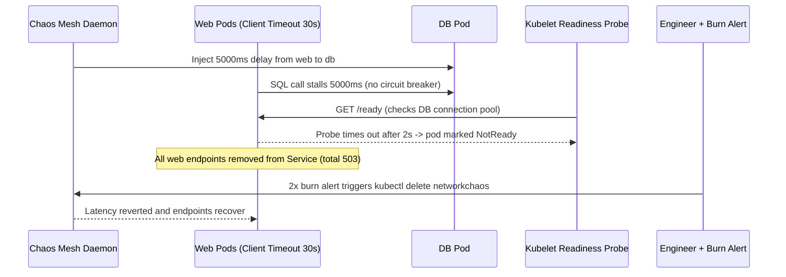

# 05 - Chaos Engineering with Azure Chaos Studio

> **Prerequisites:** Chaos Engineering discipline & experiment design (Module 04), Kubernetes operators & CRDs (`03-kubernetes`, `14-databases`), Service Mesh resilience patterns (`13-service-mesh`), and Managed Identity & RBAC (`16-identity-deep-dive`).  
> **Estimated Reading Time:** 35 minutes  
> **Target Audience:** Backend Engineers, Platform Engineers, Cloud Reliability Engineers.

> [!TIP]
> **The Golden Rule of Chaos Tooling:** Always enforce declarative blast-radius bounds (`mode: one`, explicit label `selector`, and finite `duration`), wire your track-20 SLO burn-rate alert as an automatic abort trigger, and disable Chaos Studio targets immediately after experiments—because an unattended fault or lingering target permission is an incident waiting to happen.

---

## Why This Matters

Module 04 gave you the discipline; `kubectl delete pod` gave you the crudest possible fault. Real chaos engineering needs tooling that is **repeatable, permissioned, blast-radius-bounded, and auditable** — so experiments are safe to schedule, safe to hand to a team, and safe to eventually point at production. This module uses **Azure Chaos Studio** (the managed, Azure-native fault-injection service) and **Chaos Mesh** (the CNCF Kubernetes-native alternative/complement) to inject the three faults from module 04's vocabulary — pod failure, network fault, resource exhaustion — and observe each through the track-12 stack against the track-20 SLOs, turning every experiment into a validated or invalidated hypothesis.

---

## 1. Architectural Mental Model: Azure Chaos Studio RBAC Control Plane & Chaos Mesh Operator Execution

Azure Chaos Studio acts as the RBAC-governed Azure orchestration layer across VMs, NSGs, and AKS clusters, using an explicit **experiment managed identity** and opted-in **targets**. For AKS workloads, Chaos Studio delegates Kubernetes-level injection to **Chaos Mesh** CRDs reconciled inside the cluster, while track-12 Prometheus telemetry and track-20 burn-rate alerts form the closed-loop abort path:

```mermaid
flowchart LR
    subgraph Azure["Azure Chaos Studio Control Plane"]
        Exp["Experiment Resource (Steps and Branches)"]
        MI["Experiment Managed Identity (Least-Privilege RBAC)"]
        Target["Opted-In Chaos Target (AKS / VM / NSG)"]
        Exp -->|Uses identity| MI
        MI -->|Authorized to fault| Target
    end

    subgraph Cluster["AKS / Kubernetes Data Plane (Chaos Mesh)"]
        CM["Chaos Mesh Controller (CRD Reconciler)"]
        Daemon["Chaos Daemon (Pod / Network / Stress)"]
        Pods["Target Pods (selector + mode + duration)"]
        CM -->|Instructs node daemon| Daemon
        Daemon -->|Injects bounded fault| Pods
    end

    subgraph Obs["Observability and Abort Loop"]
        Prom["Prometheus and Tracing (Track 12)"]
        SLO["Burn-Rate Alert 2x (Track 20)"]
        Abort["Big Red Button (Cancel / kubectl delete)"]
        Prom -->|Evaluates SLO| SLO
        SLO -->|Trips abort criteria| Abort
    end

    Target -->|AKS capabilities invoke| CM
    Pods -->|Emits SLIs and traces| Prom
    Abort -->|Stops experiment or deletes CRD| CM
```



### Azure Chaos Studio: managed fault injection

**Azure Chaos Studio** injects faults into Azure resources as a first-class, RBAC-controlled Azure service. Its model:

- **Targets** — the resources you *enable* for chaos (an AKS cluster, a VM, a VMSS, an NSG). Enabling a target is an explicit, permissioned step — nothing can be faulted until you opt it in, which is a blast-radius control in itself.
- **Capabilities** — the specific fault types enabled on a target (e.g. "AKS pod chaos," "network latency," "CPU pressure").
- **Experiments** — a resource describing *what* faults to inject, on *which* targets, in what *sequence* (steps) and *parallelism* (branches), for how long. The experiment has its own **managed identity**, which must be granted permission on the targets — so an experiment can only touch what it's been explicitly authorized to touch (least privilege, track 16).
- **Selectors** — which subset of a target's resources are in scope (the blast-radius scope from module 04, expressed declaratively).

Two fault-delivery styles:

- **Service-direct faults** — Chaos Studio acts on the Azure resource itself (shut down a VM, fail over, block an NSG rule). No agent needed.
- **Agent-based faults** — an agent inside a VM/node injects OS-level faults (CPU/memory pressure, disk I/O, process kill). Requires installing the Chaos Studio agent.

For AKS, Chaos Studio delivers Kubernetes faults by running **Chaos Mesh** under the hood — which is why the two tools in this module are complementary, not either/or.

### Chaos Mesh: Kubernetes-native chaos as CRDs

**Chaos Mesh** is a CNCF chaos platform that runs *inside* the cluster and expresses faults as Kubernetes custom resources — consistent with the operator model you've seen since track 03 and track 14. You `kubectl apply` a `PodChaos`, `NetworkChaos`, or `StressChaos` object, and a controller injects the fault into pods matched by a label selector:

- **`PodChaos`** — `pod-kill`, `pod-failure` (make a pod unavailable without killing it), `container-kill`.
- **`NetworkChaos`** — `delay` (latency), `loss` (packet loss), `partition` (split), `bandwidth` limits, targeting pods by selector and optionally a direction/target.
- **`StressChaos`** — CPU and memory pressure inside target pods.
- **`IOChaos`**, **`DNSChaos`**, `TimeChaos`, etc. — richer fault families.

Every Chaos Mesh object has a **`selector`** (blast-radius scope: namespace + labels) and a **`duration`** / scheduling — the module-04 discipline encoded as YAML. You can drive it directly (`kubectl apply`) or let Azure Chaos Studio orchestrate it as an AKS capability. Use Chaos Mesh directly for fine-grained, frequent, in-cluster experiments; use Chaos Studio when you want faults across *Azure* resources (VMs, NSGs, whole node pools) alongside the Kubernetes ones, with Azure RBAC and experiment history.

### Injecting a pod failure

The redundancy/self-healing test from module 04, now as a repeatable resource. A Chaos Mesh `PodChaos` with `action: pod-kill` and a selector of one replica tests "does the Service keep serving while Kubernetes reschedules?" — and because it's declarative with a `duration` and selector, it's blast-radius-bounded and re-runnable. The hypothesis (phrased in track-20 SLO terms) is "success rate stays ≥ SLO target while one replica is killed," and you watch the track-12 success-rate panel to confirm.

### Injecting a network fault

The most revealing fault (module 04's independent challenge). A `NetworkChaos` with `action: delay` adds latency to a dependency call; with `action: loss` it drops packets; with `partition` it cuts pods off entirely. This directly tests the **timeouts, retries, and circuit breakers** you'll audit in track 13's service mesh: does a 5-second injected latency on a downstream call trip a circuit breaker and degrade gracefully, or do requests pile up until the caller exhausts its connection pool and the *whole* service falls over? Distributed tracing (track 12) is how you *see* which call cascaded. This is where chaos most often disproves a resilience hypothesis.

### Injecting resource exhaustion

A `StressChaos` pins CPU or fills memory inside target pods, testing the `resources.requests`/`limits` from track 03 and the noisy-neighbour isolation they're supposed to provide. The hypothesis: "one pod exhausting CPU doesn't degrade its neighbours, because limits cap it." A disproved version — the stressed pod drags down the whole node's latency — reveals missing or oversized limits, or a node without enough headroom. Memory pressure additionally tests OOM behaviour: does the greedy pod get OOM-killed (good, contained) or does the node OOM and take out unrelated pods (bad)?

### Observing through track 12 and scoring against track 20

The point of running these through managed tooling rather than `kubectl delete` is that each experiment becomes a **scored** event:

- **Steady state** is a track-12 PromQL SLI you can see before, during, after.
- **The pass/fail line** is a track-20 SLO / error-budget burn threshold — the same burn-rate alerts from track 20 / module 03 double as your chaos **abort signal**.
- **Distributed tracing** (track 12) localizes *where* an injected fault propagated.
- **The experiment's own result** (held / did not hold) plus the dashboard snapshot is the artifact — the same "record the result" discipline as the DR drill (module 02). An experiment you didn't observe against an SLO is just breakage.

---

## 2. Taxonomic Comparison & Command Reference

### Azure Chaos Studio vs. Chaos Mesh Comparison

| Dimension | Azure Chaos Studio | Chaos Mesh (In-Cluster CRDs) |
| :--- | :--- | :--- |
| **Target Scope** | Azure resources (AKS, VMs, VMSS, NSGs, Cosmos DB, Key Vault rules) | Kubernetes objects (Pods, Containers, Pod Networks, DNS, Pod I/O) |
| **Delivery Mechanism** | Service-direct ARM APIs, VM agent, or Chaos Mesh on AKS | Kubernetes operator + DaemonSet (`chaos-daemon`) |
| **RBAC & Governance** | Azure RBAC on targets + experiment managed identity + Azure audit history | Kubernetes RBAC on Chaos Mesh CRDs (`PodChaos`, `NetworkChaos`, `StressChaos`) |
| **Primary Strength** | Cross-Azure + AKS multi-step orchestration with central compliance logs | Fast, GitOps-friendly, fine-grained pod/network fault iteration |
| **Cleanup / Security Hygiene** | Delete experiment AND disable chaos targets/capabilities | Delete fault CRDs (`kubectl delete`) and uninstall chart when finished |

### Chaos Mesh CRD Blast-Radius & Fault Matrix

| CRD Kind | Supported Actions | Primary Blast-Radius Bounds | Resilience Pattern Validated | Instant Abort Command |
| :--- | :--- | :--- | :--- | :--- |
| **`PodChaos`** | `pod-kill`, `pod-failure`, `container-kill` | `mode: one`, `selector`, `duration` | Horizontal redundancy & endpoint draining | `kubectl delete podchaos <name> -n <ns>` |
| **`NetworkChaos`** | `delay`, `loss`, `partition`, `bandwidth` | `mode`, `selector`, `direction: to`, `target`, `duration` | Timeouts, retries, circuit breakers (Track 13) | `kubectl delete networkchaos <name> -n <ns>` |
| **`StressChaos`** | CPU `workers`/`load`, Memory `size` | `mode: one`, `selector`, `duration` | `requests`/`limits` & noisy-neighbour OOM isolation | `kubectl delete stresschaos <name> -n <ns>` |
| **`IOChaos` / `DNSChaos`** | Disk delay/errno, DNS error/random | `mode`, `selector`, `volumePath` / `patterns`, `duration` | Storage error handling & DNS retry caching | `kubectl delete iochaos,dnschaos <name> -n <ns>` |

### Command Reference

| Command | What it does | Example |
|---|---|---|
| `az provider register --namespace Microsoft.Chaos` | Enables Chaos Studio in the subscription | `az provider register --namespace Microsoft.Chaos` |
| `az rest ... targets/enable` | Enables a resource as a Chaos target (opt-in) | see Chaos Studio docs / portal |
| `az resource create ... /experiments` | Creates a Chaos Studio experiment | see breakdown |
| `az resource ... /experiments/<n>/start` | Runs an experiment | `az resource invoke-action ... --action start` |
| `kubectl apply -f podchaos.yaml` | Applies a Chaos Mesh pod-kill fault | see breakdown |
| `kubectl apply -f networkchaos.yaml` | Applies a Chaos Mesh network latency/loss fault | see breakdown |
| `kubectl apply -f stresschaos.yaml` | Applies a Chaos Mesh CPU/memory pressure fault | see breakdown |
| `kubectl get podchaos,networkchaos,stresschaos -A` | Lists active chaos experiments (your abort inventory) | `kubectl get podchaos -A` |
| `kubectl delete networkchaos <n>` | **Aborts** a running fault (the big red button) | `kubectl delete networkchaos db-latency` |
| `helm install chaos-mesh chaos-mesh/chaos-mesh` | Installs Chaos Mesh into the cluster | see exercises |

YAML breakdown — a **`PodChaos`** pod-kill scoped to one app's pods for 60s:

```yaml
apiVersion: chaos-mesh.org/v1alpha1
kind: PodChaos
metadata:
  name: kill-one-web
  namespace: app
spec:
  action: pod-kill          # the fault: kill matching pods
  mode: one                 # blast radius: exactly ONE matching pod, not all
  selector:
    namespaces: [app]
    labelSelectors:
      app: web              # scope: only pods labelled app=web
  duration: "60s"           # time-box; auto-reverts after
```
- `action: pod-kill` — the fault type (redundancy/self-healing test).
- `mode: one` — **blast-radius control**: `one` hits a single pod; `fixed`/`fixed-percent`/`all` widen it. Start with `one`.
- `selector` — namespace + labels bound the scope (module 04's target scoping, declaratively).
- `duration` — time-box; Chaos Mesh reverts automatically, so an unattended experiment can't run forever.

YAML breakdown — a **`NetworkChaos`** injecting 5s latency on a DB dependency:

```yaml
apiVersion: chaos-mesh.org/v1alpha1
kind: NetworkChaos
metadata: { name: db-latency, namespace: app }
spec:
  action: delay             # add latency (vs loss / partition / bandwidth)
  mode: all                 # affect all matching client pods
  selector:
    namespaces: [app]
    labelSelectors: { app: web }
  direction: to             # traffic FROM web pods TO the target below
  target:
    mode: all
    selector:
      namespaces: [app]
      labelSelectors: { app: db }
  delay:
    latency: "5000ms"       # 5s — longer than a sane client timeout, on purpose
  duration: "120s"
```
- `action: delay` — latency (the timeout/retry/circuit-breaker test).
- `direction: to` + `target` — inject on the path from `web` → `db` only, not all of `web`'s traffic — a precise blast radius.
- `delay.latency: 5000ms` — deliberately exceeds a reasonable timeout to test whether the caller degrades gracefully or cascades.

YAML breakdown — a **`StressChaos`** pinning CPU in one pod:

```yaml
apiVersion: chaos-mesh.org/v1alpha1
kind: StressChaos
metadata: { name: cpu-hog, namespace: app }
spec:
  mode: one
  selector: { namespaces: [app], labelSelectors: { app: web } }
  stressors:
    cpu: { workers: 2, load: 100 }   # 2 workers at 100% — saturate CPU
  duration: "120s"
```
- `stressors.cpu.workers/load` — how many cores and how hard; tests limits and noisy-neighbour isolation (track 03).

---

## 3. Production War Story Post-Mortem: Unbounded DB Latency Cascades via Coupled Readiness Probes

| Field | Incident Details |
| :--- | :--- |
| **Severity** | **SEV-2** (Staging Load-Test Total Cascade & Near-Prod Readiness Bug Catch) |
| **Detection / Resolution Time** | Detected in 2 minutes via 2x burn-rate alert / Resolved in 4 minutes via `kubectl delete networkchaos` |
| **Impact** | Entire `web` deployment stopped serving even static cached endpoints (`503`/`504`) during a targeted `NetworkChaos` DB latency test |

### What Happened

An engineer applied `NetworkChaos` (`db-latency`) injecting `5000ms` delay strictly on egress traffic from `web` pods to `db` pods. The hypothesis was that only database-backed checkout requests would slow down while cached catalog endpoints stayed healthy. Within 60 seconds, all `web` pods were pulled from Kubernetes Service endpoints and unrelated routes returned `503`. The track-20 burn-rate alert (`2x`) fired, prompting the engineer to execute the rehearsed `kubectl delete networkchaos db-latency -n app` abort.



### Root Cause Analysis

1. **Missing client timeout & circuit breaker**: `web` held DB connections open for up to 30 seconds instead of failing fast at 1.5 seconds and opening a circuit breaker (Track 13).
2. **Coupled readiness probe (`/ready` checked DB)**: Because the Kubernetes readiness probe ran a synchronous DB query with a 2s timeout, a slow DB forced kubelet to mark every `web` pod `NotReady`, taking down even stateless endpoints.

### The Fix & Architectural Hardening

- Enforced `1500ms` DB client timeouts, bounded retries, and a circuit breaker that sheds DB-dependent writes while keeping read-through cache paths alive.
- Decoupled `/ready` from downstream DB latency (checking only local process initialization and warm cache readiness) and re-ran `NetworkChaos` to verify graceful degradation.

---

## 4. Multi-Language Production Implementation: Burn-Rate-Gated Chaos Orchestrator & Auto-Abort Watcher

These four implementations model an automated chaos experiment runner that triggers an Azure Chaos Studio experiment (via ARM REST / SDK shape), continuously evaluates a Prometheus error-budget burn-rate query during the experiment window, and immediately calls the Chaos Studio `cancel` action (or deletes a Chaos Mesh fault) inside a guaranteed cleanup path if burn rate breaches `2.0x`.

````carousel
```go
package chaosrunner

import (
	"bytes"
	"context"
	"encoding/json"
	"fmt"
	"net/http"
	"time"
)

type ChaosOrchestrator struct {
	HTTP         *http.Client
	ARMToken     string
	ExperimentID string
	PromQueryURL string
	MaxBurnRate  float64
}

type promResponse struct {
	Data struct {
		Result []struct {
			Value [2]any `json:"value"`
		} `json:"result"`
	} `json:"data"`
}

func (c *ChaosOrchestrator) RunWithBurnAbort(ctx context.Context, duration time.Duration) error {
	if err := c.invokeAction(ctx, "start"); err != nil {
		return fmt.Errorf("failed to start Chaos Studio experiment: %w", err)
	}
	// Guaranteed abort/cancel on any exit path
	defer func() { _ = c.invokeAction(context.Background(), "cancel") }()

	timer := time.NewTimer(duration)
	defer timer.Stop()
	ticker := time.NewTicker(10 * time.Second)
	defer ticker.Stop()

	for {
		select {
		case <-ctx.Done():
			return ctx.Err()
		case <-timer.C:
			return nil
		case <-ticker.C:
			burn, err := c.queryBurnRate(ctx)
			if err != nil {
				return fmt.Errorf("telemetry error; cancelling experiment: %w", err)
			}
			if burn > c.MaxBurnRate {
				return fmt.Errorf("SLO burn rate %.2fx exceeded %.2fx threshold; aborted", burn, c.MaxBurnRate)
			}
		}
	}
}

func (c *ChaosOrchestrator) invokeAction(ctx context.Context, action string) error {
	url := fmt.Sprintf("https://management.azure.com%s/%s?api-version=2024-01-01", c.ExperimentID, action)
	req, err := http.NewRequestWithContext(ctx, http.MethodPost, url, bytes.NewReader([]byte("{}")))
	if err != nil {
		return err
	}
	req.Header.Set("Authorization", "Bearer "+c.ARMToken)
	req.Header.Set("Content-Type", "application/json")
	resp, err := c.HTTP.Do(req)
	if err != nil {
		return err
	}
	defer resp.Body.Close()
	if resp.StatusCode >= 300 {
		return fmt.Errorf("ARM action %s returned HTTP %d", action, resp.StatusCode)
	}
	return nil
}

func (c *ChaosOrchestrator) queryBurnRate(ctx context.Context) (float64, error) {
	req, err := http.NewRequestWithContext(ctx, http.MethodGet, c.PromQueryURL, nil)
	if err != nil {
		return 0, err
	}
	resp, err := c.HTTP.Do(req)
	if err != nil {
		return 0, err
	}
	defer resp.Body.Close()
	var parsed promResponse
	if err := json.NewDecoder(resp.Body).Decode(&parsed); err != nil {
		return 0, err
	}
	if len(parsed.Data.Result) == 0 {
		return 0, nil
	}
	var val float64
	_, _ = fmt.Sscanf(fmt.Sprint(parsed.Data.Result[0].Value[1]), "%f", &val)
	return val, nil
}
```
<!-- slide -->
```typescript
import { DefaultAzureCredential } from "@azure/identity";

export interface ChaosRunConfig {
  experimentResourceId: string;
  prometheusQueryUrl: string;
  maxBurnRate: number;
  durationMs: number;
}

async function invokeExperimentAction(
  experimentResourceId: string,
  action: "start" | "cancel",
  armToken: string
): Promise<void> {
  const url = `https://management.azure.com${experimentResourceId}/${action}?api-version=2024-01-01`;
  const res = await fetch(url, {
    method: "POST",
    headers: { Authorization: `Bearer ${armToken}`, "Content-Type": "application/json" },
    body: "{}",
  });
  if (!res.ok) {
    throw new Error(`Chaos Studio ${action} failed with HTTP ${res.status}`);
  }
}

async function fetchBurnRate(promQueryUrl: string): Promise<number> {
  const res = await fetch(promQueryUrl);
  if (!res.ok) throw new Error(`Prometheus query failed: HTTP ${res.status}`);
  const payload = (await res.json()) as { data?: { result?: Array<{ value: [number, string] }> } };
  const raw = payload.data?.result?.[0]?.value?.[1];
  return raw ? Number.parseFloat(raw) : 0;
}

export async function runChaosExperimentWithAbort(cfg: ChaosRunConfig): Promise<void> {
  const credential = new DefaultAzureCredential();
  const { token } = await credential.getToken("https://management.azure.com/.default");

  await invokeExperimentAction(cfg.experimentResourceId, "start", token);
  const deadline = Date.now() + cfg.durationMs;

  try {
    while (Date.now() < deadline) {
      await new Promise((r) => setTimeout(r, 10_000));
      const burnRate = await fetchBurnRate(cfg.prometheusQueryUrl);
      if (burnRate > cfg.maxBurnRate) {
        throw new Error(`Burn rate ${burnRate.toFixed(2)}x breached ${cfg.maxBurnRate}x abort cap`);
      }
    }
  } finally {
    // Always invoke cancel on completion, failure, or SLO breach
    await invokeExperimentAction(cfg.experimentResourceId, "cancel", token).catch(() => undefined);
  }
}
```
<!-- slide -->
```python
import time
import urllib.request
import json
from azure.identity import DefaultAzureCredential


def arm_action(experiment_id: str, action: str, token: str) -> None:
    url = f"https://management.azure.com{experiment_id}/{action}?api-version=2024-01-01"
    req = urllib.request.Request(
        url,
        data=b"{}",
        method="POST",
        headers={"Authorization": f"Bearer {token}", "Content-Type": "application/json"},
    )
    with urllib.request.urlopen(req, timeout=10) as resp:
        if resp.status >= 300:
            raise RuntimeError(f"Chaos Studio {action} returned HTTP {resp.status}")


def query_burn_rate(prom_query_url: str) -> float:
    with urllib.request.urlopen(prom_query_url, timeout=5) as resp:
        data = json.loads(resp.read().decode("utf-8"))
    results = data.get("data", {}).get("result", [])
    return float(results[0]["value"][1]) if results else 0.0


def run_guarded_experiment(
    experiment_id: str,
    prom_query_url: str,
    duration_sec: int = 120,
    max_burn_rate: float = 2.0,
) -> bool:
    token = DefaultAzureCredential().get_token("https://management.azure.com/.default").token
    arm_action(experiment_id, "start", token)
    ends_at = time.monotonic() + duration_sec

    try:
        while time.monotonic() < ends_at:
            time.sleep(10)
            burn = query_burn_rate(prom_query_url)
            if burn > max_burn_rate:
                raise RuntimeError(f"SLO burn-rate abort tripped: {burn:.2f}x > {max_burn_rate:.2f}x")
        return True
    finally:
        arm_action(experiment_id, "cancel", token)
```
<!-- slide -->
```csharp
using System;
using System.Net.Http;
using System.Net.Http.Headers;
using System.Text;
using System.Text.Json;
using System.Threading;
using System.Threading.Tasks;
using Azure.Core;
using Azure.Identity;

public sealed class ChaosStudioWatcher
{
    private readonly HttpClient _http;
    private readonly TokenCredential _credential = new DefaultAzureCredential();

    public ChaosStudioWatcher(HttpClient http) => _http = http;

    public async Task<bool> RunWithBurnAbortAsync(
        string experimentResourceId,
        Uri prometheusQueryUri,
        TimeSpan duration,
        double maxBurnRate = 2.0,
        CancellationToken ct = default)
    {
        var token = (await _credential.GetTokenAsync(
            new TokenRequestContext(["https://management.azure.com/.default"]), ct)).Token;

        await InvokeActionAsync(experimentResourceId, "start", token, ct);
        var deadline = DateTimeOffset.UtcNow + duration;

        try
        {
            while (DateTimeOffset.UtcNow < deadline)
            {
                await Task.Delay(TimeSpan.FromSeconds(10), ct);
                var burn = await QueryBurnRateAsync(prometheusQueryUri, ct);
                if (burn > maxBurnRate)
                    return false;
            }
            return true;
        }
        finally
        {
            await InvokeActionAsync(experimentResourceId, "cancel", token, CancellationToken.None);
        }
    }

    private async Task InvokeActionAsync(string resourceId, string action, string token, CancellationToken ct)
    {
        var uri = $"https://management.azure.com{resourceId}/{action}?api-version=2024-01-01";
        using var req = new HttpRequestMessage(HttpMethod.Post, uri);
        req.Headers.Authorization = new AuthenticationHeaderValue("Bearer", token);
        req.Content = new StringContent("{}", Encoding.UTF8, "application/json");
        using var resp = await _http.SendAsync(req, ct);
        resp.EnsureSuccessStatusCode();
    }

    private async Task<double> QueryBurnRateAsync(Uri promUri, CancellationToken ct)
    {
        var json = await _http.GetStringAsync(promUri, ct);
        using var doc = JsonDocument.Parse(json);
        var result = doc.RootElement.GetProperty("data").GetProperty("result");
        if (result.GetArrayLength() == 0) return 0.0;
        return double.Parse(result[0].GetProperty("value")[1].GetString() ?? "0");
    }
}
```
````

---

## 5. Practical Hands-On Verification CLI Workflows

Use one AKS cluster (or kind for Chaos Mesh only — Chaos Studio needs Azure) with the **track-12 observability stack installed** and an app exposing metrics + a real dependency. Every experiment must have a written design (module 04's template) and be watched on Grafana. Keep it non-prod. Teardown is exercise 9.

### 1. Install Chaos Mesh and confirm your observability baseline

```bash
helm repo add chaos-mesh https://charts.chaos-mesh.org
kubectl create ns chaos-mesh
helm install chaos-mesh chaos-mesh/chaos-mesh -n chaos-mesh \
  --set chaosDaemon.runtime=containerd --set chaosDaemon.socketPath=/run/containerd/containerd.sock
kubectl get pods -n chaos-mesh
# Confirm steady state is visible on Grafana BEFORE any fault:
# success rate ~100%, p99 stable — write the numbers down.
```

**Expected Output:**
```text
NAME                                        READY   STATUS    RESTARTS   AGE
chaos-controller-manager-6c998f8c7c-2f8q9   1/1     Running   0          45s
chaos-daemon-7z4mp                          1/1     Running   0          45s
chaos-dashboard-7b8d567c94-n9x2k            1/1     Running   0          45s
```

Expected: Chaos Mesh controller running, and a track-12 dashboard showing steady state. If you can't see steady state, stop and fix that first (module 04's precondition).

### 2. Pod-failure experiment, scored against an SLO

Write the design (hypothesis: "killing one `web` replica keeps success rate ≥ 99.9%"), then apply the `PodChaos` above:

```bash
kubectl apply -f podchaos.yaml
kubectl get podchaos -n app -w
# watch Grafana success rate + p99 for the 60s duration; note the reschedule
kubectl get pods -l app=web -n app -w
```

**Expected Output:**
```text
podchaos.chaos-mesh.org/kill-one-web created
NAME           AGE
kill-one-web   1s
```

Record: did success rate hold? Did you see a brief dip while the Service dropped the killed pod's endpoint? Fill in Result/Learning. If it held, the redundancy is real (contrast module 04's SPOF exercise).

### 3. Network-latency experiment (the timeout/retry test)

Hypothesis: "5s latency on the DB call degrades gracefully (fast errors or circuit-broken), success rate stays ≥ SLO." Apply the `NetworkChaos`:

```bash
kubectl apply -f networkchaos.yaml
kubectl get networkchaos -n app
# watch Grafana: does p99 spike to ~5s and requests pile up (cascade),
# or does the caller time out fast and shed load (graceful)?
# use distributed tracing (track 12) to see WHERE the latency lands.
```

**Expected Output:**
```text
networkchaos.chaos-mesh.org/db-latency created
NAME         AGE
db-latency   2s
```

This is the experiment most likely to *disprove* its hypothesis — record exactly how the failure propagated. It sets up module 07's circuit-breaker audit.

### 4. Resource-exhaustion experiment (noisy neighbour)

Hypothesis: "one CPU-pinned `web` pod doesn't degrade its neighbours because limits cap it." Apply `StressChaos`:

```bash
kubectl apply -f stresschaos.yaml
kubectl top pods -n app                 # see the hog
# watch Grafana: is p99 for OTHER web pods stable (limits work), or does the
# whole Service slow down (blast radius leaked)?
```

**Expected Output:**
```text
stresschaos.chaos-mesh.org/cpu-hog created
NAME                   CPU(cores)   MEMORY(bytes)
web-7c9d4b5f6-8v2mn    1000m        64Mi
web-7c9d4b5f6-p3k9r    18m          62Mi
web-7c9d4b5f6-x7q4z    15m          60Mi
```

Record whether the fault stayed contained. A leak means missing/oversized `limits` (track 03) — a module-07 fix.

### 5. Practice the abort (big red button)

While a fault is running, rehearse stopping it instantly:

```bash
kubectl get podchaos,networkchaos,stresschaos -A   # your live-fault inventory
kubectl delete networkchaos db-latency -n app       # abort — fault reverts immediately
```

**Expected Output:**
```text
NAMESPACE   NAME                                      AGE
app         networkchaos.chaos-mesh.org/db-latency    28s

networkchaos.chaos-mesh.org "db-latency" deleted
```

Confirm on Grafana that steady state returns right after the delete. An abort you've rehearsed is the difference between a contained experiment and an outage.

### 6. Do it the Azure Chaos Studio way

Enable Chaos Studio and run a managed experiment so you understand the permissioned, auditable model:

```bash
az provider register --namespace Microsoft.Chaos
# enable your AKS cluster as a Chaos target + AKS chaos capability (portal or az rest)
# create an experiment (AKS pod-kill), grant its managed identity access to the target,
# then start it:
az resource invoke-action --action start \
  --ids "<experiment-resource-id>"
az resource show --ids "<experiment-resource-id>" --query "properties.provisioningState"
```

**Expected Output:**
```json
"Succeeded"
```

Expected: an experiment run that appears in Chaos Studio's history with a result, injecting the same class of fault but with Azure RBAC and an audit trail — note how the **experiment's managed identity** had to be explicitly granted target access (least privilege, track 16). Write down when you'd reach for Chaos Studio (cross-Azure faults, RBAC, history) vs. raw Chaos Mesh (fast, in-cluster, fine-grained).

### 7. Combine a fault with an SLO burn-rate abort (track 20 tie-in)

Set your track-20 burn-rate alert as the *abort signal*: run the network-loss fault and treat a 2× burn-rate alert firing as the trigger to `kubectl delete` the fault. This is the mechanism module 06's game days use — the same alert that pages on-call in a real incident tells you to stop the experiment.

### 8. Diagnose-and-fix: an experiment that reveals an untested single point of failure

Point a `NetworkChaos` `partition` at the app's *single* backing dependency (a lone database pod, a single cache) rather than a replica:

```bash
kubectl apply -f partition-db.yaml     # cut web off from the one db pod
# watch: success rate craters to ~0 — the "resilient" app has no fallback
# for its single non-replicated dependency.
```

**Expected Output:**
```text
networkchaos.chaos-mesh.org/partition-db created
```

**Finding:** the app tier was redundant, but it depended on a single-instance backing service with no replica, no read-replica fallback, and no graceful degradation — one fault takes the whole system down. Redundancy at the app tier masked a SPOF one layer down (echoing module 04's exercise 7, now via a managed network fault). **Fix options (record which fits):** replicate the dependency (track 14 HA), add a cache/fallback for graceful degradation, or at minimum a circuit breaker so the app fails fast and sheds load instead of hanging (track 13). Re-run the partition and confirm the system degrades gracefully rather than dying. This finding goes straight into module 07's prioritized gap analysis.

### 9. Clean up

```bash
kubectl delete podchaos,networkchaos,stresschaos --all -A
helm uninstall chaos-mesh -n chaos-mesh
kubectl delete ns chaos-mesh
# Chaos Studio: delete the experiment + disable the targets so nothing stays chaos-enabled:
az resource delete --ids "<experiment-resource-id>" 2>/dev/null
# if you created a dedicated AKS cluster for this, delete its resource group.
az group delete -n <chaos-rg> --yes --no-wait 2>/dev/null
```

**Expected Output:**
```text
release "chaos-mesh" uninstalled
namespace "chaos-mesh" deleted
```

Expected: no active chaos objects, Chaos Mesh removed, Chaos Studio targets disabled, and any dedicated cluster gone. Leaving a resource chaos-enabled or a dedicated cluster running is both a security and a cost loose end.

### Independent challenge

Run a **scored, multi-fault** chaos experiment against a system with the track-12 stack: pick a real hypothesis about the system's resilience, phrase its pass/fail line as a track-20 SLO/burn-rate threshold, and inject *two* different fault types in sequence (e.g. a pod-kill followed by a network latency on a dependency) using Chaos Mesh and/or Chaos Studio — with an explicit, rehearsed abort tied to the burn-rate alert. Capture the Grafana steady-state-vs-during snapshots and a distributed trace showing where any fault propagated, and write up whether each hypothesis held plus one concrete resilience gap to carry into module 07. Draws on track 12 (observation), track 20 (SLO scoring + burn-rate abort), track 16 (Chaos Studio's least-privilege experiment identity), and module 04's design discipline. Keep it non-prod and **tear down Chaos Mesh, the experiments, any chaos-enabled targets, and any dedicated cluster** when done.

<details>
<summary>Stuck? One hint</summary>

Sequence, don't stack blindly — a multi-fault experiment is most instructive when the second fault tests what the first one *stressed*. Kill a replica (reducing capacity), then, while the survivors are handling the full load, inject latency on the dependency: now you're testing whether the system degrades gracefully under *combined* pressure, which is far closer to a real incident than any single fault. Wire your track-20 burn-rate alert as the abort so the experiment stops itself if the combination pushes past the SLO — that same alert-as-abort wiring is exactly what module 06's game days formalize, so you're pre-building that muscle here.

</details>

---

## 6. Common Mistakes & Troubleshooting

- **Running a fault with no `duration`/`mode: one` scope.** Unbounded or cluster-wide (`mode: all`) faults are outages, not experiments. Start with `mode: one` and a short `duration`; widen deliberately.
- **No rehearsed abort.** Know your live-fault inventory (`kubectl get podchaos,networkchaos,stresschaos -A`) and that `kubectl delete <fault>` reverts it. Wire the track-20 burn-rate alert as an automatic abort signal.
- **Running without visible steady state.** If Grafana doesn't show the SLI before the fault, you can't score the experiment. Fix observability first (module 04's precondition).
- **Leaving resources chaos-enabled.** A Chaos Studio target left enabled is standing permission to fault a resource — disable targets and delete experiments after use (security *and* tidiness).
- **Confusing Chaos Mesh and Chaos Studio scopes.** Chaos Mesh is in-cluster/Kubernetes-only; Chaos Studio spans Azure resources with RBAC and history (and uses Chaos Mesh under the hood for AKS). Pick per need, not habit.
- **Cost pitfall — a dedicated multi-region cluster spun up just to break (ties to track 21).** Chaos Mesh and Chaos Studio are cheap; the AKS cluster(s) you run them against are not. Don't stand up a full warm-standby or a second region *solely* to run chaos — run against the smallest environment that tests the hypothesis, and destroy anything provisioned only for the experiment, exactly as you right-size a DR standby.

---

## 7. Operational Validation Checkpoints & Cumulative Review

### Operational Validation Checkpoints

<details><summary><strong>Checkpoint 1: Enforcing Least-Privilege RBAC on Chaos Studio Experiment Identities</strong></summary>

A newly created Azure Chaos Studio experiment fails on `start` with `AuthorizationFailed` even though the engineer running `az resource invoke-action` is Subscription Owner. Because Chaos Studio executes faults using the **experiment's own managed identity** (not the caller's CLI session), you must grant that managed identity an appropriately scoped role on the opted-in target resource (for example, AKS Cluster Admin or Virtual Machine Contributor scoped only to that target) before execution.

</details>

<details><summary><strong>Checkpoint 2: Why Network Latency Crashes Healthy Routes While Pod Kill Passes</strong></summary>

Your service passes `PodChaos` (`pod-kill`) with 99.98% availability, yet a 5-second `NetworkChaos` (`delay`) on a single downstream microservice causes total `504` timeouts across unrelated routes. Unlike a clean pod termination, high latency pins caller worker threads and connection pools while keeping sockets open; if readiness probes also depend on that slow downstream, Kubernetes removes all pods simultaneously. Re-test with bounded timeouts and circuit breakers before retrying.

</details>

<details><summary><strong>Checkpoint 3: Preventing Lingering Targets and Orphaned Fault CRDs</strong></summary>

After finishing a staging game day, an engineer deletes the Azure Chaos Studio experiment resource, unaware that a Chaos Mesh `NetworkChaos` CRD or an enabled Chaos Target capability remains active. Always verify `kubectl get podchaos,networkchaos,stresschaos -A` returns zero resources, disable opted-in Chaos Studio targets, and remove temporary RBAC grants so no standing fault permissions linger.

</details>

### Checkpoint quiz

Write down your answer to each question before expanding it — checking without attempting first is the single easiest way to fool yourself into thinking you've learned this.

1. In Azure Chaos Studio, what are targets, capabilities, experiments, and selectors, and how do they combine to bound blast radius safely?
2. How does Chaos Mesh express faults, and how is that consistent with the operator model from earlier tracks?
3. In a Chaos Mesh `PodChaos`, which fields control the blast radius, and what does `mode: one` do?
4. Why is the network-latency experiment the one most likely to *disprove* a resilience hypothesis, and which track's patterns does it test?
5. What does a `StressChaos` CPU experiment actually test about your Kubernetes config (track 03)?
6. How does a track-20 burn-rate alert serve double duty in a chaos experiment?
7. When would you reach for Azure Chaos Studio over raw Chaos Mesh, and vice versa?
8. In exercise 8, an app with redundant replicas still went fully down under a network partition. What was the real gap, and name two possible fixes.

<details>
<summary>Show answers</summary>

1. Targets are resources explicitly opted in to chaos; capabilities are the specific fault types enabled on a target; experiments describe which faults to inject on which targets in what sequence/parallelism for how long (with their own managed identity that must be granted access); selectors scope which subset is in scope. Nothing can be faulted until opted in, and the experiment identity can only touch what it's authorized to — least privilege plus selectors bound the blast radius.
2. As Kubernetes custom resources (`PodChaos`, `NetworkChaos`, `StressChaos`, …) applied with `kubectl` and reconciled by a controller — the same CRD + operator pattern seen since track 03 and track 14.
3. `mode` (e.g. `one`, `fixed-percent`, `all`), the namespace+label `selector`, and the `duration`. `mode: one` injects the fault into exactly one matching pod — the smallest blast radius.
4. Because it tests the failure mode people rarely handle — a *slow* (not dead) dependency — and without a client timeout + circuit breaker requests pile up until resources exhaust and the whole caller cascades. It tests track 13's timeouts, retries, and circuit breakers.
5. Whether `resources.requests`/`limits` (track 03) actually cap the pod and provide noisy-neighbour isolation — i.e. whether one CPU-pinned pod stays contained or drags down its neighbours/the node.
6. It's both the normal on-call page (detection) and the chaos experiment's abort signal — if the injected fault pushes SLO burn past the threshold, the same alert tells you to stop the experiment.
7. Chaos Studio for faults across Azure resources (VMs, NSGs, node pools) with Azure RBAC and experiment history; Chaos Mesh for fast, fine-grained, frequent in-cluster Kubernetes experiments (and it's what Chaos Studio uses under the hood for AKS).
8. The redundant app tier depended on a single-instance backing service (a lone DB/cache) with no replica or fallback, so partitioning it took everything down — a SPOF one layer below the redundancy. Fixes (any two): replicate the dependency (track 14 HA), add a cache/fallback for graceful degradation, or add a circuit breaker so the app fails fast and sheds load (track 13).

</details>

### Cumulative review

Closed-book. Cover the answers and write each out first — this mixes modules 00-05, roughly the two-thirds mark of the track.

1. Define RTO and RPO and name the strategy that minimizes both at highest cost.
2. Which failure domain does multi-region failover *not* cover, and which two modules' mechanisms cover it instead?
3. Explain the Traffic-Manager-vs-Front-Door failover difference and why it changes failover speed.
4. In a failover drill, "Traffic Manager switched instantly but users kept hitting the dead region." Why, and what fix must be applied *before* the incident?
5. What are the three layers an AKS cluster splits into for backup, and how is each recovered — and what is "redeploy from Terraform's" RPO for infra?
6. State the five steps of a chaos experiment and its real deliverable.
7. Define blast radius and give three declarative ways Chaos Mesh bounds it.
8. Why is the track-12 observability stack a *precondition* for any chaos experiment, and how does a track-20 burn-rate alert serve double duty?
9. A network-latency experiment on a dependency crashed the whole app instead of degrading gracefully. What resilience mechanism was missing, and which track covers it?
10. Give the one FinOps rule (track 21) common to DR standbys *and* chaos infrastructure.

<details>
<summary>Show answers</summary>

1. RTO = max time to restore service; RPO = max data loss in time. Active-active minimizes both at the highest cost.
2. Logical/in-region damage (corruption, bad upgrade, deletion) — it replicates to the standby. Covered by module 03's platform backups and track 14 / module 04's database backups (point-in-time).
3. Traffic Manager routes at DNS, bounded by cached client TTL (failover = detection + TTL); Front Door routes at its L7 edge with no client DNS in the path, so it fails over in seconds regardless of TTL.
4. Resolvers/clients cached the old DNS answer for the TTL, so they kept hitting the dead primary until it expired. Fix beforehand: lower the TTL in advance (or use Front Door) — you can't fix it mid-incident because the high TTL is already cached.
5. Infrastructure → recreate from Terraform (RPO 0, code in Git); Kubernetes object state → GitOps re-sync or Velero; PV data → volume snapshots / DB backup. Infra RTO = apply time; infra RPO = 0.
6. Define steady state (measurable SLI) → falsifiable hypothesis → inject the smallest real fault → observe/compare → learn and fix. Deliverable: a validated or invalidated hypothesis, not "we broke something."
7. Blast radius = how much of the system a fault can affect. Chaos Mesh bounds it via `mode: one`/fixed-percent, a namespace+label `selector`, and a `duration` time-box (auto-revert).
8. Because you can only score an experiment by seeing steady state move under the fault — no observability, no experiment. A track-20 burn-rate alert is both the normal on-call page and the chaos experiment's abort signal.
9. A client timeout + circuit breaker (fail fast / shed load) was missing, so requests piled up waiting on the slow dependency until the app exhausted resources — a cascade. Track 13 (service mesh) covers timeouts, retries, and circuit breakers.
10. Run against / provision the *smallest* environment that meets the goal and tear down anything spun up only for it — don't run a full second region or warm standby you don't need, whether for DR or for chaos.

</details>

---

## 8. Next

[06-game-days-and-dr-drills](../06-game-days-and-dr-drills/README.md) — you can inject faults and fail over regions in isolation. Now combine them into the organizational practice that makes resilience a habit: a scheduled game day that runs a chaos experiment and a DR drill through track 20's incident-response process, with the whole team.
