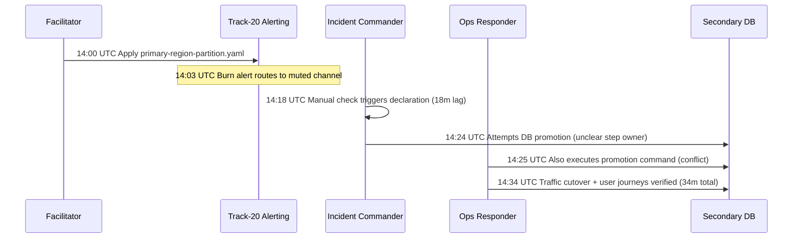

# 06 - Game Days and DR Drills

> **Prerequisites:** DR failover runbooks (Module 02), Chaos engineering discipline & tooling (Modules 04–05), Observability stack (`12-observability`), and Incident response & blameless postmortems (`20-sre`).  
> **Estimated Reading Time:** 30 minutes  
> **Target Audience:** Backend Engineers, Site Reliability Engineers, Engineering Managers, Incident Commanders.

> [!TIP]
> **The Golden Rule of Game Days:** Never turn a game day into a solo technical drill or an unannounced surprise—exercise the *real* incident-response roles (IC, responders, comms, scribe, facilitator), time **detection and declaration lag** separately from technical recovery, and track every finding through a blameless postmortem to verified closure and full infra teardown.

---

## Why This Matters

Modules 02 and 05 gave you the pieces — an executed failover drill and scored chaos experiments — as *individual technical acts*. But resilience isn't a tool you install, it's a habit an organization keeps. A **game day** is that habit made concrete: a scheduled, structured exercise where the team deliberately triggers failure (chaos + DR) and responds to it *using the real incident-response process* from track 20, so that the people, the runbooks, the communication, and the tooling are all exercised together before a real outage exercises them for you. This module is the organizational practice — the part that turns "we have DR" into "we have DR and we've proven, as a team, that we can actually run it."

---

## 1. Architectural Mental Model: End-to-End Game Day Synthesis & Human-vs-Technical RTO Breakdown

In a real outage, **Actual RTO = Detection Lag + Declaration Lag + Technical Recovery Time**. Solo DR drills only measure the third term while ignoring the human coordination that dominates real incidents. A game day wires Module 05 fault injection, Track 20 alerting and incident roles, Module 02 DR runbooks, and Track 12 verification into one closed organizational loop:

```mermaid
flowchart LR
    subgraph Prep["1. Contract and Roles"]
        Doc["Scenario Doc (Scope + Abort + Hypotheses)"]
        Roles["Assigned Roles (IC / Ops / Comms / Scribe / Facilitator)"]
        Doc --> Roles
    end

    subgraph Exec["2. Fault to Recovery (Real RTO Phases)"]
        Fault["Facilitator Injects Fault (Chaos Studio / Mesh)"]
        Detect["Burn-Rate Alert Fires (Detection Lag)"]
        Declare["IC Declares Incident (Declaration Lag)"]
        Runbook["Ops Execute DR Runbook + Comms Updates (Recovery Time)"]
        Fault --> Detect
        Detect --> Declare
        Declare --> Runbook
    end

    subgraph Close["3. Verify, Teardown and Learn"]
        Verify["Verify Real User Journeys (Track 12)"]
        Teardown["Failback + Delete Chaos and Drill Infra"]
        PM["Blameless Postmortem -> Module 07 Gap Closure"]
        Verify --> Teardown
        Teardown --> PM
    end

    Roles --> Fault
    Runbook --> Verify
```



### What a game day is (and isn't)

A game day is a **planned, time-boxed exercise** in which a team injects a realistic failure into a system and works the response end to end. It is *not* an unannounced production outage, and it is *not* one engineer quietly running `kubectl delete pod`. Its defining features:

- **Scheduled and communicated** — everyone who could be paged, or whose system is in scope, knows it's happening (and downstream teams/customers are informed if there's any prod exposure). Surprise game days destroy trust.
- **A written scenario** — a specific, plausible failure ("the primary region becomes unreachable during peak checkout traffic") with defined scope and success criteria.
- **Real process, real roles** — the team responds using the *actual* incident-response process (track 20 / module 05): an Incident Commander is declared, comms happen in the real channel, the runbook is followed as written. The whole point is to test the process, not just the technology.
- **Observed and timed** — steady state and impact are watched on the track-12 stack; RTO/RPO and process timings are recorded.
- **Followed by a blameless review** — the output is a list of what broke (technically *and* organizationally) and prioritized fixes, run through track 20 / module 06's blameless-postmortem discipline.

The chaos tooling (module 05) and the DR runbook (module 02) are the *content* of a game day; the incident-response process (track 20) is the *frame*.

### The roles: it's a rehearsal of the whole response

A game day exercises the same roles a real incident would (track 20 / module 05), and that's deliberate:

- **Incident Commander (IC)** — declares the incident, coordinates, owns decisions (fail over or not, abort or not). Rotating who plays IC across game days is how a team builds bench depth.
- **Operations / responders** — execute the runbook, run the failover, drive the recovery.
- **Communications lead** — posts status updates, manages stakeholder expectations, drafts the customer-facing message.
- **Scribe** — timestamps every action and decision (this record *is* the drill report and the postmortem's raw material).
- **Facilitator / "Master of Disaster"** — the person who designed the scenario, injects the fault, holds the abort switch, and can inject *complications* ("now the on-call for the DB team is unreachable") to test the process's robustness.

If a game day is one person doing all of this, it's a technical drill, not a game day — the organizational muscles (handoff, communication, decision under pressure) are exactly what's being trained.

### Designing the scenario and its blast radius

A good scenario is specific, plausible, and bounded — the blast-radius discipline from module 04 applied at the exercise level:

- **Specific trigger** — "Chaos Studio takes the primary region's AKS node pool offline," not "something breaks."
- **A hypothesis about the response** — not just the system's tolerance, but the *team's*: "we can detect within 5 min, declare within 10, and complete failover within our 30-min RTO." Game days test organizational SLOs as much as technical ones.
- **Defined scope** — which systems, which environment (staging first, prod only when the team is practised), which time window.
- **Pre-agreed abort criteria and a rollback** — the facilitator can end the exercise instantly, and there's a known-good way to restore normal operation (re-enable the primary, delete the chaos objects). Same big red button as module 05, now owned by the facilitator.
- **Escalating complications (optional)** — inject a second problem mid-drill to test the process under compounding stress, but only once the base scenario runs smoothly.

### The synthesis: chaos + DR runbook + incident process

The reason this module comes after 02 and 05 is that a mature game day *combines* them into one exercise. A canonical flow:

1. **Facilitator injects the fault** — e.g. a Chaos Studio experiment (module 05) that makes the primary region's cluster unreachable, or a network partition.
2. **The team detects it** via the track-20 SLO burn-rate alert (module 05 wired this as both page and abort signal) — testing whether detection actually works.
3. **The IC declares an incident** (track 20 / module 05) and the process spins up — comms channel, roles assigned, scribe timestamping.
4. **Responders execute the DR runbook** (module 02) — promote data, cut over traffic, scale up the standby — while the comms lead updates stakeholders.
5. **Verification** against real user journeys and the track-12 dashboards.
6. **Facilitator calls the exercise**, the system is restored (failback), and the team runs a **blameless postmortem** (track 20 / module 06) on both the technical *and* process findings.

Every earlier module's artifact shows up here: the RTO/RPO targets (00), the multi-region substrate (01), the runbook (02), the backups as a fallback (03), the chaos discipline (04), the fault tooling (05) — orchestrated by the track-20 process. That's why game days are the capstone-shaped practice of this track.

### Cadence, and turning findings into fixes

A single game day proves little; the value is in the **cadence**. Run them on a schedule (quarterly is common, monthly for critical systems), rotate the scenario and the IC, and — critically — **track the findings to closure**. A game day that produces a list of gaps nobody fixes is theatre. Each finding becomes a prioritized action (module 07's gap analysis is the structured version), and the *next* game day re-tests last time's fixes. Over time the game day's job shifts from "find the obvious holes" to "verify the system still recovers as it evolves" — resilience as an ongoing practice, not a one-time certification, mirroring track 20's error-budget-driven continuous reliability.

---

## 2. Taxonomic Comparison & Run-of-Show Reference

### Technical Drill vs. Full Organizational Game Day

| Dimension | Solo Technical Drill | Full Organizational Game Day |
| :--- | :--- | :--- |
| **Participants** | Single engineer running scripts/commands | Cross-functional team (IC, Ops, Comms, Scribe, Facilitator) |
| **Trigger Awareness** | Engineer knows exact command & millisecond of injection | Scheduled window known, exact fault trigger kept secret by Facilitator |
| **Process Exercised** | None (ad-hoc terminal execution) | Full Track-20 incident response (paging, comms channel, handoffs) |
| **Metrics Captured** | Technical failover duration only | Detection lag, declaration lag, technical recovery, and user-journey SLO |
| **Gaps Surfaced** | Missing commands or broken automation | Misrouted pages, unclear step ownership, missing comms templates, bench depth |

### Game Day Role Matrix & RTO Phase Ownership

| Role | Primary Responsibility | Key Output / Decision | Failure Mode If Omitted or Unclear |
| :--- | :--- | :--- | :--- |
| **Facilitator** | Authors scenario, injects fault, injects complications, holds abort switch | Controlled start, abort call, failback initiation | Unbounded impact or team pre-knows exact trigger |
| **Incident Commander (IC)** | Declares incident, assigns tasks, makes failover go/no-go calls | Timely declaration & unblocked decisions | Responders execute conflicting steps concurrently |
| **Operations / Responders** | Execute Module 02 DR runbook & verify health | Data promotion, traffic cutover, standby scale-up | Unrehearsed runbook commands fail under pressure |
| **Communications Lead** | Updates status page & internal stakeholders | Clear updates using pre-approved templates | Engineers pulled off recovery to answer executive pings |
| **Scribe** | Records exact UTC timestamps for actions, alerts, and decisions | Accurate timeline for RTO audit & postmortem | Guessing detection/declaration lag after the fact |

### Command & Run-of-Show Reference

A game day is mostly process; the commands are the ones from modules 02 and 05 now sequenced by a facilitator, plus the observation/recording tools. The key "reference" is the run-of-show and role checklist.

| Command / artifact | Role in the game day | Example |
|---|---|---|
| Scenario doc | The written failure + hypothesis + scope + abort | see template below |
| `az resource invoke-action --action start` | Facilitator injects the Chaos Studio fault (module 05) | `... --action start --ids <experiment-id>` |
| `kubectl apply -f <chaos>.yaml` | Facilitator injects a Chaos Mesh fault | `kubectl apply -f region-partition.yaml` |
| Track-20 burn-rate alert | The detection signal the team should react to | (from track 20 / module 03) |
| DR runbook | What responders execute (module 02) | `dr-runbook.md` |
| Scribe timeline | Timestamped record of every action/decision | a shared doc |
| `kubectl delete <chaos>` / re-enable endpoint | Facilitator's abort / restore (module 05, 02) | `kubectl delete networkchaos ...` |
| Postmortem doc | The blameless review output (track 20 / module 06) | see track 20 |

Scenario document template (the facilitator writes this *before* the game day):

```text
Scenario title:      <the plausible failure>
Systems in scope:    <which; which environment — staging first>
Trigger (the fault): <exact Chaos Studio/Mesh action or region disablement>
Time window:         <scheduled start/end; who's notified>
Hypotheses (team):   detect ≤ X min · declare ≤ Y min · recover ≤ RTO
Hypotheses (system): steady-state SLI stays ≥ <SLO> through failover
Roles:               IC · responders · comms · scribe · facilitator
Abort criteria:      <facilitator ends if ...>  Restore: <how to return to normal>
Observation:         <track-12 dashboards · track-20 SLOs watched>
Findings (after):    <technical + process gaps, prioritized>
```

---

## 3. Production War Story Post-Mortem: 9-Minute Failover Still Breaches 30-Minute RTO

| Field | Incident Details |
| :--- | :--- |
| **Severity** | **SEV-2** (Quarterly Staging-to-Canary Regional Failover Game Day RTO Breach) |
| **Detection / Resolution Time** | 18 min detection lag + 7 min declaration lag + 9 min technical failover = 34 min total RTO (Target: 30 min) |
| **Impact** | Team failed organizational RTO hypothesis (`<= 30m`) despite automated DB promotion and traffic cutover completing in 9 minutes |

### What Happened

During a quarterly game day simulating total loss of `eastus`, the Facilitator applied `primary-region-partition.yaml` at `14:00 UTC`. The Track-20 2x burn-rate alert fired at `14:03 UTC`, but routed into an unmonitored `#alerts-staging-noise` channel instead of paging the on-call Incident Commander. Only after a manual Grafana check at `14:18 UTC` did the IC declare the incident. During execution, both the IC and an Ops responder attempted database failover simultaneously because `dr-runbook.md` lacked step ownership, while the Comms lead lost 10 minutes drafting stakeholder copy from scratch.



### Root Cause Analysis

1. **Misrouted detection alert (18-minute human delay)**: Even though Prometheus detected the failure in 3 minutes, alert routing sent the notification to a muted channel instead of paging the active rotation.
2. **Ambiguous runbook step ownership**: `dr-runbook.md` listed technical commands without naming which role executed each step, causing conflicting database promotion calls.
3. **Missing communications templates**: Drafting external status updates mid-incident delayed stakeholder notifications and pulled IC attention away from coordination.

### The Fix & Architectural Hardening

- Updated alert routing rules so critical burn-rate alerts page the active IC rotation directly and added pre-game-day alert delivery verification.
- Annotated every step in `dr-runbook.md` with explicit role tags (`[IC]`, `[Ops]`, `[Comms]`, `[Scribe]`) and added pre-approved stakeholder status templates.
- Enforced mandatory post-drill teardown checklist verification (`az aks list -o table` and `az group list -o table`) so secondary drill clusters are destroyed immediately.

---

## 4. Multi-Language Production Implementation: Game Day Timeline & RTO Phase Audit Tracker

These four implementations model the Scribe and RTO Phase Auditor used during a game day: enforcing separate timestamps for `FaultInjected`, `AlertFired`, `IncidentDeclared`, `Recovered`, and `InfraTornDown`, computing exact detection lag, declaration lag, and technical recovery duration against organizational hypotheses, and blocking closure until teardown is confirmed.

````carousel
```go
package gameday

import (
	"errors"
	"fmt"
	"time"
)

type DrillTimeline struct {
	ScenarioTitle    string
	FaultInjectedAt  time.Time
	AlertFiredAt     time.Time
	DeclaredAt       time.Time
	RecoveredAt      time.Time
	InfraTornDown    bool
	PostmortemLinked bool
}

type DrillHypotheses struct {
	MaxDetectionLag time.Duration
	MaxDeclareLag   time.Duration
	MaxTotalRTO     time.Duration
}

type AuditReport struct {
	DetectionLag      time.Duration
	DeclarationLag    time.Duration
	TechnicalRecovery time.Duration
	TotalRTO          time.Duration
	Passed            bool
	Findings          []string
}

func EvaluateGameDay(t DrillTimeline, h DrillHypotheses) (AuditReport, error) {
	if t.AlertFiredAt.Before(t.FaultInjectedAt) ||
		t.DeclaredAt.Before(t.AlertFiredAt) ||
		t.RecoveredAt.Before(t.DeclaredAt) {
		return AuditReport{}, errors.New("invalid timeline: phase timestamps out of chronological order")
	}

	detect := t.AlertFiredAt.Sub(t.FaultInjectedAt)
	declare := t.DeclaredAt.Sub(t.AlertFiredAt)
	tech := t.RecoveredAt.Sub(t.DeclaredAt)
	total := t.RecoveredAt.Sub(t.FaultInjectedAt)

	var findings []string
	if detect > h.MaxDetectionLag {
		findings = append(findings, fmt.Sprintf("detection lag %s exceeded %s", detect, h.MaxDetectionLag))
	}
	if declare > h.MaxDeclareLag {
		findings = append(findings, fmt.Sprintf("declaration lag %s exceeded %s", declare, h.MaxDeclareLag))
	}
	if total > h.MaxTotalRTO {
		findings = append(findings, fmt.Sprintf("total RTO %s breached %s target", total, h.MaxTotalRTO))
	}
	if !t.InfraTornDown {
		findings = append(findings, "FinOps gate failed: temporary drill infrastructure not torn down")
	}
	if !t.PostmortemLinked {
		findings = append(findings, "process gate failed: blameless postmortem not created")
	}

	return AuditReport{
		DetectionLag:      detect,
		DeclarationLag:    declare,
		TechnicalRecovery: tech,
		TotalRTO:          total,
		Passed:            len(findings) == 0,
		Findings:          findings,
	}, nil
}
```
<!-- slide -->
```typescript
export interface DrillTimeline {
  scenarioTitle: string;
  faultInjectedAt: Date;
  alertFiredAt: Date;
  declaredAt: Date;
  recoveredAt: Date;
  infraTornDown: boolean;
  postmortemUrl?: string;
}

export interface DrillHypotheses {
  maxDetectionMin: number;
  maxDeclarationMin: number;
  maxTotalRtoMin: number;
}

export interface DrillAudit {
  detectionLagMin: number;
  declarationLagMin: number;
  technicalRecoveryMin: number;
  totalRtoMin: number;
  passed: boolean;
  findings: string[];
}

export function auditGameDay(timeline: DrillTimeline, targets: DrillHypotheses): DrillAudit {
  const t0 = timeline.faultInjectedAt.getTime();
  const t1 = timeline.alertFiredAt.getTime();
  const t2 = timeline.declaredAt.getTime();
  const t3 = timeline.recoveredAt.getTime();

  if (!(t0 <= t1 && t1 <= t2 && t2 <= t3)) {
    throw new Error("Chronological timeline violation between fault, alert, declaration, and recovery");
  }

  const toMin = (ms: number) => Number((ms / 60_000).toFixed(2));
  const detectionLagMin = toMin(t1 - t0);
  const declarationLagMin = toMin(t2 - t1);
  const technicalRecoveryMin = toMin(t3 - t2);
  const totalRtoMin = toMin(t3 - t0);

  const findings: string[] = [];
  if (detectionLagMin > targets.maxDetectionMin) {
    findings.push(`Detection lag ${detectionLagMin}m > ${targets.maxDetectionMin}m target`);
  }
  if (declarationLagMin > targets.maxDeclarationMin) {
    findings.push(`Declaration lag ${declarationLagMin}m > ${targets.maxDeclarationMin}m target`);
  }
  if (totalRtoMin > targets.maxTotalRtoMin) {
    findings.push(`Total RTO ${totalRtoMin}m breached ${targets.maxTotalRtoMin}m limit`);
  }
  if (!timeline.infraTornDown) {
    findings.push("Teardown incomplete: temporary drill infrastructure still active");
  }
  if (!timeline.postmortemUrl) {
    findings.push("Blameless postmortem URL missing before drill closure");
  }

  return {
    detectionLagMin,
    declarationLagMin,
    technicalRecoveryMin,
    totalRtoMin,
    passed: findings.length === 0,
    findings,
  };
}
```
<!-- slide -->
```python
from dataclasses import dataclass
from datetime import datetime


@dataclass(frozen=True)
class DrillTimeline:
    scenario: str
    fault_injected: datetime
    alert_fired: datetime
    incident_declared: datetime
    recovered: datetime
    infra_torn_down: bool
    postmortem_created: bool


@dataclass(frozen=True)
class DrillTargets:
    max_detect_minutes: float
    max_declare_minutes: float
    max_rto_minutes: float


def audit_game_day(timeline: DrillTimeline, targets: DrillTargets) -> dict:
    if not (
        timeline.fault_injected
        <= timeline.alert_fired
        <= timeline.incident_declared
        <= timeline.recovered
    ):
        raise ValueError("Phase timestamps must be monotonically non-decreasing")

    detect_min = (timeline.alert_fired - timeline.fault_injected).total_seconds() / 60.0
    declare_min = (timeline.incident_declared - timeline.alert_fired).total_seconds() / 60.0
    recovery_min = (timeline.recovered - timeline.incident_declared).total_seconds() / 60.0
    total_rto_min = (timeline.recovered - timeline.fault_injected).total_seconds() / 60.0

    findings: list[str] = []
    if detect_min > targets.max_detect_minutes:
        findings.append(f"Detection lag {detect_min:.1f}m exceeded {targets.max_detect_minutes}m")
    if declare_min > targets.max_declare_minutes:
        findings.append(f"Declaration lag {declare_min:.1f}m exceeded {targets.max_declare_minutes}m")
    if total_rto_min > targets.max_rto_minutes:
        findings.append(f"Total RTO {total_rto_min:.1f}m breached {targets.max_rto_minutes}m")
    if not timeline.infra_torn_down:
        findings.append("Cost leak: drill secondary resources not destroyed")
    if not timeline.postmortem_created:
        findings.append("Process gap: blameless postmortem not logged")

    return {
        "detect_min": round(detect_min, 2),
        "declare_min": round(declare_min, 2),
        "tech_recovery_min": round(recovery_min, 2),
        "total_rto_min": round(total_rto_min, 2),
        "passed": len(findings) == 0,
        "findings": findings,
    }
```
<!-- slide -->
```csharp
using System;
using System.Collections.Generic;

public sealed record DrillTimeline(
    string ScenarioTitle,
    DateTimeOffset FaultInjectedAt,
    DateTimeOffset AlertFiredAt,
    DateTimeOffset DeclaredAt,
    DateTimeOffset RecoveredAt,
    bool InfraTornDown,
    bool PostmortemRecorded);

public sealed record DrillHypotheses(TimeSpan MaxDetect, TimeSpan MaxDeclare, TimeSpan MaxTotalRto);

public sealed record DrillAuditResult(
    TimeSpan DetectionLag,
    TimeSpan DeclarationLag,
    TimeSpan TechnicalRecovery,
    TimeSpan TotalRto,
    bool Passed,
    IReadOnlyList<string> Findings);

public static class GameDayAuditor
{
    public static DrillAuditResult Evaluate(DrillTimeline t, DrillHypotheses h)
    {
        if (t.AlertFiredAt < t.FaultInjectedAt ||
            t.DeclaredAt < t.AlertFiredAt ||
            t.RecoveredAt < t.DeclaredAt)
        {
            throw new ArgumentException("Game day phase timestamps must be chronologically ordered.");
        }

        var detect = t.AlertFiredAt - t.FaultInjectedAt;
        var declare = t.DeclaredAt - t.AlertFiredAt;
        var tech = t.RecoveredAt - t.DeclaredAt;
        var total = t.RecoveredAt - t.FaultInjectedAt;

        var findings = new List<string>();
        if (detect > h.MaxDetect) findings.Add($"Detection lag {detect} exceeded {h.MaxDetect}");
        if (declare > h.MaxDeclare) findings.Add($"Declaration lag {declare} exceeded {h.MaxDeclare}");
        if (total > h.MaxTotalRto) findings.Add($"Total RTO {total} breached {h.MaxTotalRto}");
        if (!t.InfraTornDown) findings.Add("FinOps violation: drill infrastructure was not torn down");
        if (!t.PostmortemRecorded) findings.Add("Governance gap: blameless postmortem not recorded");

        return new DrillAuditResult(detect, declare, tech, total, findings.Count == 0, findings);
    }
}
```
````

---

## 5. Practical Hands-On Verification CLI Workflows

Ideally run these with at least one other person so the roles are real; solo, play the roles explicitly and switch between them (it's less realistic but still trains the sequence). Use a staging environment with the track-12 stack, the module-02 runbook, and module-05 chaos tooling. Tear down billable infra in exercise 8.

### 1. Write a game-day scenario

Using the template, design a scenario: primary region's AKS becomes unreachable during simulated peak load. Define the system *and* team hypotheses (detection/declaration/recovery times and the steady-state SLO), scope it to staging, name the roles, and set abort/restore criteria. This document is the exercise's contract.

### 2. Assign roles and pre-brief

Assign IC, responders, comms, scribe, facilitator (or map them to yourself if solo). Pre-brief everyone *except* on the exact fault — the facilitator keeps the specific trigger secret so detection is genuinely tested, but everyone knows the window and that it's an exercise. Open the real comms channel and the scribe's timeline doc.

### 3. Confirm steady state and detection wiring

Before injecting anything, confirm on Grafana (track 12) that the system is healthy and that the track-20 burn-rate alert is *armed* and would actually fire. A game day that can't detect its own injected fault has found its first finding — record it.

### 4. Facilitator injects the fault; team detects and declares

```bash
# Facilitator (module 05): make the primary region's cluster unreachable, e.g.
kubectl apply -f primary-region-partition.yaml   # or Chaos Studio node-pool shutdown
# Team: watch for the burn-rate alert to fire -> IC declares an incident (track 20)
```

**Expected Output:**
```text
networkchaos.chaos-mesh.org/primary-region-partition created
```

Scribe timestamps: fault injected, alert fired, incident declared. The gaps between these are your *detection* and *declaration* times — the team-level RTO components most drills never measure.

### 5. Execute the DR runbook under the incident process

Responders run the module-02 failover runbook (promote data, cut traffic over to the secondary, scale up), while the comms lead posts status updates and the scribe records every action. The IC makes the go/no-go calls. Verify recovery against real user journeys and the track-12 dashboards — not just "pods Running."

### 6. Inject a complication (test the process under stress)

Once failover is underway, the facilitator adds a realistic wrinkle: "the runbook step to promote the database fails because the credential rotated," or "the comms lead is suddenly unavailable — reassign." Observe whether the *process* adapts (handoffs, IC decisions) rather than whether one person knows one command. This is the organizational muscle game days uniquely train.

### 7. Diagnose-and-fix: the game day exposes a broken handoff, not a broken system

The module's core lesson — game days find *organizational* gaps invisible to solo technical drills. Watch for a finding like: the technology failed over fine, but **detection took 18 minutes** because the burn-rate alert routed to a channel nobody watches; or the IC and responders both assumed the *other* would promote the database, so it happened twice (or not at all); or the comms lead had no template and lost 10 minutes drafting a status update mid-incident.

**Findings to record and fix:**
- Alert routing/ownership — the fastest technical failover is worthless if detection lags because nobody's paged (fix: alert routing, on-call ownership, track 20).
- Role ambiguity — unclear who owns which runbook step causes double-execution or gaps (fix: explicit step ownership in the runbook, module 02).
- Missing comms templates — draft the customer/stakeholder message *before* the incident (fix: a comms runbook).

The point: your RTO in a real incident includes human coordination time, and *only a game day with real roles surfaces that*. A technically perfect failover behind an 18-minute detection lag still breaches a 30-minute RTO. These findings feed module 07's prioritized gap analysis.

### 8. Blameless postmortem and cleanup

Run a blameless postmortem (track 20 / module 06) on the timeline: what happened, what went well, what to fix — *technical and process* — with owners and priorities. Then restore and clean up:

```bash
kubectl delete -f primary-region-partition.yaml   # end the fault
# re-enable the primary endpoint / fail back (module 02)
# tear down any second region / dedicated cluster stood up for the drill:
az group delete -n <drill-secondary-rg> --yes --no-wait
az aks list -o table    # confirm nothing billable is left running
```

**Expected Output:**
```text
networkchaos.chaos-mesh.org "primary-region-partition" deleted
Name    Location    ResourceGroup    KubernetesVersion    ProvisioningState
------  ----------  ---------------  -------------------  -------------------
```

Expected: system restored, findings written up with owners, and the expensive drill infrastructure destroyed. The postmortem-to-fixes loop is what makes the *next* game day worth running.

### Independent challenge

Plan and run a game day (solo with explicit role-switching, or ideally with others) for a real system, combining a **chaos experiment and a DR failover** into a single scenario responded to through the full track-20 incident process. Write the scenario doc (system + team hypotheses, scope, roles, abort/restore), have the "facilitator" inject a region-level fault the responders must detect via a track-20 burn-rate alert, execute the module-02 runbook to recover, and produce a blameless postmortem with *prioritized* findings that include at least one organizational gap (detection lag, role ambiguity, or comms) — not only technical ones. Time the detection, declaration, and recovery phases separately. Draws on module 02 (runbook), module 05 (fault injection), track 12 (observation), and track 20 (incident process + blameless postmortem). **Restore the system and destroy any duplicated infrastructure afterward** — a game day that leaves a second region running has swapped a resilience win for a cost incident.

<details>
<summary>Stuck? One hint</summary>

The trick to a solo-but-real game day is to *physically separate* the facilitator role from the responder role in time: as facilitator, write the scenario and pick the exact fault, then genuinely walk away for ten minutes so that when you return as a responder you're reacting to an alert, not to knowledge of what you just did. Measure the clock from fault-injection to detection to declaration to recovery as three separate intervals — the detection interval is the one that surprises people, because it's dominated by whether the alert actually reached someone watching, not by any command's speed. That single measurement is usually the highest-priority finding, and it lives entirely in the organizational layer a technical drill can't see.

</details>

---

## 6. Common Mistakes & Troubleshooting

- **A "game day" that's one person running a command.** That's a technical drill. Game days train handoffs, communication, and decision-making — use real roles (IC, comms, scribe, facilitator) even if you have to role-switch.
- **Surprising people with a production game day.** Unannounced prod chaos destroys trust and can cause real customer harm. Schedule, communicate, start in staging, and earn production (module 04's ramp, at the exercise level).
- **Not measuring the human phases.** Detection and declaration time are usually the biggest chunk of real RTO and the only place a solo drill can't find them. Time them separately with a scribe.
- **Skipping the blameless postmortem, or making it blameful.** The findings are the entire product of a game day; a blameful review makes people hide problems, which defeats the purpose (track 20 / module 06).
- **Findings that never get fixed.** A game day whose gaps aren't tracked to closure and re-tested next time is theatre. Feed findings into module 07's prioritized gap analysis and re-drill.
- **Cost pitfall — the drill's duplicated infrastructure outliving the drill (ties to track 21).** Game days often stand up a second region or a dedicated cluster to break; forgetting to tear it down after the postmortem turns a quarterly exercise into a permanent doubled bill. Make teardown the final line of the run-of-show and verify with `az aks list` / `az group list` that nothing survived the exercise.

---

## 7. Operational Validation Checkpoints

<details><summary><strong>Checkpoint 1: Why Sub-10-Minute Technical Failover Still Breaches a 30-Minute RTO</strong></summary>

A database promotion and Traffic Manager failover script completes in 8 minutes, yet a quarterly game day clocks total customer outage at 34 minutes. Separating the Scribe's timestamps reveals 19 minutes of **detection lag** (alert routed to a muted chat channel) and 7 minutes of **declaration lag** (waiting for IC handoff). Technical automation only optimizes the final slice of real RTO; organizational alerting and declaration drills must be measured and improved alongside scripts.

</details>

<details><summary><strong>Checkpoint 2: Testing Organizational Resilience with Mid-Drill Complications</strong></summary>

During a smooth staging failover, the Facilitator announces that the primary database promotion credential rotated or that the primary Comms lead dropped offline. When a team freezes or fails to reassign roles cleanly, the drill surfaces hidden **bus-factor** and runbook-staleness risks before a real 3am incident exposes them. Complications should be introduced only after the base scenario runs reliably.

</details>

<details><summary><strong>Checkpoint 3: Preventing the "Doubled Bill" After a Multi-Region Drill</strong></summary>

Teams frequently provision a temporary secondary AKS cluster or warm-standby database replica solely for a multi-region DR game day. If the run-of-show ends at "failback complete" without verifying `az aks list -o table` and `az group list -o table` are clean, standby clusters continue accruing compute charges until the next monthly invoice. Teardown verification is a mandatory closure gate for every game day.

</details>

### Checkpoint quiz

Write down your answer to each question before expanding it — checking without attempting first is the single easiest way to fool yourself into thinking you've learned this.

1. What distinguishes a game day from one engineer running a chaos command?
2. Name four roles a game day exercises and one thing each is responsible for.
3. Why is a game day run through the *real* incident-response process (track 20) rather than an ad-hoc response?
4. What two kinds of hypothesis does a game-day scenario test — give an example of each.
5. Describe the canonical flow that combines chaos, the DR runbook, and the incident process into one exercise.
6. Why should a game day usually start in staging and only later run in production?
7. In exercise 7, the technology failed over perfectly but the RTO was still breached. Give a plausible reason and the category of fix.
8. What makes a game-day *cadence* (not a single event) the thing that actually builds resilience?

<details>
<summary>Show answers</summary>

1. A game day is scheduled, communicated, scenario-driven, and run by a *team* through the real incident process with defined roles, observation, timing, and a blameless review — it trains people and process, not just tooling. One person running a command is a technical drill.
2. Incident Commander (declares, coordinates, owns decisions); responders (execute the runbook/failover); comms lead (stakeholder updates); scribe (timestamps every action/decision); facilitator (designs the scenario, injects the fault, holds the abort). Any four.
3. Because the process — roles, comms, declaration, decision-making — is exactly what fails under real pressure and needs rehearsal; testing only the technology leaves the organizational response untested until a real incident.
4. System hypotheses (the tech tolerates the fault, e.g. "steady-state SLI stays ≥ SLO through failover") and team/process hypotheses (e.g. "we detect ≤ 5 min, declare ≤ 10, recover within the 30-min RTO").
5. Facilitator injects the fault → team detects via the track-20 burn-rate alert → IC declares an incident and the process spins up → responders execute the module-02 DR runbook (promote data, cut over, scale up) → verify real user journeys on track-12 dashboards → facilitator calls it, system is restored, team runs a blameless postmortem.
6. To bound blast radius and build competence where mistakes are cheap; production game days risk real customer harm and should only run once the scenario, tooling, observability, and team are proven — the module-04 maturity ramp at exercise scale.
7. Detection lag — e.g. the burn-rate alert routed to a channel nobody watched, so 18 minutes passed before declaration — consumed the RTO even though failover was fast. Fix category: organizational/process (alert routing, on-call ownership, role clarity), not technical.
8. Because one game day only finds the obvious holes; a regular cadence with rotating scenarios/ICs, findings tracked to closure, and re-testing of prior fixes turns resilience into an ongoing verified practice as the system evolves — mirroring track 20's continuous, error-budget-driven reliability.

</details>

---

## 8. Next

[07-resilience-patterns-review-and-gap-analysis](../07-resilience-patterns-review-and-gap-analysis/README.md) — game days generate findings; this final module before the capstone gives you the structured method to turn a system's resilience gaps — timeouts, retries, circuit breakers, health probes, graceful degradation — into a prioritized, defensible plan of fixes.
