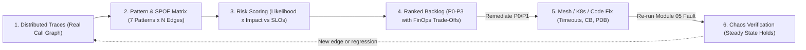
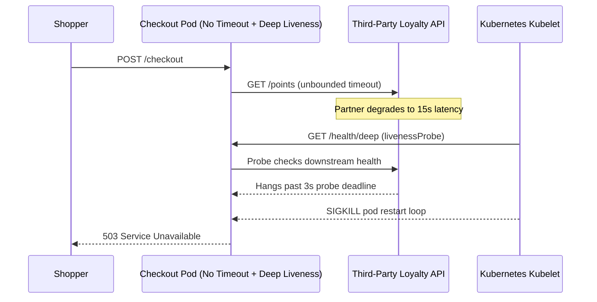

# 07 - Resilience Patterns Review and Gap Analysis

> **Prerequisites:** Failure-mode analysis, backup/restore, and chaos engineering (Modules 00–06), Kubernetes probes and PodDisruptionBudgets (Tracks 03/07), distributed tracing (Track 12), service mesh resilience policies (Track 13), and SRE SLOs (Track 20).  
> **Estimated Reading Time:** 35 minutes  
> **Target Audience:** Backend Engineers, SREs, Platform Architects.

> [!TIP]
> **The Golden Rule of Resilience Gap Analysis:** Never audit from memory—map your real call graph from distributed traces, rank every missing pattern by **likelihood × impact** against live SLOs (leaving low-value paths unhardened per FinOps), and treat every proposed fix as an unverified hypothesis until a re-run chaos experiment proves the system degrades gracefully.

---

## Why This Matters

Modules 04–06 found resilience gaps by *breaking things*. This module finds them by *reading the system* — a structured audit of the resilience patterns that should be present (timeouts, retries, circuit breakers from track 13, health probes, graceful degradation, redundancy) and where each is missing, wrong, or untested. Chaos experiments prove specific gaps exist; a gap analysis maps the whole surface *and prioritizes the fixes* so limited engineering time goes to the failures that would actually hurt. It is the bridge from "we ran some experiments" to "here is the ranked list of what to fix and why" — the artifact a real team acts on, and the one your capstone produces.

---

## 1. Architectural Mental Model: Closed-Loop Audit, Prioritization & Chaos Verification

A resilience gap analysis is not a one-off spreadsheet exercise. It forms a closed engineering loop anchored in real runtime telemetry (Track 12 traces) at the start and real failure injection (Module 05 chaos) at the end:



### The resilience patterns to audit

You have met these across the curriculum; a gap analysis checks each is actually present and correct at every relevant call:

- **Timeouts** — every network call (service→service, service→database, service→external API) must have a bounded timeout. The default in most HTTP clients is *no timeout* or a very long one — the single most common resilience bug, and the one module 05's latency experiment exposes: without a timeout, a slow dependency hangs the caller indefinitely.
- **Retries (with backoff and jitter)** — transient failures should be retried, but *bounded*, with exponential backoff and jitter, and only for idempotent operations. Naive retries (immediate, unlimited, on everything) turn a blip into a self-inflicted DDoS — the "retry storm."
- **Circuit breakers** — when a dependency is clearly failing, stop calling it (open the circuit), fail fast, and periodically test if it has recovered. This is what prevents the cascade module 05's network experiment triggers. Track 13's service mesh provides these declaratively.
- **Bulkheads** — isolate resources (connection pools, thread pools) per dependency so one saturated dependency cannot consume all of them and starve the rest — the isolation module 05's resource-exhaustion experiment tests.
- **Health probes** — liveness (restart if wedged), readiness (do not route to me until I can serve), and startup probes (track 03/07). Wrong probes cause both false failovers and traffic sent to dead pods (module 01's exercise 8).
- **Graceful degradation** — when a non-critical dependency is down, serve a reduced experience (cached data, a default, a disabled feature) rather than failing the whole request. The difference between "recommendations are temporarily unavailable" and a blank error page.
- **Redundancy across fault domains** — replicas spread across nodes/zones, PodDisruptionBudgets, no single-instance dependencies (module 04/05's SPOF findings).

### Where these come from in the curriculum

The gap analysis is a synthesis, not new material — it is auditing patterns you already have the tools for:

- **Track 13 (service mesh)** — timeouts, retries, circuit breakers, outlier-detection as mesh config (Istio `DestinationRule`/`VirtualService`). A mesh makes these auditable in one place rather than scattered across application code.
- **Track 03/07 (Kubernetes/AKS)** — probes, resource requests/limits, topology spread, PodDisruptionBudgets.
- **Track 12 (observability)** — you cannot audit what you cannot see; tracing reveals every call that *needs* a timeout, and metrics reveal retry storms and saturation.
- **Track 20 (SRE)** — the SLOs tell you which gaps matter (a gap on a path that never affects an SLO is low priority), and error-budget burn during chaos tells you which are actively costing reliability.
- **This track (00–06)** — module 00's RTO/RPO targets and modules 04–06's experiment findings feed directly into what to audit and how to rank it.

### The gap analysis method

A repeatable process, not a vibe check:

1. **Map the dependency graph.** List every component and every call between them (distributed tracing, track 12, is the fastest way — it *is* the call graph). You cannot audit calls you do not know exist.
2. **For each call/component, check each pattern.** Does this call have a timeout? A bounded retry? A circuit breaker? Is this component redundant across fault domains? Does it degrade gracefully if its dependency is down? Produce a matrix: rows = calls/components, columns = patterns, cells = present/missing/wrong.
3. **Identify single points of failure.** Anything whose failure takes down a user-facing path with no fallback — the SPOFs modules 04–05 surface.
4. **Assess each gap: likelihood × impact.** How likely is this failure, and how bad if it happens (how many users, which SLO, how much revenue)? This is a risk assessment, borrowing the same likelihood × impact framing as threat modeling (track 11) and FinOps prioritization (track 21).
5. **Prioritize and estimate.** Rank gaps by risk, weigh against fix effort, and produce a ranked backlog: what to fix first, why, and roughly how much work. The output is a *decision-ready document*, not a wall of findings.

### Prioritization: not every gap is worth fixing

The discipline that makes a gap analysis useful is *ruthless prioritization* — the same instinct as track 21's cost prioritization and track 20's error budget. A missing timeout on the checkout→payment call (high traffic, revenue path, tight SLO) is a P0; a missing circuit breaker on an internal admin-dashboard→metrics call that is already behind a degraded-mode fallback is a P3 you may never do. Rank by **risk to an actual SLO / user journey**, not by "which pattern is missing" in the abstract. A gap analysis that flags 200 issues with no ranking is as useless as none — the value is the top 5 that actually matter, with a defensible reason each.

### Validate fixes the way you found the gaps

A gap analysis proposes fixes; chaos engineering *verifies* them. The loop closes: for each high-priority gap you fix (add a timeout, a circuit breaker, a zone spread), you re-run the chaos experiment that would have exposed it (module 05) and confirm the system now degrades gracefully. An unverified fix is just another untested assumption — the exact trap this whole track exists to break. This is why the capstone requires both the gap analysis *and* chaos experiments: the analysis says what to fix, the experiments prove you fixed it.

---

## 2. Taxonomic Comparison & Command Reference

### The 7 Resilience Patterns Audit Matrix

| Pattern | Failure Mode Mitigated | Where to Audit | Common Misconfiguration |
| :--- | :--- | :--- | :--- |
| **Timeouts** | Hung caller threads/sockets when downstream stalls | HTTP/gRPC client config, Istio `VirtualService.timeout` | Relying on framework default (infinite or >60s) |
| **Bounded Retries** | Transient packet loss or rolling pod restarts | Retry policy + `perTryTimeout` + idempotency key check | Retrying POST payments or omitting exponential backoff + jitter |
| **Circuit Breakers** | Cascading resource exhaustion from failing peer | Istio `DestinationRule.outlierDetection` or SDK breaker | Missing altogether, or threshold set too loose to trip |
| **Bulkheads** | One slow dependency starving shared worker/DB pools | Istio `connectionPool`, per-dependency HTTP client/pool | Single shared `HttpClient` / DB pool across critical and optional calls |
| **Health Probes** | Routing to unready pods or wedged processes never restarting | Deployment `livenessProbe`, `readinessProbe`, `startupProbe` | Liveness probe checks downstream DB/API, causing restart cascades |
| **Graceful Degradation** | Full user-journey 500 when optional dependency fails | Fallback handlers, stale-while-revalidate cache flags | Treating non-critical enrichment (recommendations) as hard failure |
| **Fault-Domain Redundancy** | Single node, zone, or lone pod taking down a critical path | `topologySpreadConstraints`, `PodDisruptionBudget`, DB HA | `replicas: 3` scheduled onto the exact same worker node |

### Risk Prioritization & FinOps Triage Matrix

| Priority | Likelihood × Impact | SLO / Revenue Coupling | Action & Verification |
| :--- | :--- | :--- | :--- |
| **P0** | High × Critical | Direct hit to primary user journey & tight error budget | Fix immediately; verify via Module 05 chaos re-run |
| **P1** | Medium × High | Degrades core experience or threatens multi-zone SLA | Schedule in current sprint; verify via chaos / failover drill |
| **P2** | Medium × Medium | Non-blocking feature with partial fallback | Remediate opportunistically when touching service |
| **P3** | Low × Low | Internal tooling or already degraded-mode path (no SLO breach) | Deliberately leave unfixed per Track 21 FinOps discipline |

### Command reference

The "commands" here are inspection and audit tools, plus the mesh/Kubernetes config where the patterns live.

| Command | What it audits | Example |
|---|---|---|
| Distributed tracing UI (track 12) | The real call graph — every dependency that needs a timeout | Jaeger/Tempo trace view |
| `kubectl get vs,dr -A` (Istio) | Timeouts/retries/outlier-detection config (track 13) | `kubectl get virtualservice,destinationrule -A` |
| `kubectl get deploy -o yaml \| grep -A5 Probe` | Liveness/readiness/startup probes present & sane | see below |
| `kubectl get pdb -A` | PodDisruptionBudgets (redundancy under disruption) | `kubectl get pdb -A` |
| `kubectl get pods -o wide` | Whether "replicas" actually span nodes/zones (SPOF check) | `kubectl get pods -l app=web -o wide` |
| `kubectl get deploy -o jsonpath=...topologySpreadConstraints` | Cross-fault-domain spread | see below |
| Chaos Mesh/Studio (module 05) | *Verifying* a fix — re-run the experiment | `kubectl apply -f networkchaos.yaml` |

Audit snippet — check a Deployment has readiness *and* liveness probes and that they differ sensibly (a liveness probe that is really a readiness check causes restart loops):

```bash
kubectl get deploy web -o jsonpath='{range .spec.template.spec.containers[*]}{.name}{"\n  live: "}{.livenessProbe}{"\n  ready: "}{.readinessProbe}{"\n"}{end}'
```
- Confirms both exist. **Missing readiness** → traffic to not-yet-ready pods (failed requests on rollout). **Missing liveness** → a wedged pod never restarts. **Liveness == readiness on a slow dependency** → cascading restarts when the dependency is slow (the probe fails, the pod restarts, worsening load). The audit flags all three.

Audit snippet — an Istio `VirtualService`/`DestinationRule` resilience check (track 13):

```bash
kubectl get virtualservice web -o yaml | grep -A4 -iE "timeout|retries"
kubectl get destinationrule web -o yaml | grep -A6 -iE "outlierDetection|connectionPool"
```
- `timeout` on the route — present and shorter than upstream timeouts? A call with *no* `timeout` inherits the mesh/app default (often too long or none).
- `retries` — bounded `attempts` with a `perTryTimeout`, not unlimited.
- `outlierDetection` — the circuit breaker: ejects failing hosts. Absent = no circuit breaking, so a bad instance keeps taking traffic.
- `connectionPool` — the bulkhead: caps concurrent connections/requests so one dependency cannot exhaust the pool.

---

## 3. Production War Story Post-Mortem: Unbounded Partner Timeout + Downstream Liveness Cascade

| Field | Incident Details |
| :--- | :--- |
| **Severity** | **SEV-1** (Complete Checkout Outage Across All Availability Zones) |
| **Detection / Resolution Time** | Detected in 4 minutes via error-budget burn alert / Mitigated in 41 minutes |
| **Impact** | 100% of checkout submissions failed with `503 Service Unavailable`; 3.2 hours of monthly error budget burned |

### What Happened

An order-checkout microservice called a third-party loyalty-points enrichment endpoint added six months earlier—an edge never captured on architecture diagrams because the engineer left the company. The client used a default HTTP transport with **no timeout**, shared the main connection pool, and the service's Kubernetes `livenessProbe` hit `/health/deep` (which checked the loyalty endpoint). When the loyalty partner stalled at 15 seconds per request, checkout goroutines blocked indefinitely, connections saturated, `/health/deep` timed out, and kubelet terminated and restarted every checkout pod simultaneously.



### Root Cause Analysis

1. **Unmapped dependency ("audit from memory")**: Because nobody built the dependency graph from distributed traces, the loyalty call bypassed resilience review entirely.
2. **Three stacked pattern gaps on one edge**: No per-request timeout, no bulkhead separating loyalty from payment calls, and no graceful degradation when loyalty points were unavailable.
3. **Liveness probe coupled to downstream**: Checking an external dependency inside `livenessProbe` turned a slow optional partner into a self-inflicted fleet restart storm.

### The Fix & Architectural Hardening

- Built the call graph directly from Tempo/Jaeger traces to surface every internal and external outbound edge.
- Added a `1.5s` client + Istio `VirtualService` timeout, an isolated bulkhead pool (`maxConnections: 32`), and a circuit breaker (`outlierDetection`) with graceful degradation (skip bonus points display and queue async award if loyalty fails).
- Separated `livenessProbe` (`/livez` — local process liveness only) from `readinessProbe` (`/readyz`), and **verified the fix by injecting 5s `NetworkChaos` latency** against the loyalty stub while confirming checkout stayed within its 99.9% SLO.

---

## 4. Multi-Language Production Implementation: Audited Resilient Dependency Client

These four implementations model the exact client-side safeguards a gap analysis verifies on a non-critical or latency-sensitive edge: **bounded per-call timeout**, **bounded retries with exponential backoff and jitter** (strictly for idempotent reads), **circuit breaker state machine** (`Closed` → `Open` → `HalfOpen`), and **graceful degradation fallback**.

````carousel
```go
package resilience

import (
	"context"
	"errors"
	"math/rand"
	"net/http"
	"sync"
	"time"
)

type BreakerState int

const (
	StateClosed BreakerState = iota
	StateOpen
	StateHalfOpen
)

type AuditedClient struct {
	httpClient   *http.Client
	mu           sync.Mutex
	state        BreakerState
	failures     int
	failureLimit int
	openUntil    time.Time
	cooldown     time.Duration
}

func NewAuditedClient(callTimeout, cooldown time.Duration, failureLimit int) *AuditedClient {
	return &AuditedClient{
		// Bulkhead & timeout: never rely on http.DefaultClient (which has Timeout: 0)
		httpClient: &http.Client{
			Timeout: callTimeout,
			Transport: &http.Transport{
				MaxIdleConnsPerHost: 16,
				MaxConnsPerHost:     32,
			},
		},
		failureLimit: failureLimit,
		cooldown:     cooldown,
	}
}

func (c *AuditedClient) allowRequest() bool {
	c.mu.Lock()
	defer c.mu.Unlock()
	if c.state == StateOpen {
		if time.Now().After(c.openUntil) {
			c.state = StateHalfOpen
			return true
		}
		return false
	}
	return true
}

func (c *AuditedClient) recordResult(err error) {
	c.mu.Lock()
	defer c.mu.Unlock()
	if err == nil {
		c.failures = 0
		c.state = StateClosed
		return
	}
	c.failures++
	if c.failures >= c.failureLimit || c.state == StateHalfOpen {
		c.state = StateOpen
		c.openUntil = time.Now().Add(c.cooldown)
	}
}

// FetchWithFallback enforces bounded retries + jitter + circuit breaking and degrades gracefully.
func (c *AuditedClient) FetchWithFallback(ctx context.Context, url string, fallback string) string {
	if !c.allowRequest() {
		return fallback
	}

	const maxAttempts = 3
	var lastErr error
	for attempt := 0; attempt < maxAttempts; attempt++ {
		reqCtx, cancel := context.WithTimeout(ctx, c.httpClient.Timeout)
		req, err := http.NewRequestWithContext(reqCtx, http.MethodGet, url, nil)
		if err != nil {
			cancel()
			return fallback
		}

		resp, err := c.httpClient.Do(req)
		cancel()
		if err == nil && resp.StatusCode < 500 {
			resp.Body.Close()
			c.recordResult(nil)
			return "live-enrichment"
		}
		if resp != nil {
			resp.Body.Close()
		}
		lastErr = errors.New("transient downstream failure")

		if attempt < maxAttempts-1 {
			backoff := time.Duration(50*(1<<attempt)) * time.Millisecond
			jitter := time.Duration(rand.Intn(40)) * time.Millisecond
			time.Sleep(backoff + jitter)
		}
	}

	c.recordResult(lastErr)
	return fallback // Graceful degradation instead of cascading failure
}
```
<!-- slide -->
```typescript
type BreakerState = "CLOSED" | "OPEN" | "HALF_OPEN";

export class AuditedDependencyClient {
  private state: BreakerState = "CLOSED";
  private failures = 0;
  private openUntil = 0;

  constructor(
    private readonly timeoutMs = 1500,
    private readonly failureThreshold = 3,
    private readonly cooldownMs = 10_000
  ) {}

  private canAttempt(): boolean {
    if (this.state === "OPEN") {
      if (Date.now() >= this.openUntil) {
        this.state = "HALF_OPEN";
        return true;
      }
      return false;
    }
    return true;
  }

  private onSuccess(): void {
    this.failures = 0;
    this.state = "CLOSED";
  }

  private onFailure(): void {
    this.failures += 1;
    if (this.failures >= this.failureThreshold || this.state === "HALF_OPEN") {
      this.state = "OPEN";
      this.openUntil = Date.now() + this.cooldownMs;
    }
  }

  async getIdempotentWithDegradation<T>(url: string, fallbackValue: T): Promise<T> {
    if (!this.canAttempt()) {
      return fallbackValue;
    }

    const maxAttempts = 3;
    for (let attempt = 0; attempt < maxAttempts; attempt++) {
      const controller = new AbortController();
      const timer = setTimeout(() => controller.abort(), this.timeoutMs);

      try {
        const res = await fetch(url, { method: "GET", signal: controller.signal });
        clearTimeout(timer);
        if (res.ok) {
          this.onSuccess();
          return (await res.json()) as T;
        }
        if (res.status < 500) {
          // Non-transient 4xx should not trip breaker or waste retries
          return fallbackValue;
        }
      } catch {
        clearTimeout(timer);
      }

      if (attempt < maxAttempts - 1) {
        const backoff = 50 * 2 ** attempt;
        const jitter = Math.floor(Math.random() * 40);
        await new Promise((r) => setTimeout(r, backoff + jitter));
      }
    }

    this.onFailure();
    return fallbackValue;
  }
}
```
<!-- slide -->
```python
import random
import time
from enum import Enum
import urllib.request
import urllib.error


class BreakerState(Enum):
    CLOSED = "closed"
    OPEN = "open"
    HALF_OPEN = "half_open"


class AuditedDependencyClient:
    """Bounded timeout, jittered retry, circuit breaker, and graceful degradation."""

    def __init__(self, timeout_s: float = 1.5, failure_limit: int = 3, cooldown_s: float = 10.0) -> None:
        self.timeout_s = timeout_s
        self.failure_limit = failure_limit
        self.cooldown_s = cooldown_s
        self.state = BreakerState.CLOSED
        self.failures = 0
        self.open_until = 0.0

    def _allow_call(self) -> bool:
        if self.state == BreakerState.OPEN:
            if time.monotonic() >= self.open_until:
                self.state = BreakerState.HALF_OPEN
                return True
            return False
        return True

    def _record_success(self) -> None:
        self.failures = 0
        self.state = BreakerState.CLOSED

    def _record_failure(self) -> None:
        self.failures += 1
        if self.failures >= self.failure_limit or self.state == BreakerState.HALF_OPEN:
            self.state = BreakerState.OPEN
            self.open_until = time.monotonic() + self.cooldown_s

    def fetch_or_degrade(self, url: str, fallback: str) -> str:
        if not self._allow_call():
            return fallback

        max_attempts = 3
        for attempt in range(max_attempts):
            try:
                req = urllib.request.Request(url, method="GET")
                with urllib.request.urlopen(req, timeout=self.timeout_s) as resp:
                    if resp.status < 500:
                        self._record_success()
                        return resp.read().decode("utf-8")
            except (urllib.error.URLError, TimeoutError):
                pass

            if attempt < max_attempts - 1:
                backoff_s = 0.05 * (2 ** attempt) + random.uniform(0.0, 0.04)
                time.sleep(backoff_s)

        self._record_failure()
        return fallback
```
<!-- slide -->
```csharp
using System.Net;

public sealed class AuditedDependencyClient
{
    private readonly HttpClient _http;
    private readonly int _failureLimit;
    private readonly TimeSpan _cooldown;
    private readonly object _gate = new();
    private int _failures;
    private DateTimeOffset _openUntil = DateTimeOffset.MinValue;
    private bool _halfOpen;

    public AuditedDependencyClient(TimeSpan callTimeout, int failureLimit = 3, TimeSpan? cooldown = null)
    {
        // Per-dependency bulkhead via MaxConnectionsPerServer + explicit timeout
        var handler = new SocketsHttpHandler { MaxConnectionsPerServer = 32 };
        _http = new HttpClient(handler) { Timeout = callTimeout };
        _failureLimit = failureLimit;
        _cooldown = cooldown ?? TimeSpan.FromSeconds(10);
    }

    public async Task<string> GetWithDegradationAsync(string url, string fallback, CancellationToken ct)
    {
        lock (_gate)
        {
            if (DateTimeOffset.UtcNow < _openUntil)
                return fallback;
            if (_failures >= _failureLimit)
                _halfOpen = true;
        }

        for (int attempt = 0; attempt < 3; attempt++)
        {
            try
            {
                using var resp = await _http.GetAsync(url, ct);
                if ((int)resp.StatusCode < 500)
                {
                    lock (_gate) { _failures = 0; _halfOpen = false; _openUntil = DateTimeOffset.MinValue; }
                    return await resp.Content.ReadAsStringAsync(ct);
                }
            }
            catch (Exception ex) when (ex is HttpRequestException or TaskCanceledException && !ct.IsCancellationRequested)
            {
                // Transient timeout or network fault eligible for bounded retry
            }

            if (attempt < 2)
            {
                int jitterMs = Random.Shared.Next(0, 40);
                await Task.Delay(TimeSpan.FromMilliseconds(50 * (1 << attempt) + jitterMs), ct);
            }
        }

        lock (_gate)
        {
            _failures++;
            if (_failures >= _failureLimit || _halfOpen)
            {
                _openUntil = DateTimeOffset.UtcNow.Add(_cooldown);
                _halfOpen = false;
            }
        }
        return fallback;
    }
}
```
````

---

## 5. Practical Hands-On Verification CLI Workflows

Audit a real system you have built (a track 07/13/14 environment with the track-12 stack). No new billable multi-region infra is required — this is mostly reading and small fixes, verified with module-05 chaos. Clean up any chaos objects and dedicated clusters in exercise 8.

### 1. Map the dependency graph from traces

Use distributed tracing (track 12) under load to enumerate every call: which services call which, and which external dependencies/databases each touches. Draw it (even on paper). Every edge is a call that needs a timeout and possibly a circuit breaker — you cannot audit edges you did not know existed, and tracing usually reveals a few surprises.

### 2. Build the resilience matrix

Make a table: rows = each call/component from exercise 1, columns = timeout, bounded-retry, circuit-breaker, redundant-across-fault-domains, graceful-degradation. Fill each cell present / missing / wrong by inspecting the mesh config, Deployments, and code. This matrix is the core artifact.

### 3. Audit health probes

```bash
kubectl get deploy -A -o json | jq -r '.items[] | .metadata.name + ": live=" + (.spec.template.spec.containers[0].livenessProbe!=null|tostring) + " ready=" + (.spec.template.spec.containers[0].readinessProbe!=null|tostring)'
```

**Expected Output:**
```text
checkout-api: live=true ready=true
inventory-svc: live=true ready=false
legacy-worker: live=false ready=false
```

Flag every workload missing a readiness probe (traffic to unready pods) or missing liveness (wedged pods never restart), and any liveness probe that would fail under dependency slowness (restart-loop risk). Add these to the matrix.

### 4. Audit timeouts, retries, and circuit breakers (track 13)

```bash
kubectl get virtualservice,destinationrule -A -o yaml | grep -iE "timeout|retries|outlierDetection|connectionPool" || echo "NONE FOUND — every call is unbounded"
```

**Expected Output:**
```text
NONE FOUND — every call is unbounded
```

The common, alarming finding: **no timeouts or circuit breakers configured anywhere** — meaning every inter-service call is unbounded and one slow dependency can hang everything (module 05's cascade). Record which calls lack each pattern.

### 5. Hunt single points of failure

```bash
kubectl get pods -A -o wide | awk '{print $2, $8}'    # pod, node — are "replicas" on one node?
kubectl get pdb -A                                     # any PodDisruptionBudgets?
# find single-instance backing services (a lone db/cache pod with no replica)
```

**Expected Output:**
```text
NAME           MIN AVAILABLE   MAX UNAVAILABLE   ALLOWED DISRUPTIONS   AGE
checkout-pdb   2               N/A               1                     12d
```

List every SPOF: replicas that do not span fault domains, single-instance dependencies, no PDBs. These are usually the highest-impact gaps (a whole user-facing path dies with no fallback).

### 6. Score and prioritize (the actual deliverable)

For each gap in the matrix, assign **likelihood** (how often could this fail?) and **impact** (which SLO/user journey, how many users, revenue?) — using your track-20 SLOs to decide impact. Rank by risk, then annotate rough fix effort. Produce a **prioritized gap-analysis document**: top gaps first, each with a one-line justification tying it to a real SLO/journey. Ruthlessly deprioritize gaps on paths no SLO cares about. *This ranked doc — not the raw matrix — is what a team acts on and what the capstone requires.*

### 7. Diagnose-and-fix: fix the top gap and *verify* it with chaos

Take your #1 gap — most likely a missing timeout + circuit breaker on a critical call. Fix it (add a mesh `timeout` + `outlierDetection`, or a client timeout), then **re-run the module-05 experiment that would have exposed it** and confirm the system now degrades gracefully instead of cascading:

```bash
# add timeout + circuit breaker (Istio example):
kubectl apply -f web-vs-with-timeout.yaml      # timeout: 2s, bounded retries
kubectl apply -f db-dr-with-outlier.yaml       # outlierDetection = circuit breaker
# now re-run the latency experiment from module 05:
kubectl apply -f networkchaos.yaml             # 5s latency on the dependency
# verify on Grafana: caller now times out at 2s and sheds load / serves degraded,
# instead of hanging until resource exhaustion.
```

**Expected Output:**
```text
virtualservice.networking.istio.io/web configured
destinationrule.networking.istio.io/db configured
networkchaos.chaos-mesh.org/dependency-latency created
```

**The point:** the fix is only real once the experiment that found the gap now passes. An unverified resilience fix is just another untested assumption — the whole track's thesis. Record before/after dashboards.

### 8. Clean up

```bash
kubectl delete podchaos,networkchaos,stresschaos --all -A 2>/dev/null
# remove any dedicated cluster/infra stood up for the audit:
az group delete -n <audit-rg> --yes --no-wait 2>/dev/null
```

**Expected Output:**
```text
No chaos objects remain in any namespace; audit resource group deletion accepted asynchronously.
```

Expected: no active chaos objects, no lingering dedicated infra. Keep the gap-analysis document — it is a deliverable, and the capstone builds on it.

### Independent challenge

Produce a complete, prioritized **resilience gap analysis** for a real system (a track 07/13/14 capstone environment), then fix and *verify* the top two gaps. Map the dependency graph from track-12 traces, build the resilience matrix (timeouts / bounded retries / circuit breakers / cross-fault-domain redundancy / graceful degradation / probes), identify SPOFs, and rank every gap by likelihood×impact against your track-20 SLOs — producing a ranked document where each top item has a defensible one-line justification. Then remediate the two highest-priority gaps (e.g. add a timeout + circuit breaker via track 13's mesh, spread a single-node "replicated" workload across zones) and **re-run the module-05 chaos experiment that would expose each**, proving the fix holds. Draws on track 12 (call graph), track 13 (mesh patterns), track 20 (SLO-based prioritization), and modules 04–06 (the experiments that verify). Tear down any chaos objects or dedicated infra afterward.

<details>
<summary>Stuck? One hint</summary>

Let the traces do the discovery and the SLOs do the ranking — those two external inputs prevent the two failure modes of a gap analysis. Without the call graph from tracing you will audit the calls you *remember* and miss the ones that actually hang (the forgotten external API call with no timeout is always the killer). Without the SLOs you will rank by "which pattern is missing" and waste effort hardening paths nobody's reliability depends on. Start from the single highest-traffic revenue path, walk its every call for a timeout and a circuit breaker first, and you will usually find your P0 in the first ten minutes — then verify the fix by re-running the exact latency experiment from module 05 against that path.

</details>

---

## 6. Common Mistakes & Troubleshooting

- **Auditing from memory instead of from traces.** You will miss exactly the calls that lack timeouts — the forgotten external dependency. Map the real call graph from track-12 tracing first.
- **The missing-timeout blind spot.** Most HTTP clients default to no (or a huge) timeout; an unbounded call hangs the caller when the dependency slows. This is the most common and most damaging single gap — check every call.
- **Naive retries as a "fix."** Immediate, unlimited retries on everything turn a blip into a retry storm and can take down the dependency you are retrying. Retries need backoff, jitter, bounds, and idempotency.
- **Liveness probe doubling as a dependency check.** A liveness probe that fails when a downstream is slow causes restart loops that worsen an incident. Liveness = "am *I* wedged"; readiness = "can I serve right now."
- **A gap list with no prioritization.** 200 unranked findings are as useless as none. Rank by likelihood×impact against real SLOs and present the top few that matter, each justified.
- **Proposing fixes you never verify.** A fix is a hypothesis until a chaos experiment (module 05) confirms the system now degrades gracefully. Unverified fixes are how "we hardened it" becomes the next outage.
- **Cost pitfall — over-hardening low-value paths (ties to track 21).** Redundancy, multi-zone spread, and active-active for a component that no SLO depends on spends real money (and complexity) for reliability nobody needs — the same over-provisioning FinOps guards against. Prioritize hardening spend by risk to actual SLOs, and be willing to leave low-impact gaps unfixed.

---

## 7. Operational Validation Checkpoints & Checkpoint Quiz

### Operational Validation Checkpoints

<details><summary><strong>Checkpoint 1: Separating liveness from dependency readiness during an outage</strong></summary>

During a gap audit, you notice `orders-api` uses `/healthz` for both `livenessProbe` and `readinessProbe`, and `/healthz` executes a `SELECT 1` against Azure SQL. If Azure SQL enters a 4-second failover pause, kubelet restarts every `orders-api` pod across all nodes—multiplying recovery time with cold starts and wiping in-memory caches. Split them into `/livez` (process event loop alive, zero external calls) for `livenessProbe` and `/readyz` for `readinessProbe`.

</details>

<details><summary><strong>Checkpoint 2: Ranking a gap using SLO error budget and FinOps cost</strong></summary>

Your matrix uncovers two gaps: (A) `checkout-api -> payment-gw` has no timeout on a 99.95% SLO journey, and (B) `internal-billing-export -> metrics-api` runs single-AZ with no circuit breaker and already falls back to skipping export metrics. Gap A is **P0** because a single payment stall cascades into immediate error-budget exhaustion and revenue loss; Gap B is **P3** and should be deliberately left unhardened so engineering time and multi-AZ compute spend protect real user SLOs.

</details>

<details><summary><strong>Checkpoint 3: Proving a resilience remediation is not theater</strong></summary>

Adding `timeout: 2s` and `outlierDetection` to an Istio `VirtualService`/`DestinationRule` does not close the ticket on its own—without a `NetworkChaos` latency fault test (`5s` injected delay), you have not proven whether a legacy SDK timeout (`60s`) or missing fallback handler overrides or bypasses the mesh configuration. Only passing the re-run chaos experiment under steady load closes the gap.

</details>

### Checkpoint quiz

Write down your answer to each question before expanding it — checking without attempting first is the single easiest way to fool yourself into thinking you've learned this.

1. Name five resilience patterns a gap analysis audits and the failure each guards against.
2. Why is a missing timeout the most commonly cited resilience bug, and what does it cause?
3. Why can naive retries make an incident *worse*, and what three properties make retries safe?
4. What is the difference between a liveness and a readiness probe, and what goes wrong if a liveness probe effectively checks a downstream dependency?
5. Give the five steps of the gap-analysis method.
6. Why must a gap analysis prioritize by likelihood×impact against SLOs rather than by "which pattern is missing"?
7. Why is a proposed fix not "done" until you have run a chaos experiment against it?
8. Give an example of a resilience gap you would *deliberately not fix*, and the FinOps reasoning (track 21).

<details>
<summary>Show answers</summary>

1. Any five: timeouts (a slow/hung dependency hanging the caller); bounded retries with backoff/jitter (transient failures, without causing retry storms); circuit breakers (cascading failure from a failing dependency); bulkheads (one dependency exhausting shared pools and starving others); health probes (traffic to unready pods / wedged pods never restarting); graceful degradation (whole-request failure when a non-critical dependency is down); cross-fault-domain redundancy (a single node/zone/instance being a SPOF).
2. Most HTTP clients default to no or a very long timeout, so it is silently absent; a call with no timeout hangs the caller indefinitely when the dependency slows, exhausting threads/connections and cascading into a full outage.
3. Immediate unlimited retries multiply load on an already-struggling dependency (a retry storm) and can take it fully down. Safe retries are bounded (limited attempts), backed off exponentially with jitter, and only applied to idempotent operations.
4. Liveness = "restart me if I am wedged"; readiness = "do not route traffic to me until I can serve." If liveness effectively checks a downstream, a slow dependency makes the probe fail and the pod restart, causing restart loops that worsen the incident.
5. Map the dependency graph (from traces) → check each pattern per call/component (build the matrix) → identify SPOFs → assess each gap by likelihood×impact against SLOs → prioritize and estimate into a ranked backlog.
6. Because engineering time is finite; a gap on a path no SLO/user journey depends on is not worth fixing, while a gap on a high-traffic revenue path under a tight SLO is a P0. Ranking by risk to real SLOs directs effort where it actually protects reliability.
7. Because the fix is an assumption until verified; re-running the experiment that would have exposed the gap and confirming the system now degrades gracefully is the only proof the fix works — an unverified fix is just another untested resilience claim.
8. E.g. adding multi-zone redundancy or a circuit breaker to an internal admin/reporting path that already has a degraded-mode fallback and whose failure breaches no SLO — the reliability gained is near zero while the cost and complexity are real, so FinOps (track 21) says spend that money and effort on higher-risk paths instead.

</details>

---

## 8. Next

[08-capstone-project](../08-capstone-project/README.md) — you now have every piece: RTO/RPO targets, a multi-region substrate, a tested DR runbook, platform backups, chaos discipline and tooling, the game-day practice, and a prioritization method. The capstone combines them into one end-to-end deliverable: a real DR plan, a Terraform failover you actually execute, chaos experiments you actually run, and a gap analysis you actually prioritize.
