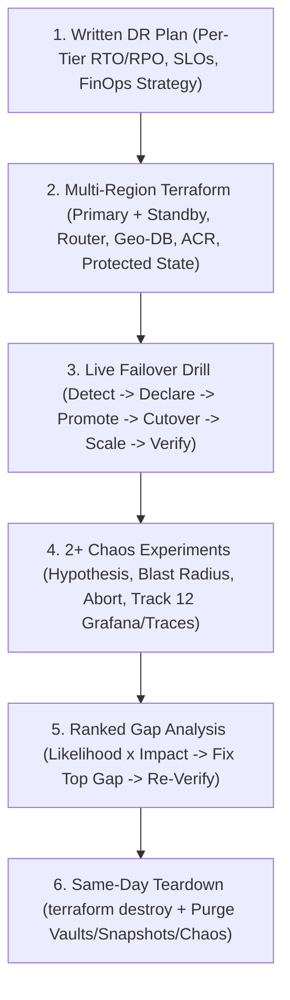
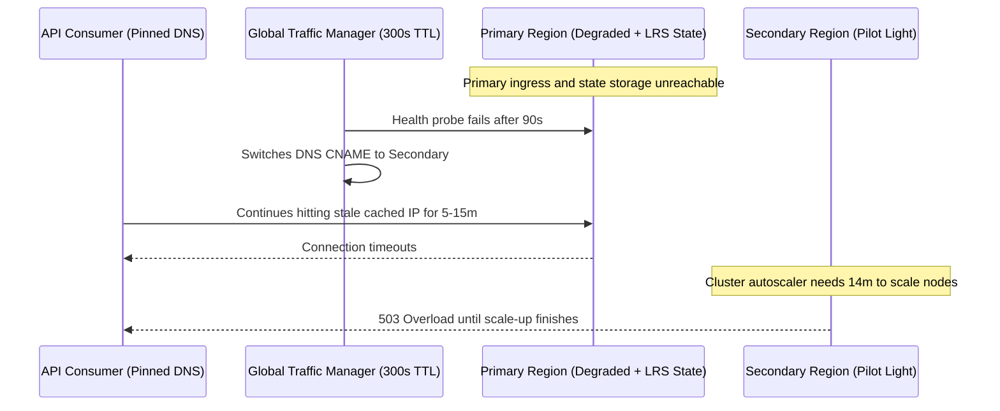

# Capstone Project

> **Prerequisites:** All modules in Track 22 (Modules 00–07), AKS/ACR Capstone (Tracks 07/14), reusable Terraform modules (Track 09), observability stack (Track 12), service mesh policies (Track 13), SRE SLOs (Track 20), and FinOps prioritization (Track 21).  
> **Estimated Reading Time:** 45 minutes (plan 4–6 hours for live execution and same-day teardown)  
> **Target Audience:** Backend Engineers, SREs, Cloud Architects.

> [!TIP]
> **The Golden Rule of the DR & Chaos Capstone:** Write your DR plan and honest RTO/RPO targets *first* so they constrain your Terraform standby footprint, time human detection and DNS-TTL propagation alongside automated promotion during the live drill, design chaos experiments that can genuinely fail, verify fixes with the same fault, and tear down every billable multi-region resource the same day.

---

## Why This Matters

This is where the whole track converges from paper into proof. Across modules 00–07 you learned, in isolation, to set RTO/RPO targets, build a second region, write and execute a failover drill, back up a platform, run disciplined chaos experiments, hold a game day, and prioritize resilience gaps. The capstone asks the only question that ultimately matters: for a *specific real system*, can you put it all together into a DR plan with honest targets, provision a multi-region failover in Terraform, **actually fail over** and record what happened, **actually break the system** with chaos and observe it, and hand someone a prioritized list of what to fix? There is no new concept and no quiz here — the deliverable is evidence that your system recovers, not a claim that it should.

Treat this as a project, not a checklist of isolated exercises. The pieces depend on each other in the order a real resilience engagement would run: you cannot drill a failover you have not built, and you cannot prioritize gaps you have not discovered by breaking things.

---

## 1. Architectural Mental Model: Five-Deliverable Convergence & Dual-Region Substrate

Every deliverable constrains and feeds the next in sequence—from paper RTO/RPO commitments, through Terraform multi-region provisioning and live failover measurement, into chaos validation and ranked remediation:



### The project

Take a real system — ideally the AKS + ACR + database environment from your track 07 or track 14 capstone, or the multi-module Terraform environment from track 09's capstone — and produce a complete, *executed* disaster-recovery and resilience engagement for it. Five deliverables, each building on the last:

1. **A written DR plan with real RTO/RPO targets.** For your specific system, decomposed per component/tier, with defensible RTO and RPO numbers reconciled against a plausible SLO (track 20) and a chosen position on the strategy spectrum (backup/restore → pilot light → warm standby → active-active) for each — including an explicit, cost-justified reason for *not* choosing a more expensive strategy where you did not (module 00, track 21). This is the document everything else is measured against.

2. **A multi-region, Terraform-provisioned failover setup.** Using the reusable modules from track 09, stand the system up in a **second Azure region** with a global traffic router (Traffic Manager or Front Door), geo-redundant data, and a geo-replicated ACR — the second region being a second module invocation, not new code (module 01). The standby's size must match the strategy you chose in deliverable 1 (do not run active-active if you specified warm standby).

3. **An actually-executed failover drill with results recorded.** Write the regional-outage runbook (module 02), then *run it* against your two regions: trigger the failover, cut traffic over, promote data, verify real user journeys, and record a drill report with the achieved RTO decomposed by phase and the achieved RPO — plus every runbook defect you found and fixed. The recorded results, including the DNS-TTL behaviour you observed, are the deliverable — not "it worked."

4. **At least two real chaos experiments run against the system.** Using Chaos Studio and/or Chaos Mesh (module 05), run at least two *different* fault types (e.g. a pod failure and a dependency network fault) as designed experiments — each with a steady-state SLI, a falsifiable hypothesis in SLO terms, a bounded blast radius, and a rehearsed abort — and capture observations from your **track-12 observability stack** (Grafana steady-state-vs-during, and a distributed trace showing where a fault propagated). Record whether each hypothesis held.

5. **A prioritized resilience gap-analysis document.** From the drill and the chaos findings plus a structured audit (module 07), produce a *ranked* list of the system's resilience gaps — timeouts, retries, circuit breakers (track 13), health probes, graceful degradation, SPOFs — each scored by likelihood × impact against your SLOs, with a defensible one-line justification for the top items and a note on which you would deliberately not fix and why (track 21). Fixing at least the top gap and *verifying* it by re-running the experiment that exposed it is the strongest version.

Then **prove** it and **tear it down** — see the acceptance checklist.

---

## 2. Taxonomic Comparison & Capstone Deliverable Matrix

### Five-Deliverable Evidence & Gate Matrix

| Deliverable | Primary Constraint / Input | Mandatory Artifact / Evidence | Verification Gate |
| :--- | :--- | :--- | :--- |
| **1. Written DR Plan** | Component tiers, Track 20 SLOs, Track 21 budget | `dr-plan.md` with per-tier RTO/RPO & FinOps justification | Explicit "why not active-active" rationale for lower tiers |
| **2. Multi-Region Terraform** | Track 09 modules + Deliverable 1 standby sizing | `terraform state list` showing Region 2 + global router + non-overlapping CIDRs | `dig` / `curl` resolves steady-state primary via real probe |
| **3. Live Failover Drill** | `dr-runbook.md` + geo-replicated store | Drill report with phase-decomposed RTO, measured RPO, DNS TTL behavior | Real end-to-end user journey passes + ≥2 runbook fixes |
| **4. 2+ Chaos Experiments** | Steady-state SLI + SLO burn-rate abort trigger | Chaos Studio/Mesh manifests + Grafana before/during + Trace | At least 1 non-trivial fault disproves hypothesis (or documented rigor) |
| **5. Ranked Gap Analysis** | Drill findings + Trace call graph + Module 07 matrix | Likelihood × impact ranked list + Track 21 deprioritized item | Top gap remediated and proven via chaos re-run |

### Verification & Teardown Command Reference

| Command | Phase | Purpose |
| :--- | :--- | :--- |
| `terraform state list` | Provision & Cleanup | Confirm secondary region, router, and remote state inventory |
| `dig +short <global-fqdn>` | Drill Cutover | Measure real DNS-TTL decay and CNAME transition to secondary |
| `az aks list -o table` | Final Sweep | Verify zero lingering primary/secondary AKS clusters |
| `az group list -o table` | Final Sweep | Confirm all capstone resource groups are removed |
| `az backup vault list -o table` | Final Sweep | Confirm Recovery Services/Backup vaults and recovery points are deleted |
| `az snapshot list -o table` | Final Sweep | Ensure zero orphaned Velero/CSI disk snapshots remain billed |

---

## 3. Production War Story Post-Mortem: The "10-Minute RTO" That Took 47 Minutes Live

| Field | Incident Details |
| :--- | :--- |
| **Severity** | **SEV-1** (Regional Outage Failover Breach During Real Event) |
| **Detection / Resolution Time** | Detected in 11 minutes / Full traffic recovery in 47 minutes (breached 15m RTO target) |
| **Impact** | 36 minutes of extended user downtime; Terraform state lock unreachable in failed primary region |

### What Happened

A platform team previously claimed a "10-minute RTO" because database replica promotion completed in 4 minutes in isolation. When an actual regional networking outage struck, three hidden gaps surfaced simultaneously: (1) Traffic Manager used a 300-second DNS TTL, and downstream service clients cached DNS lookups indefinitely; (2) the secondary AKS cluster lacked pre-provisioned node pool headroom and took 14 minutes to scale from pilot-light to peak capacity; and (3) Terraform remote state lived in an LRS storage account inside the dead primary region, blocking emergency infrastructure adjustments.



### Root Cause Analysis

1. **Unmeasured human & DNS cutover tail**: Only machine database-promotion time had been timed; detection, incident declaration, and DNS-TTL expiry were excluded from paper RTO.
2. **Standby capacity mismatch**: The DR plan promised a 15-minute RTO, but the Terraform build deployed a tiny pilot-light cluster whose cold node-pool scale-out exceeded the remaining time budget.
3. **Unprotected Terraform state**: Storing remote state without geo-redundancy (GRS/RA-GRS) and soft-delete made the recovery tool itself a single-region SPOF.

### The Fix & Architectural Hardening

- Tracked and enforced **decomposed 6-phase RTO** (`detect → declare → promote → cutover → scale-up → verify`) in quarterly live drills.
- Lowered Traffic Manager TTL to 30 seconds, enforced bounded DNS cache TTLs in backend HTTP clients, and upgraded standby sizing to **warm standby** for the Tier-1 API.
- Migrated Terraform remote state to a GRS storage account with blob versioning and soft-delete enabled, verified in a cold rebuild test.

---

## 4. Multi-Language Production Implementation: Decomposed RTO Cutover Timer & Synthetic User-Journey Verifier

During Deliverable 3, verifying "pods Running" is insufficient—you must measure **when user traffic actually succeeds in the promoted secondary region**. These four implementations continuously execute a real synthetic user-journey check against the global router during failover, recording the exact timestamp of outage detection, first secondary-region response (`X-Served-Region`), total achieved cutover RTO, and any failed journey requests.

````carousel
```go
package drillverifier

import (
	"context"
	"fmt"
	"net/http"
	"time"
)

type DrillReport struct {
	StartedAt       time.Time
	OutageDetected  time.Time
	RecoveredAt     time.Time
	AchievedCutover time.Duration
	FailedRequests  int
	ActiveRegion    string
}

func MeasureFailoverCutover(ctx context.Context, globalURL, expectedSecondary string) (*DrillReport, error) {
	client := &http.Client{Timeout: 3 * time.Second}
	report := &DrillReport{StartedAt: time.Now()}
	ticker := time.NewTicker(1 * time.Second)
	defer ticker.Stop()

	sawOutage := false
	for {
		select {
		case <-ctx.Done():
			return report, fmt.Errorf("drill verification timed out: %w", ctx.Err())
		case now := <-ticker.C:
			req, _ := http.NewRequestWithContext(ctx, http.MethodGet, globalURL, nil)
			resp, err := client.Do(req)
			if err != nil || resp.StatusCode >= 500 {
				if resp != nil {
					resp.Body.Close()
				}
				report.FailedRequests++
				if !sawOutage {
					sawOutage = true
					report.OutageDetected = now
				}
				continue
			}

			region := resp.Header.Get("X-Served-Region")
			resp.Body.Close()
			if region == expectedSecondary {
				report.RecoveredAt = now
				report.ActiveRegion = region
				report.AchievedCutover = now.Sub(report.StartedAt)
				return report, nil
			}
		}
	}
}
```
<!-- slide -->
```typescript
export interface DrillReport {
  startedAt: Date;
  outageDetectedAt?: Date;
  recoveredAt: Date;
  achievedCutoverMs: number;
  failedRequests: number;
  activeRegion: string;
}

export async function measureFailoverCutover(
  globalJourneyUrl: string,
  expectedSecondaryRegion: string,
  timeoutMs = 600_000
): Promise<DrillReport> {
  const startedAt = new Date();
  let outageDetectedAt: Date | undefined;
  let failedRequests = 0;

  while (Date.now() - startedAt.getTime() < timeoutMs) {
    const controller = new AbortController();
    const timer = setTimeout(() => controller.abort(), 3000);
    try {
      const res = await fetch(globalJourneyUrl, { signal: controller.signal });
      clearTimeout(timer);
      if (res.ok) {
        const region = res.headers.get("x-served-region") ?? "";
        if (region === expectedSecondaryRegion) {
          const recoveredAt = new Date();
          return {
            startedAt,
            outageDetectedAt,
            recoveredAt,
            achievedCutoverMs: recoveredAt.getTime() - startedAt.getTime(),
            failedRequests,
            activeRegion: region,
          };
        }
      } else if (res.status >= 500) {
        failedRequests++;
        outageDetectedAt ??= new Date();
      }
    } catch {
      clearTimeout(timer);
      failedRequests++;
      outageDetectedAt ??= new Date();
    }

    await new Promise((r) => setTimeout(r, 1000));
  }
  throw new Error("Failover verification exceeded maximum RTO budget");
}
```
<!-- slide -->
```python
import time
import urllib.request
import urllib.error
from dataclasses import dataclass
from typing import Optional


@dataclass
class DrillReport:
    achieved_cutover_s: float
    outage_detected_s: Optional[float]
    failed_requests: int
    active_region: str


def measure_failover_cutover(
    global_journey_url: str,
    expected_secondary: str,
    max_wait_s: float = 600.0,
) -> DrillReport:
    started = time.monotonic()
    outage_detected: Optional[float] = None
    failed = 0

    while (time.monotonic() - started) < max_wait_s:
        try:
            req = urllib.request.Request(global_journey_url, method="GET")
            with urllib.request.urlopen(req, timeout=3.0) as resp:
                region = resp.headers.get("X-Served-Region", "")
                if resp.status == 200 and region == expected_secondary:
                    return DrillReport(
                        achieved_cutover_s=round(time.monotonic() - started, 2),
                        outage_detected_s=outage_detected,
                        failed_requests=failed,
                        active_region=region,
                    )
        except (urllib.error.URLError, TimeoutError):
            failed += 1
            if outage_detected is None:
                outage_detected = round(time.monotonic() - started, 2)

        time.sleep(1.0)

    raise TimeoutError("Secondary region failed to serve healthy user journey within RTO window")
```
<!-- slide -->
```csharp
using System.Diagnostics;

public sealed record DrillReport(
    TimeSpan AchievedCutover,
    TimeSpan? OutageDetectedOffset,
    int FailedRequests,
    string ActiveRegion);

public static class FailoverDrillVerifier
{
    public static async Task<DrillReport> MeasureCutoverAsync(
        string globalJourneyUrl,
        string expectedSecondaryRegion,
        TimeSpan maxWait,
        CancellationToken ct = default)
    {
        using var http = new HttpClient { Timeout = TimeSpan.FromSeconds(3) };
        var sw = Stopwatch.StartNew();
        TimeSpan? outageDetected = null;
        int failed = 0;

        while (sw.Elapsed < maxWait)
        {
            try
            {
                using var resp = await http.GetAsync(globalJourneyUrl, ct);
                if (resp.IsSuccessStatusCode &&
                    resp.Headers.TryGetValues("X-Served-Region", out var values) &&
                    values.Contains(expectedSecondaryRegion))
                {
                    return new DrillReport(sw.Elapsed, outageDetected, failed, expectedSecondaryRegion);
                }
                if ((int)resp.StatusCode >= 500)
                {
                    failed++;
                    outageDetected ??= sw.Elapsed;
                }
            }
            catch (Exception ex) when (ex is HttpRequestException or TaskCanceledException && !ct.IsCancellationRequested)
            {
                failed++;
                outageDetected ??= sw.Elapsed;
            }

            await Task.Delay(TimeSpan.FromSeconds(1), ct);
        }

        throw new TimeoutException("Failover verification breached maxWait RTO budget.");
    }
}
```
````

---

## 5. Practical Hands-On Verification CLI Workflows, Acceptance Checklist & Final Cleanup

### Verification CLI Workflows for Deliverables 2, 3, and 5

Verify steady-state multi-region routing and protected state before executing the failover drill:

```bash
# 1. Confirm both regions and global router exist in Terraform state
terraform state list | grep -E "azurerm_kubernetes_cluster|azurerm_traffic_manager|azurerm_cdn_frontdoor"

# 2. Confirm steady-state DNS routing and real health endpoint
dig +short app.contoso-dr.example
curl -sI https://app.contoso-dr.example/healthz | grep -iE "HTTP/|X-Served-Region"
```

**Expected Output:**
```text
module.primary.azurerm_kubernetes_cluster.aks
module.secondary.azurerm_kubernetes_cluster.aks
azurerm_traffic_manager_profile.global
HTTP/2 200
x-served-region: eastus
```

Verify post-teardown subscription hygiene after finishing the project:

```bash
az aks list -o table
az group list --query "[?starts_with(name, 'rg-dr-capstone')]" -o table
az backup vault list -o table
az snapshot list -o table
```

**Expected Output:**
```text
(All four commands return empty results / zero lingering billable resources)
```

### Acceptance checklist

Work top to bottom; each item depends on the previous ones actually working, not merely existing.

- [ ] **DR plan exists and is specific.** A document naming your real system's components, each with a tier, a defensible RTO and RPO, a reconciled SLO, and a chosen strategy — including at least one explicit, cost-justified "we did *not* go active-active here because…" (module 00, track 21).
- [ ] **Second region is real and Terraform-provisioned.** `terraform state list` shows the system's resources in a second region created by re-invoking your track-09 modules with a different `location` and a **non-overlapping** address space — not hand-built, not copy-pasted HCL.
- [ ] **A global router fronts both regions.** Traffic Manager or Front Door resolves/routes to the primary while healthy, with a health probe hitting a *real* health endpoint; `dig`/`curl` confirms steady-state routing to the primary.
- [ ] **The standby's size matches the chosen strategy.** If you specified warm standby, the secondary runs small; if pilot light, it is scaled to near-zero until needed — not a full active-active clone you did not call for (module 01, track 21).
- [ ] **A failover drill was executed and recorded.** A `dr-runbook.md` plus a drill report showing achieved RTO *decomposed by phase* (detect → declare → promote → cutover → scale-up → verify), achieved RPO, the observed DNS-TTL/client-cutover behaviour, and ≥2 runbook defects found and fixed. Verification was a real user journey, not "pods Running."
- [ ] **Data promotion was part of the drill.** The drill promoted a geo-replicated data store and you measured the *real* RPO (the replication gap), not just shifted traffic (module 02, track 14).
- [ ] **≥2 chaos experiments were designed, run, and observed.** Two different fault types, each with a written design (steady state, falsifiable hypothesis in SLO terms, bounded blast radius, rehearsed abort), executed via Chaos Studio/Mesh, with track-12 evidence (Grafana before/during, a trace) and a recorded held/not-held result.
- [ ] **At least one chaos experiment disproved a hypothesis (or you can explain why none did).** The value is the gap found; if everything held, show the experiments were non-trivial (a real dependency fault, a node/zone loss), not just a single-replica kill of an over-provisioned service.
- [ ] **A prioritized gap-analysis document exists.** A ranked list scored by likelihood × impact against your SLOs, top items justified, at least one SPOF identified, and at least one gap explicitly deprioritized with a cost/impact reason (module 07, track 21).
- [ ] **At least one top gap was fixed and verified.** You remediated it (a timeout + circuit breaker, a zone spread, a replicated dependency) and *re-ran the chaos experiment that exposed it*, with before/after dashboards showing the system now degrades gracefully.
- [ ] **Terraform state itself is protected.** The remote state backend has versioning + soft-delete + geo-redundancy, so "redeploy from Terraform" is genuinely a recovery mechanism (module 03).
- [ ] **You can explain every RTO/RPO number and every strategy choice** in terms of the failure domain it addresses and the SLO/cost that justifies it. If you cannot defend a number, that is a signal to redo the analysis, not to leave a plausible-looking figure in the plan.
- [ ] **Everything billable is torn down** and confirmed: the second region, the router, any geo-replica, vaults/recovery points, and chaos-enabled targets are gone (`az aks list`, `az group list`, `az backup vault list` all clean).

### Hints

- **Write the DR plan first, and let it constrain the build.** The plan's strategy choice per component decides how big the standby is, which router you need, and which data-replication option — build to the plan, do not build first and rationalize. If the plan says warm standby, you are *not* allowed to stand up active-active "because it is easier to test."
- **Reuse, do not rewrite, the second region.** The whole point of track 09 was that "add a DR region" is a second module block with a different `location` and CIDR. If you find yourself hand-writing region-two resources, stop and parameterize — that reuse *is* also your "redeploy from Terraform" recovery mechanism (module 03).
- **Measure the human and DNS time, not just the machine time.** Your achieved RTO includes detection, declaration, and the DNS-TTL cutover tail — the parts that blow paper RTOs. Time them separately; a fast failover behind a slow detection or a long TTL still breaches the target (modules 02, 06).
- **Design chaos experiments to *possibly fail*.** An experiment you are sure will pass teaches nothing. Point a network fault at a real single dependency, or drain a node your "replicas" secretly share — the disproved hypothesis is the deliverable (modules 04, 05).
- **Prioritize ruthlessly; do not fix everything.** The gap analysis's value is the ranked top few tied to real SLOs, plus the honesty to leave low-impact gaps unfixed for cost reasons (module 07, track 21). A flat list of 50 findings is a non-deliverable.
- **Verify the fix with the same experiment that found the gap.** "We added a timeout" is a claim; "the latency experiment that used to cascade now sheds load gracefully, here are the before/after dashboards" is proof.
- **The second region is the expensive part — scope and schedule it.** Stand it up, run the drill and the chaos in one sitting, and destroy it the same day. Do not let a warm standby or a duplicated cluster idle across days while you write up notes (track 21).

### Final cleanup

This track ran real duplicated infrastructure — the most expensive teardown in the curriculum so far. Clean up deliberately.

1. Confirm what exists: `terraform state list`, `az group list -o table`, `az aks list -o table`, `az backup vault list -o table`.
2. `terraform destroy` the whole multi-region environment — review the destroy plan, confirm it includes *both* regions' clusters and the router, then `yes`.
3. Delete any resources Terraform does not manage: the Recovery Services/Backup Vault and its recovery points, disk snapshots from Velero/volume snapshots, the ACR geo-replica if you added one, and — separately — the state-backend storage group if you stood one up for this.
4. Disable any Chaos Studio targets so nothing remains chaos-enabled, and `kubectl delete` any lingering chaos objects if a cluster survived.
5. Final sweep: `az aks list -o table` (empty), `az group list -o table` (nothing from this project), `az backup vault list -o table` (empty), `az snapshot list -o table` (no orphans). Empty results across all of these are your signal you are no longer being billed for any of it.

---

## 6. Common Mistakes & Troubleshooting

- **Building active-active after writing a warm-standby DR plan.** Standing up a full duplicate cluster "because it was easier to test" invalidates both your FinOps justification and your scale-up timing measurements.
- **Copy-pasting HCL instead of invoking reusable Track 09 modules.** Duplicated `.tf` files drift between regions and destroy your automated "redeploy from Terraform" recovery guarantee.
- **Reporting database promotion time as total RTO.** Detection lag, declaration wait, DNS-TTL decay, and client connection draining routinely add 10–30 minutes to raw DB promotion time.
- **Running trivial chaos experiments that cannot fail.** Killing 1 of 4 over-provisioned stateless replicas proves nothing; target single dependencies, zone loss, or real shared pools.
- **Forgetting non-Terraform resources during teardown.** Velero/CSI disk snapshots, Backup Vault recovery points, and Chaos Studio target associations survive `terraform destroy` and continue billing silently.

---

## 7. Operational Validation Checkpoints & Before You Move On

### Operational Validation Checkpoints

<details><summary><strong>Checkpoint 1: Standby footprint and CIDR hygiene before the drill</strong></summary>

Before running the failover drill, `terraform state list` shows both primary and secondary deployments emitted from the same parameterized Track 09 module with non-overlapping VNet CIDRs (e.g., `10.10.0.0/16` vs `10.20.0.0/16`), and the secondary node pool sizing matches the DR plan's chosen tier (pilot light or warm standby) rather than an unapproved active-active clone.

</details>

<details><summary><strong>Checkpoint 2: Honest RTO/RPO measurement during failover</strong></summary>

Your drill report lists six explicit timestamps (`detect`, `declare`, `promote`, `cutover`, `scale-up`, `verify`), confirms that real end-to-end user requests succeeded against the secondary region (`X-Served-Region`), records observed DNS-TTL tail errors, and measures actual database replication lag as achieved RPO—plus ≥2 runbook corrections discovered under pressure.

</details>

<details><summary><strong>Checkpoint 3: Zero-orphan teardown verification</strong></summary>

After `terraform destroy`, running `az aks list -o table`, `az group list -o table`, `az backup vault list -o table`, and `az snapshot list -o table` all return zero items from this capstone, and no Chaos Studio targets or lingering `NetworkChaos`/`PodChaos` manifests remain anywhere.

</details>

### Before you move on

Once everything is torn down, do not consider this finished at the moment the resources are gone. Wait a few days, then — with none of the earlier modules open, no runbook and no HCL in front of you — **rebuild the core of this capstone from memory**: stand a system up in two regions from your Terraform modules, put a router in front, execute a failover and *record the decomposed RTO/RPO*, run one chaos experiment that could genuinely fail and observe it on your dashboards, and produce a three-line prioritized gap list. Rebuilding it cold — and noticing exactly where you stall (Was it the non-overlapping CIDR? The data-promotion step? Wiring the burn-rate alert as the chaos abort? Phrasing a falsifiable hypothesis?) — is the truest retention check there is, and it is the same closed-book discipline the whole curriculum is built on. Tear it all down again afterward and confirm the subscription is clean.

The deeper habit this track leaves you with: **resilience is a claim until it is tested, and a test is worthless unless you recorded what it told you.** Failover you have run, chaos you have observed, and gaps you have ranked — that is the difference between "we have DR" and knowing you do.

---

## 8. Next

You have now proven a system recovers from disaster and survives deliberate failure — the reliability side of running a platform. The natural next question is the *performance* side: does the system actually hold up under the load you will subject it to, and does the autoscaling you configured back in tracks 05–07 really kick in when it should? That is **[23-performance-and-load-testing](../../23-performance-and-load-testing/README.md)**, which puts real, measured load on your system — the complement to this track's failure-injection, and the tool that turns "it should scale" into "here is the load curve where it does." Many of this track's habits carry straight over: a load test is an experiment with a hypothesis, blast radius, and observation through the track-12 stack — you will recognize the shape immediately.

[Back to track index](../README.md) · [Back to main curriculum](../../README.md)
