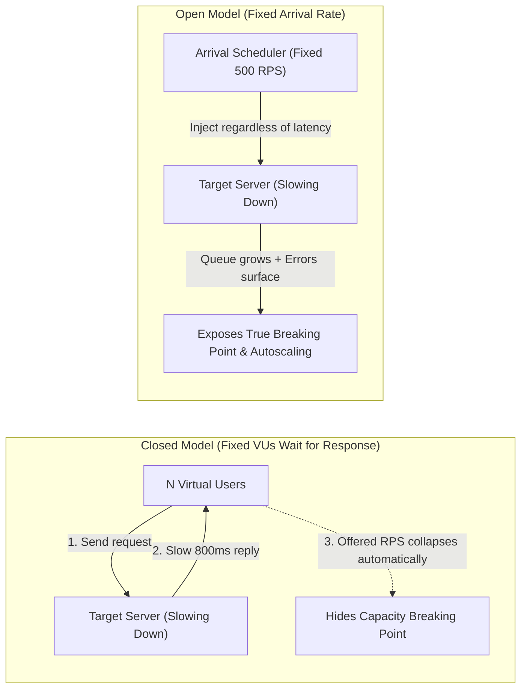
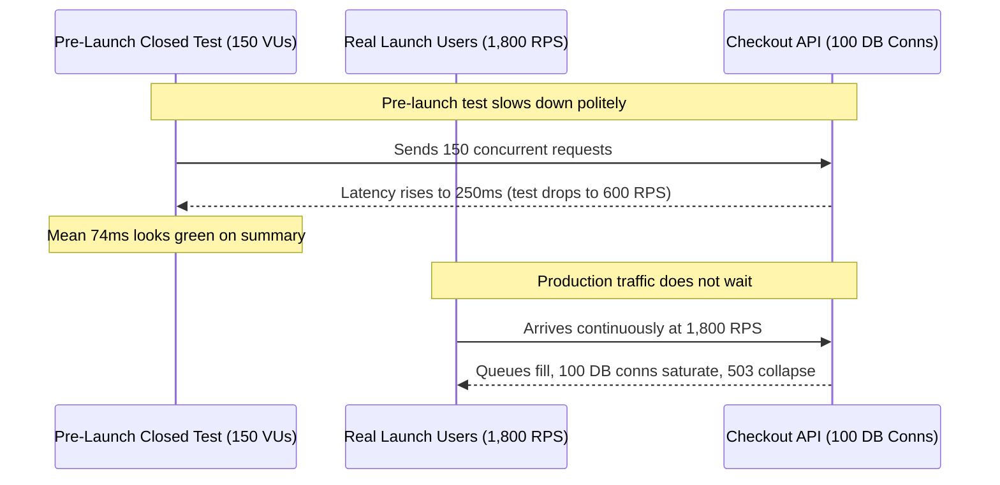

# 00 - Performance Testing Concepts

> **Prerequisites:** Kubernetes HPA ([track 03 module 09](../../03-kubernetes/09-scaling-hpa-and-vpa/README.md)), Container Apps KEDA ([track 06 module 03](../../06-azure-container-apps/03-scaling-with-keda/README.md)), and SRE SLO basics ([track 20](../../20-sre-practices/README.md)).  
> **Estimated Reading Time:** 30 minutes  
> **Target Audience:** Backend Engineers, SREs, Performance Engineers.

> [!TIP]
> **The Golden Rule of Performance Testing:** Define the **exact engineering question** and derive your pass/fail thresholds from a **real SLO** before running a single request, evaluate **tail percentiles (`p95`/`p99`)** instead of averages, use an **open arrival-rate model** when probing capacity ceilings, and confirm the **load generator** is not saturated before blaming the server.

---

## Why This Matters

You have configured autoscaling twice in this curriculum — HPA in [track 03 module 09](../../03-kubernetes/09-scaling-hpa-and-vpa/README.md) and KEDA in [track 06 module 03](../../06-azure-container-apps/03-scaling-with-keda/README.md) — and both times you "proved" it worked by throwing a loop of requests at it and watching a number go up. That is a demo, not a measurement. Before you write a single line of k6, you need the vocabulary to say *what question a test is answering*: whether the system meets its targets at expected load, where it breaks, whether it degrades over hours, or how it handles a sudden spike. Those are four different tests answering four different questions, and "it feels fast to me" answers none of them.

---

## 1. Architectural Mental Model: Open vs. Closed Models & Load-Test Framing

The most consequential distinction in load-testing architecture is how offered traffic behaves when the target service slows down. A **closed model** allows the server's latency to throttle the client (coordinated omission), whereas an **open model** decouples incoming request arrivals from response times just like real internet traffic:



### "It feels fast to me" is not a performance strategy

The single most common performance "strategy" is a developer loading the app in a browser on a fast laptop next to the server, deciding it is snappy, and shipping. This fails for reasons that are obvious once stated: you are **one user**, not the thousand concurrent ones production sees; your latency excludes the real network path; and "feels fast" has no number attached, so you cannot tell whether the next change made it slower. Performance testing replaces a feeling with a **reproducible measurement under controlled load** — a specific number of virtual users, doing specific things, producing latency and error-rate numbers you can compare across runs. Everything in this track is in service of that one shift: from anecdote to measurement.

### The four test types — each answers a different question

These names get used loosely; the useful way to hold them is by the *question* each answers:

- **Load test** — "Does the system meet its targets at *expected* load?" You ramp to a realistic peak (say, your busiest normal hour) and hold it, checking latency and error rate stay within targets. This is the default test and the one your CI gate (module 07) runs.
- **Stress test** — "*Where* does it break, and *how*?" You push past expected load, increasing until something fails, to find the ceiling and observe the failure mode (does it shed load gracefully, or fall over and corrupt data?).
- **Soak test** (a.k.a. endurance test) — "Does it survive *sustained* load over *time*?" You hold a moderate load for hours, hunting slow problems that do not show up in a ten-minute run: memory leaks, disk filling, connection pools slowly leaking, caches growing unbounded.
- **Spike test** — "Can it handle a *sudden* jump?" You go from low load to very high load almost instantly (a flash sale, a link going viral, a cron job waking 10,000 devices at once) and watch whether autoscaling reacts fast enough or whether the spike causes errors before capacity catches up.

A system can pass a load test and fail a soak test (a leak), or pass a load test and fail a spike test (autoscaling too slow) — which is exactly why you do not get to run one test and call it "performance tested."

### Latency, throughput, and why the average lies

Two numbers describe a system under load, and you need both. **Throughput** is how much work per unit time — requests per second (RPS). **Latency** is how long each request takes. The trap is summarizing latency with an **average**: one slow request among a thousand fast ones barely moves the mean, yet that one slow request is a real user having a bad time. Always look at **percentiles** instead — p95 ("95% of requests were faster than this") and p99 are the standard, because they describe the *tail*, which is where users actually notice pain. A p50 of 40ms with a p99 of 4s is a system that feels fine in a demo and is quietly failing 1% of real users. You will set k6 thresholds on percentiles, never on averages, for exactly this reason.

### Performance tests are how you *verify* SLOs, not invent them

In [track 20](../../20-sre-practices/README.md) you define **SLOs** — Service Level Objectives — the explicit targets your service commits to, like "99% of requests complete in under 300ms" or "error rate stays below 0.1%." An SLO is a *promise*; a performance test is how you find out whether you can keep it *before* real users do. The relationship is directional and important: **the SLO comes first and the test's pass/fail thresholds are derived from it.** You do not run a load test, see p95 = 280ms, and declare 280ms your target — that is just enshrining whatever you happened to measure. You take the SLO ("p95 < 300ms at peak load") and write a test that ramps to peak load and *fails* if p95 exceeds 300ms. If you have not done track 20 yet, hold this idea: a good threshold answers "what did we promise?", not "what did we happen to get?".

### Open vs. closed models, and why your test client can lie to you

There are two ways to generate load, and confusing them produces wrong conclusions. A **closed model** has a fixed number of virtual users, each of which sends a request, *waits for the response*, then sends the next. A **open model** injects requests at a fixed *arrival rate* regardless of how fast responses come back. The difference matters under stress: in a closed model, when the system slows down, your virtual users *also* slow down (they are waiting for responses), so you unintentionally back off exactly when you meant to keep pushing — the system's own slowness throttles your test. Real internet traffic is closer to open (users keep arriving whether or not your server is keeping up). k6 supports both; module 03 covers choosing. For now, hold the warning: a naive closed-model test can *hide* a system's failure by politely waiting for it.

### The load generator is part of the system under test

A result is only as trustworthy as the machine producing the load. If your k6 process is pinned at 100% CPU on a tiny laptop, or saturating a home connection's uplink, then the latency you measure includes *your own client's* queueing — you are measuring your laptop, not the server. This is the "false bottleneck" you will deliberately reproduce in module 05: a test that shows the system "maxing out" at 200 RPS when really the test *client* maxed out. The fix is either a beefier generator, distributed load generation, or the managed Azure Load Testing service (module 02) that runs the load from cloud engines sized for the job. Rule of thumb: before trusting a ceiling, confirm the *generator* was not the thing that hit the ceiling.

---

## 2. Taxonomic Comparison & Pre-Test Checklist

### The Four Performance Test Types

| Test Type | Engineering Question Answered | Typical Load Shape | Bugs & Failure Modes Caught |
| :--- | :--- | :--- | :--- |
| **Load Test** | Does the system meet SLO targets at expected peak? | Gradual ramp up → sustained peak hold → ramp down | Under-provisioned pods, missing indexes, bad regressions in CI |
| **Stress Test** | Where is the hard ceiling, and how does it fail past peak? | Stepwise ramp beyond peak until SLA failure or saturation | Thread/DB pool exhaustion, OOM crashes, missing load shedding |
| **Soak (Endurance) Test** | Does performance hold over sustained hours/days? | Moderate steady load held for hours | Memory leaks, connection-pool leaks, disk log fill, unbounded caches |
| **Spike Test** | Can autoscaling and queues absorb a sudden surge? | Near-instantaneous jump from baseline to extreme multiple | Slow HPA/KEDA reaction, cold-start errors, rate-limit cascading |

### Closed vs. Open Load Models

| Dimension | Closed Model (Fixed VUs) | Open Model (Fixed Arrival Rate) |
| :--- | :--- | :--- |
| **How Traffic Is Driven** | Each VU waits for reply before sending next request | Scheduler launches new iterations at fixed RPS rate |
| **When Server Slows Down** | Offered RPS drops automatically ("self-throttling") | Offered RPS stays constant; backlog & timeouts climb |
| **Models Real World For** | Bounded internal batch workers / fixed call-center agents | Public internet traffic, webhooks, flash sales |
| **Failure Mode Risk** | Hides capacity cliff during stress or autoscaling tests | Can exhaust client VUs if `maxVUs` cap is too low |

### Command reference

This module is concepts-first — there is no tool to run yet (module 01 installs k6). The "commands" here are the mental checklist you apply before *any* test:

| Question to ask | Why it matters | Where it's covered |
|---|---|---|
| Which of the four test types is this? | Determines the load shape (ramp, hold, spike) and what "pass" means | This module; module 01 stages |
| What SLO is this verifying? | The threshold must come from a target, not from a prior measurement | Module 03; track 20 |
| Am I measuring percentiles, not averages? | The average hides the tail where users hurt | This module; module 01 thresholds |
| Open or closed model? | A closed model can throttle itself and hide failure | Module 03 |
| Is my load generator itself the bottleneck? | A saturated client fakes a server ceiling | Module 02; module 05 |
| Is the traffic realistic, or a uniform flood? | A uniform test scales a system that would fall over on real traffic | Module 03 |

---

## 3. Production War Story Post-Mortem: The Self-Throttling Closed-Model Illusion

| Field | Incident Details |
| :--- | :--- |
| **Severity** | **SEV-1** (Checkout Collapse During Scheduled Product Drop) |
| **Detection / Resolution Time** | Detected 90 seconds into drop / Mitigated in 34 minutes via emergency rate limiting |
| **Impact** | `HTTP 503` failures across 68% of checkout attempts despite passing pre-launch "2,000 RPS" test |

### What Happened

Prior to a major product launch, an API team signed off on capacity using a 150-VU closed-model load test that reported an average latency of 74ms and 0% errors. Two minutes into the real drop, real user arrivals stayed fixed at 1,800 RPS even as a downstream inventory lock raised checkout latency from 70ms to 950ms. Because the pre-launch closed-model VUs had silently slowed down whenever server latency crept past 150ms, the test had never applied sustained pressure beyond ~700 RPS—leaving connection-pool starvation completely hidden until real users hit production.



### Root Cause Analysis

1. **Self-throttling closed test**: Fixing VU count without decoupling arrival rate caused offered load to collapse whenever latency increased.
2. **Mean-latency sign-off**: Reporting overall mean (74ms) obscured the `p99` tail jump (1.4s) that was already signaling lock contention during ramp-up.
3. **Wrong test type**: No spike test was ever run to measure how quickly pod autoscaling reacted to a 10x sudden jump.

### The Fix & Architectural Hardening

- Converted all capacity and autoscaling validation tests to an **open arrival-rate model**.
- Replaced mean reporting with strict SLO-derived **`p(95)` and `p(99)` gates** plus `http_req_failed` checks.
- Added a dedicated spike test simulating 30-second traffic surges against staging before every major event.

---

## 4. Multi-Language Production Implementation: Percentile Tail Analyzer & SLO Gate

Even before touching k6, understanding how **mean hides tail latency (`p95`/`p99`)** and how thresholds are **derived from SLOs** is fundamental. These four implementations ingest request latency samples, compute exact `mean`, `p50`, `p95`, and `p99`, and enforce an SLO pass/fail check.

````carousel
```go
package perfsummary

import (
	"fmt"
	"math"
	"sort"
)

type Report struct {
	Count int
	Mean  float64
	P50   float64
	P95   float64
	P99   float64
}

func percentile(sorted []float64, p float64) float64 {
	if len(sorted) == 0 {
		return 0
	}
	idx := int(math.Ceil((p/100.0)*float64(len(sorted)))) - 1
	if idx < 0 {
		idx = 0
	}
	if idx >= len(sorted) {
		idx = len(sorted) - 1
	}
	return sorted[idx]
}

func EvaluateSLO(latenciesMs []float64, sloP99TargetMs float64) (Report, bool) {
	sorted := append([]float64(nil), latenciesMs...)
	sort.Float64s(sorted)

	var sum float64
	for _, v := range sorted {
		sum += v
	}
	rep := Report{
		Count: len(sorted),
		Mean:  sum / float64(max(1, len(sorted))),
		P50:   percentile(sorted, 50),
		P95:   percentile(sorted, 95),
		P99:   percentile(sorted, 99),
	}
	passed := rep.P99 < sloP99TargetMs
	fmt.Printf("n=%d mean=%.1fms p50=%.1fms p95=%.1fms p99=%.1fms slo_pass=%v\n",
		rep.Count, rep.Mean, rep.P50, rep.P95, rep.P99, passed)
	return rep, passed
}
```
<!-- slide -->
```typescript
export interface LatencySummary {
  count: number;
  meanMs: number;
  p50Ms: number;
  p95Ms: number;
  p99Ms: number;
  sloPassed: boolean;
}

function percentile(sorted: number[], p: number): number {
  if (sorted.length === 0) return 0;
  const rank = Math.max(0, Math.min(sorted.length - 1, Math.ceil((p / 100) * sorted.length) - 1));
  return sorted[rank];
}

export function evaluateSlo(latenciesMs: number[], sloP99LimitMs: number): LatencySummary {
  const sorted = [...latenciesMs].sort((a, b) => a - b);
  const meanMs = sorted.reduce((acc, v) => acc + v, 0) / Math.max(1, sorted.length);
  const p50Ms = percentile(sorted, 50);
  const p95Ms = percentile(sorted, 95);
  const p99Ms = percentile(sorted, 99);

  return {
    count: sorted.length,
    meanMs: Number(meanMs.toFixed(2)),
    p50Ms,
    p95Ms,
    p99Ms,
    // Threshold derived directly from the promised SLO, never invented from mean
    sloPassed: p99Ms < sloP99LimitMs,
  };
}
```
<!-- slide -->
```python
import math
from dataclasses import dataclass
from typing import Sequence


@dataclass
class LatencySummary:
    count: int
    mean_ms: float
    p50_ms: float
    p95_ms: float
    p99_ms: float
    slo_passed: bool


def _percentile(sorted_vals: Sequence[float], p: float) -> float:
    if not sorted_vals:
        return 0.0
    idx = min(len(sorted_vals) - 1, max(0, math.ceil((p / 100.0) * len(sorted_vals)) - 1))
    return sorted_vals[idx]


def evaluate_slo(latencies_ms: Sequence[float], slo_p99_limit_ms: float) -> LatencySummary:
    ordered = sorted(latencies_ms)
    mean_ms = sum(ordered) / max(1, len(ordered))
    p50 = _percentile(ordered, 50)
    p95 = _percentile(ordered, 95)
    p99 = _percentile(ordered, 99)
    return LatencySummary(
        count=len(ordered),
        mean_ms=round(mean_ms, 2),
        p50_ms=p50,
        p95_ms=p95,
        p99_ms=p99,
        slo_passed=p99 < slo_p99_limit_ms,
    )
```
<!-- slide -->
```csharp
public sealed record LatencySummary(
    int Count,
    double MeanMs,
    double P50Ms,
    double P95Ms,
    double P99Ms,
    bool SloPassed);

public static class SloLatencyAnalyzer
{
    private static double Percentile(double[] sorted, double p)
    {
        if (sorted.Length == 0) return 0;
        int idx = Math.Clamp((int)Math.Ceiling((p / 100.0) * sorted.Length) - 1, 0, sorted.Length - 1);
        return sorted[idx];
    }

    public static LatencySummary Evaluate(IEnumerable<double> samplesMs, double sloP99TargetMs)
    {
        double[] sorted = samplesMs.OrderBy(x => x).ToArray();
        double mean = sorted.Length == 0 ? 0 : sorted.Average();
        double p50 = Percentile(sorted, 50);
        double p95 = Percentile(sorted, 95);
        double p99 = Percentile(sorted, 99);

        return new LatencySummary(
            sorted.Length,
            Math.Round(mean, 2),
            p50,
            p95,
            p99,
            p99 < sloP99TargetMs);
    }
}
```
````

---

## 5. Practical Hands-On Verification Workflows & Analysis Exercises

No k6 yet — these are analysis exercises plus a quick host-headroom sanity check. Do the written analyses seriously; a performance engineer's core skill is choosing the *right* test before touching a tool.

### 1. Classify the question

For each scenario below, name which of the four test types answers it, in writing, before reading the next:

1. "Our Black Friday sale starts at midnight and traffic 20×'s in under a minute — will we survive the opening?"
2. "The service seems fine when we deploy but gets sluggish by the third day — is something leaking?"
3. "We expect 800 RPS at peak. Do we stay under 300ms p95 at 800 RPS?"
4. "How many RPS can this thing actually take before it falls over, and does it fail cleanly or corrupt data?"

Expected: 1 = spike, 2 = soak, 3 = load, 4 = stress. If you called #1 a load test, re-read "The four test types" — the *suddenness* is the whole point.

### 2. Turn a feeling into a measurement

Write down a service you have built or used. Now write a single sentence that would make "it is fast" falsifiable — it must contain a percentile, a latency number, and a load level. Example: "p95 latency stays under 250ms at 500 concurrent users." Expected: if your sentence has no number in it, you have just re-described the feeling, not replaced it.

### 3. Catch the lying average

A test reports: mean latency 60ms, p50 45ms, p95 90ms, p99 3200ms, over 100,000 requests. Answer in writing: roughly how many requests were slower than 3.2 seconds, and would a dashboard showing only the *mean* have told you? Expected: ~1% of 100,000 ≈ 1,000 requests over 3.2s; the 60ms mean completely hides them — this is why you alert on p99, not mean.

### 4. Derive a threshold from an SLO

Given the SLO "99.5% of checkout requests complete within 400ms during business hours," write the load test's pass condition as a threshold on a percentile. Expected: something like `p(99.5) < 400ms` while holding business-hours peak load — note that you did *not* invent 400ms; you copied it from the SLO. If you wrote a threshold on the *average*, re-read the SLO concept.

### 5. Spot the self-throttling test

A colleague's test uses 50 virtual users, each looping "send request → wait for response → repeat." They report "the system handled 50 users at 200ms and never errored, even under our worst case." Explain in writing why this result cannot tell you the system's real capacity. Expected: closed model — as the server slows, the 50 users slow with it, so the offered load *drops* exactly when you wanted it to stay constant; the test cannot push past the point where the server starts struggling because the users politely wait.

### 6. Indict the generator

A test on a 2-core laptop over home WiFi reports the API "plateaus at 300 RPS — that is our ceiling." List two things you would check before believing 300 RPS is the *server's* limit. Expected: (a) was the k6/laptop CPU saturated at 300 RPS — check `top` on the client; (b) was the home uplink saturated — 300 RPS of large responses can max a residential connection. Either makes 300 RPS the *client's* ceiling, not the server's.

Verify how to inspect client generator headroom locally on Linux/WSL2 before running any test:

```bash
nproc && uptime && ss -s | head -n 4
```

**Expected Output:**
```text
8
 10:15:02 up 1 day,  2:14,  1 user,  load average: 0.18, 0.22, 0.19
Total: 412
TCP:   24 (estab 12, closed 4, orphaned 0, timewait 4)
```

### Independent challenge

Pick a real service you can name — the demo app from [track 07's AKS capstone](../../07-aks/09-capstone-project/README.md), or any API you have deployed. Without writing any k6 yet, produce a one-page **test plan** in prose: state the SLO you are verifying (invent a plausible one if you have not done track 20), which of the four test types you would run *first* and why, the specific percentile-based pass/fail threshold derived from that SLO, the load shape in words (ramp to what, hold how long), and one sentence on how you will make sure the load generator itself is not the bottleneck. This draws on this module's whole vocabulary plus the SLO idea from [track 20](../../20-sre-practices/README.md). The goal is to prove you can frame a test *before* you know the tool — because a test framed wrong runs perfectly and tells you nothing.

<details>
<summary>Stuck? One hint</summary>

Start from the SLO and work backwards. "p95 < 300ms at 800 RPS" almost writes the plan for you: the test type is a *load* test (you are verifying expected peak, not finding the ceiling or testing a spike), the threshold is `p(95) < 300ms`, the load shape is "ramp to 800 RPS over a few minutes, hold for 10." The generator check is one line: confirm the box running k6 has headroom (CPU well under 100%) at 800 RPS, or you are measuring the wrong thing.

</details>

---

## 6. Common Mistakes & Troubleshooting

- **Running one test and calling it "performance tested."** A passing load test says nothing about spikes or soak behavior. Name the question before claiming coverage.
- **Reporting averages.** The mean hides the tail. If a result summary shows only "average response time," it is hiding its p99 — ask for percentiles.
- **Inventing thresholds from measurements.** Setting the pass bar to "a bit above whatever we measured" enshrines the status quo and makes the test incapable of catching a regression down to that level. Thresholds come from SLOs.
- **Trusting a closed-model test under stress.** If offered load *drops* as the server slows, you are measuring a negotiation between your client and the server, not the server's capacity.
- **Ignoring the generator.** A saturated laptop or uplink produces a confident, wrong "ceiling." Always check client-side resource use before believing a plateau.
- **Confusing "it scaled in a demo" with "it scales."** The whole point of module 04: the track-03/06 demos proved the *mechanism*, not that your real app and real thresholds behave under realistic load.

---

## 7. Operational Validation Checkpoints & Checkpoint Quiz

### Operational Validation Checkpoints

<details><summary><strong>Checkpoint 1: Selecting the right test shape for a memory-leak investigation</strong></summary>

Customers report that pods begin OOMKilling after 18 hours in production even though your 10-minute load test at peak RPS passed cleanly. Re-running another 10-minute load test will miss the bug again; you need a **soak (endurance) test** holding moderate load for multiple hours while tracking heap allocation, open file descriptors, and connection-pool counts.

</details>

<details><summary><strong>Checkpoint 2: Explaining why 50 VUs cannot reveal an autoscaling ceiling</strong></summary>

When 50 closed-model VUs hit a server whose latency triples from 100ms to 300ms, offered load automatically falls from 500 RPS down to ~167 RPS. Because the server sees *less* traffic right as it struggles, HPA/KEDA CPU targets may never cross their scale-out threshold. Switch to an **open arrival-rate model** so pressure remains constant while latency rises.

</details>

<details><summary><strong>Checkpoint 3: Ruling out the load generator before escalating a capacity ceiling</strong></summary>

Before declaring a backend "maxed out at 300 RPS," verify client CPU utilization (`top` / `mpstat`), open socket / ephemeral port limits (`ss -s`), and uplink bandwidth on the machine running the load generator. If client CPU is pinned near 100%, move to horizontally scaled cloud generators such as Azure Load Testing.

</details>

### Checkpoint quiz

Write down your answer to each question before expanding it — checking without attempting first is the single easiest way to fool yourself into thinking you've learned this.

1. Name the four test types and the one-sentence question each answers.
2. Why is p99 latency a better thing to alert on than mean latency?
3. What is the correct direction of the relationship between an SLO and a load test's pass/fail threshold?
4. In a closed-model test, what happens to the offered load when the server slows down, and why is that a problem for a stress test?
5. Give one concrete way the *load generator* can produce a misleading "ceiling," and how you would detect it.
6. A service passes its load test but users complain it gets slow after a few days of uptime. Which test type would have caught this, and what class of bug does it hunt?
7. Why is "it feels fast to me" not a performance strategy — name two distinct reasons.

<details>
<summary>Show answers</summary>

1. **Load** — does it meet targets at *expected* load? **Stress** — *where* and *how* does it break past expected load? **Soak** — does it survive *sustained* load over time? **Spike** — can it handle a *sudden* jump?
2. The mean is dominated by the many fast requests and hides the slow tail; p99 describes the slowest 1%, which is real users having a bad time. A fine mean can coexist with a terrible p99.
3. The SLO comes *first*; the test threshold is *derived from* the SLO. You do not measure first and then declare the measurement your target.
4. The virtual users wait for responses, so as the server slows they send fewer requests — offered load drops. For a stress test that is fatal: you wanted to keep pushing past the breaking point, but the test backs off on its own and never finds the real ceiling.
5. Any of: the k6 process saturates the client CPU; the client's network uplink is maxed. Detect by watching client-side CPU/network (`top`, network graphs) during the run — if the *client* is at 100%, the "ceiling" is the client's.
6. A **soak/endurance test** — it hunts slow, time-dependent bugs like memory leaks, connection-pool leaks, disks filling, unbounded caches.
7. Any two of: you are one user, not the concurrent thousands; your path excludes the real network latency; "fast" has no number, so you cannot compare runs or catch a regression.

</details>

---

## 8. Next

[01-k6-fundamentals](../01-k6-fundamentals/README.md) — now that you can frame a test, learn the tool: writing a k6 script, virtual users, ramping stages, checks, and thresholds, run for real against a live app.
