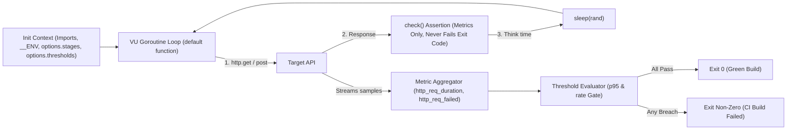
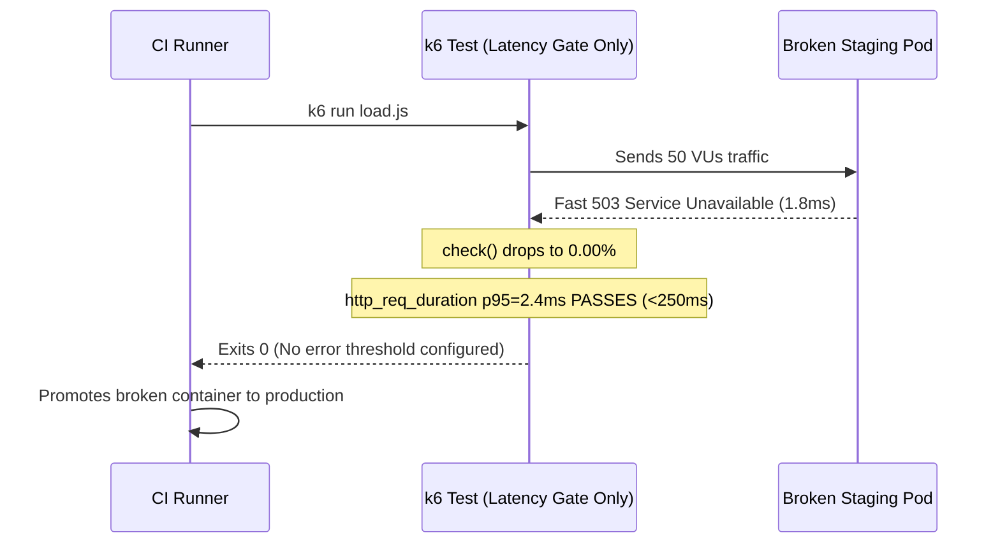

# 01 - k6 Fundamentals

> **Prerequisites:** Performance testing concepts ([Module 00](../00-performance-testing-concepts/README.md)) and a running local Kubernetes cluster ([Track 03](../../03-kubernetes/README.md)).  
> **Estimated Reading Time:** 35 minutes  
> **Target Audience:** Backend Engineers, QA Automation Engineers, SREs.

> [!TIP]
> **The Golden Rule of k6:** Always pair a percentile latency threshold (`http_req_duration: ['p(95)<...']`) with an error-rate threshold (`http_req_failed: ['rate<...']`), remember that `check()` measures correctness while only `thresholds` drive the non-zero exit code for CI, and parameterize target URLs via `__ENV` from your very first script.

---

## Why This Matters

[Module 00](../00-performance-testing-concepts/README.md) gave you the vocabulary — load vs. stress vs. soak vs. spike, percentiles over averages, thresholds derived from SLOs. Now you need a tool that turns those ideas into a repeatable, version-controllable test. **k6** is that tool: a load generator whose tests are plain JavaScript files you keep in your repo next to your code, that ramps virtual users on a schedule you define, and that can *fail* a run (non-zero exit code) when a threshold is breached — which is exactly what makes it usable as a CI gate later in [module 07](../07-performance-testing-in-cicd/README.md). Learning k6 well here is what makes every later module (Azure Load Testing, proving autoscaling, the CI gate) a matter of pointing the same script at a different target.

---

## 1. Architectural Mental Model: Script Lifecycle, Checks vs. Thresholds & CI Exit Gate

k6 executes your JavaScript test inside an embedded Go runtime: it parses `options` once during initialization, spawns concurrent VU goroutines executing `default function()` in loops across `stages`, streams HTTP timings into metric aggregators, and evaluates `thresholds` at test end to emit either exit code `0` (pass) or non-zero (`99`, threshold failure):



### k6 is a scriptable load generator, not a browser

k6 runs a JavaScript file, but it is **not** a browser and does **not** run your frontend's JavaScript, render pages, or execute a real user's client code. It makes HTTP requests (and gRPC/WebSocket) as fast and as many times as you tell it, from a fast Go runtime underneath. That is the point: you want to measure the *server*, so you strip away browser rendering and just exercise the API. A k6 script has one required piece — an exported **default function** — that is the code each virtual user runs, over and over, for the duration of the test:

```javascript
import http from 'k6/http';

export default function () {
  http.get('https://example.com/api/health');
}
```

That is a complete, runnable test. Everything else — VUs, stages, thresholds, checks — is configuration layered on top of this one loop.

### Virtual users (VUs) and iterations

A **virtual user (VU)** is one concurrent worker running your default function in a loop. Ten VUs means ten copies of that loop running simultaneously; each completed pass through the default function is one **iteration**. This maps directly to the closed-model idea from module 00: by default a VU sends a request, waits for the response, runs the rest of the function, then starts again — so with a fixed VU count, a slower server means fewer iterations, not more queued requests. The two headline numbers k6 reports are therefore **iterations** (total passes completed) and the request rate they produced. Hold the module-00 warning: raising VUs is *not* the same as raising a fixed request rate — module 03 covers the arrival-rate (open) model when you need that.

### Stages: ramping load over time

Real tests do not slam full load instantly (except spike tests). You describe a **load profile** with `stages` — a list of `{ duration, target }` steps where `target` is the VU count k6 linearly ramps *toward* over `duration`:

```javascript
export const options = {
  stages: [
    { duration: '30s', target: 20 },  // ramp 0 → 20 VUs over 30s
    { duration: '1m',  target: 20 },  // hold 20 VUs for 1 minute
    { duration: '30s', target: 0 },   // ramp down to 0
  ],
};
```

This one shape *is* the load test from module 00: ramp up, hold at expected peak, ramp down. A **spike** test is the same mechanism with a near-zero duration on the ramp-up (`{ duration: '5s', target: 500 }`); a **soak** test is a very long hold (`{ duration: '2h', target: 50 }`). The tool does not have four modes — you get all four test types by shaping `stages` differently.

### Checks: per-request assertions that do not fail the run

A **check** is a boolean assertion about a single response — "was the status 200?", "did the body contain `order_id`?". Checks record a pass/fail rate but, crucially, **do not stop the test or set the exit code** on their own. They are how you catch the sneaky failure mode where a system stays *fast* by returning errors quickly: without a status check, 10,000 instant `500`s look like a great latency result. Always assert on status:

```javascript
import { check } from 'k6';
const res = http.get('https://example.com/api/health');
check(res, { 'status is 200': (r) => r.status === 200 });
```

If your latency looks suspiciously good, look at the checks — you may be timing error pages.

### Thresholds: the pass/fail bar (this is the SLO)

A **threshold** is a pass/fail condition on an *aggregate* metric across the whole run, and unlike a check it **fails the entire test (non-zero exit code)** when breached. This is the piece that makes k6 a gate rather than a report. Thresholds are where the module-00 rule lands in code — you express the SLO as a percentile condition:

```javascript
export const options = {
  thresholds: {
    http_req_duration: ['p(95)<300'],   // 95th percentile latency under 300ms
    http_req_failed:   ['rate<0.01'],   // error rate under 1%
  },
};
```

If p95 exceeds 300ms, `k6 run` exits non-zero — which a CI pipeline reads as a failed build. Note the two built-in metrics doing the work: `http_req_duration` (latency) and `http_req_failed` (error rate). You derived exactly these two thresholds from an SLO by hand in module 00 exercise 4; this is that, executed.

### Think time: `sleep()` and why a test with none is a lie

By default a VU loops with *zero* pause between iterations — it sends the next request the instant the last response lands. Real users do not do that; they read the page, think, click. Adding `sleep()` between actions models that **think time**:

```javascript
import { sleep } from 'k6';
export default function () {
  http.get('https://example.com/api/products');
  sleep(Math.random() * 3 + 1);  // think 1-4 seconds
}
```

Without think time, 20 VUs might generate the request rate of 2,000 real users — so you either wildly overestimate load per user or, worse, produce a perfectly uniform machine-gun pattern no real traffic resembles. This is a first taste of module 03's central theme (realistic traffic); for now, know that `sleep()` is not optional politeness — it is part of modeling a user.

---

## 2. Taxonomic Comparison & Command Reference

### Checks vs. Thresholds Comparison

| Dimension | `check()` | `thresholds` |
| :--- | :--- | :--- |
| **Granularity** | Evaluated per individual HTTP response | Evaluated across aggregate run metrics |
| **Effect on Process Exit Code** | Never fails the run (`0` even if 0% pass) | Sets non-zero exit code (`99`) if any rule fails |
| **Primary Purpose** | Detect silent wrong responses / payload corruption | Enforce SLO pass/fail gates in CI/CD |
| **Combined Best Practice** | Assert `r.status === 200` and payload structure | Pair `http_req_duration: ['p(95)<N']` + `http_req_failed: ['rate<0.01']` + `checks: ['rate>0.99']` |

### Shaping All Four Test Types via `stages`

| Test Type | Sample `stages` Profile | Purpose |
| :--- | :--- | :--- |
| **Load** | `30s:20` → `1m:20` → `20s:0` | Validate SLO holds at expected peak |
| **Stress** | `2m:50` → `2m:150` → `2m:300` → `1m:0` | Step upward past peak to locate ceiling |
| **Soak** | `5m:50` → `4h:50` → `5m:0` | Expose slow memory/connection leaks over hours |
| **Spike** | `1m:10` → `5s:500` → `1m:500` → `10s:10` | Verify sudden surge & autoscaler reaction |

### Command reference

Installing k6 in WSL2 (Ubuntu):

```bash
sudo gpg -k
sudo gpg --no-default-keyring --keyring /usr/share/keyrings/k6-archive-keyring.gpg --keyserver hkp://keyserver.ubuntu.com:80 --recv-keys C5AD17C747E3415A3642D57D77C6C491D6AC1D69
echo "deb [signed-by=/usr/share/keyrings/k6-archive-keyring.gpg] https://dl.k6.io/deb stable main" | sudo tee /etc/apt/sources.list.d/k6.list
sudo apt-get update && sudo apt-get install k6
```

`k6 run` flags you will use constantly:

| Flag | What it does | Example |
|---|---|---|
| `k6 run <script.js>` | Runs the test defined in the script's `options`/default fn | `k6 run test.js` |
| `--vus <n>` | Override the number of virtual users (ignored if `stages` set) | `k6 run --vus 50 test.js` |
| `--duration <t>` | Override run length for a flat load (pairs with `--vus`) | `k6 run --vus 50 --duration 2m test.js` |
| `--stage <t:target>` | Define/override a stage on the CLI instead of in the script | `k6 run --stage 30s:20 --stage 1m:20 test.js` |
| `--rps <n>` | Cap total requests per second across all VUs (a ceiling, not a target) | `k6 run --rps 200 test.js` |
| `--out <output>` | Stream results to an external sink (JSON, Prometheus, cloud) | `k6 run --out json=res.json test.js` |
| `--summary-export <file>` | Write the end-of-run summary as JSON (useful in CI) | `k6 run --summary-export summary.json test.js` |
| `-e KEY=value` | Pass an environment variable into the script (`__ENV.KEY`) | `k6 run -e BASE_URL=http://... test.js` |
| `--no-thresholds` | Run but don't let thresholds fail the exit code | `k6 run --no-thresholds test.js` |
| `--quiet` | Suppress the progress bar (cleaner CI logs) | `k6 run --quiet test.js` |

Reading the end-of-test summary — the fields that matter:

| Summary line | What it means |
|---|---|
| `http_req_duration` | Request latency; look at `p(95)`/`p(99)`, not `avg` |
| `http_req_failed` | Fraction of requests that failed (non-2xx/3xx or errored) |
| `http_reqs` | Total requests and the **rate** (RPS) achieved |
| `iterations` | Total passes through the default function, and per-second rate |
| `vus` / `vus_max` | Current and peak virtual users |
| `checks` | Pass rate of your `check()` assertions (does *not* set exit code) |
| `✓`/`✗` next to a threshold | Whether each threshold passed; a `✗` means non-zero exit |

---

## 3. Production War Story Post-Mortem: Fast `503`s Blessing a Broken Canary Deploy

| Field | Incident Details |
| :--- | :--- |
| **Severity** | **SEV-2** (Broken Release Promoted Past CI Load Gate) |
| **Detection / Resolution Time** | Detected in 6 minutes via synthetic monitor after canary cutover / Rolled back in 14 minutes |
| **Impact** | 100% of `/api/orders` calls returned `503 Service Unavailable` to canary traffic for 14 minutes |

### What Happened

A release candidate misconfigured a Redis connection string, causing the service to fail fast with `HTTP 503` in `1.8ms`. The CI pipeline ran `k6 run load.js` with `thresholds: { http_req_duration: ['p(95)<250'] }` and even included a `check(res, { 'status is 200': ... })`, but omitted an `http_req_failed` or `checks` threshold. k6 reported `p(95) = 2.4ms ✓` and exited `0`, promoting the broken image out of staging.



### Root Cause Analysis

1. **Latency-only threshold**: Fast error responses (`1.8ms`) look faster than healthy DB-backed responses (`45ms`).
2. **Assumed `check()` fails builds**: Engineers saw `check()` inside the script and wrongly assumed failed assertions would halt the pipeline.

### The Fix & Architectural Hardening

- Standardized every k6 test template to enforce three mandatory thresholds together: `http_req_duration: ['p(95)<300']`, `http_req_failed: ['rate<0.01']`, and `checks: ['rate>0.99']`.
- Exported `--summary-export summary.json` in CI pipelines to archive exact `p(95)` and error-rate artifacts per commit.

---

## 4. Multi-Language Production Implementation: k6 `--summary-export` CI Gate Verifier

In real pipelines (and Exercise 8 below), you export `k6 run --summary-export summary.json` so automated tooling can inspect exact percentiles, error rates, and check pass ratios, compare against SLO budgets, and emit a deterministic non-zero exit code. These four implementations parse k6's `summary.json` schema cleanly and enforce all three gates (`p(95)`, `http_req_failed`, `checks`).

````carousel
```go
package k6gate

import (
	"encoding/json"
	"fmt"
	"os"
)

type Summary struct {
	Metrics struct {
		HTTPReqDuration struct {
			Values map[string]float64 `json:"values"`
		} `json:"http_req_duration"`
		HTTPReqFailed struct {
			Values map[string]float64 `json:"values"`
		} `json:"http_req_failed"`
		Checks struct {
			Values map[string]float64 `json:"values"`
		} `json:"checks"`
	} `json:"metrics"`
}

func VerifySummaryGate(path string, maxP95Ms, maxErrRate, minCheckRate float64) error {
	raw, err := os.ReadFile(path)
	if err != nil {
		return fmt.Errorf("read k6 summary: %w", err)
	}
	var s Summary
	if err := json.Unmarshal(raw, &s); err != nil {
		return fmt.Errorf("parse k6 summary: %w", err)
	}

	p95 := s.Metrics.HTTPReqDuration.Values["p(95)"]
	errRate := s.Metrics.HTTPReqFailed.Values["rate"]
	checkRate := s.Metrics.Checks.Values["rate"]

	if p95 >= maxP95Ms || errRate >= maxErrRate || checkRate <= minCheckRate {
		return fmt.Errorf("SLO gate failed: p95=%.2fms errRate=%.4f checkRate=%.4f", p95, errRate, checkRate)
	}
	return nil
}
```
<!-- slide -->
```typescript
import { readFileSync } from "node:fs";

interface K6Summary {
  metrics: {
    http_req_duration?: { values: Record<string, number> };
    http_req_failed?: { values: { rate: number } };
    checks?: { values: { rate: number } };
  };
}

export function verifyK6SummaryGate(
  summaryPath: string,
  maxP95Ms = 300,
  maxErrorRate = 0.01,
  minCheckRate = 0.99
): void {
  const data = JSON.parse(readFileSync(summaryPath, "utf-8")) as K6Summary;
  const p95 = data.metrics.http_req_duration?.values["p(95)"] ?? Infinity;
  const errRate = data.metrics.http_req_failed?.values.rate ?? 1;
  const checkRate = data.metrics.checks?.values.rate ?? 0;

  if (p95 >= maxP95Ms || errRate >= maxErrorRate || checkRate <= minCheckRate) {
    throw new Error(
      `k6 SLO gate breached (p95=${p95.toFixed(1)}ms, errRate=${errRate}, checks=${checkRate})`
    );
  }
}
```
<!-- slide -->
```python
import json
from pathlib import Path


def verify_k6_summary_gate(
    summary_path: str,
    max_p95_ms: float = 300.0,
    max_error_rate: float = 0.01,
    min_check_rate: float = 0.99,
) -> dict[str, float]:
    payload = json.loads(Path(summary_path).read_text(encoding="utf-8"))
    metrics = payload["metrics"]

    p95 = float(metrics["http_req_duration"]["values"]["p(95)"])
    err_rate = float(metrics["http_req_failed"]["values"]["rate"])
    check_rate = float(metrics["checks"]["values"]["rate"])

    if p95 >= max_p95_ms or err_rate >= max_error_rate or check_rate <= min_check_rate:
        raise SystemExit(
            f"k6 SLO gate failed: p95={p95:.2f}ms err_rate={err_rate:.4f} checks={check_rate:.4f}"
        )
    return {"p95_ms": p95, "error_rate": err_rate, "check_rate": check_rate}
```
<!-- slide -->
```csharp
using System.Text.Json;

public static class K6SummaryGate
{
    public static void AssertSloPassed(
        string summaryJsonPath,
        double maxP95Ms = 300.0,
        double maxErrorRate = 0.01,
        double minCheckRate = 0.99)
    {
        using var doc = JsonDocument.Parse(File.ReadAllText(summaryJsonPath));
        var metrics = doc.RootElement.GetProperty("metrics");

        double p95 = metrics.GetProperty("http_req_duration").GetProperty("values").GetProperty("p(95)").GetDouble();
        double errRate = metrics.GetProperty("http_req_failed").GetProperty("values").GetProperty("rate").GetDouble();
        double checkRate = metrics.GetProperty("checks").GetProperty("values").GetProperty("rate").GetDouble();

        if (p95 >= maxP95Ms || errRate >= maxErrorRate || checkRate <= minCheckRate)
        {
            throw new InvalidOperationException(
                $"k6 SLO gate failed: p95={p95:F2}ms, errorRate={errRate:P2}, checks={checkRate:P2}");
        }
    }
}
```
````

---

## 5. Practical Hands-On Verification CLI Workflows

You need something to test. Reuse a real app from earlier: the simplest is a single deployment on your local kind cluster from [track 03](../../03-kubernetes/README.md), port-forwarded to localhost.

### 1. Stand up a target app

On your local kind `learning` cluster (namespace `demo`):

```bash
kubectl create deployment httpbin --image=kennethreitz/httpbin --port=80 -n demo
kubectl expose deployment httpbin --port=80 -n demo
kubectl port-forward -n demo svc/httpbin 8080:80
```

Leave that running. In another terminal, confirm:

```bash
curl -s http://localhost:8080/get | head
```

**Expected Output:**
```json
{
  "args": {},
  "headers": {
    "Accept": "*/*",
    "Host": "localhost:8080"
  },
  "url": "http://localhost:8080/get"
}
```

Expected: a JSON response. `httpbin` gives you endpoints like `/get`, `/delay/1` (sleeps 1s server-side), and `/status/500` — handy for shaping latency and errors deliberately.

### 2. The smallest possible test

```javascript
// smoke.js
import http from 'k6/http';
export default function () {
  http.get('http://localhost:8080/get');
}
```

```bash
k6 run --vus 1 --duration 10s smoke.js
```

**Expected Output:**
```text
     http_req_duration..............: avg=4.12ms   min=1.80ms med=3.75ms max=19.2ms p(90)=5.90ms p(95)=7.15ms
     http_req_failed................: 0.00%  ✓ 0        ✗ 2410
     http_reqs......................: 2410   240.91/s
```

Expected: a summary showing ~some iterations, `http_req_duration` with avg/p95, and `http_req_failed: 0.00%`. Find the `p(95)` line — that is the number that will become a threshold.

### 3. Add a status check

```javascript
// checked.js
import http from 'k6/http';
import { check } from 'k6';
export default function () {
  const res = http.get('http://localhost:8080/get');
  check(res, {
    'status is 200': (r) => r.status === 200,
    'body has url field': (r) => r.body.includes('"url"'),
  });
}
```

```bash
k6 run --vus 5 --duration 15s checked.js
```

**Expected Output:**
```text
     ✓ status is 200
     ✓ body has url field

     checks.........................: 100.00% ✓ 18420  ✗ 0
```

Expected: a `checks` block showing `100.00%` pass. Now point it at `http://localhost:8080/status/500` and re-run — the status check drops to 0% but `http_req_failed` may *also* climb; note that latency still looks great because error pages are fast. That is the module-00 trap made concrete.

### 4. Shape a real load test with stages

```javascript
// load.js
import http from 'k6/http';
import { check, sleep } from 'k6';
export const options = {
  stages: [
    { duration: '30s', target: 20 },
    { duration: '1m',  target: 20 },
    { duration: '20s', target: 0 },
  ],
};
export default function () {
  const res = http.get('http://localhost:8080/get');
  check(res, { 'status is 200': (r) => r.status === 200 });
  sleep(Math.random() * 2 + 1);
}
```

```bash
k6 run load.js
```

Expected: the progress bar shows VUs ramping 0→20, holding, then draining. The summary reports the RPS achieved and p95 over the whole run.

### 5. Add thresholds and watch a pass

Add to `options`:

```javascript
  thresholds: {
    http_req_duration: ['p(95)<500'],
    http_req_failed:   ['rate<0.01'],
  },
```

```bash
k6 run load.js ; echo "exit code: $?"
```

**Expected Output:**
```text
     ✓ http_req_duration..............: avg=4.5ms  p(95)=8.1ms
     ✓ http_req_failed................: 0.00%
exit code: 0
```

Expected: both thresholds show `✓`, and the exit code is `0`. This is a *passing* gate.

### 6. Watch a threshold fail (and set the exit code)

Point the request at the deliberately-slow endpoint and tighten the bar:

```javascript
  const res = http.get('http://localhost:8080/delay/1');  // 1s server-side delay
```
with `http_req_duration: ['p(95)<500']` still set.

```bash
k6 run load.js ; echo "exit code: $?"
```

**Expected Output:**
```text
     ✗ http_req_duration..............: avg=1.01s  p(95)=1.04s
     ✓ http_req_failed................: 0.00%
ERRO[0111] thresholds on metrics 'http_req_duration' have been crossed
exit code: 99
```

Expected: `http_req_duration` p95 is ~1000ms, the threshold shows `✗`, and the exit code is **non-zero**. Confirm the number: this is what CI reads as "build failed." Notice checks can still be 100% (the slow responses are valid 200s) — the *threshold*, not the check, is what failed the run.

### 7. Parameterize the target with an env var

Hard-coding `localhost:8080` will not survive pointing at AKS later. Use `__ENV`:

```javascript
const BASE = __ENV.BASE_URL || 'http://localhost:8080';
// ...
const res = http.get(`${BASE}/get`);
```

```bash
k6 run -e BASE_URL=http://localhost:8080 load.js
```

Expected: identical behavior, but now the same script runs unchanged against any environment by changing one flag — the property you need for module 02 (Azure Load Testing) and module 07 (CI).

### 8. Export the summary for later comparison

```bash
k6 run --summary-export summary.json load.js
cat summary.json | head -40
```

**Expected Output:**
```json
{
  "metrics": {
    "http_req_duration": {
      "values": {
        "avg": 4.41,
        "p(95)": 8.12
      }
    }
  }
}
```

Expected: a JSON object with the metrics; the p95 lives at `metrics.http_req_duration.values["p(95)"]`. Being able to extract one number programmatically is what module 07's pipeline gate depends on.

### 9. Diagnose and fix: "great latency" that is actually all errors

```javascript
// misleading.js
import http from 'k6/http';
export const options = { vus: 10, duration: '15s',
  thresholds: { http_req_duration: ['p(95)<200'] } };
export default function () {
  http.get('http://localhost:8080/status/503');  // always errors, fast
}
```

```bash
k6 run misleading.js ; echo "exit: $?"
```

**Expected Output:**
```text
     ✓ http_req_duration..............: avg=2.91ms p(95)=5.10ms
     http_req_failed................: 100.00% ✓ 15420 ✗ 0
exit: 0
```

Expected: the p95 threshold **passes** (503s come back in a few ms) and the exit code is 0 — the test reports success while the app returns nothing but errors. **Diagnose:** there is no check on status and no `http_req_failed` threshold, so k6 only ever measured *how fast* the errors came back. **Fix:** add `http_req_failed: ['rate<0.01']` to `thresholds` and re-run — now it fails loudly. Lesson: a latency threshold alone can bless a completely broken service; always pair it with an error-rate threshold.

### 10. Clean up

```bash
# Ctrl+C the port-forward, then:
kubectl delete deployment httpbin -n demo
kubectl delete svc httpbin -n demo
```

Expected: the target app is gone; your kind cluster stays for later modules.

### Independent challenge

Using only what is in this module, write a single k6 script (no copy-paste from the exercises) that models a *load* test — not a spike or soak — against the `httpbin` app: ramp to a peak you choose over about a minute, hold it, ramp down, put realistic think time between requests, assert on response status with a check, and enforce *two* thresholds derived from an SLO you state in a comment at the top of the file (one on p95 latency, one on error rate). Then deliberately make one threshold fail by pointing at `/delay/2` and confirm the exit code goes non-zero. This draws on this module's stages, checks, thresholds, and think time, plus the "threshold comes from an SLO" rule from [module 00](../00-performance-testing-concepts/README.md).

<details>
<summary>Stuck? One hint</summary>

The skeleton is `options` with both `stages` (three entries: ramp/hold/ramp down) and `thresholds` (two entries: `http_req_duration: ['p(95)<N']` and `http_req_failed: ['rate<0.01']`), plus a default function that does one `http.get`, one `check` on `r.status === 200`, and a `sleep()` with a small random component. State the SLO in a comment so anyone can see the two threshold numbers did not come from nowhere. To force the failure, swap the URL to `/delay/2` — a 2s server delay guarantees p95 blows past any sane latency bar.

</details>

---

## 6. Common Mistakes & Troubleshooting

- **Confusing checks with thresholds.** Checks report a pass rate but never fail the run; only thresholds set the exit code. A CI gate built on checks alone will never go red.
- **A latency threshold with no error-rate threshold.** Exactly exercise 9: fast error pages sail through a latency bar. Always pair them.
- **No think time.** Zero-`sleep` VUs generate a machine-gun pattern that both overstates per-user load and looks nothing like real traffic — a preview of module 03's whole point.
- **Thinking `--vus` sets a request rate.** VUs are concurrent closed-model workers; a slow server yields fewer requests, not a backlog. For a fixed arrival rate you need the open model (module 03).
- **Reading the average.** k6 prints `avg` prominently; ignore it and read `p(95)`/`p(99)`. The average is the module-00 lying summary.
- **Hard-coded URLs.** A script pinned to `localhost` cannot be reused against AKS or in CI. Parameterize with `__ENV` from the start.
- **The load generator on the same machine as a local cluster.** Running k6 and kind on one laptop means k6 competes with the app for CPU — a local false-bottleneck. Fine for learning the tool; a real reason to use Azure Load Testing (module 02) for anything serious.

---

## 7. Operational Validation Checkpoints & Checkpoint Quiz

### Operational Validation Checkpoints

<details><summary><strong>Checkpoint 1: Detecting why a broken service still exits 0</strong></summary>

When `k6 run` finishes with `checks: 0.00%` yet exits `0`, your script used `check(res, ...)` without adding `checks: ['rate>0.99']` or `http_req_failed: ['rate<0.01']` inside `options.thresholds`. Checks are informational counters; only `thresholds` enforce the exit code.

</details>

<details><summary><strong>Checkpoint 2: Why `--vus 50` does not work when `stages` is defined</strong></summary>

If `options.stages` is exported inside the JS file, passing `--vus 50 --duration 2m` on the CLI is ignored or conflicts with the stage schedule. Use `--stage` flags or separate environment overrides (`__ENV`) when parameterizing load shapes for staging vs. prod.

</details>

<details><summary><strong>Checkpoint 3: Isolating local kind CPU contention</strong></summary>

Running 200 VUs from `k6` on the same laptop hosting your `kind` container means `k6` goroutines and `httpbin` pods compete for the exact same CPU cores. Before trusting high-load saturation tests, move the load generator off-box (e.g., to Azure Load Testing engines).

</details>

### Checkpoint quiz

Write down your answer to each question before expanding it — checking without attempting first is the single easiest way to fool yourself into thinking you've learned this.

1. What is the one required part of any k6 script, and what does it represent?
2. What is the difference between a **check** and a **threshold** in terms of effect on the test's exit code?
3. How do you turn the same k6 script into a load test, a spike test, and a soak test — what changes?
4. Why must a latency threshold almost always be paired with an error-rate threshold?
5. What does `sleep()` model, and what goes wrong in a test that omits it?
6. A test with `--vus 20` against a slowing server produces *fewer* requests per second as the server slows. Why, and what would you use instead to hold a constant request rate?
7. Which single k6 built-in metric, and which statistic of it, is where your SLO's latency target actually gets enforced?

<details>
<summary>Show answers</summary>

1. The exported **default function** — the code each virtual user runs in a loop for the duration of the test.
2. A **check** records a pass/fail rate but does **not** affect the exit code; a **threshold** fails the whole run (non-zero exit) when breached. Only thresholds gate.
3. Only the `stages` shape: load = ramp/hold/ramp-down at expected peak; spike = near-instant ramp to a high target; soak = a long hold at moderate load. Same tool, different `stages`.
4. Because error pages are typically *fast*, so a broken service returning instant 500s can pass a latency-only threshold — the error-rate threshold is what catches "fast but wrong."
5. Think time — the pause a real user takes between actions. Omitting it produces a uniform machine-gun request pattern that overstates per-user load and resembles no real traffic.
6. Default VUs are closed-model: each waits for its response before the next request, so a slower server means each VU completes fewer iterations — offered load drops. To hold a constant rate use the open/arrival-rate model (`constant-arrival-rate` executor, module 03).
7. `http_req_duration`, at the `p(95)` (or `p(99)`) percentile — that is where a latency SLO like "p95 < 300ms" becomes a pass/fail condition.

</details>

---

## 8. Next

[02-azure-load-testing](../02-azure-load-testing/README.md) — your laptop can only generate so much load before *it* becomes the bottleneck; run the exact same k6 script at scale from Azure's managed load-testing service.
