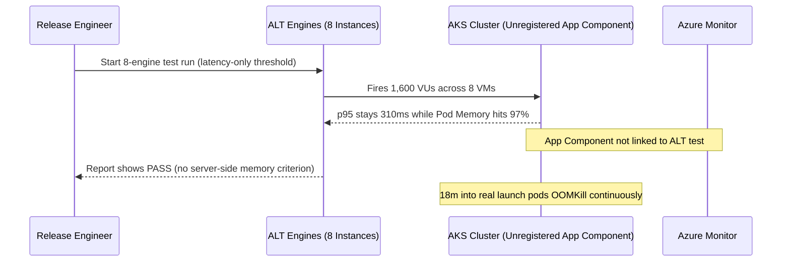

# 02 - Azure Load Testing

> **Prerequisites:** k6 fundamentals ([Module 01](../01-k6-fundamentals/README.md)), Azure Container Apps ([Track 06](../../06-azure-container-apps/README.md)) or AKS ingress & monitoring ([Track 07](../../07-aks/README.md)), and Terraform basics ([Track 09](../../09-terraform-on-azure/README.md)).  
> **Estimated Reading Time:** 35 minutes  
> **Target Audience:** Backend Engineers, Platform Engineers, SREs.

> [!TIP]
> **The Golden Rule of Azure Load Testing:** Always debug and validate your parameterized k6 script locally before paying for cloud engine-minutes, scale offered load horizontally via `--engine-instances` rather than overloading a single engine VM, register your target App Components for correlated Azure Monitor timelines, and pair latency thresholds with `http_req_failed` so an unreachable target fails loudly.

---

## Why This Matters

The very last mistake in [module 01](../01-k6-fundamentals/README.md) was the one that scales worst: your laptop running k6 is part of the system under test, and it maxes out long before a real service does. To generate the kind of load that actually drives an AKS cluster's HPA or a Container App's KEDA rules past their thresholds (which you will do in [module 04](../04-proving-autoscaling-works/README.md)), you need load coming from many machines, sized for the job, on a fat network path — not one WSL2 process. **Azure Load Testing** is the managed service that runs *your existing k6 script* on cloud engines you do not have to provision, and it plugs the results straight into the Azure metrics you already know from [track 07](../../07-aks/06-monitoring-aks-azure-monitor-container-insights/README.md).

---

## 1. Architectural Mental Model: Distributed Engine Fleet & Unified Telemetry Correlation

Azure Load Testing separates test authoring from distributed execution and server-side observability. Your unmodified k6 script runs in parallel across `N` managed engine VMs while Azure Monitor streams target AKS/ACA resource telemetry into the same synchronized report timeline:

```mermaid
flowchart LR
    subgraph Control["ALT Control Plane"]
        Res["Load Testing Resource (lt-perf)"]
        Test["Test Definition (load.js, engine-instances = N, __ENV)"]
        Res --> Test
    end

    subgraph Engines["Distributed Load Generators"]
        E1["Engine Instance 1 (200 VUs)"]
        E2["Engine Instance 2 (200 VUs)"]
        EN["Engine Instance N (200 VUs)"]
    end

    subgraph Target["Azure Workload + App Components"]
        App["AKS / Container App Public or VNet Endpoint"]
        Mon["Azure Monitor (CPU %, Memory, Replica Count)"]
        App --> Mon
    end

    Test -->|Deploy & start test run| Engines
    Engines -->|Parallel N x 200 VUs traffic| App
    Engines -->|Client p95 + error rate| Report["Correlated Test Run Report & Pass/Fail Gate"]
    Mon -->|Server metrics on same timeline| Report
```



### It runs your k6 script — you do not rewrite anything

The key thing to internalize: Azure Load Testing (ALT) is not a different load tool with its own language. It **runs the same k6 JavaScript** (and JMeter, if you ever inherit a JMeter estate) you wrote in module 01. Your `load.js` with its `stages`, `checks`, and `thresholds` uploads as-is. What ALT adds is everything *around* the script: provisioning the load-generating machines, running the script on many of them in parallel, aggregating the results into one report, and — the part you cannot get locally — correlating your client-side latency with **server-side Azure metrics** (AKS pod CPU, Container App replica count) on the same timeline. You keep your script; you rent the muscle and the correlation.

### Engine instances — this is how you get past the laptop ceiling

ALT runs your script on **engine instances**: managed VMs that each run a copy of your k6 script, in parallel. If your script ramps to 200 VUs and you set 5 engine instances, you get roughly **200 × 5 = 1,000 VUs** of real load, from five separate machines on Azure's network. This is the direct fix for module 00's "the generator is part of the system under test" problem — instead of one saturated laptop faking a ceiling, you have horizontally-scaled generators sized to genuinely stress the target. More engines = more load, and because they are separate managed VMs, the generator stops being the bottleneck. You choose the engine count based on the total VUs (and RPS) you need to reach the target's real limits.

### The test resource, the test, and the test run

Three nested objects, same shape as most Azure services:

- A **Load Testing resource** (`Microsoft.LoadTestService/loadtests`) — the top-level Azure resource in a resource group, billed while it exists, created once per project. This is the thing `az load create` makes.
- A **test** — a saved configuration inside the resource: which k6 script, how many engine instances, environment variables (like `BASE_URL`), and any **server-side metrics** to collect. You define it once and re-run it.
- A **test run** — one execution of a test, with its own results and report. Every `az load test-run create` produces one, timestamped, so you can compare last week's run to today's.

This mirrors module 01's separation of concerns: the script is the *what*, the test config is the *how much and where*, and the run is one *when*.

### Pass/fail criteria — thresholds, but server-side too

Your k6 `thresholds` still work and still fail the run. But ALT lets you *also* define **pass/fail criteria** on **server-side** metrics it collects — e.g. "fail if AKS node CPU exceeds 90%" or "fail if the app's average response time > 300ms." This is genuinely more than local k6 gives you: a local run only knows what the client saw; ALT can fail a run because the *server* got unhealthy even if client latency was still (barely) acceptable. For validating autoscaling in module 04, this matters — you want a run to fail if pods pegged their CPU limit, not just if the user-visible latency degraded.

### App Components and server-side metrics

When you point ALT at a target, you can register the target's **App Components** — the actual Azure resources behind it (the AKS cluster, the Container App, an Application Gateway). ALT then pulls their Azure Monitor metrics into the test report automatically, on the *same timeline* as your load curve. So one report shows "at 14:32 we hit 800 RPS, client p95 jumped to 600ms, and AKS pod CPU hit 95% while replica count climbed from 3 to 7." That single correlated view is the whole reason to prefer ALT over self-run k6 for autoscaling validation — locally you would be alt-tabbing between a k6 terminal and `kubectl get hpa -w`, eyeballing whether two clocks line up.

### When to self-run k6 vs. use Azure Load Testing

Neither is "better"; they answer different needs:

- **Self-run k6** (module 01) — free, instant, runs on your machine, perfect for developing the script, smoke tests, and the *lightweight* CI gate in module 07 (a CI runner is a fine, disposable generator for a small test).
- **Azure Load Testing** — when you need **high load** (past one machine), **distributed** generation, **server-side metric correlation**, or a **shared, historical** record of runs across a team. It costs money (per engine-minute) and takes a minute to spin up, so you do not reach for it to test a five-VU tweak.

The healthy pattern: develop and iterate the script locally with self-run k6, then run the *same script* at real scale in ALT when you need to genuinely stress the system or produce a shareable, correlated report.

---

## 2. Taxonomic Comparison & Command Reference

### Self-Run k6 vs. Azure Load Testing Decision Matrix

| Dimension | Self-Run k6 (Laptop / CI Runner) | Azure Load Testing (Managed) |
| :--- | :--- | :--- |
| **Load Ceiling** | Bounded by single VM CPU, sockets, and uplink | Horizontally scales via `--engine-instances` |
| **Server-Side Metrics** | Manual (`kubectl` / separate Grafana correlation) | Automatic timeline correlation via App Components |
| **Pass/Fail Gates** | Client-side k6 `thresholds` only | Client-side + Azure Monitor server-side criteria |
| **Startup & Cost** | Instant and free | ~1–2m engine spin-up; billed per resource + engine-minute |
| **Best Use Case** | Script authoring, smoke checks, lightweight PR CI gates | Peak/stress tests, autoscaling proofs, historical release sign-off |

### ALT Resource Hierarchy

| Object | Azure / CLI Representation | Lifecycle & Scope |
| :--- | :--- | :--- |
| **Load Testing Resource** | `Microsoft.LoadTestService/loadtests` (`az load create`) | Long-lived project container; billed while present |
| **Test** | Saved configuration (`az load test create`) | Holds `.js` plan, `--engine-instances`, `--env`, criteria, App Components |
| **Test Run** | Timestamped execution (`az load test-run create`) | Immutable historical report, CSV/JSON artifacts, PASS/FAIL verdict |

### Command reference

The `az load` command group needs the extension: `az extension add --name load`. Then:

| Command | What it does | Example |
|---|---|---|
| `az load create` | Creates the Load Testing *resource* in a resource group | `az load create --name lt-perf --resource-group rg-lt --location eastus` |
| `az load test create` | Defines a *test* (config: script, engines, env vars) | see breakdown below |
| `az load test-run create` | Starts one *test run* of a test | see breakdown below |
| `az load test-run list` | Lists runs of a test (compare over time) | `az load test-run list --test-id checkout --load-test-resource lt-perf -g rg-lt -o table` |
| `az load test-run show` | Shows one run's status and result summary | `az load test-run show --test-run-id run-01 --load-test-resource lt-perf -g rg-lt` |
| `az load test-run download-files` | Downloads a run's results/report artifacts | `az load test-run download-files --test-run-id run-01 --load-test-resource lt-perf -g rg-lt --path ./out --result` |
| `az load test-run stop` | Stops an in-progress run (stops the bill) | `az load test-run stop --test-run-id run-01 --load-test-resource lt-perf -g rg-lt` |

Flag-by-flag — defining a test:

`az load test create --test-id checkout --load-test-resource lt-perf --resource-group rg-lt --test-plan ./load.js --engine-instances 5 --env BASE_URL=https://myapp.example.com`
- `--test-id checkout` — a stable ID for this test config; you re-run it by this ID.
- `--load-test-resource lt-perf` — which Load Testing resource owns this test.
- `--test-plan ./load.js` — **your k6 script**, uploaded unchanged from module 01.
- `--engine-instances 5` — run the script on 5 parallel engines (≈ 5× the script's VU load).
- `--env BASE_URL=...` — sets `__ENV.BASE_URL` inside the script — the same parameterization you built in module 01 exercise 7.

Flag-by-flag — starting a run:

`az load test-run create --test-id checkout --test-run-id run-2026-07-26 --load-test-resource lt-perf --resource-group rg-lt --description "peak validation"`
- `--test-id checkout` — which test config to execute.
- `--test-run-id run-2026-07-26` — a unique ID for *this* run so you can find and compare it later.
- `--description` — free text shown in the run list; note *what* you were testing.

Terraform (if you provision ALT as IaC, tying into [track 09](../../09-terraform-on-azure/README.md)):

```hcl
resource "azurerm_load_test" "perf" {
  name                = "lt-perf"
  resource_group_name = azurerm_resource_group.rg.name
  location            = azurerm_resource_group.rg.location
}
```

| Argument | What it does |
|---|---|
| `name` | The Load Testing resource name |
| `resource_group_name` / `location` | Placement, same as any Azure resource |
| `identity` (optional block) | A managed identity so the test can read Key Vault secrets / target private endpoints |

Note the `azurerm_load_test` resource creates only the *resource*; the test config and runs are still driven via `az load` or the portal / a CI task.

---

## 3. Production War Story Post-Mortem: Unregistered App Components & Green-Looking Unreachable Target

| Field | Incident Details |
| :--- | :--- |
| **Severity** | **SEV-2** (False Sign-Off Before Public Launch) |
| **Detection / Resolution Time** | Discovered 18 minutes post-launch via AKS OOMKills / Stabilized in 42 minutes |
| **Impact** | Checkout pods crashed under initial launch spike despite "green" 8-engine ALT sign-off |

### What Happened

A release engineer triggered an 8-engine Azure Load Testing run against a staging ingress FQDN using a k6 script whose only threshold was `http_req_duration: ['p(95)<400']`. On one staging environment, an outdated internal hostname caused TLS/DNS failures (zero successful requests reached the backend), leaving latency samples near empty and passing the latency criterion. On the production-like staging run where traffic *did* land, the team never attached the AKS cluster as an **App Component**—so nobody saw pod memory climbing monotonically to 97% right before the test ended, masking an imminent `OOMKill` cascade under sustained traffic.



### Root Cause Analysis

1. **Missing `http_req_failed` gate**: A latency-only criterion cannot detect failed DNS resolution or dropped connections when few 2xx samples exist.
2. **Unregistered App Components**: Running ALT without linking the AKS cluster or Container App stripped away server-side CPU, memory, and replica timelines—turning ALT into a blind client runner.

### The Fix & Architectural Hardening

- Enforced dual client-side thresholds (`http_req_duration` + `http_req_failed`) in every k6 script before uploading.
- Required registering target App Components plus a server-side pass/fail criterion (`Memory Working Set Percentage < 80%`) on every sign-off test.
- Added a mandatory local `k6 run` smoke check (`--vus 2 --duration 10s`) in CI prior to invoking `az load test-run create`.

---

## 4. Multi-Language Production Implementation: ALT Data-Plane Run Trigger & Pass/Fail Poller

In automated release pipelines, teams use Azure Load Testing's Data-Plane REST API (authenticated via `DefaultAzureCredential` with scope `https://cnt-prod.loadtesting.azure.com/.default`) to trigger a test run, poll until completion (`DONE`, `FAILED`, or `CANCELLED`), and gate deployment on both `testResult` (`PASSED`) and `errorPct`. These four implementations model that automation cleanly.

````carousel
```go
package altclient

import (
	"bytes"
	"context"
	"encoding/json"
	"fmt"
	"net/http"
	"time"

	"github.com/Azure/azure-sdk-for-go/sdk/azcore/policy"
	"github.com/Azure/azure-sdk-for-go/sdk/azidentity"
)

type testRunResponse struct {
	TestRunID  string `json:"testRunId"`
	Status     string `json:"status"`
	TestResult string `json:"testResult"`
}

func TriggerAndWaitALT(ctx context.Context, dataPlaneHost, testID, runID string) error {
	cred, err := azidentity.NewDefaultAzureCredential(nil)
	if err != nil {
		return err
	}
	tok, err := cred.GetToken(ctx, policy.TokenRequestOptions{
		Scopes: []string{"https://cnt-prod.loadtesting.azure.com/.default"},
	})
	if err != nil {
		return err
	}

	url := fmt.Sprintf("https://%s/test-runs/%s?api-version=2022-11-01", dataPlaneHost, runID)
	body, _ := json.Marshal(map[string]string{"testId": testID, "displayName": runID})
	req, _ := http.NewRequestWithContext(ctx, http.MethodPatch, url, bytes.NewReader(body))
	req.Header.Set("Authorization", "Bearer "+tok.Token)
	req.Header.Set("Content-Type", "application/merge-patch+json")

	client := &http.Client{Timeout: 10 * time.Second}
	resp, err := client.Do(req)
	if err != nil {
		return err
	}
	resp.Body.Close()
	if resp.StatusCode >= 300 {
		return fmt.Errorf("create ALT run failed with HTTP %d", resp.StatusCode)
	}

	for {
		pollReq, _ := http.NewRequestWithContext(ctx, http.MethodGet, url, nil)
		pollReq.Header.Set("Authorization", "Bearer "+tok.Token)
		pResp, err := client.Do(pollReq)
		if err != nil {
			return err
		}
		var state testRunResponse
		_ = json.NewDecoder(pResp.Body).Decode(&state)
		pResp.Body.Close()

		if state.Status == "DONE" || state.Status == "FAILED" || state.Status == "CANCELLED" {
			if state.TestResult != "PASSED" {
				return fmt.Errorf("ALT run %s finished with status=%s result=%s", runID, state.Status, state.TestResult)
			}
			return nil
		}
		time.Sleep(15 * time.Second)
	}
}
```
<!-- slide -->
```typescript
import { DefaultAzureCredential } from "@azure/identity";

interface AltRunStatus {
  status: string;
  testResult: string;
}

export async function runAndGateAzureLoadTest(
  dataPlaneHost: string,
  testId: string,
  testRunId: string
): Promise<void> {
  const credential = new DefaultAzureCredential();
  const token = await credential.getToken("https://cnt-prod.loadtesting.azure.com/.default");
  if (!token) throw new Error("Unable to obtain ALT data-plane token");

  const endpoint = `https://${dataPlaneHost}/test-runs/${testRunId}?api-version=2022-11-01`;
  const headers = {
    Authorization: `Bearer ${token.token}`,
    "Content-Type": "application/merge-patch+json",
  };

  const startRes = await fetch(endpoint, {
    method: "PATCH",
    headers,
    body: JSON.stringify({ testId, displayName: testRunId }),
  });
  if (!startRes.ok) throw new Error(`Failed to start ALT run: HTTP ${startRes.status}`);

  while (true) {
    await new Promise((r) => setTimeout(r, 15_000));
    const poll = await fetch(endpoint, { headers: { Authorization: headers.Authorization } });
    const data = (await poll.json()) as AltRunStatus;
    if (["DONE", "FAILED", "CANCELLED"].includes(data.status)) {
      if (data.testResult !== "PASSED") {
        throw new Error(`ALT run ${testRunId} failed gate: status=${data.status} result=${data.testResult}`);
      }
      return;
    }
  }
}
```
<!-- slide -->
```python
import time
import json
import urllib.request
from azure.identity import DefaultAzureCredential


def trigger_and_wait_alt(data_plane_host: str, test_id: str, run_id: str) -> None:
    cred = DefaultAzureCredential()
    token = cred.get_token("https://cnt-prod.loadtesting.azure.com/.default").token
    url = f"https://{data_plane_host}/test-runs/{run_id}?api-version=2022-11-01"

    payload = json.dumps({"testId": test_id, "displayName": run_id}).encode("utf-8")
    req = urllib.request.Request(
        url,
        data=payload,
        method="PATCH",
        headers={
            "Authorization": f"Bearer {token}",
            "Content-Type": "application/merge-patch+json",
        },
    )
    with urllib.request.urlopen(req, timeout=15) as resp:
        if resp.status >= 300:
            raise RuntimeError(f"Failed starting ALT run: HTTP {resp.status}")

    while True:
        time.sleep(15)
        poll = urllib.request.Request(url, method="GET", headers={"Authorization": f"Bearer {token}"})
        with urllib.request.urlopen(poll, timeout=15) as p_resp:
            state = json.loads(p_resp.read().decode("utf-8"))
        if state["status"] in {"DONE", "FAILED", "CANCELLED"}:
            if state.get("testResult") != "PASSED":
                raise RuntimeError(
                    f"ALT run {run_id} failed gate: status={state['status']} result={state.get('testResult')}"
                )
            return
```
<!-- slide -->
```csharp
using System.Net.Http.Headers;
using System.Text;
using System.Text.Json;
using Azure.Core;
using Azure.Identity;

public static class AzureLoadTestRunner
{
    public static async Task ExecuteAndVerifyAsync(
        string dataPlaneHost,
        string testId,
        string testRunId,
        CancellationToken ct = default)
    {
        var cred = new DefaultAzureCredential();
        var token = await cred.GetTokenAsync(
            new TokenRequestContext(["https://cnt-prod.loadtesting.azure.com/.default"]), ct);

        using var http = new HttpClient { Timeout = TimeSpan.FromSeconds(15) };
        http.DefaultRequestHeaders.Authorization = new AuthenticationHeaderValue("Bearer", token.Token);

        string url = $"https://{dataPlaneHost}/test-runs/{testRunId}?api-version=2022-11-01";
        var body = new StringContent(
            JsonSerializer.Serialize(new { testId, displayName = testRunId }),
            Encoding.UTF8,
            "application/merge-patch+json");

        using var startResp = await http.PatchAsync(url, body, ct);
        startResp.EnsureSuccessStatusCode();

        while (true)
        {
            await Task.Delay(TimeSpan.FromSeconds(15), ct);
            using var doc = JsonDocument.Parse(await http.GetStringAsync(url, ct));
            string status = doc.RootElement.GetProperty("status").GetString() ?? "";
            if (status is "DONE" or "FAILED" or "CANCELLED")
            {
                string result = doc.RootElement.GetProperty("testResult").GetString() ?? "FAILED";
                if (result != "PASSED")
                    throw new InvalidOperationException($"ALT run {testRunId} failed: {status}/{result}");
                return;
            }
        }
    }
}
```
````

---

## 5. Practical Hands-On Verification CLI Workflows

You will need a target reachable from Azure's network. The cleanest is a public Container App from [track 06](../../06-azure-container-apps/README.md) or an Ingress-exposed app on AKS from [track 07](../../07-aks/README.md). These exercises assume a public FQDN in `$FQDN`.

### 1. Install the extension and create the resource

```bash
az extension add --name load
az group create --name rg-lt --location eastus
az load create --name lt-perf --resource-group rg-lt --location eastus
```

**Expected Output:**
```json
{
  "dataPlaneURI": "xxxxxxxx-xxxx-xxxx-xxxx-xxxxxxxxxxxx.eastus.cnt-prod.loadtesting.azure.com",
  "location": "eastus",
  "name": "lt-perf",
  "provisioningState": "Succeeded"
}
```

Expected: the resource is created. `az load show --name lt-perf --resource-group rg-lt -o table` lists it. This resource bills while it exists — cleanup is step 9.

### 2. Reuse your module-01 script, parameterized

Take the `load.js` from module 01 exercise 7 (the one using `__ENV.BASE_URL`). Confirm it runs locally against your target first — never debug a script for the first time *inside* ALT:

```bash
k6 run -e BASE_URL=https://$FQDN load.js
```

Expected: a normal local summary. If this fails, fix it locally before uploading — ALT will only reproduce the same failure more expensively.

### 3. Define the test (small, one engine)

```bash
az load test create \
  --test-id smoke \
  --load-test-resource lt-perf --resource-group rg-lt \
  --test-plan ./load.js \
  --engine-instances 1 \
  --env BASE_URL=https://$FQDN
```

**Expected Output:**
```json
{
  "engineInstances": 1,
  "testId": "smoke",
  "testPlan": "load.js"
}
```

Expected: the test `smoke` is created with your k6 script attached. Confirm with `az load test show --test-id smoke --load-test-resource lt-perf --resource-group rg-lt -o jsonc`.

### 4. Run it and read the result

```bash
az load test-run create \
  --test-id smoke --test-run-id smoke-run-1 \
  --load-test-resource lt-perf --resource-group rg-lt \
  --description "first managed run"
az load test-run show --test-run-id smoke-run-1 \
  --load-test-resource lt-perf --resource-group rg-lt -o jsonc
```

**Expected Output:**
```json
{
  "status": "DONE",
  "testResult": "PASSED",
  "vusers": 20
}
```

Expected: a run that transitions to `DONE`, with a results summary including response-time percentiles and error rate — the same metrics k6 reported locally, now produced from Azure's network.

### 5. Scale the load with engine instances

Redefine the test with more engines and re-run:

```bash
az load test create \
  --test-id smoke \
  --load-test-resource lt-perf --resource-group rg-lt \
  --test-plan ./load.js \
  --engine-instances 5 \
  --env BASE_URL=https://$FQDN
az load test-run create --test-id smoke --test-run-id smoke-run-5eng \
  --load-test-resource lt-perf --resource-group rg-lt \
  --description "5 engines"
```

Expected: roughly 5× the total VUs/RPS of the single-engine run — the same script, five machines. This is the ceiling-breaking capability you cannot get from one laptop. Compare the achieved RPS between `smoke-run-1` and `smoke-run-5eng`.

### 6. Add a server-side pass/fail criterion (portal or config)

In the Azure Portal, open `lt-perf` → your `smoke` test → **Test criteria**, and add a client-side criterion like "Response time (p95) > 500ms → fail," and under **Monitoring** register your target's App Component (the Container App or AKS cluster) so its metrics appear in the report.

```bash
az load test-run create --test-id smoke --test-run-id smoke-run-criteria \
  --load-test-resource lt-perf --resource-group rg-lt \
  --description "with pass/fail criteria"
```

Expected: the run report now shows a **PASS/FAIL** verdict against your criterion *and* the target's server-side CPU/replica metrics on the same timeline as the load curve — the correlation you cannot get locally.

### 7. Download the report artifacts for the record

```bash
az load test-run download-files --test-run-id smoke-run-5eng \
  --load-test-resource lt-perf --resource-group rg-lt \
  --path ./alt-out --result --report
ls ./alt-out
```

**Expected Output:**
```text
results.csv  results.json  report.zip
```

Expected: result CSV/JSON and a report you can attach to a ticket or share — the "shared, historical record" advantage over ephemeral local runs.

### 8. Diagnose and fix: the run "passes" but generated almost no load

Create a test that points `BASE_URL` at a wrong/unreachable host:

```bash
az load test create --test-id broken \
  --load-test-resource lt-perf --resource-group rg-lt \
  --test-plan ./load.js --engine-instances 2 \
  --env BASE_URL=https://this-host-does-not-exist.example
az load test-run create --test-id broken --test-run-id broken-run \
  --load-test-resource lt-perf --resource-group rg-lt
az load test-run show --test-run-id broken-run \
  --load-test-resource lt-perf --resource-group rg-lt -o jsonc
```

Expected: the run *completes* but the results show ~100% errors and near-zero successful throughput — yet if your **only** threshold was on `http_req_duration`, the run can still look "green" because failed connections do not contribute latency samples. **Diagnose:** check `http_req_failed` in the results and the error breakdown — the target was never actually hit. **Fix:** correct `BASE_URL`, *and* ensure the test has an `http_req_failed` threshold so an unreachable target fails the run loudly. This is module 01's exercise-9 lesson, now at managed scale: a latency-only gate blesses a test that hit nothing.

### 9. Clean up

```bash
az group delete --name rg-lt --yes --no-wait
```

**Expected Output:**
```text
Resource group rg-lt deletion queued; managed ALT billing stops upon removal.
```

Expected: the Load Testing resource and everything in `rg-lt` are removed. ALT bills per engine-minute *while runs execute* and a small amount for the resource — do not leave it around.

### Independent challenge

Provision an Azure Load Testing resource, upload the *realistic* k6 script you will build in [module 03](../03-designing-a-realistic-load-test/README.md) — or, for now, your module-01 load script — and run it against a real public app from [track 06](../../06-azure-container-apps/README.md) or [track 07](../../07-aks/README.md) at enough engine instances to reach a load your laptop could not. Register the target as an App Component so server-side metrics land in the report, add one client-side and one server-side pass/fail criterion, run it twice at *different* engine counts, and be able to state — from the two reports — how the achieved RPS scaled with engine count and whether the server-side metrics moved. This draws on module 01 (the script and its thresholds) and forward to module 04 (server-side correlation), plus the target apps from tracks 06/07. Tear down the resource group when done.

<details>
<summary>Stuck? One hint</summary>

The flow is: `az load create` (resource) → `az load test create --test-plan your.js --engine-instances N --env BASE_URL=...` (config) → `az load test-run create` (run). To compare engine counts, run the same `test-id` twice with the test redefined at, say, 2 then 8 engines, giving each run a distinct `--test-run-id`, then read `http_reqs` rate from each. Register the App Component in the portal under the test's Monitoring tab so the AKS/ACA metrics appear — the CLI run alone will not add server-side correlation for you.

</details>

---

## 6. Common Mistakes & Troubleshooting

- **Debugging a script for the first time inside ALT.** Every failed managed run costs money and minutes. Always `k6 run` locally until the script is correct, *then* upload it.
- **Expecting more load without more engines.** One engine ≈ your script's VU count. To 5× the load, set `--engine-instances 5`, not a bigger `stages` target on one engine (which may just saturate one engine VM).
- **Forgetting `http_req_failed` thresholds.** Exactly exercise 8 — a run that never reached the target can look green if only latency is gated. An unreachable or misconfigured target must *fail* the run.
- **Leaving the resource running.** The Load Testing resource bills for its existence and each run bills per engine-minute; a forgotten `rg-lt` is a slow leak. Delete the resource group when done.
- **Not registering App Components.** Without them the report shows only client-side latency — you lose the one big advantage over local k6 (the server-side metric correlation you need for module 04).
- **Testing an internal-only endpoint from ALT without networking.** If the target has no public ingress, ALT's engines cannot reach it unless you deploy them into the VNet — a real setup step, not a bug, for private apps.

---

## 7. Operational Validation Checkpoints & Checkpoint Quiz

### Operational Validation Checkpoints

<details><summary><strong>Checkpoint 1: Scaling offered load safely with `--engine-instances`</strong></summary>

If your k6 script defines 250 VUs and you push `stages` up to 3,000 VUs on `--engine-instances 1`, the single managed engine VM saturates its CPU/sockets—reproducing the laptop bottleneck inside Azure. Keep per-engine VU counts moderate (~200–300 VUs) and scale total load horizontally by increasing `--engine-instances`.

</details>

<details><summary><strong>Checkpoint 2: Why a latency-only ALT test passes on an unreachable private FQDN</strong></summary>

When ALT attempts to hit an internal-only AKS ingress without VNet injection configured, DNS/TCP calls fail fast with zero valid HTTP latency samples or near-zero successful requests. Only an explicit error-rate threshold (`http_req_failed: ['rate<0.01']` or ALT error-percentage criterion) catches the misconfiguration and marks the run `FAILED`.

</details>

<details><summary><strong>Checkpoint 3: Validating server-side saturation even when p95 looks acceptable</strong></summary>

By registering the target AKS cluster or Container App as an **App Component** and adding a server-side pass/fail criterion (e.g., pod CPU > 85% or memory working set > 85%), ALT fails a run that was quietly approaching resource exhaustion even before user-facing p95 latency visibly spiked.

</details>

### Checkpoint quiz

Write down your answer to each question before expanding it — checking without attempting first is the single easiest way to fool yourself into thinking you've learned this.

1. Does moving a test from local k6 to Azure Load Testing require rewriting the test? What changes?
2. What does increasing `--engine-instances` do to the load, and which module-00 problem does that solve?
3. Name the three nested objects — resource, test, test run — and what each is responsible for.
4. What can Azure Load Testing's pass/fail criteria assert on that a local k6 run fundamentally cannot?
5. Why is registering the target's App Components the main reason to prefer ALT over self-run k6 when validating autoscaling?
6. Give one situation where self-run k6 is the *right* choice over ALT.
7. A managed run completes and its latency threshold is green, but it generated almost no successful traffic. What most likely happened and what threshold would have caught it?

<details>
<summary>Show answers</summary>

1. No rewrite — ALT runs the **same k6 script**. What changes is everything around it: provisioned engines, parallel/distributed execution, aggregated reporting, and server-side metric correlation.
2. It multiplies the load — the script runs on that many parallel engine VMs (N engines ≈ N× the script's VUs). It solves module 00's "the load generator is part of the system under test / one saturated machine fakes a ceiling" problem.
3. The **Load Testing resource** (top-level Azure resource, billed while it exists); the **test** (saved config: script, engine count, env vars, criteria); the **test run** (one timestamped execution with its own results).
4. **Server-side** metrics from the target's Azure resources (AKS node/pod CPU, replica count, etc.), correlated on the same timeline — a local run only knows what the client observed.
5. Because it pulls the target's Azure Monitor metrics into the *same* report and timeline as the load curve, so you see load, client latency, and pod/replica scaling together instead of alt-tabbing between k6 and `kubectl`.
6. Any of: developing/iterating the script; a quick smoke test; the lightweight CI gate (module 07) where a disposable CI runner is a fine generator for a small test and you do not want to pay for/spin up ALT.
7. The target was unreachable or misconfigured (e.g. wrong `BASE_URL`), so most requests errored and never produced latency samples. An `http_req_failed` (error-rate) threshold would have failed the run.

</details>

---

## 8. Next

[03-designing-a-realistic-load-test](../03-designing-a-realistic-load-test/README.md) — you can now generate huge load, but a huge *uniform* flood tests a system that does not exist. Learn to model traffic that looks like real users.
