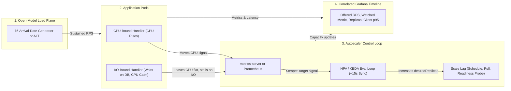
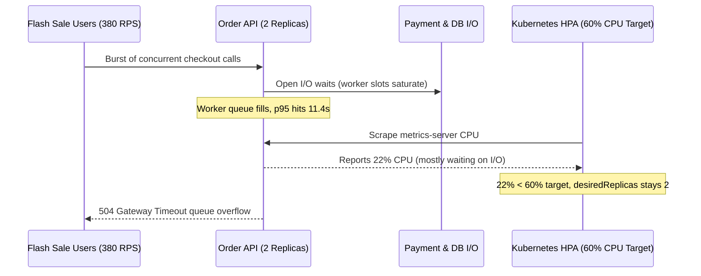

# 04 - Proving Autoscaling Actually Works

> **Prerequisites:** Kubernetes HPA/VPA fundamentals ([03-kubernetes/09](../../03-kubernetes/09-scaling-hpa-and-vpa/README.md)), Azure Container Apps KEDA scaling ([06-azure-container-apps/03](../../06-azure-container-apps/03-scaling-with-keda/README.md)), Grafana dashboards ([12-observability-deep-dive/03](../../12-observability-deep-dive/03-grafana-dashboards/README.md)), and open-model load testing ([Module 03](../03-designing-a-realistic-load-test/README.md)).  
> **Estimated Reading Time:** 35 minutes  
> **Target Audience:** Backend Engineers, SREs, Platform Engineers.

> [!TIP]
> **The Golden Rule of Autoscaling Validation:** Never celebrate a rising replica graph in isolation—correlate **offered RPS**, the **autoscaler's watched metric**, **replica count**, and **client-side p95 latency** on one timeline using an open-model arrival-rate load test, and prove that your real traffic actually moves the signal the autoscaler watches.

---

## Why This Matters

This is the module the whole track was built to reach. In [track 03 module 09](../../03-kubernetes/09-scaling-hpa-and-vpa/README.md) you configured an HPA and watched a synthetic `vish/stress` pod trigger it. In [track 06 module 03](../../06-azure-container-apps/03-scaling-with-keda/README.md) you set KEDA scale rules and threw a `curl` loop at them. Both proved the *mechanism* exists. Neither proved that *your real application*, under *realistic* load ([module 03](../03-designing-a-realistic-load-test/README.md)), scales the way you need — or that the thresholds you picked are the right ones. Worse, autoscaling has a nasty failure mode: a config that *looks* completely correct but never fires, silently, because the load never actually stresses the metric it watches. This module drives real k6 load at those setups, watches pods scale in real time on [track 12](../../12-observability-deep-dive/README.md)'s Grafana, and teaches you to read the result correctly — including catching the "looks right, never scales" trap.

---

## 1. Architectural Mental Model: The Autoscaling Control Loop & Signal Mismatch Trap

An autoscaler only sees what its metrics pipeline reports. Between traffic arriving and new capacity serving requests, multiple scrape, evaluation, scheduling, and readiness delays stack up—and if the workload is I/O-bound while the HPA watches CPU, the control loop never triggers at all:



### The demo proved the mechanism; you're proving the system

The track-03 HPA demo used `vish/stress`, an image whose *entire job* is to burn CPU. Of course the CPU-based HPA fired — you handed it exactly the signal it watches. Your real app is different: a web request might spend its time waiting on a database, not burning CPU, so a CPU-based HPA may barely twitch under heavy *traffic*. The question this module answers is not "does an HPA work" (it does) but "does *this* HPA, watching *this* metric, scale *this* app under load that looks like *my* users?" That's a different, harder, and far more useful question — and the honest answer is sometimes "no," which is exactly the finding you want *before* production finds it for you.

### Watch it live: k6 on one side, Grafana on the other

The right way to run this is two views side by side. On one side, k6 (locally for a kind cluster, or Azure Load Testing for AKS/ACA) drives a **realistic, open-model** load — arrival-rate executor, so offered load doesn't back off as the system strains (module 03's rule). On the other, Grafana from [track 12 module 03](../../12-observability-deep-dive/03-grafana-dashboards/README.md) shows, on one timeline: **offered RPS**, **the metric the autoscaler watches** (pod CPU % of request, or KEDA's queue depth / concurrency), **replica count**, and **client-side p95 latency**. The story you're looking for: load rises → watched metric crosses the target → replica count climbs → latency, which spiked during the lag, recovers as capacity arrives. If any link in that chain is missing, you've found something. This correlated view is precisely why module 02's Azure Load Testing App Components (or a Prometheus-fed Grafana) beat alt-tabbing to `kubectl get hpa -w`.

### Reading the HPA correctly: the scaling *lag* is the story

Autoscaling is not instant, and the gap is where the interesting behavior lives. There's a chain of delays: the metric must be *scraped* (metrics-server / Prometheus interval), the HPA control loop runs on its *own* interval (~15s default) and computes `desiredReplicas` with the formula from track 03 module 09, new pods must be *scheduled and started* (image pull, readiness probe), and only then do they absorb load. During that whole window, latency is degraded — your users feel the lag even though scaling "worked." Reading a result correctly means judging not just "did it scale?" but "did it scale *fast enough* that latency stayed within SLO during the ramp?" A spike test (module 00) that ramps in 5 seconds will blow the SLO even with a perfectly-configured HPA, because pods can't start that fast — which tells you a spike needs *headroom* (higher min replicas) or a faster signal, not just an HPA.

### The trap: config that looks right but never stresses the watched metric

Here is the single most important failure mode in this module. You have a CPU-based HPA (`averageUtilization: 50`), correctly configured, on an app whose requests are **I/O-bound** — each request mostly *waits* on a database or a downstream API and uses almost no CPU. You run a heavy load test. Traffic is enormous, latency climbs, users suffer — and the HPA **never scales**, because CPU never crosses 50%. Everything *looks* right: the HPA exists, has a target, metrics-server works, `kubectl get hpa` shows a real percentage. But the load doesn't stress the metric the HPA watches, so the autoscaler is blind to the actual saturation. The fix is not "the HPA is broken" — it's that you're scaling on the **wrong signal**: this app should scale on requests-per-second, concurrency, or a custom/queue metric, not CPU. Catching this requires reading *two* things together — "load is high and latency is bad" **and** "the watched metric is calm" — which is exactly why you watch the metric on Grafana, not just the replica count.

### The KEDA equivalents: threshold and signal, both can be wrong

KEDA (track 06) has the same class of failure in two flavors. **Wrong signal:** an HTTP `concurrentRequests` rule scales on in-flight request count — fine for a slow app, but if your requests are fast, concurrency stays low even at high RPS and it under-scales. **Wrong threshold:** a `queueLength=5` rule that should've been `queueLength=50`, or the reverse — the number is plausible but doesn't match reality, so KEDA either flaps or never trips. You met the "wrong metadata / broken auth" silent failures in track 06 module 03; this module adds the subtler case where the rule is *valid and authenticated* but the **threshold is mis-tuned for the real load**, which only a real load test reveals. KEDA fails *closed* (holds at min) and silent — so, as in track 06, you diagnose by comparing the rule's watched signal against what the load actually produces, now with a load test producing that reality.

### Right-reading a "success": did latency actually stay healthy?

A run where replica count went from 3 to 10 *looks* like a win, but scaling is a means, not the end. The real acceptance question is the SLO: **did client-side p95 stay within target throughout the ramp and hold?** Three distinct outcomes to tell apart: (1) it scaled and latency stayed healthy — success; (2) it scaled but latency blew the SLO during the lag and only recovered after — the *mechanism* works but is too slow for this load shape (needs headroom or a faster signal); (3) it scaled to `maxReplicas` and latency *still* didn't recover — you hit a real bottleneck *downstream* of the thing that scaled (the database, a dependency), which no amount of app replicas fixes — straight into [module 05](../05-identifying-bottlenecks/README.md). Reading the result is distinguishing these three, not celebrating the replica graph.

---

## 2. Taxonomic Comparison & Command Reference

### The Three Outcomes of an Autoscaling Load Test

| Outcome | Replica Trend | Watched Metric | Client-Side p95 | Diagnosis & Action |
| :--- | :--- | :--- | :--- | :--- |
| **1. Scaled & SLO Held** | Climbs smoothly with ramp | Crosses target then stabilizes below ceiling | Remains under SLO throughout ramp and hold | Verified: signal, threshold, and headroom match load shape |
| **2. Scaled Too Slowly (Scaling Lag)** | Climbs after ramp begins | Spikes above target during lag, recovers after pods ready | Breaches SLO during ramp window, recovers later | Mechanism works but pods start too slowly; raise `minReplicas` or switch to faster signal |
| **3. Scaled to Max, Still Failing** | Hits `maxReplicas` ceiling | Remains elevated or flat depending on downstream | Stays degraded even at `maxReplicas` | Downstream bottleneck (DB pool, rate limit); stop scaling app and inspect [Module 05](../05-identifying-bottlenecks/README.md) |

### Signal & Load-Model Selection Matrix

| Dimension | CPU-Based HPA | Custom / KEDA HTTP Concurrency & RPS | Closed VU Model vs. Open Arrival-Rate |
| :--- | :--- | :--- | :--- |
| **Best Workload Fit** | Compute-intensive APIs (encryption, image/JSON processing) | I/O-bound APIs waiting on databases or downstream HTTP | Open (`ramping-arrival-rate`) required for scaling tests |
| **Blind Spot** | Never fires when workers sleep waiting on I/O | Fast sub-10ms handlers keep concurrency low despite huge RPS | Closed VU loops back off offered RPS as p95 climbs |
| **Verification Metric** | `container_cpu_usage_seconds_total` vs `requests.cpu` | `http_requests_in_flight` / `http_requests_per_second` | Achieved `http_reqs` rate matches scheduled stage target |

### Command Reference

Observation commands you'll run alongside the load test:

| Command | What it does | Example |
|---|---|---|
| `kubectl get hpa <name> -w` | Watch HPA target metric and replica count live | `kubectl get hpa web -w` |
| `kubectl describe hpa <name>` | See the HPA's scaling *events* and its reasoning | `kubectl describe hpa web` |
| `kubectl get pods -l app=<app> -w` | Watch pods being created/terminated in real time | `kubectl get pods -l app=web -w` |
| `kubectl top pods -l app=<app>` | Current CPU/mem per pod — is the *watched metric* actually rising? | `kubectl top pods -l app=web` |
| `kubectl get events --sort-by=.lastTimestamp` | `ScalingReplicaSet`, `FailedScheduling` (pods pending → no room) | `kubectl get events --sort-by=.lastTimestamp` |
| `az containerapp replica list` | ACA replica count during a KEDA test (track 06) | `az containerapp replica list --name web -g rg -o table` |
| `az containerapp revision show --query properties.template.scale` | The live scale rule config being evaluated | see track 06 |
| `kubectl get hpa <name> -o jsonc` | Full HPA status incl. `currentMetrics` vs `targetMetrics` | inspect the actual gap |

Grafana / PromQL panels to have open (from track 12):

| Panel query (PromQL) | Shows |
|---|---|
| `sum(rate(http_requests_total[1m]))` | Offered RPS reaching the app |
| `kube_horizontalpodautoscaler_status_current_replicas` | Replica count the HPA has set |
| `kube_horizontalpodautoscaler_spec_target_metric` vs `..._status_current_metric` | Target vs. *actual* watched metric — the trap detector |
| `sum(rate(container_cpu_usage_seconds_total{pod=~"web.*"}[1m]))` | Actual CPU — is the watched signal even moving? |
| `histogram_quantile(0.95, sum(rate(http_request_duration_seconds_bucket[1m])) by (le))` | Client/server p95 — did the SLO hold? |

---

## 3. Production War Story Post-Mortem: The Silent CPU-HPA Blindspot During Flash Sale

| Field | Incident Details |
| :--- | :--- |
| **Severity** | **SEV-1** (Checkout API Outage During Scheduled Marketing Drop) |
| **Detection / Resolution Time** | Detected in 3 minutes via synthetic SLO burn alert / Mitigated in 22 minutes |
| **Impact** | p95 surged from 180ms to 11.4s and 34% of checkouts timed out (`504 Gateway Timeout`) while the service stayed pinned at `minReplicas: 2` |

### What Happened

An order-orchestration service was validated prior to launch using a closed-VU load script and a standard Kubernetes HPA targeting `averageUtilization: 60` CPU. In production, a flash sale spiked traffic from 40 RPS to 380 RPS. Because each checkout request spent ~85% of its wall-clock time waiting synchronously on payment-gateway HTTP calls and database writes, pod CPU hovered at 22% even as all HTTP worker threads filled up and queued incoming requests. The HPA faithfully held replicas at 2 until engineers manually scaled the deployment.



### Root Cause Analysis

1. **Wrong scaling signal for an I/O-bound service**: CPU utilization measured compute saturation, not worker-slot / in-flight concurrency saturation.
2. **Closed-model pre-release test masked the trap**: The pre-launch script used fixed VUs that paused on slow responses, artificially reducing offered RPS when latency climbed instead of reproducing real user arrival rates.

### The Fix & Architectural Hardening

- Instrumented and exported `http_requests_in_flight` and per-pod RPS gauges to Prometheus, then switched the HPA (`autoscaling/v2`) and KEDA triggers to scale on concurrent in-flight requests per pod (`averageValue: "40"`).
- Converted pre-release validation to an open-model `ramping-arrival-rate` k6 suite correlated against Grafana's 4-panel dashboard, plus added a high-latency-with-idle-HPA alert (`p95 > SLO && current_replicas == min_replicas`).

---

## 4. Multi-Language Production Implementation: Exposing In-Flight Concurrency & Request-Rate Signals for Autoscaling

When CPU stays calm on an I/O-bound service, your application must expose the signal that *does* move under load—active in-flight requests and total requests—so Prometheus Adapter or KEDA can scale replicas accurately before worker queues overflow.

````carousel
```go
package autoscale

import (
	"fmt"
	"net/http"
	"sync/atomic"
	"time"
)

// ScaleMetrics tracks the true load signals for an I/O-bound service.
type ScaleMetrics struct {
	InFlight atomic.Int64
	TotalReq atomic.Uint64
	Errors5x atomic.Uint64
}

func (m *ScaleMetrics) Middleware(next http.Handler) http.Handler {
	return http.HandlerFunc(func(w http.ResponseWriter, r *http.Request) {
		m.InFlight.Add(1)
		m.TotalReq.Add(1)
		defer m.InFlight.Add(-1)

		rec := &statusRecorder{ResponseWriter: w, status: http.StatusOK}
		start := time.Now()
		next.ServeHTTP(rec, r)
		_ = time.Since(start) // Feed to histogram in full telemetry setup

		if rec.status >= 500 {
			m.Errors5x.Add(1)
		}
	})
}

// MetricsHandler exposes Prometheus text format scraped by KEDA / Prometheus Adapter.
func (m *ScaleMetrics) MetricsHandler(w http.ResponseWriter, _ *http.Request) {
	w.Header().Set("Content-Type", "text/plain; version=0.0.4")
	fmt.Fprintf(w, "# TYPE http_requests_in_flight gauge\nhttp_requests_in_flight %d\n", m.InFlight.Load())
	fmt.Fprintf(w, "# TYPE http_requests_total counter\nhttp_requests_total %d\n", m.TotalReq.Load())
	fmt.Fprintf(w, "# TYPE http_requests_5xx_total counter\nhttp_requests_5xx_total %d\n", m.Errors5x.Load())
}

type statusRecorder struct {
	http.ResponseWriter
	status int
}

func (s *statusRecorder) WriteHeader(code int) {
	s.status = code
	s.ResponseWriter.WriteHeader(code)
}
```
<!-- slide -->
```typescript
import type { Request, Response, NextFunction } from "express";

export class AutoscaleMetrics {
  private inFlight = 0;
  private totalRequests = 0;
  private serverErrors = 0;

  middleware() {
    return (_req: Request, res: Response, next: NextFunction): void => {
      this.inFlight += 1;
      this.totalRequests += 1;
      let settled = false;

      const decrement = (): void => {
        if (!settled) {
          settled = true;
          this.inFlight = Math.max(0, this.inFlight - 1);
          if (res.statusCode >= 500) {
            this.serverErrors += 1;
          }
        }
      };

      res.on("finish", decrement);
      res.on("close", decrement);
      next();
    };
  }

  renderPrometheus(): string {
    return [
      "# TYPE http_requests_in_flight gauge",
      `http_requests_in_flight ${this.inFlight}`,
      "# TYPE http_requests_total counter",
      `http_requests_total ${this.totalRequests}`,
      "# TYPE http_requests_5xx_total counter",
      `http_requests_5xx_total ${this.serverErrors}`,
    ].join("\n");
  }
}
```
<!-- slide -->
```python
import threading
from contextlib import contextmanager


class AutoscaleSignalCollector:
    """Thread-safe concurrency and RPS signal collector for HPA/KEDA scraping."""

    def __init__(self) -> None:
        self._lock = threading.Lock()
        self.in_flight = 0
        self.total_requests = 0
        self.errors_5xx = 0

    @contextmanager
    def track_request(self):
        with self._lock:
            self.in_flight += 1
            self.total_requests += 1
        status_code = 200

        def set_status(code: int) -> None:
            nonlocal status_code
            status_code = code

        try:
            yield set_status
        except Exception:
            status_code = 500
            raise
        finally:
            with self._lock:
                self.in_flight = max(0, self.in_flight - 1)
                if status_code >= 500:
                    self.errors_5xx += 1

    def render_prometheus(self) -> str:
        with self._lock:
            return (
                "# TYPE http_requests_in_flight gauge\n"
                f"http_requests_in_flight {self.in_flight}\n"
                "# TYPE http_requests_total counter\n"
                f"http_requests_total {self.total_requests}\n"
                "# TYPE http_requests_5xx_total counter\n"
                f"http_requests_5xx_total {self.errors_5xx}\n"
            )
```
<!-- slide -->
```csharp
using System.Threading;
using Microsoft.AspNetCore.Http;

public sealed class AutoscaleSignalMiddleware(RequestDelegate next)
{
    private static long _inFlight;
    private static long _totalRequests;
    private static long _errors5xx;

    public async Task InvokeAsync(HttpContext context)
    {
        Interlocked.Increment(ref _inFlight);
        Interlocked.Increment(ref _totalRequests);
        try
        {
            await next(context);
            if (context.Response.StatusCode >= 500)
            {
                Interlocked.Increment(ref _errors5xx);
            }
        }
        finally
        {
            Interlocked.Decrement(ref _inFlight);
        }
    }

    public static string RenderPrometheus() =>
        $"# TYPE http_requests_in_flight gauge\nhttp_requests_in_flight {Volatile.Read(ref _inFlight)}\n" +
        $"# TYPE http_requests_total counter\nhttp_requests_total {Volatile.Read(ref _totalRequests)}\n" +
        $"# TYPE http_requests_5xx_total counter\nhttp_requests_5xx_total {Volatile.Read(ref _errors5xx)}\n";
}
```
````

---

## 5. Practical Hands-On Verification CLI Workflows

Two arcs: HPA on a local kind cluster (free), then KEDA on Container Apps (billable — clean up). You need metrics-server (track 03 module 09) and, ideally, kube-prometheus-stack + Grafana (track 12) on the kind cluster.

### 1. Deploy a *realistic* app (not a CPU-burner)

Deploy an app that does real per-request work but is **CPU-bound** so a CPU-HPA *should* fire, with requests set (mandatory for HPA — track 03):

```yaml
# cpu-app.yaml
apiVersion: apps/v1
kind: Deployment
metadata: { name: cpuapp }
spec:
  replicas: 1
  selector: { matchLabels: { app: cpuapp } }
  template:
    metadata: { labels: { app: cpuapp } }
    spec:
      containers:
        - name: app
          image: hashicorp/http-echo   # placeholder; use your real app image
          args: ["-text=ok"]
          resources:
            requests: { cpu: "100m", memory: "64Mi" }
            limits:   { cpu: "300m", memory: "128Mi" }
---
apiVersion: v1
kind: Service
metadata: { name: cpuapp }
spec: { selector: { app: cpuapp }, ports: [{ port: 80, targetPort: 5678 }] }
```

Use your own real CPU-bound app image if you have one from an earlier track's capstone — the point is a *real* app, not `vish/stress`.

```bash
kubectl apply -f cpu-app.yaml -n demo
kubectl autoscale deployment cpuapp -n demo --min=1 --max=8 --cpu-percent=50
kubectl get hpa cpuapp -n demo
```

**Expected Output:**
```text
NAME     REFERENCE           TARGETS   MINPODS   MAXPODS   REPLICAS   AGE
cpuapp   Deployment/cpuapp   4%/50%    1         8         1          12s
```
> Verify: an HPA showing `TARGETS: <n>%/50%`. This is the exact HPA from track 03 module 09 — you're about to find out if it fires under *load-test* traffic rather than a stress image.

### 2. Set up the live view

Two terminals plus Grafana:

```bash
# terminal A
kubectl get hpa cpuapp -n demo -w
# terminal B
kubectl get pods -l app=cpuapp -n demo -w
```

Open Grafana (track 12) and add panels for replica count and pod CPU, or if you skipped track 12, `kubectl top pods -l app=cpuapp -n demo` in a third terminal.

### 3. Drive realistic open-model load and watch it scale

Use an arrival-rate k6 test (module 03) — not a closed VU flood — so offered load holds as the app strains:

```javascript
// scale-test.js
import http from 'k6/http';
export const options = {
  scenarios: { load: {
    executor: 'ramping-arrival-rate',
    startRate: 10, timeUnit: '1s',
    preAllocatedVUs: 50, maxVUs: 300,
    stages: [
      { target: 200, duration: '2m' },   // ramp offered RPS
      { target: 200, duration: '3m' },   // hold at peak
      { target: 0,   duration: '1m' },
    ],
  }},
  thresholds: { http_req_duration: ['p(95)<800'], http_req_failed: ['rate<0.02'] },
};
export default function () { http.get(`${__ENV.BASE_URL}/`); }
```

```bash
kubectl port-forward -n demo svc/cpuapp 8080:80 &
k6 run -e BASE_URL=http://localhost:8080 scale-test.js
```

**Expected Output:**
```text
     ✓ http_req_duration..............: avg=42.1ms   min=3.2ms  med=21.4ms  max=490.2ms p(90)=110.5ms p(95)=185.0ms
     ✓ http_req_failed................: 0.00%   ✓ 0        ✗ 42600
     http_reqs........................: 42600   118.3/s
```
> Verify: in terminal A, `TARGETS` climbs above `50%`; in terminal B, pods appear one by one up to 8; on Grafana, replica count steps up as CPU crosses target, and p95 (which spiked during the ramp lag) settles. You just proved a *real* HPA scales a *real* app under *realistic* load — the thing the track-03 demo did not actually prove.

### 4. Read the lag deliberately

Re-run exercise 3 but as a *spike* (change the first stage to `{ target: 200, duration: '10s' }`).

**Expected Output:**
```text
     ✗ http_req_duration..............: p(95)=1340.5ms
     ERRO[0045] thresholds on metrics 'http_req_duration' have been crossed
```
> Verify: latency blows past the 800ms threshold and the run **fails**, even though the HPA is perfectly configured — because pods can't start in 10 seconds. **Read it right:** the HPA isn't broken; the *load shape* (a spike) needs headroom. Fix by raising `--min` (warm capacity) and re-run — confirm the spike now stays under SLO. This is outcome (2) from Concepts made concrete.

### 5. Reproduce THE trap: I/O-bound app, CPU-HPA that never fires

Deploy an app whose requests *wait* rather than compute — httpbin's `/delay/2` is perfect (the pod sleeps server-side, using ~no CPU):

```bash
kubectl create deployment ioapp --image=kennethreitz/httpbin --port=80 -n demo
kubectl set resources deployment ioapp -n demo --requests=cpu=100m,memory=64Mi --limits=cpu=300m,memory=128Mi
kubectl expose deployment ioapp --port=80 -n demo
kubectl autoscale deployment ioapp -n demo --min=1 --max=8 --cpu-percent=50
kubectl port-forward -n demo svc/ioapp 8081:80 &
```

Point the k6 test at the slow, I/O-bound endpoint (edit the default fn to ``http.get(`${__ENV.BASE_URL}/delay/2`)``):

```bash
k6 run -e BASE_URL=http://localhost:8081 scale-test.js  # requests hit /delay/2 via a tweaked script
kubectl get hpa ioapp -n demo
```

**Expected Output:**
```text
NAME    REFERENCE          TARGETS   MINPODS   MAXPODS   REPLICAS   AGE
ioapp   Deployment/ioapp   6%/50%    1         8         1          3m
```
> Verify: offered RPS is high, p95 is terrible (requests queue behind the 2s delay), users would be suffering — **and the HPA does not scale**. `kubectl get hpa ioapp -n demo` shows `TARGETS` sitting *below* 50% because waiting on a delay burns no CPU. Everything *looks* correct: HPA exists, has a real target, metrics-server works. **Diagnose:** on Grafana/`kubectl top` you see the two facts that together spell the trap — **latency is bad AND the watched metric (CPU) is calm.** The load never stresses the metric the HPA watches. **This is the diagnose-and-fix.**

### 6. Fix the trap: scale on the right signal

CPU is the wrong signal for an I/O-bound app. Scale on a metric that *does* move under this load — requests-in-flight or RPS. On plain Kubernetes that means a custom/external metric (e.g. via Prometheus Adapter feeding an `autoscaling/v2` HPA on `http_requests_per_second`), or KEDA's `prometheus`/`http` scaler. Sketch of the corrected HPA target:

```yaml
  metrics:
    - type: Pods
      pods:
        metric: { name: http_requests_per_second }
        target: { type: AverageValue, averageValue: "50" }
```

Re-run the load. Expected: now the watched metric (RPS per pod) crosses target under the I/O load, and the app scales — because you're finally watching a signal the load actually moves. Lesson to carry: **an autoscaler is only as good as whether your load stresses the metric it watches.**

### 7. KEDA arc: prove (or disprove) a scale rule under real load (ACA)

Recreate the track-06 HTTP-scaled Container App (or a queue worker) and drive it with **Azure Load Testing** (module 02) rather than a `curl` loop:

```powershell
az group create --name rg-keda-perf --location eastus
az containerapp env create --name env-kp --resource-group rg-keda-perf --location eastus
az containerapp create --name web --resource-group rg-keda-perf --environment env-kp `
  --image mcr.microsoft.com/k8se/quickstart:latest --target-port 80 --ingress external `
  --min-replicas 0 --max-replicas 10 `
  --scale-rule-name http-rule --scale-rule-type http --scale-rule-http-concurrency 50
```

Run your realistic k6 script from ALT against the FQDN while watching:

```powershell
az containerapp replica list --name web --resource-group rg-keda-perf -o table
```

**Expected Output:**
```text
Name                        CreatedTime                RunningState    Replicas
--------------------------  -------------------------  --------------  ----------
web--0000001-6f9c7f9b-8k2p  2026-05-12T10:14:02+00:00  Running         4
web--0000001-6f9c7f9b-9m1z  2026-05-12T10:14:18+00:00  Running         4
```
> Verify: replicas climb as concurrency exceeds 50/replica. If your requests are *fast*, concurrency may stay low even at high RPS and it **under-scales** — that's the "wrong signal" flavor; note it.

### 8. Diagnose and fix: KEDA threshold mis-tuned for real load

Set the concurrency threshold absurdly high so it never trips under your load:

```powershell
az containerapp update --name web --resource-group rg-keda-perf `
  --scale-rule-name http-rule --scale-rule-type http --scale-rule-http-concurrency 5000
```

Re-run the load test. **Expected:** heavy load, degraded latency, and replicas **stay at 1** — the rule is *valid and authenticated* (unlike track 06's wrong-metadata/broken-auth failures), but the **threshold** is set so high the real load never crosses it. **Diagnose:** compare the actual concurrency the load produces against the `concurrentRequests` target — the target is simply too high for this traffic. **Fix:** set `--scale-rule-http-concurrency 50` and re-run; confirm it now scales. Lesson: a rule that "looks right" can still be mis-tuned for *your* real load — only a real load test tells you the number matches reality.

### 9. Clean up

```bash
kubectl delete deployment cpuapp ioapp -n demo
kubectl delete svc cpuapp ioapp -n demo
kubectl delete hpa cpuapp ioapp -n demo
# kill any port-forwards
```
```powershell
az group delete --name rg-keda-perf --yes --no-wait
az group list -o table
```

> Verify: local objects gone; the billable ACA resources are being deleted. Confirm ACA is gone with `az group list -o table`.

### Independent challenge

Take a *real* app on either your kind cluster or an AKS cluster from [track 07](../../07-aks/README.md), attach the autoscaler you'd actually use in production (HPA on the right metric, or KEDA), and run a realistic open-model load test (module 03) that proves — with a Grafana dashboard (track 12) showing offered load, the watched metric, replica count, and p95 on one timeline — that scaling triggers *and* keeps latency within a stated SLO. Then, deliberately introduce the "looks right but never fires" trap (either an I/O-bound app under a CPU-HPA, or a KEDA threshold mis-tuned for your load), demonstrate the app is suffering while the autoscaler sits idle, diagnose it by reading the *watched metric* alongside the latency, and fix it by scaling on a signal your load actually moves. This pulls on track 03 (HPA mechanics), track 06 (KEDA), track 12 (Grafana), and modules 01-03 of this track.

<details><summary>Stuck? One hint</summary>

The trap is always the same shape: **latency is bad AND the metric the autoscaler watches is calm** — those two facts on one Grafana timeline are the diagnosis. For the I/O-bound-app version, an endpoint that sleeps server-side (`/delay/N`) uses ~no CPU, so a CPU-HPA never crosses its target no matter how much traffic queues; the fix is an HPA/KEDA rule on RPS or concurrency (Prometheus Adapter or KEDA's prometheus/http scaler) instead of CPU. For the KEDA-threshold version, set `concurrentRequests` (or `queueLength`) far above what your load produces, prove it never trips, then lower it to match the real concurrency your test generates. Use an **arrival-rate** executor so offered load doesn't back off while you wait for scaling.

</details>

---

## 6. Common Mistakes & Troubleshooting

- **Using a closed-model (VU) test to prove scaling.** As the app strains, a closed model backs off offered load — you stop pushing right when you needed to keep pushing to trigger scale-up. Use an arrival-rate executor.
- **Celebrating the replica graph.** Replicas going 3→10 is not success; SLO latency holding through the ramp is. Always read p95, not just replica count.
- **Watching only replica count, not the watched metric.** The trap is invisible unless you also watch the autoscaler's *input* metric — high latency with a *calm* watched metric is the signature of "wrong signal."
- **Scaling an I/O-bound app on CPU.** Requests that wait on I/O burn little CPU; a CPU-HPA never fires under traffic. Scale on RPS/concurrency/queue.
- **Expecting instant scale-up on a spike.** Pods take time to schedule and become ready; a 10-second spike blows the SLO even with a perfect HPA. Spikes need headroom (higher min) or a faster signal, not just an HPA.
- **A KEDA/HPA threshold that's plausible but wrong for your real load.** The number looks sane but doesn't match the concurrency/queue depth your traffic actually produces — only a real load test reveals the mismatch.
- **Scaling to max and still failing SLO.** The bottleneck is *downstream* of what scaled (database, dependency). Adding replicas can't fix it — that's module 05.

---

## 7. Operational Validation Checkpoints & Cumulative Review

### Operational Validation Checkpoints

<details><summary><strong>Checkpoint 1: HPA holds at minReplicas while p95 reaches 4.2 seconds</strong></summary>

Your Grafana dashboard shows offered RPS climbing from 20 to 250 RPS and p95 latency breaching the 400ms SLO, while `kube_horizontalpodautoscaler_status_current_replicas` remains flat at 2 and pod CPU stays around 18% of request. Because CPU is calm while latency explodes, the workload is I/O-bound (waiting on DB or HTTP calls) and the HPA is watching the wrong signal. Switch the scaling target to `http_requests_in_flight` or per-pod RPS via Prometheus Adapter / KEDA.

</details>

<details><summary><strong>Checkpoint 2: Pods scale 2 to 8 cleanly, yet the 10-second spike test fails SLO</strong></summary>

Replicas scaled up to 8 and steady-state p95 returned to 120ms, but the k6 threshold failed because p95 reached 1.9s during the 10-second ramp. Metrics scrape intervals, the 15s HPA sync loop, image pulls, and readiness probes create unavoidable scale-up lag. For sudden traffic spikes, configure warm headroom (`minReplicas`) or pre-scale ahead of scheduled bursts rather than tuning HPA reaction percentages alone.

</details>

<details><summary><strong>Checkpoint 3: KEDA HTTP rule is valid and authenticated but never scales past 1 replica</strong></summary>

Unlike broken-auth or wrong-metadata failures where KEDA logs scaler errors, here the scaler evaluates cleanly but the configured `concurrentRequests` threshold (for example, 500) exceeds what fast requests ever accumulate at peak RPS (say, 35 concurrent requests per replica). Compare actual observed concurrency against the rule target under an open-model load test and tune the threshold down to match real per-replica saturation.

</details>

### Checkpoint quiz

Write down your answer to each question before expanding it — checking without attempting first is the single easiest way to fool yourself into thinking you've learned this.

1. Why did the track-03 `vish/stress` demo "prove" the HPA works without proving your real app scales?
2. What four things do you want on one Grafana timeline to read an autoscaling test correctly, and why each?
3. Describe the "looks right but never fires" trap precisely: what is configured correctly, what's wrong, and what two facts together diagnose it?
4. A CPU-HPA sits below its target while an I/O-bound app is drowning in traffic. Is the HPA broken? What's the actual fix?
5. Your app scaled from 3 to 10 replicas but the run still failed its p95 threshold. Give the two distinct explanations and how you'd tell them apart.
6. Why must you use an open (arrival-rate) executor rather than a closed (VU) one to validate scaling?
7. A KEDA HTTP rule is valid and authenticated but never scales under heavy load. How is this different from the track-06 failures, and how do you diagnose it?
8. Why does a 10-second spike blow the SLO even with a correctly configured HPA, and what are the two ways to handle a spike?

<details><summary>Show answers</summary>

1. `vish/stress` exists only to burn CPU — it hands the CPU-HPA exactly the signal it watches, so of course it fired. A real app's requests may be I/O-bound and barely move CPU, so the demo proved the *mechanism*, not that *your* app scales under *your* traffic.
2. Offered **RPS** (the load), the **metric the autoscaler watches** (to see if the load even stresses it), **replica count** (did it react), and client-side **p95 latency** (did the SLO hold). Together they show the whole causal chain and expose the trap.
3. Correctly configured: the HPA/KEDA rule exists, has a real target, metrics work. Wrong: the load doesn't stress the metric it watches (e.g. CPU-HPA on an I/O-bound app). Diagnosis = two facts together: **latency is bad AND the watched metric is calm.**
4. Not broken — it's watching the wrong signal. Waiting on I/O burns no CPU, so CPU never crosses target. Fix: scale on a metric the load actually moves — RPS/concurrency/queue (Prometheus Adapter HPA or KEDA prometheus/http scaler).
5. (a) It scaled but too *slowly* — latency blew SLO during the lag and only recovered after; the mechanism works but needs headroom/faster signal. (b) It hit a *downstream* bottleneck (DB, dependency) that more app replicas can't fix. Tell apart: in (a) latency recovers once pods are up; in (b) it stays bad even at max replicas — check the downstream (module 05).
6. A closed model backs off offered load as the server slows, reducing pressure exactly when you wanted to sustain it to trigger scaling — hiding the behavior. An open/arrival-rate model keeps injecting the target rate so you can watch capacity respond.
7. Track-06 failures were *wrong metadata* or *broken auth* (KEDA can't read the metric at all). Here the rule reads the metric fine but its **threshold** is set higher than the concurrency/depth your real load produces, so it never trips. Diagnose by comparing the actual concurrency the load generates against the rule's target and lowering it to match.
8. Pods take time to schedule, pull images, and pass readiness — seconds to tens of seconds — so a 10s spike outruns any scale-up. Handle it with **headroom** (higher `minReplicas`/warm capacity) or a **faster/predictive signal**, not by tuning the HPA alone.

</details>

---

## 8. Next

[05-identifying-bottlenecks](../05-identifying-bottlenecks/README.md) — outcome (3) from this module — "it scaled to max and *still* failed" — means the real limit is somewhere else. Learn to read a load test to find where a system actually breaks.
