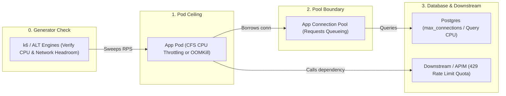
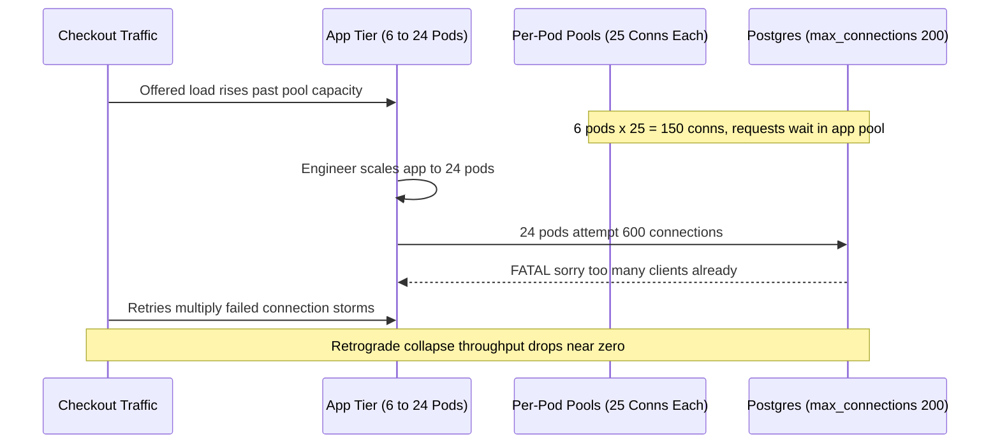

# 05 - Identifying Bottlenecks

> **Prerequisites:** Proving autoscaling works ([Module 04](../04-proving-autoscaling-works/README.md)), Kubernetes CPU/memory limits (`03/02`), Postgres connection pools ([Track 14](../../14-databases-and-stateful-workloads/README.md)), and API Management rate limits ([Track 19](../../19-api-management/README.md)).  
> **Estimated Reading Time:** 35 minutes  
> **Target Audience:** Backend Engineers, Performance Engineers, SREs.

> [!TIP]
> **The Golden Rule of Bottleneck Isolation:** Before blaming the application or adding replicas, **prove the load generator has CPU and network headroom**, inspect which tier plateaus at its ceiling while downstream layers stay calm, and change **exactly one variable** between identical runs to prove the latency knee moves.

---

## Why This Matters

[Module 04](../04-proving-autoscaling-works/README.md) ended on its third outcome: the app scaled to `maxReplicas` and latency *still* didn't recover. When adding replicas doesn't help, the bottleneck is somewhere the autoscaler can't reach — a CPU/memory limit throttling each pod, the database connection pool from [track 14](../../14-databases-and-stateful-workloads/README.md) exhausting, or a downstream dependency's rate limit shedding your requests. A load test that only reports "p95 got bad" is a smoke alarm with no map. This module is about reading the *shape* of a failure to locate *where* the system actually breaks — because you can't fix a bottleneck you've misdiagnosed, and "add more replicas" is the wrong fix for most real bottlenecks.

---

## 1. Architectural Mental Model: Tracing the Request Path to the First Saturated Ceiling

Every request traverses a chain of bounded resources—starting with your own load generator. As offered load sweeps upward, the first resource to hit 100% saturation creates a **knee** in the latency curve; everything behind it queues, while everything downstream of it stays curiously idle:



### A bottleneck is the *first* resource to saturate, and it moves

Every system has exactly one bottleneck at a time: the single resource that saturates first as load rises. Everything downstream of it is starved; everything upstream backs up behind it. Fix that one, and the bottleneck *moves* — it doesn't disappear, it relocates to the next-tightest resource. This is why performance work is iterative: you find the current limit, remove it, re-test, and find the *new* limit, which was invisible before because the first one was hiding it. The load-test skill is reading which resource is currently the wall. The tell is almost always a **knee** in the graphs: up to some RPS latency is flat and throughput scales linearly; past the knee, latency climbs steeply while throughput flattens (or drops). The knee is the bottleneck announcing itself; the job is identifying *which* resource caused it.

### Latency vs. throughput curves — reading the knee

Plot latency (p95) and throughput (successful RPS) against offered load. Three signatures tell you three different things:

- **Latency climbs, throughput flat, errors low** — a queue is forming behind a saturated resource (CPU, a pool, a slow dependency). Requests aren't *failing*, they're *waiting*. Classic connection-pool or CPU saturation.
- **Throughput flat, errors climbing** — something is actively *rejecting* load: a rate limit, a full queue, connection refusals. The system chose to shed rather than queue.
- **Throughput *drops* under increasing load** (a "retrograde" curve) — the system is spending resources on overhead (thrashing, GC, retry storms, connection churn) instead of work. The worst signature: pushing harder makes it do *less*. Often a sign of a missing backpressure mechanism.

You already have the tools to draw these: k6's summary gives you throughput and percentiles per run, and running a *ramping-arrival-rate* test (module 03) sweeps offered load so a single run traces the curve.

### CPU and memory limits: the pod-level ceiling

The first suspect, because it's the one autoscaling *should* have handled. Two distinct failures. **CPU throttling:** a pod with a CPU *limit* (track 03 module 02) gets throttled by the kernel (CFS) when it exceeds the limit — latency rises sharply, but the pod's CPU graph plateaus *at the limit*, not at the node's capacity. The tell is `container_cpu_cfs_throttled_periods_total` climbing while CPU sits pinned at the limit. **Memory:** a pod exceeding its memory *limit* is **OOM-killed** — you'll see restarts (`kubectl get pods` RESTARTS climbing, `OOMKilled` in `kubectl describe pod`), and latency spikes as requests in flight die with the pod. Crucially, if the *limit* is the wall, more *replicas* help (spread the load) but bigger *requests/limits* per pod may be the real fix — this is the HPA-vs-VPA distinction from track 03 module 09 showing up as a diagnostic question: are you compute-bound per-pod, or just need more pods?

### Database connection pool exhaustion (the track-14 bottleneck)

The most common bottleneck that *looks* like the app and *is* the database boundary. Your app holds a **connection pool** — a fixed number of reusable DB connections (track 14 module 07). Each in-flight request that touches the DB borrows one; when all are in use, further requests **wait** for one to free up. Under load, the pool saturates: request latency climbs not because the DB is slow but because requests are *queued waiting for a connection*. The signature is diagnostic gold — **app latency high, but the database's own CPU and query latency are calm.** The requests aren't slow *at* the DB; they're slow getting *to* it. And here's the cruel twist that ties back to module 04: **adding app replicas makes it worse** — more replicas means more pools means more total connections hammering a database that has its *own* `max_connections` limit, so you scale the app and either exhaust the DB's connection limit or just move the queue. The fixes are pool tuning, a connection *proxy*/pooler (PgBouncer), or addressing why requests hold connections so long — never "more app pods."

### Downstream dependency limits: rate limits and quotas

Your service is rarely the whole system. It calls a payment provider, a third-party API, an internal service fronted by [APIM](../../19-api-management/README.md) with a rate-limit policy, or an Azure service with a documented throughput quota. Under load you hit *their* ceiling, and it manifests as a wall you don't control: a burst of `429 Too Many Requests` or `503`s, latency spikes from *their* throttling, or timeouts. The signature: **errors concentrated on requests that touch one specific downstream**, while requests that don't touch it stay healthy — which is exactly why the module-03 traffic *mix* matters, because a uniform test that never hits the checkout path would never find the payment provider's limit. Scaling your app does nothing here (you'll just hit their limit faster); the fixes are caching, request coalescing, backpressure, a higher quota, or a circuit breaker so their limit degrades you gracefully instead of cascading.

### The false bottleneck: when the *test* is the limit

Before you trust *any* ceiling, rule out that you found the *generator's* limit, not the system's — the module-00 warning, now a formal diagnostic step. If the box running k6 is CPU-pinned, or its network uplink is saturated, latency you attribute to the server is really queueing *in your own client*. The signatures of a false bottleneck: the "ceiling" RPS is suspiciously round and stable regardless of what you change server-side; server-side metrics (pod CPU, DB, dependencies) are *all* calm at the "limit"; and the k6 client's own host shows high CPU or network saturation. This is why serious tests run from Azure Load Testing (module 02) with enough engines that the generator has headroom — and why the diagnostic discipline is always: **before blaming the server, prove the client had room to push harder.**

### The method: change one thing, re-test, watch the bottleneck move

Diagnosis isn't guessing — it's controlled experiment. When the knee appears, you form a hypothesis from the *signature* (queueing vs. rejecting vs. retrograde; which resource's graph is pinned), change **one** thing to test it (raise the pool size; raise the CPU limit; add a cache in front of the dependency), and re-run the identical load test. Two outcomes, both informative: latency knee moves to a higher RPS (you found and moved the real bottleneck — now find the next one), or nothing changes (your hypothesis was wrong; the real bottleneck is elsewhere — revert and try the next suspect). Changing several things at once destroys this — you learn nothing about *which* change mattered. This is the same discipline as track 03/06's diagnose-and-fix exercises, applied to performance: reproduce, isolate, verify.

---

## 2. Taxonomic Comparison & Command Reference

### Latency / Throughput Curve Signatures

| Curve Shape | p95 Latency | Successful RPS | Error Rate | Meaning & Typical Culprits |
| :--- | :--- | :--- | :--- | :--- |
| **Queueing Knee** | Climbs steeply past knee | Plateaus flat | Low | Saturation behind a bounded queue (CPU throttling, DB pool wait) |
| **Shedding / Rejection** | Flat or spikes on blocked tier | Plateaus flat | Climbs (`429`, `503`) | Active rejection (APIM rate limit, full ingress queue, connection refusal) |
| **Retrograde Collapse** | Explodes toward timeout | *Drops* as offered RPS rises | Climbs sharply | System burning capacity on overhead (GC thrashing, retry storms, connection churn) |

### Bottleneck Attribution Matrix

| Suspected Wall | App Pod CPU | DB CPU & Query Time | Pool Waiters / Errors | Per-URL Concentration | Effect of Adding App Replicas |
| :--- | :--- | :--- | :--- | :--- | :--- |
| **False Bottleneck (Generator)** | Calm | Calm | Zero | Uniform across URLs | No change (k6 host CPU/NIC pinned) |
| **Per-Pod CPU Limit** | Pinned at `limits.cpu`, CFS throttled | Calm | Zero | Compute-heavy routes | Helps (spreads CPU load) or raise limit |
| **DB Connection Pool** | Calm | Calm | Waiters high, `pg_stat_activity` pinned | DB-touching routes | **Makes it worse** (exhausts `max_connections`) |
| **Downstream Rate Limit** | Calm | Calm | Zero | Isolated to 1 downstream route (`429`) | No help (hits downstream quota faster) |

### Command Reference

| Command / query | What it reveals | Notes |
|---|---|---|
| `kubectl top pods -l app=<app>` | Per-pod CPU/mem — is it pinned at the *limit*? | Limit-pinned ≠ node-maxed |
| `kubectl describe pod <pod>` | `OOMKilled`, restart reasons, events | Memory-limit failures |
| `kubectl get pods -w` (RESTARTS) | Restart count climbing = OOM/crash under load | Ties latency spikes to restarts |
| `container_cpu_cfs_throttled_periods_total` (PromQL) | CPU throttling — pod hitting its CPU *limit* | Rises while CPU plateaus at limit |
| `container_memory_working_set_bytes` vs limit (PromQL) | Approaching the memory limit before OOM | Leading indicator |
| DB: `SELECT count(*) FROM pg_stat_activity;` | Active DB connections vs. `max_connections` | Pool/DB-limit exhaustion (track 14) |
| App pool metrics (active/idle/waiting) | Requests *waiting* for a connection | The pool-exhaustion signature |
| `kubectl logs <pod> \| grep -i "429\|timeout\|pool"` | Downstream 429s, timeouts, pool-timeout errors | Dependency/pool tells |
| k6 `http_req_waiting` (TTFB) vs `http_req_connecting` | Where request time is spent | Server-think vs. connection setup |
| k6 per-URL metrics (tags) | *Which endpoint* carries the errors/latency | Localizes to the mix element hitting the wall |
| `top` / `mpstat` **on the k6 host** | Generator saturation — false-bottleneck check | Run this before trusting a ceiling |

---

## 3. Production War Story Post-Mortem: Why Scaling App Pods Caused a Full Postgres Outage

| Field | Incident Details |
| :--- | :--- |
| **Severity** | **SEV-1** (Total Checkout & Account Service Outage) |
| **Detection / Resolution Time** | Detected in 4 minutes / Mitigated in 31 minutes |
| **Impact** | Throughput collapsed retroactively from 450 RPS to <30 RPS with 100% `500` responses across all DB-backed routes |

### What Happened

Under peak load, checkout API p95 climbed past 3.5 seconds while Postgres CPU sat quietly at 18%. Believing the API tier was saturated, an engineer manually raised HPA `maxReplicas` from 6 to 24. Each pod held a local connection pool configured to `max=25`. As 24 pods booted, total connection attempts reached `600` against a Postgres server capped at `max_connections=200`. New pods failed health checks opening pools, clients retried aggressively, and throughput collapsed in a textbook retrograde curve.



### Root Cause Analysis

1. **Misdiagnosed pool exhaustion**: "App latency high, DB calm" meant requests were queued inside application pools, not CPU-starved on pods.
2. **Unbounded replica-to-connection math**: `maxReplicas (24) * poolSize (25) = 600` exceeded `max_connections (200)` with zero pooling proxy in between.

### The Fix & Architectural Hardening

- Deployed **PgBouncer** in transaction pooling mode between the API pods and Postgres, capping server-side Postgres connections to 120 while safely multiplexing hundreds of app slots.
- Reduced per-pod pool sizes (`max=10`) with a strict acquire timeout (`500ms`) so saturation fails fast (`503`) instead of queueing indefinitely, and exported `db_pool_wait_seconds` + `db_pool_waiting` gauges.

---

## 4. Multi-Language Production Implementation: Connection Pool Wait Telemetry & Fail-Fast Backpressure

To detect "app slow, DB calm" immediately—and prevent unbounded queueing or retry storms—instrument your database/downstream pools to measure acquire wait duration and enforce strict acquire timeouts (`context.WithTimeout` / `pool_timeout`).

````carousel
```go
package poolobs

import (
	"context"
	"database/sql"
	"errors"
	"sync/atomic"
	"time"
)

var ErrPoolSaturated = errors.New("connection pool acquire timeout")

type InstrumentedDB struct {
	DB          *sql.DB
	Waiters     atomic.Int64
	AcquireTime time.Duration
}

// AcquireAndPing enforces a strict fail-fast acquire bound and exposes pool queueing.
func (i *InstrumentedDB) AcquireConn(ctx context.Context) (*sql.Conn, time.Duration, error) {
	i.Waiters.Add(1)
	defer i.Waiters.Add(-1)

	acquireCtx, cancel := context.WithTimeout(ctx, i.AcquireTime)
	defer cancel()

	start := time.Now()
	conn, err := i.DB.Conn(acquireCtx)
	waited := time.Since(start)
	if err != nil {
		if errors.Is(err, context.DeadlineExceeded) {
			return nil, waited, ErrPoolSaturated
		}
		return nil, waited, err
	}
	return conn, waited, nil
}
```
<!-- slide -->
```typescript
import type { Pool, PoolClient } from "pg";

export interface PoolSnapshot {
  waitingCount: number;
  totalCount: number;
  idleCount: number;
}

export async function withInstrumentedConnection<T>(
  pool: Pool,
  acquireTimeoutMs: number,
  fn: (client: PoolClient, waitMs: number) => Promise<T>
): Promise<{ result: T; snapshot: PoolSnapshot }> {
  const start = performance.now();
  const timeoutPromise = new Promise<never>((_, reject) => {
    setTimeout(() => reject(new Error(`DB pool acquire timeout after ${acquireTimeoutMs}ms`)), acquireTimeoutMs);
  });

  const client = await Promise.race([pool.connect(), timeoutPromise]);
  const waitMs = performance.now() - start;

  try {
    const result = await fn(client, waitMs);
    return {
      result,
      snapshot: {
        waitingCount: pool.waitingCount,
        totalCount: pool.totalCount,
        idleCount: pool.idleCount,
      },
    };
  } finally {
    client.release();
  }
}
```
<!-- slide -->
```python
import time
import threading
from contextlib import contextmanager
from queue import Empty, Queue


class BoundedInstrumentedPool:
    """Bounded resource pool exposing waiter count and acquire latency."""

    def __init__(self, connections: list, acquire_timeout_sec: float = 0.5) -> None:
        self._pool: Queue = Queue(maxsize=len(connections))
        for conn in connections:
            self._pool.put(conn)
        self._timeout = acquire_timeout_sec
        self._lock = threading.Lock()
        self.waiting = 0
        self.timeouts = 0

    @contextmanager
    def borrow(self):
        with self._lock:
            self.waiting += 1
        start = time.monotonic()
        conn = None
        try:
            conn = self._pool.get(timeout=self._timeout)
            wait_ms = (time.monotonic() - start) * 1000.0
            with self._lock:
                self.waiting -= 1
            yield conn, wait_ms
        except Empty as exc:
            with self._lock:
                self.waiting -= 1
                self.timeouts += 1
            raise TimeoutError(f"Pool saturated; waited >{self._timeout}s") from exc
        finally:
            if conn is not None:
                self._pool.put(conn)
```
<!-- slide -->
```csharp
using System.Diagnostics;
using System.Threading;

public sealed class BoundedPoolTelemetry
{
    private readonly SemaphoreSlim _semaphore;
    private readonly TimeSpan _acquireTimeout;
    private long _waitingCount;
    private long _timeoutFailures;

    public BoundedPoolTelemetry(int maxSize, TimeSpan acquireTimeout)
    {
        _semaphore = new SemaphoreSlim(maxSize, maxSize);
        _acquireTimeout = acquireTimeout;
    }

    public async Task<T> ExecuteWithPoolAsync<T>(Func<double, Task<T>> work, CancellationToken ct)
    {
        Interlocked.Increment(ref _waitingCount);
        var sw = Stopwatch.StartNew();
        bool acquired = false;
        try
        {
            acquired = await _semaphore.WaitAsync(_acquireTimeout, ct);
            sw.Stop();
            if (!acquired)
            {
                Interlocked.Increment(ref _timeoutFailures);
                throw new TimeoutException($"Pool saturated after {_acquireTimeout.TotalMilliseconds}ms");
            }
            return await work(sw.Elapsed.TotalMilliseconds);
        }
        finally
        {
            Interlocked.Decrement(ref _waitingCount);
            if (acquired)
            {
                _semaphore.Release();
            }
        }
    }
}
```
````

---

## 5. Practical Hands-On Verification CLI Workflows

Reuse the kind cluster and k6 from earlier modules. For the DB exercise, a small Postgres from [track 14](../../14-databases-and-stateful-workloads/README.md) plus any app that queries it works; `httpbin` stands in where you just need latency shapes.

### 1. Trace the latency/throughput curve and find the knee

Run a single ramping-arrival-rate test that sweeps offered load wide:

```javascript
// sweep.js
import http from 'k6/http';
export const options = {
  scenarios: { sweep: {
    executor: 'ramping-arrival-rate', startRate: 10, timeUnit: '1s',
    preAllocatedVUs: 50, maxVUs: 500,
    stages: [
      { target: 50,  duration: '1m' },
      { target: 150, duration: '1m' },
      { target: 400, duration: '1m' },
      { target: 800, duration: '1m' },
    ],
  }},
};
export default function () { http.get(`${__ENV.BASE_URL}/`); }
```

```bash
k6 run -e BASE_URL=http://localhost:8080 --out json=sweep.json sweep.js
```

**Expected Output:**
```text
     http_req_duration..............: avg=145.2ms min=2.1ms med=18.4ms max=2.41s p(90)=412.0ms p(95)=890.5ms
     http_reqs........................: 61400  255.8/s
```
> Verify: watch the live p95 — at some offered rate it stops being flat and climbs steeply. That inflection is the **knee**; note the RPS. The rest of the module is identifying *what* caused it.

### 2. Reproduce a CPU-limit knee

Deploy a CPU-bound app with a *tight* CPU limit and load it past the knee:

```bash
kubectl create deployment cpubound --image=hashicorp/http-echo -n demo -- -listen=:5678 -text=ok
kubectl set resources deployment cpubound -n demo --requests=cpu=50m --limits=cpu=100m
kubectl expose deployment cpubound --port=80 --target-port=5678 -n demo
kubectl port-forward -n demo svc/cpubound 8080:80 &
k6 run -e BASE_URL=http://localhost:8080 sweep.js
kubectl top pods -l app=cpubound -n demo
```

**Expected Output:**
```text
NAME                        CPU(cores)   MEMORY(bytes)
cpubound-7c8d9f4b6c-x2k9p   100m         14Mi
```
> Verify: as latency knees up, pod CPU plateaus *at ~100m* (the limit), not higher — the tell of CPU throttling, not node exhaustion. On Grafana, `container_cpu_cfs_throttled_periods_total` climbs. Diagnosis: per-pod CPU limit is the wall.

### 3. Change one thing, watch the knee move

Raise only the CPU limit and re-run the identical test:

```bash
kubectl set resources deployment cpubound -n demo --limits=cpu=500m
k6 run -e BASE_URL=http://localhost:8080 sweep.js
```

**Expected Output:**
```text
     http_req_duration..............: avg=24.6ms min=1.8ms med=9.2ms max=410.3ms p(90)=58.1ms p(95)=112.4ms
     http_reqs........................: 83900  349.6/s
```
> Verify: the knee moves to a *higher* RPS — you confirmed CPU limit was the bottleneck by moving it. Note you changed exactly one variable; that's what makes the conclusion valid.

### 4. Reproduce and read connection-pool exhaustion

Point an app at a Postgres (track 14) with a small pool (e.g. app pool size 5), and load it with a DB-touching endpoint. Check DB connections and app logs while under load:

```sql
SELECT count(*) FROM pg_stat_activity;
```

**Expected Output:**
```text
 count
-------
     5
(1 row)
```
> Verify: app p95 climbs steeply, but on the DB side `SELECT count(*) FROM pg_stat_activity;` shows connections pinned at the pool size and the DB's *own* CPU/query latency stays low.
> **Diagnose:** the requests aren't slow *at* the database — they're queued *waiting for a connection*. The signature is "app latency high, DB calm." Prove it: `kubectl logs` for pool-timeout / "waiting for connection" messages.

### 5. Diagnose and fix: scaling app replicas makes the pool worse

With the pool bottleneck from exercise 4 active, attach an HPA and let it scale the app under load (the naive fix from module 04):

```bash
kubectl autoscale deployment <app> -n demo --min=2 --max=8 --cpu-percent=50
k6 run -e BASE_URL=http://localhost:8080 sweep.js
```

**Expected Output:**
```text
FATAL: sorry, too many clients already
http_req_failed................: 18.42%
```
> Verify: latency does *not* improve, and may worsen — each new replica opens its *own* pool, so total connections to the DB rise, and you either hit the DB's `max_connections` (new errors appear) or just multiply the queues. **Fix:** *don't* scale app replicas; instead raise the pool sensibly and/or put a **connection pooler (PgBouncer)** between app and DB (track 14), then re-run. Confirm latency recovers *without* more app pods. Lesson: a connection-pool bottleneck is immune to app-replica scaling — sometimes made worse by it.

### 6. Reproduce a downstream rate-limit wall

Front a dependency with a rate limit (an APIM policy from [track 19](../../19-api-management/README.md), or simulate with an app that returns `429` above N RPS), and drive a *mixed* load where only one endpoint calls it. **Expected:** errors concentrate on the requests that touch the limited dependency (visible via per-URL k6 tags), while other endpoints stay healthy — throughput flattens and `http_req_failed` climbs with `429`s. Diagnosis: a downstream limit, not your app. Note that a *uniform* test not hitting that path would have missed it entirely — module 03 vindicated.

### 7. Diagnose and fix the false bottleneck (the test is the limit)

Deliberately cripple the generator: run k6 with far more VUs than a tiny box can drive, or `cpulimit`/a busy loop stealing CPU on the k6 host, and watch it "plateau."

```bash
# run k6 while something else pegs the client CPU
yes > /dev/null &   # burn a client core
k6 run -e BASE_URL=http://localhost:8080 sweep.js
top -bn1 | head -n 12   # observe the k6 host CPU pinned
kill %1  # stop the CPU burner
```

**Expected Output:**
```text
%Cpu(s): 99.2 us,  0.8 sy,  0.0 ni,  0.0 id
```
> Verify: the "ceiling" RPS appears, but **all server-side metrics are calm** (pod CPU low, DB idle) while the **k6 host is CPU-pinned**. **Diagnose:** the limit is the *generator*, not the system. **Fix:** free the client (kill the burner), or move to Azure Load Testing with more engines (module 02), and re-run — the "ceiling" rises. Rule locked in: prove the client had headroom before blaming the server.

### 8. Localize with per-endpoint tags

Add name tags so k6 reports metrics per logical endpoint:

```javascript
http.get(`${__ENV.BASE_URL}/cheap`,  { tags: { name: 'cheap' } });
http.get(`${__ENV.BASE_URL}/expensive`, { tags: { name: 'expensive' } });
```

Run a mixed test.

**Expected Output:**
```text
     http_req_duration{name:cheap}......: p(95)=14.2ms
     http_req_duration{name:expensive}..: p(95)=1180.5ms
```
> Verify: the summary breaks latency/errors down by `name`, so you can point at *which* endpoint carries the knee — the difference between "the app is slow" and "the `/expensive` path is slow," which is the difference between a useless and an actionable finding.

### 9. Clean up

```bash
kubectl delete deployment cpubound <app> -n demo 2>/dev/null
kubectl delete svc cpubound <app> -n demo 2>/dev/null
kubectl delete hpa <app> -n demo 2>/dev/null
# stop port-forwards and any background CPU burner; delete the track-14 Postgres if you spun one up
```

> Verify: scratch workloads removed cleanly.

### Independent challenge

Take a real app that talks to a database (a track-14 setup, or your track-07 capstone app) and run a ramping load test that drives it past its knee. Without guessing, *diagnose which resource is the bottleneck* by reading the signatures in this module — is it per-pod CPU/memory limits, the connection pool, or a downstream dependency? — and prove your diagnosis by changing exactly one thing and showing the knee move (or not). Then demonstrate the trap from module 04's third outcome: show that scaling *app replicas* does **not** fix a connection-pool bottleneck (and explain, from the DB's `max_connections`, why it can make it worse), and propose the correct fix. Finally, before trusting any ceiling you report, show you ruled out the false bottleneck by confirming the k6 host had CPU/network headroom. This draws on track 14 (pools), track 03 (limits), track 19 (rate limits), and modules 00-04 of this track.

<details><summary>Stuck? One hint</summary>

Diagnose by *which graph is pinned while others are calm*: CPU limit → pod CPU plateaus at the limit (not node max) and CFS throttling climbs; pool exhaustion → app latency high but the **DB's own CPU/query latency is calm** and `pg_stat_activity` sits at the pool size; downstream limit → errors concentrate on the one endpoint that calls the dependency (per-URL k6 tags) with 429s. To prove the pool case is replica-immune, attach an HPA, scale up under load, and watch latency fail to improve while total DB connections rise toward `max_connections`; the real fix is a pooler (PgBouncer) or pool tuning, not more pods. Always run `top` on the k6 host first to rule out a saturated generator.

</details>

---

## 6. Common Mistakes & Troubleshooting

- **Reporting "it's slow" without locating *where*.** A p95 number with no resource attribution is a smoke alarm with no map. Read which graph is pinned.
- **"Add more replicas" as a reflex.** For CPU-per-pod limits it may help; for a connection pool it makes things *worse*; for a downstream rate limit it does nothing. Match the fix to the bottleneck.
- **Confusing a CPU *limit* wall with node exhaustion.** CPU pinned at the *limit* with CFS throttling is a per-pod limit problem (raise limit/VPA), not a "need more nodes" problem.
- **Missing pool exhaustion because you only watched the app.** The signature is app-latency-high / DB-calm — you must look at the *database* side to see it.
- **Uniform test that never hits the limited path.** A downstream rate limit or an expensive endpoint's bottleneck is invisible if your test doesn't model the traffic mix (module 03).
- **Trusting a ceiling without checking the generator.** The false bottleneck: all server metrics calm, k6 host pinned. Always rule out the client first.
- **Changing multiple things between runs.** You lose the ability to attribute the change. One variable per re-test.

---

## 7. Operational Validation Checkpoints & Cumulative Review

### Operational Validation Checkpoints

<details><summary><strong>Checkpoint 1: Ceiling RPS hits 300 every run even after upgrading pod CPU and DB tier</strong></summary>

Because pod CPU, Postgres CPU, and downstream error rates all remain calm while the throughput ceiling stays rigidly fixed around 300 RPS across server changes, suspect a **false bottleneck** on the load generator itself. Check `top` / `mpstat` and NIC throughput on the k6 host—if the generator is CPU-pinned or ephemeral-port exhausted, scale out to Azure Load Testing engines before profiling the server.

</details>

<details><summary><strong>Checkpoint 2: App latency spikes to 2.5s while pod CPU stays at 25% and Postgres CPU stays at 12%</strong></summary>

"App latency high, DB calm" is the diagnostic signature of **connection-pool exhaustion** on the application side of the database boundary. Confirm by inspecting `pg_stat_activity` (pinned at `pool_size * replicas`) and pool wait queues in app logs. Adding app replicas will worsen total connection pressure; resolve by deploying PgBouncer or reducing query hold times.

</details>

<details><summary><strong>Checkpoint 3: Aggregate p95 looks acceptable, but error rate hits 12% during peak mix</strong></summary>

When errors cluster exclusively on one tagged endpoint (`http_req_failed{name:checkout}`) with HTTP `429` or `503` responses while other routes stay fast, you have hit a **downstream dependency quota or APIM rate limit**. Scaling your API pods only hits the downstream quota faster; add caching, request coalescing, backpressure, or a circuit breaker around that dependency.

</details>

### Checkpoint quiz

Write down your answer to each question before expanding it — checking without attempting first is the single easiest way to fool yourself into thinking you've learned this.

1. What is a bottleneck, and what happens to it when you fix it?
2. Name the three latency/throughput-curve signatures and what each implies (queueing vs. rejecting vs. retrograde).
3. What's the diagnostic signature of database connection-pool exhaustion, and why is "app latency high, DB calm" the giveaway?
4. Why can scaling *app replicas* make a connection-pool bottleneck *worse*, and what's the correct fix?
5. How do you tell a per-pod CPU *limit* wall apart from simply needing more nodes?
6. A downstream dependency's rate limit is the bottleneck. Why would a uniform load test miss it, and what does the failure look like in the results?
7. List the three signatures of a *false* bottleneck (the test itself being the limit) and the one thing you always check before trusting a ceiling.
8. What is the disciplined method for confirming a bottleneck diagnosis, and why must you change only one thing per re-test?

<details><summary>Show answers</summary>

1. The first resource to saturate as load rises — the current wall. Fixing it doesn't remove the bottleneck, it *moves* it to the next-tightest resource, which is why perf work is iterative (find, fix, re-test, find the next).
2. **Latency climbs / throughput flat / errors low** → queueing behind a saturated resource (CPU, pool). **Throughput flat / errors climbing** → active rejection (rate limit, full queue, refused connections). **Throughput drops under more load (retrograde)** → thrashing/overhead (GC, retry storms, connection churn) — doing less as you push harder.
3. App request latency high while the database's *own* CPU and query latency stay low, with active connections pinned at the pool size. The requests aren't slow *at* the DB — they're queued *waiting for a connection* — so the slowness is on the app side of the DB boundary.
4. Each replica has its own pool, so more replicas = more total connections toward the DB's fixed `max_connections`; you either exhaust it (new errors) or just multiply the queues. Correct fix: tune the pool / add a connection pooler (PgBouncer) / reduce how long requests hold connections — not more pods.
5. CPU *limit* wall: the pod's CPU graph plateaus *at its configured limit* (not the node's capacity) and `container_cpu_cfs_throttled_periods_total` climbs. Node exhaustion instead shows node CPU maxed and/or pods `Pending`. Limit wall → raise limit/VPA; node exhaustion → more/bigger nodes.
6. A uniform test typically hammers one cheap endpoint and never exercises the path that calls the limited dependency, so it never hits the limit. In the results it shows as errors (429/503) **concentrated on the one endpoint** that touches the dependency, with throughput flattening and `http_req_failed` climbing there while other endpoints stay healthy.
7. (a) The "ceiling" RPS is suspiciously stable regardless of server-side changes; (b) *all* server-side metrics (pod CPU, DB, dependencies) are calm at the "limit"; (c) the k6 host's own CPU/network is saturated. Always check the **generator's** resource use (`top` on the k6 host) before believing a ceiling.
8. Form a hypothesis from the signature, change exactly **one** thing, re-run the *identical* test, and see whether the knee moves. One variable at a time is what lets you attribute the result to that change — changing several at once tells you nothing about which mattered.

</details>

---

## 8. Next

[06-profiling-and-application-performance](../06-profiling-and-application-performance/README.md) — when the bottleneck is *inside the code* (a hot path, an N+1 query) rather than an infra limit, load tests tell you *that* it's slow; profiling tells you *which line*.
