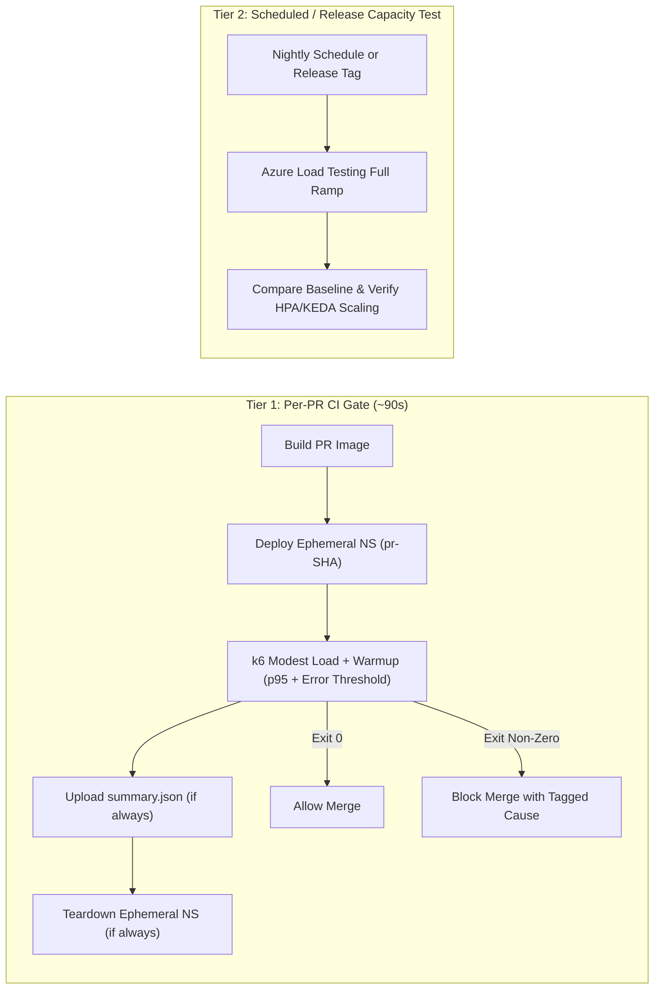
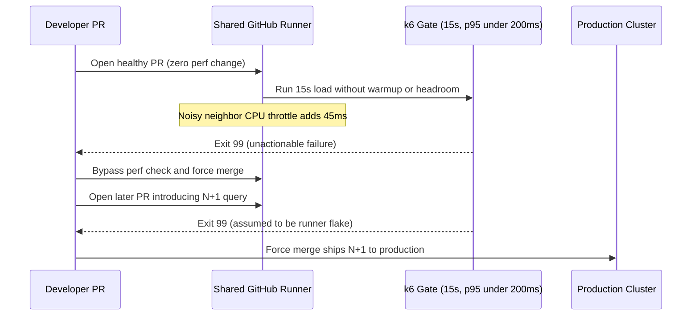

# 07 - Performance Testing in CI/CD

> **Prerequisites:** CI/CD pipelines & GitHub Actions ([10-cicd-and-gitops/01](../../10-cicd-and-gitops/01-github-actions-deep-dive/README.md)), k6 thresholds & CLI (`Module 01`), warm-up & steady-state design (`Module 03`), and profiling/bottleneck workflows ([Modules 05–06](../06-profiling-and-application-performance/README.md)).  
> **Estimated Reading Time:** 30 minutes  
> **Target Audience:** Backend Engineers, DevOps Engineers, Platform Engineers.

> [!TIP]
> **The Golden Rule of CI Performance Gating:** Keep per-PR checks **small, fast, deterministic, and headroom-buffered** (always paired with `http_req_failed` and an `if: always()` teardown of the ephemeral environment), while relegating full peak and autoscaling load suites to a **nightly or release-branch schedule**—because a slow or flaky gate trains developers to bypass it.

---

## Why This Matters

Every load test so far, you ran by hand — which means performance is only checked when someone *remembers* to check it, and a regression sails to production between those moments. In [track 10](../../10-cicd-and-gitops/README.md) you built pipelines that gate merges on unit tests, image scans, and deployments; a performance test belongs in that same gate. The goal is narrow and specific: catch a change that makes p95 materially worse *before* it ships, using a test small enough to run on every pipeline without slowing developers down or — the failure mode that kills these efforts — flaking so often that the team learns to ignore it. A perf gate everyone bypasses is worse than none, because it costs pipeline time and trains people to click "merge anyway."

---

## 1. Architectural Mental Model: Two-Tier Performance Gating & Ephemeral Cleanup

A trustworthy pipeline separates fast per-commit regression detection against a disposable ephemeral deployment from heavy capacity and autoscaling validation on a controlled schedule:



### The CI perf gate is a *different* test from your big load test

The load tests in modules 03-05 ramp to real peak load, run for many minutes, and often need Azure Load Testing's engines. That test does **not** belong in a per-commit pipeline — it's too slow and too expensive to run on every push. The CI gate is a **small, fast, deterministic** test: modest load (tens of VUs, not thousands), a short duration (a minute or two), against a freshly-deployed build, whose only job is to answer "did *this change* regress performance relative to what we accept?" You keep both: the big periodic/pre-release load test that proves capacity and autoscaling (modules 04-05, often on a schedule or a release branch), and the lightweight per-commit gate that catches regressions early. Confusing the two — trying to run the full peak test on every commit — is how teams end up with a 40-minute pipeline nobody wants to trigger.

### It's the same k6 script and the same thresholds — that's the payoff

Everything that makes k6 CI-friendly, you already built. The script is a plain file in your repo (module 01). Thresholds set the **exit code** — pass is 0, breach is non-zero (module 01) — which is *exactly* the pass/fail signal a CI step reads. `-e BASE_URL=...` (module 01 ex 7) points the same script at the ephemeral environment the pipeline just deployed. So wiring k6 into CI is barely more than adding a step that runs `k6 run test.js` and lets its exit code fail the job — no new tooling, no rewrite. This is why module 01 insisted on threshold-based gating and parameterized URLs from the start: it was building toward this exact step. The pipeline discipline from track 10 (a failing step blocks the merge) does the rest.

### Where in the pipeline it runs: deploy to ephemeral, then test

A perf gate needs something running to test, so it slots *after* the build/deploy of a **temporary environment** and *before* promotion. The shape, building on track 10's stages: build the image → deploy it to an ephemeral namespace or a Container Apps revision (a throwaway, not production) → run the k6 gate against that deployment → tear the environment down → the k6 exit code decides whether the pipeline proceeds. This mirrors how track 10 ran integration tests against a deployed build rather than a mock. The ephemeral environment matters: you're testing the *actual built artifact* on infrastructure resembling production, not a developer's guess — and tearing it down keeps the perf gate from leaking cost (the track-21 discipline, and this track's cost warning).

### Regression thresholds: absolute SLO vs. relative-to-baseline

Two ways to set the gate's pass/fail bar, and the choice matters. **Absolute threshold:** fail if p95 > 300ms — the SLO-derived bar from module 00. Simple, stable, and it's what you want for the *contract* ("we promise 300ms"). **Relative / baseline threshold:** fail if p95 is more than X% worse than the *last known good* run — catches a *regression* (a change that made things 40% slower) even while still technically inside the SLO, which is the early warning an absolute bar misses. The subtle trap: relative thresholds are more sensitive but also more *flaky*, because CI runners have noisy, variable performance (shared, throttled, cold). A common robust setup is a **loose absolute** gate on every commit (catch gross regressions cheaply and stably) plus a **baseline comparison** on a more controlled environment (a schedule, or a dedicated runner) where the noise is lower. Naming which you're using, and why, is half of making the gate trustworthy.

### The real enemy: flakiness, and how to not create it

A perf gate that fails randomly — passing on retry with no code change — is poison: developers stop believing red means "you broke performance" and start reflexively re-running or bypassing, so a *real* regression slides through unnoticed. CI runners are the flakiness source: they're shared, CPU-throttled, have variable network, and start cold. Defenses, in order of importance: (1) gate on **percentiles with headroom**, not a razor's edge — if the SLO is 300ms and CI noise is ±50ms, gate at 400ms so noise alone can't fail it; (2) keep the gate's load **modest and its duration long enough** to average out noise (a 90s run is far less noisy than a 10s one); (3) include a brief **warm-up** and evaluate steady state (module 03) so cold-start latency doesn't fail the gate; (4) for baseline comparisons, use a **less noisy environment** than a generic shared runner. And — the module-00/module-01 rule that saves you from a *different* kind of false pass — always include an **`http_req_failed` threshold**, so a deploy that half-broke doesn't sail through on great latency for the few requests that worked. The target is a gate that goes red **when and only when** performance actually regressed.

### What a failed gate should *tell* you

A red perf gate must be actionable, or people will bypass it out of frustration. The pipeline should surface *which* threshold failed and by how much (k6's summary already prints `✓`/`✗` per threshold), ideally publish the `--summary-export` JSON (module 01) as a build artifact so the numbers are inspectable, and point at the offending endpoint if you tagged them (module 05). A failure that just says "perf gate failed, exit 1" sends a developer digging; one that says "p95 on `/checkout` was 620ms vs. the 400ms gate, error rate fine" sends them straight to the cause. This is the CI equivalent of module 05's "don't just say it's slow, say *where*."

---

## 2. Taxonomic Comparison & Command Reference

### Tiered CI Performance Testing Comparison

| Dimension | Per-PR Performance Gate | Scheduled / Release Capacity Test |
| :--- | :--- | :--- |
| **Trigger** | Every Pull Request before merge | Nightly cron schedule or release branch |
| **Load Shape & Duration** | Modest steady load (e.g., 20 VUs for ~90s + warmup) | Full open-model ramp to peak/stress (15–45 mins, ALT engines) |
| **Target Environment** | Ephemeral SHA-keyed namespace/revision | Dedicated staging cluster mirroring prod topology |
| **Threshold Style** | Headroom-buffered absolute SLO + error rate | Exact SLO verification + autoscaling & baseline comparison |
| **Primary Question** | "Did this PR introduce a gross regression or fast 500s?" | "Does the platform scale and hold SLO at peak capacity?" |

### Absolute SLO vs. Relative Baseline Thresholds

| Criterion | Absolute (SLO-Derived + Headroom) | Relative (Compared to Baseline Run) |
| :--- | :--- | :--- |
| **What It Catches** | Breaches of latency/error SLA contracts | Quiet regressions (e.g., +45% latency) still below SLO |
| **CI Runner Noise Sensitivity** | Low when buffered with measured noise headroom | High on shared/throttled CI runners |
| **Recommended Placement** | Mandatory per-PR merge blocker | Controlled scheduled runner or dedicated perf lab |

### Command Reference

k6 flags and patterns that matter specifically in CI:

| Flag / pattern | Why it matters in CI | Example |
|---|---|---|
| `k6 run test.js` exit code | The pass/fail signal the pipeline reads; non-zero fails the job | `k6 run test.js` (job fails on threshold breach) |
| `--quiet` | Suppresses the progress bar for clean CI logs | `k6 run --quiet test.js` |
| `--summary-export summary.json` | Emits machine-readable results to publish as a build artifact | `k6 run --summary-export summary.json test.js` |
| `-e BASE_URL=$EPHEMERAL_URL` | Points the same script at the pipeline's temp deployment | `k6 run -e BASE_URL="https://pr-123.ephemeral.example" test.js` |
| `--no-color` | Cleaner logs in CI systems that don't render ANSI | `k6 run --no-color test.js` |
| `thresholds` with headroom | The anti-flake bar (gate above SLO by the noise margin) | `http_req_duration: ['p(95)<400']` |
| `--out experimental-prometheus-rw` | Stream gate results to Prometheus/Grafana (track 12) for history | `k6 run --out experimental-prometheus-rw test.js` |
| `abortOnFail` (threshold option) | Fail *fast* the moment a threshold is breached, saving CI minutes | `http_req_failed: [{ threshold: 'rate<0.05', abortOnFail: true }]` |

A GitHub Actions step (building on track 10's workflows):

```yaml
      - name: Deploy to ephemeral namespace
        run: ./scripts/deploy-ephemeral.sh "$GITHUB_SHA"   # your track-10 deploy, to a temp ns

      - name: Performance gate
        run: |
          k6 run --quiet --no-color \
            --summary-export summary.json \
            -e BASE_URL="https://pr-${GITHUB_SHA}.ephemeral.example" \
            tests/perf/gate.js
        # non-zero exit from a breached threshold fails this step -> blocks the merge

      - name: Publish k6 summary
        if: always()                     # publish even when the gate failed
        uses: actions/upload-artifact@v4
        with: { name: k6-summary, path: summary.json }

      - name: Tear down ephemeral namespace
        if: always()                     # always clean up, pass or fail (cost + hygiene)
        run: ./scripts/teardown-ephemeral.sh "$GITHUB_SHA"
```

| Step detail | Why it's there |
|---|---|
| Deploy to *ephemeral* ns, keyed by `$GITHUB_SHA` | Test the real built artifact in isolation, not production |
| `k6 run` with thresholds | The exit code gates the merge — the whole point |
| `--summary-export` + upload `if: always()` | Actionable failure: the numbers survive even a red run |
| Teardown `if: always()` | No leaked cost/resources whether the gate passed or failed |

---

## 3. Production War Story Post-Mortem: The Flaky Gate That Trained Engineers to Bypass Performance Checks

| Field | Incident Details |
| :--- | :--- |
| **Severity** | **SEV-2** (Production Latency Regression Shipped After Gate Bypass) |
| **Detection / Resolution Time** | Regression discovered 36 hours post-release via customer support tickets / Hotfix shipped in 45 minutes |
| **Impact** | Checkout p95 doubled from 290ms to 680ms in production because engineers bypassed a chronically noisy CI perf check |

### What Happened

A backend team added a 15-second k6 step to GitHub Actions with `http_req_duration: ['p(95)<200']` (matching their exact 200ms production SLO with zero headroom) and no `http_req_failed` threshold. Because shared CI runners experienced intermittent CPU throttling and cold container starts, ~35% of healthy PRs randomly failed with `exit 99` and zero diagnostic details. Frustrated developers disabled branch protection and merged anyway. Two weeks later, a real N+1 query regression doubled checkout latency and sailed straight into production on a bypassed check.



### Root Cause Analysis

1. **Zero noise headroom and insufficient duration**: Evaluating 15 seconds on a noisy shared runner without warmup meant normal jitter breached the hairline 200ms SLO threshold.
2. **Unactionable failure output**: Failing with a generic exit code and no `--summary-export` artifact made debugging indistinguishable from runner flakiness.

### The Fix & Architectural Hardening

- Rebuilt `gate.js` with a 15s warmup stage + 90s steady state, buffered the per-PR threshold to `p(95)<320ms` alongside `http_req_failed: ['rate<0.02']`, and added tagged endpoint breakdowns.
- Uploaded `summary.json` and rendered a Markdown table into `$GITHUB_STEP_SUMMARY` with `if: always()`, restoring developer trust so branch protection could be re-enforced.

---

## 4. Multi-Language Production Implementation: Actionable CI Summary Gate & Regression Reporter

Publishing `--summary-export summary.json` is only half the battle—evaluating it into a clear threshold + baseline delta report (highlighting exact breached endpoints and error rates) makes CI failures immediately actionable in PR logs or `$GITHUB_STEP_SUMMARY`.

````carousel
```go
package cigate

import (
	"encoding/json"
	"fmt"
	"os"
)

type K6Summary struct {
	Metrics map[string]struct {
		Values map[string]float64 `json:"values"`
	} `json:"metrics"`
}

// EvaluateGate checks p95 headroom, error rate, and optional baseline regression %.
func EvaluateGate(summaryPath string, maxP95Ms, maxErrRate, baselineP95Ms, maxRegressionPct float64) error {
	raw, err := os.ReadFile(summaryPath)
	if err != nil {
		return fmt.Errorf("read summary %s: %w", summaryPath, err)
	}
	var s K6Summary
	if err := json.Unmarshal(raw, &s); err != nil {
		return err
	}

	p95 := s.Metrics["http_req_duration"].Values["p(95)"]
	errRate := s.Metrics["http_req_failed"].Values["rate"]

	fmt.Printf("| Metric | Actual | Gate | Status |\n|---|---:|---:|---|\n")
	fmt.Printf("| p95 latency | %.1f ms | < %.1f ms | %s |\n", p95, maxP95Ms, status(p95 < maxP95Ms))
	fmt.Printf("| error rate  | %.2f%%  | < %.2f%%  | %s |\n", errRate*100, maxErrRate*100, status(errRate < maxErrRate))

	if p95 >= maxP95Ms || errRate >= maxErrRate {
		return fmt.Errorf("absolute gate failed: p95=%.1fms errRate=%.4f", p95, errRate)
	}
	if baselineP95Ms > 0 {
		deltaPct := ((p95 - baselineP95Ms) / baselineP95Ms) * 100
		if deltaPct > maxRegressionPct {
			return fmt.Errorf("relative regression %.1f%% exceeded limit %.1f%%", deltaPct, maxRegressionPct)
		}
	}
	return nil
}

func status(ok bool) string {
	if ok {
		return "PASS"
	}
	return "FAIL"
}
```
<!-- slide -->
```typescript
import { readFileSync } from "node:fs";

interface K6SummaryJson {
  metrics: Record<string, { values: Record<string, number> }>;
}

export interface GateLimits {
  maxP95Ms: number;
  maxErrorRate: number;
  baselineP95Ms?: number;
  maxRegressionPct?: number;
}

export function evaluateK6Summary(summaryPath: string, limits: GateLimits): number {
  const data = JSON.parse(readFileSync(summaryPath, "utf8")) as K6SummaryJson;
  const p95 = data.metrics["http_req_duration"]?.values["p(95)"] ?? Number.POSITIVE_INFINITY;
  const errRate = data.metrics["http_req_failed"]?.values["rate"] ?? 1;

  const p95Pass = p95 < limits.maxP95Ms;
  const errPass = errRate < limits.maxErrorRate;
  let relPass = true;

  if (limits.baselineP95Ms && limits.maxRegressionPct !== undefined) {
    const pctDelta = ((p95 - limits.baselineP95Ms) / limits.baselineP95Ms) * 100;
    relPass = pctDelta <= limits.maxRegressionPct;
  }

  console.log(
    `Gate Report: p95=${p95.toFixed(1)}ms (limit ${limits.maxP95Ms}ms), ` +
      `err=${(errRate * 100).toFixed(2)}% (limit ${(limits.maxErrorRate * 100).toFixed(2)}%)`
  );

  return p95Pass && errPass && relPass ? 0 : 1;
}
```
<!-- slide -->
```python
import json
import sys
from pathlib import Path


def evaluate_k6_gate(
    summary_path: str,
    max_p95_ms: float,
    max_err_rate: float,
    baseline_p95_ms: float | None = None,
    max_regression_pct: float = 25.0,
) -> int:
    data = json.loads(Path(summary_path).read_text(encoding="utf-8"))
    metrics = data.get("metrics", {})

    p95 = metrics.get("http_req_duration", {}).get("values", {}).get("p(95)", float("inf"))
    err_rate = metrics.get("http_req_failed", {}).get("values", {}).get("rate", 1.0)

    failures: list[str] = []
    if p95 >= max_p95_ms:
        failures.append(f"p95={p95:.1f}ms >= gate {max_p95_ms:.1f}ms")
    if err_rate >= max_err_rate:
        failures.append(f"error_rate={err_rate:.4f} >= gate {max_err_rate:.4f}")
    if baseline_p95_ms and baseline_p95_ms > 0:
        pct = ((p95 - baseline_p95_ms) / baseline_p95_ms) * 100.0
        if pct > max_regression_pct:
            failures.append(f"regression=+{pct:.1f}% > +{max_regression_pct:.1f}%")

    if failures:
        print("PERF GATE FAILED: " + "; ".join(failures), file=sys.stderr)
        return 1
    print(f"PERF GATE PASSED: p95={p95:.1f}ms, error_rate={err_rate:.4f}")
    return 0
```
<!-- slide -->
```csharp
using System.Text.Json;

public static class K6GateEvaluator
{
    public static int Evaluate(string summaryPath, double maxP95Ms, double maxErrRate, double? baselineP95Ms = null, double maxRegressionPct = 25.0)
    {
        using var doc = JsonDocument.Parse(File.ReadAllText(summaryPath));
        var metrics = doc.RootElement.GetProperty("metrics");

        double p95 = metrics.GetProperty("http_req_duration").GetProperty("values").GetProperty("p(95)").GetDouble();
        double errRate = metrics.GetProperty("http_req_failed").GetProperty("values").GetProperty("rate").GetDouble();

        bool ok = p95 < maxP95Ms && errRate < maxErrRate;
        if (baselineP95Ms is > 0)
        {
            double deltaPct = ((p95 - baselineP95Ms.Value) / baselineP95Ms.Value) * 100.0;
            if (deltaPct > maxRegressionPct) ok = false;
        }

        Console.WriteLine($"k6 Gate -> p95={p95:F1}ms (limit <{maxP95Ms:F1}ms), err={errRate:P2} (limit <{maxErrRate:P2}), result={(ok ? "PASS" : "FAIL")}");
        return ok ? 0 : 1;
    }
}
```
````

---

## 5. Practical Hands-On Verification CLI Workflows

You need a repo with a pipeline (track 10) and a small app you can deploy to an ephemeral namespace on kind or AKS. A GitHub Actions workflow from [track 10 module 01](../../10-cicd-and-gitops/01-github-actions-deep-dive/README.md) is the base.

### 1. Write the lightweight gate script

Make a *small* test, distinct from your big load test — tens of VUs, ~60-90s, both thresholds, with headroom over the SLO:

```javascript
// tests/perf/gate.js
import http from 'k6/http';
import { check, sleep } from 'k6';
export const options = {
  vus: 20,
  duration: '90s',
  thresholds: {
    // SLO is p95<300ms; gate at 400ms to absorb CI noise (see Concepts)
    http_req_duration: ['p(95)<400'],
    http_req_failed:   ['rate<0.02'],
  },
};
export default function () {
  const res = http.get(`${__ENV.BASE_URL}/`);
  check(res, { 'status 200': (r) => r.status === 200 });
  sleep(1);
}
```

```bash
k6 run -e BASE_URL=http://localhost:8080 tests/perf/gate.js ; echo "exit: $?"
```

**Expected Output:**
```text
     ✓ status 200
     ✓ http_req_duration..............: p(95)=84.2ms
     ✓ http_req_failed................: 0.00%
exit: 0
```
> Verify: runs in ~90s, both thresholds `✓`, exit 0. This is your gate; note it deliberately runs *modest* load with a *headroom* bar.

### 2. Confirm the exit code gates

Point it at a slow endpoint (`/delay/1`) so p95 blows the 400ms bar:

```bash
k6 run -e BASE_URL=http://localhost:8080 tests/perf/gate.js ; echo "exit: $?"
```

**Expected Output:**
```text
     ✗ http_req_duration..............: p(95)=1018.4ms
     ERRO[0090] thresholds on metrics 'http_req_duration' have been crossed
exit: 99
```
> Verify: `http_req_duration` `✗`, exit **non-zero**. In CI, that non-zero exit is what blocks the merge — verify the number yourself before trusting a pipeline to read it.

### 3. Wire it into the pipeline after an ephemeral deploy

Add the perf-gate step to your track-10 workflow *after* the step that deploys the build to a temporary namespace/revision and *before* any promotion, using the YAML from the command reference. Push a branch and open a PR.

**Expected Output:**
```text
Run k6 run --quiet --no-color --summary-export summary.json -e BASE_URL=...
  ✓ http_req_duration..............: p(95)=112.5ms
  ✓ http_req_failed................: 0.00%
Uploading summary.json artifact...
Tearing down ephemeral namespace pr-a1b2c3d...
```
> Verify: the Actions run deploys the build, runs `k6`, and the job's status reflects the k6 exit code. Confirm a normal build passes the gate.

### 4. Catch a real regression before it ships

On a branch, introduce a deliberate performance regression in the app — add a `sleep(300ms)` to the hot endpoint, or reintroduce an N+1 (module 06) — commit, and open a PR.

**Expected Output:**
```text
  ✗ http_req_duration..............: p(95)=448.1ms
Error: Process completed with exit code 99.
Post-step (if: always): Uploaded k6-summary artifact; tore down ephemeral ns.
```
> Verify: the pipeline **deploys the regressed build, runs the gate, and fails the check**, blocking the merge — the regression is caught in CI instead of production. This is the entire value proposition, demonstrated end to end. Revert and confirm the gate goes green again.

### 5. Make the failure actionable

Confirm your workflow uploads `summary.json` with `if: always()` and add per-endpoint tags (module 05) to the gate script. Re-trigger the failing run from exercise 4.

**Expected Output:**
```text
  ✗ http_req_duration{name:checkout}..: p(95)=620.4ms  (threshold: p(95)<400)
  ✓ http_req_duration{name:catalog}...: p(95)=42.1ms
  ✓ http_req_failed...................: 0.00%
```
> Verify: the build artifacts include the k6 summary, and the failing threshold names *which* endpoint and *by how much* — a developer can act without re-running anything locally. Compare to a bare "exit 1": one sends them to the cause, the other sends them digging.

### 6. Deliberately create — then fix — flakiness

Set a razor-thin, no-headroom bar and a very short run to *induce* flakiness:

```javascript
export const options = { vus: 20, duration: '10s',
  thresholds: { http_req_duration: ['p(95)<205'] } };  // SLO is 200ms, ~no margin, 10s run
```

Run it in CI (or on a loaded laptop) several times. **Expected:** it fails *sometimes* with no code change — pure CI/host noise crossing a hairline bar over too-short a window. **Diagnose:** the gate has no headroom over the SLO and too short a run to average noise. **Fix:** widen the bar to absorb the measured noise (e.g. `p(95)<300`), lengthen the run to ~90s, and add a brief warm-up. Re-run several times and confirm it's now *stably* green on unchanged code. Lesson: a flaky gate trains people to bypass it — headroom and duration are what make red mean "you regressed," not "unlucky runner."

### 7. Diagnose and fix: the gate passes a half-broken deploy

Configure the gate with *only* a latency threshold (delete the `http_req_failed` line) and deploy a build where the endpoint returns fast `500`s (module 01 ex 9 / module 06).

**Expected Output:**
```text
# With http_req_failed removed:
  ✗ status 200 (check only, non-gating)
  ✓ http_req_duration..............: p(95)=4.2ms
exit: 0   <-- Broken build passed!
```
> Verify: the gate **passes** — the errors are fast, latency is great, exit 0 — and a broken build ships. **Diagnose:** a latency-only gate blesses fast failures; there's no error-rate check. **Fix:** restore `http_req_failed: ['rate<0.02']` and re-run — now the broken deploy fails the gate. Lesson carried from modules 01 and 06: a perf gate without an error-rate threshold has a hole a broken deploy walks straight through.

### 8. Separate the gate from the big load test

Keep exercise 1's gate on every PR, and set up the *full* peak load test (modules 04-05, via Azure Load Testing) to run on a **schedule** (nightly) or on the release branch only — not per commit. Expected: two distinct jobs — a fast per-commit gate and a slow periodic capacity test. Confirm the per-commit pipeline stays fast (the gate adds ~90s, not 40 minutes). This is the structural answer to "why not just run the big test every time."

### 9. Clean up

```bash
# ensure the pipeline's teardown step ran; manually remove any leaked ephemeral ns:
kubectl get ns | grep ephemeral   # should be empty after a clean run
# delete any scheduled ALT resource if you created one for exercise 8
```

> Verify: no ephemeral namespaces or load-testing resources left billing. Verify the teardown step ran `if: always()` even on the failed runs from exercises 4 and 6.

### Independent challenge

Add a performance gate to a real pipeline from [track 10](../../10-cicd-and-gitops/README.md): write a lightweight k6 gate script (distinct from your big load test — modest load, ~90s, both thresholds with SLO-derived numbers plus noise headroom), wire it into the workflow so it runs against an ephemeral deployment of the build and its exit code blocks the merge, publish the k6 summary as a build artifact so a failure is actionable, and ensure the ephemeral environment is always torn down. Then *prove it works in both directions*: push a change that regresses the hot path and show the gate red-blocks the merge, and push a normal change and show it passes *stably* over several runs (not flakily). State explicitly which threshold style you used (absolute SLO vs. baseline) and how you chose the headroom to avoid flakiness. This draws on track 10 (the pipeline), modules 00-01 (thresholds/exit codes), module 03 (warm-up/steady state), and module 06 (the regression you introduce).

<details><summary>Stuck? One hint</summary>

The gate is just a small k6 script whose exit code the CI step already respects — the work is *around* it: a deploy-to-ephemeral step before it (keyed by the commit SHA so runs don't collide), a teardown step after it with `if: always()`, and `--summary-export` uploaded with `if: always()` so a red run is inspectable. For anti-flakiness, measure your CI runner's natural p95 noise on unchanged code over a few runs, then set the gate a comfortable margin above the SLO (or above that measured noise, whichever is higher) and make the run long enough (~90s) to average it out. Keep the big peak/autoscaling test (modules 04-05) on a *schedule* or release branch, not on every commit. Always include `http_req_failed` so a fast-failing deploy can't pass on latency alone.

</details>

---

## 6. Common Mistakes & Troubleshooting

- **Running the full peak load test on every commit.** Too slow and too expensive; developers stop triggering the pipeline. The per-commit gate is a small, fast test; the big test runs on a schedule/release branch.
- **A razor-thin threshold with no headroom.** CI runners are noisy; a bar at the exact SLO fails randomly. Gate above the SLO by the measured noise margin.
- **Too-short a gate run.** A 10s run is dominated by noise and cold start; ~90s averages it out. Include a brief warm-up and evaluate steady state.
- **A flaky gate that people bypass.** The worst outcome — it trains the team to ignore red, so a real regression slips through. Fix the flakiness; don't disable the gate.
- **No error-rate threshold.** A latency-only gate passes a deploy returning fast errors. Always pair `http_req_duration` with `http_req_failed`.
- **Testing production, or leaking the ephemeral env.** Gate against a throwaway deployment of the build, and tear it down `if: always()` — a leaked env is a cost and a hygiene problem.
- **An unactionable failure.** "exit 1" with no numbers sends developers digging. Publish the summary and tag endpoints so red says *what* and *where*.
- **Confusing absolute and baseline thresholds.** Know which you're using: absolute checks the SLO contract; baseline catches regressions still inside the SLO but is more flake-prone — often use a stable absolute gate per commit and baseline comparison in a controlled environment.

---

## 7. Operational Validation Checkpoints & Cumulative Review

### Operational Validation Checkpoints

<details><summary><strong>Checkpoint 1: Choosing CI gate headroom without hiding genuine regressions</strong></summary>

If your production SLO is `p95 < 250ms` and repeated runs on unchanged code inside shared GitHub Actions runners fluctuate between 190ms and 275ms, setting the gate at `p95 < 250ms` guarantees ~30% random flakiness. Measure the runner baseline variance first, add a brief warm-up stage, run for 90s, and set the per-PR absolute gate around `p95 < 340ms` while running strict baseline-delta tracking on a dedicated nightly runner.

</details>

<details><summary><strong>Checkpoint 2: Preventing orphaned ephemeral environments after failed PR gates</strong></summary>

When `k6 run` exits with code 99 on a threshold breach, GitHub Actions aborts all subsequent steps unless explicitly guarded. Placing `if: always()` on both the `actions/upload-artifact` step (`summary.json`) and the ephemeral namespace teardown step ensures developers get actionable metrics while preventing orphaned clusters or containers from accumulating overnight cloud bills.

</details>

<details><summary><strong>Checkpoint 3: Catching a "fast 500" deployment bug in CI</strong></summary>

A misconfigured database secret causes the newly deployed ephemeral pod to return HTTP `500` in 3 milliseconds. Without `http_req_failed: ['rate<0.02']`, `http_req_duration` p95 looks stellar (`4ms`) and the PR gate exits 0, shipping a completely broken service. Pairing latency thresholds with error-rate thresholds eliminates this blind spot.

</details>

### Checkpoint quiz

Write down your answer to each question before expanding it — checking without attempting first is the single easiest way to fool yourself into thinking you've learned this.

1. How is the CI perf *gate* different from the big load test from modules 04-05, and why don't you run the big one on every commit?
2. What single property of k6 (built in module 01) makes wiring it into a pipeline almost trivial?
3. Where in the pipeline does the gate run relative to build/deploy/promote, and why does it need an ephemeral environment?
4. Contrast an absolute (SLO) threshold with a baseline (relative) threshold — what does each catch, and which is more prone to flakiness?
5. Name three concrete defenses against a flaky perf gate, and why flakiness is specifically dangerous (not just annoying).
6. Why must a CI perf gate include an error-rate threshold, not just a latency one?
7. What makes a failed gate *actionable*, and why does that matter for whether the gate survives?
8. Give the two-tier structure that lets you both catch regressions per-commit and validate real capacity — without a 40-minute pipeline.

<details><summary>Show answers</summary>

1. The gate is **small, fast, deterministic** (tens of VUs, ~1-2 min, modest load) and only answers "did *this change* regress?"; the big test ramps to real peak, runs many minutes, and often needs Azure Load Testing engines. Running the big one per commit makes the pipeline too slow/expensive, so developers avoid triggering it.
2. Thresholds set the **exit code** (0 = pass, non-zero = breach) — exactly the pass/fail signal a CI step reads — and `-e BASE_URL` points the same script at the pipeline's deployment. So the CI step is little more than `k6 run`.
3. **After** build + deploy-to-ephemeral, **before** promotion. It needs a running instance to test, and an ephemeral (throwaway) environment lets it test the *actual built artifact* in isolation without touching production — torn down after to avoid leaked cost.
4. **Absolute/SLO**: fail if p95 > a fixed bar — checks the *contract*, stable. **Baseline/relative**: fail if p95 is X% worse than last known good — catches a *regression* even while still inside the SLO, but is more sensitive to CI noise and thus more flake-prone.
5. Any three of: gate on **percentiles with headroom** above the SLO (bigger than the noise); keep load modest but **run long enough** (~90s) to average noise; include a **warm-up** and evaluate steady state; use a **less noisy environment** for baseline comparisons; always add an **error-rate threshold**. Flakiness is dangerous because it trains the team to ignore red / bypass, so a *real* regression slips through unnoticed.
6. Because a deploy returning fast errors passes a latency-only gate (the errors are quick), shipping a broken build. The error-rate threshold catches "fast but wrong."
7. Surfacing *which* threshold failed and *by how much* (publish `--summary-export`, tag endpoints so it names the offending path). It matters because an unactionable "exit 1" frustrates developers into bypassing the gate, while an actionable failure sends them straight to the cause and keeps the gate trusted.
8. A **lightweight per-commit gate** (fast, catches regressions, blocks merges) plus the **full peak/capacity + autoscaling test on a schedule or release branch** (modules 04-05, Azure Load Testing). Two jobs, so the per-commit pipeline stays fast (~90s added) while capacity is still validated periodically.

</details>

---

## 8. Next

[08-capstone-project](../08-capstone-project/README.md) — put it all together: a realistic load test on a real cluster, proof that autoscaling handles it via Grafana, a real bottleneck found and fixed, and a performance gate in CI.
