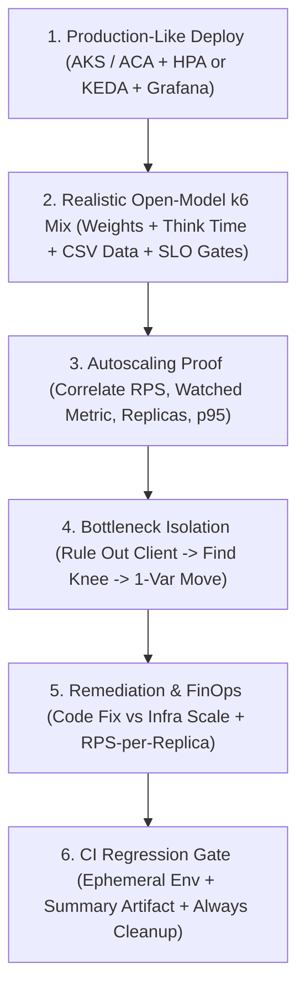
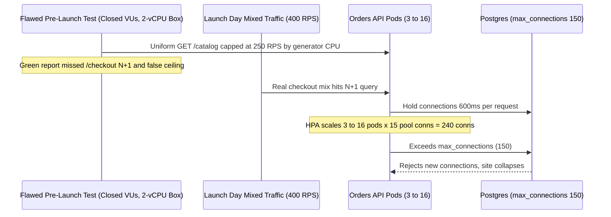

# 08 - Capstone Project

> **Prerequisites:** Modules 00–07 of this track, AKS/Container Apps (`Tracks 06–07`), CI/CD (`Track 10`), Observability (`Track 12`), Databases (`Track 14`), SRE SLOs ([Track 20](../../20-sre-practices/README.md)), and FinOps (`Track 21`).  
> **Estimated Reading Time:** 120–180 minutes (end-to-end hands-on integration)  
> **Target Audience:** Backend Engineers, SREs, Platform Engineers.

> [!TIP]
> **The Golden Rule of the Performance Capstone:** Never claim a system scales because an HPA or KEDA YAML exists—present **correlated Grafana evidence** showing offered load, the watched metric, replica count, and SLO-derived p95 on one timeline, prove any capacity ceiling by **ruling out the load generator** and moving a real bottleneck with a single-variable change, and enforce regression protection in CI before tearing down every billable resource.

---

## Why This Matters

This is the last module of the performance track, and it exists to make you do the one thing the whole curriculum has been building toward twice over: not *configure* autoscaling, but *prove* it. Back in [track 03 module 09](../../03-kubernetes/09-scaling-hpa-and-vpa/README.md) and [track 06 module 03](../../06-azure-container-apps/03-scaling-with-keda/README.md) you set up HPA and KEDA and watched a synthetic signal move a number. Everything since — the four test types, k6, Azure Load Testing, realistic traffic modeling, reading autoscaling correctly, finding bottlenecks, profiling, and CI gating — was in service of turning that demo into a *measured, defended claim*: "under realistic load, this system scales, holds its SLO, and I know where it breaks and why." There's no new concept and no quiz here; the goal is to integrate modules 00-07 into one real, end-to-end piece of performance engineering.

---

## 1. Architectural Mental Model: End-to-End Performance Engineering Loop

The capstone integrates all eight modules into a single closed-loop engineering workflow where each stage provides the evidence required by the next:



### The project

Take a real, multi-component application — your [track 07 AKS capstone](../../07-aks/09-capstone-project/README.md) app, a Container Apps deployment from [track 06](../../06-azure-container-apps/README.md), or any real app you've built that has a database and at least two meaningfully different endpoints — and put it through a complete performance-engineering cycle. Treat this as a project with dependencies, in roughly this order:

1. **Deploy the app for real** on AKS or Container Apps, with autoscaling configured the way you'd actually run it in production (HPA on an appropriate metric, or KEDA scale rules) and observability wired up so you can watch it — Grafana fed by Prometheus (track 12), or Azure Load Testing's App Component correlation (module 02).

2. **Design a realistic load test** (module 03): model the real traffic *mix* across your endpoints in production-like proportions, with randomized think time, data parameterization so you're not just warming a cache, and at least one correlated stateful flow. Use an **open/arrival-rate** executor for the part that must drive scaling. State the SLO the test verifies (from [track 20](../../20-sre-practices/README.md), or a plausible one you define).

3. **Prove autoscaling actually works** (module 04): run the test at real scale (Azure Load Testing engines if a laptop can't reach the load) and produce a Grafana dashboard showing, on **one timeline**, offered load, the metric the autoscaler watches, replica count, and client-side p95 — demonstrating that scaling *triggers* and that latency stays within SLO through the ramp. Read the result correctly: distinguish "scaled and healthy" from "scaled but too slow" from "scaled to max and still failing."

4. **Find at least one real bottleneck** (module 05): push past the knee and diagnose *which* resource is the wall — a CPU/memory limit, connection-pool exhaustion (track 14), or a downstream dependency's rate limit — proving the diagnosis by changing one thing and watching the knee move. Rule out a false bottleneck (confirm the generator had headroom).

5. **Propose (and ideally make) a fix** for that bottleneck (module 06): decide whether the right response is infra scaling or a code-level fix (an N+1, a hot path, a pool/pooler change), justify the choice including its recurring-vs-one-time cost (track 21), and if it's a code fix you can make, prove the improvement with a re-run (more RPS-per-replica within SLO).

6. **Wire a lightweight performance gate into a CI pipeline** (module 07, on a track-10 pipeline): a small, fast, headroom-tuned k6 gate that deploys the build to an ephemeral environment, runs against it, blocks the merge on a threshold breach, publishes its summary, and tears the environment down — and demonstrate it catches a deliberately-introduced regression while staying stably green on unchanged code.

---

## 2. Taxonomic Comparison & Acceptance Checklist

### Configured vs. Proven Capstone Evidence Matrix

| Phase | Merely Configured (Insufficient) | Proven Operational Evidence Required |
| :--- | :--- | :--- |
| **1–2. Traffic & SLO** | Hardcoded uniform `GET /` VU loop | Weighted multi-endpoint arrival-rate script with CSV parameterization & SLO thresholds |
| **3. Autoscaling** | HPA YAML applied; `replicas` went up once | Single Grafana timeline correlating RPS, watched metric, replicas, and p95 within SLO |
| **4. Bottleneck** | Guessing "DB looks slow" from a spike | Client headroom verified (`top`/`mpstat`), signature attributed, knee shifted via 1 variable |
| **5. Remediation** | Raising `maxReplicas` blindly | FinOps comparison (recurring infra bill vs one-time code fix) + post-fix RPS-per-replica proof |
| **6. CI Gate** | Manual `k6` command in developer notes | PR ephemeral deploy + stable green runs + red-blocked regression PR + `if: always()` teardown |

### Acceptance checklist

Work through these in order; each depends on the previous ones actually working, not just existing.

- [ ] A real app with a database and ≥2 distinct endpoints is deployed on AKS or Container Apps with production-style autoscaling (HPA on an appropriate metric, or KEDA) configured.
- [ ] Observability is live: a Grafana dashboard (or Azure Load Testing App Component correlation) that can show offered load, the autoscaler's watched metric, replica count, and p95 latency together.
- [ ] A k6 load test that is genuinely *realistic*: a traffic mix in production-like proportions across the endpoints, randomized think time, at least one parameterized-from-a-dataset field (no accidental cache-only test), and at least one correlated stateful flow — with an **open/arrival-rate** executor driving the scaling-relevant load.
- [ ] The test's thresholds are **derived from a stated SLO** (not from a prior measurement), and include both a latency percentile and an error-rate bound.
- [ ] First-hand evidence (a saved Grafana dashboard / screenshot, or an Azure Load Testing report) that autoscaling **triggered** under the load — the watched metric crossed target and replica count climbed.
- [ ] A correct *reading* of that result in writing: whether latency stayed within SLO through the ramp, and which of the three outcomes (healthy / too-slow / downstream-limited) you observed.
- [ ] At least one **real bottleneck** identified by pushing past the knee, with the diagnosis (which resource) *proven* by changing one variable and showing the knee move — and the false-bottleneck (saturated generator) explicitly ruled out.
- [ ] A written scale-vs-fix decision for that bottleneck, justified with the recurring-vs-one-time cost framing; if a code fix was feasible, a re-run showing improved RPS-per-replica within SLO.
- [ ] A CI performance gate on a real pipeline: a small k6 test that deploys to an ephemeral environment, gates the merge on its exit code, publishes its summary as an artifact, and tears the environment down `if: always()`.
- [ ] Proof the gate works **both ways**: a deliberately-regressed change is red-blocked, and an unchanged/normal change passes *stably* across several runs (not flakily).
- [ ] Everything billable is cleaned up: the cluster/Container Apps, any Azure Load Testing resource, and any ephemeral namespaces are gone and no longer billing.
- [ ] You can explain, for each piece, what you *proved* versus what you merely *configured* — if you can't say what a given step demonstrated, that's a sign to go back rather than having copy-pasted a passing command.

---

## 3. Production War Story Post-Mortem: How a "Passing" Capstone Demo Failed Production Week One

| Field | Incident Details |
| :--- | :--- |
| **Severity** | **SEV-1** (Post-Launch Production Collapse Under First Marketing Campaign) |
| **Detection / Resolution Time** | Detected in 2 minutes at campaign launch / Mitigated in 38 minutes |
| **Impact** | Orders API exhausted Postgres `max_connections` at 400 RPS despite "passing" pre-launch tests at 250 RPS |

### What Happened

An engineering team checked off every surface item before launch: HPA configured on CPU, a k6 load script ran green from a 2-vCPU CI runner, and Grafana existed. However, their test ran a closed-VU loop exclusively against `GET /catalog` (cached in Redis) while ignoring `POST /checkout` (which held an N+1 query inside a database transaction). Furthermore, the tiny 2-vCPU generator capped out at 250 RPS—creating a false bottleneck that looked like "steady performance." On launch day, mixed user traffic hit `/checkout`, triggered HPA scaling from 3 to 16 pods, and exhausted Postgres `max_connections`.



### Root Cause Analysis

1. **False bottleneck + unrepresentative uniform traffic**: Testing one cached GET endpoint from a CPU-starved generator hid both the real server ceiling and the `/checkout` N+1 bug.
2. **Unproven autoscaling effect**: Nobody checked whether scaling app pods actually helped `/checkout` latency or worsened DB connection pressure.

### The Fix & Architectural Hardening

- Enforced every item on the **Acceptance Checklist** above: moved heavy load generation to Azure Load Testing engines with verified generator headroom, added weighted traffic mixes hitting parameterized checkout flows, eliminated the N+1 query, deployed PgBouncer, and gated PR merges with an ephemeral k6 CI step.

---

## 4. Multi-Language Production Implementation: Automated Capstone Evidence & SLO Scorecard Verifier

To prove your capstone results programmatically before sign-off, use a scorecard verifier that inspects exported k6 `summary.json` alongside observed telemetry snapshots—checking SLO latency/error bounds, generator headroom (ruling out false bottlenecks), autoscaling responsiveness, and RPS-per-replica gains.

````carousel
```go
package capstone

import (
	"encoding/json"
	"fmt"
	"os"
)

type CapstoneReport struct {
	OfferedRPS        float64 `json:"offered_rps"`
	GeneratorCPU      float64 `json:"generator_cpu_pct"`
	StartReplicas     int     `json:"start_replicas"`
	PeakReplicas      int     `json:"peak_replicas"`
	P95Ms             float64 `json:"p95_ms"`
	ErrorRate         float64 `json:"error_rate"`
	SLOMs             float64 `json:"slo_p95_ms"`
	BaselineRPSPerPod float64 `json:"baseline_rps_per_pod"`
}

func VerifyScorecard(path string) error {
	raw, err := os.ReadFile(path)
	if err != nil {
		return err
	}
	var r CapstoneReport
	if err := json.Unmarshal(raw, &r); err != nil {
		return err
	}
	if r.GeneratorCPU >= 75.0 {
		return fmt.Errorf("false bottleneck risk: generator CPU %.1f%% >= 75%%", r.GeneratorCPU)
	}
	if r.PeakReplicas <= r.StartReplicas {
		return fmt.Errorf("autoscaling not proven: replicas stayed at %d", r.StartReplicas)
	}
	if r.P95Ms > r.SLOMs || r.ErrorRate >= 0.02 {
		return fmt.Errorf("SLO breached: p95=%.1fms (limit %.1fms), err=%.2f%%", r.P95Ms, r.SLOMs, r.ErrorRate*100)
	}
	rpsPerPod := r.OfferedRPS / float64(r.PeakReplicas)
	fmt.Printf("CAPSTONE PASS: p95=%.1fms, scaled %d->%d, efficiency=%.1f RPS/pod (baseline=%.1f)\n",
		r.P95Ms, r.StartReplicas, r.PeakReplicas, rpsPerPod, r.BaselineRPSPerPod)
	return nil
}
```
<!-- slide -->
```typescript
import { readFileSync } from "node:fs";

export interface CapstoneEvidence {
  offeredRps: number;
  generatorCpuPct: number;
  startReplicas: number;
  peakReplicas: number;
  p95Ms: number;
  sloP95Ms: number;
  errorRate: number;
}

export function verifyCapstoneEvidence(filePath: string): void {
  const ev = JSON.parse(readFileSync(filePath, "utf8")) as CapstoneEvidence;
  const issues: string[] = [];

  if (ev.generatorCpuPct >= 75) {
    issues.push(`Generator CPU ${ev.generatorCpuPct}% too high (possible false bottleneck)`);
  }
  if (ev.peakReplicas <= ev.startReplicas) {
    issues.push(`Replicas did not scale (${ev.startReplicas} -> ${ev.peakReplicas})`);
  }
  if (ev.p95Ms > ev.sloP95Ms) {
    issues.push(`p95 ${ev.p95Ms}ms breached SLO ${ev.sloP95Ms}ms`);
  }
  if (ev.errorRate >= 0.02) {
    issues.push(`Error rate ${(ev.errorRate * 100).toFixed(2)}% >= 2%`);
  }

  if (issues.length > 0) {
    throw new Error(`Capstone acceptance failed:\n- ${issues.join("\n- ")}`);
  }
  const rpsPerReplica = ev.offeredRps / ev.peakReplicas;
  console.log(`Capstone verified: ${rpsPerReplica.toFixed(1)} RPS/replica within ${ev.sloP95Ms}ms SLO.`);
}
```
<!-- slide -->
```python
import json
from pathlib import Path


def verify_capstone_scorecard(report_path: str) -> dict:
    data = json.loads(Path(report_path).read_text(encoding="utf-8"))
    failures: list[str] = []

    if data["generator_cpu_pct"] >= 75.0:
        failures.append(f"Generator saturated ({data['generator_cpu_pct']}%); false bottleneck unruled")
    if data["peak_replicas"] <= data["start_replicas"]:
        failures.append("No autoscaling event recorded")
    if data["p95_ms"] > data["slo_p95_ms"]:
        failures.append(f"SLO breached: {data['p95_ms']}ms > {data['slo_p95_ms']}ms")
    if data["error_rate"] >= 0.02:
        failures.append(f"Error budget exceeded: {data['error_rate']:.2%}")

    if failures:
        raise AssertionError("Capstone checks failed: " + "; ".join(failures))

    rps_per_replica = data["offered_rps"] / data["peak_replicas"]
    return {"status": "PASS", "rps_per_replica": round(rps_per_replica, 2)}
```
<!-- slide -->
```csharp
using System.Text.Json;

public sealed record CapstoneSnapshot(
    double OfferedRps,
    double GeneratorCpuPct,
    int StartReplicas,
    int PeakReplicas,
    double P95Ms,
    double SloP95Ms,
    double ErrorRate);

public static class CapstoneScorecard
{
    public static void Validate(string jsonPath)
    {
        var snap = JsonSerializer.Deserialize<CapstoneSnapshot>(File.ReadAllText(jsonPath))
            ?? throw new InvalidOperationException("Invalid scorecard JSON");

        if (snap.GeneratorCpuPct >= 75.0)
            throw new InvalidOperationException($"Generator CPU {snap.GeneratorCpuPct:F1}% risks false bottleneck.");
        if (snap.PeakReplicas <= snap.StartReplicas)
            throw new InvalidOperationException("Autoscaling trigger not proven.");
        if (snap.P95Ms > snap.SloP95Ms || snap.ErrorRate >= 0.02)
            throw new InvalidOperationException($"SLO violated: p95={snap.P95Ms:F1}ms, err={snap.ErrorRate:P2}");

        Console.WriteLine($"PASS: {snap.OfferedRps / snap.PeakReplicas:F1} RPS/replica within SLO.");
    }
}
```
````

---

## 5. Practical Hands-On Verification CLI Workflows & Hints

Use these verification commands across the six capstone stages to capture hard evidence and ensure clean cloud teardown when finished:

### 1. Smoke-test your parameterized realistic k6 script locally before cloud scale
```bash
k6 run -e BASE_URL=http://localhost:8080 --vus 5 --duration 30s tests/perf/realistic-mix.js
```
**Expected Output:**
```text
     ✓ status 200 (catalog)
     ✓ checkout flow correlated
     ✓ http_req_failed................: 0.00%
```
> Verify: data parameterization and correlated stateful flows pass locally with zero `4xx`/`5xx` script errors before provisioning Azure Load Testing engines.

### 2. Verify autoscaling triggered and generator stayed unpinned during peak ramp
```bash
kubectl get hpa -n prod-sim
kubectl get events -n prod-sim --field-selector reason=SuccessfulRescale --sort-by=.lastTimestamp
mpstat 5 3   # run on load generator host during peak stage
```
**Expected Output:**
```text
LAST SEEN   TYPE     REASON              OBJECT                MESSAGE
2m14s       Normal   SuccessfulRescale   hpa/orders-api        New size: 6; reason: All metrics below target
Average:     all    %usr  18.40   %sys  4.12   %idle  77.48
```
> Verify: `SuccessfulRescale` matches the timeline on Grafana where p95 recovered, while generator `%idle` stayed comfortably high (`>25%` idle), ruling out a false bottleneck.

### 3. Validate the CI performance gate and confirm complete cloud cost teardown
```bash
kubectl get ns | grep ephemeral
```
```powershell
az group list --query "[?starts_with(name, 'rg-perf-capstone')].name" -o table
```
**Expected Output:**
```text
# Empty output for both commands confirms zero leaked ephemeral namespaces or billable Azure resource groups.
```
> Verify: all clusters, Container Apps, Azure Load Testing resources, and ephemeral namespaces are deleted and no longer incurring charges.

### Hints

- **Reuse, don't reinvent.** The realistic script is your module-03 challenge script; the autoscaling proof is your module-04 setup; the gate is your module-07 gate. The capstone is integration, not new discovery — resist building fresh from scratch.
- **Develop the script locally, run it big in the cloud.** Get the k6 script correct with a small local `k6 run` first (module 01), *then* point Azure Load Testing at it with more engines (module 02). Never debug a script for the first time at managed scale.
- **If autoscaling "doesn't scale," check the metric before the mechanism.** The module-04 trap: high latency with a *calm* watched metric means you're scaling on the wrong signal (a CPU-HPA on an I/O-bound app), not that the HPA is broken. Watch the metric on Grafana, not just the replica count.
- **If scaling to max doesn't fix latency, stop scaling and look downstream.** That's the module-05 signal — a connection pool (track 14) or a dependency's rate limit that more app replicas can't help (and may worsen). "App latency high, DB calm" is pool exhaustion.
- **Before reporting any ceiling, run `top` on the k6 host.** The false bottleneck (module 05) — a saturated generator faking a server ceiling — is the easiest wrong conclusion to draw. Prove the client had room to push harder.
- **Tune the CI gate for stability, then trust it.** Measure the runner's noise on unchanged code, set the bar above the SLO by that margin, run ~90s, and keep the big peak test on a schedule — a flaky gate people bypass is worse than no gate (module 07).
- **Keep a running note of every billable resource** (cluster, ACR, Load Testing resource, ephemeral namespaces) so final cleanup is a checklist, not an archaeology exercise — and so a load test left running doesn't become a weekend bill.

---

## 6. Common Mistakes & Troubleshooting

- **Confusing configuration with proof.** Having an HPA manifest and a passing `GET /` k6 run does not prove autoscaling holds your SLO under real traffic mixes.
- **Debugging load scripts at Azure Load Testing scale.** Iterate locally with a 30-second smoke test first; launching 10 cloud engines to discover a missing JSON field burns money and time.
- **Scaling app replicas into a database pool wall.** When scaling to `maxReplicas` leaves latency degraded and Postgres CPU calm, stop scaling pods and fix the pool/N+1 bottleneck first.
- **Reporting a generator ceiling as server capacity.** Always record load-generator CPU and network headroom alongside server metrics before declaring a throughput limit.
- **Leaving load-testing or ephemeral resources running overnight.** Verify both the CI `if: always()` teardown and manual Azure resource group deletion before signing off.

---

## 7. Operational Validation Checkpoints & Readiness Review

### Operational Validation Checkpoints

<details><summary><strong>Checkpoint 1: Defending "autoscaling works" in an architecture review</strong></summary>

A single screenshot of `kubectl get hpa` showing `REPLICAS: 6` is insufficient. Present a synchronized Grafana view showing offered RPS rising, the watched metric crossing target, replica count climbing, and client-side p95 recovering under the stated SLO—along with explicit confirmation of which of the three outcomes (healthy, scaling lag, or downstream-limited) occurred.

</details>

<details><summary><strong>Checkpoint 2: Proving your bottleneck fix actually moved the ceiling</strong></summary>

Changing both the database pool size and the pod CPU limit in a single run invalidates root-cause attribution. Isolate one hypothesis at a time under the identical `ramping-arrival-rate` sweep, document the knee shifting from e.g. 220 RPS to 610 RPS, and record the resulting RPS-per-replica improvement to support your FinOps build-vs-buy argument.

</details>

<details><summary><strong>Checkpoint 3: Auditing CI gate reliability and cost hygiene</strong></summary>

Confirm that an intentional regression PR (such as an added `300ms` delay or N+1 loop) fails the pipeline and uploads its tagged `summary.json` artifact, that three consecutive unchanged PR runs pass without spurious flakiness, and that the `if: always()` teardown step leaves `kubectl get ns | grep ephemeral` empty after both green and red builds.

</details>

### Before you move on

When the checklist is done and everything is torn down, don't consider this finished yet. Wait a few days, then — with no notes and none of your earlier modules open — take a *different* app and reproduce the core of it cold: a realistic load test, a Grafana-backed proof that autoscaling triggers and holds SLO, one diagnosed-and-explained bottleneck, and a CI gate that catches a regression. Noticing exactly where you stall — was it modeling the traffic mix? reading the watched metric? distinguishing a pool bottleneck from a CPU one? — is the truest retention check there is, and it's what separates "I followed the exercises" from "I can do performance engineering."

This is the **last track before [24-platform-engineering](../../24-platform-engineering/README.md)** — the final capstone-of-capstones track that ties the entire curriculum together into a self-service internal developer platform. Everything you've built the ability to *prove* here — that a system scales, holds its SLO, and fails in a place you understand — is exactly what a platform has to guarantee on behalf of every team that deploys onto it. You now have the last major operational discipline the platform track assumes. Tear down anything still running, and go build the platform.

---

## 8. Next

[../../24-platform-engineering/README.md](../../24-platform-engineering/README.md) — the final track: fold everything from all 23 prior tracks into one self-service internal developer platform.
