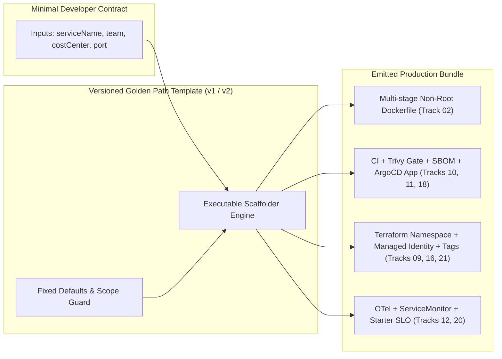
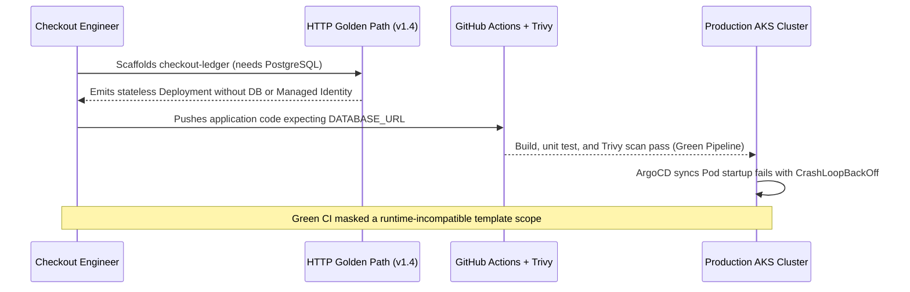

# Designing a Golden Path

> **Prerequisites:** [Module 00](../00-platform-engineering-concepts/README.md) plus core delivery, infra, security, and observability foundations ([Track 02](../../02-docker/README.md), [Track 09](../../09-terraform-on-azure/README.md), [Track 10](../../10-cicd-and-gitops/README.md), [Track 11](../../11-security-deep-dive/README.md), [Track 12](../../12-observability-deep-dive/README.md)).  
> **Estimated Reading Time:** 35 minutes  
> **Target Audience:** Platform Engineers, Backend Engineers, DevOps/SRE Engineers.

> [!TIP]
> **The Golden Rule of Golden Path Design:** Deliver every golden path as an **executable, versioned template** rather than a wiki page, lock in **opinionated defaults** (hardened base image, failing security gates, OTel, starter SLO, and cost tags) for the 80% case while leaving a bounded override path for the 20%, and always validate the **deployed runtime**—never confuse a green scaffold or green CI run with a working service.

---

## Why This Matters

In module 00 you learned *why* a paved road matters; this module is where you design the road itself. A golden path is the concrete artifact at the heart of platform engineering: a scaffolding template that, when a developer invokes it, emits a brand-new service that is *already* wired for CI/CD, GitOps, observability, and security — with none of it assembled by hand. Getting this design right is the difference between a platform that removes real toil and one that just adds a new layer of its own. And designing it forces you to make explicit, opinionated decisions about defaults that you previously made implicitly, one track at a time.

---

## 1. Architectural Mental Model: Composing Tracks 02–21 into an Executable Template

A golden path is not a brand-new tool—it is the deterministic **composition** of infrastructure, delivery, security, identity, observability, and FinOps primitives into a single versioned template contract:



### What "a golden path" actually contains

A golden path for "create a new service" is not one thing — it's a *bundle* of everything a service needs on day one, pre-assembled. Concretely, invoking it should produce: a source repository with a sane project layout and a Dockerfile ([track 02](../../02-docker/README.md)); a CI pipeline that builds, tests, scans, and pushes an image ([track 10](../../10-cicd-and-gitops/README.md)); a GitOps Application manifest so the service deploys by reconciliation, not `kubectl apply` ([track 10](../../10-cicd-and-gitops/README.md)); a Kubernetes namespace or Container App provisioned via a Terraform module ([track 09](../../09-terraform-on-azure/README.md)); vulnerability and secret scanning plus a baseline policy ([track 11](../../11-security-deep-dive/README.md), [track 18](../../18-supply-chain-security/README.md)); and OpenTelemetry instrumentation, a metrics scrape config, and a starter dashboard ([track 12](../../12-observability-deep-dive/README.md)). The developer supplies a *name* and a *few parameters*; the golden path supplies everything else.

The key realization: **you already built every one of those pieces**, one track at a time. The golden path is not new technology — it is the *composition* of pieces you know individually, frozen into a template so nobody has to compose them again. If you can't yet build a given piece by hand, you can't put it in a golden path; the path is only as good as your mastery of what it wires together.

### Opinionated defaults — deciding *for* the developer

The essence of a golden path is **opinionated defaults**: the platform decides, once and well, the things every team would otherwise decide badly and differently. Which base image? The hardened one from [track 11](../../11-security-deep-dive/README.md), not `latest`. Which deploy model? GitOps via the Application manifest from [track 10](../../10-cicd-and-gitops/README.md). Which observability? OpenTelemetry auto-instrumentation and a Prometheus `ServiceMonitor` from [track 12](../../12-observability-deep-dive/README.md). Which SLO? A sensible starter availability SLO from [track 20](../../20-sre-practices/README.md), pre-wired so the service is measured from day one.

Opinionated does not mean rigid. The art is choosing defaults that are *right for 80% of services* and letting the other 20% override specific values without abandoning the whole path. A default the developer can't change is a constraint; a default they *can* change but rarely need to is a gift. Every default you bake in is a decision you're making on behalf of dozens of teams — which is exactly why the platform team, who has seen all the tracks, should make it rather than each app team re-deciding it worse.

### The template as the unit of standardization

A golden path is delivered as a **template** — a parameterized skeleton that gets rendered with the developer's inputs. In practice this is a scaffolder template (Backstage's, [module 02](../02-internal-developer-portals/README.md); or `cookiecutter`, `copier`, a Helm chart, or a Terraform module). The template turns "the right way to build a service" from tribal knowledge into an *executable artifact* — and that's what makes it standardization rather than a wiki page everyone ignores.

Because the template is executable and versioned, it becomes the single point where you improve every future service at once: fix the CI pipeline in the template, and every service scaffolded afterward gets the fix for free. This is enormous leverage — and also a responsibility, because a bug in the template is a bug in every service born from it. Templates therefore need the same rigor as production code: tests, review, and versioning (which raises the *migration* problem — how do services created from v1 get v2's improvements? — that [module 07](../07-platform-adoption-and-measuring-success/README.md) tackles).

### Golden paths compose earlier tracks — the wiring diagram

It's worth seeing the composition explicitly, because *this composition is the whole point of the track*. A single "new HTTP service" golden path wires together:

- **[Track 02](../../02-docker/README.md)** — a multi-stage Dockerfile producing a small, non-root image.
- **[Track 09](../../09-terraform-on-azure/README.md)** — a Terraform module call that creates the service's namespace/Container App, its managed identity ([track 16](../../16-identity-deep-dive/README.md)), and any ACR access.
- **[Track 10](../../10-cicd-and-gitops/README.md)** — a CI workflow (build → test → scan → push) *and* a GitOps `Application` so ArgoCD reconciles the deployment.
- **[Track 11](../../11-security-deep-dive/README.md) / [18](../../18-supply-chain-security/README.md)** — image scanning, an SBOM, image signing, and an OPA/Gatekeeper baseline the service must satisfy.
- **[Track 12](../../12-observability-deep-dive/README.md)** — OTel SDK wiring, a `ServiceMonitor`, structured logging, and a starter Grafana dashboard.
- **[Track 20](../../20-sre-practices/README.md)** — a starter SLO and a burn-rate alert, so reliability is measured from commit one.
- **[Track 21](../../21-cost-management-and-finops/README.md)** — cost tags applied automatically to every resource the path creates.

The developer sees none of that plumbing — they see "I got a service." That invisibility *is* the developer experience win. Every arrow in that diagram is something you already know how to draw by hand; the golden path just draws them all at once, the same way, every time.

### The happy path is easy — the edge cases are the design

Any golden path handles the happy path — a stateless HTTP service with default everything. The real design skill shows up at the edges: a service that needs a database ([track 14](../../14-databases-and-stateful-workloads/README.md)), one that's event-driven rather than request/response ([track 15](../../15-messaging-and-event-driven-architecture/README.md)), one that needs a public API through a gateway ([track 19](../../19-api-management/README.md)), or one in a regulated landing zone with stricter policy ([track 17](../../17-governance-at-scale/README.md)). A path that only works for the happy path and breaks — or silently produces something broken — for a real team's variation is worse than no path, because it erodes trust.

Good golden-path design therefore means deciding, *up front and explicitly*, its scope: which variations it supports as parameters, which it supports as *separate* paths ("new event-driven service" vs. "new HTTP service"), and which it doesn't support at all (the off-ramp from module 00). The failure mode to hunt for is the template that *appears* to succeed but emits something subtly wrong for the edge case — a broken deploy is loud, but a service scaffolded without the right policy or without a database connection string is a quiet trap that surfaces in production. You'll build and fix exactly that in the exercises.

---

## 2. Taxonomic Comparison & Command Reference

### Common wiring reference (which track owns which default)

Keep this table nearby for the rest of the track — it's the map of what a full golden path composes and where each piece was taught.

| Default | Supplied by | Overridable? |
| :--- | :--- | :--- |
| Base image (hardened, non-root) | track 02 / 11 | Rarely — security-sensitive |
| Namespace + managed identity | track 09 / 16 | No — platform-owned |
| CI build/test/scan/push | track 10 / 11 | Steps yes, gate no |
| GitOps Application | track 10 | No — the deploy model is fixed |
| Image signing + SBOM | track 18 | No |
| OTel + ServiceMonitor + dashboard | track 12 | Dashboard yes, instrumentation no |
| Starter SLO + burn-rate alert | track 20 | Target yes, existence no |
| Cost tags | track 21 | Values from inputs, keys no |

### Edge-Case Scoping Strategies Comparison

| Dimension | Parameter Flag (`needs-db: true`) | Separate Golden Path (`new-stateful-service`) | Explicit Off-Ramp |
| :--- | :--- | :--- | :--- |
| **Template Complexity** | Increases conditional branches inside one template | Keeps each template linear and clean | Zero template bloat |
| **Developer Choice UX** | Single entry point; more form fields | Clear upfront pick ("HTTP" vs "Worker") | Team owns bespoke manifests |
| **Maintenance Risk** | Matrix explosion if >3 orthogonal flags interact | Multiple templates to keep in sync on v2 updates | Team owns security & drift |
| **Best Used When** | Variation is minor & orthogonal (e.g. external route) | Workload topology differs fundamentally (HTTP vs Worker) | Rare 5% workload (GPU, legacy monolith) |

### Command Reference

A golden path is defined by the artifacts it emits. The commands below are the *ingredients* you already know from earlier tracks, viewed as template outputs. No single new tool here — the skill is composition.

| Emitted artifact | Command / file that produces or applies it | Comes from |
| :--- | :--- | :--- |
| Container image | `docker build -t <acr>/<svc>:<sha> .` (multi-stage Dockerfile) | track 02 |
| Namespace / infra | `terraform apply` on a service module | track 09 |
| CI pipeline | `.github/workflows/ci.yml` (build → test → scan → push) | track 10 |
| GitOps deploy | ArgoCD `Application` YAML reconciled from Git | track 10 |
| Image scan | `trivy image <ref>` in CI | track 11 |
| Policy baseline | OPA/Gatekeeper `Constraint` the workload must pass | track 11 |
| Metrics scrape | Prometheus `ServiceMonitor` CR | track 12 |
| Starter SLO | `PrometheusRule` recording + burn-rate alert | track 20 |
| Cost tags | `tags = { team, cost-center, service }` on every resource | track 21 |

Multi-flag examples the template renders (know each flag, since the template bakes these decisions in):

| Command | Flag | Why the golden path sets it this way |
| :--- | :--- | :--- |
| `docker build --pull --no-cache -t $IMG .` | `--pull` | Always refetch the base image so a stale cached layer can't reintroduce a patched CVE |
| | `--no-cache` | CI builds are reproducible from scratch, not dependent on a warm layer cache |
| `trivy image --severity HIGH,CRITICAL --exit-code 1 $IMG` | `--severity HIGH,CRITICAL` | Fail the pipeline only on serious findings, so noise doesn't erode the gate |
| | `--exit-code 1` | Make a finding *fail CI* (track 11) rather than just print — the scan is a gate, not a report |
| `kubectl create namespace $SVC --dry-run=client -o yaml` | `--dry-run=client` | Render the manifest for GitOps instead of imperatively creating it — the path is declarative |
| | `-o yaml` | Emit YAML the template commits to the GitOps repo |
| `argocd app create $SVC --repo $URL --path $PATH --dest-namespace $SVC --sync-policy automated` | `--sync-policy automated` | The service reconciles automatically — the developer never runs a manual deploy |

---

## 3. Production War Story Post-Mortem: "Green Pipeline, Crash-Looping Service"

| Field | Incident Details |
| :--- | :--- |
| **Severity** | **SEV-1** (New Service Launch Failure & Broken Developer Trust) |
| **Detection / Resolution Time** | Detected 4 minutes after production ArgoCD sync / Resolved in 37 minutes via manual Terraform + Workload Identity wiring |
| **Impact** | `checkout-ledger` passed scaffolding and CI/CD completely green, then entered `CrashLoopBackOff` on rollout due to missing PostgreSQL module, connection secret, and Entra ID RBAC |

### What Happened

A product team selected the platform's `"new-http-service"` golden path to launch a payment ledger service requiring PostgreSQL. The template had no scope guard rejecting stateful workloads and no `needsDatabase` option. Scaffolding succeeded, `docker build` + `trivy` + ArgoCD sync all turned green, and the pod crashed within seconds in production with `FATAL: DATABASE_URL missing and no ManagedIdentity bound`.



### Root Cause Analysis

1. **Missing scope validation**: The `v1.4` HTTP template silently accepted any service without checking whether a backing database or message queue was needed.
2. **Build-only template testing**: Platform CI tested that the template rendered valid YAML and built a container image, but never deployed the rendered template into an ephemeral cluster to verify runtime health.

### The Fix & Architectural Hardening

- Split `"new-stateful-service"` into a separate, explicit golden path wiring Terraform PostgreSQL, private endpoints, and Workload Identity, and added a strict scope selector in `"new-http-service"`.
- Added automated **runtime smoke tests** in platform template CI: every PR to the template repository now renders a sample app, deploys it to an ephemeral `kind` cluster, verifies `/healthz`, confirms Prometheus scrapes metrics, and checks `trivy --exit-code 1` enforcement.

---

## 4. Multi-Language Production Implementation: Golden Path Contract Validator & Renderer

These four production implementations validate a developer's golden-path request against opinionated platform constraints (enforcing non-`:latest` hardened base images, mandatory cost tags, Trivy gate settings, and scope boundaries for stateful workloads) before rendering the service metadata contract.

````carousel
```go
package goldenpath

import (
	"errors"
	"fmt"
	"regexp"
	"strings"
)

var validServiceName = regexp.MustCompile(`^[a-z][a-z0-9-]{2,31}$`)

type ServiceRequest struct {
	ServiceName   string
	Team          string
	CostCenter    string
	Port          int
	BaseImage     string
	NeedsDatabase bool
	SLOTarget     float64
}

type RenderedBundle struct {
	Namespace      string
	DockerfileBase string
	TrivyGateCmd   string
	Tags           map[string]string
	SLOTarget      float64
}

// ValidateAndRender enforces golden-path opinionated defaults and scope boundaries before scaffolding.
func ValidateAndRender(req ServiceRequest) (*RenderedBundle, error) {
	if !validServiceName.MatchString(req.ServiceName) {
		return nil, fmt.Errorf("invalid serviceName %q: must match ^[a-z][a-z0-9-]{2,31}$", req.ServiceName)
	}
	if strings.TrimSpace(req.Team) == "" || strings.TrimSpace(req.CostCenter) == "" {
		return nil, errors.New("team and costCenter are required for automated Track 21 cost attribution")
	}
	if req.NeedsDatabase {
		return nil, errors.New("scope boundary violation: stateless HTTP path cannot provision databases; use 'new-stateful-service' golden path")
	}
	if req.BaseImage == "" {
		req.BaseImage = "cgr.dev/chainguard/static:nonroot@sha256:9f8b2c"
	}
	if strings.HasSuffix(req.BaseImage, ":latest") || !strings.Contains(req.BaseImage, "@sha256:") {
		return nil, fmt.Errorf("baseImage %q must be digest-pinned (@sha256:...), never mutable :latest", req.BaseImage)
	}
	if req.Port == 0 {
		req.Port = 8080
	}
	if req.SLOTarget == 0 {
		req.SLOTarget = 99.9
	}

	return &RenderedBundle{
		Namespace:      fmt.Sprintf("%s-%s", req.Team, req.ServiceName),
		DockerfileBase: req.BaseImage,
		TrivyGateCmd:   fmt.Sprintf("trivy image --severity HIGH,CRITICAL --exit-code 1 acr.azurecr.io/%s:ci", req.ServiceName),
		Tags: map[string]string{
			"team":        req.Team,
			"cost-center": req.CostCenter,
			"service":     req.ServiceName,
			"managed-by":  "golden-path-v2",
		},
		SLOTarget: req.SLOTarget,
	}, nil
}
```
<!-- slide -->
```typescript
export interface GoldenPathRequest {
  serviceName: string;
  team: string;
  costCenter: string;
  port?: number;
  baseImage?: string;
  needsDatabase?: boolean;
  sloTarget?: number;
}

export interface RenderedBundle {
  namespace: string;
  dockerfileBase: string;
  trivyGateCommand: string;
  tags: Record<string, string>;
  sloTarget: number;
}

const SERVICE_NAME_REGEX = /^[a-z][a-z0-9-]{2,31}$/;
const DEFAULT_HARDENED_IMAGE = "cgr.dev/chainguard/static:nonroot@sha256:9f8b2c";

export function validateAndRenderGoldenPath(req: GoldenPathRequest): RenderedBundle {
  if (!SERVICE_NAME_REGEX.test(req.serviceName)) {
    throw new Error(`Invalid serviceName '${req.serviceName}': use lowercase kebab-case (3-32 chars).`);
  }
  if (!req.team.trim() || !req.costCenter.trim()) {
    throw new Error("Both team and costCenter are mandatory for cost attribution tags.");
  }
  if (req.needsDatabase) {
    throw new Error(
      "Scope boundary: 'new-http-service' does not wire databases. Select 'new-stateful-service' to avoid CrashLoopBackOff."
    );
  }

  const baseImage = req.baseImage ?? DEFAULT_HARDENED_IMAGE;
  if (baseImage.endsWith(":latest") || !baseImage.includes("@sha256:")) {
    throw new Error(`Unsafe baseImage '${baseImage}': must be immutable and digest-pinned (@sha256:...).`);
  }

  return {
    namespace: `${req.team}-${req.serviceName}`,
    dockerfileBase: baseImage,
    trivyGateCommand: `trivy image --severity HIGH,CRITICAL --exit-code 1 acr.azurecr.io/${req.serviceName}:ci`,
    tags: {
      team: req.team,
      "cost-center": req.costCenter,
      service: req.serviceName,
      "managed-by": "golden-path-v2",
    },
    sloTarget: req.sloTarget ?? 99.9,
  };
}
```
<!-- slide -->
```python
import re
from dataclasses import dataclass

SERVICE_NAME_RE = re.compile(r"^[a-z][a-z0-9-]{2,31}$")
DEFAULT_HARDENED_IMAGE = "cgr.dev/chainguard/static:nonroot@sha256:9f8b2c"


@dataclass(frozen=True)
class GoldenPathRequest:
    service_name: str
    team: str
    cost_center: str
    port: int = 8080
    base_image: str = DEFAULT_HARDENED_IMAGE
    needs_database: bool = False
    slo_target: float = 99.9


@dataclass(frozen=True)
class RenderedBundle:
    namespace: str
    dockerfile_base: str
    trivy_gate_command: str
    tags: dict[str, str]
    slo_target: float


def validate_and_render(req: GoldenPathRequest) -> RenderedBundle:
    """Validate developer inputs and enforce opinionated golden-path defaults."""
    if not SERVICE_NAME_RE.match(req.service_name):
        raise ValueError(f"Invalid service_name '{req.service_name}'")
    if not req.team.strip() or not req.cost_center.strip():
        raise ValueError("team and cost_center are mandatory for Track 21 cost attribution")
    if req.needs_database:
        raise ValueError(
            "Scope violation: stateless HTTP path excludes DB wiring; route to 'new-stateful-service'"
        )
    if req.base_image.endswith(":latest") or "@sha256:" not in req.base_image:
        raise ValueError(f"Base image '{req.base_image}' must be pinned by @sha256 digest")

    return RenderedBundle(
        namespace=f"{req.team}-{req.service_name}",
        dockerfile_base=req.base_image,
        trivy_gate_command=f"trivy image --severity HIGH,CRITICAL --exit-code 1 acr.azurecr.io/{req.service_name}:ci",
        tags={
            "team": req.team,
            "cost-center": req.cost_center,
            "service": req.service_name,
            "managed-by": "golden-path-v2",
        },
        slo_target=req.slo_target,
    )
```
<!-- slide -->
```csharp
using System;
using System.Collections.Generic;
using System.Text.RegularExpressions;

public sealed record GoldenPathRequest(
    string ServiceName,
    string Team,
    string CostCenter,
    int Port = 8080,
    string BaseImage = "cgr.dev/chainguard/static:nonroot@sha256:9f8b2c",
    bool NeedsDatabase = false,
    double SloTarget = 99.9);

public sealed record RenderedBundle(
    string Namespace,
    string DockerfileBase,
    string TrivyGateCommand,
    IReadOnlyDictionary<string, string> Tags,
    double SloTarget);

public static partial class GoldenPathValidator
{
    [GeneratedRegex("^[a-z][a-z0-9-]{2,31}$")]
    private static partial Regex ServiceNamePattern();

    public static RenderedBundle ValidateAndRender(GoldenPathRequest req)
    {
        if (!ServiceNamePattern().IsMatch(req.ServiceName))
            throw new ArgumentException($"Invalid service name '{req.ServiceName}'.", nameof(req));

        if (string.IsNullOrWhiteSpace(req.Team) || string.IsNullOrWhiteSpace(req.CostCenter))
            throw new ArgumentException("Team and CostCenter are required for cost attribution.", nameof(req));

        if (req.NeedsDatabase)
            throw new InvalidOperationException(
                "Scope boundary: 'new-http-service' does not provision databases. Use 'new-stateful-service'.");

        if (req.BaseImage.EndsWith(":latest", StringComparison.OrdinalIgnoreCase) ||
            !req.BaseImage.Contains("@sha256:", StringComparison.Ordinal))
            throw new ArgumentException($"Base image '{req.BaseImage}' must use an immutable @sha256 digest.");

        return new RenderedBundle(
            Namespace: $"{req.Team}-{req.ServiceName}",
            DockerfileBase: req.BaseImage,
            TrivyGateCommand: $"trivy image --severity HIGH,CRITICAL --exit-code 1 acr.azurecr.io/{req.ServiceName}:ci",
            Tags: new Dictionary<string, string>
            {
                ["team"] = req.Team,
                ["cost-center"] = req.CostCenter,
                ["service"] = req.ServiceName,
                ["managed-by"] = "golden-path-v2"
            },
            SloTarget: req.SloTarget);
    }
}
```
````

---

## 5. Practical Hands-On Verification CLI Workflows

### Verification Workflows: Testing Golden-Path Template Outputs

Run these commands to verify the three foundational guarantees of a golden path: declarative manifest rendering, a failing security gate, and deterministic GitOps packaging.

#### Workflow A: Declaratively render a GitOps namespace manifest with cost labels
```bash
SVC="payments-api"
TEAM="checkout"
kubectl create namespace "$SVC" --dry-run=client -o yaml | \
  kubectl label --local -f - team="$TEAM" cost-center="cc-402" service="$SVC" -o yaml
```

**Expected Output:**
```yaml
apiVersion: v1
kind: Namespace
metadata:
  creationTimestamp: null
  labels:
    cost-center: cc-402
    service: payments-api
    team: checkout
  name: payments-api
spec: {}
status: {}
```
> Verify: `--dry-run=client -o yaml` produces declarative YAML ready to commit to GitOps without mutating any cluster imperatively.

#### Workflow B: Prove the security gate fails CI on a vulnerable base image
```bash
docker pull alpine:3.14
trivy image --severity HIGH,CRITICAL --exit-code 1 alpine:3.14
echo "Exit status: $?"
```

**Expected Output:**
```text
alpine:3.14 (alpine 3.14.10)
Total: 7 (HIGH: 5, CRITICAL: 2)
...
Exit status: 1
```
> Verify: `--exit-code 1` forces CI to abort rather than merely logging warnings—demonstrating security *in* the path by default.

### Hands-on exercises

You need the tooling from earlier tracks available (Docker, `kubectl`, a kind or AKS cluster, `git`). The point is composition, so reuse what you already built.

1. **List the golden path's contract.** Write down the *inputs* your "new HTTP service" golden path takes from a developer (service name, team, language, maybe a port) and the *outputs* it produces (repo, CI, GitOps Application, namespace, dashboard, SLO...). This input/output contract is the design; keep it to one screen.

2. **Build the template skeleton by hand.** Create a directory `service-template/` containing a placeholder repo: a `Dockerfile` (multi-stage, non-root, from track 02), a `.github/workflows/ci.yml` (build → test → `trivy` scan → push, from tracks 10-11), a `k8s/` folder with a Deployment/Service and a `ServiceMonitor` (track 12), and an `argocd-application.yaml` (track 10). Use an obvious placeholder like `{{SERVICE_NAME}}` everywhere the developer's input would go. You're building a template manually before automating it in module 02.

3. **Render it for a fake service.** With `sed` or your editor, replace every `{{SERVICE_NAME}}` with `payments-api` and every `{{TEAM}}` with `checkout`. Confirm the rendered output is a *complete, valid* service you could actually deploy. This manual render is exactly what a scaffolder automates.

4. **Bake in a security default and prove it bites.** Ensure your template's CI uses `trivy image --severity HIGH,CRITICAL --exit-code 1`. Introduce a deliberately vulnerable base image (e.g. an old tag) and confirm the rendered pipeline's scan step *fails*. The point: security is in the path by default, not bolted on — and it actually blocks.

5. **Bake in observability and confirm it's wired.** Verify the rendered service has a `ServiceMonitor` (or scrape annotation) and exports at least one metric. Deploy it to your kind cluster from [track 12](../../12-observability-deep-dive/README.md) and confirm Prometheus is scraping it *without you configuring anything after scaffolding*. If you had to touch Prometheus by hand, the observability wiring isn't actually in the path yet.

6. **Add cost tags automatically.** Ensure every resource the path's Terraform creates carries `team`, `cost-center`, and `service` tags derived from the developer's inputs (track 21). Render for two different teams and confirm the tags differ correctly — this is what makes cost attribution (module 06) possible later.

7. **Diagnose-and-fix: the template that breaks for a real team.** Your "new HTTP service" path works perfectly for a stateless service. The `checkout` team scaffolds a service from it that needs a PostgreSQL database ([track 14](../../14-databases-and-stateful-workloads/README.md)). The scaffold *succeeds* and the pipeline goes green, but the service crash-loops in the cluster because there's no database, no connection string, and no managed identity ([track 16](../../16-identity-deep-dive/README.md)) to reach one. Reproduce a version of this (scaffold a service that expects an env var or backing resource the template doesn't provide, and watch it fail at runtime). Then decide the *right* fix: do you (a) add a `needs-database` parameter that provisions a managed database and injects the connection via workload identity, (b) create a *separate* "new stateful service" golden path, or (c) declare databases off-path? Write your decision and *why*, then implement whichever you chose for a minimal case. The lesson: a green pipeline is not a working service, and the edge cases are where the design actually lives.

8. **Version the template and reason about migration.** Tag your template `v1`. Now improve it — say, add a stricter OPA policy baseline (track 11) — and tag `v2`. Write down: how does `payments-api` (scaffolded from v1) get v2's improvement? There's no clean automatic answer; describe the options (rescaffold, manual backport, a renovate-style bot) and their tradeoffs. This is the drift problem module 07 returns to.

### Independent challenge

Drawing on this module and tracks 09, 10, 11, and 12 (and optionally 16, 20, and 21), design — on paper, in full — the complete contract and wiring diagram for a golden path of your choice that is *not* the plain HTTP service: pick either a **public-facing API service** (add [track 19](../../19-api-management/README.md) gateway configuration and [track 16](../../16-identity-deep-dive/README.md) auth by default) or an **event-driven worker** (add [track 15](../../15-messaging-and-event-driven-architecture/README.md) Service Bus/Dapr pub-sub wiring by default). Specify every input the developer provides, every artifact the path emits, which earlier track supplies each artifact, which defaults are fixed vs. overridable, and — critically — the explicit *scope boundary*: which variations this path supports and which it deliberately doesn't. The deliverable is a design document a teammate could implement from, not code.

<details><summary>Stuck? One hint</summary>

Start from the plain HTTP service path's contract and ask, for your chosen variant, "what's *added*, what's *changed*, and what's *removed*?" A public API service is mostly the HTTP path plus an API Management route ([track 19](../../19-api-management/README.md)) and a default auth policy ([track 16](../../16-identity-deep-dive/README.md)) — so most of your diagram is reuse, not new invention. An event-driven worker *removes* the Ingress and *adds* a topic subscription ([track 15](../../15-messaging-and-event-driven-architecture/README.md)) and a different scaling trigger (KEDA on queue length rather than HTTP RPS). The scope boundary is the hardest and most important part: name at least one realistic variation you'd push off-path and say who owns it instead.

</details>

---

## 6. Common Mistakes & Troubleshooting

- **Confusing a golden path with a wiki page.** Documentation of "the right way" is not a golden path; an *executable, versioned template* that produces the right way is. If teams still assemble it by hand from your docs, you haven't built a path.
- **Over-parameterizing.** A template with 40 knobs is as much cognitive load as no template at all. Bake opinionated defaults; expose only the few knobs teams genuinely differ on.
- **Under-parameterizing (a wall, not a road).** A template that supports exactly one shape and breaks for any variation drives teams off-path entirely. Know which variations you support and be explicit about the rest.
- **Green pipeline, broken service.** The most dangerous failure: the scaffold and CI succeed but the emitted service is subtly wrong (missing a backing resource, wrong policy). Test the *runtime*, not just the render.
- **Bolting security on after.** If scanning and policy aren't in the template from render time, teams ship first and secure later (i.e. never). Security defaults belong *in* the path (tracks 11/18), failing the pipeline when unmet.
- **Forgetting the migration problem.** Templates improve; already-scaffolded services drift. If you have no story for propagating template v2 to v1 services, your platform's quality silently forks.
- **Baking in a stale base image.** A template that pins an old base image reintroduces patched CVEs into every new service. Use `--pull` and keep the template's base image current (tracks 11/18).

---

## 7. Operational Validation Checkpoints & Checkpoint Quiz

### Operational Validation Checkpoints

<details><summary><strong>Checkpoint 1: Resisting the 40-parameter "configurable everything" template</strong></summary>

A team asks for template parameters covering `cpuRequest`, `cpuLimit`, `memoryRequest`, `memoryLimit`, `livenessDelaySeconds`, `prometheusScrapePath`, and `dockerfileUserId`. Exposing all of them reintroduces raw Kubernetes cognitive load. Keep `cpu/memory` as a small `sizeTier` (`small`, `medium`, `large`) or optional override block, and **lock** `dockerfileUserId` (non-root) and `prometheusScrapePath` (`/metrics`) as non-overridable golden-path defaults.

</details>

<details><summary><strong>Checkpoint 2: Catching template defects before app teams scaffold them</strong></summary>

Your platform team bumps the starter `ServiceMonitor` API version in the template from `v1alpha1` to `v1`, and unit tests checking `sed` variable substitution pass. However, production clusters still run an older Prometheus Operator CRD version, so newly scaffolded services silently stop emitting metrics. Testing golden-path PRs by deploying the rendered skeleton onto a live cluster version matching production prevents silent drift at scaffold time.

</details>

<details><summary><strong>Checkpoint 3: Handling v1-to-v2 template drift across 60 existing repos</strong></summary>

After tagging `v2` of your golden path with a stricter `trivy --exit-code 1` gate and signed SBOM generation, 60 existing services scaffolded on `v1` still have the older workflow because scaffolding created independent Git forks. Opening automated update PRs (Renovate/Dependabot or reusable GitHub Actions workflow references `uses: acme/platform-workflows/.github/workflows/ci.yml@v2`) lets v1 services adopt v2 fixes cleanly without manual backports.

</details>

### Checkpoint quiz

Write down your answer to each question before expanding it — checking without attempting first is the single easiest way to fool yourself into thinking you've learned this.

<details><summary>Show questions</summary>

1. Name at least six distinct artifacts a "new HTTP service" golden path should emit, and the track each comes from.
2. What does "opinionated defaults" mean, and what's the difference between a default you can't change and one you rarely need to change?
3. Why is a golden path delivered as an *executable template* rather than documentation, and what leverage does that give the platform team?
4. What's the danger of the "green pipeline, broken service" failure, and how do you catch it?
5. A team needs a database-backed service and your HTTP path doesn't support it. Name the three legitimate design responses and one tradeoff of each.
6. Why is baking security scanning *into* the template (failing CI) different from documenting that teams should scan their images?
7. Explain the template migration problem: why does improving a template *not* automatically improve services already made from it?

</details>

<details><summary>Show answers</summary>

1. Any six of: repo + Dockerfile (track 02), CI pipeline (track 10), GitOps Application (track 10), namespace/infra via Terraform (track 09), image scan + policy baseline (track 11/18), OTel + ServiceMonitor + dashboard (track 12), starter SLO + burn-rate alert (track 20), cost tags (track 21).
2. Opinionated defaults means the platform decides, once and well, the choices every team would otherwise make badly and differently (base image, deploy model, observability). A default you *can't* change is a constraint; one you *can* change but rarely need to is a gift — it serves the 80% while letting the 20% override.
3. Documentation is ignored and re-assembled inconsistently; an executable, versioned template *is* the standard and produces it identically every time. Leverage: fix the template once and every service scaffolded afterward gets the fix for free.
4. The scaffold and CI go green but the emitted service is subtly wrong (missing backing resource, wrong policy), so the failure surfaces in production, not at build time, eroding trust. Catch it by testing the *runtime* (deploy the rendered service and confirm it actually runs), not just that the template renders.
5. (a) Add a parameter that provisions the database + workload identity — keeps one path but adds complexity/knobs. (b) Create a separate "stateful service" path — cleaner but more paths to maintain. (c) Declare databases off-path — simplest, but pushes work back to the team. Any reasonable tradeoff each.
6. Documentation relies on discipline every team must repeat; baking it in with `--exit-code 1` makes the scan a *gate* that blocks a vulnerable image from ever shipping, by default, without anyone remembering to run it. Security in the path vs. bolted on after.
7. A template renders a *copy* at scaffold time; there's no live link back. When the template improves, existing services are unaffected because they were forked from the old version — so quality drifts unless you rescaffold, backport, or run an automated update bot (module 07's drift problem).

</details>

---

## 8. Next

[02-internal-developer-portals](../02-internal-developer-portals/README.md) — you've designed the golden path as a template; now give it a *front door*. You'll learn how an internal developer portal (Backstage, conceptually) exposes your scaffolder templates, catalogs every service the platform knows about, and hosts the docs — turning the template you hand-rendered into a one-click self-service action.
