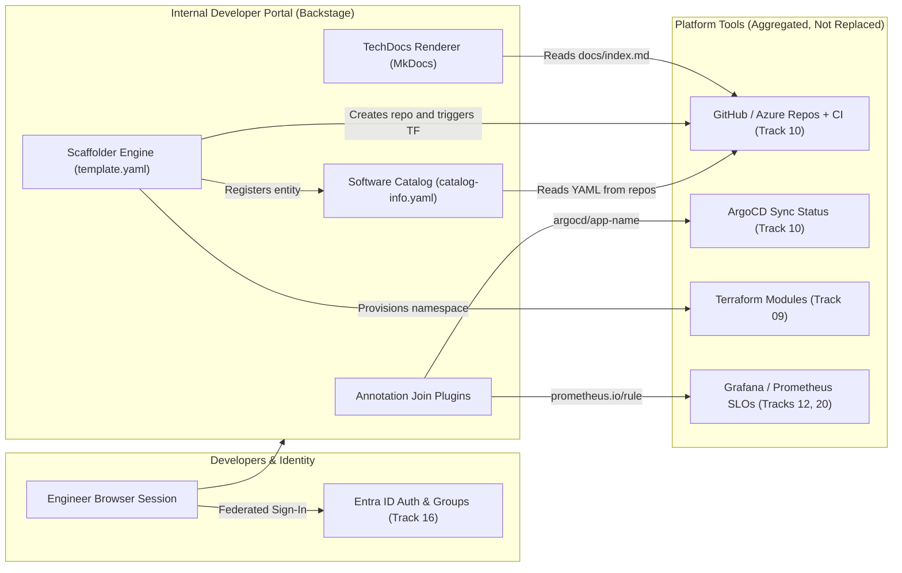
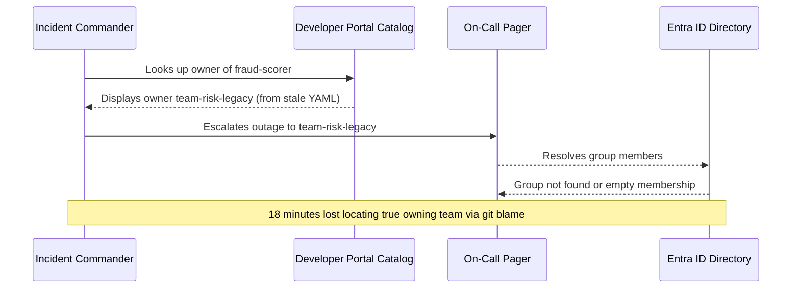

# Internal Developer Portals

> **Prerequisites:** [Module 01](../01-designing-a-golden-path/README.md), Git/CI/GitOps ([Track 10](../../10-cicd-and-gitops/README.md)), Observability ([Track 12](../../12-observability-deep-dive/README.md)), and Entra ID ([Track 16](../../16-identity-deep-dive/README.md)).  
> **Estimated Reading Time:** 40 minutes  
> **Target Audience:** Platform Engineers, Backend Engineers, Developer Experience Leads.

> [!TIP]
> **The Golden Rule of Internal Developer Portals:** Treat the portal as an **aggregation and orchestration front door** rather than a replacement for underlying tools; keep `catalog-info.yaml` and **TechDocs** inside each service's own repository so metadata stays current with code PRs, and validate every `owner` against **real Entra ID groups** so your catalog never rots into confidently-wrong data.

---

## Why This Matters

You designed a golden-path template in module 01, but a template sitting in a Git repo isn't self-service — someone still has to know it exists, find it, and run it correctly. An **internal developer portal (IDP)** is the front door that turns your platform's capabilities into things developers can *discover and click*: a searchable catalog of every service, one-click scaffolding from your templates, and docs that live next to the code. Without a portal, even a great golden path stays tribal knowledge; with one, "create a new service the right way" becomes a form a developer fills out. This module is the developer-facing surface of everything you've built.

---

## 1. Architectural Mental Model: Catalog, Scaffolder, TechDocs & Plugin Aggregation

An internal developer portal like Backstage acts as a thin human-facing index and orchestration layer over Git repositories, CI/CD, observability, and identity systems:



### The portal as the platform's front door

An internal developer portal is a single web application where developers go to *do platform things*: create a new service, find an existing one, read its docs, see who owns it, and check its health. **Backstage** — open-sourced by Spotify and now the dominant tool in this space — is the canonical example, so this module uses it as the reference model, but the concepts (catalog, templates, docs) apply to any portal (Port, Cortex, a homegrown one). The point is not the tool; it's the *pattern* of a unified front door.

The portal's job is to reduce **cognitive load** (module 00): instead of a developer needing to know that CI lives in GitHub Actions, deploys in ArgoCD, dashboards in Grafana, infra in Terraform, and the runbook in a wiki, the portal stitches all of that into one view *per service*. It doesn't replace those tools — it aggregates and links them. Backstage calls this being a "developer portal," but the deeper idea is that it's the human-facing index over the entire platform you assembled across tracks 09-23.

### The software catalog — the system of record

The heart of a portal is the **software catalog**: a registry of all the software entities the organization owns — services, libraries, websites, databases, and the teams that own them. In Backstage, each entity is described by a `catalog-info.yaml` file that lives *in the entity's own repo*, so the catalog is assembled from metadata that travels with the code (not a separate database someone forgets to update). Entities have a **kind** (`Component`, `API`, `System`, `Resource`, `Group`), an **owner**, and relationships to each other.

This catalog is what makes questions answerable that are agony without it: "who owns this service?", "what depends on the payments API?", "which services are on an unpatched base image?", "what's this team responsible for?". It's the same inventory problem you glimpsed in module 00's `gh repo list` exercise — but structured, owned, and kept fresh by living next to the code. The catalog is also the substrate everything else hangs off: scaffolder templates *register* new entities into it, and TechDocs and dashboards are shown *per catalog entity*.

### Scaffolder templates — the golden path, clickable

The portal's **scaffolder** (Backstage "Software Templates") is exactly where your module 01 golden path becomes self-service. A scaffolder template defines a **form** (the inputs: service name, team, language) and a sequence of **actions** (fetch a skeleton, render it with the inputs, create a Git repo, register the new entity in the catalog, open a PR). A developer picks the template, fills the form, clicks create — and out comes the fully wired service you designed: repo, CI, GitOps Application, observability, security defaults, cost tags.

This is the concrete payoff of the whole track's synthesis. The scaffolder action that "creates the repo with CI and a GitOps Application" is wiring together [track 10](../../10-cicd-and-gitops/README.md); the action that "provisions the namespace" calls the [track 09](../../09-terraform-on-azure/README.md) module; the skeleton it renders carries the [track 11](../../11-security-deep-dive/README.md) scan config and the [track 12](../../12-observability-deep-dive/README.md) OTel wiring. The template you rendered *by hand with `sed`* in module 01 is now a form field and a button — that transformation is the developer-experience win of a portal.

### TechDocs — documentation that lives with the code

A portal solves the "docs are always stale and nobody can find them" problem with **docs-as-code**: documentation written as Markdown *in the service's own repo*, built and rendered by the portal alongside the catalog entity (Backstage calls this **TechDocs**, typically MkDocs under the hood). Because the docs live next to the code and are shown on the service's catalog page, they're discoverable (you're already looking at the service) and far likelier to stay current (they're in the same PR as the code change).

For a platform team this matters twice over: your *platform's own* documentation — how to use the golden path, what the defaults are, how to override them — lives in TechDocs too, so the platform is self-documenting. Good docs are a core part of developer experience (module 00); a powerful platform nobody can figure out how to use has failed as a product. TechDocs is how the paved road gets its signposts.

### The portal aggregates, it does not replace

A crucial design principle: the portal is an **aggregation and orchestration layer**, not a replacement for the tools underneath. It doesn't run your pipelines — it links to and shows the status of the GitHub Actions runs from [track 10](../../10-cicd-and-gitops/README.md). It doesn't store your metrics — it embeds the Grafana dashboards from [track 12](../../12-observability-deep-dive/README.md). It doesn't own identity — it federates with Entra ID from [track 16](../../16-identity-deep-dive/README.md) for sign-in and to know who owns what. It does this through **plugins**: each integration (Kubernetes, ArgoCD, Grafana, PagerDuty, Azure) is a plugin that surfaces that tool's data on the catalog entity.

Understanding this keeps you from a common trap: trying to make the portal *do* everything itself. The portal's value is precisely that it *doesn't* — it's the thin, unified human interface over the deep stack you already built. Its own reliability, however, becomes critical: if the portal (and especially the scaffolder) is down, self-service stops for everyone, which is why the platform's portal needs its own SLO ([module 05](../05-platform-observability-and-slos/README.md)).

---

## 2. Taxonomic Comparison & Command Reference

### Core Portal Capabilities Matrix

| Capability | Primary Question Solved | Source of Truth | Key Join Mechanism | Failure Mode If Neglected |
| :--- | :--- | :--- | :--- | :--- |
| **Software Catalog** | What exists, who owns it, what depends on it? | `catalog-info.yaml` in each service repo | `spec.owner`, `spec.system`, `providesApis` | Dangling owners; blind incident escalations |
| **Scaffolder** | How do I ship a compliant service fast? | Versioned `template.yaml` + skeleton repo | `fetch:template`, `publish:*`, `catalog:register` | Templates emit partial services or lag behind v2 |
| **TechDocs** | Where are current runbooks & platform docs? | `docs/*.md` + `mkdocs.yml` in repo | `backstage.io/techdocs-ref: dir:.` | Stale external wiki docs nobody trusts |
| **Plugin Integrations** | Is it healthy, synced, and within SLO? | ArgoCD, GitHub Actions, Grafana, Entra ID | Entity metadata annotations (`argocd/app-name`) | Portal duplicates tools instead of indexing them |

### Backstage Entity Kinds & Relationships

| Kind | Represents | Typical Relations | Ownership Requirement |
| :--- | :--- | :--- | :--- |
| **`Component`** | Deployable service, website, or library | `partOf` System, `providesApis` / `consumesApis`, `dependsOn` Resource | Mandatory `spec.owner` (`Group`) |
| **`API`** | OpenAPI, gRPC, GraphQL, or AsyncAPI contract | `providedBy` / `consumedBy` Components | Mandatory `spec.owner` (`Group`) |
| **`System`** | Cohesive collection of components & resources | Aggregates Components, APIs, Resources | Mandatory `spec.owner` (`Group`) |
| **`Resource`** | Stateful cloud dependency (DB, Storage, Bus) | `dependencyOf` Components | Mandatory `spec.owner` (`Group`) |
| **`Group`** | Engineering team synced from Entra ID (Track 16) | `ownerOf` Components / APIs / Systems | Directory-backed group object |

### Command Reference

Backstage is a Node.js app scaffolded with its CLI. The commands below get a local instance running and show the shape of catalog/template files — the point is to see the model, not to operate Backstage in production.

| Command | What it does |
| :--- | :--- |
| `npx @backstage/create-app@latest` | Scaffolds a new Backstage app (frontend + backend) locally |
| `yarn dev` | Runs Backstage locally (frontend on 3000, backend on 7007) |
| `yarn tsc && yarn build:all` | Type-checks and builds all packages for a production image |
| `yarn new --select plugin` | Scaffolds a new custom plugin |

Multi-flag / multi-part examples (know each part — these configure the portal's core behavior):

| Command / config | Part | What it means |
| :--- | :--- | :--- |
| `npx @backstage/create-app@latest --path ./portal` | `--path ./portal` | Where to generate the app, so it isn't dropped in the current dir |
| `app-config.yaml: catalog.locations[].type: url` | `type: url` | The catalog ingests `catalog-info.yaml` files from remote Git URLs, not local files |
| `app-config.yaml: catalog.locations[].target` | `target: https://.../catalog-info.yaml` | The exact file (or a `glob`) the catalog reads entity metadata from |
| `app-config.yaml: auth.providers.microsoft` | `microsoft` | Federates sign-in with Entra ID (track 16) so identities and ownership match reality |
| `app-config.yaml: integrations.azure` | `azure` | Lets Backstage read Azure DevOps/GitHub repos to discover catalog files and run scaffolder actions |

A minimal `catalog-info.yaml` (the file that puts a service in the catalog):

```yaml
apiVersion: backstage.io/v1alpha1
kind: Component
metadata:
  name: payments-api
  annotations:
    backstage.io/techdocs-ref: dir:.          # TechDocs source in this repo
    argocd/app-name: payments-api             # links the ArgoCD plugin (track 10)
    prometheus.io/rule: payments-api-slo       # links dashboards/SLO (tracks 12/20)
spec:
  type: service
  lifecycle: production
  owner: team-checkout                        # who owns it (track 16 groups)
  system: payments
```

A minimal scaffolder `template.yaml` (the golden path, as a form):

```yaml
apiVersion: scaffolder.backstage.io/v1beta3
kind: Template
metadata:
  name: new-http-service
  title: New HTTP Service (golden path)
spec:
  parameters:                      # the developer-facing form (module 01 inputs)
    - title: Service details
      required: [name, owner]
      properties:
        name: { type: string, title: Service name }
        owner: { type: string, title: Owning team }
  steps:                           # the actions (module 01 outputs)
    - id: fetch
      action: fetch:template       # render the skeleton with the inputs
      input: { url: ./skeleton, values: { name: '${{ parameters.name }}' } }
    - id: publish
      action: publish:github       # create the repo with CI + GitOps (track 10)
      input: { repoUrl: 'github.com?owner=acme&repo=${{ parameters.name }}' }
    - id: register
      action: catalog:register     # add the new service to the catalog
      input: { repoContentsUrl: '${{ steps.publish.output.repoContentsUrl }}' }
```

---

## 3. Production War Story Post-Mortem: Stale Catalog Ownership During a P0 Outage

| Field | Incident Details |
| :--- | :--- |
| **Severity** | **SEV-1** (18-Minute Escalation Blind Spot During Payment Latency Spike) |
| **Detection / Resolution Time** | Detected 2 minutes into checkout P0 / Resolved owner mismatch in 18 minutes; catalog gate shipped within 48 hours |
| **Impact** | On-call responders consulted Backstage to page the service owner for `fraud-scorer`, only to target `team-risk-legacy`—an Entra group dissolved 5 months earlier |

### What Happened

During a checkout outage, `fraud-scorer` began timing out. The incident commander opened the developer portal to identify who owned `fraud-scorer` and trigger their escalation webhook. Its `catalog-info.yaml` still listed `owner: team-risk-legacy`, a team disbanded during a reorganization months prior. Automated catalog sync kept ingesting the stale YAML without checking whether the owner group still existed in Entra ID.



### Root Cause Analysis

1. **Unvalidated string owners**: Backstage ingested `spec.owner` as free-form text rather than enforcing an active Entra ID `Group` entity match.
2. **Missing continuous scorecard hygiene**: No automated check flagged services whose `owner` group disappeared during org restructurings.

### The Fix & Architectural Hardening

- Configured Backstage `MicrosoftGraphOrgEntityProvider` to sync active Entra ID groups into `Group` catalog entities every 15 minutes.
- Added a custom Catalog Processor + CI PR validation check rejecting `catalog-info.yaml` changes referencing non-existent `Group` entities, and surfaced a **Catalog Ownership Scorecard** flagging orphaned production services for immediate reassignment.

---

## 4. Multi-Language Production Implementation: Catalog Entity Validator & Service Scorecard Evaluator

These four production implementations validate `catalog-info` metadata against active Entra ID directory groups, verify required plugin join-key annotations (`backstage.io/techdocs-ref`, `argocd/app-name`, `prometheus.io/rule`), and compute a transparent service maturity scorecard without incentivizing metric gaming.

````carousel
```go
package idpcatalog

import "fmt"

type CatalogEntity struct {
	Kind        string
	Name        string
	Owner       string
	Lifecycle   string
	Annotations map[string]string
}

type ScorecardResult struct {
	EntityName   string
	Score        int
	MaxScore     int
	Tier         string
	Findings     []string
	HasValidOwnr bool
}

var requiredAnnotations = map[string]string{
	"backstage.io/techdocs-ref": "Add TechDocs dir:. annotation for docs-as-code discoverability",
	"argocd/app-name":           "Add argocd/app-name annotation to surface Track 10 GitOps sync status",
	"prometheus.io/rule":        "Add prometheus.io/rule annotation to bind Track 12/20 SLO scorecards",
}

// EvaluateServiceScorecard validates directory-backed ownership and golden-path plugin wiring.
func EvaluateServiceScorecard(entity CatalogEntity, activeEntraGroups map[string]bool) ScorecardResult {
	score := 0
	const maxScore = 100
	var findings []string

	ownerValid := activeEntraGroups[entity.Owner]
	if ownerValid {
		score += 40
	} else {
		findings = append(findings, fmt.Sprintf("CRITICAL: owner %q is not an active Entra ID group", entity.Owner))
	}

	for key, remediation := range requiredAnnotations {
		if val, ok := entity.Annotations[key]; ok && val != "" {
			score += 20
		} else {
			findings = append(findings, remediation)
		}
	}

	tier := "needs-remediation"
	if score == 100 {
		tier = "gold"
	} else if score >= 60 && ownerValid {
		tier = "silver"
	}

	return ScorecardResult{
		EntityName:   entity.Name,
		Score:        score,
		MaxScore:     maxScore,
		Tier:         tier,
		Findings:     findings,
		HasValidOwnr: ownerValid,
	}
}
```
<!-- slide -->
```typescript
export interface CatalogEntity {
  kind: "Component" | "API" | "System" | "Resource";
  name: string;
  owner: string;
  lifecycle: "experimental" | "production" | "deprecated";
  annotations: Record<string, string>;
}

export interface ScorecardResult {
  entityName: string;
  score: number;
  maxScore: number;
  tier: "gold" | "silver" | "needs-remediation";
  hasValidOwner: boolean;
  actionableNextSteps: string[];
}

const REQUIRED_ANNOTATIONS: Array<[string, string]> = [
  ["backstage.io/techdocs-ref", "Configure TechDocs in-repo so docs ship alongside code PRs."],
  ["argocd/app-name", "Link ArgoCD GitOps Application name for live sync telemetry."],
  ["prometheus.io/rule", "Link PrometheusRule SLO identifier to verify reliability gates."],
];

export function evaluateServiceScorecard(
  entity: CatalogEntity,
  activeEntraGroups: Set<string>
): ScorecardResult {
  let score = 0;
  const actionableNextSteps: string[] = [];

  const hasValidOwner = activeEntraGroups.has(entity.owner);
  if (hasValidOwner) {
    score += 40;
  } else {
    actionableNextSteps.push(
      `Reassign spec.owner '${entity.owner}' to an active Entra ID group in catalog-info.yaml.`
    );
  }

  for (const [annotationKey, guidance] of REQUIRED_ANNOTATIONS) {
    if (entity.annotations[annotationKey]?.trim()) {
      score += 20;
    } else {
      actionableNextSteps.push(`Missing '${annotationKey}': ${guidance}`);
    }
  }

  const tier: ScorecardResult["tier"] =
    score === 100 ? "gold" : score >= 60 && hasValidOwner ? "silver" : "needs-remediation";

  return {
    entityName: entity.name,
    score,
    maxScore: 100,
    tier,
    hasValidOwner,
    actionableNextSteps,
  };
}
```
<!-- slide -->
```python
from dataclasses import dataclass


@dataclass(frozen=True)
class CatalogEntity:
    kind: str
    name: str
    owner: str
    lifecycle: str
    annotations: dict[str, str]


@dataclass(frozen=True)
class ScorecardResult:
    entity_name: str
    score: int
    max_score: int
    tier: str
    has_valid_owner: bool
    findings: list[str]


REQUIRED_ANNOTATIONS = {
    "backstage.io/techdocs-ref": "Add backstage.io/techdocs-ref: dir:. for co-located TechDocs.",
    "argocd/app-name": "Add argocd/app-name to aggregate Track 10 GitOps sync status.",
    "prometheus.io/rule": "Add prometheus.io/rule to surface Track 12/20 SLO status.",
}


def evaluate_service_scorecard(
    entity: CatalogEntity, active_entra_groups: set[str]
) -> ScorecardResult:
    """Evaluate Backstage catalog hygiene and actionable golden-path compliance."""
    score = 0
    findings: list[str] = []

    has_valid_owner = entity.owner in active_entra_groups
    if has_valid_owner:
        score += 40
    else:
        findings.append(
            f"CRITICAL: spec.owner '{entity.owner}' does not resolve to an active Entra ID group"
        )

    for key, hint in REQUIRED_ANNOTATIONS.items():
        if entity.annotations.get(key, "").strip():
            score += 20
        else:
            findings.append(hint)

    if score == 100:
        tier = "gold"
    elif score >= 60 and has_valid_owner:
        tier = "silver"
    else:
        tier = "needs-remediation"

    return ScorecardResult(
        entity_name=entity.name,
        score=score,
        max_score=100,
        tier=tier,
        has_valid_owner=has_valid_owner,
        findings=findings,
    )
```
<!-- slide -->
```csharp
using System.Collections.Generic;

public sealed record CatalogEntity(
    string Kind,
    string Name,
    string Owner,
    string Lifecycle,
    IReadOnlyDictionary<string, string> Annotations);

public sealed record ScorecardResult(
    string EntityName,
    int Score,
    int MaxScore,
    string Tier,
    bool HasValidOwner,
    IReadOnlyList<string> Findings);

public static class CatalogScorecardEvaluator
{
    private static readonly (string Key, string Guidance)[] RequiredAnnotations =
    [
        ("backstage.io/techdocs-ref", "Add backstage.io/techdocs-ref: dir:. to render in-repo TechDocs."),
        ("argocd/app-name", "Add argocd/app-name to surface Track 10 GitOps deployment state."),
        ("prometheus.io/rule", "Add prometheus.io/rule to attach Track 12/20 SLO telemetry.")
    ];

    public static ScorecardResult Evaluate(CatalogEntity entity, IReadOnlySet<string> activeEntraGroups)
    {
        int score = 0;
        var findings = new List<string>();

        bool hasValidOwner = activeEntraGroups.Contains(entity.Owner);
        if (hasValidOwner)
        {
            score += 40;
        }
        else
        {
            findings.Add($"CRITICAL: spec.owner '{entity.Owner}' is not an active Entra ID group.");
        }

        foreach (var (key, guidance) in RequiredAnnotations)
        {
            if (entity.Annotations.TryGetValue(key, out var value) && !string.IsNullOrWhiteSpace(value))
                score += 20;
            else
                findings.Add($"Missing '{key}': {guidance}");
        }

        string tier = score == 100
            ? "gold"
            : (score >= 60 && hasValidOwner ? "silver" : "needs-remediation");

        return new ScorecardResult(entity.Name, score, 100, tier, hasValidOwner, findings);
    }
}
```
````

---

## 5. Practical Hands-On Verification CLI Workflows

### Verification Workflows: Local Backstage Portal & Catalog Inspection

Run these commands to bootstrap a local Backstage portal and validate catalog/template schema readiness before registering services:

#### Workflow A: Scaffold and boot a local Backstage portal instance
```bash
npx @backstage/create-app@latest --path ./portal
cd portal
yarn dev
```

**Expected Output:**
```text
[1] webpack compiled successfully
[0] [info] Listening on :7007
[1] Local: http://localhost:3000
```
> Verify: frontend runs on port `3000` and backend catalog/scaffolder APIs listen on port `7007`, serving the sample software catalog and "Create" scaffolder page.

#### Workflow B: Validate TypeScript compilation and catalog metadata syntax
```bash
yarn tsc && yarn build:all
npx @backstage/cli repo test --passWithNoTests
```

**Expected Output:**
```text
$ backstage-cli repo test --passWithNoTests
Done in 4.18s.
```
> Verify: type-checking and workspace builds pass cleanly, confirming custom plugins, catalog processors, and `app-config.yaml` schemas are valid prior to containerizing the portal.

### Hands-on exercises

You need Node.js and Yarn for the Backstage exercises. If you can't run Backstage locally, the "on paper" variants still teach the model — the catalog/template *files* are the real learning.

1. **Stand up Backstage locally.** Run `npx @backstage/create-app@latest` and `yarn dev`. Open the portal, click into the default example catalog, and note the structure: entities, owners, relationships. This is the front door you're learning to fill with *your* platform's contents.

2. **Catalog a real service.** Take the `payments-api` you rendered in module 01 (or any repo you own) and write its `catalog-info.yaml` as a `Component` with an `owner` and `lifecycle`. Register it in your local Backstage. Confirm it appears with the right owner. You've just made one service discoverable.

3. **Add relationships and see the graph.** Add a second entity — an `API` kind that `payments-api` `providesApis`, and a `System` that groups them. In the portal, view the relationship graph. This is the "what depends on what" answer that's impossible without a catalog.

4. **Turn your golden path into a scaffolder template.** Convert the module 01 template into a `template.yaml` with a form (name, owner) and steps (`fetch:template` → `publish:github` or `publish:gitlab` → `catalog:register`). Run it from the portal's "Create" page and watch a new, fully wired repo come out. This is the module 01 hand-render, now one click.

5. **Wire TechDocs.** Add a `docs/index.md` and an `mkdocs.yml` to your service repo, and the `backstage.io/techdocs-ref: dir:.` annotation to its `catalog-info.yaml`. Confirm the docs render on the service's catalog page. Now write one page of your *platform's* own docs the same way — the golden path is self-documenting.

6. **Link an external tool via annotations.** Add the `argocd/app-name` (track 10) and a Grafana dashboard annotation (track 12) to a catalog entity. Even without the live plugins configured, observe how annotations are the join key that lets the portal aggregate every tool's data onto one page — the "aggregates, doesn't replace" principle made concrete.

7. **Federate sign-in (design or configure).** Configure (or, if you can't, write up exactly how you *would* configure) `auth.providers.microsoft` to sign in with Entra ID from [track 16](../../16-identity-deep-dive/README.md), so portal identity and catalog `owner` groups match real org groups. Explain why ownership is worthless if it's not backed by real identity.

8. **Diagnose-and-fix: the catalog that lies.** Scaffold or hand-create a service whose `catalog-info.yaml` claims `owner: team-checkout`, but that team was dissolved and no longer exists as an Entra group. In the portal, the service shows an owner that can't be paged and won't answer. Reproduce the broken state (a dangling owner reference), then decide and implement the fix: should the platform *reject* a catalog entity whose owner isn't a real group at registration time (a validation gate), *flag* it as un-owned in a scorecard, or *reassign* it? Write which and why. The lesson: a catalog is only as trustworthy as its freshness, and stale ownership is the most common and most dangerous rot — it's the exact "graceful validation vs. silent wrong data" theme you'll hit again in module 03.

### Independent challenge

Drawing on this module and modules 00-01 (and tracks 10, 12, and 16), design a **"service scorecard"** for your portal: a per-catalog-entity view that scores each service on platform-defined standards — e.g. "has an owner that's a real group (track 16)," "has a CI pipeline with passing security scan (tracks 10/11)," "exports metrics and has an SLO (tracks 12/20)," "has current TechDocs," "carries cost tags (track 21)." Specify: which signals you'd score, where each signal's data comes from (which annotation or plugin), how you'd present the score so it *drives behavior* rather than being ignored, and one anti-pattern to avoid (a scorecard that shames teams into gaming the metric rather than improving). The deliverable is the scorecard design and the data-sourcing plan, not code — you're designing how the portal turns "the catalog knows everything" into "teams actually improve."

<details><summary>Stuck? One hint</summary>

Every signal you want to score already exists as data *somewhere* you built in an earlier track — the trick is that the catalog entity's annotations are the join key that lets you pull it onto one page (the "aggregates, doesn't replace" principle). "Has an SLO" is a `PrometheusRule` from track 20; "passing scan" is a CI status from tracks 10/11; "has an owner" is a resolvable `owner` field backed by track 16 groups. For the behavior-driving part, the honest lesson from module 00 is that metrics people can't influence, or that punish rather than guide, get gamed or ignored — score things a team can actually fix, and make the *next action* obvious ("adopt the golden path to get all of these at once").

</details>

---

## 6. Common Mistakes & Troubleshooting

- **Treating the portal as the platform.** The portal is the front door; the platform is everything behind it (tracks 09-23). A pretty portal over a non-existent golden path is a menu with no kitchen.
- **A catalog that isn't kept fresh.** If `catalog-info.yaml` lives away from the code, or ownership isn't backed by real identity (track 16), the catalog rots into confidently-wrong data — worse than no catalog. Keep metadata next to the code and validate owners.
- **Making the portal *do* the work instead of aggregating.** Trying to run pipelines or store metrics *in* the portal duplicates tools you already have. Link and embed; don't reimplement.
- **A scaffolder with no golden path behind it.** A slick "Create" form that emits a half-wired service is worse than a hand-render, because it *looks* standardized. The template must emit the full module 01 bundle.
- **Ignoring the portal's own reliability.** When the scaffolder or catalog is down, every team's self-service stops. The portal needs its own SLO (module 05) — it's a production service to its customers.
- **Docs as an afterthought.** A platform nobody can learn to use has failed as a product; TechDocs that live with the code and render on the catalog page are part of the product, not optional polish.

---

## 7. Operational Validation Checkpoints, Checkpoint Quiz & Cumulative Review

### Operational Validation Checkpoints

<details><summary><strong>Checkpoint 1: Enforcing Entra-backed ownership without breaking existing catalog imports</strong></summary>

When integrating `MicrosoftGraphOrgEntityProvider` into an existing Backstage catalog, dozens of legacy `catalog-info.yaml` files contain deprecated team slugs. Instead of deleting those entities silently (which makes production services disappear from discovery), ingest them with an `orphaned-owner` warning status on the entity scorecard while blocking **new** PR registrations whose `spec.owner` does not resolve to an active Entra ID `Group`.

</details>

<details><summary><strong>Checkpoint 2: Why the portal should link Grafana and ArgoCD rather than build custom charts</strong></summary>

A stakeholder asks the platform team to build a custom metrics time-series database inside Backstage so engineers never leave the portal tab. Building a bespoke metrics store violates **aggregation over replacement**: it duplicates Prometheus/Grafana (Track 12), creates data lag, and consumes platform engineering capacity on solved tooling. Embedding Grafana panels via catalog annotations delivers unified discovery at near-zero maintenance cost.

</details>

<details><summary><strong>Checkpoint 3: Protecting developer velocity when the portal backend restarts</strong></summary>

Because Backstage aggregates existing tools, an outage of the portal web UI should **never** halt CI/CD builds, ArgoCD reconciliation, or running production workloads. Only self-service **scaffolding** and catalog search degrade—meaning the portal needs an explicit availability SLO ([Module 05](../05-platform-observability-and-slos/README.md)), stateless horizontal replicas, and cached catalog persistence in PostgreSQL so deployments remain unaffected during portal maintenance.

</details>

### Checkpoint quiz

Write down your answer to each question before expanding it — checking without attempting first is the single easiest way to fool yourself into thinking you've learned this.

<details><summary>Show questions</summary>

1. What are the three core capabilities a developer portal like Backstage provides, and what problem does each solve?
2. Why does `catalog-info.yaml` live in each service's *own* repo rather than in a central database?
3. How does a scaffolder template relate to the golden path you designed in module 01?
4. Explain "the portal aggregates, it does not replace," with two concrete examples of tools it links rather than replaces.
5. Why does ownership in the catalog have to be backed by real identity (track 16) to be worth anything?
6. Why does the portal — especially the scaffolder — need its own SLO?
7. What makes docs-as-code (TechDocs) more likely to stay current than a separate wiki?

</details>

<details><summary>Show answers</summary>

1. The **software catalog** (solves "what services exist and who owns them"), the **scaffolder** (solves "create a new service the right way, self-service"), and **TechDocs** (solves "find current documentation"). Together they reduce cognitive load by unifying the platform's surface.
2. So the metadata travels *with the code* and is updated in the same PR as changes — keeping it fresh — instead of living in a separate store that drifts out of date. The catalog is assembled from these files.
3. The scaffolder template *is* the golden path made clickable: its form is the module 01 inputs, its actions are the module 01 outputs (render skeleton, create repo with CI + GitOps, register in catalog). It turns the hand-render into a self-service button.
4. The portal is an aggregation/orchestration layer: it links to and shows status from the tools underneath rather than reimplementing them. Examples: it embeds Grafana dashboards (track 12) rather than storing metrics; it shows ArgoCD sync status (track 10) rather than running deploys; it federates Entra sign-in (track 16) rather than owning identity.
5. Because an `owner` that isn't a resolvable, real group is a name you can't page or hold accountable — stale or fictional ownership is confidently-wrong data. Backing it with track 16 groups makes ownership actionable.
6. Because when the scaffolder/catalog is down, *every* team's self-service stops — the portal is a critical production service to its internal customers, so it needs measured reliability (module 05, applying track 20).
7. It lives in the service's repo and ships in the same PR as the code change, so updating docs is part of the normal change flow and it's shown right on the service's catalog page where developers already are — both freshness and discoverability.

</details>

### Cumulative review

Closed book. Cover the answers and write each out before checking. These mix everything in this track so far — platform concepts (module 00), golden-path design (module 01), and portals (module 02) — plus the earlier tracks they all compose.

<details><summary>Show questions</summary>

1. Distinguish platform engineering from DevOps, SRE, and infrastructure engineering, in one sentence each, then say what platform engineering *adds* on top of all three. (module 00)
2. A "platform team" does everyone's Terraform applies from a ticket queue. Why is that not a platform, and what would make it one? (module 00)
3. List six artifacts a "new HTTP service" golden path emits and the track each comes from. (module 01, tracks 02/09/10/11/12/20/21)
4. What's the difference between an opinionated default you *can't* change and one you *rarely need* to change, and why does the distinction matter for adoption? (modules 00-01)
5. Your golden-path template is improved from v1 to v2. Explain why services scaffolded from v1 don't automatically get v2's improvement, and name two ways to close the gap. (module 01)
6. What is the software catalog, why must `catalog-info.yaml` live with the code, and what question does the catalog make answerable that's agony without it? (module 02)
7. Trace one concrete flow: a developer clicks "Create → New HTTP Service" in the portal. Name, in order, what the scaffolder does and which earlier track supplies each step's substance. (modules 01-02, tracks 09/10/11/12)
8. "The portal aggregates, it does not replace." Give three tools it links rather than reimplements, and the track each tool came from. (module 02, tracks 10/12/16)
9. Why do *both* extremes fail — a platform nobody is required to use but that nobody adopts, and a platform mandated with no off-ramp? What's the middle? (module 00)
10. Name three developer-experience/adoption signals you'd measure to know if the platform is succeeding, and why output (amount of infra shipped) is the wrong measure. (modules 00, 02)

</details>

<details><summary>Show answers</summary>

1. DevOps = a culture/set of practices (not a team); SRE = the discipline of operating services reliably with SLOs/error budgets; infrastructure engineering = building the underlying resources. Platform engineering sits on all three and *adds* a self-service product with an abstraction layer so app teams get the benefit without the expertise.
2. It's a service desk: humans do the work from tickets, so there's no self-service. It becomes a platform when developers can get the infra *themselves* via a template/self-service action with guardrails, no human in the loop.
3. Any six: repo+Dockerfile (02), CI pipeline (10), GitOps Application (10), namespace/infra Terraform (09), image scan + policy (11/18), OTel + ServiceMonitor + dashboard (12), starter SLO + burn-rate alert (20), cost tags (21).
4. A default you can't change is a hard constraint (drives edge-case teams off-path if it doesn't fit); one you rarely need to change is a gift (serves the 80% while letting the 20% override). It matters because rigid defaults reduce adoption while good overridable defaults maximize it.
5. The template renders a *copy* at scaffold time with no live link back, so improving the template doesn't touch existing forks. Close the gap by rescaffolding, manual backport, or an automated update bot (renovate-style).
6. The catalog is the registry of all software entities and their owners, assembled from `catalog-info.yaml` files that live *with the code* so they stay fresh in the same PR as changes. It answers "who owns this / what depends on what," which is agony to answer otherwise.
7. Fill the form (name/owner) → `fetch:template` renders the skeleton (carries track 02 Dockerfile, track 11 scan config, track 12 OTel) → `publish:github` creates the repo with CI and a GitOps Application (track 10) → a Terraform step provisions the namespace + managed identity (tracks 09/16) → `catalog:register` adds it to the catalog. Cost tags (track 21) applied throughout.
8. Any three: ArgoCD sync status (track 10), Grafana dashboards (track 12), Entra sign-in/ownership (track 16), CI runs (track 10), image scan results (track 11). The portal links/embeds them rather than reimplementing.
9. A platform nobody's required to use *but that isn't good enough to choose* fails on adoption; a mandated platform with no off-ramp becomes a wall that breeds shadow platforms and resentment. The middle: a product so good teams choose it, with a supported off-ramp for genuine edge cases.
10. E.g. time-to-first-deploy for a new service, lead time from commit to prod (DORA), self-service rate / ticket volume, number of teams adopted. Output (infra shipped) is wrong because a platform can ship tons of infra nobody adopts — success is customer outcomes, not team output.

</details>

---

## 8. Next

[03-self-service-infrastructure-provisioning](../03-self-service-infrastructure-provisioning/README.md) — the portal can now scaffold *services*; next it must safely hand out *infrastructure*. You'll expose the Terraform modules from [track 09](../../09-terraform-on-azure/README.md) as self-service catalog items, put guardrails around them with the policy from [track 17](../../17-governance-at-scale/README.md) so self-service doesn't mean unsafe, and design the approval workflow and the *graceful rejection* UX for when a request violates a guardrail.
