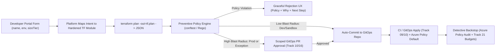
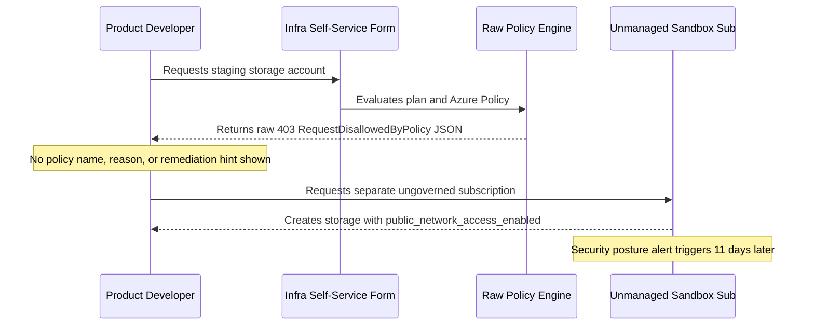

# Self-Service Infrastructure Provisioning

> **Prerequisites:** [Module 02](../02-internal-developer-portals/README.md), Terraform modules ([Track 09](../../09-terraform-on-azure/README.md)), OPA/Conftest ([Track 11](../../11-security-deep-dive/README.md)), GitOps PR flows ([Track 10](../../10-cicd-and-gitops/README.md)), and Azure Policy ([Track 17](../../17-governance-at-scale/README.md)).  
> **Estimated Reading Time:** 40 minutes  
> **Target Audience:** Platform Engineers, Cloud Architects, Security & Governance Engineers.

> [!TIP]
> **The Golden Rule of Self-Service Infrastructure:** Wrap hardened Terraform modules behind a **minimal intent form** so developers never edit HCL, enforce **preventive guardrails** (`conftest`/Rego + Azure Policy `Default`) before resources exist, reserve **human approvals** for scoped GitOps PRs on genuine blast-radius boundaries, and turn every policy failure into a **graceful rejection** explaining the policy, rationale, and compliant next step.

---

## Why This Matters

Scaffolding a service (module 02) is the easy half of self-service; the hard half is letting developers provision *real infrastructure* — a database, a storage account, a message queue — without a human running `terraform apply` for them and without letting them create something insecure, non-compliant, or ruinously expensive. This is where platform engineering's two forces collide: **freedom** (developers move fast without tickets) and **safety** (the org's governance, security, and cost rules still hold). Getting this balance right is the core of self-service infra: expose the Terraform modules you already wrote, wrap them in the guardrails you already know how to enforce, and design what happens — humanely — when a request crosses a line.

---

## 1. Architectural Mental Model: Request -> Policy -> Approval -> GitOps Reconcile

Self-service infrastructure replaces human ticket queues with an automated pipeline bounded by preventive plan-time guardrails, scoped GitOps approvals, and detective cloud backstops:



### Self-service infra = your Terraform modules, minus the human

In [track 09](../../09-terraform-on-azure/README.md) you wrote reusable Terraform modules for Azure resources; provisioning meant *you* ran `plan` and `apply`. Self-service infrastructure provisioning keeps the exact same modules but removes you from the loop: a developer picks "provision a PostgreSQL database" from the portal, fills a small form (size, name, environment), and the platform runs the module for them — via a pipeline, a GitOps-reconciled config, or a controller — with no ticket and no waiting on a person.

The critical design choice is *what the developer sees*. They should **not** see Terraform HCL, subscription IDs, or networking details — they see a handful of meaningful choices (this is the abstraction skill of [module 04](../04-platform-apis-and-abstractions/README.md)). The platform maps those choices onto the full track 09 module with all its safe defaults baked in: the right VNet integration ([track 05](../../05-azure-networking/README.md)), private endpoints, managed identity access ([track 16](../../16-identity-deep-dive/README.md)), backups ([track 22](../../22-disaster-recovery-and-chaos-engineering/README.md)), and cost tags ([track 21](../../21-cost-management-and-finops/README.md)). The developer gets a production-grade database; they never learn (or mis-configure) any of that.

### Guardrails: self-service is not a blank check

Self-service without guardrails is a way to let every developer create expensive, insecure, non-compliant resources at machine speed — the opposite of what a platform is for. **Guardrails** are the policies that constrain what self-service can produce, and you already built the machinery for them in [track 17](../../17-governance-at-scale/README.md) (Azure Policy, initiatives, management-group scopes) and [track 11](../../11-security-deep-dive/README.md) (OPA/Gatekeeper for Kubernetes). The platform's job is to place self-service *inside* those guardrails so that "self-service" and "safe" aren't in tension.

Guardrails work at two moments. **Preventively**, before the resource is created: a policy or a `plan`-time check rejects a request for a public-IP database or an un-tagged resource or a VM SKU outside the allowed list — the request never becomes real. **Detectively**, after creation: Azure Policy audits existing resources and flags drift, and cost budgets ([track 21](../../21-cost-management-and-finops/README.md)) alert when spend crosses a line. The best self-service leans preventive — it's far better to stop a bad request at the form than to remediate a live misconfiguration — which is exactly the "shift-left" instinct from [track 11](../../11-security-deep-dive/README.md), applied to provisioning.

### Approval workflows — where a human *should* stay in the loop

Not everything should be fully automatic. The design skill is deciding *which* requests need a human approval and which don't — and keeping that set as small as possible. A dev-environment cache or a small database in a sandbox subscription should be instant and unattended. A production database, a new public endpoint, a resource that crosses a cost threshold, or anything touching a regulated landing zone ([track 17](../../17-governance-at-scale/README.md)) may warrant a lightweight approval — but the approval should be *fast, scoped, and rare*, not a return to ticket ops.

Implemented well, an approval is a pull-request review (the self-service request opens a PR against a GitOps repo, a human approves the merge, and the [track 10](../../10-cicd-and-gitops/README.md) reconciliation applies it) or a portal approval step routed to the right owner from [track 16](../../16-identity-deep-dive/README.md). The GitOps-PR pattern is especially elegant: it gives you a self-service *request*, an *auditable* record, a *human gate* only where needed, and *automatic apply* on approval — all from machinery you already built. If your approval process feels like the old ticket queue, you've over-scoped it; approvals are the exception, not the default.

### Graceful rejection — the UX of "no"

Here is where most self-service systems fail their users: when a request violates a guardrail, they surface a raw policy engine error — a wall of JSON, an OPA rego trace, a Terraform `Error: 403`. The developer has no idea *what* rule they hit, *why* it exists, or *how* to comply. This is a developer-experience catastrophe (module 00): the guardrail did its job technically but destroyed trust in the platform.

**Graceful rejection** treats "no" as a first-class UX. A good rejection tells the developer, in plain language: *which* policy was violated ("databases must use private endpoints"), *why* it exists ("public database endpoints are a data-exfiltration risk — security policy SEC-014"), and *what to do instead* ("choose the `private` networking option, or request an exception via #platform if you have a genuine need"). It converts a dead end into a next step. Designing this well is a real platform-engineering skill — arguably *the* skill that separates a platform developers trust from one they route around — and you'll build it in the exercises. The same principle applies to the stale-owner rejection you met in module 02: a guardrail should *guide*, not just block.

### The reference architecture: request → policy → provision → reconcile

Putting it together, a mature self-service provisioning flow looks like this: the developer makes a **request** in the portal (a form over a track 09 module); the platform runs a **preventive policy check** (track 17 / OPA) that either passes, gracefully rejects, or routes to a scoped **approval** (track 10 PR); on approval the change is committed to a **GitOps repo** and **reconciled** into Azure (track 10), with the module applying all safe defaults (tracks 05/16/21/22); and afterward **detective controls** (Azure Policy audit, cost budgets) keep it compliant over its life. Every box in that flow is something you built in an earlier track — self-service infra is the composition, with graceful rejection as the human-facing glue.

---

## 2. Taxonomic Comparison & Command Reference

### Preventive vs. Detective Guardrails & Defense-in-Depth

| Dimension | Plan-Time Preventive (`conftest` / OPA) | Platform-Boundary Preventive (Azure Policy `Default`) | Post-Deploy Detective (Azure Policy Audit + Budgets) |
| :--- | :--- | :--- | :--- |
| **Evaluation Point** | Before `terraform apply` runs | At ARM control plane create/update | Continuously after resource creation |
| **What It Catches** | Bad module wiring, missing tags, public flags in plan JSON | Direct `az` CLI / portal bypasses outside Terraform | Configuration drift, spend spikes, expiring exemptions |
| **Failure UX Potential** | High — custom Rego messages power Graceful Rejection | Medium — raw `RequestDisallowedByPolicy` JSON unless wrapped | Alert-based (`az consumption budget` / Compliance dashboard) |
| **Role in Stack** | Primary developer-facing shift-left gate | Hard multi-subscription safety net (Management Group) | Compliance monitoring & FinOps backstop |

### Approval Scoping Decision Matrix

| Provisioning Scenario | Approval Strategy | Blast Radius Justification | Audit & Reconciliation Mechanism |
| :--- | :--- | :--- | :--- |
| **Dev/Sandbox Cache or Small DB** | Unattended Auto-Apply | Ephemeral data, bounded SKU cost | Auto-merged commit in GitOps infra repo |
| **Staging Infra within Allowed SKUs** | Unattended Auto-Apply | Non-customer-facing, guarded by Azure Policy | Automated PR merge after `conftest` passes |
| **Production Database / High-Cost SKU** | Scoped GitOps PR Approval | High blast radius, persistent state, significant spend | PR approved by team lead/owner + ArgoCD/TF apply |
| **Policy Exemption (Public Endpoint)** | Time-Boxed Security Review | Increases attack surface beyond default baseline | Azure Policy Exemption (`--expires-on`) + PR audit |

### Command Reference

The pieces are Terraform (track 09), policy (tracks 11/17), and GitOps (track 10). The commands below are the guardrail and provisioning primitives, viewed as self-service building blocks.

| Command | What it does | From |
| :--- | :--- | :--- |
| `terraform plan -out=tf.plan` | Produces the plan a policy check runs against *before* apply | track 09 |
| `terraform show -json tf.plan` | Emits the plan as JSON for a policy engine to inspect | track 09 |
| `conftest test tf.plan.json` | Runs OPA/Rego policy against the plan JSON — preventive guardrail | track 11 |
| `az policy state list` | Lists compliance state of existing resources — detective guardrail | track 17 |
| `az policy assignment create` | Assigns a policy/initiative at a scope — the guardrail itself | track 17 |
| `gh pr create` / `argocd app sync` | Opens the approval PR / applies on merge — approval + reconcile | track 10 |

Multi-flag examples (know each flag — these are the guardrail mechanics):

| Command | Flag | Why |
| :--- | :--- | :--- |
| `az policy assignment create --policy <id> --scope <mg-id> --params @allowed-skus.json --enforcement-mode Default` | `--scope <mg-id>` | Assign at a management-group scope (track 17) so the guardrail covers every subscription self-service can target |
| | `--params @allowed-skus.json` | Parameterize the allowed VM/DB SKUs so self-service can only pick safe/affordable sizes (track 21) |
| | `--enforcement-mode Default` | Actually *deny* non-compliant creates (vs. `DoNotEnforce`, which only audits) — preventive vs. detective |
| `conftest test --policy ./policies tf.plan.json --output table` | `--policy ./policies` | Point at the Rego guardrails the platform enforces before apply |
| | `--output table` | Human-readable output you can transform into a graceful rejection message |
| `az consumption budget create --amount 500 --category Cost --time-grain Monthly --notifications @notify.json` | `--amount 500` | A cost guardrail (track 21): alert/act when a team's self-served resources exceed budget |

Example: a Rego guardrail that produces a *graceful* denial message (not a raw trace):

```rego
package main

deny[msg] {
  input.resource_changes[_].change.after.public_network_access_enabled == true
  msg := "Databases must use private endpoints (policy SEC-014): public endpoints are a data-exfiltration risk. Choose the 'private' networking option, or request an exception in #platform."
}
```

---

## 3. Production War Story Post-Mortem: Cryptic Policy Denials & The Shadow-Subscription Bypass

| Field | Incident Details |
| :--- | :--- |
| **Severity** | **SEV-2** (Guardrail Bypass Leading to Publicly Accessible Staging Blob Storage) |
| **Detection / Resolution Time** | Detected 11 days post-creation by cloud posture scan / Contained in 35 minutes; UX + Management Group fix in 1 week |
| **Impact** | Three feature teams bypassed the self-service portal after hitting raw `RequestDisallowedByPolicy` errors and manual PR backlogs, spinning up an ungoverned subscription with public blob exports |

### What Happened

A platform team deployed Azure Policy `Deny` assignments and `conftest` checks without rewriting error handling or scoping dev approvals down. Developers requesting staging storage received unformatted JSON errors (`RequestDisallowedByPolicy: 403`) whenever a module field defaulted wrong or lacked a tag, followed by 3-day waits for routine staging PRs. Frustrated, an engineering manager requested a separate "innovation sandbox" subscription outside the governed management group—and deployed public storage containers inside it.



### Root Cause Analysis

1. **Cryptic rejection UX**: Raw Terraform/ARM JSON failures left developers guessing which field violated policy and how to fix it.
2. **Over-scoped human approvals**: Requiring platform PR sign-off on low-risk dev/staging storage turned self-service back into ticket ops.
3. **Management-group gap**: An unmanaged subscription existed outside the track 17 governance hierarchy, allowing an uncontrolled off-ramp without baseline safety rules.

### The Fix & Architectural Hardening

- Mapped every `conftest` Rego failure and Azure Policy violation ID (`SEC-014`, `FIN-002`) into structured **Graceful Rejection** payloads surfacing Policy ID, security/cost rationale, and one-click compliant defaults.
- Automated dev/staging merges when `conftest` passes, reserving human PR review exclusively for `prod` resources, SKUs above cost threshold, or time-boxed policy exemptions.
- Moved all subscriptions under the governed root Management Group with `Default` enforcement for baseline security policies.

---

## 4. Multi-Language Production Implementation: Preventive Guardrail Evaluator & Graceful Rejection Engine

These four production implementations evaluate an infrastructure provisioning plan against preventive guardrails (`SEC-014` private networking, `FIN-002` mandatory cost tags, `FIN-008` allowed SKU tiers), return human-readable **Graceful Rejections** when blocked, support time-boxed exception IDs, and route compliant requests to either `AUTO_APPROVE` or `GITOPS_PR_APPROVAL`.

````carousel
```go
package selfservice

import (
	"fmt"
	"strings"
)

type Environment string

const (
	EnvDev     Environment = "dev"
	EnvStaging Environment = "staging"
	EnvProd    Environment = "prod"
)

type ProvisionRequest struct {
	ResourceName        string
	Environment         Environment
	SkuTier             string
	PublicNetworkAccess bool
	EstimatedMonthlyUSD float64
	Tags                map[string]string
	ExceptionTicketID   string
}

type GracefulRejection struct {
	PolicyID    string
	Summary     string
	Why         string
	Remediation string
}

type EvaluationDecision struct {
	Allowed         bool
	ApprovalMode    string
	Rejections      []GracefulRejection
	ExceptionScoped bool
}

var allowedSkus = map[string]bool{"B_Standard_B2s": true, "GP_Standard_D2s_v3": true, "GP_Standard_D4s_v3": true}

// EvaluateProvisionPlan runs shift-left preventive checks and scopes GitOps PR approval gates.
func EvaluateProvisionPlan(req ProvisionRequest) EvaluationDecision {
	var rejections []GracefulRejection

	if req.PublicNetworkAccess && strings.TrimSpace(req.ExceptionTicketID) == "" {
		rejections = append(rejections, GracefulRejection{
			PolicyID:    "SEC-014",
			Summary:     "Databases and storage must disable public network access.",
			Why:         "Public database endpoints introduce data-exfiltration risk outside VNet private endpoints.",
			Remediation: "Set PublicNetworkAccess=false to use private endpoints, or supply a time-boxed Azure Policy exemption ID from #platform.",
		})
	}

	if req.Tags["team"] == "" || req.Tags["cost-center"] == "" || req.Tags["environment"] == "" {
		rejections = append(rejections, GracefulRejection{
			PolicyID:    "FIN-002",
			Summary:     "Missing mandatory cost attribution tags (team, cost-center, environment).",
			Why:         "Untagged self-service resources break FinOps showback and monthly budget alerts.",
			Remediation: "Select an owning team and cost-center in the portal catalog form so tags auto-populate.",
		})
	}

	if !allowedSkus[req.SkuTier] {
		rejections = append(rejections, GracefulRejection{
			PolicyID:    "FIN-008",
			Summary:     fmt.Sprintf("SKU %q is outside the approved platform tier catalog.", req.SkuTier),
			Why:         "Unbounded SKU sizes lead to sudden monthly cloud spend overruns.",
			Remediation: "Choose B_Standard_B2s (dev), GP_Standard_D2s_v3, or GP_Standard_D4s_v3.",
		})
	}

	if len(rejections) > 0 {
		return EvaluationDecision{Allowed: false, ApprovalMode: "REJECTED", Rejections: rejections}
	}

	exceptionUsed := req.PublicNetworkAccess && req.ExceptionTicketID != ""
	if req.Environment == EnvProd || req.EstimatedMonthlyUSD > 500 || exceptionUsed {
		return EvaluationDecision{Allowed: true, ApprovalMode: "GITOPS_PR_APPROVAL", ExceptionScoped: exceptionUsed}
	}

	return EvaluationDecision{Allowed: true, ApprovalMode: "AUTO_APPROVE_UNATTENDED"}
}
```
<!-- slide -->
```typescript
export type Environment = "dev" | "staging" | "prod";

export interface ProvisionRequest {
  resourceName: string;
  environment: Environment;
  skuTier: string;
  publicNetworkAccess: boolean;
  estimatedMonthlyUsd: number;
  tags: Record<string, string>;
  exceptionTicketId?: string;
}

export interface GracefulRejection {
  policyId: string;
  summary: string;
  why: string;
  remediation: string;
}

export interface EvaluationDecision {
  allowed: boolean;
  approvalMode: "REJECTED" | "AUTO_APPROVE_UNATTENDED" | "GITOPS_PR_APPROVAL";
  rejections: GracefulRejection[];
  exceptionScoped: boolean;
}

const ALLOWED_SKUS = new Set(["B_Standard_B2s", "GP_Standard_D2s_v3", "GP_Standard_D4s_v3"]);

export function evaluateProvisionPlan(req: ProvisionRequest): EvaluationDecision {
  const rejections: GracefulRejection[] = [];

  if (req.publicNetworkAccess && !req.exceptionTicketId?.trim()) {
    rejections.push({
      policyId: "SEC-014",
      summary: "Public network access is disallowed on self-service data resources.",
      why: "Public endpoints expose databases beyond VNet private link boundaries.",
      remediation:
        "Switch networking mode to 'private', or attach an approved time-boxed Azure Policy exemption ID.",
    });
  }

  for (const tagKey of ["team", "cost-center", "environment"]) {
    if (!req.tags[tagKey]?.trim()) {
      rejections.push({
        policyId: "FIN-002",
        summary: `Required cost-attribution tag '${tagKey}' is missing.`,
        why: "All provisioned resources must attribute spend cleanly to a team and budget.",
        remediation: "Ensure your portal request includes valid team, cost-center, and environment inputs.",
      });
      break;
    }
  }

  if (!ALLOWED_SKUS.has(req.skuTier)) {
    rejections.push({
      policyId: "FIN-008",
      summary: `SKU '${req.skuTier}' is not permitted by platform cost guardrails.`,
      why: "Restricted SKU catalogs keep self-service environments predictable and affordable.",
      remediation: "Select one of: B_Standard_B2s, GP_Standard_D2s_v3, GP_Standard_D4s_v3.",
    });
  }

  if (rejections.length > 0) {
    return { allowed: false, approvalMode: "REJECTED", rejections, exceptionScoped: false };
  }

  const exceptionScoped = Boolean(req.publicNetworkAccess && req.exceptionTicketId?.trim());
  const needsHumanGate = req.environment === "prod" || req.estimatedMonthlyUsd > 500 || exceptionScoped;

  return {
    allowed: true,
    approvalMode: needsHumanGate ? "GITOPS_PR_APPROVAL" : "AUTO_APPROVE_UNATTENDED",
    rejections: [],
    exceptionScoped,
  };
}
```
<!-- slide -->
```python
from dataclasses import dataclass
from typing import Literal

Environment = Literal["dev", "staging", "prod"]
ALLOWED_SKUS = {"B_Standard_B2s", "GP_Standard_D2s_v3", "GP_Standard_D4s_v3"}


@dataclass(frozen=True)
class ProvisionRequest:
    resource_name: str
    environment: Environment
    sku_tier: str
    public_network_access: bool
    estimated_monthly_usd: float
    tags: dict[str, str]
    exception_ticket_id: str | None = None


@dataclass(frozen=True)
class GracefulRejection:
    policy_id: str
    summary: str
    why: str
    remediation: str


@dataclass(frozen=True)
class EvaluationDecision:
    allowed: bool
    approval_mode: Literal["REJECTED", "AUTO_APPROVE_UNATTENDED", "GITOPS_PR_APPROVAL"]
    rejections: list[GracefulRejection]
    exception_scoped: bool = False


def evaluate_provision_plan(req: ProvisionRequest) -> EvaluationDecision:
    """Apply preventive guardrails with graceful rejection UX and scoped approval routing."""
    rejections: list[GracefulRejection] = []

    if req.public_network_access and not (req.exception_ticket_id or "").strip():
        rejections.append(
            GracefulRejection(
                policy_id="SEC-014",
                summary="Databases must use private endpoints rather than public network access.",
                why="Public endpoints create an internet-exposed data-exfiltration surface.",
                remediation="Select 'private' networking, or reference a time-boxed policy exemption ID.",
            )
        )

    if any(not req.tags.get(k, "").strip() for k in ("team", "cost-center", "environment")):
        rejections.append(
            GracefulRejection(
                policy_id="FIN-002",
                summary="Mandatory cost-attribution tags (team, cost-center, environment) are incomplete.",
                why="Every self-service asset must map to an owner and monthly budget.",
                remediation="Populate team and cost-center via your catalog group before resubmitting.",
            )
        )

    if req.sku_tier not in ALLOWED_SKUS:
        rejections.append(
            GracefulRejection(
                policy_id="FIN-008",
                summary=f"Requested SKU '{req.sku_tier}' is outside approved tiers.",
                why="Allowlisted SKUs prevent accidental high-cost cluster or DB provisioning.",
                remediation=f"Use one of {sorted(ALLOWED_SKUS)} or submit a FinOps exception.",
            )
        )

    if rejections:
        return EvaluationDecision(allowed=False, approval_mode="REJECTED", rejections=rejections)

    exception_used = bool(req.public_network_access and req.exception_ticket_id)
    needs_pr_approval = (
        req.environment == "prod" or req.estimated_monthly_usd > 500 or exception_used
    )
    return EvaluationDecision(
        allowed=True,
        approval_mode="GITOPS_PR_APPROVAL" if needs_pr_approval else "AUTO_APPROVE_UNATTENDED",
        rejections=[],
        exception_scoped=exception_used,
    )
```
<!-- slide -->
```csharp
using System;
using System.Collections.Generic;

public enum DeployEnvironment { Dev, Staging, Prod }

public sealed record ProvisionRequest(
    string ResourceName,
    DeployEnvironment Environment,
    string SkuTier,
    bool PublicNetworkAccess,
    double EstimatedMonthlyUsd,
    IReadOnlyDictionary<string, string> Tags,
    string? ExceptionTicketId = null);

public sealed record GracefulRejection(
    string PolicyId,
    string Summary,
    string Why,
    string Remediation);

public sealed record EvaluationDecision(
    bool Allowed,
    string ApprovalMode,
    IReadOnlyList<GracefulRejection> Rejections,
    bool ExceptionScoped);

public static class GuardrailEvaluator
{
    private static readonly HashSet<string> AllowedSkus =
        ["B_Standard_B2s", "GP_Standard_D2s_v3", "GP_Standard_D4s_v3"];

    public static EvaluationDecision Evaluate(ProvisionRequest req)
    {
        var rejections = new List<GracefulRejection>();

        if (req.PublicNetworkAccess && string.IsNullOrWhiteSpace(req.ExceptionTicketId))
        {
            rejections.Add(new GracefulRejection(
                PolicyId: "SEC-014",
                Summary: "Public network access is blocked for self-service infrastructure.",
                Why: "Public endpoints expose data stores outside private VNet boundaries.",
                Remediation: "Choose 'private' networking mode or attach a time-boxed Azure Policy exemption ID."));
        }

        foreach (var requiredTag in new[] { "team", "cost-center", "environment" })
        {
            if (!req.Tags.TryGetValue(requiredTag, out var val) || string.IsNullOrWhiteSpace(val))
            {
                rejections.Add(new GracefulRejection(
                    PolicyId: "FIN-002",
                    Summary: $"Mandatory tag '{requiredTag}' is missing or empty.",
                    Why: "Cost attribution and monthly budget alerts depend on consistent tagging.",
                    Remediation: "Re-render from the platform portal form so standard tags are injected automatically."));
                break;
            }
        }

        if (!AllowedSkus.Contains(req.SkuTier))
        {
            rejections.Add(new GracefulRejection(
                PolicyId: "FIN-008",
                Summary: $"SKU '{req.SkuTier}' is not in the approved SKU allowlist.",
                Why: "Restricting SKU tiers prevents runaway dev/test cloud expenditure.",
                Remediation: "Pick B_Standard_B2s, GP_Standard_D2s_v3, or GP_Standard_D4s_v3."));
        }

        if (rejections.Count > 0)
            return new EvaluationDecision(false, "REJECTED", rejections, false);

        bool exceptionScoped = req.PublicNetworkAccess && !string.IsNullOrWhiteSpace(req.ExceptionTicketId);
        bool needsApproval = req.Environment == DeployEnvironment.Prod
                             || req.EstimatedMonthlyUsd > 500
                             || exceptionScoped;

        return new EvaluationDecision(
            Allowed: true,
            ApprovalMode: needsApproval ? "GITOPS_PR_APPROVAL" : "AUTO_APPROVE_UNATTENDED",
            Rejections: [],
            ExceptionScoped: exceptionScoped);
    }
}
```
````

---

## 5. Practical Hands-On Verification CLI Workflows

### Verification Workflows: Shift-Left Plan Guardrails & Azure Policy Enforcement

Run these verification flows to observe plan-time preventive rejection with human-readable feedback alongside Azure Policy defense-in-depth:

#### Workflow A: Evaluate a Terraform plan with `conftest` and verify graceful rejection
```bash
terraform plan -out=tf.plan
terraform show -json tf.plan > tf.plan.json
conftest test --policy ./policies tf.plan.json --output table
```

**Expected Output:**
```text
+---------+--------------+---------------------------------------------------------------------+
| RESULT  |     FILE     |                               MESSAGE                               |
+---------+--------------+---------------------------------------------------------------------+
| failure | tf.plan.json | Databases must use private endpoints (policy SEC-014): public       |
|         |              | endpoints are a data-exfiltration risk. Choose the 'private'        |
|         |              | networking option, or request an exception in #platform.            |
+---------+--------------+---------------------------------------------------------------------+
```
> Verify: `conftest` blocks non-compliant changes *before* `terraform apply` and prints a clear policy ID, rationale, and compliant next step.

#### Workflow B: Verify defense-in-depth with Azure Policy `Default` enforcement & cost tags
```bash
az policy assignment create \
  --name deny-public-db-endpoints \
  --policy "/providers/Microsoft.Authorization/policyDefinitions/<policy-guid>" \
  --scope "/providers/Microsoft.Management/managementGroups/<mg-id>" \
  --params @allowed-skus.json \
  --enforcement-mode Default

az resource show --ids "<resource-id>" --query tags -o json
```

**Expected Output:**
```json
{
  "cost-center": "cc-402",
  "environment": "staging",
  "team": "checkout"
}
```
> Verify: `--enforcement-mode Default` blocks direct CLI bypasses at the ARM boundary, while self-service modules guarantee non-empty `team`, `cost-center`, and `environment` tags on every created resource.

### Hands-on exercises

You need Terraform, an Azure subscription, and the OPA/`conftest` and Azure Policy familiarity from tracks 11 and 17. Clean up any billable resources you create.

1. **Wrap a track 09 module as a self-service item.** Take a Terraform module you wrote in [track 09](../../09-terraform-on-azure/README.md) (e.g. a storage account or database). Define the *minimal* set of inputs a developer should provide (name, environment, size) and hard-code or default everything else (networking, tags, identity). The gap between "module variables" and "developer inputs" is the abstraction you're designing.

2. **Add cost tags automatically.** Ensure the wrapped module applies `team`, `cost-center`, and `environment` tags (track 21) derived from the request, with no way for the developer to omit them. Provision once and confirm with `az resource show --query tags`. Un-taggable self-service resources are how cost attribution (module 06) breaks.

3. **Write a preventive guardrail.** Write a `conftest`/Rego policy that denies a plan creating a resource with `public_network_access_enabled = true` or without the required tags. Run `terraform plan -out=tf.plan && terraform show -json tf.plan > plan.json && conftest test plan.json`. Confirm a compliant plan passes and a non-compliant one fails *before* apply.

4. **Enforce a guardrail as Azure Policy too.** Assign an Azure Policy (track 17) at a resource-group or management-group scope that denies public database endpoints, with `--enforcement-mode Default`. Attempt a non-compliant create with `az` directly and confirm Azure itself refuses it. Now you have defense-in-depth: preventive at plan time *and* at the platform boundary.

5. **Build the approval workflow as a GitOps PR.** Wire self-service so a request opens a PR against a Git repo (the desired-state infra), a reviewer approves the merge, and a [track 10](../../10-cicd-and-gitops/README.md) pipeline (or ArgoCD) applies it. Prove the loop: open a PR, approve, watch it apply; open a second PR and *reject* it, watch nothing happen. This is self-service *with* a human gate, auditable by design.

6. **Scope approvals correctly.** Decide, and encode, which requests are *unattended* (dev/sandbox, small sizes, within budget) and which require approval (production, public endpoints, over a cost threshold, regulated landing zone from track 17). Write the rule. Then critique it: is anything in the "needs approval" bucket that's really just ticket ops in disguise?

7. **Diagnose-and-fix: the cryptic rejection.** A developer requests a database with public networking (perhaps because a tutorial told them to). Today, your guardrail rejects it with a raw `conftest` failure or an Azure Policy `RequestDisallowedByPolicy` JSON blob — the developer files an angry ticket asking what went wrong. Reproduce that cryptic rejection. Then *fix the UX*: rewrite the guardrail (and/or the portal's handling of it) so the rejection states, in plain language, *which* policy, *why* it exists, and *what to do instead* (choose private networking, or request an exception). Show the before/after messages side by side. The lesson: the guardrail catching the request is table stakes; turning "no" into a next step is the platform-engineering skill — a cryptic rejection makes developers route *around* the platform, which defeats its purpose.

8. **Design an exception path.** Some genuine needs *do* violate a default guardrail (a service that legitimately needs a public endpoint for a partner integration). Design the exception process: how a developer requests it, who approves (track 16 ownership), how the exception is recorded (an Azure Policy exemption from track 17, scoped and time-boxed), and how it's audited so exceptions don't quietly become the norm. A guardrail with no exception path becomes a wall teams route around; one with a *loose* exception path is no guardrail at all.

9. **Clean up.** Delete every billable resource you provisioned: `az group delete --name <rg> --yes --no-wait`. Confirm with `az resource list`. Self-service makes it *easy* to create resources — which makes disciplined cleanup (and the cost guardrails from exercise 2) matter more, not less.

### Independent challenge

Drawing on this module and tracks 09, 10, 11, 17, and 21, design a complete **self-service "provision a production database" catalog item** end to end, on paper: the developer-facing form (the minimal inputs), the track 09 module it maps onto and every safe default baked in (private networking from track 05, managed-identity access from track 16, backups from track 22, cost tags from track 21), the preventive guardrails it must pass (track 11/17) *and their graceful rejection messages*, the exact approval rule (what auto-applies vs. what needs a scoped human approval and why), the GitOps apply flow (track 10), and the detective controls that keep it compliant afterward (Azure Policy audit + a cost budget from track 21). Include one deliberately-designed *failure* case — a request you show being gracefully rejected with a real next step. The deliverable is a design a teammate could build, showing you can make self-service *and* safe coexist.

<details><summary>Stuck? One hint</summary>

The whole design hinges on a single question you must answer for every field: "should the developer decide this, or should the platform?" Anything that's a *safety, compliance, or cost* decision (networking mode, region, backup policy, tags, allowed sizes) the platform decides via track 09 defaults and track 17 guardrails — the developer never sees it. Anything that's a genuine *application* choice (database name, environment, rough size tier) is a form field. For the approval rule, default to *unattended* and only add a human gate where the blast radius is real (production, public exposure, over budget) — and remember the graceful-rejection lesson: every guardrail you list needs a rejection message that names the policy, the reason, and the way forward, or developers will route around it.

</details>

---

## 6. Common Mistakes & Troubleshooting

- **Self-service with no guardrails.** Letting developers create anything at machine speed is faster ticket ops, not a platform. Guardrails (tracks 11/17) are what make self-service safe enough to *not* need a human on every request.
- **Exposing raw Terraform/HCL to developers.** If the self-service form is just Terraform variables, you've moved the complexity, not removed it. Expose meaningful choices; bury the module (module 04's abstraction skill).
- **Cryptic rejections.** A raw policy/OPA/Terraform error as the "no" is a DX failure that pushes developers to route around the platform. Every guardrail needs a graceful, actionable rejection message.
- **Over-scoping approvals.** If most requests need a human approval, you've rebuilt the ticket queue. Default to unattended; gate only real blast-radius cases (production, public exposure, cost thresholds).
- **No exception path — or a too-loose one.** A guardrail with no way to grant a legitimate exception becomes a wall teams route around; one where exceptions are trivial and unaudited is no guardrail at all. Make exceptions scoped, time-boxed (track 17 exemptions), owned, and reviewed.
- **Preventive vs. detective confusion.** Auditing a bad resource *after* it's live (`DoNotEnforce`) is not the same as *denying* it at creation (`enforcement-mode Default`). Lead with preventive; use detective as backstop.
- **Un-taggable self-service resources.** If developers can create resources without cost tags, attribution (module 06) and budgets (track 21) break. Enforce tags in the module, not by convention.

---

## 7. Operational Validation Checkpoints & Checkpoint Quiz

### Operational Validation Checkpoints

<details><summary><strong>Checkpoint 1: Catching `DoNotEnforce` vs. `Default` enforcement gaps before rollout</strong></summary>

An engineer assigns a new Azure Policy denying public storage access with `--enforcement-mode DoNotEnforce` during testing and forgets to switch it at launch. Non-compliant resources silently succeed in production and only show up hours later in `az policy state list`. Verifying both plan-time `conftest` rejection and `--enforcement-mode Default` at the management-group scope guarantees preventive enforcement at both layers.

</details>

<details><summary><strong>Checkpoint 2: Preventing GitOps-PR approvals from becoming disguised ticket ops</strong></summary>

Your platform team sees PR merge times for self-service dev databases climb to 3 days because security engineers review every PR regardless of environment. Scoping PR approvals strictly to production, SKUs exceeding budget thresholds, and policy exemptions while auto-merging compliant `dev`/`staging` plans cuts dev provisioning latency from days to minutes without lowering production safety.

</details>

<details><summary><strong>Checkpoint 3: Keeping policy exemptions time-boxed and auditable</strong></summary>

A partner integration legitimately requires a public endpoint, so you grant an Azure Policy exemption (`az policy exemption create`) at the resource scope without an expiration date. Twelve months later, the partner integration is retired, yet the public endpoint stays open indefinitely. Setting `--expires-on` (e.g., 90 days) and requiring an Entra owner group ensures exemptions expire or face mandatory renewal review.

</details>

### Checkpoint quiz

Write down your answer to each question before expanding it — checking without attempting first is the single easiest way to fool yourself into thinking you've learned this.

<details><summary>Show questions</summary>

1. In self-service infra, what should and shouldn't a developer see, and why?
2. What are the two moments guardrails act (preventive vs. detective), and why should self-service lean preventive?
3. Which earlier tracks supply the guardrail machinery, and what does each provide?
4. Describe the GitOps-PR approval pattern and the four properties it gives you at once.
5. What is graceful rejection, and what three things should a good rejection message tell the developer?
6. When *should* a self-service request require a human approval, and what's the risk of over-scoping that set?
7. Why does a guardrail need an exception path, and what makes an exception path safe rather than a loophole?

</details>

<details><summary>Show answers</summary>

1. The developer should see a small set of meaningful *application* choices (name, environment, rough size); they should **not** see Terraform HCL, subscription IDs, networking, or identity wiring. The platform maps their choices onto the full track 09 module with all safe defaults, so they get production-grade infra without configuring (or misconfiguring) it.
2. **Preventive** = before creation, a policy/plan-check rejects a bad request so it never becomes real; **detective** = after creation, audits and cost budgets flag drift. Lean preventive because stopping a bad request at the form is far cheaper and safer than remediating a live misconfiguration (shift-left, track 11).
3. Track 17 (Azure Policy, initiatives, management-group scopes) for Azure-level governance; track 11 (OPA/Gatekeeper, conftest/Rego) for Kubernetes and plan-time checks; track 21 (cost budgets) for spend guardrails.
4. The self-service request opens a PR against a GitOps infra repo; a human approves the merge; the track 10 pipeline/ArgoCD reconciles it into Azure. It gives you at once: a self-service request, an auditable record, a human gate only where needed, and automatic apply on approval.
5. Graceful rejection is treating "no" as a first-class UX. A good message tells the developer *which* policy was violated (plainly named), *why* it exists (the real reason/risk), and *what to do instead* (a compliant option or a scoped exception path). It converts a dead end into a next step.
6. When the blast radius is real: production resources, new public exposure, over a cost threshold, or a regulated landing zone (track 17). Over-scoping recreates the ticket queue self-service was meant to remove — defeating the platform's purpose. Default to unattended; gate the exceptions.
7. Because some legitimate needs genuinely violate a default; with no exception path the guardrail becomes a wall teams route around. It's safe (not a loophole) when exceptions are scoped, time-boxed (track 17 exemptions), owned by a real approver (track 16), recorded, and audited so they don't quietly become the norm.

</details>

---

## 8. Next

[04-platform-apis-and-abstractions](../04-platform-apis-and-abstractions/README.md) — you've been *hiding* Terraform behind a form and *hiding* Kubernetes behind a scaffolder; next you'll study that hiding as a discipline in its own right. You'll learn to design the internal API/CLI/template layer that abstracts away Kubernetes and Azure complexity for app teams — and, crucially, the tradeoff between too little abstraction (you've exposed the raw complexity) and too much (you've built a leaky, brittle layer nobody can debug).
