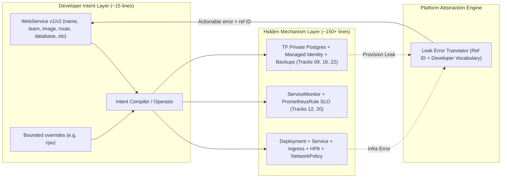
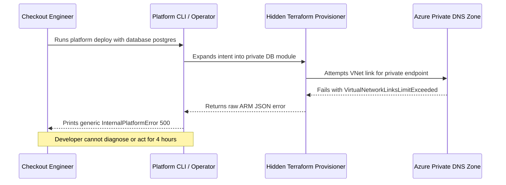

# Platform APIs and Abstractions

> **Prerequisites:** [Module 03](../03-self-service-infrastructure-provisioning/README.md), Kubernetes fundamentals ([Track 03](../../03-kubernetes/README.md)), Azure Container Apps ([Track 06](../../06-azure-container-apps/README.md)), and API versioning ([Track 19](../../19-api-management/README.md)).  
> **Estimated Reading Time:** 40 minutes  
> **Target Audience:** Platform Engineers, Staff Engineers, API & Infrastructure Architects.

> [!TIP]
> **The Golden Rule of Platform Abstractions:** Expose **declarative intent** (`what` the developer wants) while hiding **volatile mechanism** (`how` Kubernetes and Azure realize it) to eliminate **extraneous cognitive load**, keep the common 80% trivial alongside a bounded **`overrides:` escape hatch** for the 20%, version your abstraction like a public API, and translate inevitable **abstraction leaks** into developer-vocabulary diagnostics with actionable correlation IDs.

---

## Why This Matters

Every module so far has quietly been doing one thing: *hiding complexity*. The scaffolder hid the golden path's wiring; the self-service form hid Terraform. This module makes that hiding a deliberate discipline. The single hardest — and most valuable — skill in platform engineering is **abstraction design**: choosing what to expose to app teams and what to bury, so they get power without complexity. Get it right and developers ship fast on a simple, stable interface. Get it wrong in either direction — too little abstraction and you've just relabeled the raw complexity; too much and you've built a leaky, brittle layer that's harder to debug than the thing it wraps. This is where platform engineering stops being "wiring tracks together" and becomes genuine design.

---

## 1. Architectural Mental Model: Intent Boundary, Cognitive Load & Leak Translation

A well-designed platform abstraction separates a small, stable developer intent contract (`WebService`) from the deep, fast-changing Kubernetes and Azure implementation objects underneath—while translating failures back across that boundary cleanly:



### The abstraction is the platform's actual product

The tools underneath — Kubernetes, Terraform, Azure — are commodities every platform uses. What makes *your* platform yours is the **abstraction layer** you put over them: the interface app teams actually touch. That interface might be a CLI (`platform deploy`), a template/schema (a simple `service.yaml` a developer fills in), a custom Kubernetes resource, or an internal API. Whatever the form, its job is to let a developer express *what they want* ("a service that runs this container, gets a database, and is reachable at this hostname") without expressing *how* it's achieved (Deployments, Services, Ingress, VNet integration, private endpoints, managed identity).

This is the difference between **declarative intent** and **imperative implementation**. In [track 03](../../03-kubernetes/README.md) you learned that Kubernetes itself is declarative — you say "3 replicas" and a controller reconciles reality to match. A good platform abstraction pushes that idea one level up: the developer declares a *higher-level* intent ("a production web service") and the platform's own controllers/templates expand it into all the lower-level Kubernetes and Azure objects. The abstraction *is* the product; the underlying tracks are its implementation.

### Cognitive load is the thing you're minimizing

The reason to abstract is **cognitive load** — the total amount a developer must understand to get their job done. Across tracks 02-23 you learned dozens of concepts; asking every app developer to hold all of them is the failure platform engineering exists to prevent. A good abstraction lets a developer be productive knowing a *small, stable* vocabulary ("service," "environment," "route," "database") while the platform team holds the large, volatile vocabulary (StatefulSets, NSGs, private DNS zones, workload identity federation) behind it.

There are three kinds of cognitive load, and the distinction guides design. **Intrinsic** load is the irreducible difficulty of the developer's actual problem (their business logic) — you can't remove it, and you shouldn't try. **Extraneous** load is complexity from *how* things are done that doesn't help the developer (remembering the exact NSG rule syntax) — this is precisely what a platform abstraction should eliminate. **Germane** load is effort that builds useful mental models. Platform engineering's target is *extraneous* load: bury the how, expose the what, and never make a developer learn a track's worth of Kubernetes to run a web service.

### Too little abstraction — the leaky relabel

The first failure mode is **too little abstraction**: the platform exposes an interface that's really just the raw tool with a new coat of paint. A "service.yaml" that's actually a full Kubernetes Deployment with every field, or a self-service form that's a 1:1 mapping of Terraform variables (the module 03 anti-pattern), hasn't reduced cognitive load — it's *relabeled* it. The developer still has to understand resource requests, security contexts, affinity rules, and probes; you've just made them type it in your schema instead of Kubernetes's.

The tell is that your abstraction has as many concepts as the thing it wraps. If a developer needs to understand Kubernetes to fill in your "simple" service spec, you haven't abstracted — you've re-skinned. Too little abstraction is seductive because it's *easy to build* (thin pass-throughs are simple) and it never traps you with a case it can't express (it exposes everything). But it fails the core mission: developers still carry the full load, and the platform adds a layer without removing one.

### Too much abstraction — the leaky black box

The opposite and subtler failure is **too much abstraction**: an interface so simplified and so far from the underlying reality that it becomes a leaky, un-debuggable black box. The developer says "deploy," it fails, and the error is a Kubernetes event three layers down they were specifically shielded from — so they *can't* debug it and neither can they, and every problem becomes a platform-team ticket. This is **the law of leaky abstractions**: all non-trivial abstractions leak, and the more you hide, the more painful the leak when it inevitably shows.

Over-abstraction also tends to be *rigid*: by collapsing many knobs into one, it can't express the legitimate variation real teams need (the edge cases from module 01), so teams route around it. And it's *brittle* to maintain: a magical layer that auto-does-everything has to keep working for every case, and each new case you didn't anticipate is a platform-team emergency. The seduction here is the demo — over-abstracted platforms demo beautifully ("look, one line!") and fall apart on the second real team's second real requirement.

### Designing the boundary — the actual skill

The craft is choosing the abstraction boundary deliberately, and a few heuristics guide it. **Expose intent, hide mechanism**: developers declare *what* (a web service reachable here, with a database), the platform decides *how* (which Deployment/Ingress/private endpoint). **Make the common case trivial and the rare case possible**: the module 01 lesson — trivial defaults for the 80%, escape hatches for the 20% (an `overrides:` block, a way to drop to raw manifests for a genuine need) rather than an all-or-nothing wall. **Make leaks debuggable**: when the abstraction fails, surface an error in the developer's vocabulary with a path to more detail (the graceful-rejection principle from module 03, applied to runtime). And **version the interface**: the abstraction is an API contract app teams build on, so breaking changes need versioning and deprecation ([module 07](../07-platform-adoption-and-measuring-success/README.md)), just like any public API ([track 19](../../19-api-management/README.md)).

The reference form in the Kubernetes world is the **platform-as-a-custom-resource** pattern: the developer writes a small custom resource (say, `kind: WebService`) and a controller/operator expands it into all the underlying objects — declarative intent, reconciled implementation, exactly Kubernetes's own model one level up. Whether you implement it as a CRD, a CLI over templates, or an internal API, the design principles are the same: expose the smallest stable vocabulary that lets developers express real intent, and keep the escape hatch honest.

---

## 2. Taxonomic Comparison & Command Reference

### The Abstraction Spectrum: Too Little vs. Balanced vs. Too Much

| Dimension | Too Little Abstraction (The Relabel) | Balanced Intent Abstraction (Sweet Spot) | Too Much Abstraction (Leaky Black Box) |
| :--- | :--- | :--- | :--- |
| **Concept Count Ratio** | ~1:1 with raw Kubernetes/Terraform | ~1:10 (4–7 intent choices -> 10+ objects) | Collapses real requirements into 1 magic switch |
| **Exposed Vocabulary** | `affinity`, `readinessProbe`, `subnetId` | `image`, `route`, `database`, `slo` | `appType: standard` with hidden rigid behavior |
| **Escape Hatch (`overrides:`)** | Unnecessary (everything is already exposed) | Bounded overrides for safe 20% edge cases | None — forces off-path forks when needs diverge |
| **When Underlying Infra Fails** | Developer debugs raw K8s/ARM directly | Leak translator maps error to intent terms + ref ID | Opaque `500` / buried event nobody can diagnose |
| **Cognitive Load Impact** | Relabels extraneous load without removing it | Eliminates extraneous load cleanly | Shifts toil into platform escalation tickets |

### Cognitive Load Taxonomy

| Type of Load | Definition | Platform Engineering Action | Concrete Example |
| :--- | :--- | :--- | :--- |
| **Intrinsic** | Irreducible complexity of business domain | Preserve & stay out of the way | Fraud detection rules, payment state machine |
| **Extraneous** | Friction from *how* infra & plumbing work | **Eliminate** via abstraction & defaults | Private DNS zone links, `ServiceMonitor` labels, NSG syntax |
| **Germane** | Effort building durable mental models | **Cultivate** via clear docs & debuggable leaks | Understanding SLO error budgets or event retries |

### Command Reference

Abstractions in this space are usually a CLI, a schema/template, or a custom resource. The commands below illustrate the *interface a developer sees* versus the *implementation it expands to* — the whole point being how much smaller the former is.

| The developer runs / writes | It expands to (platform-owned) | Underlying track |
| :--- | :--- | :--- |
| `platform deploy --env prod` | build → scan → push → GitOps sync | tracks 10/11 |
| `kind: WebService` (a ~15-line CR) | Deployment + Service + Ingress + HPA + ServiceMonitor | tracks 03/12 |
| `service.yaml: database: postgres` | Terraform module → private DB + identity + backup | tracks 09/16/22 |
| `service.yaml: route: api.acme.com` | Ingress/APIM route + TLS cert + DNS record | tracks 05/19 |
| `platform env create dev` | namespace + quota + network policy + tags | tracks 03/11/21 |

A minimal example of the abstraction the developer writes — small, stable, intent-only:

```yaml
# service.yaml — the ENTIRE developer-facing interface for a web service
apiVersion: platform.acme.io/v1
kind: WebService
metadata:
  name: payments-api
  team: checkout            # drives ownership (track 16) + cost tags (track 21)
spec:
  image: acme/payments-api  # what to run
  route: payments.acme.com  # where it's reachable (platform wires Ingress+TLS+DNS)
  database: postgres        # platform provisions it privately (tracks 09/14/16)
  slo: 99.9                 # platform pre-wires the SLO + burn alert (track 20)
  # everything below is a platform default the developer never sees:
  #   replicas, resources, probes, security context, network policy,
  #   ServiceMonitor, private endpoints, managed identity, backups, tags
  overrides:                # the honest escape hatch for the 20%
    resources:
      cpu: "2"              # a real, rare need the abstraction still lets through
```

Contrast: the *same* service expressed at the raw layer would be a Deployment, a Service, an Ingress, an HPA, a ServiceMonitor, a NetworkPolicy, a Terraform module call, a managed identity, a private endpoint, and a PrometheusRule — hundreds of lines the developer never writes. That reduction is the product.

---

## 3. Production War Story Post-Mortem: The Opaque Black-Box Failure During Holiday Peak

| Field | Incident Details |
| :--- | :--- |
| **Severity** | **SEV-2** (4-Hour Checkout Hotfix Deployment Freeze) |
| **Detection / Resolution Time** | Detected 6 minutes after failed `platform deploy` / Resolved in 4 hours after platform escalation |
| **Impact** | `checkout-api` could not deploy a critical holiday release because an over-abstracted platform operator masked an Azure Private DNS Zone link quota error behind `InternalPlatformError: 500` |

### What Happened

A team ran `platform deploy --env prod` with `database: postgres` in their `service.yaml`. Under the hood, the platform controller failed while linking a Private Endpoint to an Azure Private DNS Zone that had hit its subscription VNet-link limit. Because the controller suppressed raw Terraform/ARM errors to "protect developers from infra details" without translating them, the CLI printed only `Error: database reconciliation failed (500)` with no reference ID, no next step, and no hint whether the bug was in `checkout-api`'s spec or Azure infrastructure.



### Root Cause Analysis

1. **Silent black-box error swallowing**: The abstraction hid *both* the complexity and the diagnostic path when the underlying mechanism leaked.
2. **No developer-vocabulary leak translation**: There was no mapping from known infrastructure failure signatures (`VirtualNetworkLinksLimitExceeded`, `ImagePullBackOff`, `CrashLoopBackOff`) into clear owner-actionable vs. platform-escalatable messages.

### The Fix & Architectural Hardening

- Built a structured **Leak Translator** in the platform controller that classifies failure root cause into `USER_ACTIONABLE` (e.g., bad image tag or invalid `route`) vs. `PLATFORM_OWNED` (e.g., DNS link quota), prints a human explanation in the developer's vocabulary, and emits a correlation `refId` auto-paging the platform on-call when platform-owned.
- Exposed bounded `platform describe <service> --events` diagnostics summarizing translated reconciliation phases without forcing developers to read raw Terraform state.

---

## 4. Multi-Language Production Implementation: `WebService` Intent Compiler & Leak Translator

These four production implementations model the `platform.acme.io/v1` and `v2` `WebService` abstraction: validating API version deprecation rules, enforcing safe bounded `overrides` (permitting `cpu` while blocking unsafe security overrides), expanding ~15 lines of developer intent into underlying mechanism manifests, and translating low-level infrastructure leaks into developer-vocabulary diagnostics with correlation IDs.

````carousel
```go
package platformapi

import (
	"fmt"
	"strings"
)

type WebServiceSpec struct {
	APIVersion  string
	Name        string
	Team        string
	Image       string
	Route       string
	Database    string
	SLOTarget   float64
	OverrideCPU string
}

type CompiledMechanism struct {
	DeprecationWarning string
	K8sObjects         []string
	CPULimit           string
	CostTags           map[string]string
}

type TranslatedLeak struct {
	DeveloperMessage string
	Owner            string
	PlatformRefID    string
	NextStep         string
}

// CompileWebService expands concise developer intent into underlying K8s + Azure mechanisms.
func CompileWebService(spec WebServiceSpec) (*CompiledMechanism, error) {
	var warning string
	switch spec.APIVersion {
	case "platform.acme.io/v1":
		warning = "DEPRECATED: platform.acme.io/v1 sunsets on 2026-12-01; migrate to platform.acme.io/v2."
	case "platform.acme.io/v2":
	default:
		return nil, fmt.Errorf("unsupported apiVersion %q", spec.APIVersion)
	}

	cpu := "500m"
	if strings.TrimSpace(spec.OverrideCPU) != "" {
		cpu = spec.OverrideCPU
	}

	objects := []string{"Deployment", "Service", "HorizontalPodAutoscaler", "NetworkPolicy", "ServiceMonitor", "PrometheusRule"}
	if spec.Route != "" {
		objects = append(objects, "Ingress+TLS+DNS")
	}
	if spec.Database == "postgres" {
		objects = append(objects, "TerraformPrivatePostgres+ManagedIdentity+Backup")
	}

	return &CompiledMechanism{
		DeprecationWarning: warning,
		K8sObjects:         objects,
		CPULimit:           cpu,
		CostTags:           map[string]string{"team": spec.Team, "service": spec.Name},
	}, nil
}

// TranslateInfraLeak converts opaque mechanism errors into developer-vocabulary diagnostics.
func TranslateInfraLeak(serviceName, refID, rawInfraError string) TranslatedLeak {
	switch {
	case strings.Contains(rawInfraError, "VirtualNetworkLinksLimitExceeded"):
		return TranslatedLeak{
			DeveloperMessage: fmt.Sprintf("Could not provision private database networking for %q.", serviceName),
			Owner:            "platform-team (auto-paged)",
			PlatformRefID:    refID,
			NextStep:         fmt.Sprintf("No action needed from you; share %s in #platform-incidents for updates.", refID),
		}
	case strings.Contains(rawInfraError, "ImagePullBackOff"):
		return TranslatedLeak{
			DeveloperMessage: fmt.Sprintf("Container image for %q could not be pulled from registry.", serviceName),
			Owner:            "service-team",
			PlatformRefID:    refID,
			NextStep:         "Verify spec.image tag exists in ACR and was signed by Track 18 CI.",
		}
	default:
		return TranslatedLeak{
			DeveloperMessage: fmt.Sprintf("Deployment reconciliation failed for %q.", serviceName),
			Owner:            "platform-team",
			PlatformRefID:    refID,
			NextStep:         fmt.Sprintf("Inspect `platform describe %s --ref %s` or escalate with ref ID.", serviceName, refID),
		}
	}
}
```
<!-- slide -->
```typescript
export interface WebServiceSpec {
  apiVersion: "platform.acme.io/v1" | "platform.acme.io/v2";
  name: string;
  team: string;
  image: string;
  route?: string;
  database?: "postgres" | "none";
  sloTarget?: number;
  overrides?: { cpu?: string };
}

export interface CompiledMechanism {
  deprecationWarning?: string;
  expandedObjects: string[];
  cpuLimit: string;
  tags: Record<string, string>;
}

export interface TranslatedLeak {
  developerMessage: string;
  owner: "service-team" | "platform-team";
  platformRefId: string;
  nextStep: string;
}

export function compileWebService(spec: WebServiceSpec): CompiledMechanism {
  const deprecationWarning =
    spec.apiVersion === "platform.acme.io/v1"
      ? "apiVersion platform.acme.io/v1 is deprecated and scheduled for removal; migrate to v2."
      : undefined;

  const expandedObjects = [
    "Deployment",
    "Service",
    "HorizontalPodAutoscaler",
    "NetworkPolicy",
    "ServiceMonitor",
    "PrometheusRule",
  ];
  if (spec.route) expandedObjects.push("Ingress+TLS+DNS");
  if (spec.database === "postgres") {
    expandedObjects.push("TerraformPrivatePostgres+ManagedIdentity+Backup");
  }

  return {
    deprecationWarning,
    expandedObjects,
    cpuLimit: spec.overrides?.cpu?.trim() || "500m",
    tags: { team: spec.team, service: spec.name },
  };
}

export function translateInfraLeak(
  serviceName: string,
  refId: string,
  rawInfraError: string
): TranslatedLeak {
  if (rawInfraError.includes("VirtualNetworkLinksLimitExceeded")) {
    return {
      developerMessage: `Could not provision private database endpoint for '${serviceName}'.`,
      owner: "platform-team",
      platformRefId: refId,
      nextStep: `Platform on-call has been notified automatically (ref ${refId}).`,
    };
  }
  if (rawInfraError.includes("ImagePullBackOff")) {
    return {
      developerMessage: `Container image for '${serviceName}' could not be pulled.`,
      owner: "service-team",
      platformRefId: refId,
      nextStep: "Confirm spec.image tag exists in ACR and passed CI signing.",
    };
  }
  return {
    developerMessage: `Unexpected infrastructure reconciliation error for '${serviceName}'.`,
    owner: "platform-team",
    platformRefId: refId,
    nextStep: `Run 'platform describe ${serviceName} --ref ${refId}' for scoped logs.`,
  };
}
```
<!-- slide -->
```python
from dataclasses import dataclass
from typing import Literal


@dataclass(frozen=True)
class WebServiceSpec:
    api_version: Literal["platform.acme.io/v1", "platform.acme.io/v2"]
    name: str
    team: str
    image: str
    route: str | None = None
    database: Literal["postgres", "none"] = "none"
    slo_target: float = 99.9
    override_cpu: str | None = None


@dataclass(frozen=True)
class CompiledMechanism:
    deprecation_warning: str | None
    expanded_objects: list[str]
    cpu_limit: str
    tags: dict[str, str]


@dataclass(frozen=True)
class TranslatedLeak:
    developer_message: str
    owner: Literal["service-team", "platform-team"]
    platform_ref_id: str
    next_step: str


def compile_web_service(spec: WebServiceSpec) -> CompiledMechanism:
    """Expand minimal WebService intent into platform-owned K8s and Azure objects."""
    warning = (
        "platform.acme.io/v1 is deprecated; plan migration to platform.acme.io/v2"
        if spec.api_version == "platform.acme.io/v1"
        else None
    )
    objects = [
        "Deployment",
        "Service",
        "HorizontalPodAutoscaler",
        "NetworkPolicy",
        "ServiceMonitor",
        "PrometheusRule",
    ]
    if spec.route:
        objects.append("Ingress+TLS+DNS")
    if spec.database == "postgres":
        objects.append("TerraformPrivatePostgres+ManagedIdentity+Backup")

    return CompiledMechanism(
        deprecation_warning=warning,
        expanded_objects=objects,
        cpu_limit=(spec.override_cpu or "500m").strip(),
        tags={"team": spec.team, "service": spec.name},
    )


def translate_infra_leak(service_name: str, ref_id: str, raw_error: str) -> TranslatedLeak:
    """Map deep mechanism exceptions into developer-vocabulary diagnostics."""
    if "VirtualNetworkLinksLimitExceeded" in raw_error:
        return TranslatedLeak(
            developer_message=f"Database private networking setup failed for '{service_name}'.",
            owner="platform-team",
            platform_ref_id=ref_id,
            next_step=f"Platform team notified; track incident using ref {ref_id}.",
        )
    if "ImagePullBackOff" in raw_error:
        return TranslatedLeak(
            developer_message=f"Could not pull container image for '{service_name}'.",
            owner="service-team",
            platform_ref_id=ref_id,
            next_step="Verify spec.image exists in ACR and passed Track 18 signing.",
        )
    return TranslatedLeak(
        developer_message=f"Reconciliation paused for '{service_name}'.",
        owner="platform-team",
        platform_ref_id=ref_id,
        next_step=f"Run 'platform describe {service_name} --ref {ref_id}' for details.",
    )
```
<!-- slide -->
```csharp
using System.Collections.Generic;

public sealed record WebServiceSpec(
    string ApiVersion,
    string Name,
    string Team,
    string Image,
    string? Route = null,
    string Database = "none",
    double SloTarget = 99.9,
    string? OverrideCpu = null);

public sealed record CompiledMechanism(
    string? DeprecationWarning,
    IReadOnlyList<string> ExpandedObjects,
    string CpuLimit,
    IReadOnlyDictionary<string, string> Tags);

public sealed record TranslatedLeak(
    string DeveloperMessage,
    string Owner,
    string PlatformRefId,
    string NextStep);

public static class PlatformIntentCompiler
{
    public static CompiledMechanism Compile(WebServiceSpec spec)
    {
        string? warning = spec.ApiVersion == "platform.acme.io/v1"
            ? "platform.acme.io/v1 is deprecated; migrate to platform.acme.io/v2."
            : null;

        var objects = new List<string>
        {
            "Deployment", "Service", "HorizontalPodAutoscaler",
            "NetworkPolicy", "ServiceMonitor", "PrometheusRule"
        };
        if (!string.IsNullOrWhiteSpace(spec.Route))
            objects.Add("Ingress+TLS+DNS");
        if (spec.Database == "postgres")
            objects.Add("TerraformPrivatePostgres+ManagedIdentity+Backup");

        return new CompiledMechanism(
            DeprecationWarning: warning,
            ExpandedObjects: objects,
            CpuLimit: string.IsNullOrWhiteSpace(spec.OverrideCpu) ? "500m" : spec.OverrideCpu,
            Tags: new Dictionary<string, string> { ["team"] = spec.Team, ["service"] = spec.Name });
    }

    public static TranslatedLeak TranslateLeak(string serviceName, string refId, string rawError)
    {
        if (rawError.Contains("VirtualNetworkLinksLimitExceeded"))
        {
            return new TranslatedLeak(
                $"Unable to provision private database networking for '{serviceName}'.",
                "platform-team",
                refId,
                $"Platform on-call auto-paged; reference {refId} in #platform.");
        }
        if (rawError.Contains("ImagePullBackOff"))
        {
            return new TranslatedLeak(
                $"Container image pull failed for '{serviceName}'.",
                "service-team",
                refId,
                "Check spec.image tag and registry permissions.");
        }
        return new TranslatedLeak(
            $"Deployment failed for '{serviceName}'.",
            "platform-team",
            refId,
            $"Inspect diagnostics using ref {refId}.");
    }
}
```
````

---

## 5. Practical Hands-On Verification CLI Workflows

### Verification Workflows: Intent Expansion, Override Injection & Leak Diagnosis

Run these workflows against a local Helm chart or Kubernetes cluster to observe how a 15-line `service.yaml` expands into production manifests while keeping overrides bounded:

#### Workflow A: Render a 15-line `service.yaml` into full Kubernetes mechanism manifests
```bash
helm template payments-api ./charts/webservice -f service.yaml | \
  grep -E "^(kind:|  name:|      cpu:)"
```

**Expected Output:**
```yaml
kind: Deployment
  name: payments-api
      cpu: "2"
kind: Service
  name: payments-api
kind: Ingress
  name: payments-api
kind: ServiceMonitor
  name: payments-api
kind: NetworkPolicy
  name: payments-api-default-deny
```
> Verify: one 15-line intent file expanded cleanly into 5+ platform-managed manifests, while applying the bounded `overrides.resources.cpu: "2"` escape hatch.

#### Workflow B: Validate expanded manifests against Kubernetes API & count concept reduction
```bash
helm template payments-api ./charts/webservice -f service.yaml | kubectl apply --dry-run=client -f -
helm template payments-api ./charts/webservice -f service.yaml | wc -l
```

**Expected Output:**
```text
deployment.apps/payments-api configured (dry run)
service/payments-api configured (dry run)
ingress.networking.k8s.io/payments-api configured (dry run)
servicemonitor.monitoring.coreos.com/payments-api configured (dry run)
networkpolicy.networking.k8s.io/payments-api-default-deny configured (dry run)
164
```
> Verify: 15 lines of developer-authored YAML expanded cleanly into 164 lines of schema-valid Kubernetes manifests without exposing `NetworkPolicy` or `ServiceMonitor` mechanics.

### Hands-on exercises

You need a kind or AKS cluster and the tools from earlier tracks. Several exercises are design work — the abstraction is a design, not a command.

1. **Count the concepts on both sides.** Take the raw Kubernetes + Terraform for one real web service (Deployment, Service, Ingress, HPA, ServiceMonitor, NetworkPolicy, DB module, identity). List every *concept* a developer must understand to write it. Then design a `WebService`-style abstraction and list the concepts *it* exposes. The ratio of the two counts is your abstraction's value — if it's near 1:1, you have too little abstraction.

2. **Design the smallest stable vocabulary.** For your `WebService` abstraction, write the *complete* list of fields a developer may set — and defend each as a genuine *intent* choice, not a mechanism detail. If a field is really "which Kubernetes knob," it belongs in platform defaults, not the interface. Aim for a spec that fits on one screen.

3. **Implement the expansion (template version).** Using Helm or a simple templating step, take a `service.yaml` and render it into the full set of underlying manifests (Deployment + Service + Ingress + ServiceMonitor). Deploy the result to your cluster. You've built the abstraction as a template — the developer wrote 15 lines, the platform produced 150.

4. **Add an honest escape hatch.** Extend your abstraction with an `overrides:` block that lets a developer set a genuinely-needed raw value (e.g. a specific CPU limit) without abandoning the whole abstraction. Prove it works for a real override. This is "common case trivial, rare case possible" made concrete.

5. **Diagnose-and-fix: the leaky black box.** Introduce a failure the abstraction hides: make the `database: postgres` expansion fail (e.g. the Terraform apply errors, or a private endpoint can't resolve), and observe what the developer sees — likely a deep, unintelligible error about a resource they were shielded from. Reproduce that opaque failure. Then *fix the leak's UX*: surface an error in the developer's vocabulary ("couldn't provision your database — the platform team has been notified; ref #1234") with a path to real detail for whoever *can* debug it. The lesson: you can't stop abstractions from leaking, but you can decide whether the leak is a dead end or a signposted next step (module 03's graceful rejection, now at runtime).

6. **Break the over-abstraction on purpose.** Find a legitimate real-team need your abstraction *can't* express (say, a service that needs two containers, or a non-HTTP protocol, or a StatefulSet from [track 14](../../14-databases-and-stateful-workloads/README.md)). Confirm the abstraction has no way to say it. Then decide: widen the vocabulary, add it to `overrides:`, provide a separate abstraction, or send this team off-path. Write the reasoning — this is the rigidity failure of too-much-abstraction, and the decision is the design.

7. **Version the interface.** Your `service.yaml` is now an API contract teams depend on. Add `apiVersion: platform.acme.io/v1`. Now design a *breaking* change (rename a field) and write down how you'd ship `v2` without breaking every existing `v1` service — supporting both, deprecating v1 on a timeline, and migrating. This is the same versioning discipline as [track 19](../../19-api-management/README.md), applied to your platform's own API.

8. **Critique two real abstractions.** Pick two abstractions you've used (a cloud CLI, a Helm chart, a PaaS like the Container Apps of [track 06](../../06-azure-container-apps/README.md)). For each, judge: does it expose intent or mechanism? Is the common case trivial? Does it leak debuggably? Can the rare case still be expressed? Container Apps is a particularly instructive one — it *is* a platform abstraction over Kubernetes; name one thing it abstracts well and one place its abstraction leaks.

### Independent challenge

Drawing on this module and tracks 03, 09, 14, 16, and 19, design (on paper, in full) the developer-facing **abstraction for an event-driven worker service** — the kind that consumes from a Service Bus topic ([track 15](../../15-messaging-and-event-driven-architecture/README.md)) rather than serving HTTP. Specify the complete field vocabulary the developer writes (intent only), every underlying object/resource the platform expands it into (the subscription, KEDA scaler on queue length, managed identity to the broker from track 16, DLQ handling, observability from track 12), which decisions are platform defaults vs. developer choices, the escape hatch for genuine variation, and how the abstraction versions. Critically, include a written analysis of where *your own* abstraction would leak and how you'd make each leak debuggable rather than opaque. The deliverable is the interface design *and* the honest leak-analysis — showing you can design an abstraction and see its failure modes before shipping it.

<details><summary>Stuck? One hint</summary>

Design the developer-facing spec first, in isolation, by asking only "what does the developer actually care about for an event-driven worker?" — probably: which topic/subscription to consume, what to run, roughly how much to scale, and what happens to poison messages. That's four intent choices; everything else (the KEDA `ScaledObject`, the workload-identity federation to Service Bus from track 16, the DLQ, the OTel wiring) is platform mechanism you hide. For the leak analysis, walk the failure paths a *real* worker hits — the broker connection fails, a message can't be deserialized, the scaler won't scale — and for each ask "what does the developer see, and can they act on it?" The abstraction that hides those failures opaquely is the black box this module warns about; the one that surfaces them in the developer's own vocabulary is the design you're after.

</details>

---

## 6. Common Mistakes & Troubleshooting

- **Too little abstraction (the relabel).** If your "simple" interface has as many concepts as the tool it wraps, you've re-skinned, not abstracted — the developer still carries the full load. Count the concepts on both sides.
- **Too much abstraction (the black box).** An interface so far from reality that its inevitable leaks are undebuggable turns every problem into a platform-team ticket. All abstractions leak; design the leaks to be readable.
- **Exposing mechanism instead of intent.** Fields like `nodeAffinity` or `privateEndpointSubnetId` in a developer-facing spec are mechanism. Developers should declare *what* they want; the platform decides *how*.
- **No escape hatch.** An abstraction with no `overrides:`/off-ramp becomes a wall the moment a team has a real need it can't express (the module 01 edge-case lesson). Make the common case trivial *and* the rare case possible.
- **A leaky escape hatch that swallows everyone.** The opposite: an `overrides:` block so broad that everyone drops to raw manifests, so the abstraction abstracts nothing. Keep the escape hatch for genuine rarities.
- **Forgetting the interface is a versioned API.** App teams build on your spec; a breaking change with no versioning breaks everyone. Version and deprecate it like the public APIs of track 19.
- **Optimizing for the demo.** Over-abstracted platforms demo beautifully and fail on the second real requirement. Design for the second team's second edge case, not the keynote.

---

## 7. Operational Validation Checkpoints & Checkpoint Quiz

### Operational Validation Checkpoints

<details><summary><strong>Checkpoint 1: Spotting a 1:1 Kubernetes relabel during platform API design review</strong></summary>

A proposed `service.yaml` schema includes `livenessProbe.initialDelaySeconds`, `affinity.podAntiAffinity`, `securityContext.fsGroup`, and `ingress.annotations`. Counting exposed concepts reveals a near 1:1 match with raw Kubernetes—it relabels extraneous cognitive load without eliminating it. Strip mechanism knobs into platform defaults and retain only developer intent (`route`, `slo`, `image`, `database`) plus a tight `overrides:` block.

</details>

<details><summary><strong>Checkpoint 2: Preventing `overrides:` from swallowing the abstraction</strong></summary>

After launching `overrides:` for `resources.cpu`, teams request adding `overrides.rawDeploymentPatch` so they can bypass security contexts, disable sidecars, and alter `ServiceMonitor` labels arbitrarily. An unbounded raw patch turns the escape hatch into a hole that breaks platform guarantees. Restrict `overrides:` to schema-validated tuning knobs (CPU, memory, timeout) and route structural exceptions to the documented off-ramp.

</details>

<details><summary><strong>Checkpoint 3: Executing a non-breaking `v1` to `v2` schema deprecation</strong></summary>

You need to rename `spec.route` to `spec.endpoints.publicHost` in `WebService`. Deleting `spec.route` immediately would break 80 deployed services simultaneously. Instead, publish `platform.acme.io/v2` alongside `v1`, run a conversion webhook/translator supporting both schemas in parallel, emit CLI/CI deprecation warnings for `v1` manifests with a 90-day sunset date, and provide an automated `platform migrate` rewrite tool.

</details>

### Checkpoint quiz

Write down your answer to each question before expanding it — checking without attempting first is the single easiest way to fool yourself into thinking you've learned this.

<details><summary>Show questions</summary>

1. Why is the abstraction layer — not Kubernetes or Terraform — the platform's actual product?
2. Define intrinsic, extraneous, and germane cognitive load. Which one is a platform abstraction supposed to eliminate?
3. Describe the "too little abstraction" failure and the single tell that you're in it.
4. Describe the "too much abstraction" failure and why the "law of leaky abstractions" makes it inevitable that it hurts.
5. State the "expose intent, hide mechanism" principle with a concrete example of each side.
6. What does "make the common case trivial and the rare case possible" mean, and what goes wrong if you drop either half?
7. Why must a platform abstraction be versioned, and which earlier track's discipline does that mirror?

</details>

<details><summary>Show answers</summary>

1. Because the underlying tools are commodities every platform uses; what differentiates your platform and what developers actually touch is the interface you design over them. The abstraction is the product; the tracks underneath are its implementation.
2. **Intrinsic** = the irreducible difficulty of the developer's real problem (can't/shouldn't remove). **Extraneous** = complexity from *how* things are done that doesn't help the developer. **Germane** = effort building useful mental models. The abstraction targets *extraneous* load.
3. Too little abstraction re-skins the raw tool with a new coat of paint (e.g. a service spec that's a 1:1 map of Kubernetes/Terraform fields), so cognitive load is relabeled, not reduced. The tell: your "simple" interface has about as many concepts as the thing it wraps.
4. Too much abstraction hides so much that the interface is a rigid, undebuggable black box: failures surface as deep errors the developer was shielded from and can't act on, and it can't express legitimate variation. The law of leaky abstractions says all non-trivial abstractions leak — so the more you hide, the more painful the inevitable leak.
5. Developers declare *what* they want (intent: "a web service reachable at payments.acme.com with a Postgres database"); the platform decides *how* (mechanism: which Deployment, Ingress, TLS cert, private endpoint, managed identity). Intent is stable and small; mechanism is volatile and hidden.
6. Trivial defaults handle the 80% with no effort; a real escape hatch (`overrides:`/drop-to-raw) lets the 20% express genuine needs. Drop the trivial default and you have too little abstraction (everyone configures everything); drop the escape hatch and you have a wall teams route around.
7. Because the abstraction is an API contract app teams build on, so breaking changes must be versioned and deprecated on a timeline instead of breaking everyone at once. It mirrors the API versioning discipline of [track 19](../../19-api-management/README.md).

</details>

---

## 8. Next

[05-platform-observability-and-slos](../05-platform-observability-and-slos/README.md) — you've built the platform's interface; now you must operate the platform itself *reliably*, because dozens of teams now depend on it. You'll turn the SRE discipline of [track 20](../../20-sre-practices/README.md) inward: define SLOs for the platform's own services (the scaffolder, the portal, the provisioning pipeline), treat your internal developers as the customers whose experience those SLOs protect, and page yourself when the platform is failing *them*.
