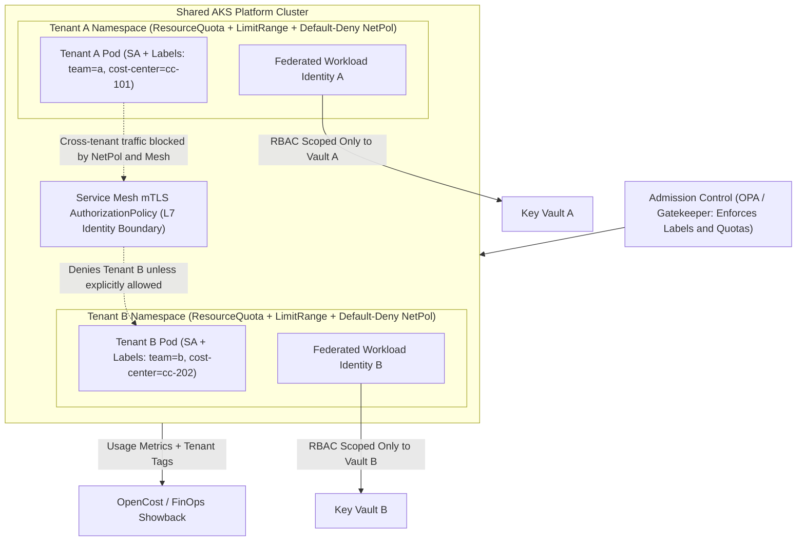
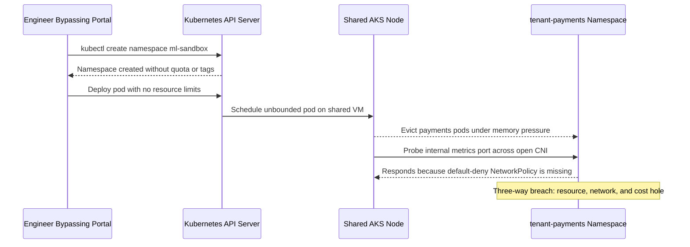

# Multi-Tenancy and Platform Security

> **Prerequisites:** Kubernetes & Security ([Track 03](../../03-kubernetes/README.md), [Track 11](../../11-security-deep-dive/README.md)), AKS ([Track 07](../../07-aks/README.md)), Service Mesh ([Track 13](../../13-service-mesh/README.md)), Identity ([Track 16](../../16-identity-deep-dive/README.md)), Governance ([Track 17](../../17-governance-at-scale/README.md)), and FinOps ([Track 21](../../21-cost-management-and-finops/README.md)).  
> **Estimated Reading Time:** 35 minutes  
> **Target Audience:** Platform Engineers, Security Architects, Kubernetes Administrators.

> [!TIP]
> **The Golden Rule of Platform Multi-Tenancy:** Tenancy must be an **enforced property of the paved road**, never a checklist teams follow manually—stamp every tenant namespace with the full five-axis isolation bundle (resource, network, identity, data, and cost) and block un-isolated namespaces at admission time.

---

## Why This Matters

A platform's whole economic argument is *sharing*: many teams run on the same AKS clusters, the same Container Apps environment, the same networking — that's how you avoid every team standing up their own everything. But shared infrastructure means one team's workload runs inches from another's, and without deliberate isolation, one tenant can read another's secrets, starve their resources, reach their pods over the network, or make their spend un-attributable. This module is where the security you learned in tracks 11, 13, and 16 stops being "secure a service" and becomes "safely host *other people's* services next to each other" — plus attributing the shared bill back to whoever ran it up (track 21). Multi-tenancy is the discipline that lets a platform be shared without being a shared liability.

---

## 1. Architectural Mental Model: Five-Axis Tenant Isolation & Defense in Depth

True platform multi-tenancy layers five independent boundaries around every tenant simultaneously so no single misconfiguration collapses isolation:



### The tenant, and the isolation you owe each one

A **tenant** on a platform is an isolation boundary — usually a team, sometimes a service or an environment. The platform's promise is that each tenant is *isolated* from the others along several axes at once, and it's worth naming them because they map to different tracks you already know:

- **Resource isolation** — one tenant can't starve another of CPU/memory (noisy neighbor). Kubernetes `ResourceQuota` and `LimitRange` from [track 03](../../03-kubernetes/README.md).
- **Network isolation** — one tenant can't reach another's pods unless allowed. `NetworkPolicy` from [track 03](../../03-kubernetes/README.md)/[11](../../11-security-deep-dive/README.md) and mesh authorization policy from [track 13](../../13-service-mesh/README.md).
- **Identity/access isolation** — one tenant can't act on another's resources. RBAC and workload identity from [track 16](../../16-identity-deep-dive/README.md).
- **Data/secret isolation** — one tenant can't read another's secrets. Key Vault scoping and RBAC from tracks [11](../../11-security-deep-dive/README.md) and [16](../../16-identity-deep-dive/README.md).
- **Cost isolation (attribution)** — each tenant's spend is measurable and billed back. Tagging from [track 21](../../21-cost-management-and-finops/README.md).

No single mechanism provides multi-tenancy; it's the *combination*, applied consistently by the platform so every tenant gets all of it by default. This is the security synthesis of the whole curriculum: everything you learned to do for *one* workload, now enforced *between* workloads that don't trust each other.

### The isolation spectrum — soft vs. hard multi-tenancy

Multi-tenancy isn't binary; it's a spectrum, and choosing where you sit is a core platform decision. **Soft multi-tenancy** shares a cluster among tenants you *somewhat* trust (all internal teams at one company), using namespaces, quotas, RBAC, and network policy as the boundary. It's efficient (one cluster, many teams) but the boundary is Kubernetes-logical, not a hard kernel/VM boundary — a container-escape vulnerability could cross it, so it's inappropriate for hostile or strongly-regulated tenants.

**Hard multi-tenancy** gives untrusted tenants stronger separation — separate node pools, separate clusters, or separate subscriptions ([track 17](../../17-governance-at-scale/README.md) landing zones) — trading efficiency for a stronger boundary. Most internal platforms live in the *soft* region (internal teams, namespace-per-tenant) but push specific high-sensitivity tenants toward *harder* isolation (a dedicated node pool from [track 07](../../07-aks/README.md), or their own landing zone from [track 17](../../17-governance-at-scale/README.md)). The skill is matching the isolation strength to the *actual* trust and compliance requirement — over-isolating everyone wastes the platform's whole sharing benefit; under-isolating a regulated tenant is a breach waiting to happen.

### Namespace-per-tenant on shared Kubernetes — the workhorse pattern

The dominant soft-multi-tenancy pattern is **namespace-per-tenant**: each team (or service) gets a Kubernetes namespace, and the platform stamps a consistent bundle of controls onto every one of them at creation — which is exactly a job for the golden path (module 01) and self-service provisioning (module 03). Onto each namespace the platform applies: a `ResourceQuota` (caps total CPU/mem so no tenant starves the cluster), a `LimitRange` (default per-pod limits so a single runaway pod is bounded), a default-deny `NetworkPolicy` (track 11 — nothing talks to this namespace unless explicitly allowed), RBAC bindings (track 16 — only this team's identities can act in it), and consistent labels/tags (track 21 — for cost attribution and policy targeting).

Because these are applied by the platform, uniformly, at provision time, tenancy becomes a *property of the paved road* rather than something each team configures (and forgets). A tenant that self-provisions a namespace through the platform can't *not* get a quota and a default-deny policy — the isolation is baked in, the same way security defaults were baked into the golden path in module 01. The failure mode to hunt (and you will, in the exercises) is the isolation *gap*: a namespace that slipped through without its network policy, or a quota that was never applied, turning a "shared" cluster into an accidental open one.

### Applying tracks 11 / 13 / 16 at the platform level

The security patterns you learned for a single workload now operate *between* tenants, and it's worth seeing the level-up explicitly:

- **[Track 11](../../11-security-deep-dive/README.md) (security):** you learned default-deny network policy and OPA/Gatekeeper for one cluster; at the platform level, Gatekeeper *enforces that every tenant namespace has* the right policies, quotas, and labels — policy that governs the *tenancy itself*, not just the workloads. A tenant can't deploy a privileged pod or a public LoadBalancer if the platform's admission policy forbids it.
- **[Track 13](../../13-service-mesh/README.md) (mesh):** mTLS gives every service a verified identity, and mesh `AuthorizationPolicy` lets the platform enforce "tenant A's services may not call tenant B's" at the mesh layer — identity-based isolation stronger than IP-based network policy alone.
- **[Track 16](../../16-identity-deep-dive/README.md) (identity):** each tenant's workloads get their *own* workload identity federated to Entra, scoped to only their own Azure resources (their Key Vault, their database). One tenant's managed identity cannot read another's secrets because the RBAC scoping forbids it. This is the identity boundary that makes data isolation real.

Layered, these give **defense in depth**: even if one control fails (a network policy is misconfigured), another (mesh authz, or identity scoping) still stands between tenants. The platform's job is to apply all layers consistently so no tenant relies on a single point of isolation.

### Cost attribution — making shared spend fair

A shared platform gets one bill, but the tenants caused it in different amounts — and if you can't split it, you can't do FinOps ([track 21](../../21-cost-management-and-finops/README.md)) and every team treats the platform as free (so nobody right-sizes). **Cost attribution** solves this by tagging every resource with its tenant (`team`, `cost-center`, `service`) — the tags the golden path applied automatically in module 01 and self-service enforced in module 03 — so Azure Cost Management can slice spend by tenant and *show each team what they cost*.

The hard part on shared Kubernetes is that many tenants share the *same* nodes, so the node VM bill isn't tagged per tenant — you need **usage-based allocation** (tools like OpenCost/Kubecost, or namespace-level resource-usage metrics from track 12) to divide shared node cost by each tenant's actual consumption. The platform-engineering point is that attribution has to be *built into tenancy*: if a tenant can run workloads the platform can't attribute (an un-tagged namespace, a resource created outside the paved road), the cost model has a hole. This closes the loop with track 21 — showback/chargeback only works if tenancy and tagging were designed together from the start, which is why this module sits where it does.

---

## 2. Taxonomic Comparison & Command Reference

### Soft vs. Hard Multi-Tenancy Isolation Spectrum

| Dimension | Soft Multi-Tenancy (Namespace-per-Tenant) | Intermediate (Dedicated Node Pool + Taints) | Hard Multi-Tenancy (Dedicated Cluster / Landing Zone) |
| :--- | :--- | :--- | :--- |
| **Underlying Boundary** | Logical Kubernetes namespace + RBAC + NetPol | Physical VM node pool isolation + taints/tolerations | Separate AKS control plane, VNet, and Azure subscription |
| **Shared Kernel Risk** | Shared Linux kernel across tenants on nodes | Kernel isolated per tenant node pool | Full VM, control-plane, and ARM blast-radius isolation |
| **Noisy-Neighbor Shield** | `ResourceQuota` + `LimitRange` | Dedicated node compute + quotas | Complete hardware & API-server isolation |
| **Operational / FinOps Cost** | Highest efficiency (shared nodes & control plane) | Moderate (node idle headroom per sensitive pool) | Highest overhead (per-tenant cluster management & base fee) |
| **Best Tenant Fit** | Trusted internal product engineering teams | PCI/PII workloads or noisy batch compute | Hostile external tenants or strict regulatory compliance |

### Command Reference

Everything here is the tenancy-and-security machinery from tracks 03/11/13/16/21, applied per tenant. The point is the *consistent bundle* the platform stamps onto every namespace.

| Command | What it does | From |
|---|---|---|
| `kubectl create namespace <tenant>` | Creates the tenant boundary | track 03 |
| `kubectl apply -f resourcequota.yaml` | Caps a tenant's total CPU/mem (anti noisy-neighbor) | track 03 |
| `kubectl apply -f networkpolicy-default-deny.yaml` | Blocks all traffic to/from the namespace by default | track 11 |
| `kubectl auth can-i --as <tenant-sa> ...` | Verifies a tenant's identity *can't* act outside its scope | track 16 |
| `az role assignment list --scope <kv-id>` | Confirms only the right tenant identity can read a Key Vault | track 16 |
| `kubectl cost namespace` (OpenCost/Kubecost) | Allocates shared node cost to tenants by usage | track 21 |

Multi-flag / multi-part examples (know each part — these are the isolation controls):

| Command / manifest | Part | Why |
|---|---|---|
| `kubectl create quota tenant-q --hard=cpu=8,memory=16Gi,pods=50 -n <tenant>` | `--hard=cpu=8,memory=16Gi` | Hard cap so one tenant can't consume the whole cluster (noisy-neighbor, track 03) |
| | `pods=50` | Bound object count too, so a tenant can't exhaust the API/scheduler |
| `ResourceQuota + LimitRange` together | `LimitRange` | Sets *default* per-pod requests/limits so a pod with none still can't run unbounded (track 03) |
| `NetworkPolicy podSelector: {} policyTypes: [Ingress, Egress]` | `podSelector: {}` | Selects *all* pods in the namespace — the default-deny baseline (track 11) |
| | `policyTypes: [Ingress, Egress]` | Deny both directions, so the tenant is isolated in and out until explicitly allowed |
| mesh `AuthorizationPolicy` `from.source.namespaces: ["tenant-a"]` | `source.namespaces` | Allow only same-tenant callers by *verified identity* (mTLS), stronger than IP (track 13) |
| resource `tags = { team, cost-center, environment }` | `cost-center` | The attribution key (track 21) — without it the tenant's shared spend is a hole in the bill |

A default-deny `NetworkPolicy` — the baseline every tenant namespace gets:

```yaml
apiVersion: networking.k8s.io/v1
kind: NetworkPolicy
metadata:
  name: default-deny-all
  namespace: tenant-checkout      # stamped onto EVERY tenant namespace by the platform
spec:
  podSelector: {}                 # every pod in the namespace
  policyTypes: [Ingress, Egress]  # nothing in or out until explicitly allowed (track 11)
```

---

## 3. Production War Story Post-Mortem: The Un-Governed Namespace & Cross-Tenant Eviction

| Field | Incident Details |
| :--- | :--- |
| **Severity** | **SEV-1** (Cross-Tenant Resource Starvation & Lateral Network Exposure) |
| **Detection / Resolution Time** | Detected in 12 minutes via `tenant-payments` PodEviction alerts / Mitigated in 38 minutes |
| **Impact** | An ad-hoc namespace (`ml-sandbox`) created outside the self-service portal exhausted node memory, evicting `tenant-payments` checkout pods, and could reach unauthenticated internal metrics endpoints across namespaces |

### What Happened

A well-meaning data scientist bypassed the platform portal and ran `kubectl create namespace ml-sandbox` using legacy cluster-admin credentials left over from early cluster bootstrapping. Because the namespace bypassed the golden-path provisioner, it received zero `ResourceQuota`, zero `LimitRange`, no default-deny `NetworkPolicy`, and no `cost-center` label. A single memory-leaking notebook pod consumed 48 GiB on a shared node, triggering kubelet OOM evictions against `tenant-payments` while also probing internal cluster services unobstructed.



### Root Cause Analysis

1. **Isolation by convention, not admission control**: The platform applied isolation bundles in its Terraform template, but allowed raw `kubectl create namespace` without an OPA/Gatekeeper policy blocking non-compliant namespaces or un-bounded pods.
2. **Missing L7 defense in depth**: `tenant-payments` relied solely on network policy and lacked a strict mTLS `AuthorizationPolicy`, so any namespace missing a network policy could reach it.
3. **Un-bounded FinOps hole**: Without mandatory `team` and `cost-center` labels enforced at admission, 18% of node spend showed up as `__unallocated__` in monthly showback reports.

### The Fix & Architectural Hardening

- Revoked legacy `cluster-admin` privileges and locked namespace creation to the platform GitOps controller and self-service portal identity.
- Enforced OPA/Gatekeeper constraints requiring `team` and `cost-center` labels on all namespaces plus mandatory container resource limits and non-privileged security contexts on every pod.
- Enabled service-mesh `STRICT` mTLS + `AuthorizationPolicy` restricting `tenant-payments` exclusively to verified gateway and same-tenant identities.

---

## 4. Multi-Language Production Implementation: Five-Axis Tenant Bundle Validator

These four implementations model a platform admission/CLI pre-flight validator that checks a tenant onboarding specification against all five multi-tenancy axes (resource bounds, default-deny network posture, scoped identity, mandatory FinOps tags, and soft/hard tier compliance) before provisioning.

````carousel
```go
package multitenancy

import (
	"fmt"
	"strings"
)

type TenantSpec struct {
	Namespace          string
	Team               string
	CostCenter         string
	ComplianceTier     string // "internal" | "regulated-pii"
	DedicatedNodePool  bool
	MaxCPUCores        int
	MaxMemoryGiB       int
	DefaultDenyIngress bool
	DefaultDenyEgress  bool
	KeyVaultResourceID string
	WorkloadClientID   string
}

func ValidateTenantBundle(spec TenantSpec) []string {
	var violations []string
	if strings.TrimSpace(spec.Team) == "" || strings.TrimSpace(spec.CostCenter) == "" {
		violations = append(violations, "cost-isolation: labels 'team' and 'cost-center' are required")
	}
	if spec.MaxCPUCores <= 0 || spec.MaxMemoryGiB <= 0 {
		violations = append(violations, "resource-isolation: ResourceQuota CPU and Memory bounds must be > 0")
	}
	if !spec.DefaultDenyIngress || !spec.DefaultDenyEgress {
		violations = append(violations, "network-isolation: default-deny NetworkPolicy must set both Ingress and Egress")
	}
	if spec.WorkloadClientID == "" || spec.KeyVaultResourceID == "" {
		violations = append(violations, "identity-isolation: tenant-scoped WorkloadClientID and KeyVaultResourceID required")
	}
	if spec.ComplianceTier == "regulated-pii" && !spec.DedicatedNodePool {
		violations = append(violations, "isolation-spectrum: regulated-pii tenants require hard isolation (DedicatedNodePool=true)")
	}
	return violations
}

func FormatRejection(namespace string, violations []string) error {
	if len(violations) == 0 {
		return nil
	}
	return fmt.Errorf("tenant %q rejected by platform admission:\n- %s", namespace, strings.Join(violations, "\n- "))
}
```
<!-- slide -->
```typescript
export type IsolationTier = "soft-namespace" | "dedicated-pool" | "landing-zone";

export interface TenantBundle {
  namespace: string;
  labels: Record<string, string>;
  quota: { cpuCores: number; memoryGiB: number; maxPods: number };
  networkPolicyTypes: Array<"Ingress" | "Egress">;
  workloadIdentityClientId: string;
  dataSensitivity: "internal" | "pii";
  isolationTier: IsolationTier;
}

export function validateTenantIsolationBundle(bundle: TenantBundle): void {
  const errors: string[] = [];

  if (!bundle.labels.team || !bundle.labels["cost-center"]) {
    errors.push("Missing required FinOps labels: team and cost-center");
  }
  if (bundle.quota.cpuCores <= 0 || bundle.quota.memoryGiB <= 0 || bundle.quota.maxPods <= 0) {
    errors.push("ResourceQuota must bound cpuCores, memoryGiB, and maxPods");
  }
  if (!bundle.networkPolicyTypes.includes("Ingress") || !bundle.networkPolicyTypes.includes("Egress")) {
    errors.push("Default-deny NetworkPolicy must deny both Ingress and Egress");
  }
  if (!bundle.workloadIdentityClientId) {
    errors.push("Tenant requires a dedicated federated Workload Identity clientId");
  }
  if (bundle.dataSensitivity === "pii" && bundle.isolationTier === "soft-namespace") {
    errors.push("PII workloads cannot share soft namespace nodes; select dedicated-pool or landing-zone");
  }

  if (errors.length > 0) {
    throw new Error(`Tenancy check failed for ${bundle.namespace}: ${errors.join("; ")}`);
  }
}
```
<!-- slide -->
```python
from dataclasses import dataclass
from typing import List, Literal, Set


@dataclass(frozen=True)
class TenantIsolationSpec:
    namespace: str
    team: str
    cost_center: str
    cpu_limit_cores: int
    memory_limit_gib: int
    policy_types: Set[str]
    federated_identity_id: str
    regulated_data: bool
    dedicated_node_pool: bool
    tier: Literal["soft", "hard"]


def audit_tenant_bundle(spec: TenantIsolationSpec) -> List[str]:
    """Verify all five multi-tenancy axes and soft/hard tier placement."""
    gaps: List[str] = []

    if not spec.team or not spec.cost_center:
        gaps.append("Missing FinOps attribution labels (team, cost-center)")
    if spec.cpu_limit_cores <= 0 or spec.memory_limit_gib <= 0:
        gaps.append("ResourceQuota must define bounded CPU and memory limits")
    if {"Ingress", "Egress"} - spec.policy_types:
        gaps.append("NetworkPolicy must enforce default-deny on both Ingress and Egress")
    if not spec.federated_identity_id:
        gaps.append("Tenant must bind its own Entra federated workload identity")
    if spec.regulated_data and spec.tier == "soft" and not spec.dedicated_node_pool:
        gaps.append("Regulated tenant placed on shared soft nodes; require dedicated node pool or landing zone")

    return gaps
```
<!-- slide -->
```csharp
public sealed record TenantOnboardingRequest(
    string Namespace,
    string Team,
    string CostCenter,
    int CpuQuotaCores,
    int MemoryQuotaGiB,
    bool HasDefaultDenyIngress,
    bool HasDefaultDenyEgress,
    string FederatedIdentityClientId,
    bool IsRegulatedPii,
    bool UsesHardIsolation);

public static class TenantIsolationGuard
{
    public static IReadOnlyList<string> ValidateFiveAxes(TenantOnboardingRequest req)
    {
        var failures = new List<string>();

        if (string.IsNullOrWhiteSpace(req.Team) || string.IsNullOrWhiteSpace(req.CostCenter))
            failures.Add("Cost attribution gap: 'team' and 'cost-center' tags are mandatory.");

        if (req.CpuQuotaCores <= 0 || req.MemoryQuotaGiB <= 0)
            failures.Add("Resource isolation gap: ResourceQuota must enforce positive CPU and memory limits.");

        if (!req.HasDefaultDenyIngress || !req.HasDefaultDenyEgress)
            failures.Add("Network isolation gap: default-deny NetworkPolicy must include Ingress and Egress.");

        if (string.IsNullOrWhiteSpace(req.FederatedIdentityClientId))
            failures.Add("Identity isolation gap: each tenant requires a dedicated federated workload identity.");

        if (req.IsRegulatedPii && !req.UsesHardIsolation)
            failures.Add("Isolation spectrum gap: regulated PII tenants cannot run on soft multi-tenant nodes.");

        return failures;
    }
}
```
````

---

## 5. Practical Hands-On Verification CLI Workflows

You need a kind or AKS cluster with a CNI that enforces `NetworkPolicy` (e.g. Calico/Cilium — plain kind may need the Calico add-on), and the mesh from [track 13](../../13-service-mesh/README.md) for the mesh exercises. Clean up billable resources.

### Step 1: Stamp & Verify a Tenant Bundle (`ResourceQuota`, `LimitRange`, `NetworkPolicy`)

```bash
kubectl create namespace tenant-a
kubectl label namespace tenant-a team=checkout cost-center=cc-1042
kubectl create quota tenant-q --hard=cpu=4,memory=8Gi,pods=30 -n tenant-a
kubectl apply -f networkpolicy-default-deny.yaml -n tenant-a
kubectl describe quota tenant-q -n tenant-a
```

**Expected Output:**
```text
Name:       tenant-q
Namespace:  tenant-a
Resource    Used  Hard
--------    ----  ----
cpu         0     4
memory      0     8Gi
pods        0     30
```

### Step 2: Verify RBAC & Cross-Tenant Network / Key Vault Denial

```bash
kubectl auth can-i list secrets --namespace tenant-b --as system:serviceaccount:tenant-a:app-sa
kubectl exec -n tenant-b curl-client -- curl -sS --max-time 3 http://api.tenant-a.svc.cluster.local:8080
```

**Expected Output:**
```text
no
curl: (28) Connection timed out after 3001 milliseconds
```

### Step 3: Verify Shared Node Cost Allocation by Tenant

```bash
kubectl cost namespace --show-all-resources --window 24h
```

**Expected Output:**
```text
NAMESPACE    CPU       MEMORY    TOTAL COST (24H)
tenant-a     1.82      3.40Gi    $4.12
tenant-b     0.64      1.20Gi    $1.48
```

### Hands-On Exercises

1. **Provision a tenant namespace with the full bundle.** Write the platform's "new tenant" bundle: a namespace, a `ResourceQuota`, a `LimitRange`, a default-deny `NetworkPolicy`, and RBAC binding a tenant service account. Apply it for `tenant-a`. This is tenancy as a *paved-road bundle* (modules 01/03), not ad-hoc config.

2. **Prove resource isolation (noisy neighbor).** In `tenant-a`, deploy a pod that tries to request more CPU than the quota allows and confirm it's *rejected*. Then deploy a pod with no limits and confirm the `LimitRange` gives it defaults. You've bounded a tenant's blast radius on shared nodes (track 03).

3. **Prove network isolation.** Create `tenant-a` and `tenant-b` namespaces, each with a pod. Confirm `tenant-b`'s pod *cannot* reach `tenant-a`'s pod (curl times out) because of the default-deny policy. Then add an explicit allow only for a legitimate cross-tenant call and confirm it now works. Isolation by default, connectivity by exception (track 11).

4. **Prove identity/data isolation.** Give `tenant-a` a managed identity scoped to *its* Key Vault (track 16), and `tenant-b` its own. Confirm `tenant-b`'s identity *cannot* read `tenant-a`'s secret (`az keyvault secret show` fails with 403). This is the boundary that makes "one tenant can't read another's data" real, not aspirational.

5. **Enforce tenancy with admission policy.** Write an OPA/Gatekeeper constraint (track 11) that *rejects* any namespace created without the required tenant label, or any pod that's privileged or exposes a public LoadBalancer. Try to violate it and confirm the platform refuses. Now tenancy rules are enforced, not trusted.

6. **Add mesh-level authorization (defense in depth).** With the mesh from [track 13](../../13-service-mesh/README.md), add an `AuthorizationPolicy` that allows a service to be called only by same-tenant identities (mTLS). Confirm a cross-tenant call is denied *even if* a network policy were misconfigured — demonstrating layered isolation (track 13).

7. **Attribute cost per tenant.** Tag both tenants' resources with `team` and `cost-center` (track 21), run some load, and use OpenCost/Kubecost (or namespace resource-usage metrics from track 12) to produce a per-tenant cost breakdown of the *shared* nodes. Confirm the two tenants show different costs. This is showback made real — the FinOps loop from track 21 closed at the platform.

8. **Choose the isolation strength.** For three hypothetical tenants — an internal dev team, a team handling PII under compliance (track 17), and a partner-facing service — decide where each sits on the soft/hard spectrum (shared namespace, dedicated node pool from track 07, separate landing zone/subscription from track 17) and justify each. Over-isolating all three wastes the platform; under-isolating the PII tenant is a breach.

9. **Diagnose-and-fix: the isolation gap.** A tenant namespace was created outside the paved road (a developer ran `kubectl create namespace` directly), so it has *no* quota, *no* default-deny network policy, and *no* cost tags. Reproduce this gap: create a bare namespace, deploy a pod, and confirm it can reach another tenant's pod *and* consume unbounded resources *and* produces un-attributable spend — a three-way isolation failure. Then fix it two ways: (a) *remediate* the existing gap (apply the missing controls), and (b) *prevent recurrence* — a Gatekeeper policy that blocks any namespace lacking the required controls/labels, so a bare `kubectl create namespace` can't produce an un-isolated tenant again. Write down *why* the paved road (modules 01/03) is the real fix: isolation applied by convention has gaps; isolation applied by the platform, and enforced by admission control, doesn't. This is the multi-tenant version of module 01's "green pipeline, broken service" — an un-governed namespace *looks* fine until a tenant crosses a boundary they shouldn't.

10. **Clean up.** Delete tenant namespaces and any billable Azure resources (`az group delete`, Key Vaults). Confirm nothing tenant-scoped is left. On a real shared platform, tenant offboarding is itself a paved-road workflow — note what the platform would need to reliably reclaim a departed tenant's namespace, identity, secrets, and cost tags.

### Independent challenge

Drawing on this module and tracks 03, 07, 11, 13, 16, 17, and 21, design the complete **multi-tenancy model for a shared AKS platform** hosting ~20 internal teams plus 2 compliance-sensitive teams. Specify: the tenant boundary and the exact control bundle every tenant namespace receives (quota, limit range, default-deny network policy, RBAC, workload identity scope, labels/tags) and how the platform *stamps it consistently* (modules 01/03); where on the soft/hard isolation spectrum each class of tenant sits and why (namespace vs. dedicated node pool from track 07 vs. separate landing zone from track 17); the admission policies (track 11) that *enforce* tenancy so gaps can't form; the mesh authorization model (track 13) for cross-tenant calls; the identity model (track 16) that keeps each tenant's Azure resources unreachable to others; and the cost-attribution scheme (track 21) including how you divide shared node cost. Call out at least one deliberate defense-in-depth layering (two controls that both enforce the same boundary). The deliverable is a design a security reviewer could sign off on — the security capstone of the whole curriculum's isolation story.

<details>
<summary>Stuck? One hint</summary>

The single most important design decision is that **tenancy is a property of the paved road, enforced by admission control — not a checklist teams follow**. So build the design around two ideas: (1) a *bundle* every namespace gets stamped with at provision time (modules 01/03), and (2) a *Gatekeeper policy* (track 11) that makes it impossible for a namespace to exist *without* that bundle — the belt-and-suspenders that closes the isolation-gap failure. For the soft/hard spectrum, match isolation strength to *trust and compliance*, not to team size: internal teams get soft namespace isolation; the PII/compliance teams get a harder boundary (dedicated node pool or their own landing zone from track 17) because a container-escape crossing a namespace boundary is an acceptable risk for a dev team and a reportable breach for a regulated one. And for defense in depth, the cleanest example is network policy (IP-based, track 11) *and* mesh authz (identity-based, track 13) both enforcing "no cross-tenant calls" — so a misconfiguration in one still leaves the other standing.

</details>

---

## 6. Common Mistakes & Troubleshooting

- **Treating multi-tenancy as one mechanism.** No single control gives isolation; it's resource + network + identity + data + cost controls applied *together*. Missing any one axis is a real gap (a tenant with RBAC isolation but no network policy is not isolated).
- **Isolation by convention instead of enforcement.** If tenants are *supposed* to apply a network policy, some won't. Apply the bundle via the paved road and *enforce* it with admission control (track 11) so a gap can't form.
- **The un-governed namespace.** A namespace created outside the platform (bare `kubectl create namespace`) lacks every control and silently becomes an open door. Gatekeeper should make an un-isolated namespace impossible.
- **Over-isolating everyone.** Putting every tenant in its own cluster/subscription throws away the platform's sharing benefit and cost. Match isolation to trust; most internal teams are fine in soft namespace tenancy.
- **Under-isolating a sensitive tenant.** Conversely, soft namespace isolation is wrong for hostile or strongly-regulated tenants — a container escape crosses a namespace boundary. Push those to harder isolation (node pool / landing zone).
- **Un-attributable cost.** If a tenant can run workloads the platform can't tag (or shares nodes with no usage-based allocation), the bill has a hole and the platform looks free to that team. Bake tagging into tenancy (track 21).
- **Single-layer isolation.** Relying on one control (just network policy) means one misconfiguration is a breach. Layer network policy *and* mesh authz *and* identity scoping for defense in depth (tracks 11/13/16).

---

## 7. Operational Validation Checkpoints

### Operational Validation Checkpoints

<details><summary><strong>Checkpoint 1: Placing regulated PII tenants vs. internal microservices on the isolation spectrum</strong></summary>

When onboarding 20 internal microservices alongside 2 PCI/PII workloads, placing everyone in separate AKS clusters wastes platform capital and multiplies control-plane toil, while leaving PII workloads on shared soft nodes exposes them to shared-kernel container escapes. Place the 20 internal teams in soft namespace-per-tenant isolation and isolate the 2 regulated workloads onto dedicated node pools (or separate Azure landing zones) enforced via node selectors, taints, and Gatekeeper admission rules.

</details>

<details><summary><strong>Checkpoint 2: Surviving a misconfigured NetworkPolicy via defense in depth</strong></summary>

If an engineer accidentally edits a `NetworkPolicy` to permit ingress from all namespaces (`namespaceSelector: {}`), a single-layer cluster suffers immediate cross-tenant exposure. With defense in depth enabled—`STRICT` mTLS service-mesh `AuthorizationPolicy` checking `source.namespaces` at L7 and Entra Workload Identity scoping Key Vault RBAC per tenant—cross-tenant calls still receive L7 `RBAC: access denied` and secret access still fails with `403 Forbidden`.

</details>

<details><summary><strong>Checkpoint 3: Tracing unallocated node spend in OpenCost back to an untracked namespace</strong></summary>

If monthly showback displays an `__unallocated__` line item alongside tenant costs, inspect both unused node capacity (idle cluster headroom) and namespaces missing `team`/`cost-center` labels or resource requests. Enforcing `LimitRange` defaults and Gatekeeper label checks ensures every scheduled pod maps deterministically to a tenant cost center.

</details>

### Checkpoint quiz

Write down your answer to each question before expanding it — checking without attempting first is the single easiest way to fool yourself into thinking you've learned this.

<details>
<summary>Show questions</summary>

1. Name the five axes of tenant isolation and the track that supplies each.
2. Distinguish soft from hard multi-tenancy, and give one tenant type that belongs in each.
3. What is the "namespace-per-tenant" bundle, and why must the platform stamp it rather than teams applying it themselves?
4. How do tracks 11, 13, and 16 each provide a *different* isolation boundary, and what does layering them give you?
5. Why is cost attribution hard on shared Kubernetes nodes, and how do you solve it?
6. Describe the "isolation gap" failure and the two-part fix (remediate + prevent).
7. Why is over-isolating every tenant as much a mistake as under-isolating a sensitive one?

</details>

<details>
<summary>Show answers</summary>

1. Resource isolation (quotas/limits — track 03), network isolation (NetworkPolicy — track 11; mesh authz — track 13), identity/access isolation (RBAC/workload identity — track 16), data/secret isolation (Key Vault scoping/RBAC — tracks 11/16), cost isolation/attribution (tagging — track 21).
2. Soft multi-tenancy shares a cluster among *somewhat-trusted* tenants using namespaces/quotas/RBAC/network policy (a Kubernetes-logical boundary) — internal teams belong here. Hard multi-tenancy gives *untrusted/regulated* tenants stronger separation (dedicated node pools, clusters, or subscriptions) — a compliance/PII or hostile tenant belongs here.
3. It's the consistent set of controls stamped onto every tenant namespace: quota, limit range, default-deny network policy, RBAC, workload identity scope, and labels/tags. The platform must stamp it (via the paved road + admission control) because isolation by convention has gaps — a team that forgets the network policy creates an open namespace.
4. Track 11 = IP/network-based isolation (default-deny NetworkPolicy) and admission enforcement (Gatekeeper); track 13 = identity-based isolation via mTLS `AuthorizationPolicy` (stronger than IP); track 16 = Azure-resource isolation via scoped workload identity/RBAC (a tenant's identity can't read another's Key Vault). Layering them is defense in depth: one control failing still leaves others between tenants.
5. Because many tenants share the *same* node VMs, so the node bill isn't tagged per tenant. Solve it with usage-based allocation (OpenCost/Kubecost or namespace resource-usage metrics from track 12) that divides shared node cost by each tenant's actual consumption — on top of tagging everything tenant-scoped (track 21).
6. A namespace exists without its isolation controls (e.g. created outside the paved road) — it can reach other tenants, consume unbounded resources, and produce un-attributable spend. Fix: (a) remediate by applying the missing controls, and (b) prevent recurrence with a Gatekeeper policy that blocks any namespace lacking the required controls/labels, so the paved road (not convention) guarantees isolation.
7. Over-isolating (a cluster/subscription per tenant) throws away the platform's entire sharing/cost benefit and adds operational overhead. Under-isolating a sensitive tenant (soft namespace isolation for regulated/hostile workloads) risks a real breach, since a container escape crosses a namespace boundary. The skill is matching isolation strength to actual trust/compliance.

</details>

---

## 8. Next

[07-platform-adoption-and-measuring-success](../07-platform-adoption-and-measuring-success/README.md) — you've built a platform that's opinionated, self-service, reliable, and safely shared. None of that matters if teams don't *use* it. The final concepts module tackles the discipline that decides whether all this work pays off: measuring developer experience, understanding adoption curves, avoiding the "build it and they won't come" failure, and running the platform team's own roadmap and backlog like the product it is.
