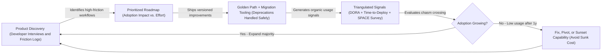
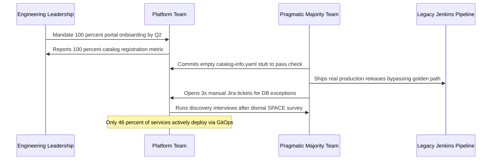

# Platform Adoption and Measuring Success

> **Prerequisites:** Platform as a Product, Golden Paths, Self-Service, and Platform SLOs (Modules 00–06), CI/CD & GitOps ([Track 10](../../10-cicd-and-gitops/README.md)), API Lifecycle ([Track 19](../../19-api-management/README.md)), SRE ([Track 20](../../20-sre-practices/README.md)), and FinOps ([Track 21](../../21-cost-management-and-finops/README.md)).  
> **Estimated Reading Time:** 30 minutes  
> **Target Audience:** Platform Product Managers, Staff Platform Engineers, Engineering Leaders.

> [!TIP]
> **The Golden Rule of Platform Adoption:** Never mistake **output** (modules shipped) or **mandated compliance** (forced registrations) for genuine adoption—triangulate quantitative flow metrics (time-to-first-deploy, DORA, active self-service rate) with qualitative developer satisfaction to earn adoption across the pragmatic majority chasm.

---

## Why This Matters

You can build a technically flawless platform — great golden paths, a slick portal, ironclad tenancy — and still fail completely, because the one metric that decides a platform's fate isn't uptime or feature count, it's **whether engineers actually use it**. "Build it and they won't come" is the single most common way platform teams fail, and it's a *product* failure, not a technical one. This module is where platform-as-a-product (module 00) becomes concrete practice: measuring developer experience, reading adoption curves honestly, and running the platform team's own work like the product it is. It's the last concepts module because it's the one that determines whether every prior module's work mattered.

---

## 1. Architectural Mental Model: The Platform Product Loop & Crossing the Chasm

A sustainable internal platform runs as a continuous product feedback loop rather than a one-time infrastructure delivery project. Discovery with non-adopting teams feeds a prioritized backlog, which evolves versioned golden paths whose true impact is verified through triangulated quantitative and qualitative telemetry:



### Adoption is the metric — output is a vanity metric

The trap platform teams fall into is measuring their *output* — how many golden paths shipped, how many Terraform modules published, how many portal plugins built — when the metric that matters is *adoption*: how many teams actually use the platform, for how much of their work. A platform with fifty features and three users has failed; a platform with one golden path that forty teams adopted has succeeded. Output measures how busy the platform team was; adoption measures whether they built something worth using.

This flows directly from module 00's platform-as-a-product framing: products live or die by adoption, not by how much was built. And adoption is a *leading* signal for everything else — a platform teams choose is one that removed real friction (good DX), which means it's providing the value that justifies its cost. The discipline is to make adoption the north-star metric the platform team reports on, and to treat a flat or declining adoption curve as a production incident for the *product*, investigated as seriously as track 20 would investigate an SLO breach.

### Measuring developer experience — turning a vibe into numbers

Module 00 named developer experience as the platform's core quality metric; this module makes it measurable. DX has both *quantitative* and *qualitative* signals, and you need both:

- **Quantitative:** time-to-first-deploy for a new service (the headline DX number), lead time from commit to production (the DORA metric from [track 10](../../10-cicd-and-gitops/README.md)), deployment frequency, change failure rate, and time-to-restore (the four DORA metrics), plus platform-specific ones like self-service rate (fraction of requests served without a human) and ticket volume to the platform team.
- **Qualitative:** developer satisfaction surveys, the friction points teams report, and — the most honest signal — what teams say when they *route around* the platform. The industry framing that pairs these is often summarized as DevEx or the SPACE framework (Satisfaction, Performance, Activity, Communication, Efficiency): the point is that pure activity metrics miss satisfaction, and pure surveys miss reality, so you triangulate.

The critical discipline, borrowed from [track 20](../../20-sre-practices/README.md) and [track 21](../../21-cost-management-and-finops/README.md), is that DX is a *measured, tracked number over time*, not a feeling. A platform improving its time-to-first-deploy from three days to two hours has evidence; one that "feels better" has an anecdote. And there's a Goodhart's-law hazard to respect: any DX metric you target can be gamed (optimize deploy frequency and teams ship trivial commits), so pair activity metrics with satisfaction so you can't win one while losing the point.

### The adoption curve and "build it and they won't come"

Platform adoption follows a curve, and understanding it prevents both premature panic and false comfort. Early adopters (a few enthusiastic teams) come easily — they'd try anything new. The **chasm** is the gap between those early adopters and the pragmatic majority, who won't adopt on novelty; they adopt when the platform is *clearly* the path of least resistance for a problem they actually have, with a migration story that isn't painful. Many platforms get a burst of early adoption, mistake it for success, and then stall at the chasm — the classic "build it and they won't come" plateau.

Crossing the chasm is a *product* problem with product solutions: do the discovery (interview the majority about their real friction — module 00), make the paved road genuinely the easiest option (not just the *correct* one), provide a concrete migration path for existing services (the template/abstraction versioning problem from modules 01/04), and win a lighthouse team whose success others will follow. The failure to avoid is *mandate-as-a-substitute-for-quality*: forcing adoption (module 00's "wall not road") masks a platform that isn't good enough, breeds shadow platforms, and produces malicious compliance rather than genuine adoption. A platform crosses the chasm by being *chosen*, and mandates should at most *ratify* a road teams already want, not *replace* the work of making it good.

### The platform team's own roadmap and backlog

Because the platform is a product, the platform team works like a product team: a **roadmap** driven by customer needs, a **prioritized backlog**, versioning and deprecation policies, changelogs, and a support model — not a reactive ticket queue (which would make it the service desk module 00 warned against). The roadmap comes from *product discovery*: interviewing developer-customers, watching adoption and friction data, and identifying the next-highest-leverage paved road to build or improve — not from the platform team's own guesses about what's interesting.

Two product disciplines deserve special mention because they recur across this track. **Deprecation** is how a platform evolves without breaking its users: the template (module 01) and abstraction (module 04) are versioned contracts, so retiring a version needs a communicated timeline, a migration path, and support — the exact discipline of [track 19](../../19-api-management/README.md)'s API lifecycle, applied to the platform's own interfaces. **Prioritization** must weigh adoption impact (how many teams does this unblock?) against cost, and resist the pull toward shiny internal projects no customer asked for. A platform team that runs a real backlog and roadmap is treating its work as a product; one that just services tickets and builds what it finds fun is not, however good its technology.

### Knowing when the platform is succeeding — and when to sunset

Finally, a mature platform practice defines *success* explicitly and revisits it, including the humility to recognize failure. Success looks like: high and growing adoption, falling time-to-first-deploy and lead time, high self-service rate, falling platform ticket volume, and developers who — when surveyed — say the platform makes them faster and would miss it if it vanished. The last is the strongest single signal: a platform teams would fight to keep has genuinely become the paved road.

The inverse discipline is knowing when a capability *isn't* working and having the product maturity to fix, pivot, or sunset it rather than defend sunk cost. A golden path only three teams use after a year is data, not a personal failure — the product response is to interview those who *didn't* adopt, fix the real friction, or retire the path and redirect effort. This is the same error-budget-style honesty from [track 20](../../20-sre-practices/README.md) and the cost-discipline from [track 21](../../21-cost-management-and-finops/README.md): a tracked number that forces a decision. The platform team's job is never "done" — it's a product under continuous discovery, and measuring success honestly is what keeps it pointed at value instead of at its own backlog.

---

## 2. Taxonomic Comparison & Command Reference

### Vanity Output Metrics vs. Real Product Outcome Metrics

| Metric Category | Vanity / Output Trap | Genuine Outcome Signal | How Target Can Be Gamed (Goodhart's Law) | Required Counter-Metric |
| :--- | :--- | :--- | :--- | :--- |
| **Platform Usage** | Total portal catalog stubs registered | Active services deploying through golden-path GitOps in last 30d | Mandating empty placeholder `catalog-info.yaml` registrations | Ratio of prod deploys via paved road vs. shadow pipelines |
| **Delivery Speed** | Count of CI templates shipped | Time-to-first-deploy (scaffold -> first prod HTTP 200) | Testing only "hello world" demos while real DB services fail | End-to-end onboarding time for services with stateful DBs |
| **Velocity (DORA)** | Raw daily commit or deploy count | Lead time for changes + deployment frequency | Splitting one logical change into ten trivial commits | Change failure rate + developer satisfaction score |
| **Support Load** | Closing Jira tickets fast | Self-service rate + falling platform ticket volume | Closing tickets as "won't fix" or pushing teams to Slack DMs | Unresolved friction logs + developer "would miss IDP" score |

### Platform Adoption Curve & Cohort Strategy

| Cohort | Adoption Motivation | Dominant Friction | Wrong Platform Response | Effective Product Strategy |
| :--- | :--- | :--- | :--- | :--- |
| **Early Adopters (0–15%)** | Curiosity and new tooling enthusiasm | Rough edges and missing docs | Assuming their excitement proves PMF | Co-develop v1 golden path and tighten feedback loops |
| **Pragmatic Majority (15–85%)** | Solving urgent delivery pain cheaply | Brownfield migration cost & edge cases | Issuing executive mandates too early | Discovery interviews, automated migrators, lighthouse case study |
| **Late / Regulated Teams (85–100%)** | Proven safety, compliance, and stability | Missing compliance controls / exceptions | Building bespoke one-off snowflaking | Scoped exception path, compliance presets, formal deprecation timelines |

### Command Reference

This module's "commands" are the metrics and the sources you compute them from — mostly data you already produce across earlier tracks, now read as adoption/DX signals.

| Metric | How you'd source it | From |
|---|---|---|
| Adoption (teams on the platform) | count of catalog entities using the golden path | module 02 |
| Time-to-first-deploy | timestamp from scaffold → first successful prod deploy | modules 01/10 |
| Lead time for changes (DORA) | commit timestamp → deploy timestamp, from CI/GitOps | track 10 |
| Deployment frequency (DORA) | count of deploys per service per week | track 10 |
| Change failure rate (DORA) | fraction of deploys causing an incident/rollback | tracks 10/20 |
| Time to restore (DORA) | incident start → resolution, from postmortems | track 20 |
| Self-service rate | requests served without a human / total requests | module 03 |
| Platform ticket volume | count of tickets to the platform team over time | — |
| Developer satisfaction | periodic survey score (SPACE/DevEx) | — |

Example queries against data you already have (illustrative — the point is that the signals *already exist*, you just have to read them as adoption/DX):

| Command | What it tells you |
|---|---|
| `gh api search/code -q "uses: acme/golden-path"` | How many repos adopted the golden path's CI (adoption) |
| `argocd app list -o json \| jq '[.[].metadata.creationTimestamp]'` | When services onboarded — the adoption curve over time |
| `az devops ... work item query` / issue counts | Platform ticket volume trend (falling = better self-service) |
| Grafana panel on scaffold→deploy latency | Time-to-first-deploy distribution (the headline DX number) |

---

## 3. Production War Story Post-Mortem: The 100% Mandated Platform That Nobody Used

| Field | Incident Details |
| :--- | :--- |
| **Severity** | **SEV-2** (Product Failure: Shadow Pipelines & Stalled Engineering Velocity) |
| **Detection / Resolution Time** | Detected 6 months post-mandate via annual developer survey / Remediated over 1 quarter |
| **Impact** | Leadership reported 100% portal adoption on slide decks, yet 54% of product teams maintained shadow Jenkins scripts for real deploys, driving platform ticket queues up 3x and cutting net deployment frequency by 35% |

### What Happened

To accelerate return on platform investment, engineering leadership mandated that every microservice register in the Backstage catalog by Q2. On paper, adoption hit 100% overnight. Six months later, an anonymous SPACE survey revealed deep frustration: developers called the portal "compliance theater," complained that brownfield migration required rewriting Terraform by hand, and continued pushing real releases through legacy Jenkins pipelines while keeping empty `catalog-info.yaml` stubs synced just to pass audit checks.



### Root Cause Analysis

1. **Vanity metric mistaken for genuine adoption**: Counting static catalog YAML files instead of active production deploys via the golden path hid widespread shadow tooling.
2. **Mandate used as a substitute for product quality**: Forcing adoption before solving brownfield migration friction turned the paved road into a compliance wall.
3. **Zero qualitative triangulation**: The platform team ignored rising manual ticket volume and did not run discovery interviews with non-adopters until annual survey results surfaced.

### The Fix & Architectural Hardening

- Replaced "catalog registration count" with a true active north-star metric: *percentage of production deployments executed via golden-path GitOps in the last 30 days*.
- Interviewed 12 shadow-pipeline teams, shipped an automated brownfield migrator CLI (`migrate-to-golden-path`), and partnered with one high-visibility lighthouse team to drop their time-to-first-deploy from 4 days to 45 minutes.
- Retired 3 unused experimental scaffolder plugins and shifted to a quarterly roadmap prioritized explicitly by developer-unblocked adoption impact.

---

## 4. Multi-Language Production Implementation: DORA + SPACE Adoption & Goodhart Guardrail Evaluator

These four implementations compute genuine active adoption (filtering out empty mandated stubs), headline DX time-to-first-deploy, and Goodhart's-law divergence checks (flagging when high deployment frequency pairs with falling developer satisfaction or high rollback rates).

````carousel
```go
package adoption

import "fmt"

type ServiceAdoptionRecord struct {
	ServiceName               string
	HasCatalogEntity          bool
	GoldenPathDeploys30d      int
	ShadowPipelineDeploys30d  int
	TimeToFirstDeployHours    float64
	FailedGoldenPathDeploys   int
}

type PlatformHealthReport struct {
	GenuineAdoptionRate float64
	CatalogVanityRate   float64
	MedianFirstDeployHr float64
	GoodhartWarning     string
}

func EvaluateAdoption(records []ServiceAdoptionRecord, devSatScoreOutOf5 float64) PlatformHealthReport {
	if len(records) == 0 {
		return PlatformHealthReport{}
	}
	var catalogCount, activeGoldenCount, totalDeploys, failedDeploys int
	var sumHours float64

	for _, r := range records {
		if r.HasCatalogEntity {
			catalogCount++
		}
		if r.GoldenPathDeploys30d > 0 && r.ShadowPipelineDeploys30d == 0 {
			activeGoldenCount++
			sumHours += r.TimeToFirstDeployHours
		}
		totalDeploys += r.GoldenPathDeploys30d
		failedDeploys += r.FailedGoldenPathDeploys
	}

	n := float64(len(records))
	genuine := float64(activeGoldenCount) / n
	vanity := float64(catalogCount) / n
	cfr := 0.0
	if totalDeploys > 0 {
		cfr = float64(failedDeploys) / float64(totalDeploys)
	}

	var warning string
	if vanity-genuine > 0.25 {
		warning = fmt.Sprintf("Mandated ghost-town signal: %.0f%% cataloged vs %.0f%% active golden-path", vanity*100, genuine*100)
	} else if cfr > 0.15 || devSatScoreOutOf5 < 3.2 {
		warning = "Goodhart divergence: activity metrics cannot mask high change failure rate or low satisfaction"
	}

	avgHours := 0.0
	if activeGoldenCount > 0 {
		avgHours = sumHours / float64(activeGoldenCount)
	}
	return PlatformHealthReport{
		GenuineAdoptionRate: genuine,
		CatalogVanityRate:   vanity,
		MedianFirstDeployHr: avgHours,
		GoodhartWarning:     warning,
	}
}
```
<!-- slide -->
```typescript
export interface ServiceTelemetry {
  name: string;
  registeredInCatalog: boolean;
  goldenPathProdDeploys30d: number;
  shadowPipelineDeploys30d: number;
  scaffoldToFirstProdHours: number;
  rollbacks30d: number;
}

export interface ProductScorecard {
  genuineAdoptionPct: number;
  vanityRegistrationPct: number;
  avgTimeToFirstDeployHours: number;
  changeFailureRatePct: number;
  chasmDiagnosis: "pre-chasm" | "stalled-mandate" | "crossing-chasm";
}

export function computePlatformScorecard(
  services: ServiceTelemetry[],
  developerWouldMissPlatformPct: number
): ProductScorecard {
  const total = Math.max(services.length, 1);
  const registered = services.filter((s) => s.registeredInCatalog).length;
  const activeUsers = services.filter(
    (s) => s.goldenPathProdDeploys30d > 0 && s.shadowPipelineDeploys30d === 0
  );

  const totalDeploys = services.reduce((acc, s) => acc + s.goldenPathProdDeploys30d, 0);
  const totalRollbacks = services.reduce((acc, s) => acc + s.rollbacks30d, 0);
  const avgDeployHours =
    activeUsers.reduce((acc, s) => acc + s.scaffoldToFirstProdHours, 0) /
    Math.max(activeUsers.length, 1);

  const genuinePct = (activeUsers.length / total) * 100;
  const vanityPct = (registered / total) * 100;

  let chasmDiagnosis: ProductScorecard["chasmDiagnosis"] = "pre-chasm";
  if (vanityPct - genuinePct > 25 || developerWouldMissPlatformPct < 40) {
    chasmDiagnosis = "stalled-mandate";
  } else if (genuinePct >= 35 && developerWouldMissPlatformPct >= 60) {
    chasmDiagnosis = "crossing-chasm";
  }

  return {
    genuineAdoptionPct: Number(genuinePct.toFixed(1)),
    vanityRegistrationPct: Number(vanityPct.toFixed(1)),
    avgTimeToFirstDeployHours: Number(avgDeployHours.toFixed(2)),
    changeFailureRatePct: Number(((totalRollbacks / Math.max(totalDeploys, 1)) * 100).toFixed(1)),
    chasmDiagnosis,
  };
}
```
<!-- slide -->
```python
from dataclasses import dataclass
from typing import List


@dataclass(frozen=True)
class ServiceSignal:
    service: str
    cataloged: bool
    golden_deploys_30d: int
    shadow_deploys_30d: int
    time_to_first_deploy_hours: float
    incidents_30d: int


def evaluate_product_health(
    signals: List[ServiceSignal],
    self_service_rate: float,
    survey_would_miss_pct: float,
) -> dict:
    """Triangulate genuine adoption, DORA, and SPACE satisfaction against Goodhart traps."""
    total = len(signals)
    if total == 0:
        raise ValueError("At least one service signal is required")

    catalog_ratio = sum(1 for s in signals if s.cataloged) / total
    genuine = [s for s in signals if s.golden_deploys_30d > 0 and s.shadow_deploys_30d == 0]
    genuine_ratio = len(genuine) / total
    total_deploys = sum(s.golden_deploys_30d for s in signals)
    cfr = sum(s.incidents_30d for s in signals) / max(total_deploys, 1)

    alerts = []
    if catalog_ratio - genuine_ratio > 0.25:
        alerts.append("Mandate gap: catalog registrations far exceed active golden-path deployments")
    if self_service_rate < 0.70:
        alerts.append("Service-desk regression: too many requests require human platform tickets")
    if genuine_ratio > 0.50 and survey_would_miss_pct < 40.0:
        alerts.append("Goodhart alert: high usage is coerced; satisfaction is dangerously low")

    return {
        "genuine_adoption_pct": round(genuine_ratio * 100, 1),
        "change_failure_rate_pct": round(cfr * 100, 1),
        "avg_first_deploy_hours": round(
            sum(s.time_to_first_deploy_hours for s in genuine) / max(len(genuine), 1), 2
        ),
        "diagnostic_alerts": alerts,
    }
```
<!-- slide -->
```csharp
public sealed record ServiceAdoptionSignal(
    string ServiceName,
    bool IsRegistered,
    int GoldenPathDeploys30d,
    int ShadowDeploys30d,
    double HoursToFirstDeploy,
    int Incidents30d);

public static class PlatformAdoptionAnalyzer
{
    public static (double GenuinePct, double VanityPct, double ChangeFailureRatePct, string Action) Analyze(
        IReadOnlyCollection<ServiceAdoptionSignal> services,
        double wouldMissPlatformSurveyPct)
    {
        if (services.Count == 0)
            return (0, 0, 0, "No telemetry collected");

        double vanityPct = services.Count(s => s.IsRegistered) * 100.0 / services.Count;
        var genuine = services.Where(s => s.GoldenPathDeploys30d > 0 && s.ShadowDeploys30d == 0).ToList();
        double genuinePct = genuine.Count * 100.0 / services.Count;

        int deploys = services.Sum(s => s.GoldenPathDeploys30d);
        int incidents = services.Sum(s => s.Incidents30d);
        double cfrPct = deploys > 0 ? incidents * 100.0 / deploys : 0.0;

        string action = (vanityPct - genuinePct > 25.0)
            ? "Investigate shadow pipelines via discovery interviews; pause mandates."
            : (genuinePct < 20.0 && wouldMissPlatformSurveyPct < 35.0)
                ? "Capability failing to cross chasm: fix migration friction or sunset."
                : "Healthy adoption trajectory; prioritize next bottleneck from friction logs.";

        return (Math.Round(genuinePct, 1), Math.Round(vanityPct, 1), Math.Round(cfrPct, 1), action);
    }
}
```
````

---

## 5. Practical Hands-On Verification CLI Workflows

Several of these are analysis and product exercises — measuring and deciding, not just running commands. That's the nature of the discipline.

### Step 1: Query Real Golden-Path Adoption & Onboarding Curve

```bash
gh api search/code -q "uses: acme/golden-path" --jq '.total_count'
argocd app list -o json | jq '[.[] | {name: .metadata.name, created: .metadata.creationTimestamp, sync: .status.sync.status}]'
```

**Expected Output:**
```json
42
[
  {
    "name": "checkout-api",
    "created": "2026-01-14T09:12:00Z",
    "sync": "Synced"
  },
  {
    "name": "billing-worker",
    "created": "2026-02-03T16:40:11Z",
    "sync": "Synced"
  }
]
```

### Step 2: Check Platform Ticket Trend & Self-Service Ratio

```bash
az boards query --wiql "SELECT [System.Id], [System.State], [System.Tags] FROM WorkItems WHERE [System.AreaPath] = 'Platform\\Support' AND [System.CreatedDate] >= @Today - 30" -o table
```

**Expected Output:**
```text
ID    State    Tags
----  -------  -------------------------
4102  Closed   db-provisioning; manual
4119  Active   migration-help
```

### Hands-On Exercises

1. **Pick the north-star metric.** For a platform you're designing (yours, or the fictional one from module 00's challenge), choose the single adoption metric you'd report to leadership and defend why it — not an output metric — is the one that reflects success. Write one sentence on how it could be gamed and how you'd guard against that.

2. **Instrument time-to-first-deploy.** Using the scaffolder (module 02) and CI (track 10) timestamps, define exactly how you'd measure the interval from "new service scaffolded" to "first successful production deploy." Compute it (even roughly) for a service you built earlier in the track. This is your headline DX number — write down the before-platform baseline from module 00 exercise 5 and the after.

3. **Compute the four DORA metrics.** For one service, source lead time, deployment frequency, change failure rate, and time-to-restore from your CI, GitOps (track 10), and postmortems (track 20). Note which the platform can *directly* improve (lead time, frequency) vs. which depend on app teams (failure rate) — the ownership line from module 05, applied to metrics.

4. **Design a DX survey.** Write five questions that capture *qualitative* DX without being leading — including the strongest single question ("would you be upset if the platform went away?"). Explain why you're pairing these with the quantitative metrics rather than relying on either alone (the SPACE/DevEx triangulation point).

5. **Plot an adoption curve and find the chasm.** Using service-onboarding timestamps (real from your exercises, or a plausible synthetic dataset), plot adoption over time. Identify where early-adopter growth would stall into the chasm. Write down the *product* actions (not technical) that would cross it: discovery, migration path, lighthouse team, making the road easiest.

6. **Diagnose-and-fix: the mandated ghost town.** A platform was *mandated* by leadership a year ago; on paper 100% of teams "use" it, but ticket volume is high, satisfaction is low, and half the teams quietly maintain shadow pipelines they actually deploy from. Diagnose what the adoption number is hiding (mandate masking a platform that isn't the path of least resistance — module 00's wall). Then write the product turnaround plan: what you'd measure to see the real adoption, what discovery you'd run, and how you'd earn *genuine* adoption so the shadow pipelines disappear because the platform is better, not because it's required. The lesson: a mandate can fake the adoption number while the actual product problem festers underneath.

7. **Run a discovery interview.** Write the interview guide you'd use with a team that *hasn't* adopted the platform: questions that surface their real friction without pitching the platform. Then predict the three most likely reasons they haven't adopted (migration cost, missing capability for their edge case from module 01, or they never heard of it) and which is most fixable. This is the input to the roadmap.

8. **Build a one-quarter roadmap from data.** Given (real or synthetic) signals — adoption stalled at 30%, high ticket volume on database provisioning, a frequently-requested event-driven path (track 15) that doesn't exist yet — prioritize the next quarter's platform backlog. Justify each item by *adoption impact*, and deliberately *cut* one shiny-but-low-impact idea to show prioritization discipline. Include one deprecation (retiring an old template version — modules 01/04) with its migration timeline (track 19-style).

### Independent challenge

Drawing on this module and modules 00-06 (and tracks 10, 19, 20, and 21), write the platform team's complete **"State of the Platform" report** for an imaginary end-of-year review: define the north-star adoption metric and where it stands; report the DX and DORA metrics (track 10) with before/after baselines; read the adoption curve honestly and name whether the platform has crossed the chasm or stalled; assess *one* capability that's *not* succeeding and make the fix/pivot/sunset call with reasoning (the track 20/21 tracked-number honesty); and lay out a next-year roadmap prioritized by adoption impact, including a deprecation with a migration path (modules 01/04, track 19). The report must be honest — it should name at least one thing that failed and what you learned — because a platform review that's all green is a review that isn't measuring. The deliverable is the report; it's the artifact that proves you can run a platform as a product, not just build one.

<details>
<summary>Stuck? One hint</summary>

The hardest and most important part of this report is the honesty, not the metrics. Any platform team can present a wall of green DORA numbers; a *credible* one names the capability that flopped and treats it as data rather than embarrassment — exactly the way track 20 treats a spent error budget and track 21 treats a blown cost budget: a tracked number that forces a decision, not a verdict on anyone's worth. So build the report around one honest failure and the fix/pivot/sunset decision you made from it, and make every roadmap item trace back to an adoption or friction *signal* you measured — never "we thought it'd be cool." If you can't tie a proposed project to a number showing a customer needs it, that's the project to cut.

</details>

---

## 6. Common Mistakes & Troubleshooting

- **Measuring output instead of adoption.** "We shipped ten features" is a vanity metric; "forty teams adopted the golden path" is success. Make adoption the north star (module 00).
- **Treating DX as a vibe.** DX is measurable (time-to-first-deploy, DORA, self-service rate, survey scores). "It feels better" is an anecdote; a tracked number over time is evidence.
- **Mistaking early-adopter buzz for success.** A burst of enthusiast adoption isn't crossing the chasm. The pragmatic majority adopts on least-resistance and migration ease, not novelty — plan for the chasm.
- **Mandating instead of earning adoption.** Forcing teams on (module 00's wall) fakes the adoption number while the real product problem — the platform isn't the easiest path — festers, breeding shadow platforms.
- **A ticket queue instead of a roadmap.** Reactively servicing requests makes the platform a service desk. Run a discovery-driven roadmap and prioritized backlog like a product team.
- **Gaming a single metric (Goodhart's law).** Any metric you target can be gamed (optimize deploy frequency → trivial commits). Pair activity metrics with satisfaction so you can't win one while losing the point.
- **No deprecation discipline.** Evolving the platform without versioned, migration-supported deprecation (modules 01/04, track 19) breaks users and destroys the trust adoption depends on.
- **Never sunsetting anything.** Defending a capability three teams use after a year is sunk-cost thinking. Have the product maturity to fix, pivot, or retire — the tracked-number honesty of tracks 20/21.

---

## 7. Operational Validation Checkpoints

### Operational Validation Checkpoints

<details><summary><strong>Checkpoint 1: Diagnosing divergent metrics (deployment frequency doubled while satisfaction dropped)</strong></summary>

If DORA deployment frequency rises sharply right after leadership sets it as an OKR while SPACE survey satisfaction drops and ticket volume stays flat, teams are likely splitting commits or gaming CI triggers to hit the activity target (Goodhart's law). Pair frequency with change failure rate, lead time for real features, and qualitative friction interviews before claiming DX improved.

</details>

<details><summary><strong>Checkpoint 2: Deciding between mandating a golden path vs. fixing migration friction</strong></summary>

When adoption stalls at 25% right after early adopters finish onboarding, issuing a top-down mandate creates empty catalog registrations and shadow pipelines. Instead, run discovery interviews with the non-adopting 75% to isolate the exact migration blocker—such as lack of legacy database support or unclear v1-to-v2 upgrade tooling—and ship an automated migrator for one lighthouse team first.

</details>

<details><summary><strong>Checkpoint 3: Executing a product-mature sunset of an unused capability</strong></summary>

If a specialized scaffolder template (for example, a legacy Batch XML worker path) shows only 2 active services after 12 months while consuming 20% of platform maintenance capacity, publish a deprecation notice with a concrete end-of-support date, migrate or offer an escape hatch for the 2 existing consumers, and decommission the template rather than defending sunk cost.

</details>

### Checkpoint quiz

Write down your answer to each question before expanding it — checking without attempting first is the single easiest way to fool yourself into thinking you've learned this.

<details>
<summary>Show questions</summary>

1. Why is adoption the metric that decides a platform's fate, and why is "features shipped" a vanity metric?
2. Name three quantitative and two qualitative DX signals, and why you need both.
3. What is the "chasm" in the adoption curve, and what *product* (not technical) actions cross it?
4. Why is mandating adoption a warning sign rather than a solution, even when the adoption number looks like 100%?
5. What distinguishes a platform team's roadmap from a ticket queue, and where does the roadmap's content come from?
6. What's the Goodhart's-law hazard in DX metrics, and how do you guard against it?
7. What's the single strongest survey signal that a platform has succeeded, and what's the mature response to a capability that *hasn't*?

</details>

<details>
<summary>Show answers</summary>

1. Because a platform is a product, and products live or die by whether people use them — a platform with fifty features and three users has failed. "Features shipped" measures how busy the platform team was (output), not whether they built something worth using (outcome); adoption is the outcome.
2. Quantitative: time-to-first-deploy, the DORA four (lead time, deploy frequency, change failure rate, time-to-restore), self-service rate, ticket volume — any three. Qualitative: satisfaction surveys, reported friction, whether teams route around the platform. You need both because activity metrics miss satisfaction and surveys miss reality — you triangulate (SPACE/DevEx).
3. The chasm is the gap between easy early adopters and the pragmatic majority, who adopt only when the platform is clearly the least-resistance path for a real problem with a painless migration. Cross it with product actions: discovery/interviews, a concrete migration path, making the road *easiest* not just correct, and a lighthouse team — not more features.
4. Because a mandate fakes the adoption number while masking that the platform isn't good enough to be *chosen* (module 00's wall). It breeds shadow platforms and malicious compliance; the real product problem festers. Mandates should at most ratify a road teams already want, not substitute for making it good.
5. A roadmap is proactive and driven by product discovery (customer interviews, adoption/friction data) and prioritized by adoption impact, with versioning and deprecation; a ticket queue is reactive request-servicing (the service-desk failure). The content comes from discovery, not the team's guesses about what's interesting.
6. Any metric you target can be gamed — optimize deploy frequency and teams ship trivial commits, hitting the number while missing the point. Guard against it by pairing activity metrics with satisfaction/outcome metrics so you can't win one while losing the other.
7. The strongest signal: developers say they'd be upset / would miss the platform if it vanished (it's genuinely become the paved road). For a failing capability, the mature response is the tracked-number honesty of tracks 20/21 — interview the non-adopters, then fix, pivot, or sunset it rather than defend sunk cost.

</details>

---

## 8. Next

[08-capstone-project](../08-capstone-project/README.md) — every concept is now in place. The final module is the capstone of the *entire 24-track curriculum*: design and build a genuine internal developer platform golden path, integrating as many of the prior tracks as you realistically can into one working, self-service, governed, observable, secure, cost-attributed path that another engineer could actually use. There is no quiz and no next track — this is the finale.
