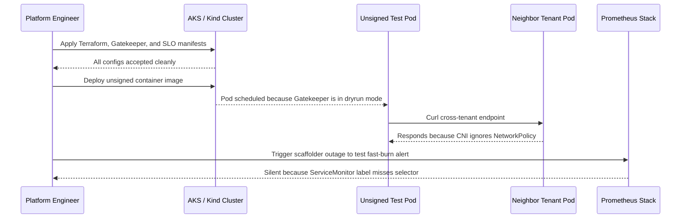

# Capstone Project: Build a Golden-Path Internal Developer Platform

> **Prerequisites:** All prior curriculum tracks ([Track 01](../../01-linux/README.md) through [Track 23](../../23-performance-and-load-testing/README.md)) and Platform Engineering Modules 00–07.  
> **Estimated Reading Time:** 4–8 hours (end-to-end capstone build and verification)  
> **Target Audience:** Graduating Platform Engineers, Cloud Architects, Senior SREs.

> [!TIP]
> **The Golden Rule of the Platform Capstone:** Build the **smallest end-to-end vertical slice first**—one self-service HTTP golden path flowing cleanly from developer portal form to GitOps `Healthy`/`Synced` deployment with real admission guardrails, isolated tenancy, observability, and FinOps tags—and prove every control at runtime rather than accumulating unverified YAML.

---

This is the final module of the entire 24-track curriculum. There is no new concept section, no quiz, no independent challenge, and no next track — this is the capstone of *everything*. Every prior track built one layer; this project asks you to compose as many of them as you realistically can into a single, working, self-service internal developer platform (IDP) that another engineer could actually use to ship a service without understanding all 23 tracks themselves.

Treat this as the real thing, not a checklist of isolated exercises. The whole point of platform engineering is *synthesis*, and this is where you prove you can synthesize. It is deliberately the most ambitious project in the curriculum. Give it real time; it is the final exam.

---

## Why This Matters

Across 23 tracks you learned to build every layer of a modern cloud platform *by hand*, one at a time. In this track you learned the meta-discipline of packaging all of it into a paved road other engineers travel without reassembling it. This capstone is where those two things meet: you will build a golden path that takes a developer from "I need a new service" to "it's running in production — governed, secured, observed, cost-attributed, and reliable" — with every layer wired in *by default* and none of it assembled by the developer. Finishing this is what "you can do platform engineering" means. More than that: finishing this is what completing the entire curriculum means. If you can build this, you can build the thing that lets a whole engineering organization move faster than the sum of its individuals — which is the highest-leverage thing an infrastructure engineer can build.

---

## 1. Architectural Mental Model: End-to-End 24-Track IDP Synthesis

Every component you built individually across the curriculum snaps together into one self-service control plane and paved-road runtime:

```mermaid
flowchart LR
    Dev["Developer (Portal Form Input)"] -->|Self-serves New HTTP Service| Portal["Front Door (Backstage + Catalog + TechDocs)"]
    Portal -->|Triggers CI/CD + Supply Chain| Pipeline["Golden Path CI (Build + Trivy Scan + SBOM + Cosign)"]
    Pipeline -->|Pushes signed image| ACR["Azure Container Registry + Admission Policy"]
    Portal -->|Provisions governed infra| Terraform["Terraform + Azure Policy Landing Zone"]
    Terraform -->|Stamps 5-axis tenant bundle| Runtime["Multi-Tenant AKS / ACA (Quota + NetPol + Entra UAMI + APIM)"]
    ACR -->|Reconciles Healthy/Synced| Argo["Argo CD GitOps Controller"]
    Argo --> Runtime
    Runtime -->|Exports telemetry + FinOps tags| Obs["OTel + Service SLO + Platform SLO + OpenCost"]
```



---

## 2. Taxonomic Comparison & Layer Integration Matrix

### 24-Track Synthesis Matrix: Platform Responsibility vs. App Ownership

| Platform Layer | Integrated Tracks | Automated by the Golden Path | Retained by App Team | Runtime Proof Artifact |
| :--- | :--- | :--- | :--- | :--- |
| **Landing Zone & IaC** | Tracks 09, 17 | Terraform remote state, resource groups, Azure Policy guardrails | App feature flags & capacity tier selection | `terraform apply` reproducible + non-compliant create denied |
| **Build & Supply Chain** | Tracks 02, 10, 11, 18 | Multi-stage hardened Dockerfile, Trivy scan gate, SBOM, image signing | Application source code & unit/integration tests | CI blocks HIGH/CRITICAL CVEs; admission rejects unsigned image |
| **Deployment & Front Door** | Tracks 10, 19, Mod 02 | Backstage catalog registration, TechDocs, Argo CD GitOps, APIM route | API business logic & endpoint contracts | Portal scaffold succeeds end-to-end; Argo CD shows `Synced`/`Healthy` |
| **Multi-Tenancy & Identity** | Tracks 03, 11, 13, 16, 21 | Namespace quota, default-deny NetPol, mTLS authz, federated UAMI, cost tags | Least-privilege app secret names inside own vault | Cross-tenant `curl` times out; cross-vault read returns `403` |
| **Observability & SRE** | Tracks 12, 20, Mod 05 | Pre-wired OTel, starter app SLO, platform scaffolder SLI + burn-rate alerts | Investigating app-logic slowness inside traces | Broken scaffolder triggers Alertmanager fast-burn route |

### Platform Component Resilience & RTO/RPO Posture (Track 22)

| Platform Component | Failure Blast Radius | Source of Truth / Backup | Target RTO / RPO | Recovery Method |
| :--- | :--- | :--- | :--- | :--- |
| **Terraform State** | Cannot modify or audit cloud infra | Encrypted remote Azure Storage backend with versioning & lock | RTO 15m / RPO 0 (versioned) | Restore prior state blob snapshot and re-run `terraform plan` |
| **GitOps Repo** | Halts continuous deployments & drift reconciliation | Git provider mirror + signed release tags | RTO 10m / RPO 0 | Repoint Argo CD `repoURL` to mirror or restore git bundle |
| **Backstage Portal / DB** | Halts new self-service scaffolds (live apps keep running) | Stateless container + Azure PostgreSQL automated PITR | RTO 30m / RPO 5m | Redeploy portal via GitOps + restore catalog DB snapshot |
| **AKS / Tenant Cluster** | Outage of hosted workloads in region | Declarative IaC + GitOps manifests + Key Vault backups | RTO 45m / RPO 15m | Re-provision cluster via Terraform; Argo CD reconciles all tenants |

---

## The Project

Design and build a genuine **golden-path IDP** on Azure: a self-service path that scaffolds a fully-wired new service onto a Terraform-provisioned, governed environment, with CI/CD, GitOps, security, observability, identity, API management, cost attribution, an SLO, and a documented resilience posture — all delivered as defaults through the path, not bolted on afterward.

Build it in the order you'd build it in the real world — the layers depend on each other. A suggested sequence (adapt as needed):

1. **Stand up the landing-zone-aware environment (tracks 09 + 17).** Use Terraform to provision the platform's own environment: a resource group / subscription structure that respects a landing-zone design (management-group scope, required Azure Policy assignments, allowed regions/SKUs), an AKS cluster *or* Container Apps environment to host tenants, an ACR, and a Key Vault. The environment itself must be code, and it must be *governed* — Azure Policy from track 17 applies before any workload lands.

2. **Build the golden-path template (tracks 01/02/09/10/11/12).** Create the scaffolding template for a "new HTTP service" that emits: a repo with a hardened multi-stage Dockerfile (track 02), a CI pipeline that builds, tests, scans, and pushes (tracks 10/11), a GitOps `Application` so it deploys by reconciliation (track 10), the Terraform call that provisions the service's namespace/Container App and managed identity (tracks 09/16), OTel instrumentation plus a `ServiceMonitor` and starter dashboard (track 12), and cost tags on every resource (track 21). This is module 01, built for real.

3. **Put a front door on it (module 02).** Expose the template through a portal (Backstage, or a documented CLI/scaffolder equivalent) with a software catalog that registers each new service and its owner, and TechDocs for the platform's own usage docs. A developer must be able to *self-serve* a new service from the portal, not run your scripts by hand.

4. **Make self-service safe (tracks 11/17/18).** Bake security and policy *into* the path: image scanning and an SBOM (tracks 11/18), image signing and an admission policy (track 18) that refuses unsigned or non-compliant images, and OPA/Gatekeeper (track 11) or Azure Policy (track 17) guardrails that a self-service request must pass — with a *graceful rejection* message (module 03) when it doesn't. Security must be a default of the path, not a later step.

5. **Wire identity and API management by default (tracks 16 + 19).** Every scaffolded service gets its own workload identity federated to Entra (track 16), scoped to only its own resources. A public-facing service gets an Azure API Management route with a default auth policy (track 19) configured by the path, not hand-built by the developer.

6. **Pre-wire an SLO and platform observability (tracks 12 + 20).** Any service using the path gets a starter availability SLO with a burn-rate alert (track 20) from day one. Separately, the *platform itself* (the scaffolder / portal / provisioning pipeline) has its own SLI, SLO, and burn-rate alert (module 05) — the platform monitors itself, not just its tenants.

7. **Make it a safely shared multi-tenant environment (tracks 03/11/13/16/21).** Each service/team is a tenant with the full isolation bundle stamped on by the platform: quota, limit range, default-deny network policy, scoped RBAC and workload identity, and tenant tags — enforced by admission control so an un-isolated tenant can't form (module 06). Cost is attributed back to each tenant (track 21).

8. **Document the platform's own resilience/DR posture (track 22).** Write the platform's own disaster-recovery consideration: what happens if the cluster, the GitOps repo, the portal, or the Terraform state is lost — backup, recovery, and the RTO/RPO for the *platform itself* (track 22). The platform is a critical dependency of every team, so its own resilience is in scope.

9. **Prove it end to end.** Onboard *one real service* through the path with zero manual assembly, and demonstrate every layer is actually present and working — not merely configured.

### Acceptance checklist

This is the final exam of the whole curriculum — the checklist is long and explicit on purpose. Work through it in order; each item depends on the previous ones actually working, not just existing. Aim to genuinely satisfy as many as you can; if you skip one, know *why* and what it would take.

**Environment and governance (tracks 09/17)**

- [ ] The platform's environment (resource group/subscription structure, AKS or Container Apps, ACR, Key Vault) is provisioned entirely by Terraform (track 09) from a clean state — no click-ops — and `terraform apply` is reproducible.
- [ ] The environment is landing-zone-aware (track 17): at least one Azure Policy (or initiative) is assigned at a management-group/subscription scope and *enforces* a real rule (allowed regions/SKUs, required tags, or denied public endpoints) — proven by a non-compliant create being *denied*.
- [ ] Terraform state is stored remotely and securely (not local), and you can articulate who can change infrastructure and how (track 16 access to state).

**The golden path (tracks 02/10/11/12)**

- [ ] A scaffolding template exists that, from a small set of developer inputs (name, team, ...), emits a complete service: repo + hardened Dockerfile (track 02), CI pipeline (track 10), GitOps `Application` (track 10), Terraform for its namespace/identity (tracks 09/16), OTel + `ServiceMonitor` + dashboard (track 12), and cost tags (track 21).
- [ ] The CI pipeline the path emits *builds, tests, scans (track 11), and pushes* an image to ACR, and the scan *fails the pipeline* on a HIGH/CRITICAL finding — proven by a deliberately vulnerable image being blocked.
- [ ] The service deploys by GitOps reconciliation (track 10), not manual `kubectl`/`helm` — you can point to the `Application` and its `Healthy`/`Synced` status.

**Front door (module 02)**

- [ ] A developer can self-serve a new service from a portal/catalog (or a documented CLI equivalent) — filling a form and getting a fully-wired service — without running your platform scripts by hand.
- [ ] The new service is registered in a software catalog with a real, resolvable owner backed by identity (track 16), and the platform's own usage docs exist as TechDocs.

**Self-service safety (tracks 11/17/18)**

- [ ] Security is a *default of the path*: image signing + SBOM (track 18) and an admission policy that refuses unsigned or policy-violating images (tracks 11/18) — proven by an unsigned/non-compliant image being *rejected* at admission.
- [ ] A self-service provisioning request that violates a guardrail (track 17) produces a *graceful rejection* (module 03) — a plain-language message naming the policy, the reason, and the way forward — not a raw policy/Terraform error.

**Identity and API management (tracks 16/19)**

- [ ] Each scaffolded service gets its *own* workload identity federated to Entra (track 16), scoped to only its own resources — proven by that identity being *unable* to read another service's Key Vault secret (403).
- [ ] A public-facing service is fronted by an Azure API Management route with a default auth policy (track 19) configured *by the path*, not hand-built.

**Observability, SLOs, and the platform's own reliability (tracks 12/20, module 05)**

- [ ] Any service using the path has a starter availability SLO and a working burn-rate alert (track 20) from day one — you can show the recording rule and the alert.
- [ ] The *platform itself* (scaffolder/portal/provisioning) has its own SLI, SLO, and burn-rate alert (module 05), and you *forced that alert to fire* by breaking a platform component and watched it route (tracks 12/20).

**Multi-tenancy and cost (tracks 03/11/13/16/21, module 06)**

- [ ] Each tenant namespace is stamped by the platform with the full isolation bundle — quota + limit range (track 03), default-deny network policy (track 11), scoped RBAC/identity (track 16), tenant tags (track 21) — and an admission policy (track 11) makes an *un-isolated* namespace impossible (proven by a bare `kubectl create namespace` being rejected or remediated).
- [ ] Two tenants are demonstrably isolated: one *cannot* reach the other's pods over the network *and cannot* read the other's secrets (defense in depth across tracks 11/13/16).
- [ ] Cost is attributed per tenant (track 21): you can produce a per-tenant cost breakdown, including a usage-based split of shared node cost.

**Resilience (track 22)**

- [ ] A written DR posture for the *platform itself* exists (track 22): what's lost if the cluster / GitOps repo / portal / Terraform state fails, the backup and recovery method for each, and a stated RTO/RPO for the platform as a critical dependency.

**The end-to-end proof**

- [ ] You onboarded *one real service* through the path end to end with **zero manual assembly** — you filled the form / ran one command, and the service came out running, deployed via GitOps, scanned, signed, observed, with an SLO, an identity, cost tags, and (if public) an API route — and you can *demonstrate* each of those, live, not just point at config.
- [ ] For every layer above, you can explain what the *platform* provides automatically versus what the *developer* still owns (the module 04/05 abstraction and ownership lines). If you can't explain a layer, that's a signal to go back and understand it, not a box to tick.

### Hints (not a solution)

- **Build the smallest possible end-to-end path first, then deepen it.** A path that scaffolds a trivial HTTP service, deploys it via GitOps, and attaches *one* real guardrail and *one* SLO — working end to end — is worth more than nine half-built layers. Get the whole loop closing on a toy service, then add scanning, signing, identity, API management, and tenancy one layer at a time. Don't debug ten unfamiliar integrations at once.
- **Reuse everything you already built.** This is synthesis, not new discovery. The Terraform modules are from track 09; the CI pipeline and GitOps from track 10; the scan/policy from tracks 11/18; the OTel/dashboards from track 12; the SLO machinery from track 20; the tagging from track 21. If you find yourself inventing something genuinely new, stop — you've almost certainly built it before in an earlier track and can lift it.
- **Make security and observability *defaults of the path*, never later steps.** The whole thesis of the track is that these are baked in. If your path scaffolds a service and *then* you add scanning by hand, you've missed the point — put the scan in the template's CI, the SLO in the template's manifests, the tags in the template's Terraform, so the developer can't *not* get them.
- **Test the runtime, not just the render.** The most dangerous failure (module 01) is a scaffold that goes green but produces a broken service. For every layer, prove it *at runtime* — deploy the scaffolded service and confirm the scan actually blocked, the SLO actually records, the identity actually can't cross a boundary, the alert actually fires. "It's configured" is not "it works."
- **Design the graceful rejection and the ownership line deliberately.** When a guardrail blocks a request, make the "no" a next step (module 03). When you draw what the platform owns vs. the developer (module 05), write it down — it decides who gets paged and what the abstraction (module 04) hides.
- **If you can't do a layer on real Azure, do it credibly on kind + documented design.** The tenancy, network policy, mesh authz, and observability layers all work on a local kind cluster; the Azure-specific layers (landing zone, API Management, workload identity, Container Apps) can be a real minimal deployment *or* a rigorous written design with the exact resources and policies named. Be honest about which is which.
- **Keep a running inventory and clean up deliberately.** This project creates billable Azure resources (cluster, ACR, Key Vault, APIM, Log Analytics). Note every one as you go, and when you're done proving it, tear it down: `az group delete --name <rg> --yes --no-wait`, plus an explicit sweep for anything in other resource groups (Key Vaults, workspaces, APIM). Confirm `az group list` and `az aks list` are clean.
- **Don't gold-plate.** One golden path, run cleanly end to end with the layers genuinely wired in and proven at runtime, beats a sprawling platform with a dozen features and nothing that actually works self-service. Depth on one path closing the full loop — scaffold → govern → deploy → secure → observe → attribute → prove — is the deliverable.

---

## 3. Production War Story Post-Mortem: The "All-Green Config" Capstone That Failed Every Runtime Check

| Field | Incident Details |
| :--- | :--- |
| **Severity** | **SEV-1** (False-Green Platform Security & Observability Controls) |
| **Detection / Resolution Time** | Caught during end-to-end runtime acceptance audit / Fixed in 50 minutes |
| **Impact** | `terraform apply` and Argo CD both reported `Synced` / `Healthy`, yet unsigned images deployed freely, pods reached across tenant namespaces, and platform burn-rate alerts stayed silent during a simulated outage |

### What Happened

A platform engineer finished wiring all nine capstone layers and verified that every YAML manifest and Terraform module applied cleanly. However, when running actual negative runtime tests for the acceptance checklist, three silent misconfigurations surfaced: Gatekeeper constraints had been deployed with `enforcementAction: dryrun`, the local test cluster lacked a `NetworkPolicy`-enforcing CNI plugin, and the platform `ServiceMonitor` lacked the `release: prometheus` label required by Prometheus Operator's selector.



### Root Cause Analysis

1. **Config existence equated with runtime enforcement**: Checking `kubectl get constraint` and `argocd app list` confirmed objects existed, not that they rejected violations.
2. **Untested negative paths**: Neither unsigned-image admission denial, cross-tenant `403`/timeout, nor intentional burn-rate alert firing had been exercised prior to sign-off.
3. **Selector mismatch on self-monitoring**: The platform's own `ServiceMonitor` failed Prometheus discovery quietly without a target-up check.

### The Fix & Architectural Hardening

- Switched Gatekeeper `enforcementAction` from `dryrun` to `deny` and verified rejection of an unsigned image and bare `kubectl create namespace`.
- Configured Calico/Cilium CNI enforcement and re-verified cross-tenant `curl` timeout plus Entra Workload Identity `403` isolation.
- Aligned `ServiceMonitor` labels with `promtool` checks and automated a runtime verification runner (below) that executes positive *and* negative acceptance probes on every platform release.

---

## 4. Multi-Language Production Implementation: Automated Golden-Path Runtime Acceptance Verifier

These four implementations model an automated capstone acceptance verifier that proves runtime enforcement—checking GitOps sync health, mandatory FinOps tags, negative cross-tenant isolation (`403`/denied), active platform SLO metric ingestion, and graceful policy-rejection formatting.

````carousel
```go
package capstone

import (
	"errors"
	"fmt"
	"strings"
)

type RuntimeProof struct {
	ServiceName              string
	ArgoStatus               string // "Healthy/Synced"
	UnsignedImageRejected    bool
	CrossTenantVaultHTTPCode int
	CrossTenantCurlTimedOut  bool
	RequiredTags             map[string]string
	PlatformSLISeriesActive  bool
}

func VerifyCapstoneAcceptance(p RuntimeProof) error {
	var gaps []string
	if p.ArgoStatus != "Healthy/Synced" {
		gaps = append(gaps, fmt.Sprintf("GitOps not ready: got %q", p.ArgoStatus))
	}
	if !p.UnsignedImageRejected {
		gaps = append(gaps, "Supply-chain gap: unsigned image was NOT rejected by admission")
	}
	if p.CrossTenantVaultHTTPCode != 403 {
		gaps = append(gaps, fmt.Sprintf("Identity gap: expected 403 on cross-tenant Key Vault read, got %d", p.CrossTenantVaultHTTPCode))
	}
	if !p.CrossTenantCurlTimedOut {
		gaps = append(gaps, "Network gap: cross-tenant pod curl succeeded instead of timing out")
	}
	for _, key := range []string{"team", "cost-center", "environment"} {
		if strings.TrimSpace(p.RequiredTags[key]) == "" {
			gaps = append(gaps, fmt.Sprintf("FinOps gap: missing required tag %q", key))
		}
	}
	if !p.PlatformSLISeriesActive {
		gaps = append(gaps, "Observability gap: platform scaffolder SLI series not scraped by Prometheus")
	}
	if len(gaps) > 0 {
		return errors.New("capstone acceptance failed:\n- " + strings.Join(gaps, "\n- "))
	}
	return nil
}
```
<!-- slide -->
```typescript
export interface CapstoneProofState {
  serviceName: string;
  gitOpsSyncedAndHealthy: boolean;
  unsignedImageBlocked: boolean;
  crossTenantVaultStatus: number;
  crossTenantNetBlocked: boolean;
  tags: Record<string, string>;
  platformBurnAlertTested: boolean;
}

export function verifyCapstoneEndToEnd(state: CapstoneProofState): {
  passed: boolean;
  failures: string[];
} {
  const failures: string[] = [];

  if (!state.gitOpsSyncedAndHealthy) {
    failures.push("GitOps Application must report Synced and Healthy.");
  }
  if (!state.unsignedImageBlocked) {
    failures.push("Admission control failed to block an unsigned image.");
  }
  if (state.crossTenantVaultStatus !== 403) {
    failures.push(`Expected HTTP 403 for cross-tenant Key Vault read, saw ${state.crossTenantVaultStatus}.`);
  }
  if (!state.crossTenantNetBlocked) {
    failures.push("Cross-tenant network probe was not blocked by default-deny NetworkPolicy.");
  }
  for (const tag of ["team", "cost-center", "service"]) {
    if (!state.tags[tag]) {
      failures.push(`Missing mandatory FinOps cost tag: ${tag}`);
    }
  }
  if (!state.platformBurnAlertTested) {
    failures.push("Platform fast-burn alert has not been forced to fire and verified in Alertmanager.");
  }

  return { passed: failures.length === 0, failures };
}
```
<!-- slide -->
```python
from dataclasses import dataclass
from typing import Dict, List


@dataclass(frozen=True)
class CapstoneAcceptanceProbe:
    gitops_healthy: bool
    cve_scan_blocked_high: bool
    unsigned_admission_rejected: bool
    cross_tenant_secret_status: int
    cross_tenant_network_denied: bool
    cost_tags: Dict[str, str]
    platform_slo_alert_fired: bool


def run_acceptance_audit(probe: CapstoneAcceptanceProbe) -> List[str]:
    """Verify runtime behavior (never just manifest syntax) across all capstone layers."""
    errors: List[str] = []

    if not probe.gitops_healthy:
        errors.append("GitOps Application is not Healthy/Synced")
    if not probe.cve_scan_blocked_high:
        errors.append("CI vulnerability gate did not block HIGH/CRITICAL image")
    if not probe.unsigned_admission_rejected:
        errors.append("Admission policy failed to reject unsigned image")
    if probe.cross_tenant_secret_status != 403:
        errors.append(f"Expected 403 on cross-tenant secret read, got {probe.cross_tenant_secret_status}")
    if not probe.cross_tenant_network_denied:
        errors.append("Cross-tenant network isolation failed runtime probe")
    for req_tag in ("team", "cost-center", "environment"):
        if not probe.cost_tags.get(req_tag):
            errors.append(f"Missing required FinOps tag: {req_tag}")
    if not probe.platform_slo_alert_fired:
        errors.append("Platform self-monitoring burn-rate alert was never forced to fire")

    return errors
```
<!-- slide -->
```csharp
public sealed record CapstoneRuntimeProof(
    bool GitOpsHealthySynced,
    bool UnsignedImageRejected,
    int CrossTenantSecretHttpStatus,
    bool CrossTenantNetworkBlocked,
    IReadOnlyDictionary<string, string> ResourceTags,
    bool PlatformAlertRouted);

public static class CapstoneAcceptanceGate
{
    public static IReadOnlyList<string> Evaluate(CapstoneRuntimeProof proof)
    {
        var gaps = new List<string>();

        if (!proof.GitOpsHealthySynced)
            gaps.Add("GitOps reconciliation is not Healthy/Synced.");
        if (!proof.UnsignedImageRejected)
            gaps.Add("Admission controller did not reject unsigned container image.");
        if (proof.CrossTenantSecretHttpStatus != 403)
            gaps.Add($"Cross-tenant Key Vault read returned {proof.CrossTenantSecretHttpStatus} instead of 403.");
        if (!proof.CrossTenantNetworkBlocked)
            gaps.Add("Default-deny NetworkPolicy did not block cross-tenant pod probe.");

        foreach (var key in new[] { "team", "cost-center", "environment" })
        {
            if (!proof.ResourceTags.TryGetValue(key, out var val) || string.IsNullOrWhiteSpace(val))
                gaps.Add($"Missing FinOps attribution tag '{key}'.");
        }

        if (!proof.PlatformAlertRouted)
            gaps.Add("Platform self-SLO burn-rate alert has not been proven to fire and route.");

        return gaps;
    }
}
```
````

---

## 5. Practical Hands-On Verification CLI Workflows

Run these runtime checks to prove your golden path actually enforces every layer rather than only holding static YAML configs.

### Step 1: Verify GitOps Sync, Admission Rejection & Namespace Isolation

```bash
argocd app get orders-api --grpc-web
kubectl apply -f unsigned-test-pod.yaml -n tenant-orders
kubectl create namespace rogue-ns
```

**Expected Output:**
```text
Name:               argocd/orders-api
Sync Status:        Synced
Health Status:      Healthy
Error from server (Forbidden): admission webhook "validation.gatekeeper.sh" denied the request: [require-cosign-signature] unsigned image is blocked
Error from server (Forbidden): admission webhook "validation.gatekeeper.sh" denied the request: [require-tenant-bundle] namespaces must declare team and cost-center labels
```

### Step 2: Verify Cross-Tenant Key Vault 403 & Platform SLO Alerting

```bash
az keyvault secret show --vault-name kv-tenant-payments --name db-pass
promtool query instant http://localhost:9090 'platform:scaffolder_success:ratio_rate5m'
```

**Expected Output:**
```text
ERROR: (Forbidden) Caller is not authorized to perform action on resource (HTTP 403)
0.996500
```

### Final cleanup

Because this is the end of the curriculum's real-Azure-spend, clean up deliberately rather than leaving anything running "just in case."

1. Inventory: `az resource list --resource-group <your-platform-rg> --output table`.
2. Delete the platform resource group and everything in it:
   `az group delete --name <your-platform-rg> --yes --no-wait`.
3. Sweep for stragglers in *other* groups — API Management, Log Analytics workspaces, Key Vaults, and any tenant resource groups you created:
   `az apim list -o table`, `az monitor log-analytics workspace list -o table`, `az keyvault list -o table`, and purge any soft-deleted Key Vaults with `az keyvault list-deleted -o table`.
4. Final confirmation: `az group list -o table` and `az aks list -o table` across the subscription show nothing from this project still running. Empty results are your signal you're no longer being billed for any of it.

---

## 6. Common Mistakes & Troubleshooting

- **Validating render instead of runtime.** A template rendering cleanly (`terraform validate`, green Backstage task) while producing unsigned pods, open namespaces, or unscraped metrics is the #1 capstone failure. Run every negative test live.
- **Gold-plating ten incomplete features.** Shipping a single end-to-end HTTP service path that provably satisfies every checklist layer beats building five half-wired templates.
- **Forgetting platform self-monitoring.** Instrumenting the hosted microservice while leaving the scaffolder/portal blind violates module 05; force the platform's own burn-rate alert to fire.
- **Policy constraints left in audit/dry-run mode.** Verify `enforcementAction: deny` on OPA/Gatekeeper and `Deny` effect on Azure Policy assignments so violations are blocked, not merely logged.
- **Leaving soft-deleted or cross-RG billing stragglers behind.** Key Vaults, APIM instances, and Log Analytics workspaces survive partial resource-group cleanups or stay in soft-delete state—always sweep and confirm empty lists.

---

## 7. Operational Validation Checkpoints

<details><summary><strong>Checkpoint 1: Pre-signoff verification of negative security and isolation controls</strong></summary>

Before declaring the capstone complete, confirm at least four explicit negative runtime tests failed as designed: (1) Azure Policy blocks a non-compliant public endpoint or disallowed SKU, (2) CI fails on a HIGH/CRITICAL CVE image, (3) cluster admission denies an unsigned image and a bare `kubectl create namespace`, and (4) tenant A receives network timeouts and `403 Forbidden` when probing tenant B's pod or Key Vault.

</details>

<details><summary><strong>Checkpoint 2: Auditing the platform's own reliability and DR posture</strong></summary>

Verify that your platform has two clearly separated SLO sets (hosted service availability SLO vs. platform scaffolder/portal SLO) and a written DR runbook specifying backup sources, exact recovery commands, and RTO/RPO targets for remote Terraform state, the GitOps repo, Backstage catalog DB, and the AKS control plane.

</details>

<details><summary><strong>Checkpoint 3: Zero-leak Azure billing teardown verification</strong></summary>

After running `az group delete --yes --no-wait`, verify `az group list -o table`, `az aks list -o table`, `az apim list -o table`, `az monitor log-analytics workspace list -o table`, and `az keyvault list-deleted -o table` all return clean/empty results so no lingering public IPs, nodes, or APIM gateways keep accruing charges.

</details>

---

## 8. Where to Go From Here

You are at the end. It's worth stopping to see the whole arc, because it is a genuinely large one.

You started in **[track 01](../../01-linux/README.md)** as a total beginner opening a terminal for the first time — `cd`, `ls`, a nervous first `sudo`. You learned to build a container in **[track 02](../../02-docker/README.md)**, to operate Kubernetes in **[03](../../03-kubernetes/README.md)** and a real AKS cluster in **[07](../../07-aks/README.md)**, to reason about networks from IP up (**[04](../../04-networking-fundamentals/README.md)**, **[05](../../05-azure-networking/README.md)**). You learned to make infrastructure code (**[09](../../09-terraform-on-azure/README.md)**), to ship it safely with CI/CD and GitOps (**[10](../../10-cicd-and-gitops/README.md)**), to threat-model and enforce it (**[11](../../11-security-deep-dive/README.md)**, **[18](../../18-supply-chain-security/README.md)**), to see inside it (**[12](../../12-observability-deep-dive/README.md)**), to mesh it (**[13](../../13-service-mesh/README.md)**), to store and stream state (**[14](../../14-databases-and-stateful-workloads/README.md)**, **[15](../../15-messaging-and-event-driven-architecture/README.md)**), to prove identity (**[16](../../16-identity-deep-dive/README.md)**), to govern at scale (**[17](../../17-governance-at-scale/README.md)**), to front APIs (**[19](../../19-api-management/README.md)**), to operate with SLOs and error budgets (**[20](../../20-sre-practices/README.md)**), to manage the money (**[21](../../21-cost-management-and-finops/README.md)**), to survive disasters and break things on purpose (**[22](../../22-disaster-recovery-and-chaos-engineering/README.md)**), and to prove it all holds under load (**[23](../../23-performance-and-load-testing/README.md)**). And in this final track, you learned to take *all* of it and build the thing that lets *other* engineers use it without walking the same road you did.

That is the real arc: from a person who couldn't navigate a filesystem to a person who can build the self-service platform an entire engineering organization stands on. Very few people actually finish a path this long. The skill you've built isn't any one tool — tools change, and half of the specific commands you learned will be different in five years. The durable skill is the *shape* of the thing: knowing how the layers fit, what each one is for, where the tradeoffs live, and how to compose them into something greater than the parts. That transfers to whatever the industry looks like next.

A few honest, non-prescriptive directions for continued growth — the curriculum is over, so these are pointers, not assignments:

- **Build a real one, for real people.** The fastest growth from here is maintaining a platform that actual engineers depend on and complain about. The gap between this capstone and a production platform used by fifty teams is mostly the messy human and scale realities no curriculum can simulate — migration pain, the politics of a mandate, the edge case you didn't design for. Seek that gap out.
- **Contribute to the open-source tooling in this space.** The platform ecosystem — internal developer portals, GitOps controllers, policy engines, Kubernetes operators, the CNCF landscape generally — is open and welcoming to contributors. Fixing a real bug in a tool you used in this curriculum teaches you more about it than any tutorial, and it's how you join the community that builds these things.
- **Look for a platform, SRE, or infrastructure role deliberately.** You now have the vocabulary and the hands-on range for one. The interviews for these roles ask exactly the questions this curriculum drilled — "how would you isolate tenants on a shared cluster," "walk me through a golden path," "how do you set an SLO" — and you can answer them from having *built* the thing, not read about it.
- **Follow the discipline as it evolves, at a high level.** Platform engineering, SRE, and cloud-native infrastructure are living fields with active conferences, practitioner blogs, vendor-neutral foundations, and a steady stream of writing from the teams doing it at scale. You don't need a reading list from me — you now know the *topics*, so you can recognize good writing on golden paths, developer experience, and reliability when you find it, and ignore the hype. Read the people who show real tradeoffs and real failures, not the ones selling a silver bullet.
- **Keep the beginner's habit that got you here.** The single most valuable thing you did across 24 tracks wasn't memorizing commands — it was sitting with an error before searching, attempting the quiz before revealing the answer, and rebuilding things cold to check you really knew them. That habit is the whole engine of an engineering career. The tools will keep changing; the way you learn them won't have to.

There is no next track. You've finished the curriculum — from a first `ls` to a self-service platform an organization can build on. Now go build something real with it.

[Back to the track index](../README.md) · [Back to main curriculum](../../README.md)
