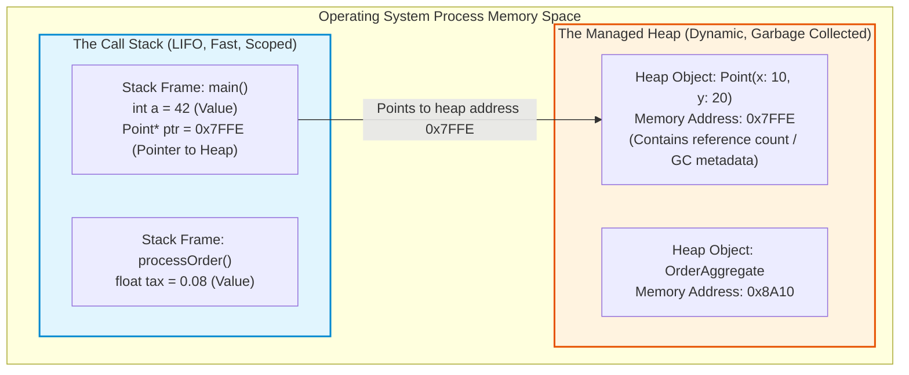
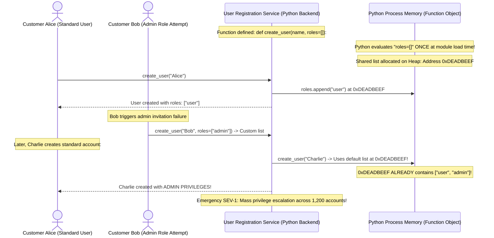

# Module 00: Programming Basics — Type Systems, Memory, and Control Flow

> **Prerequisites:** Basic computer literacy, command line terminal.  
> **Estimated Reading Time:** 25 minutes  
> **Target Audience:** Aspiring Software Engineers, Backend Developers, Low-Level Design Beginners.

> [!TIP]
> **The Golden Rule of System Programming:** Types are not decorative syntax; they are **memory layout blueprints and compiler contracts**. Understanding whether a value lives on the Stack (fast, scoped, value copy) or on the Heap (reference pointer, garbage collected) is the difference between writing clean, scalable software and debugging subtle memory leaks and concurrency race conditions.

---

## 1. Architectural Mental Model: Memory Layout (Stack vs. Heap)

Every running program interacts with system RAM through two primary memory regions managed by the operating system and runtime:



### Stack vs. Heap Mechanics
* **The Stack:** Organizes execution by function call frames in Last-In, First-Out (LIFO) order. Allocation and deallocation are instantaneous ($O(1)$) because the CPU merely shifts its stack pointer register (`RSP`). Value types (integers, floats, booleans) live directly on the stack frame and are freed automatically when the function returns.
* **The Heap:** Stores dynamically sized, long-lived objects. Pointers or references to heap memory live on the stack. Because allocation requires searching free-lists and triggers garbage collection (GC) pauses, heap allocations carry non-trivial runtime overhead.

---

## 2. Taxonomic Reference: Language Paradigm Comparison

Low-Level Design requires reading and comparing static and dynamic language architectures:

| Dimension | Python | C# (.NET) | Go | TypeScript (Node.js) |
| :--- | :--- | :--- | :--- | :--- |
| **Typing Discipline** | **Dynamic, Strong** | **Static, Strong** | **Static, Strong** | **Static (Compile), Dynamic (Run)** |
| **Execution Model** | Interpreted Bytecode (CPython VM) | JIT Compiled (CLR / CoreCLR) | Compiled to Native Machine Code | JIT Compiled (V8 Engine) |
| **Memory Allocation** | All variables are Heap `PyObject` pointers | Stack structs vs Heap classes (`class` vs `struct`) | Escape analysis determines Stack vs Heap | Primitives on Stack, Objects on Heap |
| **Null Safety** | `None` (Explicit runtime check) | Nullable Reference Types (`string?`) | Explicit `nil` pointer semantics | `null` & `undefined` union types |
| **Concurrency Model** | GIL (Global Interpreter Lock) + Asyncio | Thread pool, Tasks (`async/await`) | Lightweight Goroutines + Channels | Single-threaded Event Loop + Workers |

---

## 3. Systematic Breakdown: Reference Semantics vs. Value Semantics

Understanding how parameters are passed into functions is critical to preventing unintended mutations:

```
  VALUE COPY (Pass-by-Value)
  Original: [ x = 10 ]  ──Copy──▶  Function: [ x = 10 ] (Modifying x here leaves Original unchanged)

  REFERENCE COPY (Pass-by-Reference / Object Reference)
  Original: [ Address: 0x9A ] ──Copy Pointer──▶ Function: [ Address: 0x9A ]
                 │                                        │
                 ▼                                        ▼
            [ Shared Heap Memory: { name: "Alice", balance: $100 } ]
            (Modifying properties inside function modifies Original Heap State!)
```

---

## 4. Production War Story: The Shared Mutable Default Argument Disaster



### The Incident
An online education platform deployed a Python/FastAPI microservice handling account provisioning. Within 48 hours of launch, hundreds of standard student accounts spontaneously gained system administrator rights, allowing students to alter exam scores and view payment credentials.

### The Post-Mortem Data
* **Severity:** SEV-1 (Catastrophic Privilege Escalation)
* **Mean Time to Detect (MTTD):** 25 minutes
* **Mean Time to Resolution (MTTR):** 45 minutes

### The Root Cause
The core account provisioning function was written as:
```python
def register_user(username: str, roles: list = []):
    roles.append("student")
    return {"user": username, "roles": roles}
```
In Python, **default parameter values are evaluated exactly once when the function definition is executed at module import**, not every time the function is called. 

The list `[]` was allocated as a single, shared heap object. When one invocation appended `"admin"` or custom roles, the modification persisted across all subsequent function calls for every other user.

### The Fix & Hardening
1. **Use `None` as the Sentinel Default:**
```python
def register_user(username: str, roles: list = None):
    if roles is None:
        roles = []  # Fresh new list allocated on Heap per call!
    roles.append("student")
    return {"user": username, "roles": roles}
```
2. **Static Linting in CI:** Enable Ruff / Flake8 rule `B006` (Do not use mutable data structures for argument defaults) to reject code with mutable defaults automatically.

---

## 5. Multi-Language Production Code: Value vs. Reference Safety

Below is an enterprise demonstration of safe parameter handling, immutability, and defensive copying across four core backend languages.

### Python
```python
from typing import List, Optional
from dataclasses import dataclass, field

@dataclass(frozen=True)
class UserRole:
    name: str

class AccountManager:
    @staticmethod
    def create_user(username: str, roles: Optional[List[UserRole]] = None) -> dict:
        # Defensive copy to prevent caller mutation
        effective_roles = list(roles) if roles is not None else [UserRole("standard")]
        return {
            "username": username,
            "roles": effective_roles
        }

if __name__ == "__main__":
    u1 = AccountManager.create_user("Alice")
    u2 = AccountManager.create_user("Bob")
    print(f"Alice: {u1}")
    print(f"Bob: {u2}")
    print("✅ Verified: Zero state leakage between invocations.")
```

### C# (.NET)
```csharp
using System;
using System.Collections.Generic;
using System.Collections.Immutable;

public record UserProfile(string Username, ImmutableList<string> Roles);

public class Program
{
    public static UserProfile CreateUser(string username, IEnumerable<string>? initialRoles = null)
    {
        // Immutable collection guarantees caller cannot mutate state after creation
        var roles = initialRoles != null 
            ? initialRoles.ToImmutableList() 
            : ImmutableList.Create("standard");

        return new UserProfile(username, roles);
    }

    public static void Main()
    {
        var user = CreateUser("Asha");
        Console.WriteLine($"Created User: {user.Username} with {user.Roles.Count} roles.");
    }
}
```

### Go
```go
package main

import (
	"fmt"
)

type User struct {
	Username string
	Roles    []string
}

// NewUser creates a user while defensively copying the roles slice to eliminate pointer aliasing.
func NewUser(username string, roles []string) User {
	var safeRoles []string
	if len(roles) == 0 {
		safeRoles = []string{"standard"}
	} else {
		// Allocate distinct slice buffer to prevent caller modifications from affecting User
		safeRoles = make([]string, len(roles))
		copy(safeRoles, roles)
	}

	return User{
		Username: username,
		Roles:    safeRoles,
	}
}

func main() {
	originalRoles := []string{"editor"}
	u := NewUser("Asha", originalRoles)

	// Mutate original slice
	originalRoles[0] = "compromised_admin"

	// Verify User struct is protected
	fmt.Printf("User Roles: %v (Isolated: %t)\n", u.Roles, u.Roles[0] == "editor")
}
```

### TypeScript / Node.js
```typescript
interface UserAccount {
  readonly username: string;
  readonly roles: readonly string[];
}

export function createUser(username: string, initialRoles?: readonly string[]): UserAccount {
  // Defensive shallow copy with ReadonlyArray enforcement
  const roles = initialRoles ? [...initialRoles] : ['standard'];
  return Object.freeze({
    username,
    roles: Object.freeze(roles),
  });
}

const user = createUser('Asha');
console.log(`User created: ${user.username}, Roles: [${user.roles.join(', ')}]`);
```

---

## 6. Practical Hands-On Verification CLI Workflows

Follow these workflows in your Ubuntu terminal:

### Workflow 1: Inspect Python Object Memory Addresses (`id()`)
```bash
python3 -c '
a = [1, 2, 3]
b = a
c = list(a)
print("a address:", hex(id(a)))
print("b address (alias):", hex(id(b)))
print("c address (clone):", hex(id(c)))
assert a is b
assert a is not c
print("✅ Verified pointer aliasing vs clone.")
'
```
**Expected Output:**
```text
a address: 0x7f...
b address (alias): 0x7f... (Identical memory address!)
c address (clone): 0x7f... (Distinct new heap allocation!)
✅ Verified pointer aliasing vs clone.
```

### Workflow 2: Compile and Execute Native Type Checks
```bash
# Check if python typing is strictly verified with mypy
python3 -m pip install --quiet mypy
cat << 'EOF' > /tmp/type_test.py
def calculate_tax(subtotal: float, rate: float) -> float:
    return subtotal * rate

calculate_tax("invalid_string", 0.08) # Type error
EOF

mypy /tmp/type_test.py || echo "Mypy correctly caught runtime type violation!"
rm -f /tmp/type_test.py
```

---

## 7. Operational Validation Checkpoint

<details>
<summary><strong>Question 1: Value Type Copying vs Reference Aliasing</strong></summary>

**Scenario:** In Go, you have:
```go
type Wallet struct { Balance int }
func AddBonus(w Wallet) { w.Balance += 100 }
```
A developer invokes:
```go
myWallet := Wallet{Balance: 50}
AddBonus(myWallet)
fmt.Println(myWallet.Balance)
```
What is printed, and why?

**Answer:**
**`50`** is printed. 

In Go, structs are **value types**. When `myWallet` is passed to `AddBonus(w Wallet)`, the entire struct is copied bit-for-bit onto `AddBonus`'s local stack frame. The function mutates its private local copy. The original `myWallet` on the caller's stack frame remains completely unchanged. 

To mutate the caller's wallet, the function must accept a pointer: `func AddBonus(w *Wallet)` and invoke `AddBonus(&myWallet)`.
</details>

<details>
<summary><strong>Question 2: Memory Leak via Circular Heap References</strong></summary>

**Scenario:** In Python or Node.js, Object A holds a reference to Object B, and Object B holds a reference to Object A (`A.child = B; B.parent = A`). 

When both objects fall out of scope in the main application, how does the modern garbage collector reclaim them?

**Answer:**
Modern runtimes (Python's cyclic GC and V8/CoreCLR tracing mark-and-sweep collectors) do not rely solely on simple reference counting. 

They use **Tracing Reachability Graphs**. Starting from "GC Roots" (the active stack, global variables, and registers), the collector traces all reachable references. Because neither Object A nor Object B can be reached from any active GC root, the cyclic island is identified as unreachable garbage and reclaimed in the next collection cycle.
</details>

<details>
<summary><strong>Question 3: Why Immutability Prevents Race Conditions</strong></summary>

**Scenario:** In a multi-threaded backend service, 50 worker threads simultaneously access a shared `Configuration` object. The architect mandates that `Configuration` must be **immutable** (cannot be modified after creation).

What major concurrency bug does this design decision eliminate?

**Answer:**
It eliminates **Data Races and Race Conditions without requiring mutex locks**. 

A race condition occurs when at least one thread writes to a memory location while another thread is reading or writing to it concurrently. If an object is deeply immutable, every thread performs strictly read-only operations. Read-only memory access is inherently thread-safe and can execute concurrently across multiple CPU cores at maximum hardware speeds without locking contention.
</details>

---

## Next Step

Now that you understand type systems, Stack vs. Heap memory, and reference semantics, proceed to **[01 · Classes, Objects, and OOP Building Blocks](../01-classes-objects-and-oop-building-blocks/README.md)** to master encapsulation, constructors, access modifiers, and object lifecycles.
