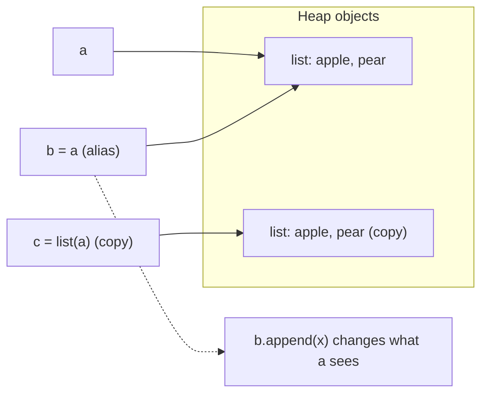
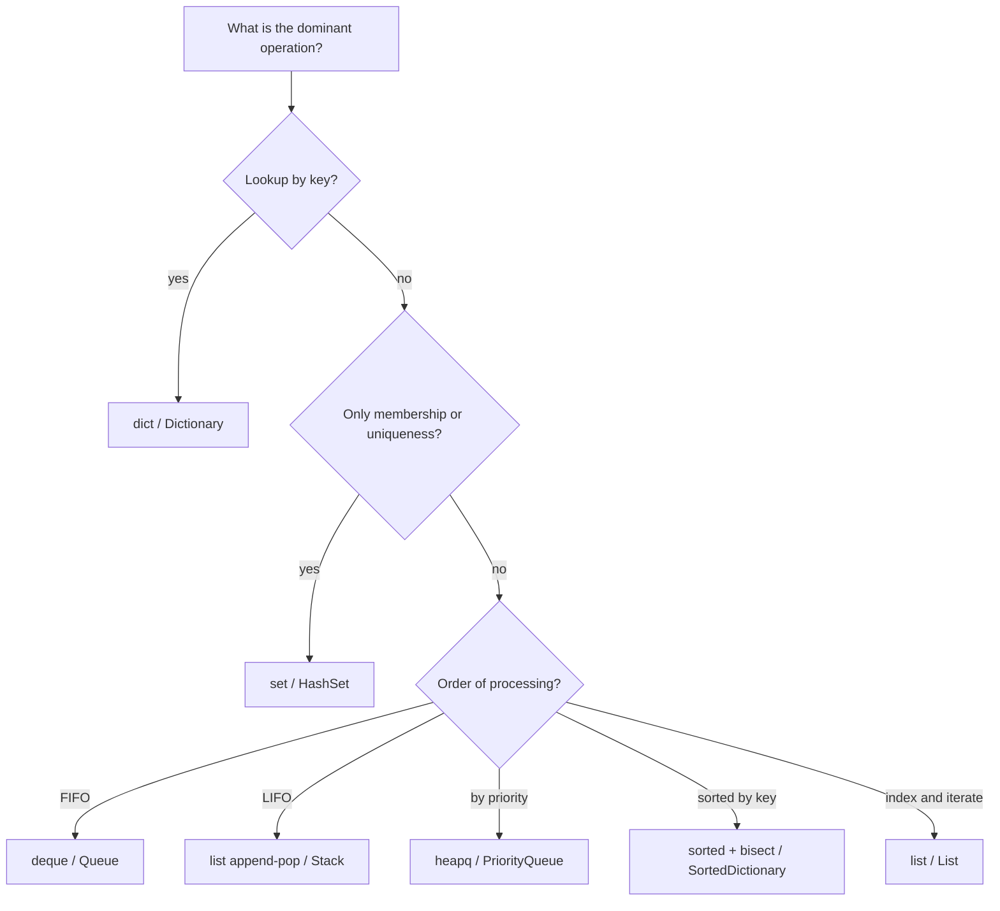

# Programming Basics for LLD — Python & C# Side by Side

> **Prerequisites:** You can read a `for` loop and a function in any language. Skim the official [Python data model](https://docs.python.org/3/reference/datamodel.html) and [C# type system](https://learn.microsoft.com/en-us/dotnet/csharp/fundamentals/types/) if names, references, or types feel fuzzy.  
> **Reading time:** ~20 minutes  
> **Audience:** Anyone about to do an LLD round in Python or C# who wants the language details that quietly break designs — not a full language course

> [!TIP]
> **Brand new to Python?** This lesson is a *fast* tour of the details that break designs. If you have never written Python, start with the slow, complete course first: [Python Basics, Step by Step](../28-python-basics-step-by-step/README.md) (values, loops, functions, then lists, tuples, sets and dictionaries with every operation, errors, files and your first classes). Then come back here.

> [!NOTE]
> **In one line:** In an LLD round the language is a tool for modeling — you must know **what a variable holds** (value or reference), **what `==` means**, **which collection fits the access pattern**, and **why money is never a float**, in both Python and C#.

> [!TIP]
> **Golden rule:** Before you write `self.items = items` or `return self._items`, ask: *"Who else holds a reference to this object, and can they change it?"* Most LLD bugs in basics are aliasing bugs, not syntax bugs.

> [!TIP]
> **Try it:** Draw the `Cart` / `Item` model below in [LLD Studio](/tools/lld-studio/), then run the Python version and port one method to C#.

---

## 1. When this shows up in an interview

Interviewer: *"Design a shopping cart. Items, quantities, a total."* You write ten lines. Then they probe:

- *"What happens if the caller keeps the list you returned and appends to it?"* → **aliasing / defensive copy**
- *"Total of three 10-cent items?"* → **float vs `Decimal` / `decimal`**
- *"Find if SKU exists among 1M SKUs."* → **`set` / `HashSet`, not a list scan**
- *"Is `Item` a class or a struct?"* → **value vs reference semantics (C#) / frozen dataclass (Python)**

**Smells you will be judged on:** `float` for money; returning internal lists; a mutable default argument; `list.pop(0)` as a queue; using `is` (or `ReferenceEquals`) where you meant equality; `None`/`null` flowing everywhere with no contract.



---

## 2. Types, references, and who owns the data

| Concept | Python | C# |
| :--- | :--- | :--- |
| **Typing** | Dynamic, strong. Hints (`list[str]`) are checked by `mypy` / `pyright`, not by the runtime | Static, strong. Compiler rejects wrong types |
| **What a variable holds** | A *name* bound to an object (always a reference) | Value type: the value itself. Reference type: a reference to a heap object |
| **Passing to a function** | Object reference passed by value. Rebinding the parameter does not touch the caller; **mutating the object does** | Value types are copied. Reference types: the *reference* is copied (same object). `ref` / `out` / `in` alias the caller's variable |
| **Built-in immutables** | `int`, `float`, `str`, `tuple`, `frozenset`, `bytes` | `string`, numeric primitives, `ImmutableList<T>`, `init`-only records |
| **User-defined value type** | None. Approximate with `@dataclass(frozen=True)` or `NamedTuple` | `struct` / `record struct` — copied on assignment |
| **Reference + value equality** | `@dataclass` generates `__eq__` | `record` (class) generates `Equals` by fields |
| **Identity vs equality** | `a is b` (identity) vs `a == b` (`__eq__`) | `ReferenceEquals(a, b)` vs `a.Equals(b)` / `==` (overloaded for `string`, records) |
| **Absence** | `None`; hint `Optional[T]` / `T \| None` | `null`; enable nullable reference types and write `string?` |
| **Exact money** | `decimal.Decimal` (build from `str`, not `float`) | `decimal` (literals like `0.10m`) |
| **Enumerations** | `enum.Enum` | `enum` |

**One sentence to say aloud:** *"Python passes object references by value; C# passes references by value for classes and copies for structs — so in both languages mutating a shared object is visible to the caller."*

### Rebinding vs mutating (the classic trap)

```python
def add_role(roles: list[str]) -> None:
    roles.append("admin")       # mutates the caller's list

def reset_roles(roles: list[str]) -> None:
    roles = ["guest"]           # rebinds the local name only; caller unchanged


if __name__ == "__main__":
    mine = ["user"]
    add_role(mine)
    assert mine == ["user", "admin"]     # mutation leaked out
    reset_roles(mine)
    assert mine == ["user", "admin"]     # rebinding did not
    print("rebind vs mutate ok:", mine)
```

In C#, replace `list[str]` with `List<string>`: `Add` mutates the shared object; `roles = new List<string>()` only repoints the parameter (unless you declared it `ref`).

---

## 3. Collections: pick by access pattern



| Need | Python | C# | Cost note |
| :--- | :--- | :--- | :--- |
| Growable sequence | `list` | `List<T>` | `append` / `Add` amortized O(1); insert/remove at front is O(n) |
| Key → value | `dict` | `Dictionary<TKey, TValue>` | O(1) average; keys must be hashable / have a stable `GetHashCode` |
| Unique / membership | `set` | `HashSet<T>` | `x in set` O(1) vs `x in list` O(n) |
| FIFO queue | `collections.deque` | `Queue<T>` | `list.pop(0)` is **O(n)** — do not use it for BFS |
| Stack | `list` (`append` / `pop`) | `Stack<T>` | O(1) at the end |
| Priority queue | `heapq` (min-heap on a list) | `PriorityQueue<TElement, TPriority>` | O(log n) push/pop; both are **min**-heaps |
| Sorted by key | `sorted(...)`, `bisect` | `SortedDictionary`, `SortedSet` | Python has no built-in balanced tree |
| Fixed small record | `tuple`, `NamedTuple`, `dataclass` | `record`, `(T1, T2)` value tuple | Prefer a named type over `tuple[str, int, str]` |
| Read-only view | `tuple`, `types.MappingProxyType` | `IReadOnlyList<T>`, `IReadOnlyDictionary<K,V>`, `ImmutableList<T>` | A read-only *interface* over a mutable list can still be cast back — copy if you must be strict |

**Ordering guarantees differ.** Python `dict` preserves insertion order (guaranteed since 3.7); `set` does not. C# `Dictionary` and `HashSet` give **no ordering contract** — if the interview needs stable output, say so and use a `List` or `SortedDictionary`.

---

## 4. Walkthrough: a cart that cannot be corrupted from outside

**Requirements (keep tiny):** add an item by SKU (adding again increases quantity), list the lines, compute a total with exact money, and make it impossible for a caller to edit the cart through a returned collection.

**Entities:** `Item` (value object: SKU + unit price), `Cart` (owns quantities).

### Before — leaks internals, uses `float`

> **ANTI-PATTERN — runnable, but wrong on purpose.** Run it to see the two bugs, then do not copy it.

```python
class BadCart:
    def __init__(self):
        self.items = []              # public mutable list

    def add(self, name, price, qty=1):
        self.items.append((name, price, qty))

    def total(self):
        return sum(p * q for _, p, q in self.items)   # float math

cart = BadCart()
for _ in range(3):
    cart.add("apple", 0.1)
print(cart.total())          # 0.30000000000000004
cart.items.clear()           # anyone can wipe the cart with no rule firing
```

### After — private state, exact money, copies out

````carousel
```python
from __future__ import annotations

from dataclasses import dataclass
from decimal import Decimal


@dataclass(frozen=True)
class Item:
    """Value object: equal if sku and price are equal; cannot be mutated."""
    sku: str
    unit_price: Decimal


class Cart:
    def __init__(self) -> None:
        self._catalog: dict[str, Item] = {}   # first price seen for a SKU wins
        self._qty: dict[str, int] = {}        # SKU -> quantity

    def add(self, item: Item, qty: int = 1) -> None:
        if qty <= 0:
            raise ValueError("qty must be positive")
        self._catalog.setdefault(item.sku, item)
        self._qty[item.sku] = self._qty.get(item.sku, 0) + qty

    def lines(self) -> tuple[tuple[Item, int], ...]:
        """Snapshot as an immutable tuple: caller cannot edit the cart through it."""
        return tuple((self._catalog[sku], q) for sku, q in self._qty.items())

    def total(self) -> Decimal:
        return sum((item.unit_price * q for item, q in self.lines()), Decimal("0"))


if __name__ == "__main__":
    print(0.1 + 0.1 + 0.1)                          # 0.30000000000000004  (float)
    cart = Cart()
    apple = Item("apple", Decimal("0.10"))
    for _ in range(3):
        cart.add(apple)
    print(cart.total())                             # 0.30
    assert cart.total() == Decimal("0.30")

    snapshot = cart.lines()
    try:
        snapshot[0] = None                          # type: ignore[index]
    except TypeError as exc:
        print("snapshot is read-only:", exc)
    assert cart.total() == Decimal("0.30")          # cart untouched
```
<!-- slide -->
```csharp
using System;
using System.Collections.Generic;
using System.Linq;

public sealed record Item(string Sku, decimal UnitPrice);   // value equality, immutable

public sealed class Cart
{
    private readonly Dictionary<string, Item> _catalog = new();   // first price wins
    private readonly Dictionary<string, int> _qty = new();

    public void Add(Item item, int qty = 1)
    {
        if (qty <= 0) throw new ArgumentOutOfRangeException(nameof(qty));
        _catalog.TryAdd(item.Sku, item);
        _qty[item.Sku] = _qty.GetValueOrDefault(item.Sku) + qty;
    }

    // New list each call: the caller can mutate it, but not our dictionaries.
    public IReadOnlyList<(Item Item, int Qty)> Lines() =>
        _qty.Select(kv => (_catalog[kv.Key], kv.Value)).ToList();

    public decimal Total() => Lines().Sum(l => l.Item.UnitPrice * l.Qty);
}

public static class Program
{
    public static void Main()
    {
        Console.WriteLine(0.1 + 0.1 + 0.1);                 // 0.30000000000000004  (double)
        var cart = new Cart();
        var apple = new Item("apple", 0.10m);
        for (var i = 0; i < 3; i++) cart.Add(apple);
        Console.WriteLine(cart.Total());                    // 0.30
        Console.WriteLine(cart.Total() == 0.30m);           // True
    }
}
```
````

**What changed and why**

| Fix | Python | C# |
| :--- | :--- | :--- |
| No public mutable collection | `_qty` / `_catalog` are private by convention | `private readonly` fields |
| Return a snapshot, not the internals | `tuple(...)` | new `List` exposed as `IReadOnlyList` |
| Exact money | `Decimal("0.10")` | `0.10m` |
| Value object for `Item` | `frozen=True` dataclass | `record` |

---

## 5. Edges interviewers push on

| Edge | Python | C# | What to say |
| :--- | :--- | :--- | :--- |
| **Mutable default argument** | `def f(x=[])` shares **one** list across calls | Not applicable (defaults must be compile-time constants) | Use `None` and create inside; lint rule `B006` |
| **Small-int / string identity** | `a is b` may be `True` for small ints and interned strings — implementation detail | `ReferenceEquals` on strings can surprise after interning | Never use identity for value comparison |
| **Dict key mutated after insert** | Lists/dicts are unhashable — `TypeError` up front | Mutable key with overridden `GetHashCode` mutated later → entry "lost" | Keys must be immutable |
| **Modify while iterating** | `dict` changed size → `RuntimeError`; `list` silently skips items | `List` / `Dictionary` → `InvalidOperationException` | Iterate over a copy, or collect changes and apply after |
| **Shallow vs deep copy** | `list(a)` / `a.copy()` copy the outer list only; nested objects still shared | `ToList()` / `new List<T>(a)` same | Copy elements too, or make elements immutable |
| **`None` / `null` contract** | Annotate `Optional[T]`; return `None` meaning "not found" only when documented | Enable `<Nullable>enable</Nullable>`; use `TryGetValue` | Decide once: absent means `None`, or raise, or return a `Result` ([03](../03-generics-exceptions-and-value-objects/README.md)) |
| **`struct` default** | — | `default(MyStruct)` skips your constructor, so invariants can be bypassed | Prefer `sealed record` / class when you have invariants |
| **Sorting stability / keys** | `sorted(xs, key=...)` is stable | `List.Sort` is **not** stable; `OrderBy` is | State stability if tie order matters |
| **Integer overflow** | Arbitrary precision `int` | `int` wraps silently unless `checked` | Matters for IDs, counters, cents in `int` |
| **Thread safety** | `list.append` is safe under CPython's GIL; `x += 1` on a shared int is not | `List<T>` / `Dictionary` are **not** thread-safe | Hand off to [10 · Concurrency](../10-concurrency-safe-design/README.md) |

### Try it — edge lab (5 minutes, runnable)

Save as `edge_lab.py` and run it. Every `assert` is one of the probes above; if you cannot predict why one passes, re-read that row of the table.

```python
from collections import deque
from decimal import Decimal, ROUND_HALF_EVEN
import copy

# 1) Aliasing: returned internals can be edited from outside
class LeakyCart:
    def __init__(self): self._items = ["apple"]
    def items(self): return self._items          # leaks internals
class SafeCart(LeakyCart):
    def items(self): return tuple(self._items)   # snapshot

leaky = LeakyCart(); leaky.items().append("INJECTED")
assert leaky._items == ["apple", "INJECTED"]
safe = SafeCart()
try:
    safe.items().append("x")
except AttributeError:
    pass
assert safe._items == ["apple"]

# 2) Mutable default argument
def bad_add(x, bucket=[]):
    bucket.append(x); return bucket
def good_add(x, bucket=None):
    bucket = [] if bucket is None else bucket
    bucket.append(x); return bucket
bad_add(1); assert bad_add(2) == [1, 2]          # state leaked between calls
good_add(1); assert good_add(2) == [2]

# 3) Shallow copy: nested objects are still shared
rows = [[1], [2]]
shallow, deep = list(rows), copy.deepcopy(rows)
rows[0].append(99)
assert shallow[0] == [1, 99] and deep[0] == [1]

# 4) Mutating a dict while iterating
d = {"a": 1, "b": 2}
try:
    for k in d: d[k + "x"] = 0
except RuntimeError as e:
    print("RuntimeError:", e)
assert list(d) != []            # safe version: iterate a copy
for k in list(d): d.pop(k)
assert d == {}

# 5) Decimal built from float inherits the float error; build from str
assert Decimal(0.1) != Decimal("0.1")
cents = (Decimal("19.995")).quantize(Decimal("0.01"), rounding=ROUND_HALF_EVEN)
print("rounded:", cents)        # 20.00 (half-even: 19.995 -> 20.00, 19.985 -> 19.98)

# 6) list as a queue vs deque
q = deque([1, 2, 3]); assert q.popleft() == 1
# 7) identity vs equality
a, b = [1], [1]
assert a == b and a is not b
print("edge lab ok")
```

Then, in order:

1. **Break it on purpose.** Delete the `tuple(...)` in `SafeCart.items` and watch the first `assert` change meaning.
2. **Port it.** Rewrite probes 1 and 3 in C# (`List<string>` returned directly vs `AsReadOnly()`; `new List<T>(a)` vs a manual deep clone). Note which behaviours are identical.
3. **Scale it.** Time `x in a_list` vs `x in a_set` for 200,000 elements with `timeit` — say the Big-O out loud before you run it.
4. **Draw it.** Model `Cart` / `Item` in [LLD Studio](/tools/lld-studio/) and mark which class owns `_qty` and which objects are immutable.

---

## 6. What you'd say in two minutes

> "I model the cart with private state and a small public API. `Item` is an immutable value object — a frozen dataclass in Python, a record in C# — so two items with the same SKU and price are equal and nobody can change one after it's shared. Quantities live in a dictionary keyed by SKU for O(1) updates. I never return the internal dictionary; I return a tuple or a fresh read-only list, so callers can't corrupt invariants. Money is `Decimal` or `decimal`, never float — `0.1 + 0.1 + 0.1` isn't `0.3`. In Python I'm careful that function arguments are object references, so mutating a parameter changes the caller's data; in C# the same applies to classes, while structs are copied. If I need a queue I use `deque` or `Queue<T>`, not `list.pop(0)`."

---

## 7. Anti-patterns

1. **`float` / `double` for currency** — store `Decimal` / `decimal`, or integer minor units (cents) with a documented rounding rule.
2. **Returning `self._items`** — the caller now owns your invariants. Return a tuple, a copy, or a read-only view.
3. **Mutable default arguments** (`roles=[]`) — shared across every call; the root of real privilege-leak incidents.
4. **`is` / `ReferenceEquals` for value comparison** — works by accident on small values, fails in production.
5. **`list` as a queue** (`pop(0)` / `RemoveAt(0)`) — O(n) per dequeue; use `deque` / `Queue<T>`.
6. **Stringly-typed data** (`"USD"`, `"ACTIVE"` scattered everywhere) — use enums and small value objects.
7. **`null` / `None` as an implicit protocol** — document it, or return a typed result.
8. **Reaching for threads to "speed up" a cart** — you added races before you needed performance.

---

## 8. Interview questions

<details>
<summary><strong>1. Is Python pass-by-value or pass-by-reference? [BASIC]</strong></summary>

Neither label fits cleanly. Python passes a **reference to the object, by value**: the parameter is a new name for the same object. Mutating the object (`append`) is visible to the caller; rebinding the name (`x = []`) is not.

</details>

<details>
<summary><strong>2. `struct` vs `class` in C#? [BASIC]</strong></summary>

A `struct` is a value type — assignment and passing copy it, no GC allocation when it lives on the stack or inline in another object. A `class` is a reference type — assignment copies the reference. Use `struct` for small, immutable, short-lived values where an all-zero `default` is valid (a 2-D point, a duration); use `class` / `record` when you need identity, inheritance, or enforced invariants.

</details>

<details>
<summary><strong>3. `==` vs `is` (Python) and `Equals` vs `ReferenceEquals` (C#)? [BASIC]</strong></summary>

`==` / `Equals` ask *"are these equal by value?"* and can be customized (`__eq__`, `IEquatable<T>`, records). `is` / `ReferenceEquals` ask *"is this the same object?"*. Use identity only for `None` / `null` checks and singletons. For entities, define equality on ID; for value objects, on all fields.

</details>

<details>
<summary><strong>4. Why not `float` for money? What instead? [BASIC]</strong></summary>

Binary floating point cannot represent most decimal fractions exactly (`0.1 + 0.2 != 0.3`), and errors accumulate. Use `Decimal` (build from a string) / `decimal`, or integer cents. Fix the rounding rule (e.g. half-even to 2 places) in one `Money` type.

</details>

<details>
<summary><strong>5. A method takes a list and sorts it; callers complain their data changed. [SCENARIO]</strong></summary>

`list.sort()` / `List.Sort()` mutate in place. Either document that, or copy first (`sorted(xs)` returns a new list; in C# use `xs.OrderBy(...).ToList()`). For public APIs accept `Sequence[T]` / `IEnumerable<T>` or `IReadOnlyList<T>` so the signature promises no mutation.

</details>

<details>
<summary><strong>6. Check whether any of 1M order IDs is in a blocked list of 50k IDs. [SCENARIO]</strong></summary>

Put the blocked IDs in a `set` / `HashSet<string>` once (O(50k)), then each lookup is O(1) average — about 1M checks total. A list scan per ID is O(1M × 50k).

</details>

<details>
<summary><strong>7. BFS on a graph with `queue = []` and `queue.pop(0)` is slow. [SCENARIO]</strong></summary>

`pop(0)` shifts every remaining element — O(n) per dequeue, O(n²) overall. Use `collections.deque` (`popleft` is O(1)) in Python or `Queue<T>` in C#.

</details>

<details>
<summary><strong>8. Mutating a collection while looping over it? [TRICKY]</strong></summary>

Python: removing from a `list` while iterating silently skips elements; changing a `dict`'s size raises `RuntimeError`. C#: `List<T>` and `Dictionary` throw `InvalidOperationException` ("Collection was modified"). Safe patterns: iterate over a copy (`for x in list(xs)`), build a new collection (comprehension / `Where`), or record deletions and apply them after the loop. In C#, `List<T>.RemoveAll(predicate)` is the idiomatic bulk removal.

</details>

---

## 9. One-page cheat sheet

```text
Variables    Python: names -> objects.  C#: value types hold values, classes hold references.
Passing      Mutating a shared object is visible to the caller in BOTH languages.
Equality     ==/Equals = value.  is/ReferenceEquals = identity (None/null checks only).
Value types  Python: frozen dataclass.  C#: record (class) or record struct; default(struct) bypasses ctor.
Money        Decimal / decimal (or integer cents). Never float/double.
Collections  dict/Dictionary for lookup, set/HashSet for membership, deque/Queue for FIFO,
             heapq/PriorityQueue for priority.  Never list.pop(0).
Order        Python dict keeps insertion order; C# Dictionary/HashSet promise nothing.
Leaks        Never return internal mutable collections. Copy out, or return tuple / read-only.
Defaults     Python: never mutable default args (use None).  C#: enable nullable reference types.

Interview opener: "Who else holds a reference to this?"
```

---

## Further reading

- [Python data model](https://docs.python.org/3/reference/datamodel.html) — objects, identity, hashing, `__eq__`
- [Python FAQ: how are arguments passed?](https://docs.python.org/3/faq/programming.html#how-do-i-write-a-function-with-output-parameters-call-by-reference)
- [Python `collections`](https://docs.python.org/3/library/collections.html) and [`decimal`](https://docs.python.org/3/library/decimal.html)
- [C# value types](https://learn.microsoft.com/en-us/dotnet/csharp/language-reference/builtin-types/value-types) and [reference types](https://learn.microsoft.com/en-us/dotnet/csharp/language-reference/keywords/reference-types)
- [.NET collections overview](https://learn.microsoft.com/en-us/dotnet/standard/collections/) and [nullable reference types](https://learn.microsoft.com/en-us/dotnet/csharp/nullable-references)

## Next

**[01 · Classes & Objects](../01-classes-objects-and-oop-building-blocks/README.md)** — encapsulation, invariants, constructors, and object lifecycle.
