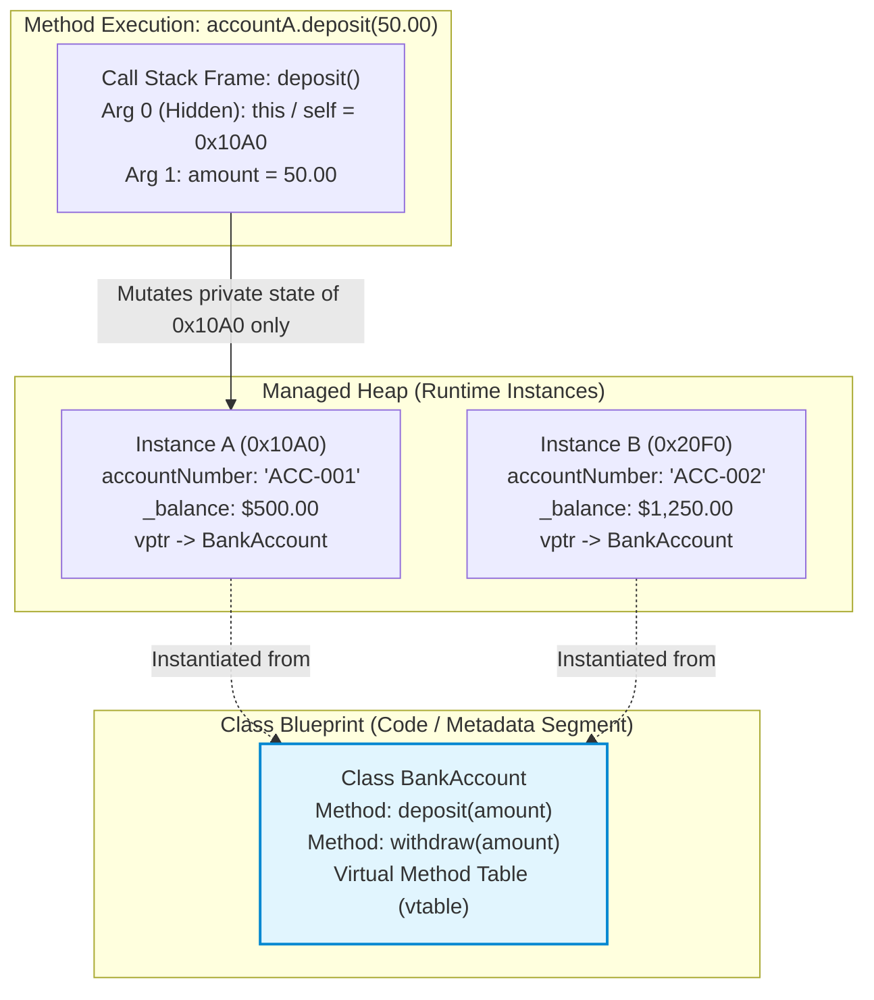

# Module 01: Classes, Objects, and OOP Building Blocks

> **Prerequisites:** Module 00 (Programming Basics, Memory Layout).  
> **Estimated Reading Time:** 25 minutes  
> **Target Audience:** Software Engineers, Backend Developers, Low-Level Design Architects.

> [!TIP]
> **The Golden Rule of Encapsulation:** **Never expose public mutable fields.** A class is not a passive data bag; it is an **enforcer of business invariants**. Make internal state private, validate all state transitions through public methods, and ensure that an object can never exist in an invalid, corrupted, or negative state from the moment its constructor finishes.

---

## 1. Architectural Mental Model: Classes, Instances, and Method Dispatch

A class is a compile-time metadata schema; an object is a dynamically allocated chunk of heap memory initialized to that schema:



### The Anatomy of `this` / `self`
When you execute `account.deposit(50.00)`, the CPU does not execute code inside the object. Executable machine code lives once in the shared code segment. 

The runtime passes the memory address of the target object as a **hidden zeroth argument** (`this` in C++/C#/Java/TS, explicit `self` in Python, explicit receiver in Go). The method reads and mutates the specific fields located at that heap address offset.

---

## 2. Taxonomic Reference: Access Modifiers Across Languages

Encapsulation restricts direct access to an object's internal representation:

| Language | Public Visibility | Private Visibility | Protected / Package Visibility | How Enforced |
| :--- | :--- | :--- | :--- | :--- |
| **C# (.NET)** | `public` | `private` (Default) | `protected` (Subclasses) / `internal` (Assembly) | Compiler & CLR runtime reflection guards |
| **Python** | Default attributes (`self.balance`) | Leading double underscore (`self.__balance`) | Leading single underscore (`self._balance` - convention) | Name mangling (`_ClassName__field`) |
| **Go** | Capitalized identifier (`Account`, `Balance`) | Lowercase identifier (`account`, `balance`) | Package-scoped (shared within folder) | Compiler symbol export table |
| **TypeScript** | `public` (Default) | `#balance` (Hard private) or `private` (TS check) | `protected` (Derived classes) | Hard private `#` enforced by JavaScript runtime |

---

## 3. Systematic Breakdown: Static Members vs. Instance Members

Understanding the scope of data prevents memory leaks and multi-tenant contamination:

```
  CLASS BLUEPRINT (Loaded once per process)
  ┌────────────────────────────────────────────────────────┐
  │ static totalAccountsCreated = 2                        │ ◀── Shared by ALL instances
  │ static getBankRoutingNumber()                          │
  └────────────────────────────────────────────────────────┘
          │                                  │
          ▼                                  ▼
  INSTANCE A (0x100)                 INSTANCE B (0x200)
  ┌───────────────────────┐          ┌───────────────────────┐
  │ id: "ACC-001"         │          │ id: "ACC-002"         │
  │ balance: $500         │          │ balance: $1200        │
  └───────────────────────┘          └───────────────────────┘
```

* **Instance Variables:** Unique to each individual object. Modifying `accountA.balance` never affects `accountB.balance`.
* **Static / Class Variables:** Bound to the class definition in global memory. Every instance shares the exact same memory cell. Modifying a static variable alters behavior across all users in the system!

---

## 4. Production War Story: The Public Mutable Field Invariant Bypass

```mermaid
sequenceDiagram
    actor Attacker as Malicious Client
    participant Promo as Marketing Promo Engine
    participant Account as BankAccount Entity
    participant DB as Production Database

    Note over Account: Account has public field: public decimal Balance;
    Attacker->>Promo: Apply $500 Promotional Coupon
    Note over Promo: Promo engine calculates discount:
    Promo->>Account: account.Balance = account.Balance - 500;
    Note over Account: Initial balance was $10! Balance becomes -$490!
    Note over Account: Because field is public, zero validation occurred!
    Promo->>DB: Save account with negative balance
    Attacker->>Account: Withdraw remaining cash from ATM
    Note over Account: Emergency SEV-1: Overdraft limits bypassed; $140,000 loss!
```

### The Incident
A digital banking platform introduced a promotional checkout service. A developer declared the domain account model with public setters:
```csharp
public class BankAccount {
    public decimal Balance { get; set; } // ❌ ANTI-PATTERN: Raw public setter
}
```
A promotional checkout module calculated item discounts and subtracted them directly from `account.Balance`. 

When users with $\$10$ applied a $\$500$ voucher that had a negative rebate clause, the balance was set directly to $-\$490$. Because no domain checks executed, 1,200 accounts went negative without triggering overdraft controls, allowing users to withdraw unbacked funds from ATMs.

### The Post-Mortem Data
* **Severity:** SEV-1 (Financial Loss & Compliance Breach)
* **Mean Time to Detect (MTTD):** 20 minutes
* **Mean Time to Resolution (MTTR):** 40 minutes

### The Root Cause
The `BankAccount` class failed to encapsulate its state. By exposing a public mutable property, external modules were permitted to bypass business invariants (e.g., balance cannot be negative without an authorized credit facility).

### The Fix & Hardening
1. **Enforce Private State and Intent-Revealing Methods:**
```csharp
public class BankAccount {
    public decimal Balance { get; private set; } // Read-only externally

    public void Withdraw(decimal amount) {
        if (amount <= 0) throw new ArgumentException("Withdrawal must be positive");
        if (Balance - amount < 0) throw new InvalidOperationException("Insufficient funds");
        Balance -= amount;
    }
}
```
2. **Make Constructors Enforce Initial Invariants:** Forbid creating half-initialized objects by requiring all mandatory fields in constructor parameters.

---

## 5. Multi-Language Production Code: Encapsulation & Domain Invariants

Below is an enterprise implementation of a domain entity enforcing strict invariants, currency boundaries, and immutable identifiers across four languages.

### Python
```python
from decimal import Decimal
from typing import Final

class BankAccount:
    def __init__(self, account_id: str, initial_deposit: Decimal):
        if not account_id or not account_id.strip():
            raise ValueError("Account ID cannot be empty.")
        if initial_deposit < Decimal("0.00"):
            raise ValueError("Initial deposit cannot be negative.")

        self._account_id: Final[str] = account_id
        self._balance: Decimal = initial_deposit

    @property
    def account_id(self) -> str:
        return self._account_id

    @property
    def balance(self) -> Decimal:
        return self._balance

    def deposit(self, amount: Decimal) -> None:
        if amount <= Decimal("0.00"):
            raise ValueError("Deposit amount must be strictly positive.")
        self._balance += amount

    def withdraw(self, amount: Decimal) -> None:
        if amount <= Decimal("0.00"):
            raise ValueError("Withdrawal amount must be strictly positive.")
        if amount > self._balance:
            raise ValueError(f"Insufficient funds: available {self._balance}, requested {amount}.")
        self._balance -= amount

if __name__ == "__main__":
    acc = BankAccount("ACC-101", Decimal("100.00"))
    acc.deposit(Decimal("50.00"))
    print(f"Account {acc.account_id} balance: ${acc.balance}")
```

### C# (.NET)
```csharp
using System;

public class BankAccount
{
    public string AccountId { get; }
    public decimal Balance { get; private set; }

    public BankAccount(string accountId, decimal initialDeposit)
    {
        if (string.IsNullOrWhiteSpace(accountId))
            throw new ArgumentException("Account ID cannot be null or whitespace.", nameof(accountId));
        
        if (initialDeposit < 0m)
            throw new ArgumentOutOfRangeException(nameof(initialDeposit), "Initial balance cannot be negative.");

        AccountId = accountId;
        Balance = initialDeposit;
    }

    public void Deposit(decimal amount)
    {
        if (amount <= 0m)
            throw new ArgumentOutOfRangeException(nameof(amount), "Deposit amount must be strictly positive.");

        Balance += amount;
    }

    public void Withdraw(decimal amount)
    {
        if (amount <= 0m)
            throw new ArgumentOutOfRangeException(nameof(amount), "Withdrawal amount must be strictly positive.");
        
        if (amount > Balance)
            throw new InvalidOperationException($"Insufficient funds. Current balance: {Balance}");

        Balance -= amount;
    }
}
```

### Go
```go
package main

import (
	"errors"
	"fmt"
)

type BankAccount struct {
	// Unexported private fields
	accountID string
	balance   int64 // Cents to avoid floating point imprecision
}

// NewBankAccount acts as a constructor function enforcing domain validation.
func NewBankAccount(id string, initialDepositCents int64) (*BankAccount, error) {
	if id == "" {
		return nil, errors.New("account ID cannot be empty")
	}
	if initialDepositCents < 0 {
		return nil, errors.New("initial deposit cannot be negative")
	}

	return &BankAccount{
		accountID: id,
		balance:   initialDepositCents,
	}, nil
}

func (a *BankAccount) Balance() int64 {
	return a.balance
}

func (a *BankAccount) Deposit(cents int64) error {
	if cents <= 0 {
		return errors.New("deposit amount must be positive")
	}
	a.balance += cents
	return nil
}

func (a *BankAccount) Withdraw(cents int64) error {
	if cents <= 0 {
		return errors.New("withdrawal amount must be positive")
	}
	if cents > a.balance {
		return fmt.Errorf("insufficient funds: balance is %d, requested %d", a.balance, cents)
	}
	a.balance -= cents
	return nil
}

func main() {
	acc, _ := NewBankAccount("ACC-001", 10000)
	_ = acc.Deposit(5000)
	fmt.Printf("Account Balance: $%.2f\n", float64(acc.Balance())/100)
}
```

### TypeScript / Node.js
```typescript
export class BankAccount {
  readonly #accountId: string;
  #balance: bigint; // Using bigint for integer currency subunits

  constructor(accountId: string, initialDepositCents: bigint) {
    if (!accountId || accountId.trim() === '') {
      throw new Error('Account ID cannot be empty');
    }
    if (initialDepositCents < 0n) {
      throw new Error('Initial deposit cannot be negative');
    }

    this.#accountId = accountId;
    this.#balance = initialDepositCents;
  }

  get accountId(): string {
    return this.#accountId;
  }

  get balanceCents(): bigint {
    return this.#balance;
  }

  public deposit(amountCents: bigint): void {
    if (amountCents <= 0n) {
      throw new Error('Deposit must be positive');
    }
    this.#balance += amountCents;
  }

  public withdraw(amountCents: bigint): void {
    if (amountCents <= 0n) {
      throw new Error('Withdrawal must be positive');
    }
    if (amountCents > this.#balance) {
      throw new Error(`Insufficient funds: balance is ${this.#balance}, requested ${amountCents}`);
    }
    this.#balance -= amountCents;
  }
}
```

---

## 6. Practical Hands-On Verification CLI Workflows

Follow these workflows in your Ubuntu terminal:

### Workflow 1: Inspect Encapsulation and Property Invariants
```bash
python3 -c '
from decimal import Decimal

class User:
    def __init__(self, age: int):
        self.age = age # Uses setter property

    @property
    def age(self) -> int:
        return self._age

    @age.setter
    def age(self, value: int):
        if value < 0:
            raise ValueError("Age cannot be negative!")
        self._age = value

u = User(25)
print("Valid age set:", u.age)
try:
    u.age = -5
except ValueError as e:
    print("✅ Invariant protection active:", e)
'
```
**Expected Output:**
```text
Valid age set: 25
✅ Invariant protection active: Age cannot be negative!
```

---

## 7. Operational Validation Checkpoint

<details>
<summary><strong>Question 1: Anemic Domain Models vs. Rich Encapsulation</strong></summary>

**Scenario:** A junior developer designs a system where all classes consist solely of public getters and setters (e.g. `Order` has `getStatus()`, `setStatus()`, `getItems()`, `setItems()`). All business logic (validation, total calculation, state transitions) is written inside an external `OrderService`.

What is this architectural anti-pattern called, and why does it degrade long-term maintainability?

**Answer:**
This is the **Anemic Domain Model** anti-pattern. 

By stripping business logic and invariant validation from the entity and reducing it to a passive data bag, encapsulation is broken:
1. Any developer anywhere in the codebase can call `order.setStatus("CANCELLED")` without checking whether the order has already shipped or triggering inventory refunds.
2. Logic is duplicated across multiple services.

**The Fix:** Build a **Rich Domain Model** where the entity encapsulates its own rules: `order.cancel(reason)` validates internal state transitions and updates items directly.
</details>

<details>
<summary><strong>Question 2: Static State in Multi-Tenant Backend APIs</strong></summary>

**Scenario:** In a Node.js or C# backend service, a developer writes:
`public static User CurrentUser;`
When 1,000 requests hit the API concurrently, users report seeing other customers' private profile data and account dashboards.

Why did this occur, and why is mutable static state prohibited in web servers?

**Answer:**
A web server processes concurrent HTTP requests within a single process. 

**Static fields are allocated once per process and shared across all threads and requests**. When Request A sets `CurrentUser = Alice` and begins an asynchronous database query, Request B arrives and sets `CurrentUser = Bob`. When Request A resumes execution, it reads `CurrentUser` (now Bob!) and serves Bob's data to Alice. 

**Rule:** Never store request-scoped data in static variables. Pass request state via method parameters or scoped dependency injection containers.
</details>

<details>
<summary><strong>Question 3: Why Floats Must Never Be Used for Currency</strong></summary>

**Scenario:** A banking class declares balance as:
`public double balance = 0.0;`
After 100,000 deposits of $\$0.10$, the account reports $\$9,999.9999999999982$ instead of $\$10,000.00$.

What is the root cause, and what data type must be used in production?

**Answer:**
Hardware floating-point numbers (`float`, `double`) use binary representation (IEEE 754). 

Numbers like `0.10` cannot be represented exactly in binary fractions, just as $1/3$ cannot be represented in finite decimal digits ($0.3333...$). Rounding errors accumulate over thousands of calculations.

**Production Solution:**
1. Store currency as **integers representing the smallest unit** (e.g. cents, satoshis): `$10.00` = `1000`.
2. Or use an exact arbitrary-precision decimal type: **`Decimal`** (Python), **`decimal`** (C#), or **`big.Int`** (Go).
</details>

---

## Next Step

Now that you have mastered classes, encapsulation, and domain invariants, proceed to **[02 · Object-Oriented Foundations and UML](../02-oop-foundations-and-uml/README.md)** to master Inheritance vs. Composition, Polymorphism, and standard UML class modeling.
