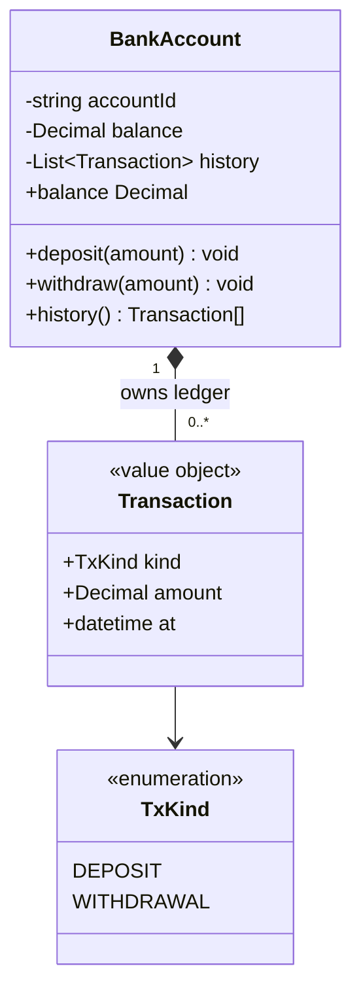
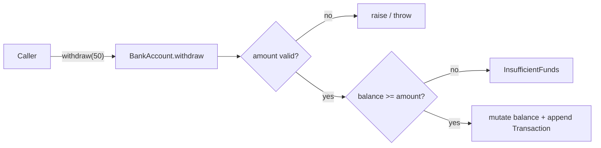

# Classes, Objects & OOP Building Blocks

> **Prerequisites:** [00 · Programming Basics (Python & C#)](../00-programming-basics-python-and-csharp/README.md) — references, value vs reference, collections, `Decimal` / `decimal`.  
> **Reading time:** ~22 minutes  
> **Audience:** Anyone in an LLD / machine-coding round who will be asked to "design a class" — a bank account, wallet, order, or locker — and defend its encapsulation

> [!NOTE]
> **In one line:** A class is a **guardian of invariants**, not a bag of fields — keep state private, build objects that are valid from the first line after the constructor, and let every state change pass through one validated method.

> [!TIP]
> **Golden rule:** If a caller can put your object into an illegal state (`balance = -490`) *without calling one of your methods*, the class is not finished. Move the rule into the class; then delete the setter.

> [!TIP]
> **Try it:** Sketch `BankAccount` → `Transaction` in [LLD Studio](/tools/lld-studio/), then run the Python ledger below and try to break the invariant from outside.

---

## 1. When this shows up in an interview

Interviewer: *"Design a `BankAccount` (or `Wallet`, `Locker`, `Order`). Deposit, withdraw, show history."* It sounds easy, which is the point — they are watching for **encapsulation instincts**.

**Smells that cost you points:**

- `public decimal Balance { get; set; }` or `self.balance` edited from outside.
- `getBalance()` / `setBalance()` pairs — encapsulation theater; the setter accepts anything.
- An `AccountService` that holds all the rules while `Account` is a data bag (**anemic domain model**).
- A constructor that leaves the object half-built (needs `init()` afterwards).
- `float` for money; `static` fields holding per-account or per-request state.
- Returning the internal history list so callers can rewrite the past.





Every state change goes through **one door**. That door is where the invariants live.

---

## 2. Building blocks (the vocabulary you must use precisely)

| Term | Meaning | Interview line |
| :--- | :--- | :--- |
| **Class** | Blueprint: fields + methods + constructors | "The class defines what is legal." |
| **Object / instance** | One allocation of that blueprint with its own field values | "Two accounts, same class, separate state." |
| **Field** | Data stored per instance | Keep private. |
| **Method** | Behavior that operates on instance fields via hidden `this` / explicit `self` | "Behavior lives next to the data it protects." |
| **Constructor** | Runs once; must leave the object valid | "No half-initialized objects." |
| **Property** | Controlled field access (`@property`, `{ get; private set; }`) | "Read freely, write through intent-revealing methods." |
| **Static / class member** | One copy per class (per process), not per object | "Process-wide state — avoid for anything mutable." |
| **Invariant** | A condition that is true whenever no method is mid-execution | "balance ≥ 0 and balance = sum of ledger." |
| **Tell, don't ask** | Tell the object what to do (`account.withdraw(50)`), don't pull its state and decide outside | "Rules live with the data." |

### Access control: Python vs C#

| Level | Python | C# | Enforced by |
| :--- | :--- | :--- | :--- |
| Public API | `balance`, `deposit()` | `public` | — |
| Internal use | `_balance` (single underscore) | `private` (default for members) | Python: **convention only**; C#: compiler |
| Name-mangled | `__balance` → `_BankAccount__balance` | — | Python avoids accidental subclass clashes; **not** security |
| Subclass-visible | `_name` by convention | `protected` | C# compiler |
| Assembly-visible | module-level / `_` helpers | `internal` | C# compiler |
| Read-only after construction | `@property` with no setter; `frozen=True` dataclass | `{ get; }`, `init`, `readonly` | Runtime / compiler |

**Say this aloud:** *"In Python 'private' is a social contract plus tooling; in C# it's a compiler guarantee. Either way I design the public surface so the contract is easy to keep."*

---

## 3. Construction and lifecycle

1. **Valid on construction.** Check every precondition in the constructor; raise / throw if it can't hold. Avoid two-phase init (`acct = Account(); acct.init(...)`) — that is **temporal coupling**.
2. **One constructor, plus named factories** when construction can take different forms or fail: `Account.open_with_deposit(...)` (Python `@classmethod`), `Account.Open(...)` (C# `static`).
3. **No virtual calls in constructors.** In C#, a base constructor that calls a `virtual` method runs the override before the derived constructor body — fields are still default. Python has the same hazard with overridden methods. Seal the class (`sealed`) unless inheritance is part of the design.
4. **Release resources deterministically.** Python `with` / `__enter__`; C# `IDisposable` + `using`. Domain objects like accounts rarely need this; connections and file handles do.

---

## 4. Walkthrough: `BankAccount` with a ledger

**Requirements (tiny):** open an account with an optional opening balance; `deposit`; `withdraw` (no overdraft); expose the balance and an immutable-looking history.

**Invariants to protect:**

1. `balance >= 0`.
2. `balance == sum(deposits) - sum(withdrawals)` (the ledger always explains the balance).
3. Amounts are positive and have at most two decimal places.
4. A failed operation changes nothing.

### Before (fields exposed, no door)

```python
class BadAccount:
    def __init__(self):
        self.balance = 0.0
        self.history = []

acct = BadAccount()
acct.balance -= 490       # allowed. No ledger entry. No check.
acct.history.clear()      # allowed. The past is gone.
```

### After (one door per change)

````carousel
```python
from __future__ import annotations

from dataclasses import dataclass
from datetime import datetime, timezone
from decimal import Decimal
from enum import Enum
from typing import Callable


class TxKind(Enum):
    DEPOSIT = "deposit"
    WITHDRAWAL = "withdrawal"


@dataclass(frozen=True)
class Transaction:
    kind: TxKind
    amount: Decimal
    at: datetime


class InsufficientFunds(Exception):
    def __init__(self, balance: Decimal, requested: Decimal) -> None:
        super().__init__(f"balance {balance}, requested {requested}")
        self.balance = balance
        self.requested = requested


def _utc_now() -> datetime:
    return datetime.now(timezone.utc)


class BankAccount:
    def __init__(
        self,
        account_id: str,
        opening_balance: Decimal = Decimal("0"),
        clock: Callable[[], datetime] = _utc_now,
    ) -> None:
        if not account_id or not account_id.strip():
            raise ValueError("account_id is required")
        if opening_balance != 0:
            self._require_money(opening_balance)
        self._account_id = account_id
        self._clock = clock
        self._balance = Decimal("0")
        self._history: list[Transaction] = []
        if opening_balance > 0:
            self._post(TxKind.DEPOSIT, opening_balance)

    @property
    def account_id(self) -> str:
        return self._account_id

    @property
    def balance(self) -> Decimal:
        return self._balance

    def deposit(self, amount: Decimal) -> None:
        self._require_money(amount)
        self._post(TxKind.DEPOSIT, amount)

    def withdraw(self, amount: Decimal) -> None:
        self._require_money(amount)
        if amount > self._balance:
            raise InsufficientFunds(self._balance, amount)
        self._post(TxKind.WITHDRAWAL, amount)

    def history(self) -> tuple[Transaction, ...]:
        """Snapshot. Later transactions do not appear in a tuple you already hold."""
        return tuple(self._history)

    # -- private helpers ----------------------------------------------------
    def _post(self, kind: TxKind, amount: Decimal) -> None:
        delta = amount if kind is TxKind.DEPOSIT else -amount
        self._balance += delta
        self._history.append(Transaction(kind, amount, self._clock()))

    @staticmethod
    def _require_money(amount: Decimal) -> None:
        if not isinstance(amount, Decimal):
            raise TypeError("amount must be Decimal, not float")
        if amount <= 0:
            raise ValueError("amount must be positive")
        if amount != amount.quantize(Decimal("0.01")):
            raise ValueError("amount has more than 2 decimal places")


if __name__ == "__main__":
    acct = BankAccount("ACC-1", Decimal("100.00"))
    acct.deposit(Decimal("50.00"))
    acct.withdraw(Decimal("30.00"))
    print(acct.balance)                                   # 120.00

    try:
        acct.withdraw(Decimal("500.00"))
    except InsufficientFunds as exc:
        print("rejected:", exc)
    assert acct.balance == Decimal("120.00")               # failed op changed nothing

    ledger = acct.history()
    assert len(ledger) == 3
    assert sum(t.amount if t.kind is TxKind.DEPOSIT else -t.amount for t in ledger) == acct.balance
    try:
        ledger[0].amount = Decimal("999")                  # type: ignore[misc]
    except Exception as exc:
        print("ledger entry is frozen:", type(exc).__name__)
```
<!-- slide -->
```csharp
using System;
using System.Collections.Generic;

public enum TxKind { Deposit, Withdrawal }

public sealed record Transaction(TxKind Kind, decimal Amount, DateTimeOffset At);

public sealed class InsufficientFundsException : InvalidOperationException
{
    public decimal Balance { get; }
    public decimal Requested { get; }

    public InsufficientFundsException(decimal balance, decimal requested)
        : base($"balance {balance}, requested {requested}")
    {
        Balance = balance;
        Requested = requested;
    }
}

public sealed class BankAccount
{
    private readonly List<Transaction> _history = new();
    private readonly Func<DateTimeOffset> _clock;

    public string AccountId { get; }
    public decimal Balance { get; private set; }

    // Live, read-only view. Caller cannot mutate it, but it reflects later changes.
    public IReadOnlyList<Transaction> History => _history.AsReadOnly();

    public BankAccount(string accountId, decimal openingBalance = 0m, Func<DateTimeOffset>? clock = null)
    {
        if (string.IsNullOrWhiteSpace(accountId))
            throw new ArgumentException("accountId is required", nameof(accountId));
        if (openingBalance != 0m) RequireMoney(openingBalance, nameof(openingBalance));

        AccountId = accountId;
        _clock = clock ?? (() => DateTimeOffset.UtcNow);
        if (openingBalance > 0m) Post(TxKind.Deposit, openingBalance);
    }

    public void Deposit(decimal amount)
    {
        RequireMoney(amount, nameof(amount));
        Post(TxKind.Deposit, amount);
    }

    public void Withdraw(decimal amount)
    {
        RequireMoney(amount, nameof(amount));
        if (amount > Balance) throw new InsufficientFundsException(Balance, amount);
        Post(TxKind.Withdrawal, amount);
    }

    private void Post(TxKind kind, decimal amount)
    {
        Balance += kind == TxKind.Deposit ? amount : -amount;
        _history.Add(new Transaction(kind, amount, _clock()));
    }

    private static void RequireMoney(decimal amount, string name)
    {
        if (amount <= 0m) throw new ArgumentOutOfRangeException(name, "amount must be positive");
        if (decimal.Round(amount, 2) != amount)
            throw new ArgumentException("amount has more than 2 decimal places", name);
    }
}

public static class Program
{
    public static void Main()
    {
        var acct = new BankAccount("ACC-1", 100.00m);
        acct.Deposit(50.00m);
        acct.Withdraw(30.00m);
        Console.WriteLine(acct.Balance);                       // 120.00

        try { acct.Withdraw(500.00m); }
        catch (InsufficientFundsException ex) { Console.WriteLine($"rejected: {ex.Message}"); }

        Console.WriteLine(acct.Balance == 120.00m);            // True: failed op changed nothing
        Console.WriteLine(acct.History.Count);                 // 3
    }
}
```
````

**What each choice bought you**

| Choice | Invariant it protects |
| :--- | :--- |
| `balance` has no public setter | Balance can only change via `deposit` / `withdraw` |
| Validation before `_post` | A failed call leaves balance and ledger untouched |
| `Transaction` is frozen / `record` | History entries cannot be edited after the fact |
| `Decimal` + two-decimal rule | No float drift; no sub-cent amounts |
| Injected `clock` | Tests are deterministic; no `sleep` or `freeze_time` needed |

---

## 5. Edges interviewers push on

| Edge | What goes wrong | What to say |
| :--- | :--- | :--- |
| **Collection getters** | `return self._history` lets callers append fake entries | Return a tuple / copy (Python) or `IReadOnlyList` view (C#); say whether it is a snapshot or a live view |
| **Static mutable state** | `static int totalAccounts`, `static User current` shared across requests/tests | Per-process state is global state: it breaks tests and is a data race under threads; use instances + DI |
| **Entity vs value equality** | Two `BankAccount` objects with the same ID — equal or not? | Entities compare by **ID**; value objects by **all fields** ([03](../03-generics-exceptions-and-value-objects/README.md)) |
| **Constructor validates, setter doesn't** | Object valid at birth, corrupted later | Route every write through a method that re-checks the same rules |
| **Python `__x` is not private** | `acct._BankAccount__balance = -1` works | Mangling prevents accidental clashes; it is not a security boundary |
| **Reflection / serialization** | ORMs and JSON can set private fields | Fine at the boundary, but do not let the domain depend on it; keep invariants in constructors/factories used by mappers |
| **Concurrent `withdraw`** | Check balance, then subtract — two threads can both pass the check | This class is **not** thread-safe; see [10 · Concurrency-Safe Design](../10-concurrency-safe-design/README.md) |
| **Idempotency** | A retried `deposit` credits twice | Real APIs carry an idempotency key; in LLD say it and keep the class simple |
| **Over-encapsulating** | A getter/setter per private field | Expose *behavior* and read-only state, not field-by-field accessors |

---

## 6. What you'd say in two minutes

> "I'd model `BankAccount` as an entity identified by `account_id`, with private balance and a private ledger of immutable `Transaction` value objects. The constructor validates the ID and opening balance, so no account is ever half-built. The only ways to change state are `deposit` and `withdraw`; both validate that the amount is a positive `Decimal` with at most two places, `withdraw` also checks sufficient funds, and a failed call leaves everything unchanged. The ledger always explains the balance — that's my second invariant. History is returned as a tuple in Python or a read-only view in C#, so callers can't rewrite it. I inject a clock for deterministic tests. It isn't thread-safe; if two gates call `withdraw` concurrently I'd put a lock inside the account, not in callers. I'd avoid static state and avoid getters and setters that just mirror fields."

---

## 7. Anti-patterns

1. **Public mutable fields / setters** — any caller can bypass every rule.
2. **Anemic domain model** — `Order` has only getters/setters; `OrderService` owns all rules; the same rule gets copied into three services. Put `order.cancel()` on `Order`.
3. **Half-built objects** — constructor then `init()` then `validate()` — temporal coupling. Use the constructor or a factory.
4. **God constructor** — twelve required parameters. Group into value objects or use a builder ([06](../06-creational-patterns/README.md)).
5. **Static state for instance concerns** — counters, "current user", caches keyed by nothing.
6. **Leaking internals** — returning `self._items`, or exposing `List<T>` instead of `IReadOnlyList<T>`.
7. **`float` / `double` for money** — drift in the ledger.
8. **Getters that ask, services that decide** — violating *tell, don't ask*.

---

## 8. Interview questions

<details>
<summary><strong>1. Are getters and setters encapsulation? [BASIC]</strong></summary>

Not by themselves. A setter that accepts any value is just a public field with extra typing. Encapsulation is hiding representation and exposing **behavior that preserves invariants** — `withdraw(amount)`, not `setBalance(x)`.

</details>

<details>
<summary><strong>2. Class vs object, and what are `this` / `self`? [BASIC]</strong></summary>

A class is the blueprint; an object is one instance with its own field values. Methods are shared code; the runtime passes the target instance as a hidden first argument — `this` in C#, explicit `self` in Python — so `acct.deposit(10)` touches only that account's fields.

</details>

<details>
<summary><strong>3. What is an invariant, and where do you enforce it? [BASIC]</strong></summary>

A condition that must hold whenever no method is mid-flight (e.g. `balance >= 0`). Enforce it in the **constructor** (so the object starts valid) and in **every method that mutates state**, before changing anything. If you must mutate in several steps, validate first so a failure leaves state untouched.

</details>

<details>
<summary><strong>4. Static vs instance members — when is static fine? [BASIC]</strong></summary>

Static is one copy per process. Fine for constants, pure functions (`Money.parse`), and factory methods. Dangerous for mutable data — it is shared across requests and tests, and is a data race under threads.

</details>

<details>
<summary><strong>5. `Order.setStatus(String)` exists; new rule: you can't cancel after it ships. Refactor. [SCENARIO]</strong></summary>

Remove the setter; add `cancel()`, `ship()`, `deliver()` that check the current status and transition it. Illegal moves raise a domain error. Callers can't skip the rule because there is no other door. If the transitions are numerous, introduce a state machine ([08 · State](../08-behavioral-patterns-i/README.md)).

</details>

<details>
<summary><strong>6. `history()` is called from a UI while deposits keep arriving. Snapshot or live view? [SCENARIO]</strong></summary>

A **snapshot** (tuple copy) is safe to iterate and cannot change under the reader; cost is O(n) per call. A **live read-only view** (C# `AsReadOnly()`) is O(1) but reflects later changes, and enumerating it while another thread appends can throw. Pick one deliberately and say which; for concurrent use prefer a snapshot taken under the account's lock.

</details>

<details>
<summary><strong>7. You must unit-test "interest posts at month end." How does the design help? [SCENARIO]</strong></summary>

Inject time. Pass a `clock` callable / `Func<DateTimeOffset>` / `TimeProvider` into the account or service so tests supply a fixed clock — no `sleep`, no monkey-patching `datetime.now`.

</details>

<details>
<summary><strong>8. Is Python's `__balance` really private? [TRICKY]</strong></summary>

No. It is name-mangled to `_BankAccount__balance`, so `acct._BankAccount__balance` still works. The goal is avoiding accidental clashes in subclasses. Python's privacy is convention (`_balance`) enforced by reviewers and linters; C# `private` is enforced by the compiler (though reflection can still reach it).

</details>

---

## 9. One-page cheat sheet

```text
Class        Blueprint. Object = one instance with its own state.
Invariant    A fact that is always true between method calls. Protect it in ctor + every mutator.
One door     State changes only through intent-revealing methods (deposit, cancel), never setters.
Construct    Valid on return. No init() afterwards. Named factories for variants.
Expose       Read-only state + behavior. Return tuple/copy/read-only view for collections.
Static       Constants, pure helpers, factories. Not mutable state.
Equality     Entity: by ID.  Value object: by all fields.
Python/C#    _x convention vs private compiler rule; __x is mangling, not security.
Not safe     This class is single-threaded. Locks go INSIDE the class (see 10).

Interview opener: "What must always be true about this object, and who is allowed to change it?"
```

---

## Further reading

- [Python tutorial — Classes](https://docs.python.org/3/tutorial/classes.html) (private variables, name mangling)
- [C# access modifiers](https://learn.microsoft.com/en-us/dotnet/csharp/programming-guide/classes-and-structs/access-modifiers)
- [Martin Fowler — AnemicDomainModel](https://martinfowler.com/bliki/AnemicDomainModel.html)
- [Martin Fowler — TellDontAsk](https://martinfowler.com/bliki/TellDontAsk.html)
- [Python `dataclasses`](https://docs.python.org/3/library/dataclasses.html) and [C# records](https://learn.microsoft.com/en-us/dotnet/csharp/language-reference/builtin-types/record)

## Next

**[02 · OOP Foundations & UML](../02-oop-foundations-and-uml/README.md)** — inheritance vs composition, polymorphism, and drawing class diagrams.
