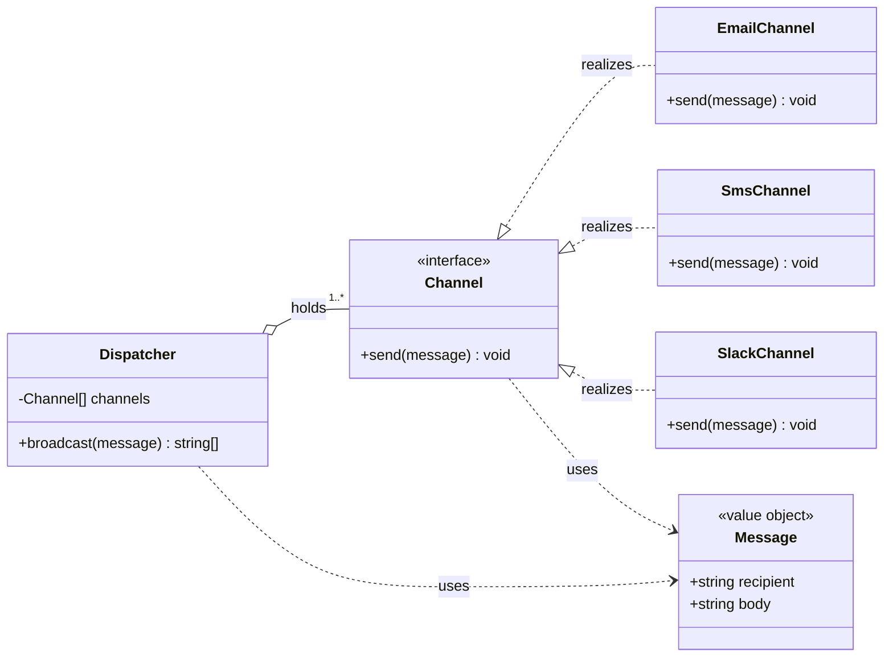
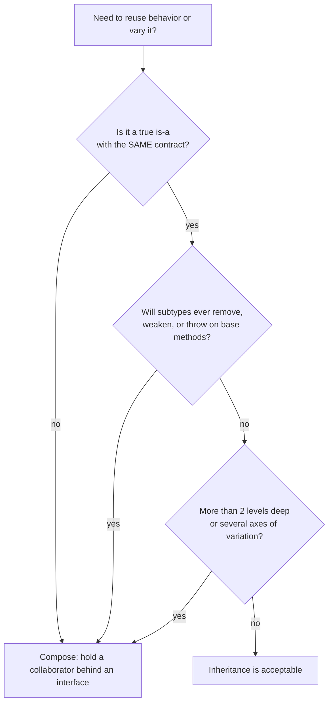

# OOP Foundations & UML Class Diagrams

> **Prerequisites:** [01 · Classes & Objects](../01-classes-objects-and-oop-building-blocks/README.md) — encapsulation, invariants, constructors.  
> **Reading time:** ~25 minutes  
> **Audience:** LLD / machine-coding candidates who must draw a class diagram on a whiteboard and justify every arrow

> [!NOTE]
> **In one line:** OOP is four ideas — **encapsulation, abstraction, inheritance, polymorphism** — and the design skill is knowing when to *not* inherit: depend on small interfaces, **compose** collaborators, and draw only the relationships that carry meaning.

> [!TIP]
> **Golden rule:** Inherit for **is-a with the same contract**; compose for everything else. If a subclass must throw `NotSupported`, override a method to do nothing, or you reach for `isinstance` to special-case it, the hierarchy is lying.

> [!TIP]
> **Try it:** Draw the notification model below in [LLD Studio](/tools/lld-studio/), then add `SlackChannel` and confirm `Dispatcher` does not change.

---

## 1. When this shows up in an interview

Interviewer: *"Design a notification system: email and SMS now, push next quarter. Draw the class diagram."*

**Smells that cost you points:**

- `class Notification` with `send(kind)` and an `if kind == "email" … elif kind == "sms"` ladder.
- A deep tree: `Notification → EmailNotification → UrgentEmailNotification → UrgentHtmlEmailNotification`.
- `Penguin extends Bird` where `fly()` throws.
- A diagram with every association drawn as a plain line, no multiplicities, no direction.
- Fifteen classes on the board before one use case has been traced.



---

## 2. The four pillars (and what each one buys you)

| Pillar | Meaning | What it buys | How it breaks |
| :--- | :--- | :--- | :--- |
| **Encapsulation** | Hide state; expose validated behavior ([01](../01-classes-objects-and-oop-building-blocks/README.md)) | Invariants hold | Public mutable fields, leaked collections |
| **Abstraction** | Callers depend on *what* (a contract), not *how* | Swap implementations; test with fakes | Leaky abstraction: `Channel.send` exposes SMTP settings |
| **Inheritance** | A subtype reuses and extends a supertype | Shared contract + shared code | Fragile base class; deep trees; forced overrides |
| **Polymorphism** | One call, behavior chosen by the runtime type | No `if type ==` ladders | Subtypes that violate the base contract (LSP) |

### Static vs dynamic polymorphism

- **Static (compile-time):** method overloading, generics / templates. Resolved before the program runs.
- **Dynamic (runtime):** overriding and interface implementation. Resolved by the object's actual type via a virtual dispatch table. In Python every method is looked up at call time, so duck typing gives you this without declaring a base type.

---

## 3. Inheritance vs composition — the decision



**Abstract class vs interface**

| | Abstract base class | Interface / protocol |
| :--- | :--- | :--- |
| **Holds state / shared code** | Yes | Python `Protocol`: no. C#: no fields; default interface methods exist but use sparingly |
| **Inheritance count** | Python: many (MRO). C#: **one** base class | Many interfaces |
| **Use when** | Shared implementation is part of the concept (`template method`) | You want a small role/contract (`Channel`, `Repository`) |
| **Python tools** | `abc.ABC` + `@abstractmethod` | `typing.Protocol` (structural), or ABC as a pure interface |
| **C# tools** | `abstract class` | `interface`; classes implement explicitly or implicitly |

**Rule of thumb:** start with an interface describing *the role*; add an abstract base only when several implementations genuinely share code.

---

## 4. Reading and drawing UML class diagrams

### Class box

```text
┌──────────────────────────┐
│ Dispatcher               │   name  (+ <<stereotype>> if useful)
├──────────────────────────┤
│ - channels: Channel[]    │   fields    (- private, + public, # protected, ~ package)
├──────────────────────────┤
│ + broadcast(m): string[] │   methods
└──────────────────────────┘
```

### Relationships (Mermaid syntax in the middle column)

| Relationship | Mermaid | Meaning | Lifecycle | Code smell if wrong |
| :--- | :--- | :--- | :--- | :--- |
| **Dependency** | `A ..> B` | A uses B briefly (parameter, local) | None | Drawing it as a field |
| **Association** | `A --> B` | A holds a reference to B | Independent | Drawing both directions when only one side knows |
| **Aggregation** | `A o-- B` | A has B; B can outlive A | Independent | Using it everywhere "just in case" |
| **Composition** | `A *-- B` | A owns B; B dies with A | Tied | Marking `Airplane *-- Flight` when planes get swapped |
| **Realization** | `I <\|.. C` | C implements interface I | — | — |
| **Generalization** | `P <\|-- C` | C is-a P | Tight | Using it for code reuse only |

**Multiplicity:** `1`, `0..1`, `1..*`, `*`. Put it at both ends when it clarifies (`Order "1" *-- "1..*" OrderLine`).

**What to include on a whiteboard:** names, key fields that show relationships, the 2–4 methods that carry the use case. **Leave out** getters/setters, constructors, helper utilities.

**Say the lifecycle test out loud:** *"If I delete the whole, does the part still make sense? Order lines — no (composition). Customer — yes (association)."* Many teams treat aggregation and composition loosely; interviewers mainly want the ownership reasoning.

---

## 5. Walkthrough: notifications by composition

**Requirements (tiny):** send a message to a recipient over every configured channel; adding Slack tomorrow must not change the dispatcher; one failing channel must not stop the others.

**Roles:** `Message` (immutable value), `Channel` (contract), concrete channels, `Dispatcher` (orchestration).

### Before — kind flag and ladder

```python
class Notification:
    def send(self, kind: str, to: str, body: str) -> None:
        if kind == "email":
            ...
        elif kind == "sms":
            ...
        # adding "slack" means editing this class and re-testing email + sms
```

### Inheritance gone wrong — the `Penguin` problem

```python
class Bird:
    def fly(self) -> str:
        return "flapping"

class Penguin(Bird):
    def fly(self) -> str:
        raise NotImplementedError("penguins can't fly")   # callers of Bird.fly() now crash
```

**Fix:** model the *capability*, not the taxonomy — `Flyer` (interface) implemented by `Sparrow`, not by `Penguin`; or make `Bird` carry no `fly()` at all. Same idea as `Channel`: a small role, many implementers.

### After — interface + composition

````carousel
```python
from __future__ import annotations

from abc import ABC, abstractmethod
from dataclasses import dataclass
from typing import Sequence


@dataclass(frozen=True)
class Message:
    recipient: str
    body: str


class Channel(ABC):
    """Contract: deliver the message or raise. Do not mutate the message."""
    name: str

    @abstractmethod
    def send(self, message: Message) -> None: ...


class EmailChannel(Channel):
    name = "email"

    def send(self, message: Message) -> None:
        print(f"[email] to {message.recipient}: {message.body}")


class SmsChannel(Channel):
    name = "sms"
    MAX_LEN = 160

    def send(self, message: Message) -> None:
        if len(message.body) > self.MAX_LEN:
            raise ValueError("sms body too long")
        print(f"[sms] to {message.recipient}: {message.body}")


class SlackChannel(Channel):          # added later: Dispatcher is untouched
    name = "slack"

    def send(self, message: Message) -> None:
        print(f"[slack] #{message.recipient}: {message.body}")


class Dispatcher:
    """Has-a list of channels. Knows only the Channel contract."""

    def __init__(self, channels: Sequence[Channel]) -> None:
        self._channels = tuple(channels)          # defensive copy, immutable

    def broadcast(self, message: Message) -> list[str]:
        failed: list[str] = []
        for channel in self._channels:
            try:
                channel.send(message)
            except Exception:                      # isolate failure per channel
                failed.append(channel.name)
        return failed


if __name__ == "__main__":
    dispatcher = Dispatcher([EmailChannel(), SmsChannel(), SlackChannel()])
    print(dispatcher.broadcast(Message("asha", "Your order shipped")))   # []
    long_body = "x" * 200
    print(dispatcher.broadcast(Message("asha", long_body)))              # ['sms']
```
<!-- slide -->
```csharp
using System;
using System.Collections.Generic;
using System.Linq;

public sealed record Message(string Recipient, string Body);

public interface IChannel
{
    string Name { get; }
    /// <summary>Deliver the message or throw. Must not mutate shared state it does not own.</summary>
    void Send(Message message);
}

public sealed class EmailChannel : IChannel
{
    public string Name => "email";
    public void Send(Message message) =>
        Console.WriteLine($"[email] to {message.Recipient}: {message.Body}");
}

public sealed class SmsChannel : IChannel
{
    private const int MaxLen = 160;
    public string Name => "sms";
    public void Send(Message message)
    {
        if (message.Body.Length > MaxLen) throw new ArgumentException("sms body too long");
        Console.WriteLine($"[sms] to {message.Recipient}: {message.Body}");
    }
}

public sealed class SlackChannel : IChannel        // added later: Dispatcher is untouched
{
    public string Name => "slack";
    public void Send(Message message) =>
        Console.WriteLine($"[slack] #{message.Recipient}: {message.Body}");
}

public sealed class Dispatcher
{
    private readonly IChannel[] _channels;

    public Dispatcher(IEnumerable<IChannel> channels)
    {
        _channels = (channels ?? throw new ArgumentNullException(nameof(channels))).ToArray();
    }

    public IReadOnlyList<string> Broadcast(Message message)
    {
        var failed = new List<string>();
        foreach (var channel in _channels)
        {
            try { channel.Send(message); }
            catch (Exception) { failed.Add(channel.Name); }   // isolate failure per channel
        }
        return failed;
    }
}

public static class Program
{
    public static void Main()
    {
        var dispatcher = new Dispatcher(new IChannel[] { new EmailChannel(), new SmsChannel(), new SlackChannel() });
        Console.WriteLine(dispatcher.Broadcast(new Message("asha", "Your order shipped")).Count);   // 0
        var failed = dispatcher.Broadcast(new Message("asha", new string('x', 200)));
        Console.WriteLine(string.Join(",", failed));                                               // sms
    }
}
```
````

**What this gave you**

| Principle | Where |
| :--- | :--- |
| Abstraction | `Dispatcher` sees only `Channel` |
| Polymorphism | `channel.send(...)` picks Email / SMS / Slack at runtime |
| Composition | `Dispatcher` **has** channels; no base-class coupling |
| Open for extension | Slack = one new class (see [04 · SOLID](../04-solid-principles/README.md)) |
| Encapsulation | Dispatcher copies the channel list; `Message` is immutable |

---

## 6. Edges interviewers push on

| Edge | Python | C# | What to say |
| :--- | :--- | :--- | :--- |
| **Override rules** | Every method is overridable; no keyword needed | Methods are non-virtual by default: need `virtual` + `override` | "C# makes extension points explicit; I seal what isn't designed for inheritance." |
| **`override` vs `new`** | — | `new` **hides**: a base-typed reference still calls the base version | Hiding breaks polymorphism; avoid it |
| **Multiple inheritance / diamond** | Allowed; resolved by **MRO** (C3 linearization); `super()` follows it | Only one base **class**; many interfaces; no diamond for state | Prefer composition or small interfaces/mixins without state |
| **Constructor + virtual call** | Overridden method sees an incompletely initialized subclass | Same hazard in C# | Don't call overridable methods in constructors |
| **Abstract with state** | `ABC` can hold fields | `abstract class` can hold fields | Interfaces can't; decide whether state is part of the role |
| **Type tests (`isinstance`, `is`)** | A smell when used to special-case subtypes | Same | Push the difference into a polymorphic method |
| **Substitutability** | Subtype must keep base preconditions/postconditions | Same | The SMS length limit above is a contract question: either document it on `Channel` or pre-validate |
| **Equality in hierarchies** | `__eq__` across subclasses can be asymmetric | `Equals` overrides likewise | Avoid equality across a class hierarchy; use value objects |
| **UML direction** | Arrow points to what is depended on | Same | Point from the class that *knows* to the class that is *known* |
| **Diagram bloat** | — | — | State a budget aloud: "five classes first; I'll add detail only for the use case we trace" |

---

## 7. What you'd say in two minutes

> "I'd model a `Channel` interface with a single `send(message)`, with `EmailChannel`, `SmsChannel`, and later `SlackChannel` realizing it. The `Dispatcher` holds a list of channels — composition, not inheritance — so adding a channel is a new class, not an edit to the dispatcher. `Message` is an immutable value object. Each send is isolated, so one failing channel can't block the others, and I'd say aloud that the contract has to cover failure: channels either deliver or raise. On the UML: realization with a dashed hollow arrow, `Dispatcher` aggregates channels with multiplicity one-or-more, and the dispatcher depends on `Message` only as a parameter. I'd avoid an `EmailNotification extends Notification` tree because it couples variation axes — channel, urgency, template — into one hierarchy. If you push on inheritance, I'd use it only for a true is-a with an identical contract, never for code reuse alone."

---

## 8. Anti-patterns

1. **Inheritance for code reuse** — `Stack extends ArrayList` exposes methods that break the stack's invariants. Wrap it instead.
2. **Deep hierarchies** — more than two levels is usually several axes (type × urgency × format) welded together; split into collaborators.
3. **Refused bequest** — subclasses that throw `NotSupportedException` or stub methods; the base is too fat or the relationship is wrong.
4. **`isinstance` ladders** — polymorphism in disguise; move the behavior into the types.
5. **God base class** — a shared `BaseEntity` with `save()`, `audit()`, `serialize()` that every subclass depends on; one change ripples everywhere ([fragile base class](https://en.wikipedia.org/wiki/Fragile_base_class)).
6. **Interface per class** — `IFoo` with one implementation and no second consumer; add the seam when you need it.
7. **Diagram as a data dump** — every field and getter drawn; the relationships you care about get lost.
8. **Wrong arrows** — composition between things with independent lives; bidirectional associations by default.

---

## 9. Interview questions

<details>
<summary><strong>1. Name the four pillars and what each buys you. [BASIC]</strong></summary>

Encapsulation: invariants stay true. Abstraction: callers depend on a contract, so implementations swap and tests use fakes. Inheritance: shared contract/code along a true is-a. Polymorphism: one call, behavior chosen at runtime — no type ladders.

</details>

<details>
<summary><strong>2. Abstract class vs interface? [BASIC]</strong></summary>

An abstract class can carry state and shared code, and (in C#) you inherit only one. An interface is a pure role/contract that many types can implement. Start with an interface; reach for an abstract class when implementations share real code (e.g. a template method).

</details>

<details>
<summary><strong>3. Aggregation vs composition — how do you tell on a whiteboard? [BASIC]</strong></summary>

Ask: *does the part make sense without the whole?* `Order *-- OrderLine`: no — composition, created and deleted with the order. `Department o-- Employee`: yes — employees survive the department closing. In code, composition usually means the whole creates and owns the part; aggregation means it receives a reference.

</details>

<details>
<summary><strong>4. Overloading vs overriding? [BASIC]</strong></summary>

Overloading: same name, different parameter lists, chosen at **compile time** (C#; Python has no overloading — use defaults or `functools.singledispatch`). Overriding: a subtype replaces a base method with the same signature, chosen at **runtime**.

</details>

<details>
<summary><strong>5. `Penguin extends Bird`, `Bird.fly()`. Fix it. [SCENARIO]</strong></summary>

The base contract promises something not all subtypes can do. Remove `fly()` from `Bird` and introduce a `Flyer` interface implemented only by flying birds — or model movement as a composed strategy (`FlyingMovement`, `WalkingMovement`). Callers that need flight depend on `Flyer`, so no surprise throws.

</details>

<details>
<summary><strong>6. Add push notifications and per-user channel preferences without editing `Dispatcher`. [SCENARIO]</strong></summary>

Add `PushChannel : Channel`. For preferences, keep the dispatcher dumb: a `PreferenceResolver` (or a `UserChannels` repository) returns the `Channel` list for a user, and `Dispatcher` is constructed per call or takes `broadcast(message, channels)`. Registration is a DI concern ([19 · API, Library Design & DI](../19-api-library-design-and-di/README.md)).

</details>

<details>
<summary><strong>7. Turn `Order "1" *-- "1..*" OrderLine` and `OrderLine --> Product` into code. [SCENARIO]</strong></summary>

`Order` owns a non-empty collection of `OrderLine` it creates itself (`add_line(product, qty)`), validates "at least one line," and doesn't expose the raw list. `OrderLine` holds a reference (or just an ID plus price snapshot) to `Product`; deleting an order deletes its lines, deleting a line never deletes a product.

</details>

<details>
<summary><strong>8. In C#, what does `new` do on a method and why is it dangerous? [TRICKY]</strong></summary>

`new` **hides** a base member instead of overriding it. Through a base-typed reference the *base* method runs; through the derived type the derived one runs — so the same object behaves differently depending on the variable's static type. That breaks substitutability; use `virtual` / `override` or rename.

</details>

---

## 10. One-page cheat sheet

```text
Pillars       Encapsulation (invariants) · Abstraction (contracts) · Inheritance (is-a) · Polymorphism (runtime choice)
Inherit when  True is-a, same contract, <= 2 levels, subtype never weakens base.
Compose when  Everything else. Hold a collaborator behind an interface.
Interface     Small role (Channel). Abstract class only for shared implementation.
UML           ..> dependency | --> association | o-- aggregation | *-- composition
              <|.. realization | <|-- generalization.  Always add multiplicity where it matters.
Lifecycle     "Delete the whole — does the part survive?"  yes = aggregation/association, no = composition.
Python/C#     MRO + duck typing vs single-class inheritance + virtual/override. Avoid `new` hiding.
Red flags     isinstance ladders, NotSupported overrides, deep trees, God base class.

Interview opener: "What varies here — and can I put it behind an interface instead of a subclass?"
```

---

## Further reading

- [UML class diagrams overview](https://www.uml-diagrams.org/class-diagrams-overview.html) — notation reference
- [Mermaid class diagram syntax](https://mermaid.js.org/syntax/classDiagram.html)
- [Martin Fowler — UML Distilled](https://martinfowler.com/books/umlDistilled.html)
- [Python `abc`](https://docs.python.org/3/library/abc.html), [`typing.Protocol`](https://docs.python.org/3/library/typing.html#typing.Protocol), [The Python 2.3 Method Resolution Order](https://docs.python.org/3/howto/mro.html)
- [C# interfaces](https://learn.microsoft.com/en-us/dotnet/csharp/fundamentals/types/interfaces) and [polymorphism](https://learn.microsoft.com/en-us/dotnet/csharp/fundamentals/object-oriented/polymorphism)

## Next

**[03 · Generics, Exceptions & Value Objects](../03-generics-exceptions-and-value-objects/README.md)** — type-safe containers, error contracts, and immutable domain values.
