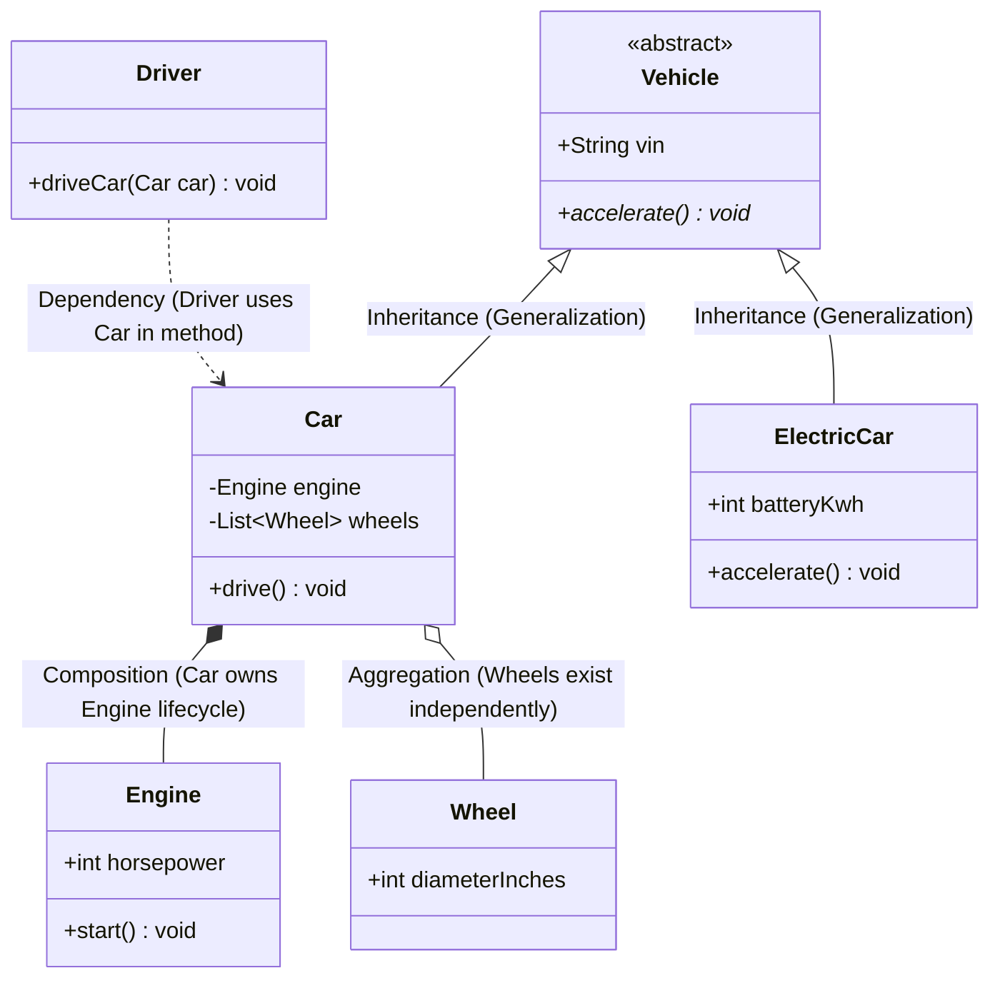

# Module 02: Object-Oriented Foundations and UML Class Modeling

> **Prerequisites:** Module 01 (Classes, Objects, and OOP Building Blocks).  
> **Estimated Reading Time:** 25 minutes  
> **Target Audience:** Backend Developers, Low-Level Design Interview Candidates, Software Architects.

> [!TIP]
> **The Golden Rule of Object-Oriented Architecture:** **Favor object composition over class inheritance.** Inheritance creates tight, compile-time coupling where subclasses inherit the internal implementation details and bugs of their ancestors ("The Fragile Base Class Problem"). Composition allows you to swap behavior dynamically at runtime by depending on abstractions (interfaces) rather than concrete base classes.

---

## 1. Architectural Mental Model: UML Class Relationships

In Low-Level Design interviews and enterprise system design, Unified Modeling Language (UML) class diagrams visually document structural relationships, lifecycles, and dependencies:



---

## 2. Taxonomic Reference: UML Relationship Matrix

| Relationship | Symbol | Semantic Meaning | Lifecycle Coupling | Real-World Code Example |
| :--- | :--- | :--- | :--- | :--- |
| **Dependency** | `..>` | Class A **uses** Class B temporarily in a method argument or local variable | **None** (Ephemeral) | `void process(Order order)` |
| **Association** | `-->` | Class A **has a** structural reference to Class B as a member field | Independent | `class Customer { Account account; }` |
| **Aggregation** | `o--` | Class A contains Class B, but **Class B can exist without Class A** (Weak ownership) | Independent | `class Department { List<Teacher> teachers; }` (Teachers survive if Dept closes) |
| **Composition** | `*--` | Class A contains Class B, and **Class B dies when Class A dies** (Strong ownership) | **Co-dependent** | `class Order { List<OrderItem> items; }` (OrderItems cannot exist without Order) |
| **Realization** | `..|>` | Class A **implements** Interface B | Contractual | `class PostgresRepo implements Repository` |
| **Generalization** | `--|>` | Class A **is a** subclass of Base Class B (Inheritance) | **Tightly Coupled** | `class Dog extends Animal` |

---

## 3. Systematic Breakdown: The Four Pillars of OOP

```
  ┌────────────────────────────────────────────────────────────────────────┐
  │ 1. ENCAPSULATION: Hiding internal state; exposing validated operations │
  ├────────────────────────────────────────────────────────────────────────┤
  │ 2. ABSTRACTION: Exposing WHAT an object does, hiding HOW it does it    │
  ├────────────────────────────────────────────────────────────────────────┤
  │ 3. INHERITANCE: Code reuse across IS-A relationships (Use sparingly!)   │
  ├────────────────────────────────────────────────────────────────────────┤
  │ 4. POLYMORPHISM: Multiple types responding to the same interface       │
  └────────────────────────────────────────────────────────────────────────┘
```

### Static vs. Dynamic Polymorphism
* **Static Polymorphism (Compile-Time):** Method Overloading (multiple methods with the same name but different parameter signatures) and Generics / Templates. The compiler resolves the target instruction at compile time with zero runtime dispatch cost.
* **Dynamic Polymorphism (Runtime):** Virtual method overriding and interface realization. Resolved via a **Virtual Method Table (vtable)** pointer at runtime based on the actual concrete heap object type.

---

## 4. Production War Story: The Fragile Base Class Deadlock Outage

```mermaid
sequenceDiagram
    actor Cron as Background Reconciliation Worker
    participant Order as OrderEntity (Subclass)
    participant Base as AuditableEntity (Monolithic Base Class)
    participant DB as Production SQL Database

    Note over Base: Base class shared by 45 business entities!
    Note over Base: Senior engineer adds automatic audit logging to Base.save():
    Note over Base: "SELECT * FROM audit_lock FOR UPDATE;" added inside base save!
    Cron->>Order: order.markShipped()
    Order->>Base: super.save()
    Base->>DB: Acquire exclusive pessimistic transaction lock on audit_lock table
    Note over DB: High-traffic web requests saving User profiles ALSO hit audit_lock!
    Note over DB: Circular dependency deadlock! 250 DB connection pool threads hang!
    Note over Cron,DB: Database CPU spikes to 100%! All API pods crash with pool timeout!
    Note over Order: Emergency SEV-1: Complete platform order processing freeze!
```

### The Incident
In an enterprise e-commerce platform, a shared base class `AuditableEntity` was extended by 45 domain models (`User`, `Product`, `Order`, `Payment`). A developer modified `AuditableEntity.save()` to acquire a database lock to write compliance audit logs. 

Immediately upon deployment, background order processors and customer checkout APIs began deadlocking, completely exhausting the database connection pool within 3 minutes.

### The Post-Mortem Data
* **Severity:** SEV-1 (Platform-Wide Database Exhaustion)
* **Mean Time to Detect (MTTD):** 10 minutes
* **Mean Time to Resolution (MTTR):** 60 minutes

### The Root Cause
The architecture suffered from the classic **Fragile Base Class Problem**. Because 45 disparate business entities inherited from a single monolithic base class, modifying a single line in the base class unintentionally altered the transaction and locking behavior of every service across the entire enterprise.

### The Fix & Hardening
1. **Refactor from Inheritance to Composition:** Strip audit logging out of the entity class hierarchy completely. Inject an independent `IAuditLogger` service:
```csharp
// ✅ COMPOSITION: Order HAS AN auditor; it DOES NOT inherit from an entity god-class
public class Order {
    private readonly IAuditLogger _auditor;
    public Order(IAuditLogger auditor) => _auditor = auditor;
    
    public void MarkShipped() {
        // Business logic strictly for Order
        _auditor.LogStateChange(this.Id, "Shipped");
    }
}
```
2. **Eliminate Deep Inheritance Trees:** Keep inheritance hierarchies shallow ($\le 2$ levels deep), or use composition exclusively.

---

## 5. Multi-Language Production Code: Polymorphism via Interfaces and Composition

Below is an enterprise notification dispatch pipeline demonstrating polymorphism and composition without deep inheritance hierarchies.

### Python
```python
from abc import ABC, abstractmethod
from typing import List

# 1. Interface / Abstract Base Contract
class NotificationChannel(ABC):
    @abstractmethod
    def send(self, recipient: str, message: str) -> None:
        pass

# 2. Concrete Polymorphic Implementations
class EmailChannel(NotificationChannel):
    def send(self, recipient: str, message: str) -> None:
        print(f"📧 [Email] To {recipient}: {message}")

class SmsChannel(NotificationChannel):
    def send(self, recipient: str, message: str) -> None:
        print(f"📱 [SMS] To {recipient}: {message}")

# 3. Composition: NotificationService HAS A list of channels
class NotificationDispatcher:
    def __init__(self, channels: List[NotificationChannel]):
        self._channels = list(channels)

    def broadcast(self, recipient: str, message: str) -> None:
        for channel in self._channels:
            channel.send(recipient, message)

if __name__ == "__main__":
    dispatcher = NotificationDispatcher([EmailChannel(), SmsChannel()])
    dispatcher.broadcast("user@example.com", "Your order #102 has shipped!")
```

### C# (.NET)
```csharp
using System;
using System.Collections.Generic;

public interface INotificationChannel
{
    void Send(string recipient, string message);
}

public class EmailChannel : INotificationChannel
{
    public void Send(string recipient, string message) =>
        Console.WriteLine($"📧 [Email] To {recipient}: {message}");
}

public class SmsChannel : INotificationChannel
{
    public void Send(string recipient, string message) =>
        Console.WriteLine($"📱 [SMS] To {recipient}: {message}");
}

public class NotificationDispatcher
{
    private readonly IEnumerable<INotificationChannel> _channels;

    public NotificationDispatcher(IEnumerable<INotificationChannel> channels)
    {
        _channels = channels ?? throw new ArgumentNullException(nameof(channels));
    }

    public void Broadcast(string recipient, string message)
    {
        foreach (var channel in _channels)
        {
            channel.Send(recipient, message);
        }
    }
}
```

### Go
```go
package main

import "fmt"

// Go implements interfaces implicitly (Structural Polymorphism)
type NotificationChannel interface {
	Send(recipient, message string) error
}

type EmailChannel struct{}

func (e EmailChannel) Send(recipient, message string) error {
	fmt.Printf("📧 [Email] To %s: %s\n", recipient, message)
	return nil
}

type SMSChannel struct{}

func (s SMSChannel) Send(recipient, message string) error {
	fmt.Printf("📱 [SMS] To %s: %s\n", recipient, message)
	return nil
}

// NotificationDispatcher uses composition to hold channels
type NotificationDispatcher struct {
	channels []NotificationChannel
}

func (d *NotificationDispatcher) Broadcast(recipient, message string) {
	for _, ch := range d.channels {
		_ = ch.Send(recipient, message)
	}
}

func main() {
	dispatcher := NotificationDispatcher{
		channels: []NotificationChannel{EmailChannel{}, SMSChannel{}},
	}
	dispatcher.Broadcast("admin@company.com", "Cluster health optimal.")
}
```

### TypeScript / Node.js
```typescript
interface NotificationChannel {
  send(recipient: string, message: string): Promise<void>;
}

class EmailChannel implements NotificationChannel {
  async send(recipient: string, message: string): Promise<void> {
    console.log(`📧 [Email] To ${recipient}: ${message}`);
  }
}

class SlackChannel implements NotificationChannel {
  async send(recipient: string, message: string): Promise<void> {
    console.log(`💬 [Slack] To ${recipient}: ${message}`);
  }
}

class NotificationDispatcher {
  constructor(private readonly channels: NotificationChannel[]) {}

  async broadcast(recipient: string, message: string): Promise<void> {
    await Promise.all(this.channels.map((c) => c.send(recipient, message)));
  }
}
```

---

## 6. Practical Hands-On Verification CLI Workflows

Verify runtime polymorphic dispatch in your terminal:

### Workflow 1: Inspect Dynamic Polymorphic Dispatch
```bash
python3 -c '
from abc import ABC, abstractmethod

class PaymentStrategy(ABC):
    @abstractmethod
    def pay(self, amount: float): pass

class Stripe(PaymentStrategy):
    def pay(self, amount: float): print(f"Processing ${amount} via Stripe API")

class PayPal(PaymentStrategy):
    def pay(self, amount: float): print(f"Processing ${amount} via PayPal OAuth")

def execute_checkout(strategy: PaymentStrategy, total: float):
    strategy.pay(total) # Dynamic dispatch via vtable

execute_checkout(Stripe(), 149.99)
execute_checkout(PayPal(), 49.50)
'
```
**Expected Output:**
```text
Processing $149.99 via Stripe API
Processing $49.50 via PayPal OAuth
```

---

## 7. Operational Validation Checkpoint

<details>
<summary><strong>Question 1: Aggregation vs. Composition in Domain Modeling</strong></summary>

**Scenario:** In an e-commerce order management system, consider two relationships:
1. `ShoppingCart` and `CartItem`
2. `ShoppingCart` and `RegisteredUser`

Which relationship represents **Composition** and which represents **Aggregation**? What happens to the components if the `ShoppingCart` is deleted?

**Answer:**
1. **`ShoppingCart` and `CartItem` represents COMPOSITION:**
   * `CartItem` is strongly owned by the cart. If the shopping cart is deleted or cleared, the `CartItem` instances cease to have any meaning and are deleted from the database alongside the cart.
2. **`ShoppingCart` and `RegisteredUser` represents AGGREGATION:**
   * The `RegisteredUser` exists independently in the system. If the cart is destroyed or times out, the `RegisteredUser` remains completely intact in the user database.
</details>

<details>
<summary><strong>Question 2: The Fragile Base Class Problem</strong></summary>

**Scenario:** A company uses class inheritance for access control:
`BaseController -> AuthenticatedController -> AdminController -> SuperAdminController`.
A security engineer modifies `AuthenticatedController` to add automatic CSRF token verification. 

Why is this deep inheritance hierarchy an architectural hazard?

**Answer:**
This is the **Fragile Base Class Problem**:
1. Any change to `AuthenticatedController` ripples down into all subclasses (`AdminController`, `SuperAdminController`, and dozens of specific endpoints), often causing unintended side effects, unexpected performance degradation, or broken assumptions in child classes.
2. Subclasses become tightly coupled to the internal private implementation details of their ancestors.
3. Multiple inheritance or branching features become impossible (e.g. what if an endpoint needs API Key authentication instead of user session authentication?).

**The Architectural Remedy:** Use **Middleware pipelines or Decorator composition** instead of class inheritance hierarchies.
</details>

<details>
<summary><strong>Question 3: Interface Realization in Compile-Time vs Runtime Languages</strong></summary>

**Scenario:** In Java/C#, a class must explicitly declare: `class Dog implements Animal`. 
In Go or TypeScript, a struct/type does not explicitly declare it implements an interface, yet it can be passed to functions expecting that interface.

What is this typing model called, and what are its advantages?

**Answer:**
This is called **Structural Typing (or Compile-Time Duck Typing)**. 

If a type possesses all the methods defined by an interface with matching signatures, the compiler automatically considers the type to implement that interface.

**Advantages:**
1. Eliminates rigid package coupling: A consumer package can declare an interface defining only the two methods it needs, and automatically accept third-party libraries without requiring those libraries to import or implement the consumer's interface.
2. Encourages small, single-method interfaces (`io.Reader`, `io.Writer`).
</details>

---

## Next Step

Now that you understand OOP foundations, UML modeling, and composition over inheritance, proceed to **[03 · Generics, Exceptions, and Value Objects](../03-generics-exceptions-and-value-objects/README.md)** to master type parameterization, error-handling architectures, and domain value objects.
