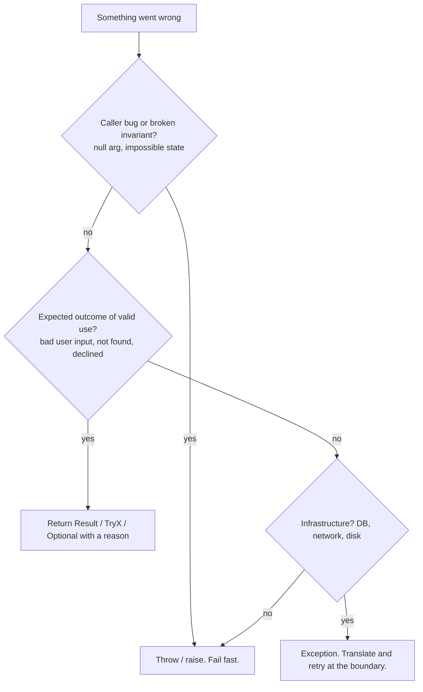
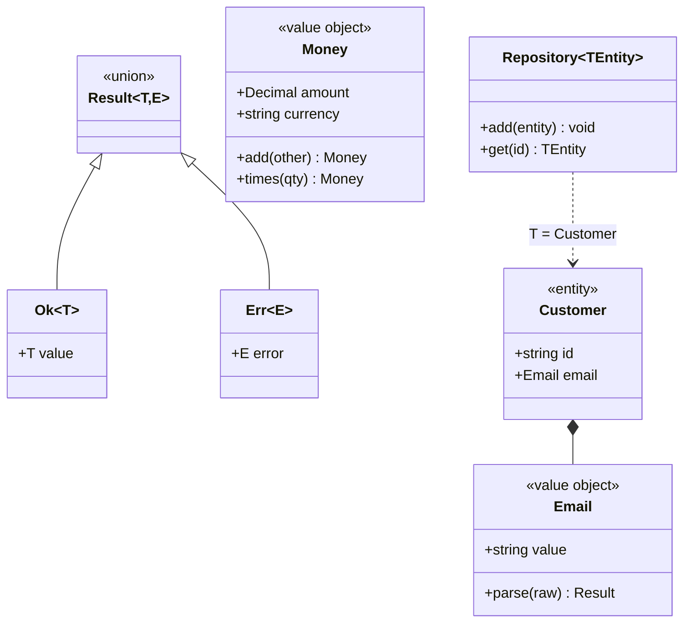

# Generics, Exceptions & Value Objects

> **Prerequisites:** [01 · Classes & Objects](../01-classes-objects-and-oop-building-blocks/README.md), [02 · OOP & UML](../02-oop-foundations-and-uml/README.md)  
> **Reading time:** ~25 minutes  
> **Audience:** LLD / machine-coding candidates who will be asked "what do you return when it fails?", "make this reusable for any type," and "is this an entity or a value object?"

> [!NOTE]
> **In one line:** **Generics** remove casts and duplicate code, an **error contract** (exception vs `Result`) tells callers exactly what can go wrong, and **value objects** (`Money`, `Email`) replace raw strings and floats with small immutable types that validate themselves.

> [!TIP]
> **Golden rule:** Bugs and broken infrastructure → **exceptions**. Expected outcomes (bad input, not found, declined) → **a typed result**. Never let a raw `str` / `decimal` carry domain meaning across a method boundary.

> [!TIP]
> **Try it:** Model `Customer → Email` and `Money` in [LLD Studio](/tools/lld-studio/), then run the registration example below and feed it a bad email.

---

## 1. When this shows up in an interview

Interviewer: *"Register a customer with an email. What happens on invalid input? Store them in a repository that works for any entity."*

**Smells that cost you points:**

- `email: str` passed through six layers, validated in two of them.
- `float price` and `"USD"` as separate parameters (**primitive obsession**).
- `raise Exception("error")` / `throw new Exception("error")` — callers cannot catch precisely.
- `except Exception: pass` or returning `None` / `null` with no reason.
- `throw ex;` (C#) destroying the stack trace.
- A `Repository` that takes and returns `object`, followed by casts.
- A value object with setters or a mutable list inside.





---

## 2. Generics: one definition, many types, no casts

| | Python | C# |
| :--- | :--- | :--- |
| **Declare** | `T = TypeVar("T")`; `class Box(Generic[T])` (3.12+: `class Box[T]:`) | `class Box<T>` |
| **Constrain** | `TypeVar("T", bound=HasId)` or `Protocol` | `where T : class, IHasId, new()` |
| **Checked by** | Static checker (`mypy`, `pyright`). **Erased at runtime** — `Box[int]("x")` still runs | Compiler **and** CLR: generics are reified, so `List<int>` and `List<string>` are distinct runtime types |
| **Variance** | Declared on the TypeVar (`covariant=True`); checker enforces | `out T` (producer, covariant), `in T` (consumer, contravariant) on interfaces / delegates |
| **Typical LLD uses** | `Repository[T]`, `Result[T, E]`, `Cache[K, V]` | `IRepository<T>`, `Result<T, E>`, `Cache<TKey, TValue>` |

**Why you care in an interview**

- A generic `Repository<T>` removes copy-paste across `Customer`, `Order`, `Product` repositories.
- A constraint (`where T : IHasId`) is how you say *"I need an `Id` to key this by"* — compile-time documentation.
- **Do not** make everything generic. One implementation, one entity? Write the concrete class.

---

## 3. Exceptions and error contracts

### Design rules

1. **Throw for violated preconditions and broken invariants** (null argument, negative quantity, mismatched currencies).
2. **Return a result for outcomes the caller should expect** (invalid email from a form, card declined, key missing).
3. **Use a domain hierarchy**, not bare `Exception`:

```text
DomainError (base)
 ├─ ValidationError       bad input the caller can fix
 ├─ NotFoundError
 └─ ConflictError         e.g. InsufficientFunds, DuplicateId
InfrastructureError       DB, network, timeouts → retry / translate at the boundary
```

4. **Carry data** (`balance`, `requested`) on the exception, not just a message string.
5. **Preserve the cause.** Python `raise DomainError("…") from original`; C# `throw new DomainException("…", inner)`; rethrow with plain `throw;` — never `throw ex;`.
6. **Catch narrowly.** A broad `catch (Exception)` belongs at a boundary (request handler, worker loop) that logs and translates — not in the middle of domain code.
7. **Clean up deterministically:** `with` / `try-finally` (Python), `using` / `try-finally` (C#).
8. **Be honest about cost.** In .NET and Java, throwing is slow (microseconds, stack trace capture), so exceptions-as-flow-control on a hot path hurts at thousands per second — use `TryParse` / `TryGetValue`. In Python, `try/except KeyError` is idiomatic (EAFP) and cheap when the exceptional case is rare; the rule there is *clarity*, not raw speed.

### Exception vs `Result`

| Aspect | Exception | `Result<T, E>` / `TryX` |
| :--- | :--- | :--- |
| **Intent** | "This should not happen" | "This can happen; handle it" |
| **Visibility** | Hidden in the signature | Visible in the return type |
| **Caller burden** | Easy to forget; surfaces at runtime | Caller must look at success vs error |
| **Best for** | Bugs, invariant violations, infrastructure | Parsing, validation, lookups, business refusals |
| **Idiom** | Both languages | Natural in C# (`TryParse`) and Go-like styles; unusual if overused in Python |

**Interview honesty:** many shops use exceptions for domain failures too. Either choice is acceptable if you **state the contract** and apply it consistently.

---

## 4. Value objects vs entities

| Dimension | Entity | Value object |
| :--- | :--- | :--- |
| **Identity** | Has an ID that survives changes | None — defined by its values |
| **Equality** | By ID | By all fields |
| **Mutability** | Changes over its lifetime | **Immutable**; a change creates a new object |
| **Examples** | `Customer(id)`, `Order(id)`, `Account(id)` | `Money`, `Email`, `Address`, `DateRange`, `Coordinates` |
| **Validation** | On every transition | **Once, in the constructor** — a valid `Email` can never be invalid |
| **Python tool** | Plain class | `@dataclass(frozen=True)` |
| **C# tool** | `class` with `Id` | `sealed record` (class) or `readonly record struct` |

Why immutable? If two objects share a mutable `Location` and one "moves", the other moves too. A value object is replaced, not edited.

---

## 5. Walkthrough: register a customer, price an order, store anything

**Requirements (keep tiny):**

1. Parse an email from user input; invalid input is an *expected* failure.
2. `Money` supports `add` and `times(qty)`; mixing currencies is a *programmer error*.
3. A generic repository stores any entity that has an `id`.

**Choices to say aloud:** `Email.parse` returns a `Result` (user input); `Money.add` throws on currency mismatch (code bug); `repo.add` throws on a duplicate that slipped past the pre-check (race or bug).

### Before (primitives, no contract)

```python
def register(customer_id, email, price, currency):
    if "@" not in email:
        return None                      # why? caller can't tell
    total = price * 3                    # float; currency forgotten
    db[customer_id] = {"email": email}   # dict of dicts; shape is a secret
```

### After

````carousel
```python
from __future__ import annotations

import re
from dataclasses import dataclass
from decimal import Decimal
from typing import Callable, Generic, Protocol, TypeVar, Union

T = TypeVar("T")
E = TypeVar("E")
U = TypeVar("U")


# ── Result ──────────────────────────────────────────────────────────────
@dataclass(frozen=True)
class Ok(Generic[T]):
    value: T

    def map(self, fn: Callable[[T], U]) -> "Ok[U]":
        return Ok(fn(self.value))


@dataclass(frozen=True)
class Err(Generic[E]):
    error: E

    def map(self, fn: Callable[[object], object]) -> "Err[E]":
        return self


Result = Union[Ok[T], Err[E]]


# ── Value objects ───────────────────────────────────────────────────────
class CurrencyMismatch(ValueError):
    pass


@dataclass(frozen=True)
class Money:
    amount: Decimal
    currency: str

    def __post_init__(self) -> None:
        if not isinstance(self.amount, Decimal):
            raise TypeError("amount must be Decimal")
        if self.amount < 0:
            raise ValueError("amount cannot be negative")
        if len(self.currency) != 3 or not self.currency.isalpha() or not self.currency.isupper():
            raise ValueError("currency must be a 3-letter upper-case code")

    def add(self, other: "Money") -> "Money":
        if other.currency != self.currency:
            raise CurrencyMismatch(f"{self.currency} vs {other.currency}")
        return Money(self.amount + other.amount, self.currency)

    def times(self, qty: int) -> "Money":
        if qty < 0:
            raise ValueError("qty cannot be negative")
        return Money(self.amount * qty, self.currency)


_EMAIL = re.compile(r"^[^@\s]+@[^@\s]+\.[^@\s]+$")


@dataclass(frozen=True)
class Email:
    value: str

    def __post_init__(self) -> None:
        if not _EMAIL.match(self.value) or self.value != self.value.lower():
            raise ValueError(f"invalid email: {self.value!r}")

    @staticmethod
    def parse(raw: str) -> Result["Email", str]:
        candidate = raw.strip().lower()
        if not _EMAIL.match(candidate):
            return Err("invalid email")
        return Ok(Email(candidate))


# ── Entity + generic repository ─────────────────────────────────────────
class HasId(Protocol):
    @property
    def id(self) -> str: ...


TEntity = TypeVar("TEntity", bound=HasId)


class DuplicateId(Exception):
    pass


class InMemoryRepository(Generic[TEntity]):
    def __init__(self) -> None:
        self._items: dict[str, TEntity] = {}

    def add(self, entity: TEntity) -> None:
        if entity.id in self._items:
            raise DuplicateId(entity.id)
        self._items[entity.id] = entity

    def get(self, entity_id: str) -> TEntity | None:
        return self._items.get(entity_id)

    def all(self) -> tuple[TEntity, ...]:
        return tuple(self._items.values())


@dataclass(frozen=True)
class Customer:
    id: str
    email: Email


def register(repo: InMemoryRepository[Customer], customer_id: str, raw_email: str) -> Result[Customer, str]:
    parsed = Email.parse(raw_email)
    if isinstance(parsed, Err):
        return parsed
    if repo.get(customer_id) is not None:
        return Err("customer id already exists")
    customer = Customer(customer_id, parsed.value)
    repo.add(customer)
    return Ok(customer)


if __name__ == "__main__":
    repo: InMemoryRepository[Customer] = InMemoryRepository()
    print(register(repo, "c1", "  Asha@Example.com "))      # Ok(value=Customer(id='c1', email=Email(value='asha@example.com')))
    print(register(repo, "c2", "not-an-email"))              # Err(error='invalid email')
    print(register(repo, "c1", "other@example.com"))         # Err(error='customer id already exists')

    price = Money(Decimal("19.99"), "USD")
    assert price.times(3) == Money(Decimal("59.97"), "USD")  # value equality
    try:
        price.add(Money(Decimal("1"), "EUR"))
    except CurrencyMismatch as exc:
        print("programmer error:", exc)
```
<!-- slide -->
```csharp
using System;
using System.Collections.Generic;
using System.Linq;
using System.Text.RegularExpressions;

// ── Result ──────────────────────────────────────────────────────────────
public abstract record Result<T, TError>
{
    private Result() { }
    public sealed record Ok(T Value) : Result<T, TError>;
    public sealed record Err(TError Error) : Result<T, TError>;
}

// ── Value objects ───────────────────────────────────────────────────────
public sealed class CurrencyMismatchException : InvalidOperationException
{
    public CurrencyMismatchException(string a, string b) : base($"{a} vs {b}") { }
}

public sealed record Money
{
    public decimal Amount { get; }
    public string Currency { get; }

    public Money(decimal amount, string currency)
    {
        if (amount < 0m) throw new ArgumentOutOfRangeException(nameof(amount), "amount cannot be negative");
        if (currency is null || currency.Length != 3 || !currency.All(c => c is >= 'A' and <= 'Z'))
            throw new ArgumentException("currency must be a 3-letter upper-case code", nameof(currency));
        Amount = amount;
        Currency = currency;
    }

    public Money Add(Money other)
    {
        if (other.Currency != Currency) throw new CurrencyMismatchException(Currency, other.Currency);
        return new Money(Amount + other.Amount, Currency);
    }

    public Money Times(int qty)
    {
        if (qty < 0) throw new ArgumentOutOfRangeException(nameof(qty));
        return new Money(Amount * qty, Currency);
    }
}

public sealed record Email
{
    private static readonly Regex Pattern = new(@"^[^@\s]+@[^@\s]+\.[^@\s]+$", RegexOptions.Compiled);

    public string Value { get; }
    private Email(string value) => Value = value;

    public static Result<Email, string> Parse(string? raw)
    {
        var candidate = (raw ?? "").Trim().ToLowerInvariant();
        return Pattern.IsMatch(candidate)
            ? new Result<Email, string>.Ok(new Email(candidate))
            : new Result<Email, string>.Err("invalid email");
    }
}

// ── Entity + generic repository ─────────────────────────────────────────
public interface IHasId { string Id { get; } }

public sealed record Customer(string Id, Email Email) : IHasId;

public sealed class InMemoryRepository<TEntity> where TEntity : class, IHasId
{
    private readonly Dictionary<string, TEntity> _items = new();

    public void Add(TEntity entity)
    {
        if (!_items.TryAdd(entity.Id, entity))
            throw new InvalidOperationException($"duplicate id {entity.Id}");
    }

    public TEntity? Get(string id) => _items.GetValueOrDefault(id);
    public IReadOnlyList<TEntity> All() => _items.Values.ToList();
}

public static class Registration
{
    public static Result<Customer, string> Register(
        InMemoryRepository<Customer> repo, string customerId, string rawEmail)
    {
        switch (Email.Parse(rawEmail))
        {
            case Result<Email, string>.Err err:
                return new Result<Customer, string>.Err(err.Error);
            case Result<Email, string>.Ok ok:
                if (repo.Get(customerId) is not null)
                    return new Result<Customer, string>.Err("customer id already exists");
                var customer = new Customer(customerId, ok.Value);
                repo.Add(customer);
                return new Result<Customer, string>.Ok(customer);
            default:
                throw new InvalidOperationException("unreachable");
        }
    }
}

public static class Program
{
    public static void Main()
    {
        var repo = new InMemoryRepository<Customer>();
        Console.WriteLine(Registration.Register(repo, "c1", "  Asha@Example.com "));
        Console.WriteLine(Registration.Register(repo, "c2", "not-an-email"));
        Console.WriteLine(Registration.Register(repo, "c1", "other@example.com"));

        var price = new Money(19.99m, "USD");
        Console.WriteLine(price.Times(3) == new Money(59.97m, "USD"));   // True: value equality
        try { price.Add(new Money(1m, "EUR")); }
        catch (CurrencyMismatchException ex) { Console.WriteLine($"programmer error: {ex.Message}"); }
    }
}
```
````

**What each piece buys you**

| Piece | Benefit |
| :--- | :--- |
| `Email` can only exist in valid, normalized form | No `if "@" in …` scattered across layers |
| `Result` return type | Caller *sees* that registration can fail, and why |
| `Money` carries currency | No float, no "forgot the currency" bug; equality by value |
| `Repository[T]` with a `HasId` bound | One implementation for every entity, still type-safe |
| Exceptions only for bugs | `CurrencyMismatch` and `DuplicateId` signal broken assumptions |

---

## 6. Edges interviewers push on

| Edge | What to say |
| :--- | :--- |
| **`throw ex;` vs `throw;`** | `throw ex;` resets the stack trace; use `throw;` to rethrow, or wrap with an inner exception |
| **`raise X from e`** | Keeps the original as `__cause__`; use `from None` only to hide noise deliberately |
| **Swallowed exceptions** | `except: pass` hides bugs. Log with context, or let it propagate to the boundary |
| **`finally` that returns** | A `return` in `finally` (Python) silently swallows in-flight exceptions — don't |
| **Async errors** | C#: `async void` can crash the process; await your tasks. Python: unawaited tasks log "never retrieved" |
| **Atomicity on failure** | Validate first, then mutate; or roll back. A half-applied operation is worse than a rejected one |
| **Generic erasure** | Python's `list[int]` is not enforced at runtime; C# generics are reified and enforced |
| **Variance** | `List<Dog>` is **not** a `List<Animal>` (writes would break it); `IEnumerable<Dog>` **is** an `IEnumerable<Animal>` (read-only, `out T`) |
| **Value object holding a collection** | A frozen dataclass with a `list` field is still mutable and unhashable — use `tuple` / `ImmutableArray` |
| **`decimal` equality** | `1.0m == 1.00m` is `true` but they format differently; normalize before display or hashing |
| **`default(Money)` for structs** | Skips your constructor. If invariants matter, use a `sealed record` class (as above) |
| **Overusing `Result`** | In Python, chains of `Ok/Err` can be less idiomatic than exceptions; pick the project convention and stay consistent |
| **Normalization** | Lowercasing the whole email is a policy choice (local part is technically case-sensitive); say so |

---

## 7. What you'd say in two minutes

> "I'd draw a line between three kinds of failure. Bugs and broken invariants — a null argument, mixing USD and EUR — throw. Infrastructure failures throw and I'd translate them at the boundary. Expected outcomes like a bad email from a form don't throw; `Email.parse` returns a `Result` with a reason, so the caller sees the failure in the type. `Email` and `Money` are immutable value objects validated in the constructor — equality by value, no setters — so the rest of the code never re-validates. `Customer` is an entity compared by ID. For storage I'd write a generic repository bound to something with an `id`; that removes duplicate repositories and the casts. Exceptions form a small domain hierarchy and carry data; I rethrow with `throw;`, wrap with a cause, and catch broadly only at the request boundary. In Python generics are checked statically; in C# they're enforced at runtime."

---

## 8. Anti-patterns

1. **Primitive obsession** — `str email`, `float price`, `str currency` everywhere; wrap them.
2. **`raise Exception("…")` / `throw new Exception("…")`** — no one can catch it precisely.
3. **Exceptions as normal flow** on hot paths (.NET/Java) — `TryParse` exists for a reason.
4. **Returning `None` / `null` for "failed"** with no reason — the caller guesses and crashes later.
5. **Catch-all and continue** — `except Exception: pass`.
6. **`throw ex;`** — destroys the original stack trace.
7. **Mutable value objects** or value objects with public setters — aliasing bugs and broken hashing.
8. **Generic everything** — `Repository<T, TKey, TContext, TSpec>` for a two-entity app; abstraction before need.

---

## 9. Interview questions

<details>
<summary><strong>1. Why use generics? [BASIC]</strong></summary>

One implementation works for many types with compile-time (or static-checker) type safety — no `object` casts, no duplicated `CustomerRepository` / `OrderRepository`. Constraints (`where T : IHasId`, `TypeVar(bound=…)`) state what the type must offer.

</details>

<details>
<summary><strong>2. Entity vs value object? [BASIC]</strong></summary>

An entity has identity that persists as its data changes (`Customer(id)`), compared by ID. A value object has no identity, is defined by its attributes, is immutable, and is compared by all fields (`Money`, `Email`, `Address`). Changing a value object means creating a new one.

</details>

<details>
<summary><strong>3. When do you throw and when do you return an error value? [BASIC]</strong></summary>

Throw for programmer errors and broken invariants (null argument, mismatched currencies) and infrastructure failures. Return a `Result` / `TryX` / `Optional` for outcomes a correct caller should expect: invalid user input, not found, payment declined. State the rule and be consistent.

</details>

<details>
<summary><strong>4. `throw;` vs `throw ex;` in C#? [BASIC]</strong></summary>

`throw;` rethrows the current exception preserving its original stack trace. `throw ex;` throws the same object but resets the trace to the current line, hiding where the failure began. To add context, wrap: `throw new DomainException("…", ex)`.

</details>

<details>
<summary><strong>5. Login with wrong password: exception or result? [SCENARIO]</strong></summary>

A wrong password is an **expected** outcome, so return `AuthResult.InvalidCredentials` (or a `Result`). Throwing makes a credential-stuffing attack also a stack-trace-generation load (a real concern in .NET/Java) and blurs "this was a normal refusal" with "something is broken." Use exceptions for the database being down.

</details>

<details>
<summary><strong>6. Build one `Repository<T>` for all entities. What constraints and pitfalls? [SCENARIO]</strong></summary>

Constraint: `T` must expose an ID (`IHasId` / `HasId` protocol), and in C# often `class` to allow `null` returns. Pitfalls: a generic CRUD repository leaks persistence concerns into the domain, makes each aggregate's special queries awkward, and tempts you to expose `IQueryable`. Keep a thin generic base and write specific repositories (`OrderRepository.find_open_for(customer)`) when behavior differs.

</details>

<details>
<summary><strong>7. Is `Address` an entity or a value object? [SCENARIO]</strong></summary>

Usually a **value object**: two customers at the same street don't share identity, and a move replaces the whole address. Store it embedded (columns or JSON) in the owning entity. It becomes an entity only if it has its own lifecycle — e.g. a warehouse location tracked independently with inventory attached.

</details>

<details>
<summary><strong>8. Can you pass a `List<Dog>` where a `List<Animal>` is expected? [TRICKY]</strong></summary>

No — generic collections are **invariant**: if the callee were allowed to `Add(new Cat())`, your `List<Dog>` would contain a cat. A read-only producer like `IEnumerable<out T>` is **covariant**, so `IEnumerable<Dog>` converts to `IEnumerable<Animal>`. In Python the static checker enforces the same rule (`list` is invariant, `Sequence` is covariant) but the runtime does not.

</details>

---

## 10. One-page cheat sheet

```text
Generics      One definition, many types, no casts. Constrain with bound= / where T :.
              Python: erased, static-checked.  C#: reified, runtime-enforced. Variance: out/in.
Exceptions    Bugs + invariants + infrastructure -> throw. Domain hierarchy, carry data, keep the cause.
              Rethrow with `throw;`  |  raise ... from e.  Catch broadly only at the boundary.
Result/TryX   Expected failures (input, not found, declined) -> typed result with a reason.
Value object  Immutable, validated in ctor, equal by fields.  Money, Email, Address, DateRange.
Entity        Has an ID, equal by ID, changes over time.
Repository    Generic base bound to "has an id"; specific repos for specific queries.
Smells        Primitive obsession, raise Exception, None-as-failure, throw ex, mutable VOs.

Interview opener: "Is this failure a bug, or a normal outcome? That decides exception vs result."
```

---

## Further reading

- [Python tutorial — Errors and Exceptions](https://docs.python.org/3/tutorial/errors.html) and [`typing` generics](https://docs.python.org/3/library/typing.html#generics)
- [.NET — Best practices for exceptions](https://learn.microsoft.com/en-us/dotnet/standard/exceptions/best-practices-for-exceptions)
- [C# generics](https://learn.microsoft.com/en-us/dotnet/csharp/fundamentals/types/generics) and [constraints on type parameters](https://learn.microsoft.com/en-us/dotnet/csharp/programming-guide/generics/constraints-on-type-parameters)
- [Martin Fowler — ValueObject](https://martinfowler.com/bliki/ValueObject.html)
- [Python `dataclasses`](https://docs.python.org/3/library/dataclasses.html) and [C# records](https://learn.microsoft.com/en-us/dotnet/csharp/language-reference/builtin-types/record)

## Next

**[04 · SOLID Principles](../04-solid-principles/README.md)** — one reason to change, extend by adding, honest subtypes, small interfaces, and dependency inversion.
