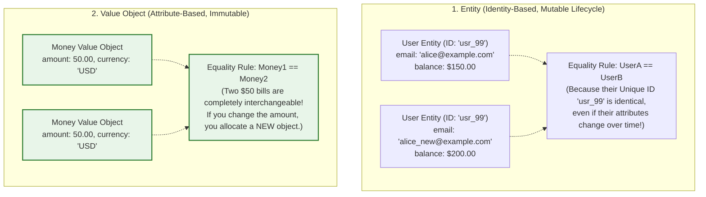
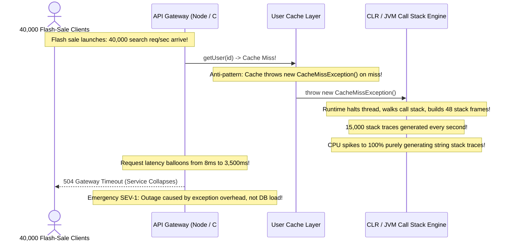

# Module 03: Generics, Exceptions, and Value Objects

> **Prerequisites:** Module 01 (Classes and Objects), Module 02 (OOP Foundations).  
> **Estimated Reading Time:** 25 minutes  
> **Target Audience:** Backend Developers, Domain-Driven Design (DDD) Practitioners, Low-Level Design Candidates.

> [!TIP]
> **The Golden Rule of Error Handling and Domain Modeling:** **Never use Exceptions for normal control flow.** Exceptions are intended for exceptional, unexpected system failures (database connection severed, disk full); throwing exceptions for routine business conditions (cache miss, user not found) incurs massive CPU overhead capturing call stack traces. Use the **Result Pattern (`Result<T, E>`)** for domain errors, and model domain attributes as **immutable Value Objects** defined strictly by their values rather than database IDs.

---

## 1. Architectural Mental Model: Entities vs. Value Objects

In Domain-Driven Design (DDD) and object-oriented architecture, domain classes are cleanly divided into **Entities** (identity-based) and **Value Objects** (attribute-based):



---

## 2. Taxonomic Reference: Entities vs. Value Objects

| Dimension | Entity | Value Object | Production Example |
| :--- | :--- | :--- | :--- |
| **Identity** | Has a persistent unique ID (`UUID`, DB primary key) | **No identity**. Defined purely by its attributes. | Entity: `Order(id="ord_101")`<br>Value Object: `Money(50, "USD")` |
| **Equality** | Compared by **ID** (`objA.Id == objB.Id`) | Compared by **all field values** | Value Object: `Address`, `Email`, `DateRange` |
| **Mutability** | State changes over time as operations occur | **Strictly Immutable**. Any change yields a new object. | `money.Add(other)` returns a brand new `Money` instance. |
| **Lifespan** | Long-lived; tracked in database tables | Ephemeral; stored embedded within Entity columns | In SQL: `users.street`, `users.city` embed `Address`. |

---

## 3. Systematic Breakdown: Exceptions vs. The Result Pattern

| Dimension | Exceptions (`throw new Exception()`) | Result Pattern (`Result<T, Error>`) |
| :--- | :--- | :--- |
| **Intended Purpose** | **Catastrophic / Unrecoverable System Failures** | **Expected Business / Domain Validations** |
| **Examples** | Database socket disconnect, hardware I/O error, OutOfMemory | User not found, validation error, card declined, cache miss |
| **Performance Cost** | **Heavy** (Captures entire stack trace, unwinds call frames) | **Zero overhead** (Standard return value on stack) |
| **Compiler Enforceability** | Often un-typed (easily forgotten until runtime crash) | **Type-enforced** (Caller is forced by compiler to check error) |
| **Code Readability** | Hidden non-local jumps (`goto`-like behavior) | Explicit, local, and linear execution flow |

---

## 4. Production War Story: The Exception-Driven Control Flow Outage



### The Incident
During a major Black Friday retail flash sale, a product catalog service experienced a complete collapse. Throughput plummeted from 40,000 requests per second to fewer than 500 req/s. CPU utilization pegged at 100% across all 40 cloud server instances, even though database queries and memory usage remained low.

### The Post-Mortem Data
* **Severity:** SEV-1 (Global Retail Platform Outage)
* **Mean Time to Detect (MTTD):** 15 minutes
* **Mean Time to Resolution (MTTR):** 35 minutes

### The Root Cause
The caching layer used an anti-pattern: **Exceptions for control flow**:
```csharp
// ❌ ANTI-PATTERN: Throwing an exception on an expected condition
public User GetUser(string id) {
    if (!_cache.TryGetValue(id, out var user)) {
        throw new CacheMissException(); // Generating 15,000 stack traces/sec!
    }
    return user;
}
```
When a cold cache received thousands of simultaneous requests, 15,000 exceptions were thrown per second. Generating and capturing call stack traces (walking the call stack, inspecting symbol tables, formatting line numbers) is one of the most computationally expensive operations in managed runtimes, starving CPU cores and grinding the service to a halt.

### The Fix & Hardening
1. **Refactor to the Tester-Doer / Result Pattern:**
```csharp
// ✅ PRODUCTION PATTERN: Return Option / bool without throwing
public bool TryGetUser(string id, out User user) {
    return _cache.TryGetValue(id, out user);
}
```
2. **Result Object for Complex Operations:** Return a lightweight `Result<T, E>` struct containing either the payload or a domain error enum, completely eliminating stack trace generation.

---

## 5. Multi-Language Production Code: Value Objects & The Result Pattern

Below is an enterprise implementation of an immutable `Money` Value Object and a generic `Result<T, E>` pattern across four backend languages.

### Python
```python
from __future__ import annotations
from dataclasses import dataclass
from decimal import Decimal
from typing import Generic, TypeVar, Optional, Union

T = TypeVar("T")
E = TypeVar("E")

# 1. Immutable Value Object
@dataclass(frozen=True)
class Money:
    amount: Decimal
    currency: str

    def __post_init__(self):
        if self.amount < Decimal("0.00"):
            raise ValueError("Money amount cannot be negative.")
        if not self.currency or len(self.currency) != 3:
            raise ValueError("Currency must be a 3-letter ISO code.")

    def add(self, other: Money) -> Money:
        if self.currency != other.currency:
            raise ValueError(f"Cannot add {self.currency} and {other.currency}")
        return Money(self.amount + other.amount, self.currency)

# 2. Generic Result Pattern
@dataclass(frozen=True)
class Result(Generic[T, E]):
    value: Optional[T] = None
    error: Optional[E] = None
    is_success: bool = True

    @staticmethod
    def ok(value: T) -> Result[T, E]:
        return Result(value=value, is_success=True)

    @staticmethod
    def fail(error: E) -> Result[T, E]:
        return Result(error=error, is_success=False)

if __name__ == "__main__":
    m1 = Money(Decimal("50.00"), "USD")
    m2 = Money(Decimal("25.00"), "USD")
    m3 = m1.add(m2)
    print(f"Total: ${m3.amount} {m3.currency}")
```

### C# (.NET)
```csharp
using System;

// Immutable Value Object using C# readonly record struct
public readonly record struct Money
{
    public decimal Amount { get; }
    public string Currency { get; }

    public Money(decimal amount, string currency)
    {
        if (amount < 0m) throw new ArgumentOutOfRangeException(nameof(amount), "Amount cannot be negative");
        if (string.IsNullOrWhiteSpace(currency) || currency.Length != 3) 
            throw new ArgumentException("Currency must be 3-letter ISO code", nameof(currency));

        Amount = amount;
        Currency = currency.ToUpperInvariant();
    }

    public Money Add(Money other)
    {
        if (Currency != other.Currency)
            throw new InvalidOperationException($"Cannot add {Currency} to {other.Currency}");
        return new Money(Amount + other.Amount, Currency);
    }
}

// Generic Lightweight Result Struct (Zero Heap Allocations!)
public readonly struct Result<T, TError>
{
    public bool IsSuccess { get; }
    public T Value { get; }
    public TError Error { get; }

    private Result(T value) { IsSuccess = true; Value = value; Error = default!; }
    private Result(TError error) { IsSuccess = false; Value = default!; Error = error; }

    public static Result<T, TError> Ok(T value) => new(value);
    public static Result<T, TError> Fail(TError error) => new(error);
}
```

### Go
```go
package main

import (
	"errors"
	"fmt"
)

// Immutable Value Object in Go
type Money struct {
	amountCents int64
	currency    string
}

func NewMoney(cents int64, currency string) (Money, error) {
	if cents < 0 {
		return Money{}, errors.New("money cannot be negative")
	}
	if len(currency) != 3 {
		return Money{}, errors.New("currency must be 3-letter ISO code")
	}
	return Money{amountCents: cents, currency: currency}, nil
}

func (m Money) Add(other Money) (Money, error) {
	if m.currency != other.currency {
		return Money{}, fmt.Errorf("currency mismatch: %s != %s", m.currency, other.currency)
	}
	return Money{amountCents: m.amountCents + other.amountCents, currency: m.currency}, nil
}

func (m Money) Display() string {
	return fmt.Sprintf("$%.2f %s", float64(m.amountCents)/100, m.currency)
}

func main() {
	m1, _ := NewMoney(5000, "USD")
	m2, _ := NewMoney(2500, "USD")
	m3, _ := m1.Add(m2)
	fmt.Println("Result:", m3.Display())
}
```

### TypeScript / Node.js
```typescript
export class Money {
  readonly #amountCents: bigint;
  readonly #currency: string;

  constructor(amountCents: bigint, currency: string) {
    if (amountCents < 0n) throw new Error('Amount cannot be negative');
    if (!currency || currency.length !== 3) throw new Error('Currency must be 3-letter ISO code');

    this.#amountCents = amountCents;
    this.#currency = currency.toUpperCase();
  }

  get amountCents(): bigint { return this.#amountCents; }
  get currency(): string { return this.#currency; }

  public equals(other: Money): boolean {
    return this.#amountCents === other.#amountCents && this.#currency === other.#currency;
  }

  public add(other: Money): Money {
    if (this.#currency !== other.#currency) {
      throw new Error(`Cannot add currency ${this.#currency} to ${other.#currency}`);
    }
    return new Money(this.#amountCents + other.#amountCents, this.#currency);
  }
}

// Discriminated Union Result Pattern
export type Result<T, E> = 
  | { success: true; value: T }
  | { success: false; error: E };
```

---

## 6. Practical Hands-On Verification CLI Workflows

Verify Value Object equality and immutability in your Ubuntu terminal:

### Workflow 1: Demonstrate Value Object Equality
```bash
python3 -c '
from dataclasses import dataclass

@dataclass(frozen=True)
class Coordinates:
    lat: float
    lon: float

c1 = Coordinates(37.7749, -122.4194)
c2 = Coordinates(37.7749, -122.4194)

print("Memory Addresses:", hex(id(c1)), hex(id(c2)))
print("Structural Equality (c1 == c2):", c1 == c2)

try:
    c1.lat = 40.7128 # Attempt mutation
except Exception as e:
    print("✅ Invariant: Value Object is strictly immutable:", type(e).__name__)
'
```
**Expected Output:**
```text
Memory Addresses: 0x7f... 0x7f... (Distinct memory locations!)
Structural Equality (c1 == c2): True
✅ Invariant: Value Object is strictly immutable: FrozenInstanceError
```

---

## 7. Operational Validation Checkpoint

<details>
<summary><strong>Question 1: Why Value Objects Must Be Immutable</strong></summary>

**Scenario:** In a ride-sharing service, `User` and `Driver` both hold a reference to the same `Location` Value Object (`{lat: 37.77, lon: -122.41}`). If `Location` was mutable, what critical concurrency bug occurs when the driver moves?

**Answer:**
If `Location` were mutable, when the driver moves and modifies `driver.location.lat = 37.78`, the user's location would **silently mutate in memory as well**, because both entities hold pointers to the same shared heap object (pointer aliasing). 

**The Rule:** Value Objects must be **strictly immutable**. When a driver moves, the system allocates a brand new `Location` instance and assigns it: `driver.location = new Location(37.78, -122.41)`. The customer's location remains completely unaffected.
</details>

<details>
<summary><strong>Question 2: Performance Cost of Exceptions in High-Throughput APIs</strong></summary>

**Scenario:** A candidate in an interview proposes: "Whenever a user submits invalid login credentials, our authentication service throws an `InvalidCredentialsException`, which is caught by a global controller advice that returns HTTP 401."

Why is this poor software design for an authentication endpoint subjected to high brute-force traffic?

**Answer:**
Throwing an exception forces the runtime engine (JVM, CLR, Python VM) to **suspend execution, walk the entire thread call stack, and construct a detailed stack trace array**. 

During a credential-stuffing attack where an attacker attempts 5,000 invalid logins per second, generating 5,000 stack traces per second will saturate CPU cores, causing a self-inflicted Denial of Service (DoS) for legitimate users. 

**Correct Design:** Return a domain `Result.Fail(AuthError.InvalidCredentials)` without throwing exceptions.
</details>

<details>
<summary><strong>Question 3: Entity vs. Value Object in Database Schema</strong></summary>

**Scenario:** You are designing a database schema for customer addresses (`Street`, `City`, `PostalCode`, `Country`). 
Should `Address` be an Entity with its own primary key table (`address_id`), or a Value Object embedded within the `users` table?

**Answer:**
Unless customers share and collaboratively edit global addresses, `Address` is fundamentally a **Value Object**:
* It has no independent lifecycle; if two users live at the same address, they do not share an identity.
* If a customer updates their address, they are not mutating a shared entity; they are replacing their address with a new value.
* **Database Representation:** Store address fields directly as embedded columns in the `users` table (`street`, `city`, `zip_code`), or serialize as a JSONB column.
</details>

---

## Next Step

Now that you understand Generics, Exceptions, and Value Objects, proceed to **[04 · SOLID Principles in Production](../04-solid-principles/README.md)** to master Single Responsibility, Open/Closed, Liskov Substitution, Interface Segregation, and Dependency Inversion.
