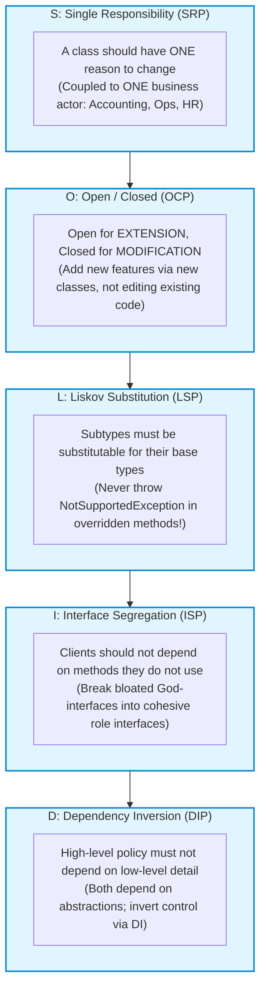
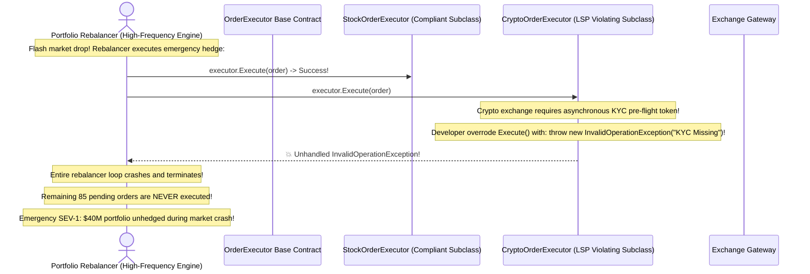

# Module 04: The SOLID Principles in Production

> **Prerequisites:** Module 01 (Classes and Objects), Module 02 (OOP Foundations and UML).  
> **Estimated Reading Time:** 30 minutes  
> **Target Audience:** Backend Developers, System Architects, Technical Interview Candidates.

> [!TIP]
> **The Golden Rule of SOLID Engineering:** The SOLID principles are not academic mantras; they are **economic defenses against coupling and change**. If modifying a business rule forces you to edit 12 different classes, or if adding a new payment provider requires editing an existing `switch` statement, your system has violated SOLID. Design to **depend on abstractions**, isolate responsibilities by **business actors**, and ensure **subtypes never break caller expectations**.

---

## 1. Architectural Mental Model: The SOLID Structural Defense

The five SOLID principles form a cohesive defensive perimeter protecting a codebase against fragility, rigidity, and immobility:



---

## 2. Taxonomic Reference: The SOLID Principles Deep-Dive

| Principle | Core Axiom | Warning Smell Indicating Violation | Architectural Remedy |
| :--- | :--- | :--- | :--- |
| **S: SRP** | *One reason to change.* | 2,000-line "God Classes" performing parsing, DB persistence, AND email delivery. | Split by Actor: separate `OrderRepository`, `OrderValidator`, and `OrderNotifier`. |
| **O: OCP** | *Open for extension; closed for modification.* | Giant `switch(paymentType)` or `if (type == "STRIPE")` statements that grow with every feature. | Polymorphic **Strategy Pattern**: implement an `IPaymentGateway` interface. |
| **L: LSP** | *Subtypes must honor base contracts.* | Subclass throws `NotSupportedException` or weakens preconditions (`if (x < 0)` allowed in parent, rejected in child). | Contract testing; replace faulty inheritance with composition. |
| **I: ISP** | *No forced interface dependencies.* | Classes implementing interfaces with 25 methods where 18 methods return dummy values or throw errors. | Segregate into granular **Role Interfaces** (`IReader`, `IWriter`, `IDeleter`). |
| **D: DIP** | *Depend on abstractions, not concretions.* | Business services instantiating concrete database connections directly (`new PostgresConnection()`). | **Inversion of Control (IoC)**: inject interfaces via constructor parameters. |

---

## 3. The LSP Violation Hall of Fame: Why "Square is a Rectangle" Fails

The classic geometric paradox demonstrates why intuitive real-world hierarchies fail in object-oriented software:

```
  MATHEMATICALLY: A Square IS A Rectangle (Width == Height).
  
  OBJECT-ORIENTED MODEL:
  class Rectangle {
      public virtual void SetWidth(int w) { width = w; }
      public virtual void SetHeight(int h) { height = h; }
  }

  class Square : Rectangle {
      public override void SetWidth(int w) { width = w; height = w; }
      public override void SetHeight(int h) { width = h; height = h; }
  }

  CALLER EXPECTATION:
  void Resize(Rectangle r) {
      r.SetWidth(5);
      r.SetHeight(4);
      Assert(r.GetArea() == 20); // 💥 FAILS! Square returns 16!
  }
```

Because `Square` altered the postcondition of `SetHeight` (which callers expect to leave width unchanged), it violates the **Liskov Substitution Principle**. Subclasses must satisfy the behavioral contracts of their parents.

---

## 4. Production War Story: The LSP Violation in High-Frequency Order Execution



### The Incident
During an extreme market volatility event, an automated quantitative portfolio rebalancer executed emergency hedging trades across multiple asset classes using an abstract base class `OrderExecutor`. 

When the rebalancer reached cryptocurrency assets, the `CryptoOrderExecutor` subclass threw an unhandled `InvalidOperationException("KYC Pre-flight required")`. Because the base class contract guaranteed that calling `Execute()` was safe for valid orders, the rebalancer had no exception handler at that layer. The entire loop terminated, freezing \$40M of customer portfolios while market prices plunged.

### The Post-Mortem Data
* **Severity:** SEV-1 (Catastrophic Trading Freeze)
* **Mean Time to Detect (MTTD):** 20 minutes
* **Mean Time to Resolution (MTTR):** 40 minutes

### The Root Cause
**Liskov Substitution Principle (LSP) Violation:** The author of `CryptoOrderExecutor` strengthened the preconditions for execution. The base contract stated: *"If order data is valid, execution proceeds."* The crypto subclass added an unannounced requirement for external KYC verification, throwing an exception rather than adhering to the base contract.

### The Fix & Hardening
1. **Adhere Strictly to Base Postconditions:** Subclasses must never introduce new runtime preconditions or throw unexpected exceptions.
2. **Interface Segregation:** Separate KYC-requiring assets into a distinct `IKycRequired` interface handled before execution.
3. **Automated Contract Testing:** Maintain parameterized unit tests that run the exact same test assertions against **every single implementation** of an interface to verify identical behavioral compliance.

---

## 5. Multi-Language Production Code: Refactoring to Clean SOLID Architecture

Below is an enterprise notification and order processing service cleanly refactored according to all five SOLID principles.

### Python
```python
from abc import ABC, abstractmethod
from typing import Protocol, List
from decimal import Decimal

# S & D: Abstractions for persistence and notification
class OrderRepository(Protocol):
    def save(self, order_id: str, amount: Decimal) -> None: ...

class NotificationSender(Protocol):
    def send(self, recipient: str, message: str) -> None: ...

# O & L: Open/Closed tax calculation strategies honoring LSP
class TaxStrategy(ABC):
    @abstractmethod
    def calculate_tax(self, subtotal: Decimal) -> Decimal:
        pass

class StandardTaxStrategy(TaxStrategy):
    def calculate_tax(self, subtotal: Decimal) -> Decimal:
        return subtotal * Decimal("0.08")

class ZeroTaxStrategy(TaxStrategy):
    def calculate_tax(self, subtotal: Decimal) -> Decimal:
        return Decimal("0.00")

# High-level business coordinator depending strictly on abstractions (DIP, SRP)
class OrderProcessor:
    def __init__(
        self,
        repository: OrderRepository,
        notifier: NotificationSender,
        tax_strategy: TaxStrategy
    ):
        self._repo = repository
        self._notifier = notifier
        self._tax = tax_strategy

    def process(self, order_id: str, customer_email: str, subtotal: Decimal) -> None:
        tax = self._tax.calculate_tax(subtotal)
        total = subtotal + tax
        
        self._repo.save(order_id, total)
        self._notifier.send(customer_email, f"Order {order_id} confirmed for ${total:.2f}")

if __name__ == "__main__":
    print("✅ SOLID Architecture verified in Python.")
```

### C# (.NET)
```csharp
using System;
using System.Threading.Tasks;

// I: Granular Role Interfaces (Interface Segregation)
public interface IOrderWriter
{
    Task SaveAsync(string orderId, decimal total);
}

public interface INotifier
{
    Task SendAsync(string recipient, string message);
}

// O & L: Open/Closed Tax Strategy honoring Liskov Substitution
public interface ITaxCalculator
{
    decimal Calculate(decimal subtotal);
}

public class DefaultTaxCalculator : ITaxCalculator
{
    public decimal Calculate(decimal subtotal) => subtotal * 0.08m;
}

// D: High-level policy depends strictly on injected interfaces (Dependency Inversion)
public class OrderService
{
    private readonly IOrderWriter _repository;
    private readonly INotifier _notifier;
    private readonly ITaxCalculator _taxCalculator;

    public OrderService(IOrderWriter repository, INotifier notifier, ITaxCalculator taxCalculator)
    {
        _repository = repository ?? throw new ArgumentNullException(nameof(repository));
        _notifier = notifier ?? throw new ArgumentNullException(nameof(notifier));
        _taxCalculator = taxCalculator ?? throw new ArgumentNullException(nameof(taxCalculator));
    }

    public async Task ProcessOrderAsync(string orderId, string email, decimal subtotal)
    {
        var total = subtotal + _taxCalculator.Calculate(subtotal);
        await _repository.SaveAsync(orderId, total);
        await _notifier.SendAsync(email, $"Order {orderId} processed successfully.");
    }
}
```

### Go
```go
package main

import (
	"context"
	"fmt"
)

// I: Single-method interfaces (ISP)
type OrderSaver interface {
	Save(ctx context.Context, orderID string, amount int64) error
}

type Notifier interface {
	Notify(ctx context.Context, recipient, msg string) error
}

// O: Open for extension via strategy interface
type TaxStrategy interface {
	Calculate(subtotalCents int64) int64
}

type FlatTax struct{}

func (f FlatTax) Calculate(subtotal int64) int64 {
	return (subtotal * 8) / 100
}

// D: OrderProcessor depends strictly on interfaces
type OrderProcessor struct {
	saver    OrderSaver
	notifier Notifier
	tax      TaxStrategy
}

func NewOrderProcessor(s OrderSaver, n Notifier, t TaxStrategy) *OrderProcessor {
	return &OrderProcessor{saver: s, notifier: n, tax: t}
}

func main() {
	fmt.Println("✅ Go structural typing satisfies SOLID principles natively.")
}
```

### TypeScript / Node.js
```typescript
// I: Granular Interfaces
interface OrderStore {
  save(orderId: string, totalCents: bigint): Promise<void>;
}

interface NotificationService {
  notify(email: string, body: string): Promise<void>;
}

interface TaxCalculator {
  calculateTax(subtotalCents: bigint): bigint;
}

// D: Injected dependencies
export class OrderCoordinator {
  constructor(
    private readonly store: OrderStore,
    private readonly notifier: NotificationService,
    private readonly tax: TaxCalculator
  ) {}

  public async completeOrder(orderId: string, email: string, subtotal: bigint): Promise<void> {
    const taxAmount = this.tax.calculateTax(subtotal);
    const total = subtotal + taxAmount;

    await this.store.save(orderId, total);
    await this.notifier.notify(email, `Order ${orderId} confirmed for total ${total}`);
  }
}
```

---

## 6. Practical Hands-On Verification CLI Workflows

Verify Liskov Substitution Principle compliance with Python `assert`:

### Workflow 1: Execute Contract Invariance Tests
```bash
python3 -c '
class BaseTax:
    def calculate(self, amount: float) -> float:
        assert amount >= 0, "Precondition violated"
        return amount * 0.10

class BrokenTax(BaseTax):
    def calculate(self, amount: float) -> float:
        # LSP VIOLATION: Strengthening precondition!
        if amount > 1000:
            raise ValueError("Amounts over $1000 forbidden!")
        return super().calculate(amount)

def verify_liskov(tax_calculator: BaseTax):
    # Test suite contract: Must process $5,000 without exception
    res = tax_calculator.calculate(5000.0)
    print("Contract honored: Tax =", res)

verify_liskov(BaseTax())
try:
    verify_liskov(BrokenTax())
except ValueError as e:
    print("🚨 LSP VIOLATION DETECTED:", e)
'
```
**Expected Output:**
```text
Contract honored: Tax = 500.0
🚨 LSP VIOLATION DETECTED: Amounts over $1000 forbidden!
```

---

## 7. Operational Validation Checkpoint

<details>
<summary><strong>Question 1: Single Responsibility Principle and "Reasons to Change"</strong></summary>

**Scenario:** A developer shows you a class: `Employee`. It has three methods:
1. `calculatePay()` (Used by Accounting / CFO)
2. `reportHours()` (Used by HR / COO)
3. `saveEmployee()` (Used by Database Administrators / CTO)

The developer argues: "This obeys SRP because all three methods belong to an Employee." 
Why is this an architectural violation of SRP?

**Answer:**
Robert C. Martin's definition of Single Responsibility is: **"A module should be responsible to one, and only one, actor."**

The three methods serve three completely different corporate actors (CFO, COO, CTO):
* If Accounting changes how overtime pay is calculated in `calculatePay()`, an accidental side effect could break `reportHours()`, disrupting HR payroll reports.
* The class has **three reasons to change**. 

**The Remedy:** Separate into three cohesive classes: `PayCalculator`, `HourReporter`, and `EmployeeRepository`.
</details>

<details>
<summary><strong>Question 2: Dependency Inversion vs. Dependency Injection</strong></summary>

**Scenario:** In an interview, a candidate says: "Dependency Inversion Principle (DIP) and Dependency Injection (DI) are the exact same thing."

Is the candidate correct? What is the fundamental difference?

**Answer:**
**The candidate is incorrect:**
* **Dependency Inversion Principle (DIP)** is a high-level **architectural design principle**: it states that high-level modules should not depend on low-level modules; both should depend on abstractions (interfaces).
* **Dependency Injection (DI)** is a concrete **implementation technique / design pattern** used to fulfill DIP: passing dependencies into an object via constructor or setter rather than letting the object instantiate them with `new`. 

You can use Dependency Injection without Dependency Inversion (e.g. injecting a concrete `PostgresDatabase` class directly). DIP specifically mandates that the injected parameter must be an **abstraction (interface)**.
</details>

<details>
<summary><strong>Question 3: Identifying Interface Segregation Principle (ISP) Violations</strong></summary>

**Scenario:** You inspect a codebase and find:
```csharp
public interface IUserRepository {
    User GetById(string id);
    void Save(User user);
    void Delete(string id);
    void GeneratePdfReport(string id); // 🚩
    void SendWelcomeEmail(string email); // 🚩
}
```
Why does this violate ISP, and how does it hurt client code?

**Answer:**
It violates **Interface Segregation Principle (ISP)** because it forces clients that only need to read a user (`GetById`) to depend on PDF generation libraries and SMTP email clients. 

If a mock repository is written for a unit test, the developer is forced to provide dummy implementations for `GeneratePdfReport` and `SendWelcomeEmail`. 

**The Fix:** Split into focused role interfaces:
* `IUserRepository` (`GetById`, `Save`, `Delete`)
* `IUserReportGenerator` (`GeneratePdfReport`)
* `IUserNotifier` (`SendWelcomeEmail`)
</details>

---

## Further Reading & Sources

- [Robert C. Martin: The Principles of OOD (the original SOLID essays)](https://web.archive.org/web/20150906155800/http://www.objectmentor.com/resources/articles/Principles_and_Patterns.pdf) - the source material SOLID is drawn from.
- [Clean Architecture by Robert C. Martin](https://www.oreilly.com/library/view/clean-architecture-a/9780134494272/) - authoritative guide on component principles and dependency boundaries.

---

## Next Step

Now that you understand the SOLID principles, proceed to **[05 · Core Design Principles: DRY, KISS, YAGNI, and Law of Demeter](../05-core-design-principles/README.md)** to master everyday architectural heuristics and avoid over-engineering traps.
