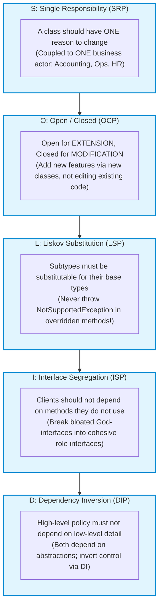
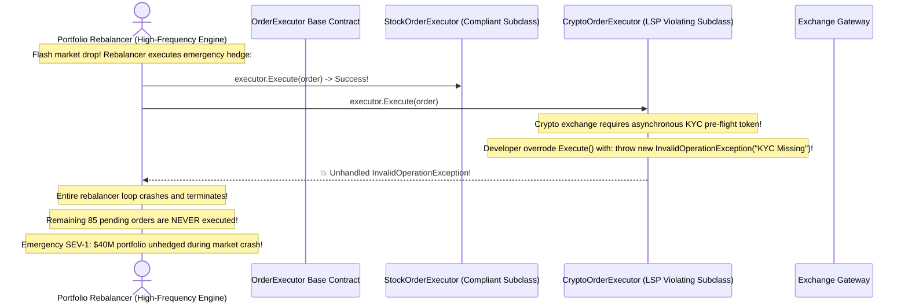

# Module 04: The SOLID Principles in Production

> **Prerequisites:** Module 01 (Classes and Objects), Module 02 (OOP Foundations and UML).  
> **Estimated Reading Time:** 30 minutes  
> **Target Audience:** Backend Developers, System Architects, Technical Interview Candidates.

> [!NOTE]
> **In one line:** The SOLID principles are five architectural heuristics (Single Responsibility, Open/Closed, Liskov Substitution, Interface Segregation, Dependency Inversion) designed to minimize coupling, isolate changes to single business actors, and keep enterprise codebases maintainable under continuous feature growth.

> [!TIP]
> **The Golden Rule of SOLID Engineering:** The SOLID principles are not academic mantras; they are **economic defenses against coupling and change**. If modifying a business rule forces you to edit 12 different classes, or if adding a new payment provider requires editing an existing `switch` statement, your system has violated SOLID. Design to **depend on abstractions**, isolate responsibilities by **business actors**, and ensure **subtypes never break caller expectations**.

---

## 1. Architectural Mental Model: The SOLID Structural Defense

The five SOLID principles form a cohesive defensive perimeter protecting a codebase against fragility, rigidity, and immobility:



---

## 2. Taxonomic Reference: The SOLID Principles Deep-Dive

| Principle | Core Axiom | Warning Smell Indicating Violation | Architectural Remedy |
| :--- | :--- | :--- | :--- |
| **S: SRP** | *One reason to change.* | 2,000-line "God Classes" performing parsing, DB persistence, AND email delivery. | Split by Actor: separate `OrderRepository`, `OrderValidator`, and `OrderNotifier`. |
| **O: OCP** | *Open for extension; closed for modification.* | Giant `switch(paymentType)` or `if (type == "STRIPE")` statements that grow with every feature. | Polymorphic **Strategy Pattern**: implement an `IPaymentGateway` interface. |
| **L: LSP** | *Subtypes must honor base contracts.* | Subclass throws `NotSupportedException` or weakens preconditions (`if (x < 0)` allowed in parent, rejected in child). | Contract testing; replace faulty inheritance with composition. |
| **I: ISP** | *No forced interface dependencies.* | Classes implementing interfaces with 25 methods where 18 methods return dummy values or throw errors. | Segregate into granular **Role Interfaces** (`IReader`, `IWriter`, `IDeleter`). |
| **D: DIP** | *Depend on abstractions, not concretions.* | Business services instantiating concrete database connections directly (`new PostgresConnection()`). | **Inversion of Control (IoC)**: inject interfaces via constructor parameters. |

---

## 3. Formal Architectural Models: Behavioral Subtyping & Coupling Metrics

The SOLID principles are grounded in mathematical formalisms of type theory and software package dynamics.

### Formal Behavioral Subtyping (Liskov & Wing, 1994)

Let $\phi(x)$ be a property provable about objects $x$ of type $T$. Then $\phi(y)$ must be true for objects $y$ of type $S$, where $S$ is a subtype of $T$:

$$\forall x \in T.\, \phi(x) \implies \forall y \in S.\, \phi(y)$$

To guarantee substitution without breaking caller expectations, four formal contract rules must hold:

1. **Precondition Invariance:** A subtype cannot strengthen preconditions:
   $$\text{Pre}_T \implies \text{Pre}_S \quad (\text{or } \text{Pre}_S \subseteq \text{Pre}_T)$$
   *If a base method accepts any integer $n \ge 0$, an override cannot restrict inputs to $0 \le n \le 1,000$.*
2. **Postcondition Invariance:** A subtype cannot weaken postconditions:
   $$\text{Post}_S \implies \text{Post}_T \quad (\text{or } \text{Post}_T \subseteq \text{Post}_S)$$
   *If a base method guarantees returning a non-empty list, an override cannot return `null` or empty.*
3. **Class Invariant Rule:** Subtype methods must preserve all invariants of the supertype:
   $$\text{Inv}_S \implies \text{Inv}_T$$
4. **History Constraint (Immutability):** If a supertype is immutable, the subtype cannot introduce mutability methods that alter state observable through base methods.

---

### Package Coupling & The Main Sequence Metrics (Robert C. Martin)

To objectively evaluate whether a codebase satisfies Dependency Inversion and Single Responsibility across module boundaries, we calculate three structural metrics:

1. **Afferent Coupling ($C_a$):** Number of external classes that depend upon classes within this package (incoming dependencies).
2. **Efferent Coupling ($C_e$):** Number of external classes that classes within this package depend upon (outgoing dependencies).
3. **Instability Metric ($I$):**
   $$I = \frac{C_e}{C_a + C_e}, \quad I \in [0, 1]$$
   - $I = 0$ (Maximally Stable): Many dependents ($C_a > 0$), depends on no one ($C_e = 0$). Hard to change without breaking upstreams (e.g., standard libraries).
   - $I = 1$ (Maximally Unstable): Depends on many ($C_e > 0$), no dependents ($C_a = 0$). Easy to modify with zero downstream ripple effect (e.g., top-level UI or CLI runners).

4. **Abstractness Metric ($A$):**
   $$A = \frac{N_a}{N_c}, \quad A \in [0, 1]$$
   where $N_a$ is the count of abstract classes/interfaces, and $N_c$ is the total class count.

5. **Distance from the Main Sequence ($D$):**
   $$D = |A + I - 1|, \quad D \in [0, 1]$$

```text
Abstractness (A)
  1.0 ^ [Zone of Uselessness]
      |   \ (A=1, I=1: pure abstractions nobody uses)
      |     \
      |       \   <--- Ideal Line: The Main Sequence (A + I = 1, D = 0)
      |         \
      |           \
  0.0 +-------------\--------> Instability (I)
     [Zone of Pain]   1.0
     (A=0, I=0: rigid concrete classes that everyone depends on)
```

- **The Main Sequence ($A + I = 1$):** Stable packages ($I \to 0$) should be abstract ($A \to 1$), while unstable/flexible packages ($I \to 1$) can safely be concrete ($A \to 0$).
- **The Zone of Pain ($A \to 0, I \to 0$):** High stability combined with zero abstraction. Highly rigid; changing one line triggers mass recompilation across dozens of services.
- **The Zone of Uselessness ($A \to 1, I \to 1$):** Pure interfaces that have no incoming callers or implementations. Over-engineered fluff.

---

## 4. The LSP Violation Hall of Fame: Why "Square is a Rectangle" Fails

The classic geometric paradox demonstrates why intuitive real-world hierarchies fail in object-oriented software:

```
  MATHEMATICALLY: A Square IS A Rectangle (Width == Height).
  
  OBJECT-ORIENTED MODEL:
  class Rectangle {
      public virtual void SetWidth(int w) { width = w; }
      public virtual void SetHeight(int h) { height = h; }
  }

  class Square : Rectangle {
      public override void SetWidth(int w) { width = w; height = w; }
      public override void SetHeight(int h) { width = h; height = h; }
  }

  CALLER EXPECTATION:
  void Resize(Rectangle r) {
      r.SetWidth(5);
      r.SetHeight(4);
      Assert(r.GetArea() == 20); // 💥 FAILS! Square returns 16!
  }
```

Because `Square` altered the postcondition of `SetHeight` (which callers expect to leave width unchanged), it violates the **Liskov Substitution Principle**. Subclasses must satisfy the behavioral contracts of their parents.

---

## 5. Production War Story: The LSP Violation in High-Frequency Order Execution



### The Incident
During an extreme market volatility event, an automated quantitative portfolio rebalancer executed emergency hedging trades across multiple asset classes using an abstract base class `OrderExecutor`. 

When the rebalancer reached cryptocurrency assets, the `CryptoOrderExecutor` subclass threw an unhandled `InvalidOperationException("KYC Pre-flight required")`. Because the base class contract guaranteed that calling `Execute()` was safe for valid orders, the rebalancer had no exception handler at that layer. The entire loop terminated, freezing \$40M of customer portfolios while market prices plunged.

### The Post-Mortem Data
* **Severity:** SEV-1 (Catastrophic Trading Freeze)
* **Mean Time to Detect (MTTD):** 20 minutes
* **Mean Time to Resolution (MTTR):** 40 minutes

### The Root Cause
**Liskov Substitution Principle (LSP) Violation:** The author of `CryptoOrderExecutor` strengthened the preconditions for execution. The base contract stated: *"If order data is valid, execution proceeds."* The crypto subclass added an unannounced requirement for external KYC verification, throwing an exception rather than adhering to the base contract.

### The Fix & Hardening
1. **Adhere Strictly to Base Postconditions:** Subclasses must never introduce new runtime preconditions or throw unexpected exceptions.
2. **Interface Segregation:** Separate KYC-requiring assets into a distinct `IKycRequired` interface handled before execution.
3. **Automated Contract Testing:** Maintain parameterized unit tests that run the exact same test assertions against **every single implementation** of an interface to verify identical behavioral compliance.

---

## 6. Multi-Language Production Code: Refactoring to Clean SOLID Architecture

Below is an enterprise notification and order processing service cleanly refactored according to all five SOLID principles.

````carousel
```python
from abc import ABC, abstractmethod
from decimal import Decimal
from typing import Protocol

# S & D: Abstractions for persistence and notification (Interface Segregation & Dependency Inversion)
class OrderRepository(Protocol):
    def save(self, order_id: str, amount: Decimal) -> None: ...

class NotificationSender(Protocol):
    def send(self, recipient: str, message: str) -> None: ...

# O & L: Open/Closed tax calculation strategies honoring LSP
class TaxStrategy(ABC):
    @abstractmethod
    def calculate_tax(self, subtotal: Decimal) -> Decimal:
        pass

class StandardTaxStrategy(TaxStrategy):
    def calculate_tax(self, subtotal: Decimal) -> Decimal:
        return subtotal * Decimal("0.08")

class ZeroTaxStrategy(TaxStrategy):
    def calculate_tax(self, subtotal: Decimal) -> Decimal:
        return Decimal("0.00")

# High-level business coordinator depending strictly on abstractions (DIP, SRP)
class OrderProcessor:
    def __init__(
        self,
        repository: OrderRepository,
        notifier: NotificationSender,
        tax_strategy: TaxStrategy,
    ):
        self._repo = repository
        self._notifier = notifier
        self._tax = tax_strategy

    def process(self, order_id: str, customer_email: str, subtotal: Decimal) -> None:
        tax = self._tax.calculate_tax(subtotal)
        total = subtotal + tax
        self._repo.save(order_id, total)
        self._notifier.send(customer_email, f"Order {order_id} confirmed for ${total:.2f}")

if __name__ == "__main__":
    print("SOLID Architecture verified in Python.")
```

<!-- slide -->

```csharp
using System;
using System.Threading.Tasks;

// I: Granular Role Interfaces (Interface Segregation)
public interface IOrderWriter
{
    Task SaveAsync(string orderId, decimal total);
}

public interface INotifier
{
    Task SendAsync(string recipient, string message);
}

// O & L: Open/Closed Tax Strategy honoring Liskov Substitution
public interface ITaxCalculator
{
    decimal Calculate(decimal subtotal);
}

public class DefaultTaxCalculator : ITaxCalculator
{
    public decimal Calculate(decimal subtotal) => subtotal * 0.08m;
}

// D: High-level policy depends strictly on injected interfaces (Dependency Inversion)
public class OrderService
{
    private readonly IOrderWriter _repository;
    private readonly INotifier _notifier;
    private readonly ITaxCalculator _taxCalculator;

    public OrderService(IOrderWriter repository, INotifier notifier, ITaxCalculator taxCalculator)
    {
        _repository = repository ?? throw new ArgumentNullException(nameof(repository));
        _notifier = notifier ?? throw new ArgumentNullException(nameof(notifier));
        _taxCalculator = taxCalculator ?? throw new ArgumentNullException(nameof(taxCalculator));
    }

    public async Task ProcessOrderAsync(string orderId, string email, decimal subtotal)
    {
        var total = subtotal + _taxCalculator.Calculate(subtotal);
        await _repository.SaveAsync(orderId, total);
        await _notifier.SendAsync(email, $"Order {orderId} processed successfully.");
    }
}
```

<!-- slide -->

```go
package main

import (
	"context"
	"fmt"
)

// I: Single-method interfaces (ISP)
type OrderSaver interface {
	Save(ctx context.Context, orderID string, amount int64) error
}

type Notifier interface {
	Notify(ctx context.Context, recipient, msg string) error
}

// O: Open for extension via strategy interface
type TaxStrategy interface {
	Calculate(subtotalCents int64) int64
}

type FlatTax struct{}

func (f FlatTax) Calculate(subtotal int64) int64 {
	return (subtotal * 8) / 100
}

// D: OrderProcessor depends strictly on interfaces
type OrderProcessor struct {
	saver    OrderSaver
	notifier Notifier
	tax      TaxStrategy
}

func NewOrderProcessor(s OrderSaver, n Notifier, t TaxStrategy) *OrderProcessor {
	return &OrderProcessor{saver: s, notifier: n, tax: t}
}

func main() {
	fmt.Println("Go structural typing satisfies SOLID principles natively.")
}
```

<!-- slide -->

```typescript
// I: Granular Interfaces
interface OrderStore {
  save(orderId: string, totalCents: bigint): Promise<void>;
}

interface NotificationService {
  notify(email: string, body: string): Promise<void>;
}

interface TaxCalculator {
  calculateTax(subtotalCents: bigint): bigint;
}

// D: Injected dependencies
export class OrderCoordinator {
  constructor(
    private readonly store: OrderStore,
    private readonly notifier: NotificationService,
    private readonly tax: TaxCalculator
  ) {}

  public async completeOrder(orderId: string, email: string, subtotal: bigint): Promise<void> {
    const taxAmount = this.tax.calculateTax(subtotal);
    const total = subtotal + taxAmount;

    await this.store.save(orderId, total);
    await this.notifier.notify(email, `Order ${orderId} confirmed for total ${total}`);
  }
}
```
````

---

## 7. Practical Hands-On Verification CLI Workflows

Verify Liskov Substitution Principle compliance with Python `assert`:

### Workflow 1: Execute Contract Invariance Tests
```bash
python3 -c '
class BaseTax:
    def calculate(self, amount: float) -> float:
        assert amount >= 0, "Precondition violated"
        return amount * 0.10

class BrokenTax(BaseTax):
    def calculate(self, amount: float) -> float:
        # LSP VIOLATION: Strengthening precondition!
        if amount > 1000:
            raise ValueError("Amounts over $1000 forbidden!")
        return super().calculate(amount)

def verify_liskov(tax_calculator: BaseTax):
    # Test suite contract: Must process $5,000 without exception
    res = tax_calculator.calculate(5000.0)
    print("Contract honored: Tax =", res)

verify_liskov(BaseTax())
try:
    verify_liskov(BrokenTax())
except ValueError as e:
    print("🚨 LSP VIOLATION DETECTED:", e)
'
```
**Expected Output:**
```text
Contract honored: Tax = 500.0
🚨 LSP VIOLATION DETECTED: Amounts over $1000 forbidden!
```

---

## 8. Operational Validation Checkpoint & 12 Interview Practice Questions

Each question is tagged by kind: **Basic** (definitions), **Scenario** (apply it to a system), and **Tricky** (deep follow-ups). Answer out loud before opening the solution.

<details>
<summary><strong>1. What is the true definition of Single Responsibility Principle (SRP), and how does it differ from "a function should do only one thing"? [BASIC]</strong></summary>

<strong>What a strong answer covers:</strong>
Robert C. Martin's definition is: **"A module should be responsible to one, and only one, actor."**
- "A function should do only one thing" is a clean code heuristic for algorithmic clarity.
- SRP is an **architectural coupling heuristic**: a module should not group behaviors that serve different stakeholders or business actors (e.g., CFO/Accounting vs. HR vs. Database Admins). Grouping them couples independent business changes, so an edit to payroll logic risks breaking HR reporting.

</details>

<details>
<summary><strong>2. What is the Open/Closed Principle (OCP), and how does the Strategy pattern achieve extension without modification? [BASIC]</strong></summary>

<strong>What a strong answer covers:</strong>
Software entities should be **open for extension, but closed for modification**:
- You should be able to add new application behaviors without touching existing, tested source code.
- With the **Strategy Pattern**, a context class depends on an abstract interface (e.g. `IPaymentGateway`). Adding a new payment provider (e.g., Crypto or Apple Pay) involves creating a new implementation class (`ApplePayGateway : IPaymentGateway`) and injecting it, without modifying the existing checkout service or adding `switch/case` statements.

</details>

<details>
<summary><strong>3. What is the formal definition of Liskov Substitution Principle (LSP), and why does "Square extends Rectangle" mathematically violate it? [BASIC]</strong></summary>

<strong>What a strong answer covers:</strong>
Let $\phi(x)$ be a property provable about objects $x$ of type $T$. Then $\phi(y)$ must hold for objects $y$ of type $S$ where $S$ is a subtype of $T$.
- Mathematically, a square is a rectangle with equal sides.
- In software, a `Rectangle` has independent mutators: `SetWidth(w)` changes width while leaving height invariant.
- If `Square` overrides `SetHeight(h)` to set both width and height to $h$, it violates the postcondition of the base class. A caller asserting that resizing height leaves width unchanged fails (`Assert(rect.Width == originalWidth)`). Thus, `Square` is not behaviorally substitutable for `Rectangle`.

</details>

<details>
<summary><strong>4. What is the fundamental difference between Dependency Inversion Principle (DIP), Inversion of Control (IoC), and Dependency Injection (DI)? [BASIC]</strong></summary>

<strong>What a strong answer covers:</strong>
- **Dependency Inversion Principle (DIP):** The high-level architectural principle stating that high-level modules should not depend on low-level modules; both must depend on abstractions.
- **Inversion of Control (IoC):** The broad architectural pattern where the framework or runtime controls program flow rather than custom procedural code (Hollywood Principle: *"Don't call us, we'll call you"*).
- **Dependency Injection (DI):** The concrete design pattern/technique used to deliver dependencies into an object (via constructor, property, or method parameters) rather than letting the object instantiate them with `new`.

</details>

<details>
<summary><strong>5. You have a NotificationService sending SMS and Email. A new requirement introduces WhatsApp and Slack. How do you implement this adhering to OCP without editing existing code? [SCENARIO]</strong></summary>

<strong>What a strong answer covers:</strong>
1. Define a cohesive abstraction: `INotificationChannel` with method `SendAsync(NotificationMessage msg)`.
2. Existing implementations `SmsChannel` and `EmailChannel` implement this interface.
3. High-level `NotificationDispatcher` accepts an injected collection `IEnumerable<INotificationChannel>`.
4. When adding WhatsApp and Slack, author `WhatsAppChannel` and `SlackChannel` in new files, and register them with the DI container. The `NotificationDispatcher` executes them polymorphically with zero modifications to existing classes.

</details>

<details>
<summary><strong>6. You inherit an IUserRepository containing 25 methods including SaveUser, GeneratePdfReport, and SendSlackAlert. How do you refactor this to adhere to ISP without breaking existing callers? [SCENARIO]</strong></summary>

<strong>What a strong answer covers:</strong>
1. Break the bloated interface into granular role interfaces: `IUserPersistence` (`Save`, `GetById`), `IUserReporting` (`GeneratePdfReport`), and `IUserAlerting` (`SendSlackAlert`).
2. Maintain backward compatibility during transition by having the existing concrete repository implement all three interfaces.
3. Update consuming client classes one by one so each client depends only on the specific interface it requires (e.g. `UserReaderService` takes only `IUserPersistence`).
4. Deprecate the original fat `IUserRepository`.

</details>

<details>
<summary><strong>7. An OrderExecutor base class defines Execute(Order o). A CryptoOrderExecutor subclass throws InvalidOperationException("KYC Missing"). How does this violate LSP, and how should it be redesigned? [SCENARIO]</strong></summary>

<strong>What a strong answer covers:</strong>
It violates LSP by **strengthening preconditions**: the base class contract guarantees that valid orders will execute, but the subclass introduces an unexpected prerequisite (KYC pre-flight token), crashing callers that do not catch this custom exception.
**Redesign:**
1. Separate verification from execution using composition: pass an `IKycValidator` to check readiness before invoking the executor.
2. Alternatively, return a polymorphic result object (`ExecutionResult { IsSuccess, ErrorCode, RequiredAction }`) so failure cases are explicitly part of the base contract rather than unhandled runtime exceptions.

</details>

<details>
<summary><strong>8. In an enterprise system, high-level business services instantiate concrete database repositories directly (new PostgresOrderRepository()). How does this violate DIP, and how do you wire it cleanly with constructor injection? [SCENARIO]</strong></summary>

<strong>What a strong answer covers:</strong>
Instantiating concrete classes via `new` tightly couples high-level business policy directly to low-level persistence mechanisms (database driver, SQL schema, connection pools), making unit testing impossible without a live Postgres instance and preventing persistence migration.
**Refactoring:**
1. Introduce an interface owned by the domain layer: `IOrderRepository`.
2. Move `PostgresOrderRepository` to the infrastructure layer, implementing `IOrderRepository`.
3. Pass `IOrderRepository` into `OrderService` via its constructor.
4. Wire the dependency in the application startup / composition root using an IoC container (`services.AddScoped<IOrderRepository, PostgresOrderRepository>()`).

</details>

<details>
<summary><strong>9. Can a class strictly obey SRP while exposing 15 public methods? [TRICKY]</strong></summary>

<strong>What a strong answer covers:</strong>
Yes! SRP is about **responsibility to a single business actor**, not method count. A mathematical matrix calculator (`MatrixMath`) or an SQL query builder (`SqlQueryBuilder`) might expose 15–20 public methods (e.g., `Where`, `OrderBy`, `GroupBy`, `Join`), but every single method serves the exact same role and the exact same stakeholder. If the SQL dialect specification changes, that class changes; if marketing or billing rules change, that class does not change.

</details>

<details>
<summary><strong>10. Does using modern functional programming or Go structural interfaces make the SOLID principles obsolete? [TRICKY]</strong></summary>

<strong>What a strong answer covers:</strong>
No. The SOLID principles are paradigm-agnostic architectural boundaries:
- In Go, single-method interfaces (`io.Reader`, `io.Writer`) are the purest real-world embodiment of **ISP**.
- In functional programming, higher-order functions accepting pure function arguments are the functional equivalent of **Strategy / OCP** and **DIP**.
- Behavioral subtyping (**LSP**) applies equally to function signatures and type classes (a pure function replacement cannot introduce hidden side-effects or panic on inputs permitted by its signature).

</details>

<details>
<summary><strong>11. If high-level modules must depend strictly on abstractions (DIP), which component is responsible for creating the concrete implementations, and doesn't that component violate DIP? [TRICKY]</strong></summary>

<strong>What a strong answer covers:</strong>
The creation of concrete instances is concentrated in a dedicated, isolated location called the **Composition Root** (or Main component) at the entry point of the application (`Program.cs`, `main.go`, `index.ts`).
The Composition Root is deliberately the most concrete, unstable module in the system ($I = 1, A = 0$). By isolating all concrete object instantiation into this single perimeter, the rest of the application remains pure, decoupled, and dependent solely on abstractions.

</details>

<details>
<summary><strong>12. How do Robert C. Martin's Package Coupling Metrics mathematically quantify whether a codebase obeys DIP and OCP? [TRICKY]</strong></summary>

<strong>What a strong answer covers:</strong>
Using Instability $I = \frac{C_e}{C_a + C_e}$ and Abstractness $A = \frac{N_a}{N_c}$:
- **DIP Mandate:** Dependencies must point in the direction of stability ($I \to 0$). If module X depends on module Y, Y should be more stable than X.
- **OCP Mandate:** Stable modules ($I \approx 0$) must be abstract ($A \approx 1$) so they can be extended without being modified.
- **The Main Sequence Metric ($D = |A + I - 1|$):** Measures distance from the optimal balance. Codebases with $D \approx 0$ avoid both the **Zone of Pain** (rigid concrete libraries that freeze changes) and the **Zone of Uselessness** (unreferenced abstract interfaces), objectively validating clean SOLID compliance.

</details>

---

## 9. One-Page Master Cheat Sheet

```text
====================================================================================================
                        THE SOLID PRINCIPLES — PRODUCTION CHEAT SHEET
====================================================================================================
S — SINGLE RESPONSIBILITY (SRP)
  * Axiom       : A module should have one, and only one, reason to change (coupled to 1 business actor).
  * Warning Sign: God classes (>500 lines) mixed across departments (e.g. Pay, DB save, and PDF report).
  * Defense     : Split by business actor: PayCalculator (CFO), HourReporter (COO), EmployeeRepo (CTO).

O — OPEN / CLOSED (OCP)
  * Axiom       : Open for EXTENSION, closed for MODIFICATION.
  * Warning Sign: Cascading switch/case or if-else ladders that grow with every new business feature.
  * Defense     : Polymorphic dispatch (Strategy / Factory Pattern); add new behavior by adding new classes.

L — LISKOV SUBSTITUTION (LSP)
  * Axiom       : Subtypes must be behaviorally substitutable for their base types (Liskov & Wing, 1994).
  * Formal Rules: Cannot strengthen preconditions (Pre_S ⊆ Pre_T); cannot weaken postconditions (Post_T ⊆ Post_S).
  * Warning Sign: Subclasses throwing NotImplementedException, or "Square extends Rectangle" area bugs.
  * Defense     : Parameterized contract tests run against all implementations; prefer composition over inheritance.

I — INTERFACE SEGREGATION (ISP)
  * Axiom       : Clients should not be forced to depend upon methods they do not use.
  * Warning Sign: Fat "kitchen-sink" interfaces with 20+ methods where mocks must supply dummy stubs.
  * Defense     : Cohesive Role Interfaces (e.g. IReader, IWriter, ICloser); compose multiple interfaces as needed.

D — DEPENDENCY INVERSION (DIP)
  * Axiom       : High-level policy must not depend on low-level detail; both depend on abstractions.
  * Warning Sign: Concrete new operators scattered in business logic (e.g. new PostgresConnection()).
  * Defense     : Inversion of Control (IoC) via constructor Dependency Injection; depend strictly on interfaces.

PACKAGE COUPLING METRICS (CLEAN ARCHITECTURE)
  * Instability (I)  = Ce / (Ca + Ce)     [0 = Stable / hard to change, 1 = Unstable / easy to change]
  * Abstractness (A) = Na / Nc          [0 = All concrete classes, 1 = All pure interfaces]
  * Main Sequence (D)= |A + I - 1|      [D = 0 is ideal balance; avoid Zone of Pain (0,0) and Uselessness (1,1)]
====================================================================================================
```

---

## Further Reading & Sources

- [Robert C. Martin: The Principles of OOD (the original SOLID essays)](https://web.archive.org/web/20150906155800/http://www.objectmentor.com/resources/articles/Principles_and_Patterns.pdf) - the source material SOLID is drawn from.
- [Clean Architecture by Robert C. Martin](https://www.oreilly.com/library/view/clean-architecture-a/9780134494272/) - authoritative guide on component principles and dependency boundaries.

---

## Next Step

Now that you understand the SOLID principles, proceed to **[05 · Core Design Principles: DRY, KISS, YAGNI, and Law of Demeter](../05-core-design-principles/README.md)** to master everyday architectural heuristics and avoid over-engineering traps.
