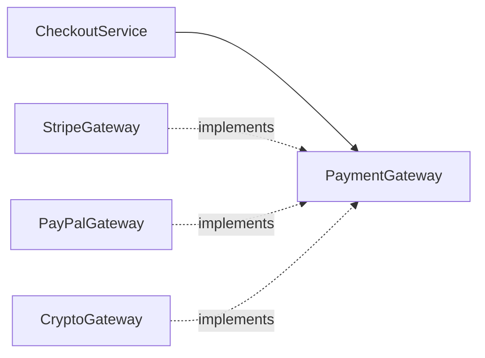

# SOLID Principles

> **Prerequisites:** [01 · Classes & Objects](../01-classes-objects-and-oop-building-blocks/README.md), [02 · OOP & UML](../02-oop-foundations-and-uml/README.md)  
> **Reading time:** ~25 minutes (plus ~10 to run the demos)  
> **Audience:** Anyone walking into an LLD / machine-coding round, or cleaning up a service that hurts to change

> [!NOTE]
> **In one line:** SOLID is five rules that keep change cheap — one reason to change per module, extend by adding classes, subtypes that keep contracts, small interfaces, and high-level code that depends on abstractions.

> [!TIP]
> **Golden rule:** If adding a payment type means editing a giant `switch`, or a subclass throws `NotSupportedException`, you are fighting SOLID. Fix the design before you write more features.

> [!TIP]
> **Try it:** Sketch the class diagram in [LLD Studio](/tools/lld-studio/), then implement the order example below in Python and run it.

---

## 1. When SOLID shows up in an interview

Interviewer: *"Design a checkout that can add new payment providers without rewriting the service."*

They are probing **OCP + DIP**. A strong answer names the smell (`if provider == …`), proposes an interface, shows one new class for the new provider, and says where DI wires it.



---

## 2. The five principles (cheat view)

| Letter | Name | Smell | Fix |
| :--- | :--- | :--- | :--- |
| **S** | Single Responsibility | God class: validate + save + email + PDF | Split by *who* asks for the change (actor) |
| **O** | Open / Closed | Growing `switch` / `if type ==` | Strategy / new class behind an interface |
| **L** | Liskov Substitution | Subclass throws or weakens guarantees | Same contract for every subtype; prefer composition |
| **I** | Interface Segregation | 25-method interface, callers stub 20 | Role interfaces (`Reader`, `Writer`) |
| **D** | Dependency Inversion | `new PostgresRepo()` inside business code | Depend on interfaces; inject at the composition root |

**SRP is about actors, not “one method.”** A query builder with 15 fluent methods can still be one responsibility. A class that serves Payroll *and* HR reporting has two.

---

## 3. Walkthrough: one checkout, all five

**Requirements (keep tiny):** save an order total, compute tax, notify the customer. Tomorrow we may add zero-tax regions and Slack notifications.

**Entities / roles:** `OrderProcessor` (orchestrates), `OrderRepository`, `NotificationSender`, `TaxStrategy`.

### Before (tight coupling)

```python
class BadCheckout:
    def process(self, order_id: str, email: str, subtotal: float) -> None:
        tax = subtotal * 0.08  # hard-coded; every region edit touches this class
        total = subtotal + tax
        # new Postgres() buried here — cannot unit-test without a DB
        print(f"save {order_id}={total}; email {email}")
```

### After (SOLID-shaped)

````carousel
```python
from abc import ABC, abstractmethod
from decimal import ROUND_HALF_UP, Decimal
from typing import Protocol

class OrderRepository(Protocol):
    def save(self, order_id: str, amount: Decimal) -> None: ...

class NotificationSender(Protocol):
    def send(self, recipient: str, message: str) -> None: ...

class TaxStrategy(ABC):
    @abstractmethod
    def calculate_tax(self, subtotal: Decimal) -> Decimal: ...

CENT = Decimal("0.01")

class StandardTax(TaxStrategy):
    def calculate_tax(self, subtotal: Decimal) -> Decimal:
        # Money: Decimal + explicit rounding, never float.
        return (subtotal * Decimal("0.08")).quantize(CENT, rounding=ROUND_HALF_UP)

class ZeroTax(TaxStrategy):
    def calculate_tax(self, subtotal: Decimal) -> Decimal:
        return Decimal("0.00")

class OrderProcessor:
    """S: one actor — checkout orchestration. D: depends only on abstractions."""

    def __init__(
        self,
        repository: OrderRepository,
        notifier: NotificationSender,
        tax: TaxStrategy,
    ) -> None:
        self._repo = repository
        self._notifier = notifier
        self._tax = tax

    def process(self, order_id: str, email: str, subtotal: Decimal) -> Decimal:
        if subtotal < 0:  # guard at the boundary so every TaxStrategy can assume >= 0
            raise ValueError("subtotal must be non-negative")
        total = subtotal + self._tax.calculate_tax(subtotal)
        self._repo.save(order_id, total)
        self._notifier.send(email, f"Order {order_id} confirmed for ${total}")
        return total


# Demo doubles (composition root in real apps wires real adapters)
class MemoryRepo:
    def __init__(self) -> None:
        self.saved: dict[str, Decimal] = {}

    def save(self, order_id: str, amount: Decimal) -> None:
        self.saved[order_id] = amount

class PrintNotifier:
    def send(self, recipient: str, message: str) -> None:
        print(f"→ {recipient}: {message}")

if __name__ == "__main__":
    repo = MemoryRepo()
    print(OrderProcessor(repo, PrintNotifier(), StandardTax()).process("o-1", "a@b.com", Decimal("100.00")))
    # OCP in action: new region = new strategy, OrderProcessor untouched.
    print(OrderProcessor(repo, PrintNotifier(), ZeroTax()).process("o-2", "a@b.com", Decimal("100.00")))
    print(repo.saved)  # {'o-1': Decimal('108.00'), 'o-2': Decimal('100.00')}
```
<!-- slide -->
```csharp
public interface IOrderWriter
{
    Task SaveAsync(string orderId, decimal total);
}

public interface INotifier
{
    Task SendAsync(string recipient, string message);
}

public interface ITaxCalculator
{
    decimal Calculate(decimal subtotal);
}

public sealed class StandardTax : ITaxCalculator
{
    public decimal Calculate(decimal subtotal) =>
        Math.Round(subtotal * 0.08m, 2, MidpointRounding.AwayFromZero);
}

public sealed class OrderService
{
    private readonly IOrderWriter _orders;
    private readonly INotifier _notifier;
    private readonly ITaxCalculator _tax;

    public OrderService(IOrderWriter orders, INotifier notifier, ITaxCalculator tax)
    {
        _orders = orders;
        _notifier = notifier;
        _tax = tax;
    }

    public async Task<decimal> ProcessAsync(string orderId, string email, decimal subtotal)
    {
        var total = subtotal + _tax.Calculate(subtotal);
        await _orders.SaveAsync(orderId, total);
        await _notifier.SendAsync(email, $"Order {orderId} confirmed for ${total}");
        return total;
    }
}
```
````

**What each letter bought you**

| Principle | In this design |
| :--- | :--- |
| S | Processor does not own SQL or SMTP details |
| O | New tax rule = new `TaxStrategy` class, not edits to `process` |
| L | Every tax strategy returns a non-negative decimal for any non-negative subtotal |
| I | Writers and notifiers are separate; a silent batch job need not take `INotifier` |
| D | Tests inject fakes; production wires Postgres / SES at startup |

---

## 4. Prove OCP and LSP with code you can run

The tax example shows S, O, D. The interview prompt was *payment providers*, so here is the same idea on `PaymentGateway`, plus the two LSP traps interviewers love: **Square/Rectangle** and **the subclass that throws**.

```python
from abc import ABC, abstractmethod


# ── OCP + DIP: Checkout depends on the abstraction only ──────────────
class PaymentGateway(ABC):
    """Contract (LSP): charge(user_id, cents) -> bool.
    A business decline returns False. It never raises for 'normal' failures."""

    @abstractmethod
    def charge(self, user_id: str, cents: int) -> bool: ...


class StripeGateway(PaymentGateway):
    def charge(self, user_id: str, cents: int) -> bool:
        return 0 < cents <= 500_000


class PayPalGateway(PaymentGateway):
    def charge(self, user_id: str, cents: int) -> bool:
        return 0 < cents <= 100_000


class CryptoGateway(PaymentGateway):      # added "later": zero edits anywhere else
    def charge(self, user_id: str, cents: int) -> bool:
        return user_id.startswith("kyc_") and cents > 0   # decline, don't raise


class BadCryptoGateway(PaymentGateway):   # the LSP violator
    def charge(self, user_id: str, cents: int) -> bool:
        if not user_id.startswith("kyc_"):
            raise RuntimeError("KYC missing")   # surprise precondition
        return True


class Checkout:
    def __init__(self, gateway: PaymentGateway) -> None:
        if gateway is None:                      # fail at wiring time, not at 3 a.m.
            raise ValueError("gateway is required")
        self._gateway = gateway

    def pay(self, user_id: str, cents: int) -> bool:
        return self._gateway.charge(user_id, cents)


# ── LSP as a CONTRACT TEST: run the same checks against every subtype ──
def gateway_contract_test(gw: PaymentGateway) -> str:
    for user_id, cents in [("kyc_1", 100), ("anon", 100), ("kyc_1", 10**9), ("anon", 0)]:
        try:
            result = gw.charge(user_id, cents)
        except Exception as exc:                 # noqa: BLE001 - that IS the violation
            return f"FAIL raised {exc!r} for ({user_id!r}, {cents})"
        if not isinstance(result, bool):
            return f"FAIL returned {result!r}"
    return "ok"


# ── The classic LSP break ────────────────────────────────────────────
class Rectangle:
    def __init__(self, w: int, h: int) -> None:
        self.w, self.h = w, h

    def set_width(self, w: int) -> None:
        self.w = w

    def set_height(self, h: int) -> None:
        self.h = h

    def area(self) -> int:
        return self.w * self.h


class Square(Rectangle):
    def set_width(self, w: int) -> None:
        self.w = self.h = w          # couples the sides: weaker postcondition for callers

    def set_height(self, h: int) -> None:
        self.w = self.h = h


def stretch(r: Rectangle) -> int:
    r.set_width(5)
    r.set_height(4)
    return r.area()                  # a Rectangle caller expects 20


if __name__ == "__main__":
    for gw in (StripeGateway(), PayPalGateway(), CryptoGateway(), BadCryptoGateway()):
        print(f"{type(gw).__name__:17} contract test: {gateway_contract_test(gw)}")
    print("checkout:", Checkout(CryptoGateway()).pay("kyc_9", 2500))
    print("Rectangle:", stretch(Rectangle(1, 1)), "| Square:", stretch(Square(1, 1)))  # 20 | 16
```

Expected output: the first three gateways print `ok`; `BadCryptoGateway` prints `FAIL raised RuntimeError('KYC missing') …`; the last line is `Rectangle: 20 | Square: 16`.

**Interview line:** *"If callers rely on base postconditions, subtypes must keep them. I'd write one contract test and run it against every implementation. For shapes I'd use immutable `width`/`height` or a shared `Shape`, not `Square : Rectangle`."*

### ISP in one picture

Fat: `IUserRepository { Save, Find, ExportPdf, PostToSlack }` → a read-only report job must stub `Save`. Split into `IUserReader` / `IUserWriter` / `IUserExporter`; the Postgres class can implement all three while each client injects only the role it calls.

### War story (compressed)

A portfolio rebalancer called `OrderExecutor.Execute` for many asset types. `CryptoOrderExecutor` threw `InvalidOperationException("KYC missing")` — a precondition the base type never advertised. One unhandled throw aborted the loop; remaining hedges never ran. That is exactly `BadCryptoGateway` above.

**Fix:** make failure part of the contract (`Result` / pre-check `IKycGate`), or segregate KYC assets behind a different interface. Never surprise callers with new throws.

---

## 5. Edges and when *not* to reach for SOLID

**Edges that bite in real rounds**

| Edge | What to say |
| :--- | :--- |
| Money as `float` | Use `Decimal` / `decimal` and round once, explicitly. Tax strategies are only substitutable if they round the same way |
| `None` / null dependency | Validate in the constructor (or let the DI container fail at startup). Don't null-check on every call |
| Shared strategy instances | Strategies should be stateless so one instance is safe across threads. If a strategy caches, guard it or make it per-request |
| Over-splitting (ISP) | One-method interface per class is a smell too. Split by *client*, not by method |
| Rule changes in OCP | "Closed" means no edits for *anticipated* variation. A truly new axis of change still needs a refactor — that's fine |

**When not to use it**

- Three classes and one call site → an interface for every noun is noise (YAGNI, see [05](../05-core-design-principles/README.md)).
- Stable, rarely changing code → don't invent strategies "just in case."
- Performance-critical tight loops → abstraction cost is rarely the bottleneck, but measure before you claim either way.

SOLID is a **cost-of-change** tool, not a completeness badge.

---

## 6. Anti-patterns

| Wrong design | Why it hurts | Fix |
| :--- | :--- | :--- |
| `if provider == "stripe" … elif …` in `Checkout` | Every provider edits the hot path (OCP) | `PaymentGateway` + one class per provider |
| `class Square(Rectangle)` with mutable setters | Breaks base postconditions (LSP) | Immutable shapes, or composition |
| Subclass overrides with `raise NotImplementedError` | Callers crash on a "valid" subtype (LSP + ISP) | Segregate the interface; don't inherit what you can't honor |
| `new PostgresRepo()` inside a service | Untestable, tied to one DB (DIP) | Constructor-inject an interface; wire in `main` |
| One interface per method, 40 interfaces | Ceremony without change pressure | Group by client role |
| Service Locator (`Container.Get<T>()` inside domain code) | DIP in name only; dependencies are hidden | Constructor injection |

---

## 7. What you’d say in two minutes

> "I'd start from the change that will hurt: new payment providers. That points to a `PaymentGateway` interface and a checkout that only depends on it — Open/Closed and Dependency Inversion. Checkout stays responsible for orchestration only — Single Responsibility — and tax and notifications get their own small interfaces so clients don't take methods they never call — Interface Segregation. Every gateway must honor the same contract: a decline returns false, it doesn't throw a surprise, so I'd write one contract test and run it against every provider — that's how I enforce Liskov. Concretes are wired in `main` or the DI container, never inside the domain. And I'd say out loud that I wouldn't apply all five to a three-class problem — SOLID pays off where change is actually coming."

---

## 8. Interview questions

<details>
<summary><strong>1. What does SRP actually mean? [BASIC]</strong></summary>

A module should be responsible to **one actor** (one reason to change). It is not “one function does one thing.” A fluent SQL builder with many methods can still be one responsibility.

</details>

<details>
<summary><strong>2. Why is Square-extends-Rectangle an LSP smell? [BASIC]</strong></summary>

Base mutators promise independent width/height. A square that couples them breaks callers’ postconditions. Prefer immutable shapes or a shared `Shape` type.

</details>

<details>
<summary><strong>3. DIP vs IoC vs DI? [BASIC]</strong></summary>

**DIP** = depend on abstractions. **IoC** = framework owns the flow. **DI** = how you supply the concretes (usually constructor injection). DIP does *not* mean "interface for everything": depend on a stable concrete you own (a `Money` value object) and introduce interfaces where the detail varies or must be faked (DB, network, clock).

</details>

<details>
<summary><strong>4. Add WhatsApp and Slack without editing the dispatcher. [SCENARIO]</strong></summary>

`INotificationChannel` + dispatcher over `IEnumerable<INotificationChannel>`. Register new channel classes in DI; leave the dispatcher alone.

</details>

<details>
<summary><strong>5. Fat `IUserRepository` with Save, PDF, Slack. [SCENARIO]</strong></summary>

Split into role interfaces; keep the concrete class implementing all during migration; inject only what each client needs; deprecate the fat interface.

</details>

<details>
<summary><strong>6. Subclass throws KYC exception from `Execute`. [SCENARIO]</strong></summary>

LSP break (stronger precondition). Pre-validate, return a result type, or use a separate KYC-aware API so the base contract stays honest.

</details>

<details>
<summary><strong>7. Can SRP allow 15 public methods? [TRICKY]</strong></summary>

Yes — if every method serves the same actor. Method count ≠ responsibility count.

</details>

<details>
<summary><strong>8. How do you actually *test* Liskov? [TRICKY]</strong></summary>

Write one **contract test** against the base type and run it for every implementation (see `gateway_contract_test`). If a subtype needs its own special-case test to pass, or throws where the base promised a return value, it isn't substitutable.

</details>
---

## 9. Try it

1. Run the two Python blocks above. Confirm the contract test flags `BadCryptoGateway`.
2. Add `ApplePayGateway` without editing `Checkout` — count the files you touched (target: only the new one + the wiring line).
3. Split a fat `IUserRepository` into `IUserReader` / `IUserWriter` and change one client to take only the reader.
4. Practice the full flow end to end: [Parking Lot](../12-parking-lot-and-elevator/README.md) is the first classic problem where all five show up.

---

## 10. One-page cheat sheet

```text
S  One actor / one reason to change. Split God classes by stakeholder.
O  Extend with new classes; stop growing switch/if ladders.
L  Subtypes keep the base contract. No surprise throws / NotImplemented.
I  Small role interfaces. Clients depend only on what they call.
D  High-level code takes interfaces; wire concretes at the composition root.

Test LSP: one contract test, run against every implementation.
Money: Decimal + explicit rounding. Null deps: fail in the constructor.

Interview opener: name the change → name the interface → show the new class → say where DI binds it.
Close with: "and I wouldn't do this for a 3-class problem."
```

---

## Further reading

- [Robert C. Martin — Principles of OOD](https://web.archive.org/web/20150906155800/http://www.objectmentor.com/resources/articles/Principles_and_Patterns.pdf)
- [Clean Architecture (Martin)](https://www.oreilly.com/library/view/clean-architecture-a/9780134494272/)

## Next

**[05 · Core Design Principles](../05-core-design-principles/README.md)** — DRY, KISS, YAGNI, Law of Demeter, composition over inheritance.
