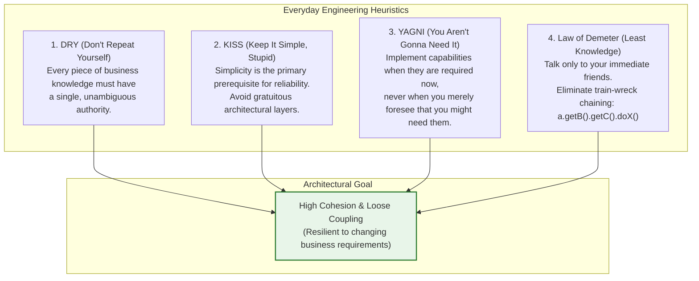
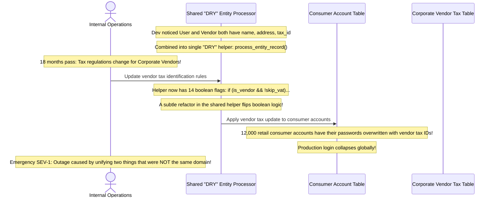

# Module 05: Core Design Principles — DRY, KISS, YAGNI, and the Law of Demeter

> **Prerequisites:** Module 01 (Classes and Objects), Module 04 (SOLID Principles).  
> **Estimated Reading Time:** 25 minutes  
> **Target Audience:** Backend Developers, Software Engineers, System Designers.

> [!NOTE]
> **In one line:** DRY (Don't Repeat Yourself), KISS (Keep It Simple, Stupid), YAGNI (You Aren't Gonna Need It), and the Law of Demeter are pragmatic architectural heuristics that prevent premature abstraction, eliminate unnecessary layers, and enforce loose coupling through minimal object knowledge.

> [!TIP]
> **The Golden Rule of Pragmatic Architecture:** **Duplication is far cheaper than the wrong abstraction.** Premature generalization (violating YAGNI) and aggressive de-duplication of coincidental similarities (misapplying DRY) create fragile, coupled codebases filled with conditional flags. Strive for **High Cohesion and Low Coupling**, adhere to the **Law of Demeter** ("don't talk to strangers"), and apply the **Rule of Three** before creating shared abstractions.

---

## 1. Architectural Mental Model: The Pragmatic Heuristics

While SOLID guides object-oriented class structure, these four foundational heuristics govern everyday architectural decision-making:



---

## 2. Taxonomic Reference: Core Design Principles Matrix

| Principle | Core Axiom | Major Anti-Pattern Prevented | Dangerous Over-Engineering Failure Mode |
| :--- | :--- | :--- | :--- |
| **DRY** | Single source of truth for business rules | Copy-paste code with out-of-sync bug fixes | **Premature Abstraction:** Coupling two unrelated features that happen to look identical today. |
| **KISS** | The simplest working design is best | Over-engineered design pattern abuse (AbstractFactoryProviderBean) | Writing primitive spaghetti code that ignores basic separation of concerns. |
| **YAGNI** | Build for today's concrete requirements | Speculative generic architectures that add complexity for zero users | Refusing to design extension points for known architectural requirements. |
| **Law of Demeter** | Talk only to immediate collaborators | "Train-wreck" method chaining (`order.getUser().getWallet().getBalance()`) | Creating hundreds of useless pass-through forwarding wrapper methods. |

---

## 3. Formal Economic & Mathematical Models of Abstraction

Software architecture is governed by economic trade-offs between duplication cost and abstraction friction.

### The Cost Asymmetry: Duplication vs. The Wrong Abstraction (Sandi Metz's Law)

Let $C_{\text{dup}}$ be the cost of maintaining duplicated code across $k$ occurrences over time $t$, and $C_{\text{wrong}}$ be the cost of an inappropriate shared abstraction with $M$ divergent business requirements:

1. **Cost of Duplication:**
   $$C_{\text{dup}}(k, t) = k \cdot c_m \cdot t$$
   where $c_m$ is the small incremental maintenance cost per instance. The cost scales **linearly** with the number of copies. When requirements diverge, modifying one copy requires zero coordination with the others.

2. **Cost of the Wrong Abstraction:**
   $$C_{\text{wrong}}(M) = c_0 + \sum_{i=1}^M \left( \beta_i \cdot 2^i + c_{\text{blast}} \right)$$
   As divergent requirements hit a premature abstraction, developers insert boolean flags (`if (isVendor && !skipVat)`). The combinatorial state space grows exponentially ($2^M$ possible execution branches), while each change carries a blast radius $c_{\text{blast}}$ that risks breaking unrelated consumers.

$$\text{Theorem: } \exists t_0 \text{ such that } \forall t > t_0,\quad C_{\text{wrong}} \gg C_{\text{dup}}$$
*Duplication is far cheaper than the wrong abstraction.*

---

### The Compounding Fragility of Law of Demeter Violations

When client code traverses an object chain of depth $L$:
$$x = a.m_1().m_2().m_3().\dots.m_L()$$

Let $p_k$ be the probability that component $k$ alters its internal API, return type, or nullability during a lifecycle:
$$P(\text{Client Breaking Change}) = 1 - \prod_{k=1}^L (1 - p_k)$$

For $L = 5$ hops with an independent change probability of $p = 0.08$ per component:
$$P(\text{Breakage}) = 1 - (1 - 0.08)^5 = 1 - (0.92)^5 = 1 - 0.659 = 34.1\%$$

By encapsulating the interaction behind an immediate collaborator ("Tell, Don't Ask", $L = 1$):
$$P(\text{Breakage}) = 1 - (1 - 0.08)^1 = 8.0\%$$
*Enforcing the Law of Demeter slashes interface breakage risk by over $4\times$.*

---

### The Rule of Three Formulation

The net economic benefit $B(N)$ of introducing a generic abstraction after observing $N$ similar implementations is:
$$B(N) = N \cdot S_{\text{dup}} - \left( C_{\text{indirection}} + C_{\text{coupling}} + C_{\text{premature}} \cdot e^{-(N - 1)} \right)$$

- When $N = 1$: $B(1) < 0$ (Pure speculative complexity; violating YAGNI).
- When $N = 2$: $B(2) \approx 0$ (Coincidental similarity often masquerades as a domain rule).
- When $N \ge 3$: $B(N) > 0$ (Three distinct implementations prove the underlying domain pattern, justifying an abstraction).

---

## 4. Systematic Breakdown: The Law of Demeter ("Principle of Least Knowledge")

The Law of Demeter establishes strict rules on which methods an object may invoke.

```
  ❌ VIOLATION (The Train Wreck):
  customer.getOrders().get(0).getPaymentMethod().getGateway().charge(50.00);
  (Calling class is tightly coupled to Customer, Order, List, PaymentMethod, AND Gateway!)

  ✅ COMPLIANT (Tell, Don't Ask):
  customer.chargeActiveOrder(50.00);
  (Calling class talks ONLY to its immediate collaborator: Customer).
```

### The Strict Method Invocation Rule
A method `M` of class `C` should only call methods on:
1. The object `C` itself (`this` / `self`).
2. Objects passed as arguments to `M`.
3. Any objects instantiated directly inside `M`.
4. Direct instance member components of `C`.

---

## 5. Production War Story: The Premature DRY Abstraction Catastrophe



### The Incident
An enterprise logistics company noticed that retail consumer accounts and B2B vendor supplier accounts shared similar database columns (`name`, `tax_id`, `address`). In the name of "DRY", an engineer merged the update logic into a single generic helper class `EntityPersistenceHelper`.

Over two years, vendor compliance rules diverged dramatically from consumer account rules. The shared helper accumulated 14 conditional parameters (`isVendor`, `skipVatValidation`, `enableInvoiceApproval`). During an emergency tax update, a developer adjusted a boolean flag, inadvertently executing vendor state logic on retail consumers and corrupting 12,000 user credentials.

### The Post-Mortem Data
* **Severity:** SEV-1 (Customer Account Data Corruption)
* **Mean Time to Detect (MTTD):** 25 minutes
* **Mean Time to Resolution (MTTR):** 60 minutes

### The Root Cause
**Misunderstanding DRY:** The developer confused **coincidental code duplication** with **essential domain duplication**. Retail customers and corporate vendors are distinct business concepts that change for completely different reasons at different cadences. Unifying them created toxic coupling.

### The Fix & Hardening
1. **The Rule of Three:** Do not abstract on the second occurrence. Wait until code has been duplicated three times across identical domain boundaries before extracting an abstraction.
2. **Accept Duplication Over Coupling:** If two pieces of code look identical today but belong to different business actors, keep them separate.

---

## 6. Multi-Language Production Code: Refactoring Train Wrecks (Law of Demeter)

Below is an enterprise demonstration refactoring a train-wreck violation into a clean "Tell, Don't Ask" pattern across four backend languages.

````carousel
```python
class Wallet:
    def __init__(self, balance: float):
        self._balance = balance

    def deduct(self, amount: float) -> bool:
        if self._balance >= amount:
            self._balance -= amount
            return True
        return False

class Customer:
    def __init__(self, wallet: Wallet):
        self._wallet = wallet

    # Law of Demeter: Tell, Don't Ask!
    def pay(self, amount: float) -> bool:
        return self._wallet.deduct(amount)

if __name__ == "__main__":
    cust = Customer(Wallet(100.0))
    if cust.pay(50.0):
        print("Payment processed cleanly via immediate collaborator.")
```

<!-- slide -->

```csharp
using System;

public class Wallet
{
    private decimal _balance;
    public Wallet(decimal balance) => _balance = balance;

    public bool Deduct(decimal amount)
    {
        if (_balance < amount) return false;
        _balance -= amount;
        return true;
    }
}

public class Customer
{
    private readonly Wallet _wallet;
    public Customer(Wallet wallet) => _wallet = wallet;

    // Law of Demeter: Tell, Don't Ask
    public bool MakePayment(decimal amount) => _wallet.Deduct(amount);
}
```

<!-- slide -->

```go
package main

import "fmt"

type Wallet struct {
	balance int64
}

func (w *Wallet) Deduct(cents int64) bool {
	if w.balance >= cents {
		w.balance -= cents
		return true
	}
	return false
}

type Customer struct {
	wallet *Wallet
}

// Law of Demeter compliance: Customer handles the transaction internally
func (c *Customer) Pay(cents int64) bool {
	return c.wallet.Deduct(cents)
}

func main() {
	cust := Customer{wallet: &Wallet{balance: 5000}}
	success := cust.Pay(2000)
	fmt.Printf("Payment succeeded: %t\n", success)
}
```

<!-- slide -->

```typescript
class Wallet {
  constructor(private balance: number) {}

  public deduct(amount: number): boolean {
    if (this.balance >= amount) {
      this.balance -= amount;
      return true;
    }
    return false;
  }
}

export class Customer {
  constructor(private readonly wallet: Wallet) {}

  // Law of Demeter compliant: Tell, Don't Ask
  public processPurchase(amount: number): boolean {
    return this.wallet.deduct(amount);
  }
}
```
````

---

## 7. Practical Hands-On Verification CLI Workflows

Verify Law of Demeter violations using Python AST (Abstract Syntax Tree) inspection:

### Workflow 1: Detect Train-Wreck Method Chaining Programmatically
```bash
python3 -c '
import ast

code = """
def bad_code(order):
    return order.get_customer().get_profile().get_address().get_zip()
"""

tree = ast.parse(code)
for node in ast.walk(tree):
    if isinstance(node, ast.Attribute):
        depth = 0
        curr = node
        while isinstance(curr, ast.Attribute):
            depth += 1
            curr = curr.value
        if depth >= 3:
            print(f"🚨 Law of Demeter Warning: Found chain of depth {depth} at line {node.lineno}")
            break
'
```
**Expected Output:**
```text
🚨 Law of Demeter Warning: Found chain of depth 4 at line 3
```

---

## 8. Operational Validation Checkpoint & 12 Interview Practice Questions

Each question is tagged by kind: **Basic** (definitions), **Scenario** (apply it to a system), and **Tricky** (deep follow-ups). Answer out loud before opening the solution.

<details>
<summary><strong>1. What is the fundamental difference between essential duplication and coincidental duplication under the DRY principle? [BASIC]</strong></summary>

<strong>What a strong answer covers:</strong>
- **Essential Duplication:** Multiple representations of the exact same business concept or authority (e.g. tax formula duplicated in frontend and backend). If the rule changes, both must change. DRY mandates consolidating essential duplication to a single source of truth.
- **Coincidental Duplication:** Two independent domain entities happen to share similar attributes or structural shapes today (e.g. `Customer` and `Supplier` both having `name`, `address`, `tax_id`), but they belong to different business actors and change for different reasons. Merging them creates toxic coupling; DRY should **not** be applied.

</details>

<details>
<summary><strong>2. What does KISS (Keep It Simple, Stupid) mean in backend engineering, and what is the difference between simple and easy? [BASIC]</strong></summary>

<strong>What a strong answer covers:</strong>
As articulated by Rich Hickey (*Simple Made Easy*):
- **Simple** refers to the lack of interleaving or entanglement (objective architectural property: few moving parts, isolated responsibilities, clear boundaries).
- **Easy** means near at hand or familiar to the developer (subjective: using a familiar giant ORM or adding a 15th parameter to an existing function).
KISS prioritizes **simplicity over ease**: choosing clean, unentangled designs even if they require thoughtful modular design upfront, rather than taking the quick-and-dirty entangled path.

</details>

<details>
<summary><strong>3. What is YAGNI (You Aren't Gonna Need It), and why is speculative generalization dangerous? [BASIC]</strong></summary>

<strong>What a strong answer covers:</strong>
YAGNI dictates that a programmer should not add functionality until deemed necessary. Speculative generalization is hazardous because:
1. **Wrong Guess:** Requirements rarely materialize as predicted, rendering speculative code useless baggage.
2. **Carrying Cost:** Every line of unused code must be tested, compiled, reviewed, maintained, and refactored during future migrations.
3. **Obscurity:** Complex generic hierarchies conceal simple business intentions from current developers.

</details>

<details>
<summary><strong>4. What is the Law of Demeter ("Principle of Least Knowledge"), and what are its exact method invocation rules? [BASIC]</strong></summary>

<strong>What a strong answer covers:</strong>
A module should talk only to its immediate collaborators and avoid navigating object graphs. Specifically, a method $M$ on object $C$ may only invoke methods on:
1. Object $C$ itself (`this` / `self`).
2. Parameters passed directly into $M$.
3. Any objects instantiated directly within $M$.
4. Direct instance fields / components of $C$.
Any call beyond these (e.g., $o.getA().getB().doC()$) violates Demeter by creating structural coupling to intermediate representations.

</details>

<details>
<summary><strong>5. In an interview, a candidate is asked to design a rate limiter for a single web service. The candidate designs a distributed Raft-consensus cluster with Cassandra and multi-region replication. How do you evaluate this under YAGNI and KISS? [SCENARIO]</strong></summary>

<strong>What a strong answer covers:</strong>
The candidate commits severe **YAGNI and KISS violations**:
- A single-instance rate limiter requires an in-memory sliding window or Token Bucket ($O(1)$ time and memory per IP), or a centralized Redis node at most.
- Introducing multi-region Cassandra and Raft consensus introduces distributed network partitions, clock skew challenges, consensus latency, and multi-node operational burdens without solving any concrete constraint stated in the problem.
- **Strong Response:** Start with in-memory or Redis-backed Token Bucket; identify the concrete bottleneck point where distributed synchronization becomes mandatory, but do not prematurely deploy it.

</details>

<details>
<summary><strong>6. You encounter an order fulfillment flow: order.getCustomer().getPaymentProfile().getDefaultCard().getIssuer().authorize(amount). How does this violate the Law of Demeter, and how do you refactor it using "Tell, Don't Ask"? [SCENARIO]</strong></summary>

<strong>What a strong answer covers:</strong>
The caller traverses 5 distinct structural layers, making it fragile to schema changes in `Customer`, `PaymentProfile`, `Card`, and `Issuer`.
**Refactoring ("Tell, Don't Ask"):**
Push the behavior down through encapsulation:
`order.charge(amount);`
Where `Order` delegates to `Customer.charge(amount)`, which delegates to `PaymentProfile.charge(amount)`. Each layer interacts exclusively with its immediate friend, and external callers are completely shielded from internal payment topologies.

</details>

<details>
<summary><strong>7. Two microservices (Identity and Billing) both validate user phone numbers using identical regex logic. An engineer wants to extract this to a shared corporate package published to Artifactory. How do you evaluate this proposal? [SCENARIO]</strong></summary>

<strong>What a strong answer covers:</strong>
Reject the shared library proposal under **pragmatic DRY and loose coupling**:
- Centralizing a 30-character regex into a shared binary library introduces distributed build coupling, repository token credentials, version pin updates, and release synchronization across two microservices.
- If Identity needs to loosen phone validation for international regions while Billing needs strict E.164 compliance, the shared library becomes a roadblock.
- **Rule:** A tiny amount of duplicated logic across independent service boundaries is vastly preferable to an external library dependency.

</details>

<details>
<summary><strong>8. An engineering team spent three months building a generic DynamicWorkflowPluginEngine<T, R> supporting speculative future workflow formats, but currently only processes standard CSV files. How should technical debt like this be remedied under KISS/YAGNI? [SCENARIO]</strong></summary>

<strong>What a strong answer covers:</strong>
1. Acknowledge the sunk cost fallacy.
2. Extract the concrete CSV processing pipeline into a straightforward, unabstracted sequential service (`CsvOrderProcessor`).
3. Deprecate and delete the unused speculative generic engine (`DynamicWorkflowPluginEngine`).
4. Result: Eliminates hundreds of lines of unused generics, lowers onboarding time for new developers from weeks to hours, and simplifies error handling and tracing.

</details>

<details>
<summary><strong>9. Does method chaining in a Fluent Builder API (e.g. HttpClient.newBuilder().timeout(...).authenticator(...).build()) violate the Law of Demeter? [TRICKY]</strong></summary>

<strong>What a strong answer covers:</strong>
No. The Law of Demeter forbids chaining through **different structural objects** to inspect internal state (`a.getB().getC().doSomething()`).
In a Fluent Builder or Method-Chaining API:
1. Every method call returns the **exact same builder instance** (`this` / `self`), or a monad/stream representation of the same data structure.
2. The caller is configuring one single object, not traversing a nested graph of unfamiliar strangers.

</details>

<details>
<summary><strong>10. Sandi Metz famously argued that "Duplication is far cheaper than the wrong abstraction." What is the mathematical and economic reasoning behind this axiom? [TRICKY]</strong></summary>

<strong>What a strong answer covers:</strong>
- **Duplication Cost:** Linear ($O(k)$). Refactoring duplicated code into an abstraction later when the real pattern is clear is simple and low risk.
- **Wrong Abstraction Cost:** Combinatorial / Exponential ($O(2^M)$). An incorrect premature abstraction forces divergent use cases to share code via boolean parameter switches, hidden side-effects, and hacky overrides. Refactoring it away requires coordinating all consumers simultaneously, which is why wrong abstractions often stay in production codebases for years.

</details>

<details>
<summary><strong>11. How do you distinguish between legitimate structural encapsulation and creating hundreds of useless "middle-man" pass-through wrapper methods? [TRICKY]</strong></summary>

<strong>What a strong answer covers:</strong>
- **Legitimate Encapsulation ("Tell, Don't Ask"):** The forwarding method combines or coordinates behavior at its level of abstraction (`customer.charge(amount)` handles authorization and records the audit log).
- **Middle-Man Code Smell:** A class has 20 methods that do nothing except forward calls directly without adding behavior (`getStreet() { return address.getStreet(); }`, `getZip() { return address.getZip(); }`).
- **Remedy:** If an object is a pure data structure (DTO / Value Object), clients can access it directly; the Law of Demeter applies to **behavioral domain objects**, not transparent data transfer structures.

</details>

<details>
<summary><strong>12. How does the "Rule of Three" provide an objective stopping criterion against premature abstraction? [TRICKY]</strong></summary>

<strong>What a strong answer covers:</strong>
1. **First occurrence:** Build the simplest working solution (KISS).
2. **Second occurrence:** Duplicate the code (duplication is cheap; two instances may be coincidental and diverge).
3. **Third occurrence:** Now that you have three concrete data points showing identical domain behavior across real use cases, the true underlying abstraction has revealed itself. You can now refactor into a shared abstraction with high confidence and minimal risk of premature generalization.

</details>

---

## 9. One-Page Master Cheat Sheet

```text
====================================================================================================
               CORE DESIGN PRINCIPLES — DRY, KISS, YAGNI & LAW OF DEMETER CHEAT SHEET
====================================================================================================
DRY — DON'T REPEAT YOURSELF
  * Core Axiom   : Every piece of knowledge must have a single, unambiguous authority in the system.
  * Essential Dup: Same domain rule duplicated in 2 places -> Consolidate into 1 source of truth.
  * Coincidental : 2 unrelated entities share identical shape today -> KEEP DUPLICATED to avoid coupling!
  * Golden Heuristic: Duplication is far cheaper than the wrong abstraction (Sandi Metz).

KISS — KEEP IT SIMPLE, STUPID
  * Core Axiom   : Simplicity is a prerequisite for reliability; avoid gratuitous architectural layers.
  * Simple vs Easy: Simple = unentangled, isolated boundaries. Easy = quick, familiar, often entangled.
  * Warning Smell: "AbstractFactoryProviderBeanFactory" when a plain 20-line function satisfies requirements.

YAGNI — YOU AREN'T GONNA NEED IT
  * Core Axiom   : Implement capabilities when required now, never when you merely foresee needing them.
  * Danger       : Speculative generalizations rot, complicate onboarding, and are usually wrong anyway.
  * The Remedy   : Build concrete today; design clean extension seams, but defer implementation until needed.

LAW OF DEMETER (PRINCIPLE OF LEAST KNOWLEDGE)
  * Core Axiom   : Talk only to your immediate friends ("Tell, Don't Ask").
  * Formal Rule  : Method M on class C may call methods on: C itself, arguments to M, objects instantiated
                   inside M, and direct instance fields of C.
  * Train Wreck  : a.getB().getC().getD().execute() -> Multiplies breakage risk by (1 - (1-p)^L).
  * Exemption    : Fluent Builders (HttpClient.newBuilder()...build()) and Streams/Monads are compliant!

THE RULE OF THREE STOPPING CRITERION
  * N = 1 : Build concrete logic cleanly (KISS).
  * N = 2 : Duplicate directly. Two instances are often coincidental similarities.
  * N = 3 : Pattern is proven by 3 real use cases. Refactor into shared abstraction with high confidence!
====================================================================================================
```

---

## Further Reading & Sources

- [The Pragmatic Programmer by David Thomas and Andrew Hunt](https://pragprog.com/titles/tpp20/the-pragmatic-programmer-20th-anniversary-edition/) — the original coining and definitive explanation of the DRY principle.
- [Sandi Metz: The Wrong Abstraction](https://sandimetz.com/blog/2016/1/20/the-wrong-abstraction) — foundational essay on why duplication is cheaper than the wrong abstraction.
- [Ian Holland: The Law of Demeter](https://en.wikipedia.org/wiki/Law_of_Demeter) — origin and formal rules of object-oriented loose coupling.

---

## Next Step

Now that you understand core heuristics (DRY, KISS, YAGNI, Law of Demeter), proceed to **[06 · Creational Design Patterns](../06-creational-patterns/README.md)** to master Factory Method, Abstract Factory, Builder, Prototype, and Singleton patterns.
