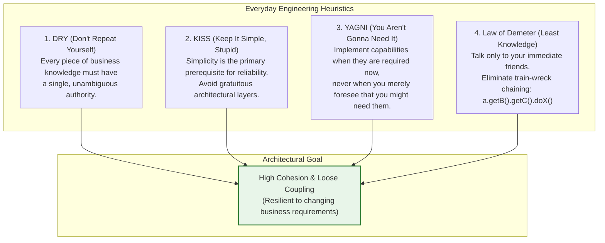
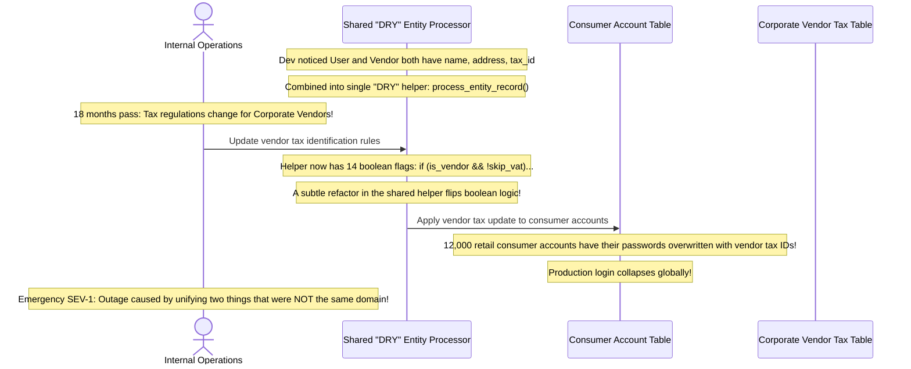

# Module 05: Core Design Principles — DRY, KISS, YAGNI, and the Law of Demeter

> **Prerequisites:** Module 01 (Classes and Objects), Module 04 (SOLID Principles).  
> **Estimated Reading Time:** 25 minutes  
> **Target Audience:** Backend Developers, Software Engineers, System Designers.

> [!TIP]
> **The Golden Rule of Pragmatic Architecture:** **Duplication is far cheaper than the wrong abstraction.** Premature generalization (violating YAGNI) and aggressive de-duplication of coincidental similarities (misapplying DRY) create fragile, coupled codebases filled with conditional flags. Strive for **High Cohesion and Low Coupling**, adhere to the **Law of Demeter** ("don't talk to strangers"), and apply the **Rule of Three** before creating shared abstractions.

---

## 1. Architectural Mental Model: The Pragmatic Heuristics

While SOLID guides object-oriented class structure, these four foundational heuristics govern everyday architectural decision-making:



---

## 2. Taxonomic Reference: Core Design Principles Matrix

| Principle | Core Axiom | Major Anti-Pattern Prevented | Dangerous Over-Engineering Failure Mode |
| :--- | :--- | :--- | :--- |
| **DRY** | Single source of truth for business rules | Copy-paste code with out-of-sync bug fixes | **Premature Abstraction:** Coupling two unrelated features that happen to look identical today. |
| **KISS** | The simplest working design is best | Over-engineered design pattern abuse (AbstractFactoryProviderBean) | Writing primitive spaghetti code that ignores basic separation of concerns. |
| **YAGNI** | Build for today's concrete requirements | Speculative generic architectures that add complexity for zero users | Refusing to design extension points for known architectural requirements. |
| **Law of Demeter** | Talk only to immediate collaborators | "Train-wreck" method chaining (`order.getUser().getWallet().getBalance()`) | Creating hundreds of useless pass-through forwarding wrapper methods. |

---

## 3. Systematic Breakdown: The Law of Demeter ("Principle of Least Knowledge")

The Law of Demeter establishes strict rules on which methods an object may invoke.

```
  ❌ VIOLATION (The Train Wreck):
  customer.getOrders().get(0).getPaymentMethod().getGateway().charge(50.00);
  (Calling class is tightly coupled to Customer, Order, List, PaymentMethod, AND Gateway!)

  ✅ COMPLIANT (Tell, Don't Ask):
  customer.chargeActiveOrder(50.00);
  (Calling class talks ONLY to its immediate collaborator: Customer).
```

### The Strict Method Invocation Rule
A method `M` of class `C` should only call methods on:
1. The object `C` itself (`this` / `self`).
2. Objects passed as arguments to `M`.
3. Any objects instantiated directly inside `M`.
4. Direct instance member components of `C`.

---

## 4. Production War Story: The Premature DRY Abstraction Catastrophe



### The Incident
An enterprise logistics company noticed that retail consumer accounts and B2B vendor supplier accounts shared similar database columns (`name`, `tax_id`, `address`). In the name of "DRY", an engineer merged the update logic into a single generic helper class `EntityPersistenceHelper`.

Over two years, vendor compliance rules diverged dramatically from consumer account rules. The shared helper accumulated 14 conditional parameters (`isVendor`, `skipVatValidation`, `enableInvoiceApproval`). During an emergency tax update, a developer adjusted a boolean flag, inadvertently executing vendor state logic on retail consumers and corrupting 12,000 user credentials.

### The Post-Mortem Data
* **Severity:** SEV-1 (Customer Account Data Corruption)
* **Mean Time to Detect (MTTD):** 25 minutes
* **Mean Time to Resolution (MTTR):** 60 minutes

### The Root Cause
**Misunderstanding DRY:** The developer confused **coincidental code duplication** with **essential domain duplication**. Retail customers and corporate vendors are distinct business concepts that change for completely different reasons at different cadences. Unifying them created toxic coupling.

### The Fix & Hardening
1. **The Rule of Three:** Do not abstract on the second occurrence. Wait until code has been duplicated three times across identical domain boundaries before extracting an abstraction.
2. **Accept Duplication Over Coupling:** If two pieces of code look identical today but belong to different business actors, keep them separate.

---

## 5. Multi-Language Production Code: Refactoring Train Wrecks (Law of Demeter)

Below is an enterprise demonstration refactoring a train-wreck violation into a clean "Tell, Don't Ask" pattern across four backend languages.

### Python
```python
class Wallet:
    def __init__(self, balance: float):
        self._balance = balance

    def deduct(self, amount: float) -> bool:
        if self._balance >= amount:
            self._balance -= amount
            return True
        return False

class Customer:
    def __init__(self, wallet: Wallet):
        self._wallet = wallet

    # Law of Demeter: Tell, Dont Ask!
    def pay(self, amount: float) -> bool:
        return self._wallet.deduct(amount)

# Client code
if __name__ == "__main__":
    cust = Customer(Wallet(100.0))
    
    # ❌ VIOLATION: cust.get_wallet().deduct(50.0)
    # ✅ COMPLIANT:
    if cust.pay(50.0):
        print("Payment processed cleanly via immediate collaborator.")
```

### C# (.NET)
```csharp
using System;

public class Wallet
{
    private decimal _balance;
    public Wallet(decimal balance) => _balance = balance;

    public bool Deduct(decimal amount)
    {
        if (_balance < amount) return false;
        _balance -= amount;
        return true;
    }
}

public class Customer
{
    private readonly Wallet _wallet;
    public Customer(Wallet wallet) => _wallet = wallet;

    // Law of Demeter: Encapsulate internal interactions
    public bool MakePayment(decimal amount) => _wallet.Deduct(amount);
}
```

### Go
```go
package main

import "fmt"

type Wallet struct {
	balance int64
}

func (w *Wallet) Deduct(cents int64) bool {
	if w.balance >= cents {
		w.balance -= cents
		return true
	}
	return false
}

type Customer struct {
	wallet *Wallet
}

// Law of Demeter compliance: Customer handles the transaction internally
func (c *Customer) Pay(cents int64) bool {
	return c.wallet.Deduct(cents)
}

func main() {
	cust := Customer{wallet: &Wallet{balance: 5000}}
	success := cust.Pay(2000)
	fmt.Printf("Payment succeeded: %t\n", success)
}
```

### TypeScript / Node.js
```typescript
class Wallet {
  constructor(private balance: number) {}

  public deduct(amount: number): boolean {
    if (this.balance >= amount) {
      this.balance -= amount;
      return true;
    }
    return false;
  }
}

export class Customer {
  constructor(private readonly wallet: Wallet) {}

  // Law of Demeter compliant
  public processPurchase(amount: number): boolean {
    return this.wallet.deduct(amount);
  }
}
```

---

## 6. Practical Hands-On Verification CLI Workflows

Verify Law of Demeter violations using Python AST (Abstract Syntax Tree) inspection:

### Workflow 1: Detect Train-Wreck Method Chaining Programmatically
```bash
python3 -c '
import ast

code = """
def bad_code(order):
    return order.get_customer().get_profile().get_address().get_zip()
"""

tree = ast.parse(code)
for node in ast.walk(tree):
    if isinstance(node, ast.Attribute):
        depth = 0
        curr = node
        while isinstance(curr, ast.Attribute):
            depth += 1
            curr = curr.value
        if depth >= 3:
            print(f"🚨 Law of Demeter Warning: Found chain of depth {depth} at line {node.lineno}")
            break
'
```
**Expected Output:**
```text
🚨 Law of Demeter Warning: Found chain of depth 4 at line 3
```

---

## 7. Operational Validation Checkpoint

<details>
<summary><strong>Question 1: The YAGNI Trap in System Design Interviews</strong></summary>

**Scenario:** In an interview, a candidate is asked to design a localized parking lot payment service for a single garage. 
The candidate spends 35 minutes designing a multi-region Cassandra distributed cluster with event-sourced Kafka replication and multi-datacenter consensus.

Why will senior interviewers penalize this design under the **YAGNI (You Aren't Gonna Need It)** principle?

**Answer:**
The candidate fell into the **YAGNI / Over-Engineering Trap**. 

A single garage parking lot has bounded throughput ($< 10$ cars per minute) and zero distributed multi-region requirements. Introducing Kafka, Cassandra, and Raft consensus introduces massive operational complexity, split-brain failure modes, and maintenance overhead without providing any business value for the problem at hand. 

**Senior Response:** Start with the simplest architecture that satisfies current concrete scale and availability requirements (e.g., PostgreSQL with read-replicas). Articulate the extension points for when scale demands distributed architectures, but do not prematurely build them.
</details>

<details>
<summary><strong>Question 2: Law of Demeter vs. Fluent Builder APIs</strong></summary>

**Scenario:** A developer inspects this code:
```java
HttpClient client = HttpClient.newBuilder()
    .timeout(Duration.ofSeconds(10))
    .authenticator(auth)
    .build();
```
The developer claims: "This violates the Law of Demeter because it has four method calls chained together!"

Is the developer correct? Why or why not?

**Answer:**
**The developer is INCORRECT.** 
The Law of Demeter warns against chaining through **different structural objects** to manipulate internal state (`a.getB().getC().doSomething()`). 

In a **Fluent Interface or Builder Pattern**, every method returns either:
1. The **exact same builder instance** (`this` / `self`), or
2. The newly constructed target object.

The caller is not traversing an unfamiliar object graph or inspecting deep internals; it is configuring a single object using method chaining. The Law of Demeter does not prohibit fluent interfaces.
</details>

<details>
<summary><strong>Question 3: Essential Duplication vs. Coincidental Duplication (DRY)</strong></summary>

**Scenario:** Two microservices both validate email addresses using the identical regular expression:
`^[a-zA-Z0-9._%+-]+@[a-zA-Z0-9.-]+\.[a-zA-Z]{2,}$`
A developer wants to create a shared corporate NuGet/npm library deployed to Artifactory to centralize this single regex so it is never repeated.

Why is creating a shared cross-service library for this regex an over-engineering anti-pattern?

**Answer:**
This is an over-application of DRY that introduces **tight organizational coupling for trivial benefit**:
1. Every time a microservice builds, it now depends on external package repository availability and version resolution.
2. Upgrading the shared library requires coordination across multiple teams.

**Pragmatic Guidance:** Duplicating a standard, stable 40-character regex across two services has essentially zero maintenance risk. Creating a shared distributed dependency introduces disproportionate versioning, testing, and deployment overhead.
</details>

---

## Next Step

Now that you understand core heuristics (DRY, KISS, YAGNI, Law of Demeter), proceed to **[06 · Creational Design Patterns](../06-creational-patterns/README.md)** to master Factory Method, Abstract Factory, Builder, Prototype, and Singleton patterns.
