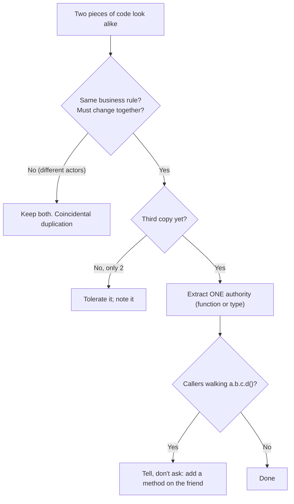

# Core Design Principles — DRY, KISS, YAGNI, Law of Demeter

> **Prerequisites:** [01 · Classes & Objects](../01-classes-objects-and-oop-building-blocks/README.md), [04 · SOLID](../04-solid-principles/README.md)  
> **Reading time:** ~22 minutes (plus ~8 to run the demos)  
> **Audience:** LLD interviews and day-to-day design reviews

> [!NOTE]
> **In one line:** DRY, KISS, YAGNI, and the Law of Demeter are everyday rules that stop you from over-abstracting, over-building, and writing train-wreck call chains.

> [!TIP]
> **Golden rule:** **Duplication is cheaper than the wrong abstraction.** Wait for the Rule of Three before extracting shared code. Talk only to immediate collaborators (`Tell, don't ask`).

> [!TIP]
> **Try it:** In [LLD Studio](/tools/lld-studio/), draw `Order → Customer → Wallet` vs a single `Customer.pay()` edge — then run the Python demos below. More exercises in [section 10](#10-try-it).

---

## 1. When this shows up in an interview

Interviewer: *"You have three similar payment helpers. Would you extract a base class?"*
Or, mid-design: *"Why is there a `PluginManager` here? We have one provider."*
Or, reading your code: *"What does `order.getCustomer().getWallet().deduct()` couple you to?"*

They want **YAGNI + Rule of Three + "coincidental vs essential" DRY + Tell-don't-ask**, not a pattern dump. Use this to decide *before you add a class*:



SOLID ([04](../04-solid-principles/README.md)) shapes classes. These heuristics shape the **everyday decisions** between two designs.

---

## 2. Cheat view

| Principle | Means | Smell | Overuse failure |
| :--- | :--- | :--- | :--- |
| **DRY** | One authority for a *business* rule | Same tax formula copied in 4 services | Merging two domains that only *look* alike |
| **KISS** | Simplest design that meets the requirement | AbstractFactory-for-two-cases | Spaghetti with zero boundaries |
| **YAGNI** | Ship today's need | "Configurable plugin framework" for one caller | Refusing a known, imminent extension point |
| **Law of Demeter** | Talk to friends, not strangers | `a.getB().getC().charge()` | Dozens of empty forwarder methods |

---

## 3. DRY — essential vs coincidental (runnable)

**Essential duplication:** the same rule (VAT) in two places that must stay in sync → one function.
**Coincidental duplication:** `Customer` and `Vendor` both have `name` / `address` today, but change for different actors → **do not** merge.

```python
from dataclasses import dataclass
from decimal import ROUND_DOWN, ROUND_HALF_UP, Decimal

CENT = Decimal("0.01")
VAT_RATE = Decimal("0.075")


# ── BEFORE: the same rule written twice, and the copies drifted ──────
def invoice_vat_old(net: Decimal) -> Decimal:
    return (net * VAT_RATE).quantize(CENT, rounding=ROUND_HALF_UP)

def refund_vat_old(net: Decimal) -> Decimal:
    return (net * VAT_RATE).quantize(CENT, rounding=ROUND_DOWN)   # someone "fixed" one copy


# ── AFTER: one authority. Invoice and refund can no longer disagree ──
def vat(net: Decimal) -> Decimal:
    return (net * VAT_RATE).quantize(CENT, rounding=ROUND_HALF_UP)

class InvoiceService:
    def total(self, net: Decimal) -> Decimal:
        return net + vat(net)

class RefundService:
    def refund(self, net: Decimal) -> Decimal:
        return net + vat(net)       # same RULE → same function


# ── Coincidental: look alike, change for different reasons → keep apart ──
@dataclass
class Customer:
    name: str
    address: str          # changes when a shopper moves (marketing / shipping)

@dataclass
class Vendor:
    name: str
    address: str          # changes with legal entity / tax registration rules


if __name__ == "__main__":
    net = Decimal("10.10")
    print("before:", invoice_vat_old(net), "vs", refund_vat_old(net))   # 0.76 vs 0.75 → 1 cent drift
    print("after :", InvoiceService().total(net), RefundService().refund(net))
```

Expected: `before: 0.76 vs 0.75`, then `after : 10.86 10.86`.

### War story (compressed)

Engineers DRY'd consumer accounts and vendor accounts into one helper. Flags piled up (`isVendor`, `skipVat`, …). A tax hotfix flipped a flag and wrote vendor fields onto 12k consumer rows.

**Fix:** separate types; share only proven domain rules (Rule of Three). Prefer two clear classes over one boolean jungle.

### Rule of Three

1. First copy — write it clear.  
2. Second — maybe still duplicate (could be coincidence).  
3. Third identical *domain* use — extract.

---

## 4. KISS and YAGNI

**KISS:** prefer a plain function / one class over a pattern you cannot justify in one sentence.

**YAGNI:** don't build the "future multi-tenant plugin bus" for a single payment provider.

```python
# YAGNI-violating: one provider today, a framework tomorrow (that never comes)
class PaymentPluginRegistry:
    def __init__(self): self._plugins = {}
    def register(self, name, factory, *, priority=0, tags=()): ...
    def resolve(self, name, *, context=None): ...

# KISS/YAGNI: what the requirement actually needs
def charge_card(card_token: str, cents: int) -> bool:
    return cents > 0 and card_token.startswith("tok_")
```

If the interviewer *already* said "we'll add UPI and wallets next quarter," a `PaymentGateway` interface is justified — that's foresight from a real requirement, not speculation. See the Strategy example in [04](../04-solid-principles/README.md).

**Simple ≠ easy.** Easy is "add another flag to the God method." Simple is "two small types that don't tangle."

---

## 5. Law of Demeter — kill the train wreck

```text
❌  order.get_customer().get_wallet().deduct(50)
✅  customer.pay(50)   # Customer talks to Wallet; caller talks only to Customer
```

A method may call: itself, its fields, its parameters, and objects it creates — not "reach through" friends of friends.

### Walkthrough + code

**Requirement:** charge a customer's wallet without exposing wallet internals to checkout.
**Entities:** `Wallet` (owns balance), `Customer` (owns a wallet), `Checkout` (orchestrates).
**Key methods:** `Wallet.deduct`, `Customer.pay`, `Checkout.charge`.
**Extension point:** swap `Wallet` for `CreditLine` behind `Customer.pay` and `Checkout` never changes.

````carousel
```python
import threading
from concurrent.futures import ThreadPoolExecutor


class Wallet:
    def __init__(self, balance_cents: int) -> None:
        self._balance = balance_cents
        self._lock = threading.Lock()

    def deduct(self, cents: int) -> bool:
        if cents <= 0:
            raise ValueError("amount must be positive")       # policy lives next to the data
        with self._lock:                                      # check-then-act must be atomic
            if self._balance < cents:
                return False
            self._balance -= cents
            return True

    @property
    def balance(self) -> int:
        return self._balance


class Customer:
    def __init__(self, wallet: Wallet) -> None:
        if wallet is None:
            raise ValueError("wallet required")               # fail at construction, not per call
        self._wallet = wallet

    def pay(self, cents: int) -> bool:
        """Tell, don't ask — callers never touch Wallet."""
        return self._wallet.deduct(cents)


class Checkout:
    def charge(self, customer: Customer, cents: int) -> None:
        if not customer.pay(cents):
            raise ValueError("insufficient funds")


if __name__ == "__main__":
    c = Customer(Wallet(10_000))
    Checkout().charge(c, 4_000)
    print("ok")

    # Edge: 10 concurrent payments of 2,000 against a 10,000 balance. Exactly 5 may succeed.
    shared = Customer(Wallet(10_000))
    with ThreadPoolExecutor(max_workers=10) as pool:
        results = list(pool.map(lambda _: shared.pay(2_000), range(10)))
    print(results.count(True), "succeeded")        # 5 succeeded
```
<!-- slide -->
```csharp
public sealed class Wallet
{
    private readonly object _gate = new();
    private long _balanceCents;
    public Wallet(long balanceCents) => _balanceCents = balanceCents;

    public bool Deduct(long cents)
    {
        if (cents <= 0) throw new ArgumentOutOfRangeException(nameof(cents));
        lock (_gate)                       // check-then-act must be atomic
        {
            if (_balanceCents < cents) return false;
            _balanceCents -= cents;
            return true;
        }
    }
}

public sealed class Customer
{
    private readonly Wallet _wallet;
    public Customer(Wallet wallet) =>
        _wallet = wallet ?? throw new ArgumentNullException(nameof(wallet));

    public bool Pay(long cents) => _wallet.Deduct(cents);
}

public sealed class Checkout
{
    public void Charge(Customer customer, long cents)
    {
        if (!customer.Pay(cents))
            throw new InvalidOperationException("insufficient funds");
    }
}
```
````

**Edges:** null wallets and non-positive amounts belong inside `Wallet`/`Customer`, not in every caller — that is also LoD (hide the policy next to the data). The balance check and the debit must be one atomic step, otherwise two threads both see "enough" and overdraw. More in [10 · Concurrency-Safe Design](../10-concurrency-safe-design/README.md).

---

## 6. When *not* to apply these religiously

| Temptation | Better move |
| :--- | :--- |
| DRY two screens that share layout by accident | Leave them; extract only shared *domain* |
| KISS so hard you inline SQL in the controller forever | Keep a thin repository when persistence will change |
| YAGNI against a stated roadmap ("must support Stripe + PayPal") | Introduce the interface now |
| LoD wrappers for every field (`getName()` → `customerName()`) | Only hide chains that create coupling. Fluent builders and immutable value objects (`order.total.currency`) are fine |

---

## 7. Anti-patterns

| Wrong design | Why it hurts | Fix |
| :--- | :--- | :--- |
| Flag-driven "DRY" helper (`isVendor`, `skipVat`) | Every caller's change risks everyone else | Separate types, or Strategy per variant |
| Speculative framework for one caller | Cost now, benefit never | Delete it until a second real caller exists |
| Train wreck in the controller (`a.b.c.d()`) | Controller is coupled to three classes' internals | Push behavior into the aggregate (`customer.pay`) |
| Extracting after the *first* copy | Locks in a guess about what varies | Rule of Three |
| "Utils" dumping ground | Unrelated rules glued by file name | Name by domain: `Money`, `TaxPolicy` |

---

## 8. What you'd say in two minutes

> "I'd separate coincidental from essential duplication — I won't merge Customer and Vendor just because fields look alike, but I will keep one VAT function so invoices and refunds can't drift by a cent. I'd use the Rule of Three before extracting. I'd keep the design as small as the stated requirements — YAGNI — unless you've already named tomorrow's providers, in which case an interface is justified. For object graphs I'd Tell, Don't Ask so checkout never walks `customer.wallet.gateway`, and I'd keep validation and locking next to the balance so every caller gets them for free. If something looks clever, I'd ask whether a simpler version still answers the prompt."

---

## 9. Interview questions

<details>
<summary><strong>1. Essential vs coincidental duplication? [BASIC]</strong></summary>

Essential = same business rule must stay in sync → DRY. Coincidental = similar shape, different actors → keep separate.

</details>

<details>
<summary><strong>2. What does KISS mean here? [BASIC]</strong></summary>

Fewest entangled parts that meet the requirement. Prefer clear types over clever indirection you cannot explain.

</details>

<details>
<summary><strong>3. What is YAGNI? [BASIC]</strong></summary>

Don't build speculative features. Do add extension points when the requirement (or interviewer) already makes them real.

</details>

<details>
<summary><strong>4. State the Law of Demeter in one line. [BASIC]</strong></summary>

A method talks only to itself, its fields, its args, and objects it creates — not friends-of-friends.

</details>

<details>
<summary><strong>5. Three nearly identical validators — extract now? [SCENARIO]</strong></summary>

Ask if they encode the *same* rule. If yes and it's the third copy, extract. If they serve different actors, leave the duplicate for now.

</details>

<details>
<summary><strong>6. Refactor `order.getCustomer().getWallet().deduct(x)`. [SCENARIO]</strong></summary>

`customer.pay(x)` or `order.charge(x)` that owns the collaboration. Checkout depends on one friend. Mention that `Wallet.deduct` must make check-and-debit atomic if payments can overlap.

</details>

<details>
<summary><strong>7. When is duplication the right call? [TRICKY]</strong></summary>

When abstraction would couple unrelated change rates (Sandi Metz): two copies that diverge cleanly beat one shared method full of flags.

</details>

<details>
<summary><strong>8. YAGNI vs Open/Closed — conflict? [TRICKY]</strong></summary>

No. OCP says *how* to extend when you extend. YAGNI says *when*. Introduce the interface when change is known or already repeating — not for imaginary plugins.

</details>

---

## 10. Try it

1. Run the two Python blocks. Change `refund_vat_old` back to `ROUND_HALF_UP` — notice the bug *vanishes silently* until someone edits one copy. That's the DRY risk.
2. Add a third service (`CreditNoteService`) that needs VAT. This is your Rule-of-Three moment: does it call `vat()` or write a new copy?
3. Add `Wallet.refund(cents)` and keep `Checkout` unchanged — if you had to touch `Checkout`, find the leak.
4. In [LLD Studio](/tools/lld-studio/), draw both the chain (`Order → Customer → Wallet`) and the single-edge version. Count the classes `Checkout` depends on in each.
5. Apply the rules in a full problem: [Parking Lot](../12-parking-lot-and-elevator/README.md).

---

## 11. One-page cheat sheet

```text
DRY   Same business rule → one place. Same-looking fields ≠ same domain.
KISS  Simplest design that passes the requirement. Explain it in one sentence.
YAGNI Build today. Interface only when the next variant is real.
LoD   No a.getB().getC(). Tell the friend; hide the chain.
Rule of Three  Wait for 3 real copies before abstracting.
Motto  Duplication < wrong abstraction.

Guard next to the data: validate, lock, and null-check inside Wallet/Customer.
Interview line: "Is this the SAME rule, or does it just LOOK the same?"
```

---

## Next

**[06 · Creational Patterns](../06-creational-patterns/README.md)** — Singleton, Factory, Builder, Prototype — when they earn their complexity.
