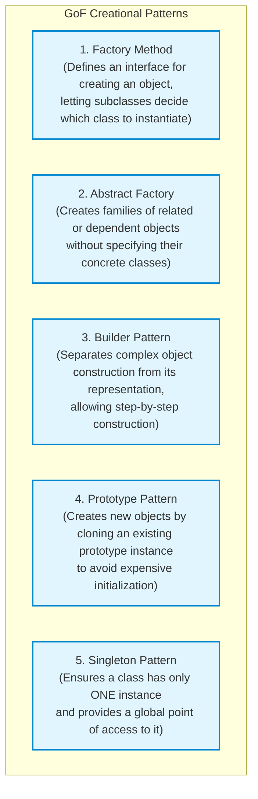
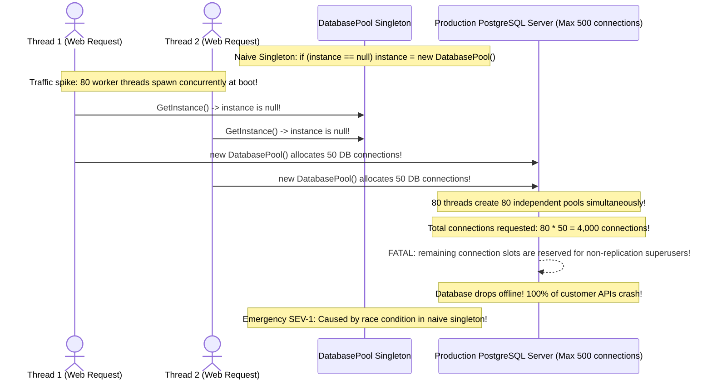

# Module 06: Creational Design Patterns

> **Prerequisites:** Module 01 (Classes and Objects), Module 04 (SOLID Principles).  
> **Estimated Reading Time:** 25 minutes  
> **Target Audience:** Software Engineers, Backend Architects, Low-Level Design Candidates.

> [!TIP]
> **The Golden Rule of Creational Patterns:** Decouple **object creation** from **object usage**. When application code uses raw `new ConcreteClass()` throughout its business logic, it hardcodes dependencies and violates the Open/Closed Principle. Use **Factories** to instantiate polymorphic subtypes based on configuration, **Builders** to assemble complex objects with many optional parameters, and ensure that **Singletons** use thread-safe double-checked locking or modern Dependency Injection lifecycles.

---

## 1. Architectural Mental Model: The Creational Pattern Taxonomy

Creational patterns abstract the instantiation process, making a system independent of how its objects are created, composed, and represented:



---

## 2. Taxonomic Reference: Creational Patterns Comparison

| Pattern | Problem Solved | Core Mechanics | Anti-Pattern or Risk if Misused |
| :--- | :--- | :--- | :--- |
| **Factory Method** | Client cannot anticipate the exact class of objects it must create. | Creator class defines abstract `CreateProduct()`; subclasses override to return specific concrete products. | Exploding class hierarchies (creating parallel creator classes for every product). |
| **Abstract Factory** | System must be independent of how families of related products are created. | Factory interface declares creation methods for each product family (e.g. `CreateButton()`, `CreateCheckbox()`). | Difficult to add new product types (requires updating all concrete factories). |
| **Builder** | Constructing complex objects with 6+ parameters or multi-step assembly. | Builder class with fluent methods (`SetTimeout()`, `SetRetries()`) and terminal `Build()` method. | Overkill for simple immutable value objects with 2-3 fields. |
| **Prototype** | Creating an object is computationally expensive (heavy DB query, network parse). | Implements a `Clone()` method performing shallow or deep memory cloning. | Circular object reference cloning bugs and deep pointer aliasing. |
| **Singleton** | System requires strictly one coordinator (e.g. Logger, Hardware Driver). | Private constructor + static instance field + static thread-safe accessor method. | **Global mutable state**, hidden dependencies, prevents unit testing isolation. |

---

## 3. Systematic Breakdown: Thread-Safe Singleton Architecture

A naive singleton is dangerous in multi-threaded environments. The **Double-Checked Locking Pattern** avoids locking overhead on every read while guaranteeing single-instance initialization:

```
  THREAD 1                                 THREAD 2
  ───────────────────────────────────────  ───────────────────────────────────────
  1. Check: instance == null? (YES)        1. Check: instance == null? (YES)
  2. Acquire exclusive Mutex Lock          2. Attempt to acquire Mutex (BLOCKED!)
  3. Re-Check: instance == null? (YES)
  4. Allocate memory & Assign instance
  5. Release Mutex Lock ─────────────────▶ 3. Unblocked! Enters Lock
                                           4. Re-Check: instance == null? (NO!)
                                           5. Release Mutex Lock (Skips creation!)
```

In modern languages, use built-in thread-safe mechanisms:
* **C#:** `Lazy<T>` (Thread-safe by default).
* **Go:** `sync.Once` (Guaranteed hardware-level atomic single execution).
* **Python / Node.js:** Modules are singletons by default (cached in `sys.modules` / `require.cache`).

---

## 4. Production War Story: The Naive Singleton Connection Pool Explosion



### The Incident
Following a major cloud deployment, a high-throughput microservice launched. Within 12 seconds of boot, the production PostgreSQL cluster crashed with:
`FATAL: sorry, too many clients already`.
The application was configured with a connection pool size of 50, well within the database's 500-connection limit.

### The Post-Mortem Data
* **Severity:** SEV-1 (Database Connection Saturation Outage)
* **Mean Time to Detect (MTTD):** 10 minutes
* **Mean Time to Resolution (MTTR):** 30 minutes

### The Root Cause
The database manager was implemented as a naive singleton:
```csharp
// ❌ ANTI-PATTERN: Non-thread-safe singleton
public class DatabasePool {
    private static DatabasePool _instance;
    public static DatabasePool Instance {
        get {
            if (_instance == null) {
                _instance = new DatabasePool(); // 💥 RACE CONDITION!
            }
            return _instance;
        }
    }
}
```
When the web server started, 80 worker threads executed `Instance` concurrently. Because checking and assigning were not synchronized, multiple threads evaluated `_instance == null` before any thread could finish allocating the object. 

The application instantiated dozens of separate connection pools, opening thousands of TCP connections to PostgreSQL and crashing the database.

### The Fix & Hardening
1. **Thread-Safe Lazy Initialization:**
```csharp
public class DatabasePool {
    private static readonly Lazy<DatabasePool> _instance = 
        new Lazy<DatabasePool>(() => new DatabasePool());

    public static DatabasePool Instance => _instance.Value;
    private DatabasePool() { /* Initialize 50 connections */ }
}
```
2. **In Go:** Use `sync.Once`:
```go
var (
    instance *DatabasePool
    once     sync.Once
)

func GetDatabasePool() *DatabasePool {
    once.Do(func() {
        instance = &DatabasePool{ /* initialize */ }
    })
    return instance
}
```

---

## 5. Multi-Language Production Code: Factory Method & Fluent Builder Patterns

Below is an enterprise notification dispatcher using the **Factory Method** to instantiate delivery channels, and the **Builder Pattern** to construct complex notification payloads.

### Python
```python
from __future__ import annotations
from abc import ABC, abstractmethod
from typing import Optional, List

# --- The Builder Pattern: Notification Payload ---
class Notification:
    def __init__(self, builder: NotificationBuilder):
        self.recipient: str = builder.recipient
        self.subject: Optional[str] = builder.subject
        self.body: str = builder.body
        self.tags: List[str] = builder.tags

class NotificationBuilder:
    def __init__(self, recipient: str):
        self.recipient = recipient
        self.subject: Optional[str] = None
        self.body: str = ""
        self.tags: List[str] = []

    def with_subject(self, subject: str) -> NotificationBuilder:
        self.subject = subject
        return self

    def with_body(self, body: str) -> NotificationBuilder:
        self.body = body
        return self

    def add_tag(self, tag: str) -> NotificationBuilder:
        self.tags.append(tag)
        return self

    def build(self) -> Notification:
        if not self.body:
            raise ValueError("Notification must have a body.")
        return Notification(self)

# --- The Factory Method Pattern ---
class NotificationSender(ABC):
    @abstractmethod
    def send(self, n: Notification) -> None: pass

class EmailSender(NotificationSender):
    def send(self, n: Notification) -> None:
        print(f"📧 Email to {n.recipient}: [{n.subject}] {n.body}")

class SenderFactory:
    @staticmethod
    def create_sender(channel_type: str) -> NotificationSender:
        if channel_type.lower() == "email":
            return EmailSender()
        raise ValueError(f"Unsupported channel: {channel_type}")

if __name__ == "__main__":
    msg = NotificationBuilder("user@company.com") \
        .with_subject("Invoice Paid") \
        .with_body("Payment of $149.99 received.") \
        .add_tag("billing") \
        .build()

    sender = SenderFactory.create_sender("email")
    sender.send(msg)
```

### C# (.NET)
```csharp
using System;
using System.Collections.Generic;

// --- Builder Pattern ---
public class EmailMessage
{
    public string Recipient { get; }
    public string Subject { get; }
    public string Body { get; }
    public IReadOnlyList<string> Attachments { get; }

    internal EmailMessage(Builder builder)
    {
        Recipient = builder.Recipient;
        Subject = builder.Subject;
        Body = builder.Body;
        Attachments = builder.Attachments.AsReadOnly();
    }

    public class Builder
    {
        public string Recipient { get; }
        public string Subject { get; private set; } = string.Empty;
        public string Body { get; private set; } = string.Empty;
        public List<string> Attachments { get; } = new();

        public Builder(string recipient)
        {
            Recipient = recipient ?? throw new ArgumentNullException(nameof(recipient));
        }

        public Builder WithSubject(string subject) { Subject = subject; return this; }
        public Builder WithBody(string body) { Body = body; return this; }
        public Builder AddAttachment(string path) { Attachments.Add(path); return this; }

        public EmailMessage Build()
        {
            if (string.IsNullOrEmpty(Body)) throw new InvalidOperationException("Email body cannot be empty");
            return new EmailMessage(this);
        }
    }
}
```

### Go
```go
package main

import (
	"errors"
	"fmt"
	"sync"
)

// Thread-Safe Singleton via sync.Once
type ConfigManager struct {
	settings map[string]string
}

var (
	configInstance *ConfigManager
	configOnce     sync.Once
)

func GetConfig() *ConfigManager {
	configOnce.Do(func() {
		configInstance = &ConfigManager{
			settings: map[string]string{"ENV": "production", "PORT": "8080"},
		}
	})
	return configInstance
}

// Functional Options Pattern (Idiomatic Go Builder)
type Client struct {
	timeoutSeconds int
	retries        int
}

type ClientOption func(*Client)

func WithTimeout(sec int) ClientOption {
	return func(c *Client) { c.timeoutSeconds = sec }
}

func WithRetries(r int) ClientOption {
	return func(c *Client) { c.retries = r }
}

func NewClient(opts ...ClientOption) *Client {
	c := &Client{timeoutSeconds: 30, retries: 3} // Defaults
	for _, opt := range opts {
		opt(c)
	}
	return c
}

func main() {
	client := NewClient(WithTimeout(10), WithRetries(5))
	fmt.Printf("Client configured: Timeout=%ds, Retries=%d\n", client.timeoutSeconds, client.retries)
}
```

### TypeScript / Node.js
```typescript
// Abstract Factory Pattern
interface Button { render(): string; }
interface Checkbox { toggle(): string; }

interface GUIFactory {
  createButton(): Button;
  createCheckbox(): Checkbox;
}

class DarkThemeFactory implements GUIFactory {
  createButton(): Button { return { render: () => 'Dark Button' }; }
  createCheckbox(): Checkbox { return { toggle: () => 'Dark Checkbox Checked' }; }
}

class LightThemeFactory implements GUIFactory {
  createButton(): Button { return { render: () => 'Light Button' }; }
  createCheckbox(): Checkbox { return { toggle: () => 'Light Checkbox Checked' }; }
}

export function renderUI(factory: GUIFactory) {
  const btn = factory.createButton();
  const chk = factory.createCheckbox();
  console.log(`Rendered: ${btn.render()} and ${chk.toggle()}`);
}
```

---

## 6. Practical Hands-On Verification CLI Workflows

Verify thread-safe singleton initialization using Python concurrent futures:

### Workflow 1: Verify Singleton Thread-Safety
```bash
python3 -c '
import threading
import time

class ThreadSafeSingleton:
    _instance = None
    _lock = threading.Lock()

    def __new__(cls):
        if cls._instance is None:
            with cls._lock:
                if cls._instance is None:
                    time.sleep(0.01) # Simulate complex setup
                    cls._instance = super().__new__(cls)
        return cls._instance

instances = []
def worker():
    instances.append(id(ThreadSafeSingleton()))

threads = [threading.Thread(target=worker) for _ in range(50)]
for t in threads: t.start()
for t in threads: t.join()

unique_ids = set(instances)
print("Unique instance IDs allocated across 50 threads:", len(unique_ids))
assert len(unique_ids) == 1, "Singleton thread-safety breached!"
print("✅ Double-checked locking singleton verified.")
'
```
**Expected Output:**
```text
Unique instance IDs allocated across 50 threads: 1
✅ Double-checked locking singleton verified.
```

---

## 7. Operational Validation Checkpoint

<details>
<summary><strong>Question 1: Factory Method vs. Abstract Factory</strong></summary>

**Scenario:** In an interview, the interviewer asks: "What is the structural and conceptual difference between the Factory Method pattern and the Abstract Factory pattern?"

How do you distinguish them clearly?

**Answer:**
* **Factory Method** uses **Class Inheritance**: It defines a single method (`CreateProduct()`) in a base creator class, and leaves it to derived subclasses to decide which concrete product class to instantiate. It creates **one product**.
* **Abstract Factory** uses **Object Composition**: It defines an interface with multiple creation methods (`CreateButton()`, `CreateCheckbox()`, `CreateScrollbar()`) to produce **families of related or dependent products** without specifying their concrete classes. Clients are injected with the factory object.
</details>

<details>
<summary><strong>Question 2: Why the Singleton Pattern is Considered an Anti-Pattern</strong></summary>

**Scenario:** A software architect flags a PR where a developer introduced five new Singleton classes for user sessions, caching, and repository access. 

Why do modern software architectures discourage singletons in favor of Dependency Injection?

**Answer:**
Singletons introduce four severe architectural liabilities:
1. **Global Mutable State:** Any module in the codebase can access and mutate the singleton from anywhere, leading to unpredictable side effects and hidden coupling.
2. **Breaks Unit Testing:** Singletons cannot be easily mocked or stubbed. Test cases leak state into subsequent test cases, causing flaky tests.
3. **Hidden Dependencies:** A class calling `DatabasePool.Instance.Query()` hides its dependencies; looking at its constructor signature does not reveal that it requires a database.
4. **Violates Single Responsibility:** The class manages its business domain logic *and* strictly controls its own lifecycle.
</details>

<details>
<summary><strong>Question 3: When to Use the Builder Pattern Over Telescoping Constructors</strong></summary>

**Scenario:** A class has 8 configuration properties, 6 of which are optional. A junior developer creates 6 overloaded constructors (telescoping constructor anti-pattern).

Why is the Builder pattern superior here?

**Answer:**
Telescoping constructors (`new Config(a)`, `new Config(a, b)`, `new Config(a, b, c, d)`) are:
1. **Hard to Read and Error-Prone:** Callers can easily swap two arguments of the same type (`int timeout, int retries`) without compiler errors.
2. **Inflexible:** If a caller wants to specify the 8th parameter with defaults for parameters 2 through 7, they must pass `null` or dummy values for all preceding arguments.

The **Builder Pattern** allows callers to set only the parameters they care about using intent-revealing names (`.WithTimeout(10).WithRetries(3)`), enforces invariants in `.Build()`, and produces an immutable final object.
</details>

---

## Next Step

Now that you understand creational design patterns, proceed to **[07 · Structural Patterns: Adapter, Decorator, Facade, and Proxy](../07-structural-patterns/README.md)** to master assembling classes and objects into resilient, larger architectures.
