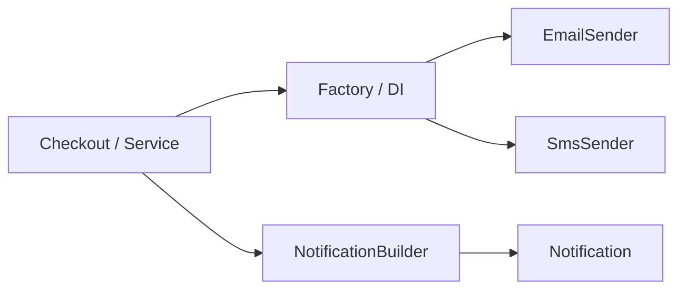

# Creational Design Patterns

> **Prerequisites:** [04 · SOLID](../04-solid-principles/README.md), [05 · Core Design Principles](../05-core-design-principles/README.md)  
> **Reading time:** ~25 minutes (plus ~10 to run the demos)  
> **Audience:** LLD / machine-coding rounds where object creation is the design question

> [!NOTE]
> **In one line:** Creational patterns move `new ConcreteThing()` out of business logic so you can swap, assemble, or share instances without rewriting callers.

> [!TIP]
> **Golden rule:** Prefer a **factory or DI** for polymorphic types, a **builder** for many optional fields, and treat **singleton** as a last resort (or as a DI lifetime) — never as a dump for global mutable state.

> [!TIP]
> **Try it:** Model `Notification` + `SenderFactory` in [LLD Studio](/tools/lld-studio/), then run the Python example below.

---

## 1. When this shows up in an interview

Interviewer: *"How would you create the right notification channel from config without `if` soup in the service?"*

Answer shape: name **Factory** (or Abstract Factory for families), show the interface, say where the map/registry lives, mention **Builder** if the payload has many optional parts.



---

## 2. Cheat view

| Pattern | Use when | Skip when |
| :--- | :--- | :--- |
| **Factory Method / Simple Factory** | Choose a subtype from type/config | One concrete class forever |
| **Abstract Factory** | Create a *family* (WinButton + WinCheckbox) | Only one product type |
| **Builder** | 4+ optional fields or multi-step validation | 2–3 required fields → constructor is enough |
| **Prototype** | Clone is cheaper than re-init (heavy graph) | Cheap plain objects |
| **Singleton** | Truly one process-wide resource | “Convenient globals”; prefer DI `scoped`/`singleton` lifetime |

---

## 3. Factory — pick the subtype

**Smell:** `if channel == "email": … elif channel == "sms": …` inside `Checkout`.

**Design:** `NotificationSender` interface + factory/registry that returns implementations. Adding Slack = new class + one registration (OCP).

````carousel
```python
from __future__ import annotations
from abc import ABC, abstractmethod
from typing import Callable


class Notification:
    def __init__(self, recipient: str, body: str, subject: str | None = None) -> None:
        self.recipient = recipient
        self.body = body
        self.subject = subject


class NotificationSender(ABC):
    @abstractmethod
    def send(self, n: Notification) -> None: ...


class EmailSender(NotificationSender):
    def send(self, n: Notification) -> None:
        print(f"email → {n.recipient}: [{n.subject}] {n.body}")


class SmsSender(NotificationSender):
    def send(self, n: Notification) -> None:
        print(f"sms → {n.recipient}: {n.body}")


_REGISTRY: dict[str, Callable[[], NotificationSender]] = {
    "email": EmailSender,
    "sms": SmsSender,
}


def create_sender(channel: str) -> NotificationSender:
    try:
        return _REGISTRY[channel.lower()]()
    except KeyError as e:
        raise ValueError(f"unknown channel: {channel}") from e


# --- Builder for optional payload fields ---
class NotificationBuilder:
    def __init__(self, recipient: str) -> None:
        self._recipient = recipient
        self._body = ""
        self._subject: str | None = None

    def with_subject(self, subject: str) -> NotificationBuilder:
        self._subject = subject
        return self

    def with_body(self, body: str) -> NotificationBuilder:
        self._body = body
        return self

    def build(self) -> Notification:
        if not self._body:
            raise ValueError("body required")
        return Notification(self._recipient, self._body, self._subject)


if __name__ == "__main__":
    msg = (
        NotificationBuilder("user@co.com")
        .with_subject("Paid")
        .with_body("Thanks")
        .build()
    )
    create_sender("email").send(msg)
```
<!-- slide -->
```csharp
public interface INotificationSender
{
    void Send(Notification message);
}

public static class SenderFactory
{
    private static readonly Dictionary<string, Func<INotificationSender>> Registry = new()
    {
        ["email"] = () => new EmailSender(),
        ["sms"] = () => new SmsSender(),
    };

    public static INotificationSender Create(string channel) =>
        Registry.TryGetValue(channel.ToLowerInvariant(), out var make)
            ? make()
            : throw new ArgumentException($"unknown channel: {channel}");
}

public sealed class NotificationBuilder
{
    private readonly string _recipient;
    private string _body = "";
    private string? _subject;

    public NotificationBuilder(string recipient) => _recipient = recipient;
    public NotificationBuilder WithSubject(string s) { _subject = s; return this; }
    public NotificationBuilder WithBody(string b) { _body = b; return this; }

    public Notification Build()
    {
        if (string.IsNullOrEmpty(_body)) throw new InvalidOperationException("body required");
        return new Notification(_recipient, _body, _subject);
    }
}
```
````

### Abstract Factory — a whole matching family

Use it when products must be **consistent with each other** (a Windows button must not sit next to a Mac checkbox). The factory is the guarantee.

```python
from abc import ABC, abstractmethod


class Button(ABC):
    @abstractmethod
    def render(self) -> str: ...

class Checkbox(ABC):
    @abstractmethod
    def render(self) -> str: ...

class WinButton(Button):
    def render(self) -> str: return "[ OK ]"
class MacButton(Button):
    def render(self) -> str: return "( OK )"
class WinCheckbox(Checkbox):
    def render(self) -> str: return "[x]"
class MacCheckbox(Checkbox):
    def render(self) -> str: return "(x)"


class UiFactory(ABC):
    @abstractmethod
    def create_button(self) -> Button: ...
    @abstractmethod
    def create_checkbox(self) -> Checkbox: ...

class WinFactory(UiFactory):
    def create_button(self) -> Button: return WinButton()
    def create_checkbox(self) -> Checkbox: return WinCheckbox()
class MacFactory(UiFactory):
    def create_button(self) -> Button: return MacButton()
    def create_checkbox(self) -> Checkbox: return MacCheckbox()


def render_form(factory: UiFactory) -> str:
    # Client never names a concrete class, and can't mix families by accident.
    return f"{factory.create_button().render()} {factory.create_checkbox().render()}"


if __name__ == "__main__":
    print(render_form(WinFactory()), "|", render_form(MacFactory()))   # [ OK ] [x] | ( OK ) (x)
```

Don't use it for a single product type — that's factory overkill (and adding a new product, e.g. `Slider`, touches every factory).

---

## 4. Builder — assemble carefully

Use when construction has optional fields, defaults, or validation that shouldn't live in an 8-arg constructor. The builder above is the pattern; three rules make it interview-proof:

- `build()` is the **only gate**: validate required fields there, not in setters.
- The product is **immutable** (no setters) so a half-built object never escapes.
- A builder is **not thread-safe and not reusable by default** — one builder per object, or `build()` must copy.

Python note: for simple cases a `@dataclass(frozen=True)` with defaults and keyword arguments *is* the builder. Reach for the fluent class only when validation or multi-step assembly is real.

---

## 5. Prototype — clone expensive state

Use when copying a configured object (parsed schema, warm cache entry) beats reconstructing from scratch. Decide **shallow vs deep** explicitly — shared mutable children are the classic bug:

```python
import copy


class Schema:
    def __init__(self, name: str, fields: list[str]) -> None:
        self.name, self.fields = name, fields

    def clone(self, deep: bool = True) -> "Schema":
        return copy.deepcopy(self) if deep else copy.copy(self)


if __name__ == "__main__":
    base = Schema("order", ["id", "total"])
    s = base.clone(deep=False)
    s.fields.append("coupon")
    print("shallow leaks:", base.fields)        # ['id', 'total', 'coupon']  ← base was mutated

    base = Schema("order", ["id", "total"])
    d = base.clone()
    d.fields.append("coupon")
    print("deep safe   :", base.fields, d.fields)
```

Interview line: *"I'd expose `clone()` only if init cost is proven; otherwise a factory is clearer. If I do, I'd make the copy deep or the children immutable."*

---

## 6. Singleton — one instance, done right

**Smell:** naive lazy init is a race.

````carousel
```python
import threading
import time


class NaivePool:
    _instance = None
    created = 0

    def __init__(self) -> None:
        time.sleep(0.05)                 # stand-in for opening connections
        NaivePool.created += 1

    @classmethod
    def instance(cls) -> "NaivePool":
        if cls._instance is None:        # ← every thread passes this check together
            cls._instance = cls()
        return cls._instance


class SafePool:
    _instance = None
    _lock = threading.Lock()
    created = 0

    def __init__(self) -> None:
        time.sleep(0.05)
        SafePool.created += 1

    @classmethod
    def instance(cls) -> "SafePool":
        if cls._instance is None:                 # fast path, no lock
            with cls._lock:
                if cls._instance is None:         # re-check inside the lock
                    cls._instance = cls()
        return cls._instance


def hammer(get) -> None:
    threads = [threading.Thread(target=get) for _ in range(20)]
    for t in threads: t.start()
    for t in threads: t.join()


if __name__ == "__main__":
    hammer(NaivePool.instance)
    hammer(SafePool.instance)
    print("naive created", NaivePool.created, "| safe created", SafePool.created)  # 20 | 1
```
<!-- slide -->
```csharp
public sealed class DbPool
{
    // Lazy<T> with ExecutionAndPublication: exactly one construction, thread-safe.
    private static readonly Lazy<DbPool> _instance =
        new(() => new DbPool(), LazyThreadSafetyMode.ExecutionAndPublication);

    public static DbPool Instance => _instance.Value;
    private DbPool() { }
}

// Better: no static at all. The container owns the lifetime.
// services.AddSingleton<IDbPool, DbPool>();
```
<!-- slide -->
```go
var (
	pool     *DbPool
	poolOnce sync.Once
)

// Pool returns the process-wide pool; sync.Once guarantees one init.
func Pool() *DbPool {
	poolOnce.Do(func() { pool = newDbPool() })
	return pool
}
```
````

The `NaivePool` demo reliably prints 20 creations here because `__init__` sleeps — in production the window is smaller but the bug is the same.

**War story (compressed):** 80 boot threads all saw `null`, each opened a 50-conn pool → thousands of Postgres connections → SEV-1.

**Fix:** language primitives (`Lazy<T>`, `sync.Once`, Python module import) or **DI container singleton lifetime**. Prefer injecting `IDbPool` over `DatabasePool.Instance` so tests can substitute:

```text
Prefer:  services.AddSingleton<IDbPool, DbPool>()
Avoid:   static mutable Singleton with hidden dependencies
```

**Edges:** a singleton is shared by every thread, so its *state* must be thread-safe too (the pool, not just its construction). Tests that mutate a singleton leak into each other — another reason to inject.

---

## 7. When *not* to use creational patterns

| Pattern theater | Better |
| :--- | :--- |
| Factory for one class | `new` or constructor injection |
| Builder for `(id, name)` | Constructor / dataclass |
| Singleton logger + config + DB | Separate services; inject them |
| Abstract Factory “for flexibility” with one family | Simple factory |

Creational patterns earn their keep when **creation varies** or **assembly is complex**. Otherwise they are YAGNI.

---

## 8. Anti-patterns

| Wrong design | Why it hurts | Fix |
| :--- | :--- | :--- |
| `if channel == "email" … elif …` inside `Checkout` | Every channel edits the hot path | Factory/registry + interface |
| `Config.Instance`, `Logger.Instance`, `Db.Instance` everywhere | Hidden dependencies, order-of-init bugs, untestable | Inject interfaces; one composition root |
| Factory that returns a `Dictionary<string, object>` | Type safety lost; callers cast | Return the interface type |
| Builder that returns a half-valid object | Callers discover missing fields at runtime | Validate in `build()` |
| Prototype with a shallow copy of mutable children | Clone and original silently share state | Deep copy or immutable children |

---

## 9. What you’d say in two minutes

> "I'd keep business code free of concrete `new` for things that vary — a small factory or DI registration picks Email vs SMS. If the message has many optional fields I'd use a builder with validation in `Build`. I'd avoid classic singleton unless we truly need one process instance, and even then I'd expose it as an injected interface with a thread-safe lifetime, not a static `Instance` callers reach for."

---

## 10. Interview questions

<details>
<summary><strong>1. Factory Method vs Simple Factory? [BASIC]</strong></summary>

Simple factory = one function/class that switches on type. Factory Method = creator hierarchy where subclasses override `create()`. Interviews usually accept a registry-based simple factory.

</details>

<details>
<summary><strong>2. When is Builder better than a constructor? [BASIC]</strong></summary>

Many optional fields, readable fluent setup, or multi-step validation before the object exists.

</details>

<details>
<summary><strong>3. Why are naive singletons dangerous? [BASIC]</strong></summary>

Races create multiple instances; they hide dependencies and make tests hard. Use safe lazy init or DI.

</details>

<details>
<summary><strong>4. Abstract Factory vs Factory Method? [BASIC]</strong></summary>

Abstract Factory creates a *family* of related products. Factory Method creates one product type via subclassing/registry.

</details>

<details>
<summary><strong>5. Add Slack without editing Checkout. [SCENARIO]</strong></summary>

`SlackSender` + register in factory/DI. Checkout only depends on `NotificationSender`.

</details>

<details>
<summary><strong>6. Connection pool as singleton under traffic spike. [SCENARIO]</strong></summary>

Thread-safe once-init; cap pool size; inject interface; never construct pools in an unlocked `if null`.

</details>

<details>
<summary><strong>7. Is a Python module a singleton? [TRICKY]</strong></summary>

Yes in practice — imports are cached. Still prefer explicit injection for testability of stateful resources.

</details>

<details>
<summary><strong>8. Prototype vs Factory for config-heavy objects? [TRICKY]</strong></summary>

Prototype when clone cost ≪ rebuild. Factory when construction from parameters is clear and cheap. Measure or justify; don’t default to clone.

</details>

---

## 11. Try it

1. Run the three Python blocks. Confirm `NaivePool` creates 20 instances and `SafePool` creates 1.
2. Add `SlackSender` to the factory registry and send a message — how many existing lines did you edit? (Target: the one registry line.)
3. Make `Notification` a `@dataclass(frozen=True)` and delete the builder. For which cases is that enough, and when do you miss the builder?
4. Model `Notification` + `SenderFactory` in [LLD Studio](/tools/lld-studio/).
5. See factories and singletons under real requirements in [Parking Lot](../12-parking-lot-and-elevator/README.md) (vehicle/spot creation).

---

## 12. One-page cheat sheet

```text
Factory         new subtype from config/type; registry + interface
Abstract Factory families of related products
Builder          many optionals / validated assembly; Build() is the gate
Prototype        clone expensive graphs; define shallow vs deep
Singleton        one instance — Lazy/Once/DI; not a global junk drawer

Interview line: “Creation behind an interface; assembly with builder; share with DI lifetime.”
```

---

## Next

**[07 · Structural Patterns](../07-structural-patterns/README.md)** — Adapter, Decorator, Facade, Proxy, Composite.
