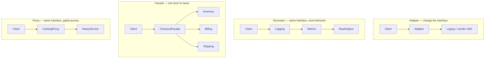

# Structural Design Patterns

> **Prerequisites:** [02 · OOP & UML](../02-oop-foundations-and-uml/README.md), [04 · SOLID](../04-solid-principles/README.md), [06 · Creational](../06-creational-patterns/README.md)  
> **Reading time:** ~30 minutes (plus ~10 to run the demos)  
> **Audience:** LLD / machine-coding rounds — especially “wrap this without rewriting the client”

> [!NOTE]
> **In one line:** Structural patterns compose objects into larger structures — **Adapter** changes an interface, **Decorator** adds behavior with the *same* interface, **Facade** simplifies many APIs into one, **Proxy** controls access with the *same* interface, **Composite** treats trees uniformly.

> [!TIP]
> **Golden rule:** Before you wrap anything, say *why*: compatibility (Adapter), features (Decorator), simplification (Facade), or control (Proxy). Same shape, different intent — interviewers grade the intent.

> [!TIP]
> **Try it:** Draw the four wrapper shapes in [LLD Studio](/tools/lld-studio/), then run the Python Adapter + Decorator example below.

---

## 1. Interview pressure

Interviewer: *"We must call Stripe’s SDK, but our checkout only knows `PaymentGateway.charge(userId, cents)`. Also add timing logs without editing the repository class."*

You need **Adapter** (foreign interface → ours) and **Decorator** (same interface + telemetry). Mixing them up is a common fail.



---

## 2. Comparison matrix (memorize this)

| Pattern | Intent | Interface vs inner | Classic smell it fixes |
| :--- | :--- | :--- | :--- |
| **Adapter** | Make incompatible APIs work together | **Different** (Target ≠ Adaptee) | `if vendor == stripe: call differently` |
| **Decorator** | Add responsibilities dynamically | **Same** | Subclass explosion (`LoggedCachedRepo`) |
| **Facade** | Hide a subsystem behind one API | **New, simpler** | God client calling 8 services |
| **Proxy** | Control access (cache, lazy, auth, remote) | **Same** | Clients construct expensive objects eagerly |
| **Composite** | Part–whole trees, uniform API | Leaf and composite share type | `if isDirectory: … else …` everywhere |
| **Bridge** | Vary abstraction ⊥ implementation | Two hierarchies | `WindowsButton`, `MacButton`, `WindowsCheckbox`… |
| **Flyweight** | Share immutable intrinsic state | Shared + extrinsic context | Millions of identical glyph/style objects |

### Wrapper cheat (say this out loud)

```text
Adapter   incompatible → compatible     (translate)
Decorator same → same + extras          (stack features)
Facade    many → one simple             (orchestrate)
Proxy     same → same + gate            (control / virtualize)
```

**Decorator vs Proxy:** both keep the interface. Decorator *adds* behavior the client wants; Proxy *restricts or defers* access (cache miss, auth, lazy load). If the client asked for “logging around every call,” that is Decorator. If the client should not know a remote stub exists, that is Proxy.

---

## 3. Walkthrough — Adapter + Decorator in one checkout path

**Requirements**

1. Domain depends on `PaymentGateway.charge(user_id, amount_cents) -> bool`.  
2. Vendor SDK exposes `make_transaction(token, dollars) -> str`.  
3. `UserRepository.get_user` must log latency **without** editing the SQL class.

````carousel
```python
from __future__ import annotations
from abc import ABC, abstractmethod
import time


# ── Adapter: vendor shape → domain shape ─────────────────────────────
class PaymentGateway(ABC):
    @abstractmethod
    def charge(self, user_id: str, amount_cents: int) -> bool: ...


class StripeLegacyApi:
    """Third-party shape we do not own."""

    def make_transaction(self, customer_token: str, dollars: float) -> str:
        print(f"stripe charged ${dollars:.2f} to {customer_token}")
        return "tx_success_99"


class StripeAdapter(PaymentGateway):
    def __init__(self, stripe: StripeLegacyApi) -> None:
        self._stripe = stripe

    def charge(self, user_id: str, amount_cents: int) -> bool:
        token = f"tok_{user_id}"
        result = self._stripe.make_transaction(token, amount_cents / 100.0)
        return result.startswith("tx_success")


# ── Decorator: same interface, add timing ────────────────────────────
class UserRepository(ABC):
    @abstractmethod
    def get_user(self, user_id: str) -> dict: ...


class SqlUserRepository(UserRepository):
    def get_user(self, user_id: str) -> dict:
        time.sleep(0.01)  # stand-in for I/O
        return {"id": user_id, "name": "Asha"}


class TimedUserRepository(UserRepository):
    def __init__(self, inner: UserRepository) -> None:
        self._inner = inner

    def get_user(self, user_id: str) -> dict:
        start = time.perf_counter()
        data = self._inner.get_user(user_id)
        ms = (time.perf_counter() - start) * 1000
        print(f"telemetry get_user={ms:.2f}ms")
        return data


if __name__ == "__main__":
    assert StripeAdapter(StripeLegacyApi()).charge("42", 5000)
    print(TimedUserRepository(SqlUserRepository()).get_user("42"))
```
<!-- slide -->
```csharp
public interface IPaymentProcessor
{
    bool ProcessPayment(string accountId, decimal amount);
}

public sealed class PayPalSdk
{
    public int SendMoney(decimal usd, string email)
    {
        Console.WriteLine($"[PayPal] Sent ${usd} to {email}");
        return 200;
    }
}

public sealed class PayPalAdapter : IPaymentProcessor
{
    private readonly PayPalSdk _sdk;
    public PayPalAdapter(PayPalSdk sdk) => _sdk = sdk;

    public bool ProcessPayment(string accountId, decimal amount) =>
        _sdk.SendMoney(amount, $"{accountId}@example.com") == 200;
}

public interface IUserRepository
{
    UserDto GetUser(string userId);
}

public sealed class LoggingUserRepository : IUserRepository
{
    private readonly IUserRepository _inner;
    public LoggingUserRepository(IUserRepository inner) => _inner = inner;

    public UserDto GetUser(string userId)
    {
        Console.WriteLine($"get_user {userId}");
        return _inner.GetUser(userId);
    }
}
```
````

**Extension points:** new vendor → new Adapter; new cross-cutting concern → new Decorator wrapping the same interface. Checkout never imports Stripe types (DIP).

---

## 4. Facade, Proxy, Composite — runnable

One block, three patterns. Run it; the expected output is under the code.

```python
from __future__ import annotations

import threading
import time
from abc import ABC, abstractmethod
from dataclasses import dataclass
from typing import Callable, Optional


# ── Composite: leaf and group share one interface ─────────────────────
class FsNode(ABC):
    @abstractmethod
    def size(self) -> int: ...


class File(FsNode):
    def __init__(self, name: str, size_bytes: int) -> None:
        self.name, self._size = name, size_bytes

    def size(self) -> int:
        return self._size


class Directory(FsNode):
    def __init__(self, name: str) -> None:
        self.name = name
        self._children: list[FsNode] = []

    def add(self, node: FsNode) -> "Directory":
        if node is self:
            raise ValueError("a directory cannot contain itself")   # cycles → infinite recursion
        self._children.append(node)
        return self

    def size(self) -> int:
        return sum(child.size() for child in self._children)       # client never branches on leaf/node


# ── Proxy: same interface, controlled access (cache with TTL) ─────────
class ProductService(ABC):
    @abstractmethod
    def get(self, product_id: str) -> dict: ...


class SlowProductService(ProductService):
    def __init__(self) -> None:
        self.calls = 0

    def get(self, product_id: str) -> dict:
        self.calls += 1                                   # stand-in for a slow DB / network hop
        return {"id": product_id, "price_cents": 1999}


class CachingProductProxy(ProductService):
    def __init__(self, inner: ProductService, ttl_s: float = 30.0,
                 clock: Callable[[], float] = time.monotonic) -> None:
        self._inner, self._ttl, self._clock = inner, ttl_s, clock
        self._cache: dict[str, tuple[float, dict]] = {}
        self._lock = threading.Lock()

    def get(self, product_id: str) -> dict:
        now = self._clock()
        with self._lock:
            hit = self._cache.get(product_id)
            if hit and now - hit[0] < self._ttl:
                return dict(hit[1])                       # copy: callers can't corrupt the cache
        value = self._inner.get(product_id)               # slow call OUTSIDE the lock
        with self._lock:
            self._cache[product_id] = (now, value)
        return dict(value)


# ── Facade: one door to inventory + billing + shipping ────────────────
class Inventory:
    def in_stock(self, sku: str) -> bool:
        return sku != "sold-out"


class Billing:
    def __init__(self) -> None:
        self.refunds = 0

    def charge(self, cents: int) -> bool:
        return cents > 0

    def refund(self, cents: int) -> None:
        self.refunds += 1


class Shipping:
    def schedule(self, sku: str) -> str:
        if sku == "bulky":
            raise RuntimeError("no carrier")
        return f"trk-{sku}"


@dataclass(frozen=True)
class CheckoutResult:
    ok: bool
    tracking: Optional[str] = None
    reason: str = ""


class CheckoutFacade:
    """Thin orchestration. Business rules stay in the subsystems."""

    def __init__(self, inventory: Inventory, billing: Billing, shipping: Shipping) -> None:
        self._inventory, self._billing, self._shipping = inventory, billing, shipping

    def checkout(self, sku: str, cents: int) -> CheckoutResult:
        if not self._inventory.in_stock(sku):
            return CheckoutResult(False, reason="out of stock")
        if not self._billing.charge(cents):
            return CheckoutResult(False, reason="payment declined")
        try:
            return CheckoutResult(True, tracking=self._shipping.schedule(sku))
        except Exception:                                  # a facade is NOT a transaction
            self._billing.refund(cents)                    # so compensate explicitly
            return CheckoutResult(False, reason="shipping failed, refunded")


if __name__ == "__main__":
    root = Directory("root").add(File("a.txt", 100)).add(Directory("docs").add(File("b.md", 50)))
    print("composite size:", root.size())                  # 150

    slow = SlowProductService()
    fake_now = [0.0]
    cached = CachingProductProxy(slow, ttl_s=30, clock=lambda: fake_now[0])
    cached.get("p1"); cached.get("p1")                     # 2nd call is a cache hit
    fake_now[0] = 31.0                                     # TTL expired
    cached.get("p1")
    print("backend calls:", slow.calls)                    # 2

    billing = Billing()
    shop = CheckoutFacade(Inventory(), billing, Shipping())
    print(shop.checkout("book", 1500))
    print(shop.checkout("sold-out", 1500))
    print(shop.checkout("bulky", 1500), "refunds:", billing.refunds)
```

Expected output:

```text
composite size: 150
backend calls: 2
CheckoutResult(ok=True, tracking='trk-book', reason='')
CheckoutResult(ok=False, tracking=None, reason='out of stock')
CheckoutResult(ok=False, tracking=None, reason='shipping failed, refunded') refunds: 1
```

### Facade — one macro for a subsystem

`CheckoutFacade.checkout` is one product action over inventory, billing, and shipping. **Edges:** a Facade is *not* a transaction — if billing succeeds and shipping throws, you must compensate (the refund above). Facades also drift into God objects: keep them thin orchestration and put rules in the subsystems. Don't use a Facade when you only need one adapter.

### Proxy — same interface, controlled access

| Proxy kind | Behavior |
| :--- | :--- |
| Virtual | Lazy-create expensive subject on first use |
| Cache | Return stored result; refresh on miss / TTL (the demo) |
| Protection | AuthZ before forwarding |
| Remote | Local stub talks over the network |

Client code still calls `service.get(id)` and never learns a cache exists. **Edges in the demo:** TTL via an injectable clock (testable without `sleep`), a lock around the map, the slow call *outside* the lock, and a defensive copy so callers can't mutate cached data. What it still lacks (say so in the interview): cache-stampede protection (many threads miss at once) and a max size/eviction policy — see [18 · LRU/LFU Cache](../18-lru-lfu-cache-and-rate-limiter/README.md).

### Composite — uniform trees

Files and directories both implement `size()`; directories sum children. UI widgets and org charts use the same idea. **Interview line:** *"Client recurses on the component interface; it never branches on leaf vs node."* **Edge:** guard against cycles (a directory containing its ancestor recurses forever) and decide whether `add`/`remove` live on the shared interface or only on the group (transparency vs safety).

---

## 5. Bridge & Flyweight (when they earn a mention)

**Bridge:** when two axes vary independently (e.g. `Notification` channel × delivery transport). Prefer Bridge over a Cartesian product of subclasses.

**Flyweight:** share immutable intrinsic state (glyph metrics, tile textures) and pass extrinsic state (position) into methods. Wrong use: sharing *mutable* user entities.

---

## 6. War story — Decorator recursion

A payments HTTP stack was `Retry → AuthToken → HttpClient`. On token refresh failure, Auth called the *outer* pipeline again → infinite recursion → `StackOverflowError` across pods.

```mermaid
sequenceDiagram
  participant Client
  participant Retry
  participant Auth
  participant Http as HttpClient
  Client->>Retry: execute
  Retry->>Auth: execute
  Note over Auth: refresh fails; wrongly calls outer pipeline
  Auth->>Retry: execute
  Retry->>Auth: execute
  Note over Retry,Auth: stack grows until crash
```

**Fix:** decorators only call **inward** (toward the core). Retries belong in an outer policy or a linear middleware pipeline with explicit `next()`, never “call the whole chain again” from the inside. Cap chain depth in review.

---

## 7. Anti-patterns

| Smell | Fix |
| :--- | :--- |
| Adapter that also logs, caches, and retries | Split: Adapter for shape; Decorators/Proxy for concerns |
| Decorator that changes method meaning | LSP break — keep the contract; add parallel APIs if needed |
| Facade that exposes every subsystem method | Not a facade — it’s a pass-through; redesign |
| Proxy that adds unrelated features | That’s a Decorator wearing a Proxy name |
| Shared Flyweight with mutable fields | Race bugs; keep intrinsic state immutable |

---

## 8. What you’d say in two minutes

> "I'd start from intent. Stripe’s method names don’t match our `PaymentGateway`, so an Adapter translates cents and tokens without leaking the SDK into checkout. Timing logs keep the same `UserRepository` interface, so a Decorator wraps the SQL implementation — Open/Closed without a subclass per concern. If we needed a single `checkout()` over inventory, billing, and shipping, that’s a Facade. A CachingProxy would keep the repository interface but gate the real call. Decorators only call inward so we never recurse the way that SEV-1 stack overflow did."

---

## 9. Interview questions

<details>
<summary><strong>1. Adapter vs Facade? [BASIC]</strong></summary>

Adapter makes **one** foreign interface match yours. Facade gives a **simple API over many** objects. Adapter changes shape; Facade reduces surface area.

</details>

<details>
<summary><strong>2. Decorator vs Proxy? [BASIC]</strong></summary>

Both preserve the interface. Decorator adds client-visible behavior; Proxy controls access, lifetime, or location of the real subject.

</details>

<details>
<summary><strong>3. When is Composite the right model? [BASIC]</strong></summary>

When clients should treat individual objects and groups the same (file trees, UI, org charts) via one component interface.

</details>

<details>
<summary><strong>4. Why can Decorators break LSP? [TRICKY]</strong></summary>

If a decorator weakens guarantees (throws new checked failures, drops results), subtypes are not substitutable. Keep postconditions; document additive behavior only.

</details>

<details>
<summary><strong>5. Wrap a legacy SOAP client for a modern port. [SCENARIO]</strong></summary>

Define the port interface your app owns; implement an Adapter that maps DTOs and errors. Do not let SOAP types escape the adapter package.

</details>

<details>
<summary><strong>6. Add auth + metrics + retries around an HTTP client. [SCENARIO]</strong></summary>

Prefer a linear middleware pipeline or ordered Decorators that only call `inner`. Put Retry outermost; never let an inner layer invoke the outer chain.

</details>

<details>
<summary><strong>7. Cache expensive reads without changing callers. [SCENARIO]</strong></summary>

CachingProxy implementing the same interface; define TTL/invalidation. Callers keep using `get(id)`.

</details>

<details>
<summary><strong>8. Bridge vs Adapter? [TRICKY]</strong></summary>

Adapter usually wraps an *existing* foreign type after the fact. Bridge is a deliberate split so abstraction and implementation evolve independently from day one.

</details>

---

## 10. Try it

1. Run the Adapter + Decorator block in section 3 and the Facade/Proxy/Composite block in section 4.
2. Write `CachingUserRepository` as a *Decorator* around `UserRepository`. Then ask: is it a Decorator or a Proxy? (Same shape — defend your answer by intent.)
3. Add a `PayPalAdapter` to the Python example without touching `PaymentGateway` callers.
4. Add `Directory.remove(name)` and decide where it belongs (interface vs group).
5. Practice the wrappers in a full problem: [Library & Vending Machine](../13-library-and-vending-machine/README.md); draw the four shapes in [LLD Studio](/tools/lld-studio/).

---

## 11. One-page cheat sheet

```text
Adapter    foreign API → your interface          (compatibility)
Decorator  same interface + stacked behavior     (features)
Facade     many collaborators → one method       (simplification)
Proxy      same interface + gate/lazy/cache      (control)
Composite  leaf + group share component API      (trees)
Bridge     abstraction ⊥ implementation          (two axes)
Flyweight  share immutable intrinsic state       (memory)

Interview test: “What changes — the interface, the behavior, the surface area, or the access?”
Decorator rule: call inward only. Never re-enter the outer chain.
```

---

## Further reading

- GoF: Adapter, Decorator, Facade, Proxy, Composite, Bridge, Flyweight  
- ASP.NET / Express middleware as industrial Decorator/pipeline cousins  

## Next

**[08 · Behavioral Patterns I](../08-behavioral-patterns-i/README.md)** — Strategy, Observer, Command, State, Template Method.
