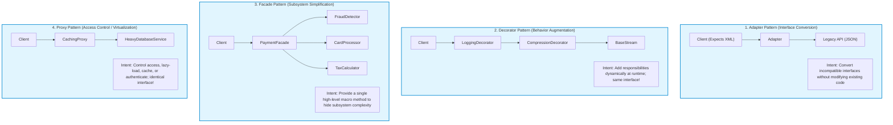
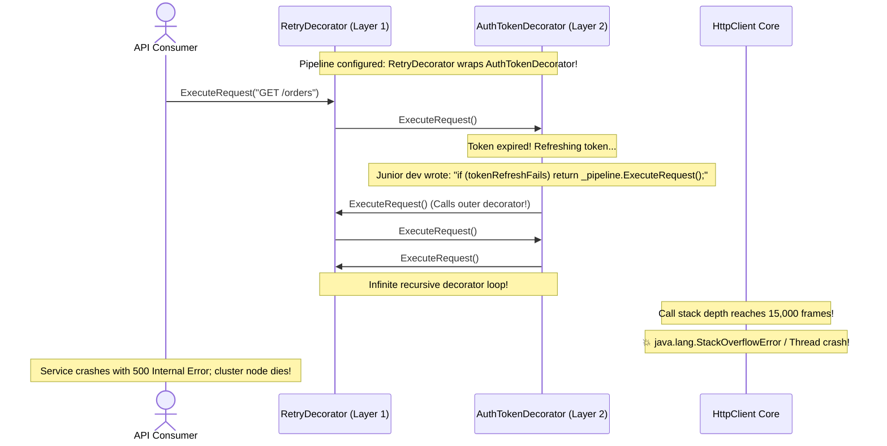

# Module 07: Structural Design Patterns

> **Prerequisites:** Module 02 (OOP Foundations and UML), Module 04 (SOLID Principles).  
> **Estimated Reading Time:** 25 minutes  
> **Target Audience:** Backend Developers, Software Architects, Technical Interview Candidates.

> [!TIP]
> **The Golden Rule of Structural Patterns:** Structural patterns answer: *"How do classes and objects assemble into larger, flexible structures?"* **Adapter** changes an interface to make incompatible classes work together; **Decorator** enhances behavior dynamically without subclassing; **Facade** provides a simplified high-level interface over a complex subsystem; **Proxy** controls and gates access to an underlying object. Never confuse them: understand what is being wrapped and *why*.

---

## 1. Architectural Mental Model: The Structural Wrapper Taxonomy

A common source of confusion in Low-Level Design interviews is differentiating the "wrapper" patterns. They all use composition to enclose an inner object, but their **architectural intent** is fundamentally different:



---

## 2. Taxonomic Reference: Structural Patterns Compared

| Pattern | Architectural Intent | Interface Relationship | Runtime Dynamics | Example Production Use Case |
| :--- | :--- | :--- | :--- | :--- |
| **Adapter** | Translate one interface into another interface the client expects | **Changes interface** (Target $\neq$ Adaptee) | Static wrapper | Integrating a third-party Stripe payment gateway into your custom internal `IPaymentProcessor`. |
| **Decorator** | Add responsibilities dynamically without subclass explosion | **Preserves interface** (Decorator implements same interface as Target) | Dynamic chaining | HTTP request middleware pipelines (Logging, Authentication, Rate Limiting, Compression). |
| **Facade** | Provide a simple, unified interface to a complex subsystem | **New, simplified interface** | Static macro interface | A one-click `checkoutOrder()` method orchestrating inventory, billing, tax, and shipping services. |
| **Proxy** | Control and manage access to a resource | **Preserves interface** (Proxy has exact same interface as RealSubject) | Intercepts calls | Lazy-loading heavy database records, caching expensive query results, RBAC security gates. |
| **Composite** | Compose objects into tree structures to represent part-whole hierarchies | **Uniform interface** for leaf nodes and branches | Recursive tree traversal | File systems (Files and Directories), UI components, Organization hierarchies. |
| **Bridge** | Decouple an abstraction from its implementation so both can vary independently | Orthogonal interfaces | Two independent dimensions | Database drivers (Abstraction: `SQLClient`, Implementation: `PostgresDriver`, `MySQLDriver`). |
| **Flyweight** | Share fine-grained immutable state to support millions of small objects | Intrinsic vs Extrinsic state | Central memory cache | Text editors (sharing glyph font data across 500,000 characters in RAM). |

---

## 3. Systematic Breakdown: Adapter vs. Facade vs. Proxy vs. Decorator

To ace low-level design evaluations, memorize the signature difference between the four primary wrapper patterns:

```
  ┌───────────┬───────────────────────────────────┬────────────────────────────────────────┐
  │ Pattern   │ Interface Transformation          │ Core Architectural Objective           │
  ├───────────┼───────────────────────────────────┼────────────────────────────────────────┤
  │ Adapter   │ Incompatible ➔ Compatible         │ Compatibility (Translate calls)       │
  │ Decorator │ Same Interface ➔ Same Interface   │ Augmentation (Add features in layers)  │
  │ Facade    │ Many Interfaces ➔ One Easy API    │ Simplification (Hide complexity)       │
  │ Proxy     │ Same Interface ➔ Same Interface   │ Protection / Control (Gate access)     │
  └───────────┴───────────────────────────────────┴────────────────────────────────────────┘
```

---

## 4. Production War Story: The Decorator Recursion Stack Overflow Outage



### The Incident
An enterprise payments integration platform utilized the Decorator pattern to wrap outgoing HTTP calls: `LoggingDecorator -> RateLimitDecorator -> AuthTokenDecorator -> HttpClient`. 

During an automated token rotation failure, an engineer added a fallback clause inside `AuthTokenDecorator`: if the auth token refresh failed, it re-invoked the outer pipeline to trigger an automatic retry. 

When upstream auth servers suffered a 10-second hiccup, the circular decoration triggered an infinite recursive loop. The JVM thread call stack blew past its limit, throwing `StackOverflowError` and crashing all 12 payment pods.

### The Post-Mortem Data
* **Severity:** SEV-1 (Critical Payment Gateway Failure)
* **Mean Time to Detect (MTTD):** 15 minutes
* **Mean Time to Resolution (MTTR):** 30 minutes

### The Root Cause
**Circular Decorator Coupling:** Decorators must remain strictly **downstream directed** and acyclic. An inner decorator must never call an outer decorator; doing so introduces non-terminating recursion under error conditions.

### The Fix & Hardening
1. **Linear Middleware Architecture:** Replace deeply nested recursive decorator wrappers with a linear, iterative array-based middleware pipeline (like Express, ASP.NET Core, or Go Gin middleware).
2. **Circuit Breaker on Decorator Depth:** Ensure decorator chains cannot exceed a depth of 5 layers.

---

## 5. Multi-Language Production Code: Adapter and Decorator Patterns

Below are production implementations of the **Adapter** (adapting a third-party payment vendor) and **Decorator** (transparently adding logging and metrics to a data repository).

### Python
```python
from abc import ABC, abstractmethod
import time

# --- Adapter Pattern: Adapting Third-Party Legacy API ---
class PaymentGateway(ABC):
    @abstractmethod
    def charge(self, user_id: str, amount_cents: int) -> bool: pass

# Incompatible 3rd-party vendor library
class StripeLegacyApi:
    def make_transaction(self, customer_token: str, dollars: float) -> str:
        print(f"💳 Stripe Legacy API charged ${dollars:.2f} to token {customer_token}")
        return "tx_success_99"

# Adapter translates PaymentGateway calls into StripeLegacyApi calls
class StripeAdapter(PaymentGateway):
    def __init__(self, stripe_service: StripeLegacyApi):
        self._stripe = stripe_service

    def charge(self, user_id: str, amount_cents: int) -> bool:
        customer_token = f"tok_{user_id}"
        dollars = amount_cents / 100.0
        result = self._stripe.make_transaction(customer_token, dollars)
        return result.startswith("tx_success")

# --- Decorator Pattern: Adding Telemetry to Data Store ---
class UserRepository(ABC):
    @abstractmethod
    def get_user(self, user_id: str) -> dict: pass

class SqlUserRepository(UserRepository):
    def get_user(self, user_id: str) -> dict:
        time.sleep(0.02) # Simulate SQL latency
        return {"id": user_id, "name": "Asha"}

class TimedUserRepositoryDecorator(UserRepository):
    def __init__(self, inner: UserRepository):
        self._inner = inner

    def get_user(self, user_id: str) -> dict:
        start = time.perf_counter()
        data = self._inner.get_user(user_id)
        elapsed_ms = (time.perf_counter() - start) * 1000
        print(f"⏱️ [Telemetry] UserRepository.get_user executed in {elapsed_ms:.2f}ms")
        return data

if __name__ == "__main__":
    adapter = StripeAdapter(StripeLegacyApi())
    adapter.charge("usr_42", 5000)

    repo = TimedUserRepositoryDecorator(SqlUserRepository())
    u = repo.get_user("usr_42")
```

### C# (.NET)
```csharp
using System;
using System.Diagnostics;

// --- Adapter Pattern ---
public interface IPaymentProcessor
{
    bool ProcessPayment(string accountId, decimal amount);
}

// Incompatible Vendor SDK
public class PayPalSdk
{
    public int SendMoney(decimal usd, string email)
    {
        Console.WriteLine($"[PayPal] Sent ${usd} to {email}");
        return 200; // HTTP Status
    }
}

public class PayPalAdapter : IPaymentProcessor
{
    private readonly PayPalSdk _sdk;
    public PayPalAdapter(PayPalSdk sdk) => _sdk = sdk;

    public bool ProcessPayment(string accountId, decimal amount)
    {
        string email = $"{accountId}@example.com";
        return _sdk.SendMoney(amount, email) == 200;
    }
}

// --- Decorator Pattern ---
public interface IDataService
{
    string FetchData(string query);
}

public class DatabaseService : IDataService
{
    public string FetchData(string query) => "Database Result for: " + query;
}

public class LoggingDataServiceDecorator : IDataService
{
    private readonly IDataService _inner;
    public LoggingDataServiceDecorator(IDataService inner) => _inner = inner;

    public string FetchData(string query)
    {
        Console.WriteLine($"[LOG] Executing query: {query}");
        var result = _inner.FetchData(query);
        Console.WriteLine($"[LOG] Query completed successfully.");
        return result;
    }
}
```

### Go
```go
package main

import (
	"fmt"
	"time"
)

// Component Interface
type OrderService interface {
	CreateOrder(orderID string) error
}

type RealOrderService struct{}

func (s *RealOrderService) CreateOrder(orderID string) error {
	fmt.Printf("📦 Order %s created in database\n", orderID)
	return nil
}

// Decorator in Go: Embeds interface
type MetricsDecorator struct {
	inner OrderService
}

func (m *MetricsDecorator) CreateOrder(orderID string) error {
	start := time.Now()
	err := m.inner.CreateOrder(orderID)
	fmt.Printf("📊 Metrics: CreateOrder took %v\n", time.Since(start))
	return err
}

func main() {
	var service OrderService = &RealOrderService{}
	// Decorate at runtime
	service = &MetricsDecorator{inner: service}
	_ = service.CreateOrder("ORD-101")
}
```

### TypeScript / Node.js
```typescript
// Facade Pattern: Simplifying a complex multi-system checkout process
class InventorySystem { checkStock(sku: string): boolean { return true; } }
class BillingSystem { chargeCard(cents: number): boolean { return true; } }
class ShippingSystem { scheduleCourier(sku: string): string { return 'TRACK_123'; } }

export class OrderCheckoutFacade {
  private inventory = new InventorySystem();
  private billing = new BillingSystem();
  private shipping = new ShippingSystem();

  // Simple macro method
  public checkout(sku: string, priceCents: number): { success: boolean; trackingNumber?: string } {
    if (!this.inventory.checkStock(sku)) return { success: false };
    if (!this.billing.chargeCard(priceCents)) return { success: false };
    const tracking = this.shipping.scheduleCourier(sku);
    return { success: true, trackingNumber: tracking };
  }
}
```

---

## 6. Practical Hands-On Verification CLI Workflows

Verify Composite pattern tree traversal in your Ubuntu terminal:

### Workflow 1: Execute Composite Pattern File Hierarchy
```bash
python3 -c '
from abc import ABC, abstractmethod

class FileSystemItem(ABC):
    @abstractmethod
    def get_size(self) -> int: pass

class File(FileSystemItem):
    def __init__(self, size: int): self.size = size
    def get_size(self) -> int: return self.size

class Directory(FileSystemItem):
    def __init__(self): self.children = []
    def add(self, item: FileSystemItem): self.children.append(item)
    def get_size(self) -> int: return sum(c.get_size() for c in self.children)

root = Directory()
root.add(File(100))
sub = Directory()
sub.add(File(250))
sub.add(File(50))
root.add(sub)

print("Total Composite Tree Size:", root.get_size())
assert root.get_size() == 400
print("✅ Composite pattern recursive structure verified.")
'
```
**Expected Output:**
```text
Total Composite Tree Size: 400
✅ Composite pattern recursive structure verified.
```

---

## 7. Operational Validation Checkpoint

<details>
<summary><strong>Question 1: Adapter vs. Proxy</strong></summary>

**Scenario:** Both the Adapter pattern and the Proxy pattern wrap another object. 
What is the definitive criterion that determines whether a wrapper is an **Adapter** or a **Proxy**?

**Answer:**
Inspect the **Interface of the Wrapper vs. the Interface of the Wrapped Object**:
* **Adapter CHANGES the interface:** The wrapper implements Interface A (which the client expects) and wraps an adaptee with Interface B. Its sole purpose is to translate between two incompatible interfaces.
* **Proxy PRESERVES the interface:** The wrapper implements the **exact same interface** as the underlying real subject. The client does not know or care that it is talking to a proxy. Its purpose is to control access, lazy-load, cache, or monitor without altering the contract.
</details>

<details>
<summary><strong>Question 2: Decorator Pattern vs. Class Inheritance Explosion</strong></summary>

**Scenario:** You are designing a Coffee Shop beverage system. Beverages have a base (`Espresso`, `DarkRoast`), and can have optional condiments: `Milk`, `Soy`, `Mocha`, `Caramel`, `Whip`. 
If you use class inheritance, how many classes do you need to represent all possible combinations? How does Decorator solve this?

**Answer:**
With class inheritance, you suffer from **Combinatorial Class Explosion**: with 2 base beverages and 5 optional condiments, you need $2 \times 2^5 = 64$ distinct subclass combinations (`EspressoWithMilk`, `EspressoWithMilkAndMocha`, etc.). 

With the **Decorator Pattern**, you need only **7 classes total** (2 base beverages + 5 condiment decorators). Condiments wrap beverages dynamically at runtime:
```csharp
IBeverage drink = new WhipDecorator(new MochaDecorator(new Espresso()));
```
New condiments can be added without modifying or creating beverage subclasses.
</details>

<details>
<summary><strong>Question 3: When to Use the Flyweight Pattern</strong></summary>

**Scenario:** In a multiplayer game, a forest contains 1,000,000 trees. Each tree has a 3D mesh (5 MB of polygon data), texture (10 MB), and a specific `(x, y, z)` coordinate on the map. 

If every tree is instantiated as an independent object, the game requires 15 Terabytes of RAM and crashes. How does Flyweight solve this?

**Answer:**
The Flyweight pattern splits object state into two parts:
1. **Intrinsic State (Shared, Immutable):** The 3D polygon mesh and texture data. This is stored **once in a single Flyweight object** in memory (15 MB total).
2. **Extrinsic State (Unique, Context-dependent):** The coordinates `(x, y, z)` and health of each specific tree. Stored as lightweight 12-byte structs.

The game creates 1,000,000 tiny coordinate records that all point to the **single shared Flyweight mesh instance**, reducing memory consumption from 15 TB to under 25 MB!
</details>

---

## Next Step

Now that you understand structural design patterns, proceed to **[08 · Behavioral Patterns I: Strategy, Observer, Command, State, and Template Method](../08-behavioral-patterns-i/README.md)** to master dynamic algorithm swapping, event systems, and state machines.
