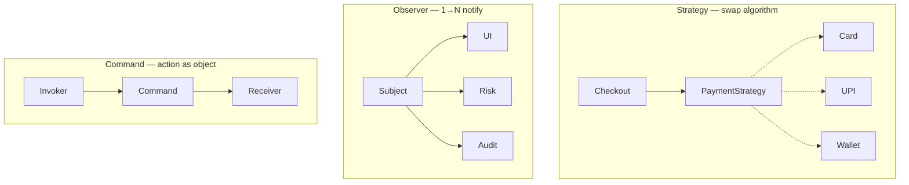
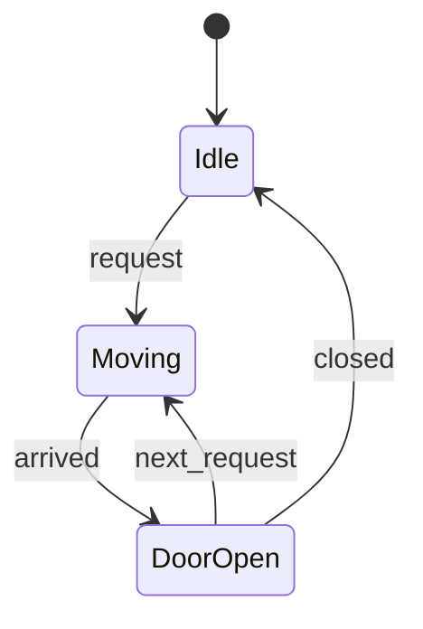

# Behavioral Patterns I — Strategy, Observer, Command, State, Template Method

> **Prerequisites:** [02 · OOP & UML](../02-oop-foundations-and-uml/README.md), [04 · SOLID](../04-solid-principles/README.md), [07 · Structural](../07-structural-patterns/README.md)  
> **Reading time:** ~30 minutes (plus ~10 to run the demos)  
> **Audience:** LLD rounds — pricing, workflows, undo, and FSMs without `if` soup

> [!NOTE]
> **In one line:** Behavioral patterns decide *how objects collaborate* — **Strategy** swaps algorithms, **Observer** broadcasts changes, **Command** turns actions into objects (queue/undo), **State** makes behavior follow an FSM, **Template Method** locks an algorithm skeleton and varies the steps.

> [!TIP]
> **Golden rule:** Strategy is chosen by the **caller**; State is advanced by the **machine**. If the UML looks the same, ask who flips the implementation.

> [!TIP]
> **Try it:** Model Strategy + State in [LLD Studio](/tools/lld-studio/), then run the Python Strategy + Command example below.

---

## 1. Interview pressure

Interviewer: *"Support card, UPI, and wallet pricing without editing the checkout class every time. Also add undo for the last seat booking."*

That is **Strategy** (payment/pricing algorithm) + **Command** (book/undo as objects). If they add *"elevator Idle → Moving → DoorOpen,"* bring **State**.



---

## 2. Comparison matrix

| Pattern | Problem | Who picks behavior? | Production cue |
| :--- | :--- | :--- | :--- |
| **Strategy** | Many algorithms, same job | **Client / DI** injects strategy | Shipping rates, sort, compression |
| **Observer** | Many listeners on one change | Subject notifies all | Domain events, UI binding, market ticks |
| **Command** | Queue, log, undo, schedule | Invoker runs `execute`/`undo` | Job queues, editors, macros |
| **State** | Behavior depends on mode | **States transition** the context | Orders, elevators, TCP-ish machines |
| **Template Method** | Same steps, different hooks | Base class owns the skeleton | ETL pipelines, report generators |

### State vs Strategy (high-yield)

```text
Strategy  External caller selects algorithm. Usually stable for the request.
State     Current state object (or context) transitions after events. Personality changes.
```

---

## 3. Walkthrough — Strategy + Command

**Requirements:** charge via pluggable strategy; support undoable “reserve seat.”

````carousel
```python
from __future__ import annotations
from abc import ABC, abstractmethod


# ── Strategy ─────────────────────────────────────────────────────────
class PaymentStrategy(ABC):
    @abstractmethod
    def pay(self, amount_cents: int) -> bool: ...


class CardStrategy(PaymentStrategy):
    def pay(self, amount_cents: int) -> bool:
        print(f"card charged {amount_cents}")
        return True


class UpiStrategy(PaymentStrategy):
    def pay(self, amount_cents: int) -> bool:
        print(f"upi charged {amount_cents}")
        return True


class Checkout:
    def __init__(self, strategy: PaymentStrategy) -> None:
        self._strategy = strategy

    def set_strategy(self, strategy: PaymentStrategy) -> None:
        self._strategy = strategy

    def complete(self, amount_cents: int) -> bool:
        return self._strategy.pay(amount_cents)


# ── Command (with undo) ──────────────────────────────────────────────
class SeatMap:
    def __init__(self) -> None:
        self.reserved: set[str] = set()

    def reserve(self, seat: str) -> None:
        if seat in self.reserved:
            raise ValueError(f"{seat} taken")
        self.reserved.add(seat)

    def release(self, seat: str) -> None:
        self.reserved.discard(seat)


class Command(ABC):
    @abstractmethod
    def execute(self) -> None: ...

    @abstractmethod
    def undo(self) -> None: ...


class ReserveSeatCommand(Command):
    def __init__(self, seats: SeatMap, seat: str) -> None:
        self._seats = seats
        self._seat = seat

    def execute(self) -> None:
        self._seats.reserve(self._seat)

    def undo(self) -> None:
        self._seats.release(self._seat)


class CommandBus:
    def __init__(self) -> None:
        self._history: list[Command] = []

    def run(self, cmd: Command) -> None:
        cmd.execute()
        self._history.append(cmd)

    def undo_last(self) -> None:
        if not self._history:
            return
        self._history.pop().undo()


if __name__ == "__main__":
    Checkout(CardStrategy()).complete(2500)
    Checkout(UpiStrategy()).complete(999)

    seats, bus = SeatMap(), CommandBus()
    bus.run(ReserveSeatCommand(seats, "A1"))
    print("reserved", seats.reserved)
    bus.undo_last()
    print("after undo", seats.reserved)
```
<!-- slide -->
```csharp
public interface IPaymentStrategy
{
    bool Pay(int amountCents);
}

public sealed class Checkout
{
    private IPaymentStrategy _strategy;
    public Checkout(IPaymentStrategy strategy) => _strategy = strategy;
    public void SetStrategy(IPaymentStrategy strategy) => _strategy = strategy;
    public bool Complete(int amountCents) => _strategy.Pay(amountCents);
}

public interface ICommand
{
    void Execute();
    void Undo();
}

public sealed class ReserveSeatCommand : ICommand
{
    private readonly SeatMap _seats;
    private readonly string _seat;
    public ReserveSeatCommand(SeatMap seats, string seat)
    {
        _seats = seats;
        _seat = seat;
    }
    public void Execute() => _seats.Reserve(_seat);
    public void Undo() => _seats.Release(_seat);
}
```
````

**OCP win:** new payment rail = new Strategy class. Checkout stays closed. Commands make undo and audit trails natural.

**Edges that matter here:**

- `CommandBus.run` appends to history **after** `execute()` succeeds. If `reserve("A1")` raises `seat taken`, nothing is recorded and nothing can be wrongly undone.
- Undo must reverse what `execute` *actually did*. If you later make `reserve` idempotent (no error when the seat is already held), `undo` would release a seat this command never took — record what changed inside the command.
- `SeatMap` is not thread-safe. Two concurrent `reserve("A1")` calls can both pass the membership check; see [10 · Concurrency-Safe Design](../10-concurrency-safe-design/README.md) or lock inside `reserve`.
- `Checkout.complete` returns `bool`: a declined card is a normal outcome, not an exception. Decide that contract up front (see LSP in [04](../04-solid-principles/README.md)).

---

## 4. Observer — publish without knowing subscribers

```text
Subject: attach / detach / notify
Observer: update(event)
```

**Edges (must mention in interviews):**

| Risk | Mitigation |
| :--- | :--- |
| Lapsed listener leak | Unsubscribe on dispose; weak refs or scoped lifetimes |
| Notify during mutation | Copy subscriber list before iterating |
| Slow observers block feed | Async queue / fan-out workers |
| Ordering assumptions | Document “no order guarantee” or use priority bus |

### War story (compressed)

A market feed kept strong references to dashboards. Users closed tabs; observers stayed subscribed. Heap grew for days → OOM. **Fix:** explicit detach on session end + weak events / DI scoped lifetimes.

---

## 5. State — behavior is the mode

Vending / order / elevator: replace `switch(status)` with state objects that accept events and return (or set) the next state.



**Interview line:** *"Strategy: I inject FastestRoute. State: DoorOpen decides what happens on Close — the object changes how it responds over time."*

---

## 6. Template Method — skeleton in the base class

Base defines `final run(): extract → transform → load`; subclasses override hooks. Prefer composition (Strategy pipeline) when inheritance gets awkward — say that trade-off out loud.

---

## 7. Code — Observer, State, Template Method (runnable)

The three patterns above without code are just vocabulary. Run this block:

```python
from __future__ import annotations

import threading
from abc import ABC, abstractmethod
from typing import Callable, final


# ── Observer: subscribe returns an unsubscribe handle ─────────────────
Listener = Callable[[str, int], None]


class PriceFeed:
    def __init__(self) -> None:
        self._subs: list[Listener] = []
        self._lock = threading.Lock()

    def subscribe(self, fn: Listener) -> Callable[[], None]:
        with self._lock:
            self._subs.append(fn)

        def unsubscribe() -> None:
            with self._lock:
                if fn in self._subs:
                    self._subs.remove(fn)
        return unsubscribe

    def publish(self, symbol: str, cents: int) -> None:
        with self._lock:
            snapshot = list(self._subs)          # copy: listeners may unsubscribe while we notify
        for fn in snapshot:                      # (call outside the lock: slow listeners don't block subscribe)
            try:
                fn(symbol, cents)
            except Exception as exc:             # one bad listener must not starve the others
                print(f"  listener failed: {exc!r}")


# ── State: behavior depends on the current state object ──────────────
class IllegalTransition(Exception):
    pass


class ElevatorState:
    def request(self, e: "Elevator", floor: int) -> None: ...
    def arrived(self, e: "Elevator") -> None:
        raise IllegalTransition(f"{type(self).__name__} cannot handle 'arrived'")
    def door_closed(self, e: "Elevator") -> None:
        raise IllegalTransition(f"{type(self).__name__} cannot handle 'door_closed'")


class Idle(ElevatorState):
    def request(self, e: "Elevator", floor: int) -> None:
        if floor == e.floor:
            e.set_state(DoorOpen())
        else:
            e.target = floor
            e.set_state(Moving())


class Moving(ElevatorState):
    def request(self, e: "Elevator", floor: int) -> None:
        e.pending.append(floor)                  # queue, don't teleport
    def arrived(self, e: "Elevator") -> None:
        e.floor = e.target
        e.set_state(DoorOpen())


class DoorOpen(ElevatorState):
    def request(self, e: "Elevator", floor: int) -> None:
        e.pending.append(floor)
    def door_closed(self, e: "Elevator") -> None:
        if e.pending:
            e.target = e.pending.pop(0)
            e.set_state(Moving())
        else:
            e.set_state(Idle())


class Elevator:
    def __init__(self) -> None:
        self.state: ElevatorState = Idle()
        self.floor, self.target = 0, 0
        self.pending: list[int] = []

    def set_state(self, s: ElevatorState) -> None:
        print(f"  {type(self.state).__name__} -> {type(s).__name__}")
        self.state = s

    def request(self, floor: int) -> None: self.state.request(self, floor)
    def arrived(self) -> None: self.state.arrived(self)
    def door_closed(self) -> None: self.state.door_closed(self)


# ── Template Method: fixed skeleton, variable steps ──────────────────
class Etl(ABC):
    @final
    def run(self) -> int:                        # skeleton: subclasses fill steps, never reorder
        rows = [self.transform(r) for r in self.extract()]
        self.load(rows)
        return len(rows)

    @abstractmethod
    def extract(self) -> list[str]: ...
    @abstractmethod
    def transform(self, raw: str) -> dict: ...
    @abstractmethod
    def load(self, rows: list[dict]) -> None: ...


class CsvEtl(Etl):
    def __init__(self) -> None:
        self.sink: list[dict] = []
    def extract(self) -> list[str]:
        return ["a,1", "b,2"]
    def transform(self, raw: str) -> dict:
        name, qty = raw.split(",")
        return {"name": name, "qty": int(qty)}
    def load(self, rows: list[dict]) -> None:
        self.sink.extend(rows)


if __name__ == "__main__":
    print("observer:")
    feed, log = PriceFeed(), []
    feed.subscribe(lambda s, c: log.append((s, c)))
    feed.subscribe(lambda s, c: 1 / 0)                     # bad listener
    unsub_once = None
    def once(s: str, c: int) -> None:
        log.append(("once", c)); unsub_once()              # unsubscribes during notify
    unsub_once = feed.subscribe(once)
    feed.publish("ACME", 1000)
    feed.publish("ACME", 1010)
    print(" ", log)   # [('ACME',1000),('once',1000),('ACME',1010)]

    print("state:")
    e = Elevator()
    e.request(3); e.arrived(); e.request(1); e.door_closed(); e.arrived(); e.door_closed()
    print("  floor", e.floor)
    try:
        e.door_closed()
    except IllegalTransition as ex:
        print("  rejected:", ex)

    print("template:", CsvEtl().run())
```

Expected output:

```text
observer:
  listener failed: ZeroDivisionError('division by zero')
  listener failed: ZeroDivisionError('division by zero')
  [('ACME', 1000), ('once', 1000), ('ACME', 1010)]
state:
  Idle -> Moving
  Moving -> DoorOpen
  DoorOpen -> Moving
  Moving -> DoorOpen
  DoorOpen -> Idle
  floor 1
  rejected: Idle cannot handle 'door_closed'
template: 2
```

What to point at when you present it:

- **Observer:** `subscribe` returns the unsubscribe handle (kills the lapsed-listener leak at the API level); `publish` iterates a *copy* (a listener removing itself mid-notify is safe, see `once`); the bad listener is isolated so it can't starve the others; the lock is not held while listeners run.
- **State:** each state object owns its own legal events; an illegal event (`door_closed` while `Idle`) raises instead of silently corrupting the machine. Requests that arrive while moving are queued, not dropped.
- **Template Method:** `run()` is `@final` — subclasses fill `extract/transform/load` but can't reorder them. In C#, mark it non-virtual (or `sealed override`).

---

## 8. When *not* to use these

| Temptation | Better |
| :--- | :--- |
| Strategy for one algorithm | Plain function / method |
| Observer for two hard-wired collaborators | Direct call or domain event once |
| Command for every method | Only when queue/undo/log needed |
| State for two booleans | Enum + clear transitions may suffice |
| Deep Template Method hierarchy | Strategy hooks or pipeline stages |

---

## 9. What you’d say in two minutes

> "I'd inject a `PaymentStrategy` so checkout doesn't grow a switch — Open/Closed. Seat booking becomes a `Command` with `execute`/`undo` so the invoker can stack history. If behavior depends on mode, I'd model an explicit State machine instead of nested ifs — and I'd stress that Strategy is chosen outside, State transitions inside. For fan-out updates I'd use Observer but always unsubscribe to avoid lapsed-listener leaks."

---

## 10. Anti-patterns

1. **God Observer** doing UI + persistence + email in `update` — split listeners.  
2. **Command without receiver clarity** — keep domain logic on the receiver; command wires intent.  
3. **State objects that know every other state** — centralize transition table if the graph is large.  
4. **Template Method with 12 overridable hooks** — you’ve built a fragile inheritance API.

---

## 11. Interview questions

<details>
<summary><strong>1. Strategy vs State? [BASIC]</strong></summary>

Strategy: caller selects algorithm, usually for one task. State: current state changes after events and alters subsequent behavior.

</details>

<details>
<summary><strong>2. What problem does Command solve? [BASIC]</strong></summary>

Treat an operation as an object — queue it, log it, undo it, or send it across a process boundary.

</details>

<details>
<summary><strong>3. Observer failure mode in long-lived subjects? [BASIC]</strong></summary>

Lapsed listeners: forgotten unsubscribe → memory growth and notifying dead UI. Always detach; prefer scoped lifetimes.

</details>

<details>
<summary><strong>4. Template Method vs Strategy? [BASIC]</strong></summary>

Template Method: inheritance skeleton with hooks. Strategy: compose replaceable algorithms. Prefer Strategy when reuse is across unrelated types.

</details>

<details>
<summary><strong>5. Add crypto payments without editing Checkout. [SCENARIO]</strong></summary>

`CryptoStrategy` implementing `PaymentStrategy`; inject or select at runtime. Checkout only calls `pay`.

</details>

<details>
<summary><strong>6. Elevator Idle/Moving/DoorOpen. [SCENARIO]</strong></summary>

State pattern (or explicit transition table). Events `Request`, `Arrived`, `DoorClosed` handled by current state.

</details>

<details>
<summary><strong>7. Undo last three editor ops. [SCENARIO]</strong></summary>

Stack of Commands with `undo`. Redo = second stack or reversible history.

</details>

<details>
<summary><strong>8. Can Observer replace a message queue? [TRICKY]</strong></summary>

In-process Observer ≠ durable cross-service messaging. Queues add persistence, backpressure, and competing consumers. Use Observer inside a process; queues between services.

</details>

---

## 12. Try it

1. Run the Strategy + Command block (section 3) and the Observer/State/Template block (section 7).
2. Add `redo` to `CommandBus` with a second stack; clear it when a new command runs.
3. Add a `CryptoStrategy` without editing `Checkout`. Then write a `FailingStrategy` and decide: should `Checkout.complete` retry, or let the caller decide?
4. Add an `Overloaded` state to the elevator that rejects new requests. How many existing state classes did you touch?
5. Model Strategy vs State side by side in [LLD Studio](/tools/lld-studio/), then use them in [Movie Ticket Booking](../16-movie-ticket-booking/README.md) and [Library & Vending Machine](../13-library-and-vending-machine/README.md).

---

## 13. One-page cheat sheet

```text
Strategy     Swap algorithm; caller injects. OCP for “how”.
Observer     1→N notify; always unsubscribe; copy list on notify.
Command      Action as object; execute / undo / queue / audit.
State        FSM; states transition; don’t confuse with Strategy.
Template     Base skeleton + hooks; prefer composition if deep.

Say aloud: “Who chooses the next behavior — the client or the state machine?”
```

---

## Next

**[09 · Behavioral Patterns II](../09-behavioral-patterns-ii/README.md)** — Iterator, Chain of Responsibility, Mediator, Memento, Visitor.
