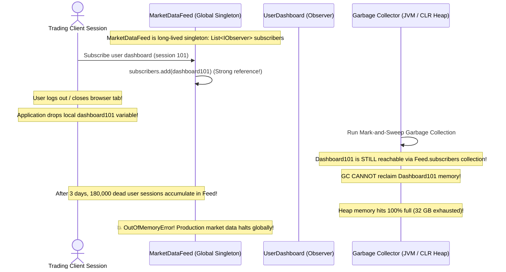

# Module 08: Behavioral Design Patterns I — Strategy, Observer, Command, State, and Template Method

> **Prerequisites:** Module 02 (OOP Foundations), Module 04 (SOLID Principles).  
> **Estimated Reading Time:** 25 minutes  
> **Target Audience:** Backend Developers, Low-Level Design Candidates, Systems Architects.

> [!TIP]
> **The Golden Rule of Behavioral Patterns:** Behavioral patterns govern how objects **distribute responsibilities, communicate, and manage runtime state**. Use **Strategy** to swap algorithms at runtime; use **Observer** to decouple event producers from multiple consumers; use **Command** to turn actions into first-class invokable data objects (enabling queues and undo); and use **State** to model finite state machines cleanly without nested `if/else` ladders.

---

## 1. Architectural Mental Model: Communication & Control Flow

Behavioral patterns characterize the ways in which classes and objects interact and apportion responsibility:

```mermaid
flowchart TD
    subgraph StrategyPattern["1. Strategy Pattern (Interchangeable Algorithms)"]
        ContextA["PaymentContext"] -->|Uses| IStrat["<<interface>>\nPaymentStrategy"]
        IStrat <|.. S1["CreditCardStrategy"]
        IStrat <|.. S2["CryptoStrategy"]
        IStrat <|.. S3["PayPalStrategy"]
    end

    subgraph ObserverPattern["2. Observer Pattern (1-to-Many Event Pub/Sub)"]
        Subject["MarketDataFeed (Subject)"] -->|notifies| Obs1["TraderUI (Observer)"]
        Subject -->|notifies| Obs2["RiskEngine (Observer)"]
        Subject -->|notifies| Obs3["AuditLogger (Observer)"]
    end

    subgraph CommandPattern["3. Command Pattern (Actions as Objects)"]
        Invoker["Button / Scheduler"] --> Cmd["<<interface>>\nCommand\n+execute()\n+undo()"]
        Cmd <|.. ConcreteCmd["ExecuteTradeCommand"]
        ConcreteCmd --> Receiver["TradingEngine (Receiver)"]
    end

    classDef pattern fill:#e1f5fe,stroke:#0288d1,stroke-width:2px;
    class ContextA,Subject,Invoker pattern;
```

---

## 2. Taxonomic Reference: Behavioral Patterns I Comparison

| Pattern | Problem Solved | Core Mechanics | State / Invariant Dynamics | Production Example |
| :--- | :--- | :--- | :--- | :--- |
| **Strategy** | Need different variants of an algorithm selectable at runtime. | Context delegates task to an injected `IStrategy` interface. | Strategy is typically stateless. | Navigation routes (Fastest, Avoid Tolls, Walking). |
| **Observer** | When one object changes state, multiple dependent objects must update automatically. | Subject maintains subscriber list (`Attach()`, `Detach()`, `Notify()`). | Loosely coupled 1-to-many notifications. | Real-time chat notifications, stock ticker feeds, UI data binding. |
| **Command** | Parameterize objects with operations, queue requests, or support undo/redo. | Encapsulates receiver, action, and arguments into an object with `execute()`. | First-class object representing a deferred action. | Background job queues (Celery/BullMQ), CLI command runners, transaction rollbacks. |
| **State** | Object must alter its behavior when internal state changes without nested `switch`. | Context delegates state-specific methods to a current `IState` object that transitions itself. | **Internal state machine** transitions dynamically. | Vending machine states (`NoCoin`, `HasCoin`, `Dispensing`, `SoldOut`). |
| **Template Method** | Multiple classes follow the same invariant algorithm steps, but vary specific details. | Base class defines invariant algorithm skeleton (`final`); subclasses override primitive hooks. | Compile-time class inheritance. | Data pipeline ETL: `Extract()` -> `Transform()` -> `Load()`. |

---

## 3. Systematic Breakdown: State Pattern vs. Strategy Pattern

Because the UML diagrams for State and Strategy look almost identical, interviewers frequently test this distinction:

```
  ┌──────────┬─────────────────────────────────┬────────────────────────────────────────┐
  │ Pattern  │ Who Selects the Implementation? │ Does the State Change at Runtime?     │
  ├──────────┼─────────────────────────────────┼────────────────────────────────────────┤
  │ Strategy │ The **External Caller / Client** │ No. Injected upfront to solve a task.  │
  │ State    │ The **State Objects Themselves** │ **Yes.** Self-transitions as events    │
  │          │ (or Context internal logic)     │ alter the personality of the Context.  │
  └──────────┴─────────────────────────────────┴────────────────────────────────────────┘
```

---

## 4. Production War Story: The Observer "Lapsed Listener" Memory Leak Outage



### The Incident
A high-throughput electronic trading dashboard experienced memory bloat. Over three days of market activity, the platform's JVM heap climbed steadily from 4 GB to 32 GB, triggering frequent 5-second Stop-The-World garbage collection pauses that froze real-time market data.

### The Post-Mortem Data
* **Severity:** SEV-1 (Platform Memory Exhaustion & Feed Lag)
* **Mean Time to Detect (MTTD):** 4 hours
* **Mean Time to Resolution (MTTR):** 45 minutes

### The Root Cause
**The Lapsed Listener Problem:** The application used the Observer pattern:
```csharp
MarketDataFeed.Instance.Subscribe(this);
```
When short-lived user websocket sessions disconnected, the application discarded the session references. However, the session objects were **never unsubscribed from `MarketDataFeed`**. 

Because `MarketDataFeed` held **strong references** to each observer in its internal list, the garbage collector could not reclaim any session object or its associated buffer memory, causing 180,000 orphaned observers to leak into RAM.

### The Fix & Hardening
1. **Mandatory Unsubscription via `IDisposable`:**
```csharp
public class UserDashboard : IObserver, IDisposable {
    public void Dispose() {
        MarketDataFeed.Instance.Unsubscribe(this);
    }
}
```
2. **Use Weak References:** In languages with weak pointer support (`WeakReference<T>` in C#, `WeakSet` / `WeakRef` in JS, `weakref` in Python), the Subject stores weak pointers so subscribers can be garbage collected automatically when all other references drop.

---

## 5. Multi-Language Production Code: Command & State Patterns

Below are production implementations of the **Command Pattern** (with undo capability) and the **State Pattern** (Finite State Machine).

### Python (Command Pattern with Undo)
```python
from abc import ABC, abstractmethod
from typing import List

# 1. Receiver
class TextDocument:
    def __init__(self):
        self.text: str = ""

    def append(self, text: str) -> None:
        self.text += text

    def erase_last(self, length: int) -> None:
        self.text = self.text[:-length]

# 2. Command Interface
class Command(ABC):
    @abstractmethod
    def execute(self) -> None: pass
    @abstractmethod
    def undo(self) -> None: pass

# 3. Concrete Command
class AppendTextCommand(Command):
    def __init__(self, doc: TextDocument, text_to_append: str):
        self._doc = doc
        self._text = text_to_append

    def execute(self) -> None:
        self._doc.append(self._text)

    def undo(self) -> None:
        self._doc.erase_last(len(self._text))

# 4. Invoker
class CommandHistory:
    def __init__(self):
        self._history: List[Command] = []

    def execute_command(self, cmd: Command) -> None:
        cmd.execute()
        self._history.append(cmd)

    def undo(self) -> None:
        if self._history:
            cmd = self._history.pop()
            cmd.undo()

if __name__ == "__main__":
    doc = TextDocument()
    history = CommandHistory()

    history.execute_command(AppendTextCommand(doc, "Hello "))
    history.execute_command(AppendTextCommand(doc, "World!"))
    print("Document:", doc.text) # "Hello World!"

    history.undo()
    print("After Undo:", doc.text) # "Hello "
```

### C# (.NET) — The State Pattern (Order State Machine)
```csharp
using System;

// 1. State Interface
public interface IOrderState
{
    void ProcessPayment(OrderContext context);
    void Ship(OrderContext context);
    void Cancel(OrderContext context);
}

// 2. Context
public class OrderContext
{
    public IOrderState CurrentState { get; set; }

    public OrderContext()
    {
        CurrentState = new CreatedState();
    }

    public void ProcessPayment() => CurrentState.ProcessPayment(this);
    public void Ship() => CurrentState.Ship(this);
    public void Cancel() => CurrentState.Cancel(this);
}

// 3. Concrete States
public class CreatedState : IOrderState
{
    public void ProcessPayment(OrderContext context)
    {
        Console.WriteLine("💳 Payment processed. Moving to Paid state.");
        context.CurrentState = new PaidState();
    }
    public void Ship(OrderContext context) => 
        throw new InvalidOperationException("Cannot ship an unpaid order.");
    public void Cancel(OrderContext context)
    {
        Console.WriteLine("❌ Order cancelled.");
        context.CurrentState = new CancelledState();
    }
}

public class PaidState : IOrderState
{
    public void ProcessPayment(OrderContext context) => 
        throw new InvalidOperationException("Order is already paid.");
    public void Ship(OrderContext context)
    {
        Console.WriteLine("🚚 Order shipped! Moving to Shipped state.");
        context.CurrentState = new ShippedState();
    }
    public void Cancel(OrderContext context) => 
        Console.WriteLine("Refund initiated. Order cancelled.");
}

public class ShippedState : IOrderState
{
    public void ProcessPayment(OrderContext context) => throw new InvalidOperationException();
    public void Ship(OrderContext context) => throw new InvalidOperationException("Already shipped.");
    public void Cancel(OrderContext context) => 
        throw new InvalidOperationException("Cannot cancel an order that has already shipped!");
}

public class CancelledState : IOrderState
{
    public void ProcessPayment(OrderContext context) => throw new InvalidOperationException();
    public void Ship(OrderContext context) => throw new InvalidOperationException();
    public void Cancel(OrderContext context) => throw new InvalidOperationException();
}
```

### Go (Strategy Pattern)
```go
package main

import "fmt"

type CompressionStrategy interface {
	Compress(data []byte) []byte
}

type ZipCompression struct{}

func (z ZipCompression) Compress(data []byte) []byte {
	fmt.Println("🗜️ Compressed using ZIP algorithm")
	return data
}

type GzipCompression struct{}

func (g GzipCompression) Compress(data []byte) []byte {
	fmt.Println("🗜️ Compressed using GZIP algorithm")
	return data
}

type Archiver struct {
	strategy CompressionStrategy
}

func (a *Archiver) SetStrategy(s CompressionStrategy) {
	a.strategy = s
}

func (a *Archiver) Archive(data []byte) []byte {
	return a.strategy.Compress(data)
}

func main() {
	archiver := &Archiver{strategy: ZipCompression{}}
	_ = archiver.Archive([]byte("payload"))

	// Swap at runtime
	archiver.SetStrategy(GzipCompression{})
	_ = archiver.Archive([]byte("payload"))
}
```

### TypeScript / Node.js (Observer Pattern)
```typescript
interface Observer<T> {
  update(data: T): void;
}

export class EventEmitterSubject<T> {
  private observers: Set<Observer<T>> = new Set();

  public subscribe(obs: Observer<T>): () => void {
    this.observers.add(obs);
    // Returns unsubscription cleanup function!
    return () => this.observers.delete(obs);
  }

  public notify(data: T): void {
    for (const obs of this.observers) {
      obs.update(data);
    }
  }
}
```

---

## 6. Practical Hands-On Verification CLI Workflows

Verify the State machine transitions in your Ubuntu terminal:

### Workflow 1: Execute State Pattern FSM
```bash
python3 -c '
from abc import ABC, abstractmethod

class State(ABC):
    @abstractmethod
    def handle(self, context): pass

class StateA(State):
    def handle(self, context):
        print("State A handling -> transitioning to State B")
        context.state = StateB()

class StateB(State):
    def handle(self, context):
        print("State B handling -> transitioning to State A")
        context.state = StateA()

class Context:
    def __init__(self): self.state = StateA()
    def request(self): self.state.handle(self)

c = Context()
c.request()
c.request()
c.request()
'
```
**Expected Output:**
```text
State A handling -> transitioning to State B
State B handling -> transitioning to State A
State A handling -> transitioning to State B
```

---

## 7. Operational Validation Checkpoint

<details>
<summary><strong>Question 1: Command Pattern in Distributed Task Queues</strong></summary>

**Scenario:** In background job frameworks like Celery or BullMQ, how does the architecture leverage the **Command Pattern**?

**Answer:**
A task invocation (`send_email.delay(user_id=42, template="welcome")`) encapsulates:
1. The **Receiver** (`EmailService`)
2. The **Action** (`send_email`)
3. The **Parameters** (`user_id`, `template`)

This command is serialized into a JSON message and stored in Redis/RabbitMQ. A background worker dequeues the payload and invokes `command.execute()`. 

The caller does not need to know *when* or *on which machine* the task runs; the request is treated as a first-class data object that can be queued, retried with exponential backoff, or routed to a Dead-Letter Queue.
</details>

<details>
<summary><strong>Question 2: State Pattern vs. Giant Switch Statements</strong></summary>

**Scenario:** A junior developer implements an Order state machine with an enum:
```csharp
public void CancelOrder(Order order) {
    switch (order.Status) {
        case OrderStatus.Created: ... break;
        case OrderStatus.Paid: ... break;
        case OrderStatus.Shipped: ... break;
        case OrderStatus.Delivered: ... break;
    }
}
```
Every operation (`Cancel`, `Ship`, `Refund`) duplicates this exact 6-way `switch` statement across 10 methods.

Why does the **State Pattern** improve maintainability?

**Answer:**
1. **Eliminates Code Duplication:** With the State pattern, state-specific behavior is encapsulated inside dedicated classes (`CreatedState`, `PaidState`, `ShippedState`).
2. **Enforces Open/Closed Principle (OCP):** Adding a new state (e.g. `PartiallyRefundedState`) requires creating one new class implementing `IOrderState`, rather than searching through 10 methods and editing 10 giant `switch` statements.
3. **Eliminates Illegal Transitions:** Each state explicitly governs which transitions are allowed and throws clear domain errors for illegal actions.
</details>

<details>
<summary><strong>Question 3: How to Prevent Observer Memory Leaks in Event-Driven Systems</strong></summary>

**Scenario:** A web application uses an in-memory event bus. Subscribers listen to `UserRegisteredEvent`. 
What two design techniques prevent the Lapsed Listener memory leak?

**Answer:**
1. **Lifecycle Binding / Disposables:** Whenever an observer subscribes, return an unsubscription token or implement `IDisposable`. Callers must explicitly unsubscribe in `finally` blocks or during component unmount.
2. **Weak References:** The event bus subject stores subscribers using **Weak References** (`WeakReference<T>` / `WeakSet`). A weak reference does not increment the target object's reference count, allowing the garbage collector to reclaim the subscriber as soon as its owning view/session falls out of scope.
</details>

---

## Next Step

Now that you understand Strategy, Observer, Command, and State, proceed to **[09 · Behavioral Patterns II: Chain of Responsibility, Iterator, Mediator, Memento, and Visitor](../09-behavioral-patterns-ii/README.md)** to complete the behavioral catalog.
