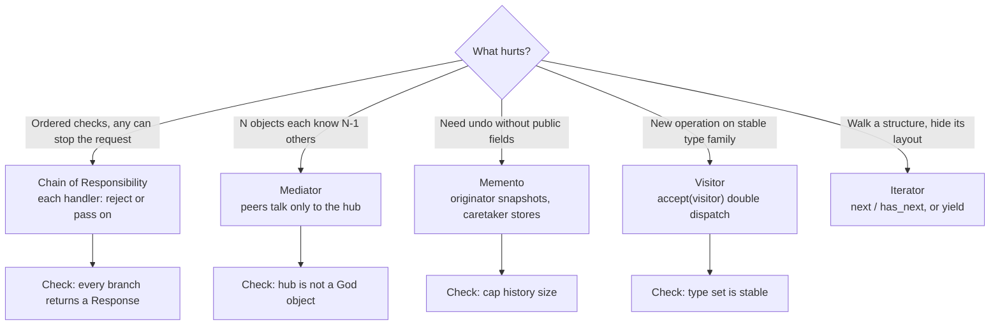

# Behavioral Patterns II — Chain of Responsibility, Iterator, Mediator, Memento, Visitor

> **Prerequisites:** [02 · OOP & UML](../02-oop-foundations-and-uml/README.md), [04 · SOLID](../04-solid-principles/README.md), [07 · Structural](../07-structural-patterns/README.md), [08 · Behavioral I](../08-behavioral-patterns-i/README.md)  
> **Reading time:** ~35 minutes (plus ~10 to run the demos)  
> **Audience:** LLD rounds — middleware pipelines, undo/redo, tree walks, and "who talks to whom" designs

> [!NOTE]
> **In one line:** These five patterns control *traffic between objects* — **Chain of Responsibility** passes a request along gatekeepers who may stop it, **Iterator** walks a collection without exposing its guts, **Mediator** puts one hub between peers, **Memento** snapshots state for undo, **Visitor** adds operations to a class family without editing the classes.

> [!TIP]
> **Golden rule:** Name the *pain* before the pattern. Ordered checks that can stop a request → Chain. Peers all holding references to each other → Mediator. Undo → Memento. New operation over a fixed set of types → Visitor. Pattern-first answers sound memorized; pain-first answers sound like engineering.

> [!TIP]
> **Try it:** Sketch the Chain and the Mediator side by side in [LLD Studio](/tools/lld-studio/) (one is a line, the other is a star), then run the Python examples below.

---

## 1. Interview pressure

Typical prompts that hide these patterns:

- *"Requests go through auth, rate limit, validation, then the handler. Any step can reject."* → **Chain of Responsibility**
- *"Design undo/redo for a text editor."* → **Memento** (or Command from [08](../08-behavioral-patterns-i/README.md) — know when each fits)
- *"Chat room / air traffic control / smart-home hub where 20 components all talk to each other."* → **Mediator**
- *"Compute tax, export to JSON, and render HTML for a heterogeneous cart — without adding three methods to every item class."* → **Visitor**
- *"Paginate through 10 million rows without loading them."* → **Iterator**

**The smell they are listening for:** a class that knows too many peers, or a `switch(item.type)` repeated in every new feature. Say the smell out loud, then the pattern.



---

## 2. Quick comparison

| Pattern | Pain it removes | Who drives? | Production cue |
| :--- | :--- | :--- | :--- |
| **Chain of Responsibility** | Sender hard-wired to one receiver; pile of `if` gates | Request travels; each link decides stop or forward | ASP.NET / Express middleware, approval workflows |
| **Iterator** | Callers depend on array/tree/DB layout | Caller pulls next element | Pagination cursors, tree traversal, generators |
| **Mediator** | Peers reference each other (N² edges) | Hub routes every message | Chat rooms, MediatR, form widgets, ATC |
| **Memento** | Undo needs private state | Caretaker stores opaque snapshots | Editor undo, "restore draft", transaction savepoints |
| **Visitor** | New operation means editing every class | Element calls `visitor.visit(this)` | AST compilers, tax over mixed cart, report export |

### Chain vs Decorator (they look alike on a slide)

```text
Decorator   EVERY layer runs. Adds behavior (log, gzip, cache).
Chain       ANY layer may STOP the request. Gatekeeping (auth, rate limit).
```

If a layer can say "no, stop here," it is a Chain. If every layer must run around the call, it is a Decorator.

### Memento vs Command (for undo)

| | Memento | Command |
| :--- | :--- | :--- |
| Stores | A snapshot of state | The operation + its inverse |
| Cost | Memory grows with state size | Needs a correct `undo()` per command |
| Best when | State is small or hard to invert (document text) | Operations are easy to reverse (reserve seat / release seat) |

---

## 3. Walkthrough — requirements → entities → methods

Two mini-problems, one pass each.

### A. Request pipeline (Chain)

**Requirements**

1. Every request must be authenticated, rate limited, then routed.
2. Any step can reject with a specific status code.
3. Adding a step (say, IP allow-list) must not edit existing steps.

**Entities**

| Noun | Role |
| :--- | :--- |
| `Request` | Input data (path, token, client IP) |
| `Response` | Always returned — never `void` |
| `Handler` | One link; knows `next` |
| `AuthHandler`, `RateLimitHandler`, `RouteHandler` | Concrete links |

**Methods**

| Method | Contract |
| :--- | :--- |
| `Handler.set_next(h) -> Handler` | Returns `h` so you can chain `a.set_next(b).set_next(c)` |
| `Handler.handle(req) -> Response` | Template: run `check`; if it rejects, return that response; else forward |
| `Handler.check(req) -> Response \| None` | Subclass hook: `None` means "I'm fine, continue" |

> The key design choice: `handle` returns a `Response` on **every** path. Making it impossible to fall off the end is what prevents the silent-hang bug in section 6.

### B. Editor undo (Memento)

**Requirements:** type text, undo the last N edits, never expose the editor's internal fields.

**Entities:** `Editor` (originator), `Snapshot` (memento, opaque), `History` (caretaker, bounded stack).

**Methods:** `editor.save() -> Snapshot`, `editor.restore(snapshot)`, `history.push(snapshot)`, `history.pop() -> Snapshot | None`.

---

## 4. Code — Chain + Memento

````carousel
```python
from __future__ import annotations

import threading
from abc import ABC, abstractmethod
from collections import deque
from dataclasses import dataclass
from typing import Optional


# ── Chain of Responsibility ──────────────────────────────────────────
@dataclass
class Request:
    path: str
    token: Optional[str] = None
    client_ip: str = "0.0.0.0"


@dataclass(frozen=True)
class Response:
    status: int
    body: str = ""


class Handler(ABC):
    def __init__(self) -> None:
        self._next: Optional[Handler] = None

    def set_next(self, nxt: Handler) -> Handler:
        self._next = nxt
        return nxt  # lets you write a.set_next(b).set_next(c)

    def handle(self, req: Request) -> Response:
        rejection = self.check(req)
        if rejection is not None:
            return rejection  # short-circuit: the rest of the chain never runs
        if self._next is None:
            return Response(500, "chain ended without a terminal handler")
        return self._next.handle(req)

    @abstractmethod
    def check(self, req: Request) -> Optional[Response]:
        """Return a Response to stop the chain, or None to continue."""


class AuthHandler(Handler):
    def check(self, req: Request) -> Optional[Response]:
        if req.token != "secret-token":
            return Response(401, "unauthorized")
        return None


class RateLimitHandler(Handler):
    """Toy per-IP counter. Real limiters (token bucket etc.) live in module 18."""

    def __init__(self, max_requests: int) -> None:
        super().__init__()
        self._max = max_requests
        self._hits: dict[str, int] = {}
        self._lock = threading.Lock()      # handlers are shared across request threads

    def check(self, req: Request) -> Optional[Response]:
        with self._lock:                   # read-modify-write must be atomic
            n = self._hits.get(req.client_ip, 0) + 1
            self._hits[req.client_ip] = n
        if n > self._max:
            return Response(429, "too many requests")  # explicit reject, never fall through
        return None


class RouteHandler(Handler):
    def check(self, req: Request) -> Optional[Response]:
        return None

    def handle(self, req: Request) -> Response:  # terminal link
        return Response(200, f"served {req.path}")


# ── Memento ──────────────────────────────────────────────────────────
@dataclass(frozen=True)
class _Snapshot:
    """Opaque to the caretaker. (Python can't truly hide it; convention + underscore.)"""
    text: str


class Editor:
    def __init__(self) -> None:
        self._text = ""

    def type(self, s: str) -> None:
        self._text += s

    @property
    def text(self) -> str:
        return self._text

    def save(self) -> _Snapshot:
        return _Snapshot(self._text)

    def restore(self, snap: _Snapshot) -> None:
        self._text = snap.text


class History:
    def __init__(self, limit: int = 50) -> None:
        self._stack: deque[_Snapshot] = deque(maxlen=limit)  # oldest dropped automatically

    def push(self, snap: _Snapshot) -> None:
        self._stack.append(snap)

    def pop(self) -> Optional[_Snapshot]:
        return self._stack.pop() if self._stack else None


if __name__ == "__main__":
    auth = AuthHandler()
    auth.set_next(RateLimitHandler(max_requests=2)).set_next(RouteHandler())

    print(auth.handle(Request("/orders", token="bad")))                    # 401
    print(auth.handle(Request("/orders", token="secret-token")))           # 200
    print(auth.handle(Request("/orders", token="secret-token")))           # 200
    print(auth.handle(Request("/orders", token="secret-token")))           # 429

    ed, hist = Editor(), History(limit=3)
    for chunk in ["Hello", ", ", "world"]:
        hist.push(ed.save())       # snapshot BEFORE the edit
        ed.type(chunk)
    print(ed.text)                 # Hello, world
    ed.restore(hist.pop())         # undo "world"
    print(ed.text)                 # Hello,
```
<!-- slide -->
```csharp
using System;
using System.Collections.Generic;

// ── Chain of Responsibility ──────────────────────────────────────────
public sealed record Request(string Path, string? Token, string ClientIp);
public sealed record Response(int Status, string Body = "");

public abstract class Handler
{
    private Handler? _next;

    public Handler SetNext(Handler next) => _next = next;

    public virtual Response Handle(Request req)
    {
        var rejection = Check(req);
        if (rejection is not null) return rejection;   // short-circuit
        return _next?.Handle(req) ?? new Response(500, "chain ended without a terminal handler");
    }

    protected abstract Response? Check(Request req);   // null = continue
}

public sealed class AuthHandler : Handler
{
    protected override Response? Check(Request req) =>
        req.Token == "secret-token" ? null : new Response(401, "unauthorized");
}

public sealed class RateLimitHandler : Handler
{
    private readonly int _max;
    private readonly Dictionary<string, int> _hits = new();
    private readonly object _gate = new();

    public RateLimitHandler(int max) => _max = max;

    protected override Response? Check(Request req)
    {
        lock (_gate)   // handlers are shared across request threads
        {
            _hits[req.ClientIp] = _hits.GetValueOrDefault(req.ClientIp) + 1;
            return _hits[req.ClientIp] > _max ? new Response(429, "too many requests") : null;
        }
    }
}

public sealed class RouteHandler : Handler
{
    protected override Response? Check(Request req) => null;
    public override Response Handle(Request req) => new(200, $"served {req.Path}");
}

// ── Memento ──────────────────────────────────────────────────────────
public interface IMemento { }   // the narrow interface the caretaker sees

public sealed class Editor
{
    private sealed record Snapshot(string Text) : IMemento;   // private: only Editor can read it
    private string _text = "";

    public string Text => _text;
    public void Type(string s) => _text += s;
    public IMemento Save() => new Snapshot(_text);

    public void Restore(IMemento m)
    {
        if (m is not Snapshot s) throw new ArgumentException("memento is not from this editor");
        _text = s.Text;
    }
}

public sealed class History
{
    private readonly LinkedList<IMemento> _stack = new();
    private readonly int _limit;
    public History(int limit = 50) => _limit = limit;

    public void Push(IMemento m)
    {
        _stack.AddLast(m);
        if (_stack.Count > _limit) _stack.RemoveFirst();   // bounded memory
    }

    public IMemento? Pop()
    {
        if (_stack.Count == 0) return null;
        var last = _stack.Last!.Value;
        _stack.RemoveLast();
        return last;
    }
}
```
````

**Why this is OCP-friendly:** an IP allow-list is one new `Handler` subclass and one extra `set_next` call. No existing handler changes.

**Why the C# Memento is stronger than Python's:** a private nested record means the caretaker physically cannot read the text. That is the "narrow interface" the textbook talks about.

---

## 5. Code — Iterator, Mediator, Visitor

````carousel
```python
from __future__ import annotations

from dataclasses import dataclass
from typing import Callable, Iterator, Optional, Protocol


# ── Iterator: a generator IS the pattern in Python ───────────────────
@dataclass
class Page:
    items: list[str]
    next_cursor: Optional[str]


def iter_orders(fetch_page: Callable[[Optional[str]], Page]) -> Iterator[str]:
    cursor: Optional[str] = None
    while True:
        page = fetch_page(cursor)       # network call happens lazily, one page at a time
        yield from page.items
        if page.next_cursor is None:
            return
        cursor = page.next_cursor


# ── Mediator: peers only know the room ───────────────────────────────
class ChatRoom:
    def __init__(self) -> None:
        self._users: dict[str, "User"] = {}

    def join(self, user: "User") -> None:
        self._users[user.name] = user
        user.room = self

    def leave(self, user: "User") -> None:
        self._users.pop(user.name, None)       # peers can leave; never keep a dead reference
        user.room = None

    def send(self, sender: "User", text: str, to: Optional[str] = None) -> None:
        if to is not None:
            target = self._users.get(to)
            if target is None:
                raise LookupError(f"no such user in room: {to}")   # explicit, not a bare KeyError
            targets = [target]
        else:
            targets = [u for u in list(self._users.values()) if u is not sender]  # copy: safe if someone leaves mid-send
        for u in targets:
            u.receive(sender.name, text)


class User:
    def __init__(self, name: str) -> None:
        self.name = name
        self.room: Optional[ChatRoom] = None
        self.inbox: list[str] = []

    def say(self, text: str, to: Optional[str] = None) -> None:
        assert self.room is not None
        self.room.send(self, text, to)

    def receive(self, sender: str, text: str) -> None:
        self.inbox.append(f"{sender}: {text}")


# ── Visitor: new operations, same item classes ───────────────────────
class CartVisitor(Protocol):
    def visit_physical(self, item: "PhysicalItem") -> int: ...
    def visit_subscription(self, item: "Subscription") -> int: ...


@dataclass(frozen=True)
class PhysicalItem:
    sku: str
    price_cents: int

    def accept(self, v: CartVisitor) -> int:
        return v.visit_physical(self)   # double dispatch: item picks the overload


@dataclass(frozen=True)
class Subscription:
    plan: str
    monthly_cents: int

    def accept(self, v: CartVisitor) -> int:
        return v.visit_subscription(self)


class TaxVisitor:
    def visit_physical(self, item: PhysicalItem) -> int:
        return item.price_cents * 8 // 100

    def visit_subscription(self, item: Subscription) -> int:
        return item.monthly_cents * 2 // 100


if __name__ == "__main__":
    pages = {None: Page(["o1", "o2"], "c2"), "c2": Page(["o3"], None)}
    print(list(iter_orders(lambda c: pages[c])))        # ['o1', 'o2', 'o3']

    room = ChatRoom()
    a, b, c = User("asha"), User("bo"), User("cy")
    for u in (a, b, c):
        room.join(u)
    a.say("hi all")
    b.say("psst", to="cy")
    print(b.inbox, c.inbox)  # ['asha: hi all'] ['asha: hi all', 'bo: psst']
    try:
        a.say("anyone?", to="ghost")
    except LookupError as exc:
        print(exc)           # no such user in room: ghost

    cart = [PhysicalItem("book", 10_000), Subscription("pro", 5_000)]
    tax = sum(item.accept(TaxVisitor()) for item in cart)
    print(tax)                                          # 800 + 100 = 900
```
<!-- slide -->
```csharp
using System;
using System.Collections.Generic;
using System.Linq;

// ── Iterator: yield return builds the state machine for you ──────────
public sealed record Page(IReadOnlyList<string> Items, string? NextCursor);

public static class Orders
{
    public static IEnumerable<string> Iterate(Func<string?, Page> fetchPage)
    {
        string? cursor = null;
        while (true)
        {
            var page = fetchPage(cursor);          // lazy: runs as the caller pulls
            foreach (var item in page.Items) yield return item;
            if (page.NextCursor is null) yield break;
            cursor = page.NextCursor;
        }
    }
}

// ── Mediator ─────────────────────────────────────────────────────────
public sealed class ChatRoom
{
    private readonly Dictionary<string, User> _users = new();

    public void Join(User u) { _users[u.Name] = u; u.Room = this; }

    public void Send(User sender, string text, string? to = null)
    {
        var targets = to is null
            ? _users.Values.Where(u => u != sender)
            : new[] { _users[to] };
        foreach (var u in targets) u.Receive(sender.Name, text);
    }
}

public sealed class User
{
    public string Name { get; }
    public ChatRoom? Room { get; set; }
    public List<string> Inbox { get; } = new();

    public User(string name) => Name = name;
    public void Say(string text, string? to = null) => Room!.Send(this, text, to);
    public void Receive(string from, string text) => Inbox.Add($"{from}: {text}");
}

// ── Visitor ──────────────────────────────────────────────────────────
public interface ICartVisitor<T>
{
    T Visit(PhysicalItem item);
    T Visit(Subscription item);
}

public interface ICartItem { T Accept<T>(ICartVisitor<T> v); }

public sealed record PhysicalItem(string Sku, long PriceCents) : ICartItem
{
    public T Accept<T>(ICartVisitor<T> v) => v.Visit(this);   // 'this' is statically PhysicalItem
}

public sealed record Subscription(string Plan, long MonthlyCents) : ICartItem
{
    public T Accept<T>(ICartVisitor<T> v) => v.Visit(this);   // 'this' is statically Subscription
}

public sealed class TaxVisitor : ICartVisitor<long>
{
    public long Visit(PhysicalItem i) => i.PriceCents * 8 / 100;
    public long Visit(Subscription s) => s.MonthlyCents * 2 / 100;
}

// usage: long tax = cart.Sum(item => item.Accept(new TaxVisitor()));
```
````

**Interview line for Visitor:** *"The item classes stay frozen. Each new operation — tax, JSON export, shipping weight — is one new visitor class. The price: adding a new item type forces me to touch every visitor, so I only use Visitor when the item types are stable."*

---

## 6. War story (short)

A gateway rolled out an IP rate limiter as a Chain link. On "limit exceeded" the handler **logged and returned** — it neither forwarded nor wrote a 429. Sockets hung until the 60-second client timeout; in four minutes the worker pool (2,000 threads) was exhausted and *every* endpoint went dark.

**Fixes:**

1. Handlers return a `Response` on every path (compiler enforces it) — exactly why `check()` returns `Response | None` and `handle()` never returns `void`.
2. Hard server-side timeouts at the edge (e.g., 15 s) so one bad handler cannot hold threads hostage.

---

## 7. Edges — and when not to use these

| Pattern | Edge / failure mode | Skip it when |
| :--- | :--- | :--- |
| **Chain** | Order bugs (auth after business logic); silent fall-through; deep chains hard to debug | There are two fixed checks → just call them in sequence |
| **Iterator** | Mutating the collection mid-iteration; leaking DB cursors; lazy iterators holding connections open | The collection is a plain list → use the language's `for` |
| **Mediator** | Hub grows into a God object holding all the business rules | Two objects talk to each other → a direct call is simpler |
| **Memento** | Snapshot of a huge object per keystroke → memory blow-up | Inverse operation is trivial → use Command with `undo` |
| **Visitor** | Adding a new element type breaks every visitor; breaks encapsulation if visitors need private fields | Types change often → polymorphic methods or pattern-matching `switch` |

**Memento memory tip:** cap history (`deque(maxlen=N)`), or store diffs instead of full copies, or snapshot only on "meaningful" boundaries (word end, pause) not on every key.

**Iterator concurrency tip:** C# `foreach` over a `List<T>` that another thread modifies throws `InvalidOperationException`. Iterate a snapshot copy, or use a concurrent collection.

**Chain concurrency tip:** handlers are shared across request threads. Keep them stateless, or guard shared counters with a lock (see [10 · Concurrency-Safe Design](../10-concurrency-safe-design/README.md)).

---

## 8. What you'd say in two minutes

> "I'd start with what hurts. Requests need auth, rate limiting, validation, then the handler, and any step can reject — that's Chain of Responsibility. Each link either returns a response or forwards, and I make `handle` return a `Response` on every path so a link can't silently fall off the end. If I'd said Decorator, every layer would have to run; here, auth failure must stop everything.
>
> For undo in an editor, I'd use Memento: the editor snapshots itself, a bounded history stores opaque tokens, and the editor alone knows how to restore. If operations are cheap to invert, I'd choose Command instead — I'd say that trade-off out loud.
>
> If twenty components talk to each other, I'd put a Mediator in the middle so each only knows the hub — but I'd keep business rules out of the hub so it doesn't become a God object. And for a stable family of types with growing operations, Visitor; if the types change often I'd skip it."

---

## 9. Anti-patterns

1. **Chain link that neither responds nor forwards** — the hang above. Return something on every path.
2. **Chain that always runs everything** — that's a Decorator pipeline; don't pretend it gatekeeps.
3. **God Mediator** — the hub holds validation, pricing, and persistence. Hub routes; domain objects decide.
4. **Memento with a public getter** — the caretaker peeks inside and starts mutating. Keep snapshots opaque.
5. **Unbounded undo history** — 10,000 full document copies is a memory leak with a nice name.
6. **Visitor on an unstable type family** — every new element type edits N visitors. Use polymorphism instead.
7. **Hand-rolled Iterator in Python/C#** — use `yield`; writing `has_next/next` by hand is ceremony for ceremony's sake.

---

## 10. Interview questions

<details>
<summary><strong>1. Chain of Responsibility vs Decorator? [BASIC]</strong></summary>

Decorator: every layer runs, adding behavior around the call. Chain: each link may *stop* the request (reject, handle, or pass on). If a layer can short-circuit, it's a Chain.

</details>

<details>
<summary><strong>2. What does Memento protect that "just copy the fields" doesn't? [BASIC]</strong></summary>

Encapsulation. The originator creates and reads the snapshot; the caretaker only stores and returns it. Outsiders never depend on private layout, so you can change the internals without breaking undo.

</details>

<details>
<summary><strong>3. When is Mediator better than Observer? [BASIC]</strong></summary>

Observer is one-to-many broadcast; peers still reference subjects. Mediator is many-to-many coordination where the hub *decides* who gets what. Use Mediator when peers shouldn't know about each other and routing rules exist (chat DMs, ATC).

</details>

<details>
<summary><strong>4. Add an IP allow-list to the pipeline without touching existing code. [SCENARIO]</strong></summary>

New `AllowListHandler` extending `Handler`, wired in at composition time (`auth.set_next(allow).set_next(rate)...`). Order matters — put it before expensive checks so cheap rejections happen first.

</details>

<details>
<summary><strong>5. Design undo/redo for a drawing app with a 50 MB canvas. [SCENARIO]</strong></summary>

Not full-canvas Mementos. Use Command with inverse ops for shape edits, or store diffs/tiles per change. Keep a bounded undo stack plus a redo stack that is cleared on any new edit. Mention the memory vs complexity trade-off.

</details>

<details>
<summary><strong>6. Page through 10M rows without loading them all. [SCENARIO]</strong></summary>

Iterator over a cursor/keyset: `fetch_page(cursor)` returns items + next cursor; the generator yields lazily. Prefer keyset (`WHERE id > last_id`) over `OFFSET`, which slows down as offset grows. Make sure the iterator closes its connection when abandoned.

</details>

<details>
<summary><strong>7. Why does Visitor need `accept()`? Why not call `visitor.visit(item)` directly? [TRICKY]</strong></summary>

Overload resolution on the argument uses the *static* type in C#/Java. With `ICartItem item = new PhysicalItem(...)`, `visitor.Visit(item)` can't pick `Visit(PhysicalItem)`. `item.Accept(visitor)` runs the virtual method on the concrete type, where `this` has the concrete static type, so the right overload binds. That's double dispatch. (Python picks by name, so you emulate it by calling `visit_physical` etc.)

</details>

<details>
<summary><strong>8. Your chain works but 1 in 1,000 requests hangs. Where do you look? [TRICKY]</strong></summary>

A link that has a branch with no return and no `next` call — typically an error or "log and continue" path. Also check swallowed exceptions inside a link and missing server-side timeouts. Fix by making the handler signature return a result type on every path and adding a catch-all in the pipeline runner that converts exceptions into a 500.

</details>

---

## 11. Try it

1. In [LLD Studio](/tools/lld-studio/), draw `Handler → Handler → Handler` (Chain) and a hub with five spokes (Mediator). Say aloud which one has a *direction of travel* and which has a *center*.
2. Extend the Python chain with a `ValidationHandler` that rejects empty paths with `400`. Confirm no other class changes.
3. Add `redo` to `History` using a second stack; clear it whenever the user types.
4. Write a `JsonExportVisitor` for the cart. Count how many existing classes you edited (target: zero).

---

## 12. One-page cheat sheet

```text
Chain      Link: check() -> Response|None. Any link can STOP. Return on EVERY path.
Iterator   Hide layout. Python/C#: yield. Prefer keyset cursors over OFFSET.
Mediator   Hub routes, peers don't know peers. Keep rules out of the hub.
Memento    Originator snapshots, caretaker stores opaque. Cap history size.
Visitor    accept(v) -> v.visit(this). Stable types, growing operations.

Chain  != Decorator  (stop vs always-run)
Memento vs Command   (snapshot vs inverse op)
Mediator vs Observer (hub decides vs broadcast)

Say aloud: "What hurts — gates, peers, undo, or a new operation?"
```

---

## Next

**[10 · Concurrency-Safe Design](../10-concurrency-safe-design/README.md)** — races, deadlocks, atomics, and thread-safe structures.
